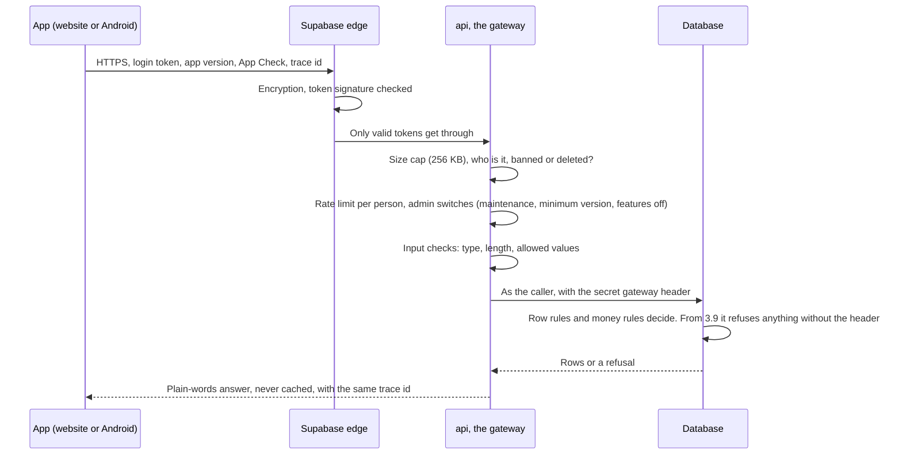
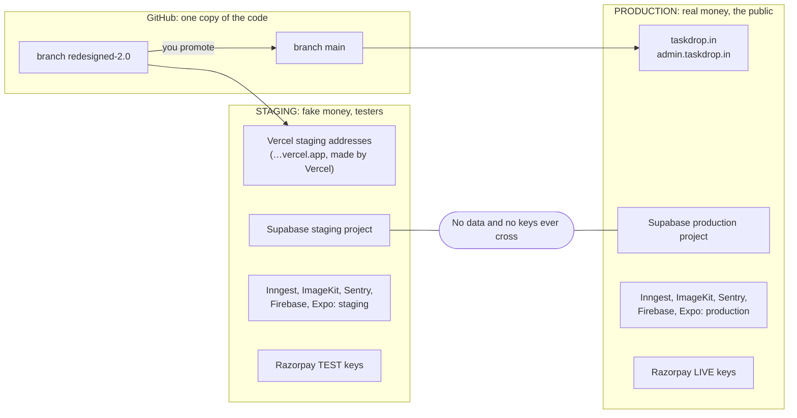
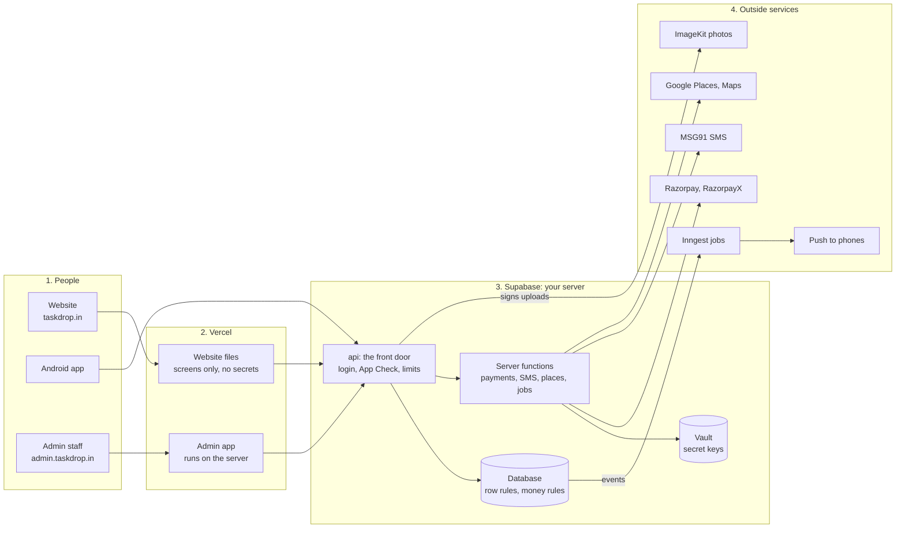
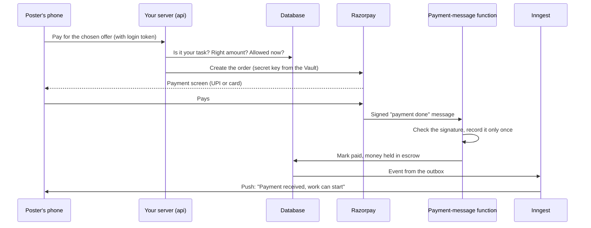

# TaskDrop: the ultimate plan

**This is the only plan you need.** It is in order. Do the steps from top to bottom, click a task to open its steps, and tick it when it is done.

The clickable version is `docs/ULTIMATE_PLAN.html`. Open it in Chrome. Your ticks are saved there.

Rethought on 30 October 2026. What changed: the steps now follow the order a product owner would choose (fix what is broken, make it hacker-proof, prove it with testers, get ready to market, build production, launch, grow). Every slow task that waits on other people sits in one "Start now" track. Future ideas sit in a separate **Future scope** section, so they never count against your progress. The accounts for staging and production are drawn as two maps. Security and marketing each have their own section. The previous version is kept unchanged in `docs/archive/2026-10-30-before-rethink/`.

Checked against best practice on 31 October 2026 (see the changelog). New: 2-step sign-in on your accounts (2.1b), money safety limits (2.11), the marketplace numbers (3.3b), a dispute and safety policy (4.9), backups you control and a real restore practice, a production that is safe from its first minute, releases in small slices, and an earlier start for the 14-day tester clock (Gate 2 is now two gates, 2a and 2b). Vercel security check (31 October): a table of what Vercel secures and what stays yours, holes H18 and H19, and a new task 5.8b (spending stop, firewall rule, preview safety). Advice from a WhatsApp group (3 November): a new task 2.13 (a lock and a limit on every server door, a code scanner, the OWASP checklist line by line, a way for security researchers to report, a spending stop on every paid service; then your three rules: one person never reaches another's data, every document private, sign-in sessions that can be ended), holes H22 to H28, and decisions 14 to 16. A second paste the same day (rate limits, a real sign-in provider, row rules, keys on the server, caching, background jobs, a load test) was checked too: it added part J (a load and abuse test, plus a check of slow work and caching) and hole H29. Made simpler on 4 November: the Security section now opens with "Security in one page", 12 plain checks (with Matt Palmer's checklist, the Betterleaks secrets audit and Strix folded in); the long tables sit in cards below it; Step 2 opens with the security path in order; and two tasks are new, 2.15 (the secrets audit) and 2.16 (the AI attacker).

---

## How to use this plan

**Every task has a tag:**

| Tag | Means |
|---|---|
| **You** | You do it yourself, in a browser or on your phone |
| **Claude** | You copy one sentence to Claude. Claude does the work and reports back in plain words |
| **Both** | Claude does part of it, you click the rest |
| **Later** | Future scope. Shown so nothing is forgotten, but it is not part of your progress |

**Every step inside a task is one of three kinds:**

- **CLICK**: you do it yourself.
- **SAY**: copy the text in the purple box into the Claude chat.
- **TELL**: write in the chat what you saw. A screenshot is fine.

**Eight rules:**

1. **Go in order.** Start the whole **Start now** track in week 1 as well. It is slow, so it runs beside Steps 1 to 4.
2. **Pass each gate.** A gate is a short checklist at the end of each step. Do not start the next step until every line is true.
3. **Never paste a password, key or secret into the chat.** Claude will never ask you for one.
4. **If a screen looks different** from the steps, stop and send Claude a screenshot. Websites rename their buttons.
5. **When you finish a task, tell Claude its number** (for example "done 2.1"), so Claude ticks it here as well.
6. **Claude pushes, opens the pull request and merges it without asking you** (your rule, 31 Oct). Merging is never a question for you. Claude still asks you first only before: publishing an app update to testers, wiping or resetting data, rotating a key, or touching `main` or production.
7. **After every new feature, check it fits the browser and the screen** (your rule, 1 Nov). Claude does not call a feature done until the website works in Chrome, Edge, Firefox and Safari (latest versions) at phone, tablet and laptop widths, and the Android app works on your phone: nothing cut off, no sideways scrolling, every button easy to reach and tap, text readable (also with bigger text and with the keyboard open). The steps are in the card "Fits every browser and screen".
8. **Secrets live only in the server-side env file** (your rule, 1 Nov). Every secret, new or old, is stored only in `.env.all-secrets` on your PC and in the server-side store that needs it (Supabase function secrets or Vault, Vercel Sensitive variables, Expo Secret variables). Claude never puts a secret in the app or website code, in a name that starts with `EXPO_PUBLIC_` or `NEXT_PUBLIC_`, in Git, in this plan, in a pull request or in chat, and never prints one. Only public values (the Supabase public key, the Sentry address, Firebase web settings) may sit in public names. The details are in task 2.1.

---

## Where you are today (30 October 2026)

**Already done**

- The app works on the website and on Android with fake money (checked "finished" on 2026-10-28).
- Staging safety is live: the "Staging" ribbon, the block on real payment keys, the site hidden from Google, the staging notice in Terms and Privacy.
- The app tour, the admin app with staff roles, Google sign-in, error alerts (Sentry), uptime monitors and GitHub secret scanning all work.
- Your 20-minute phone walkthrough (30 Oct): 11 fixes are merged into `redesigned-2.0` and published to the phone app (31 Oct, task 1.2).

**Not done yet**

- 4 phone problems from 28 Oct, about 8 small bugs, and 10 design changes you asked for. New on 31 Oct: content and alerts hidden behind the phone keyboard (task 1.8).
- Security: Claude's check on 30 Oct found real open holes (see the **Security** section). None can move money today, because staging has only fake money, but every one must be closed before real money.
- Google Play: 12 testers for 14 days have not started. (Google's ID check is done: verified 27 Oct, task S.1.)
- All the business paperwork for real money: company, bank, lawyer, payment approval, SMS registration.
- Production, the real-money copy of TaskDrop, does not exist yet.

**The three things that matter most right now**

1. **Start the slow track today** (S.1 and S.2). Google's ID check and the company paperwork take weeks, and launch cannot happen without them.
2. **Fix the bugs you can see** (Step 1), so testers judge a good app, not a broken one.
3. **Close the security holes** (Step 2) before anyone outside your circle uses the app.

**Your first week, in order**

| Day | Do this | Task |
|---|---|---|
| 1 | Start Google Play's ID check (done: Google verified your identity on 27 Oct) | S.1 |
| 1 | Book a meeting with a Chartered Accountant | S.2 |
| 1 | Answer the decisions (deferred to future scope on 1 Nov 2026) | 1.1 |
| 1 | Open the staging app on your phone twice and try the walkthrough fixes (done by Claude 31 Oct) | 1.2 |
| 2 | Set up and protect your secrets file | 2.1 |
| 2 | Turn on 2-step sign-in on your 8 most important accounts (deferred to future scope on 31 Oct 2026) | 2.1b |
| 2 | Ask Razorpay and Cashfree for quotes (one email) (sent 31 Oct, waiting for their call back) | S.4 |
| 3 | Name check and trademark search (1 hour) | S.5 |
| 3 to 7 | Approve the design drawings Claude sends; say "start key protection" | 1.5, 2.5 |

---

## The map

```map
 START NOW (week 1): the slow track. Runs beside Steps 1 to 4. All done before Step 5.
 S.1 Play ID check   S.2 company + bank   S.3 lawyer   S.4 payment quotes
 S.5 name + trademark   S.6 SMS registration   S.7 legal contacts   S.8 payment approval

 STEP 1          STEP 2            STEP 3            STEP 4            STEP 5             STEP 6            STEP 7
 Fix what is  -> Make it        -> Prove it with  -> Get ready to   -> Build           -> Launch one     -> Run and
 broken          hacker-proof      real testers      market            production         city              grow
 week 1          weeks 1-3         weeks 3-6         weeks 4-8         1-2 weeks          real money        every week
   GATE 1          GATE 2a, 2b       GATE 3            GATE 4            GATE 5             GATE 6

 FUTURE SCOPE (separate, not part of your progress): passkeys, iOS, second city, referrals, ads ...
```

**The two copies of TaskDrop**

| | Staging (now) | Production (from Step 5) |
|---|---|---|
| Money | Fake. Razorpay test mode | Real. Live Razorpay keys, real UPI and bank |
| Data | Fake. Test accounts Asha, Ravi, Meera and what testers create | Real customers. Starts empty |
| Who uses it | You and invited testers | The public |
| Sign-in code | Shown on screen. Any phone number works | Real SMS |
| Web address | The address Vercel makes: `taskdrop-git-redesigned-20-hitenduteam.vercel.app` (admin: `taskdrop-admin-git-redesigned-20-hitenduteam.vercel.app`). Staging has no name of its own, and `taskdrop.in` is never staging's | `taskdrop.in`, `www.taskdrop.in` and `admin.taskdrop.in` |
| Code branch | `redesigned-2.0` | `main` (you promote by hand) |
| Accounts | Today's account or project in every tool | Its own new account or project in every tool. Nothing is copied |
| Cost | Free plans. Google Play $25 once | About $45 a month plus fees |

---

## Your accounts map: which Gmail owns which tool

You use **two Google accounts**, plus one email alias. When Google shows an account chooser, check the colour below.

```html
<div class="fig">
<div class="fig-title">The logins you use</div>
<div class="logins">
<div class="am-owner g1"><span class="am-ic">1</span><div><b>hitendureacts@gmail.com</b><small>Chrome profile /u/2 · almost every tool, and the only login the admin website accepts</small></div></div>
<div class="am-owner g2"><span class="am-ic">2</span><div><b>narasimharaju7c@gmail.com</b><small>Chrome profile /u/0 · only Google Play Console</small></div></div>
<div class="am-owner g3"><span class="am-ic">+</span><div><b>hitendureacts+prod@gmail.com</b><small>not a new Gmail: the same inbox as login 1, used only where a tool needs a second account for production (ImageKit, maybe Inngest)</small></div></div>
<div class="am-owner gh"><span class="am-ic">GH</span><div><b>GitHub username hitendureacts77</b><small>the code, shared by both copies</small></div></div>
</div>
</div>
```

### Map 1: STAGING (the test copy, fake money)

```html
<div class="fig">
<div class="fig-title"><span class="pill stg">Staging</span> Fake money, fake data, testers only</div>
<div class="fig-sub">Web address: the ones Vercel makes, <code>taskdrop-git-redesigned-20-hitenduteam.vercel.app</code> and <code>taskdrop-admin-git-redesigned-20-hitenduteam.vercel.app</code> (no DNS records needed). <code>taskdrop.in</code> belongs to production, not staging; until task 5.10 the staging project still answers on it by leftover, and nothing new should rely on that. Built from branch <code>redesigned-2.0</code>. Names marked "today" get the ending <code>-staging</code> later (future scope F.12).</div>

<div class="am-band g1">
<div class="am-owner"><span class="am-ic">1</span><div><b>hitendureacts@gmail.com</b><small>Chrome profile /u/2 · owns every staging tool below</small></div></div>
<div class="am-cards">
<div class="am-card"><div class="am-tool">Vercel <span>hosts website + admin</span></div><dl><dt>Workspace</dt><dd>team <code>hitenduteam</code> (Hobby, free)<br><code>team_ZEyzabHJSWRmHgiiy8ZZ655y</code></dd><dt>Projects</dt><dd><code>taskdrop</code> and <code>taskdrop-admin</code> (today)</dd><dt>Project IDs</dt><dd><code>prj_4j5lBW5qhmpl1egxznEyAQK2RzkE</code><br><code>prj_AWdsUdG8vre4LLPYP1VEhsdldJqq</code></dd></dl></div>
<div class="am-card"><div class="am-tool">Supabase <span>database, sign-in, server</span></div><dl><dt>Workspace</dt><dd>organization "hitendureacts@gmail.com's Org" (Free)</dd><dt>Project</dt><dd><code>taskdrop</code> (today), Mumbai</dd><dt>Project ID</dt><dd><code>wjxvingpfbfvkfqhrguj</code> (never changes)</dd></dl></div>
<div class="am-card"><div class="am-tool">Firebase + Google Cloud <span>push, App Check, maps, Google sign-in</span></div><dl><dt>Workspace</dt><dd>organization <code>hitendureacts-org</code>; billing "My only billing account"</dd><dt>Project</dt><dd><b>Taskdrop</b> (today)</dd><dt>Project ID</dt><dd><code>project-a19d1da9-6903-4168-905</code><br>number <code>629108039430</code></dd><dt>Budget</dt><dd><code>taskdrop-monthly-100</code> (₹100)</dd></dl></div>
<div class="am-card"><div class="am-tool">Expo (EAS) <span>Android builds + updates</span></div><dl><dt>Workspace</dt><dd>account <code>hitendureacts</code></dd><dt>Project</dt><dd><code>@hitendureacts/taskdrop</code> (today)</dd><dt>Project ID</dt><dd><code>08aa002b-4eea-4952-a62a-ec9245e77953</code></dd><dt>Channel</dt><dd><code>beta</code></dd></dl></div>
<div class="am-card"><div class="am-tool">Sentry <span>error alerts</span></div><dl><dt>Workspace</dt><dd>organization <code>hitendu</code></dd><dt>Projects</dt><dd><code>taskdrop</code> (app + server), <code>taskdrop-admin</code> (today)</dd></dl></div>
<div class="am-card"><div class="am-tool">PostHog <span>funnels, task 3.3c</span></div><dl><dt>Account</dt><dd><b>hitendureacts@gmail.com</b> (not made yet)</dd><dt>Project</dt><dd><code>taskdrop-staging</code>, EU cloud</dd></dl></div>
<div class="am-card"><div class="am-tool">Inngest <span>background jobs</span></div><dl><dt>Workspace</dt><dd>organization <code>taskdrop</code> (today)</dd><dt>Plan</dt><dd>Hobby (free)</dd></dl></div>
<div class="am-card"><div class="am-tool">ImageKit <span>photos</span></div><dl><dt>Account</dt><dd>"Hitendu"</dd><dt>ImageKit ID</dt><dd>not written down yet (Claude reads it in task 2.3)</dd></dl></div>
<div class="am-card"><div class="am-tool">Razorpay <span>payments</span></div><dl><dt>Account</dt><dd>your business account</dd><dt>Mode</dt><dd><b>Test mode</b> only</dd></dl></div>
<div class="am-card"><div class="am-tool">Uptime Robot <span>"site is down" emails</span></div><dl><dt>Monitors</dt><dd>website and admin (renamed "staging website", "staging admin" in 5.11)</dd></dl></div>
<div class="am-card shared"><div class="am-tool">Spaceship <span>owns taskdrop.in</span></div><dl><dt>Domain</dt><dd><code>taskdrop.in</code>, one domain for both copies</dd><dt>Staging names</dt><dd>none. Staging uses the addresses Vercel makes</dd></dl></div>
<div class="am-card"><div class="am-tool">Admin website <span>run TaskDrop</span></div><dl><dt>Address</dt><dd><code>taskdrop-admin-git-redesigned-20-hitenduteam.vercel.app</code> (stays; Vercel makes it)</dd><dt>Who signs in</dt><dd>only this Gmail. Dummy staff Priya, Kiran, Neha</dd></dl></div>
<div class="am-card shared new"><div class="am-tool">.env.all-secrets <span>secrets file on your PC</span></div><dl><dt>Status</dt><dd>protected in task 2.1</dd><dt>Holds</dt><dd>every login, key, recovery code, account detail and the keystore passwords, staging and production. It is the only copy: there is no password manager (one-file rule)</dd></dl></div>
</div>
</div>

<div class="am-band g2">
<div class="am-owner"><span class="am-ic">2</span><div><b>narasimharaju7c@gmail.com</b><small>Chrome profile /u/0 · Google Play only</small></div></div>
<div class="am-cards">
<div class="am-card shared"><div class="am-tool">Google Play Console <span>Android store</span></div><dl><dt>Workspace</dt><dd>Personal developer account <b>NLNarasimhaRaju</b></dd><dt>App</dt><dd><code>com.taskdrop.app</code>, made in task 3.1</dd><dt>Staging uses</dt><dd>the Internal and Closed <b>testing</b> tracks only</dd></dl></div>
</div>
</div>

<div class="am-band gh">
<div class="am-owner"><span class="am-ic">GH</span><div><b>GitHub: hitendureacts77</b><small>the code, the same for both copies</small></div></div>
<div class="am-cards">
<div class="am-card shared"><div class="am-tool">GitHub <span>code + checks</span></div><dl><dt>Repositories</dt><dd><code>taskdrop</code>, <code>taskdrop-admin</code></dd><dt>Staging branch</dt><dd><code>redesigned-2.0</code></dd></dl></div>
</div>
</div>
<div class="am-legend"><span>Solid box: belongs to staging only</span><span>Dashed box: one account used by both copies</span></div>
</div>
```

### Map 2: PRODUCTION (the real copy, real money)

Everything here is **new and separate** and is made in Step 5. Nothing is copied from staging. The IDs are written in here as each one is made.

```html
<div class="fig">
<div class="fig-title"><span class="pill prd">Production</span> Real money, real customers</div>
<div class="fig-sub">Web address <code>taskdrop.in</code>, <code>www.taskdrop.in</code> and <code>admin.taskdrop.in</code>. Built from branch <code>main</code>, which only you merge into. Green dashed box = a new account or project you create.</div>

<div class="am-band g1">
<div class="am-owner"><span class="am-ic">1</span><div><b>hitendureacts@gmail.com</b><small>Chrome profile /u/2 · owns almost every production tool, as new projects</small></div></div>
<div class="am-cards">
<div class="am-card new"><div class="am-tool">Vercel <span>task 5.8</span></div><dl><dt>Workspace</dt><dd>same team <code>hitenduteam</code>, upgraded to <b>Pro</b> ($20/month)</dd><dt>Projects</dt><dd><code>taskdrop-production</code>, <code>taskdrop-admin-production</code></dd><dt>Project IDs</dt><dd>written here after 5.8</dd></dl></div>
<div class="am-card new"><div class="am-tool">Supabase <span>task 5.2</span></div><dl><dt>Workspace</dt><dd><b>new</b> organization "TaskDrop Production" (Pro, $25/month, spend cap on)</dd><dt>Project</dt><dd><code>taskdrop-production</code>, Mumbai</dd><dt>Project ID</dt><dd>written here after 5.2</dd></dl></div>
<div class="am-card new"><div class="am-tool">Firebase + Google Cloud <span>task 5.3</span></div><dl><dt>Workspace</dt><dd>same organization <code>hitendureacts-org</code>, same billing account</dd><dt>Project</dt><dd><code>taskdrop-production</code></dd><dt>Budget</dt><dd><code>taskdrop-production-monthly</code> (₹1,000, alerts 50/90/100%)</dd><dt>Keys</dt><dd><code>taskdrop-production-android-maps</code>, <code>taskdrop-production-server-places</code></dd></dl></div>
<div class="am-card new"><div class="am-tool">Expo (EAS) <span>task 5.7</span></div><dl><dt>Workspace</dt><dd>same account <code>hitendureacts</code></dd><dt>Project</dt><dd><code>@hitendureacts/taskdrop-production</code></dd><dt>Channel</dt><dd><code>production</code>. Never a debug token</dd></dl></div>
<div class="am-card new"><div class="am-tool">Sentry <span>task 5.6</span></div><dl><dt>Workspace</dt><dd>same organization <code>hitendu</code></dd><dt>Projects</dt><dd><code>taskdrop-production</code>, <code>taskdrop-admin-production</code></dd></dl></div>
<div class="am-card new"><div class="am-tool">PostHog <span>task 5.6b</span></div><dl><dt>Account</dt><dd>same organization, <b>hitendureacts@gmail.com</b></dd><dt>Project</dt><dd><code>taskdrop-production</code>, EU cloud, its own Project API key</dd></dl></div>
<div class="am-card new"><div class="am-tool">Inngest <span>task 5.4</span></div><dl><dt>Workspace</dt><dd><b>new</b> organization "TaskDrop Production", paid plan</dd><dt>If refused</dt><dd>a second account with <code>hitendureacts+prod@gmail.com</code></dd></dl></div>
<div class="am-card shared"><div class="am-tool">Razorpay + RazorpayX <span>task 6.1</span></div><dl><dt>Account</dt><dd>the same business account</dd><dt>Mode</dt><dd><b>Live mode</b>. Razorpay keeps test and live data apart</dd></dl></div>
<div class="am-card new"><div class="am-tool">MSG91 <span>task S.6</span></div><dl><dt>Account</dt><dd>new, made in S.6</dd><dt>Sender</dt><dd>DLT header such as <code>TSKDRP</code>; production only</dd></dl></div>
<div class="am-card new"><div class="am-tool">Uptime Robot <span>task 5.11</span></div><dl><dt>Monitors</dt><dd>"production website", "production admin", "production server"</dd></dl></div>
<div class="am-card shared"><div class="am-tool">Spaceship <span>task 5.10</span></div><dl><dt>Domain</dt><dd><code>taskdrop.in</code></dd><dt>Production names</dt><dd><code>taskdrop.in</code>, <code>www</code>, <code>admin</code></dd></dl></div>
<div class="am-card new"><div class="am-tool">Admin website <span>task 5.9</span></div><dl><dt>Address</dt><dd><code>admin.taskdrop.in</code></dd><dt>Who signs in</dt><dd>only this Gmail. Starts with no staff</dd></dl></div>
<div class="am-card shared"><div class="am-tool">.env.all-secrets <span>task 2.1</span></div><dl><dt>Holds</dt><dd>every key, login and recovery code, production included, in its <code>PROD_</code> section. One file on your PC with an encrypted backup (one-file rule)</dd></dl></div>
</div>
</div>

<div class="am-band g3">
<div class="am-owner"><span class="am-ic">+</span><div><b>hitendureacts+prod@gmail.com</b><small>same inbox as login 1 · only where a tool needs a second account</small></div></div>
<div class="am-cards">
<div class="am-card new"><div class="am-tool">ImageKit <span>task 5.5</span></div><dl><dt>Account</dt><dd>new, separate account</dd><dt>ImageKit ID</dt><dd><code>taskdropproduction</code></dd></dl></div>
</div>
</div>

<div class="am-band g2">
<div class="am-owner"><span class="am-ic">2</span><div><b>narasimharaju7c@gmail.com</b><small>Chrome profile /u/0 · Google Play only</small></div></div>
<div class="am-cards">
<div class="am-card shared"><div class="am-tool">Google Play Console <span>task 6.6</span></div><dl><dt>Workspace</dt><dd>the same developer account <b>NLNarasimhaRaju</b></dd><dt>App</dt><dd><b>TaskDrop</b> <code>com.taskdrop.app</code>, <b>Production</b> track</dd><dt>Linked to</dt><dd>Google Cloud project <code>taskdrop-production</code> (5.3)</dd></dl></div>
</div>
</div>

<div class="am-band gh">
<div class="am-owner"><span class="am-ic">GH</span><div><b>GitHub: hitendureacts77</b><small>no new account</small></div></div>
<div class="am-cards">
<div class="am-card shared"><div class="am-tool">GitHub <span>task 5.9</span></div><dl><dt>Repositories</dt><dd>the same <code>taskdrop</code>, <code>taskdrop-admin</code></dd><dt>Production branch</dt><dd><code>main</code>, protected: a pull request and green checks are required</dd></dl></div>
</div>
</div>
<div class="am-legend"><span>Green dashed box: new for production</span><span>Grey dashed box: one account used by both copies, kept apart by mode or project</span></div>
</div>
```

### What may cross from staging to production

```html
<div class="fig">
<div class="fig-title">Only code crosses. Never data, never keys.</div>
<div class="flowline"><span class="fb">You ask Claude</span><span class="fa">→</span><span class="fb">short branch + checks</span><span class="fa">→</span><span class="fb"><span class="pill stg">Staging</span> <code>redesigned-2.0</code></span><span class="fa">→</span><span class="fb">you and testers try it</span><span class="fa">→</span><span class="fb">you merge into <code>main</code></span><span class="fa">→</span><span class="fb"><span class="pill prd">Production</span></span></div>
<div class="fig-sub" style="margin:10px 0 0">Never copied: users, tasks, wallets, chats, photos, staff, test accounts, keys. A staging key used in production is refused, and the reverse.</div>
</div>
```

**Account rules**

1. Make every new account with **hitendureacts@gmail.com**. Where a tool needs a different email for its production account, use **hitendureacts+prod@gmail.com** (same inbox). Google Play stays on narasimharaju7c@gmail.com, because your developer account lives there.
2. **The one-file rule (owner decision, 31 Oct 2026).** Every secret you hold lives in one place: `C:\complete taskdrop\Taskdrop user\.env.all-secrets`. There is no password manager. It holds keys, passwords, account details (email and username), 2-step recovery codes and the keystore passwords, staging and production alike. Wherever a task below says "save it in the secrets file", add it the same day. In the file, production values sit in their own section and every name starts with `PROD_`; Claude keeps `PROD_` names out of anything that copies the file's values to staging. The file is plain text and the only copy, so task 2.1 makes device encryption required and adds an encrypted backup. Never in the chat. (Task 2.1 sets this up.)
3. Names: staging names end in `-staging`, production names end in `-production`. Today's staging tools keep their old names until future task F.12. Never renamed: the GitHub repositories, the Supabase project ID and the Firebase project ID.

<details id="c-tools">
<summary>[CARD] Every tool in one table (the same facts as the two maps, with links)</summary>

| Tool | What it does for TaskDrop | Open it at | Signed in as (staging) | Project name (staging) | What is inside (staging) | Gmail to use (production) | Project name (production) | What is inside (production) |
| --- | --- | --- | --- | --- | --- | --- | --- | --- |
| **GitHub** | The code | [Open](https://github.com/hitendureacts77) | Username **hitendureacts77** (checked) | `taskdrop`, `taskdrop-admin` | Repositories `taskdrop` and `taskdrop-admin`. Branch `redesigned-2.0` | No new account. Same username **hitendureacts77** | `taskdrop`, `taskdrop-admin` (the same two repositories) | Branch `main`, protected. Only code moves from staging to production (5.9) |
| **Vercel** | Hosts the website and the admin | [Open](https://vercel.com/hitenduteam) | **hitendureacts@gmail.com**, username `hitendureacts-2625` (checked) | `taskdrop-staging`, `taskdrop-admin-staging` (today `taskdrop`, `taskdrop-admin`) | Team `hitenduteam` on the free Hobby plan. Built from `redesigned-2.0`. Staging's addresses are the ones Vercel makes (`taskdrop-git-redesigned-20-hitenduteam.vercel.app` and `taskdrop-admin-git-redesigned-20-hitenduteam.vercel.app`). `taskdrop.in` is production's; staging stops answering on it in task 5.10 | **hitendureacts@gmail.com** (same team `hitenduteam`, upgraded to Pro) | `taskdrop-production`, `taskdrop-admin-production` | Same team `hitenduteam`, upgraded to Pro ($20 a month). Built from `main`. Addresses `taskdrop.in`, `www.taskdrop.in` and `admin.taskdrop.in` (5.8, 5.10) |
| **Supabase** | Database, sign-in, files, server code, Vault | [Open](https://supabase.com/dashboard) | **hitendureacts@gmail.com** (checked) | `taskdrop-staging` (today `taskdrop`; the ref `wjxvingpfbfvkfqhrguj` never changes) | Organization "hitendureacts@gmail.com's Org", free plan. Mumbai. Fake data only | **hitendureacts@gmail.com** (a new organization, not a new login) | `taskdrop-production` | New organization "TaskDrop Production", Pro plan ($25 a month), spend cap on. Mumbai. Starts empty (5.2) |
| **Firebase console** | Push messages to Android, App Check (proves a request comes from the real app) | [Open](https://console.firebase.google.com) | **hitendureacts@gmail.com** (`/u/2`) | `taskdrop-staging` (today **Taskdrop**; the ID `project-a19d1da9-6903-4168-905` and number `629108039430` never change) | Pay-as-you-go plan. An Android app and a web app are registered | **hitendureacts@gmail.com** (`/u/2`) | `taskdrop-production` | New project, Analytics off. Android app `com.taskdrop.app`, web app `taskdrop-web-production`, its own push key and App Check (5.3) |
| **Google Cloud console** | The keys behind maps, place search and Google sign-in, plus billing and the budget | [Open](https://console.cloud.google.com/?authuser=2) | **hitendureacts@gmail.com** (`/u/2`) | `taskdrop-staging` (today **Taskdrop**, the same project as Firebase), under organization `hitendureacts-org` | Keys `taskdrop-android-maps`, `taskdrop-server-places` and the Firebase "Browser key" (no extra website limit on staging for now). Sign-in client `TaskDrop Supabase`. Billing account "My only billing account". Budget `taskdrop-monthly-100` (₹100 a month, alerts only) | **hitendureacts@gmail.com** (`/u/2`) | `taskdrop-production` (the same project as Firebase) | Keys `taskdrop-production-android-maps`, `taskdrop-production-server-places` and its own "Browser key". Sign-in client `TaskDrop Supabase production`. Same billing account. Budget `taskdrop-production-monthly` (₹1,000 a month, alerts at 50%, 90%, 100%). Places search capped at 2,000 a day (5.3) |
| **Google Play Console** | The Android app store | [Open](https://play.google.com/console/u/0/developers) | **narasimharaju7c@gmail.com** (`/u/0`) | No app yet (task 3.1). After launch: "TaskDrop Staging" | Personal developer account **NLNarasimhaRaju**. Testing tracks only. After launch, staging moves to the app `com.taskdrop.app.staging` (decision 9) | **narasimharaju7c@gmail.com** (`/u/0`), where your developer account is | **TaskDrop** (`com.taskdrop.app`) | The same developer account. The app's **Production** track, linked to the `taskdrop-production` Google Cloud project (5.7, 6.6) |
| **Expo (EAS)** | Android builds, app updates, the push key | [Open](https://expo.dev/accounts/hitendureacts) | Username **hitendureacts**, email hitendureacts@gmail.com (checked) | `@hitendureacts/taskdrop-staging` (today `@hitendureacts/taskdrop`; project ID `08aa002b-4eea-4952-a62a-ec9245e77953`) | Update channel `beta`. Has the staging-only App Check debug token | **hitendureacts@gmail.com**, username **hitendureacts** | `@hitendureacts/taskdrop-production` | New project under the same account. Update channel `production`. Its own push key and variables, and never a debug token (5.7) |
| **Sentry** | Error reports and alerts | [Open](https://sentry.io) | **hitendureacts@gmail.com** (checked) | `taskdrop-staging`, `taskdrop-admin-staging` (today `taskdrop` for the app and server functions, and `taskdrop-admin`) | Organization `hitendu` | **hitendureacts@gmail.com** (same organization `hitendu`) | `taskdrop-production`, `taskdrop-admin-production` | Same organization `hitendu`. Same alert rules. Source-map token `taskdrop-production-sourcemaps` (5.6) |
| **PostHog** | Funnels and screen recordings (3.3c) | [Open](https://posthog.com) | **hitendureacts@gmail.com** (not made yet) | `taskdrop-staging` | EU cloud, free plan. Public Project API key only; no personal API key | **hitendureacts@gmail.com** (same organization) | `taskdrop-production` | Same organization and region, its own Project API key (5.6b) |
| **Inngest** | Background jobs | [Open](https://app.inngest.com) | **hitendureacts@gmail.com** (checked) | Organization `taskdrop-staging` (today `taskdrop`) | Free Hobby plan | **hitendureacts@gmail.com** (a new organization). Only if Inngest refuses a second organization: **hitendureacts+prod@gmail.com** | Organization **TaskDrop Production** | Separate organization on a paid plan, with its own Event key and Signing key. If Inngest does not allow a second organization, a second account with `hitendureacts+prod@gmail.com` (5.4) |
| **ImageKit** | Photo storage and delivery | [Open](https://imagekit.io/dashboard) | **hitendureacts@gmail.com**, name "Hitendu" (checked) | Today's photo account (name not recorded here) | Staging photos | **hitendureacts+prod@gmail.com** (a different address for the same inbox, so ImageKit makes a separate account) | ImageKit ID `taskdropproduction` | Separate account, signed up with `hitendureacts+prod@gmail.com`. Its own URL endpoint and keys (5.5) |
| **Razorpay** | Payments in (test mode now) | [Open](https://dashboard.razorpay.com) | **hitendureacts@gmail.com** (you confirmed, 2026-10-30) | The business account, **Test mode** | Test mode only | **hitendureacts@gmail.com** (same business account, Live mode) | The same business account, **Live mode** | Live keys. Razorpay already keeps test and live data apart (6.1) |
| **Uptime Robot** | "Site is down" emails | [Open](https://dashboard.uptimerobot.com) | **hitendureacts@gmail.com** (you confirmed, 2026-10-30) | "staging website", "staging admin" (renamed in 5.11) | Two monitors (website and admin), pointed at the two Vercel staging addresses (5.11) | **hitendureacts@gmail.com** | "production website", "production admin", "production server" | Three new monitors: `taskdrop.in`, `admin.taskdrop.in` and the production `app-config` address (5.11) |
| **Spaceship** | Owns the domain `taskdrop.in` and its DNS | [Open](https://www.spaceship.com) | **hitendureacts@gmail.com** (you confirmed, 2026-10-30), account holder name Narasimha Raju | Domain `taskdrop.in` (one domain for both copies) | Today the domain points at staging. Staging needs no DNS names: it uses the addresses Vercel makes | **hitendureacts@gmail.com** | Domain `taskdrop.in` (one domain for both copies) | `taskdrop.in`, `www` and `admin` point at the production Vercel projects (5.10) |
| **MSG91** | Sign-in text messages | [Open](https://msg91.com) | Not created yet (task S.6) | Not used | The sign-in code shows on screen instead | **hitendureacts@gmail.com** | Your MSG91 account from S.6 | Real SMS. Use **hitendureacts@gmail.com**, like your other tools. Its key goes into production only (6.1) |
| **Cashfree** | Possible second payment company | [Open](https://www.cashfree.com) | No account (you asked for a quote only, task S.4) | None |  | **hitendureacts@gmail.com**, only if you open an account | None | Only if you choose it after the quote |
| **.env.all-secrets** | Your secrets file (on your PC) | Not a website | Exists; protected in task 2.1 | None |  | None (a file, not an account) | None | Holds every key, login, recovery code and account detail, including every production key and the "TaskDrop production database password", under `PROD_` names. It is the only copy (one-file rule, 2.1) |
| **Admin website** | Running TaskDrop | [Open](https://taskdrop-admin-git-redesigned-20-hitenduteam.vercel.app) | Only **hitendureacts@gmail.com** can sign in (your rule, 2026-10-25) | `taskdrop-admin-staging` (today `taskdrop-admin`; Vercel's own address) | Staff roles. Dummy staff Priya, Kiran and Neha | Only **hitendureacts@gmail.com** can sign in | `taskdrop-admin-production` (`admin.taskdrop.in`) | Starts with no staff. Only you can sign in. `ADMIN_PHONE` stays empty |

</details>

---

## Security: your shield, and the holes found today

**The honest goal.** No app can be made unhackable. TaskDrop aims for this: a break-in is **unlikely**, it is **noticed within minutes**, a stolen key **does little damage**, and recovery is **written down and fast**. Step 2 builds this. The tests are done the way a real attacker would work, but only against staging, never against production or the payment companies.

**Security in one page** (made simpler on 4 November 2026). If you read only one thing about security, read this table. Its 12 checks hold everything: the checks already in this plan, all 16 lines of [Matt Palmer's security checklist for vibe-coded apps](https://gist.github.com/mattppal/5c01ef4447e94515a03314db1ef2403e), the Betterleaks secrets audit you shared (task 2.15) and [Strix](https://github.com/usestrix/strix), the free AI attacker (task 2.16). What is left, in order, is the **security path** at the top of Step 2. The full detail (every hole, the Vercel table, the bug list) is in the card under the picture.

| # | The check, in plain words | Where TaskDrop stands | Finished in |
|---|---|---|---|
| 1 | **Safe connection.** Nobody can listen in or show the site inside another page; the browser gets safety headers | **Done**, except one part. HTTPS only (Vercel and Supabase); HSTS, `nosniff`, a frame block and a referrer rule on both sites. The content policy only reports problems so far (H9) | 2.6 (H9) |
| 2 | **No key leaks, now or ever.** No secret in the app, the website, Git or chat | **New changes: done** (rule 8, a scanner on every change, a test that fails if a secret reaches the app). **Every file and the whole history, judged key by key: not started**, and both code folders are still public | 2.5 done; **2.15** |
| 3 | **Real sign-in.** A proper sign-in provider, passwords stored safely | **Done.** Supabase Auth: one-time codes, hashed passwords, Google sign-in, signed login tokens. The OWASP check found two small gaps for your answer (H30, H31) | 2.13 C |
| 4 | **Every door checks who you are and what you may do.** Person A never reaches person B's data | **Done on staging.** All 113 database functions check the caller; a test fails if a new door has no lock; a two-person test over every `api` action found nothing leaked (built 4 Nov). The last side door (H3) closes in 3.9 | 2.7, 2.12, 2.13 A and G; 3.9 |
| 5 | **A limit on every door.** Bots cannot spam sign-in, SMS, posts, uploads or withdrawals, or flood the site | **Mostly.** Every server door has a per-person limit, and a test stops a new door without one (built 4 Nov); Vercel blocks floods on the website. Left: the rush and spammer test's results (H29) | 2.8, 2.8b, 2.13 A; 2.13 J |
| 6 | **Hostile input is refused.** Script code, database tricks and odd values do nothing | **Done.** Every `api` input is checked; database queries are never built from typed text; a code scanner (Semgrep) reads every change and runs every Monday (built 4 Nov) | 2.9, 2.13 B |
| 7 | **Sessions and cookies are safe.** A forged request from another website cannot act for you, and a session can be ended | **Mostly.** The app sends a login token, not a cookie; "Sign out of all devices" and the admin's button stop a session at once (on staging 4 Nov). To check: the admin cookie's flags and forged requests | 2.13 I; 2.14 F |
| 8 | **Errors and logs say nothing private.** No keys, phone numbers or codes in error messages, Sentry or the logs | **Mostly.** Sentry hides secrets; the OWASP checklist went through errors and logs line by line (built 4 Nov). Background jobs and outside services are read in the hunt | 2.13 C; 2.14 H |
| 9 | **Uploads are safe and files are private.** Only real photos and videos of a fair size; nobody opens another person's file | **Mostly.** Private files only, shown through short-lived links; 20 uploads a minute and 15 MB each; a test that no file is public. Left: your click to make the code folders private (H27), and removing the location stored inside photos | 2.13 H; 2.14 H |
| 10 | **Packages kept up to date.** Old libraries are where most holes come from | **Mostly.** `npm audit` on every change and every Monday (built 4 Nov); Dependabot suggests new versions. One accepted warning waits for review by 13 December | 2.6, 2.13 B |
| 11 | **Attacked for real before launch.** Someone tries to break in on purpose and proves each hole | **Not started.** In order: Claude's hunt, then Strix, then 2 or 3 testers you invite | 2.14, **2.16**, 2.13 E |
| 12 | **Notice fast, recover fast, guard your own logins.** Alarms, an emergency guide, backups, your accounts | **Partly.** Budget and Sentry alarms, the decoy key and the emergency guide are in place. Yours: the clicks in 2.2 to 2.4. Backups outside Supabase come with production. 2-step sign-in is deferred by you (H14) | 2.2 to 2.4, 2.10, 5.9, 6.5 |

```html
<div class="fig">
<div class="fig-title">Five layers of protection</div>
<div class="fig-sub">Each layer catches what the one above misses.</div>
<div class="layers">
<div class="layer"><span class="ln">L1</span><span class="lt"><b>Stop leaks</b><small>A scanner blocks keys before they reach GitHub; secrets hidden from logs; a test fails if a secret reaches the app; a full audit of every key ever committed. Tasks 2.5, 2.6, 2.15</small></span><span class="st part">Scanning on, rest in 2.5</span></div>
<div class="layer"><span class="ln">L2</span><span class="lt"><b>Guard the places keys live</b><small>One secrets file with an encrypted backup, 2-step sign-in on every important account, keystore out of OneDrive, device encryption, Sensitive settings. Tasks 2.1, 2.3 (2-step sign-in 2.1b deferred, passkeys F.1: future scope)</small></span><span class="st no">Not started</span></div>
<div class="layer"><span class="ln">L3</span><span class="lt"><b>Lock the doors</b><small>Every database function checks who is calling; CORS, limits, SMS caps; direct database access closed; test shortcuts off in production; a test that every server door has a lock and a limit, a code scanner, the OWASP checklist, an AI attacker. Tasks 2.6 to 2.9, 2.13, 2.16, 3.9, 5.9</small></span><span class="st part">Partly</span></div>
<div class="layer"><span class="ln">L4</span><span class="lt"><b>Notice fast</b><small>Budget alerts, Sentry spike alerts, the decoy key, the monthly check. Tasks 2.2, 2.10, 7.4</small></span><span class="st part">Partly</span></div>
<div class="layer"><span class="ln">L5</span><span class="lt"><b>Recover fast</b><small>Key emergency guide, rollback rehearsal, a nightly database copy outside Supabase, one real restore. Tasks 2.10, 3.7, 5.9, 6.5</small></span><span class="st no">Not started</span></div>
</div>
</div>
```

<details id="c-security-detail">
<summary>[CARD] The detail: every hole found (H1 onwards), what Vercel gives you and what stays yours, and the bug list</summary>

**The holes found (checked by Claude on 30 October 2026, on staging; H15 to H17 added on 31 October from the best-practices check; H18 and H19 added on 31 October from the Vercel security check; H20 and H21 added on 2 November from Supabase's rate-limit guide; H22 to H25 added on 3 November from the WhatsApp advice, task 2.13; H29 added on 3 November from a second paste, task 2.13 part J)**

Sources: Supabase's own security check on the staging database (rerun on 31 October: the same 113 functions, the same signed-out `get_app_controls`, the same 7 private tables and leaked-password protection off, so nothing new), `npm audit` on both code folders, the break-it pass of 25 October, and a read of both `vercel.json` files, the admin's `next.config.mjs` and `middleware.ts`, and the Edge Functions' CORS settings.

**What Vercel already gives you, and what stays yours** (checked 31 October 2026 against Vercel's plan pages)

| Vercel does it | Still yours |
|---|---|
| HTTPS certificates and renewal; flood (DDoS) blocking on every plan; the servers and their updates | Who may see which task: row rules, checks inside every `api` function and every admin route |
| A firewall (3 custom rules on the free plan, 40 on Pro), IP blocking, Attack Challenge Mode | Limits on sign-in codes, SMS and task posting. They live in Supabase, where Vercel's firewall cannot see (H18) |
| Preview builds locked behind a Vercel login | Keeping production values out of preview builds (5.8b) |
| Secrets stored encrypted when marked Sensitive | Never putting a master key in a `NEXT_PUBLIC_` or `EXPO_PUBLIC_` name (the 2.5 test checks this) |
| Free plan is for non-commercial use only; Pro is $20 a month with $20 of usage included | A hard spending stop (Pro only emails you by default), set in 5.8b |
| Looks after nothing in your code | Security headers (already set in both `vercel.json` files and the admin's middleware), package warnings (H7), Sentry alerts, backups (H16) |

What the audit found good: the website sends HSTS, `nosniff`, a frame block and a referrer rule; the admin has a nonce-based content policy, a 30-minute idle timeout and a 12-hour cap; no master key appears in the mobile app; and the only `NEXT_PUBLIC_` and `EXPO_PUBLIC_` names are addresses, public keys and business details.

| # | The hole, in plain words | How bad | Closed in |
|---|---|---|---|
| H1 | Any phone number signs in with a code shown on screen (`dev_otp_for_all`). Fine for testing; a disaster with real users | Critical in production (on purpose in staging) | 5.9 switches it off |
| H2 | **113 special database functions can be called by any signed-in person.** Each one must check who is calling. None is known to be broken, but they have not all been tested | High until tested | 2.7 tests every one |
| H3 | A script with the public key can talk to the database directly, skipping the `api` front door (row rules still apply) | High: the biggest open door | Production is built with it closed from day one (5.9). Staging closes it in 3.9 |
| H4 | The admin app falls back to the master database key if its own secret is missing | High | 2.5 |
| H5 | No secret scanner runs on code changes, and nothing stops a commit that contains a key | High | 2.5 |
| H6 | The secrets file and the keystore passwords sit together in OneDrive | High | 2.1 |
| H7 | 15 package warnings in the user app, **7 of them high** (the admin app has 0) | Medium | 2.6 |
| H8 | Server functions answer requests from any website (CORS `*`). Not open today because a login token is needed, but wider than needed | Medium | 2.6 |
| H9 | The full content security policy only reports problems; it does not block them yet | Medium | 2.6 |
| H10 | Sign-in limits trust a network address that can be faked, and there is no daily cap on SMS | Medium (costs money once SMS is real) | 2.8 |
| H11 | Leaked-password protection is off (Supabase only offers it on the paid plan) | Medium | 5.2 turns it on in production |
| H12 | An unused key, `OMNIROUTE_API_KEY`, is still set | Low | 2.6 |
| H13 | An old column `payout_upi` is readable by signed-in people (it is empty) | Low | 3.9 |
| H14 | No 2-step sign-in on your accounts. Most real hacks steal a login, not a key, and with your no-key-replacement rule a stolen login does more damage | High | **Left open by your decision (31 Oct 2026).** The fix, 2.1b (authenticator app on 8 accounts), is future scope. Passkeys stay in F.1 |
| H15 | A brand-new database built from the code starts with "any phone signs in" on (migration 053), and the `production` app build setting in `eas.json` still points at the staging database. Staging also records every session as a video replay | High for production (fine on staging) | 5.7 and 5.9 fix them; a safety alarm (5.9) catches them if they ever come back |
| H16 | No database copy kept outside Supabase, and no restore ever practised. Staging's free plan has no backups at all | High for production | 5.9 (nightly copy), 6.5 (restore practice) |
| H17 | Nothing stops a brand-new account from moving large amounts at once, or one person posting a task and "doing" it from a second account | Medium (high once money is real) | 2.11 |
| H18 | Vercel's firewall and flood protection only guard the website and the admin. Sign-in codes, `api`, payments and the Edge Functions are answered by Supabase, so no Vercel rule can slow an attacker there. Their limits must live in the server (and the server functions still answer any website, H8) | Medium | 2.8 (server limits), 2.6 (CORS). Nothing to buy; just never assume "Vercel has it" |
| H20 | Supabase has its own sign-in speed limits (Authentication → Rate Limits), counted per network address. Username sign-in goes through the server function `password-auth`, so Supabase sees **every** username sign-in coming from one server address: all users share one limit of 150 a 5 minutes, and one attacker could use it up for everyone. Many Indian mobile users also share one address (carrier NAT). The limits have never been set on purpose, and the app shows a vague error when they hit | Medium (high once many people sign in at launch) | **Closed on staging 2 Nov** (2.8b); production in 5.9 |
| H21 | Anyone with the public key could create an email account directly at Supabase (`/auth/v1/signup`), skipping TaskDrop's sign-up. **Worse than junk:** an attacker could sign up as `p<someone's phone>@phone.taskdrop.app` with a password they choose. That person's "Create account" then says the number already exists; "Sign in" opens the squatter's account and confirms its email, and the attacker's password then opens it too. Staging has one old probe account made this way (September, a Gmail address, not a phone address) | **High** (raised from Low on 2 Nov after reading `phone-auth`) | **Closed on staging 2 Nov** (PR 191: migration 138 hook switched on, `phone-auth` guard); production in 5.9 |
| H19 | Vercel Pro does not stop spending by default (it only emails at $200), the production projects have no firewall rules, no limit on admin sign-in tries at the Vercel door, and nothing proves that preview builds hold no production values | Medium | 5.8b |
| H22 | No written OWASP check. Claude's tests are built on the OWASP lists, but nobody has gone through a checklist line by line and written down the proof, so a missed item would go unnoticed | Medium | **Closed 4 Nov** (2.13 part C: `docs/SECURITY_OWASP.md`, 0 Critical or High) |
| H23 | No code scanner. Secrets and package warnings are scanned, but nothing reads the code itself for unsafe patterns, and both code folders were public, so an attacker could read it | Medium | **Closed 4 Nov** (2.13 part B: Semgrep on every change and every Monday, both code folders) |
| H24 | Not every server door has a per-person limit, and nothing stops a new door being added without a lock or a limit. The withdrawal function `razorpayx-payouts` has no limit of its own, and the admin's server routes have none in the code (checked 3 Nov) | Medium | **Closed 4 Nov** (2.13 part A: `scripts/check-endpoints.mjs` in both folders; limits on `razorpayx-payouts`, `razorpay` and the admin routes; the Vercel door for admin sign-in stays in 5.8b) |
| H25 | A security researcher who finds a hole has no way to tell you: no `security.txt`, no rules and no promise that a good-faith report is not treated as an attack | Low today, Medium at launch | **Closed 4 Nov** (2.13 part D: `security.txt` is written by the website build; the rules are on the Support page) |
| H26 | Sign-in sessions cannot be ended properly. "Sign out" only signs out the device in your hand; no one (the person or the admin) can end all of a person's sessions; a password change leaves old devices signed in; an old session token keeps working for up to an hour | Medium (high if a phone is stolen) | **Closed on staging 4 Nov** (2.13 part I: migration 142; production in 5.9) |
| H27 | Both GitHub code folders (`taskdrop`, `taskdrop-admin`) are public, so this plan with its list of open holes, the security reports and the emergency guide can be read by anyone. No secret is in them (2.5 proves it), but they are a map for an attacker | Medium | **Open until you click** Make private (2.13 part H, step 4). The file side is checked: `scripts/check-private-files.mjs` |
| H28 | No test goes through every `api` action as a second person, so a new action that showed person B's data to person A would pass every check | Medium | **Closed 4 Nov** (2.13 part G: `scripts/two-person-test.mjs`, 126 operations, nothing leaked, run again after every change) |
| H29 | Nobody has measured what happens when many people arrive at once, or when one person hammers sign-in, sign-up, code sending and uploads. The load test in 3.6 is small and only counts speed; it does not try to break the limits, so a launch-day rush or a spammer would be the first real test | Medium at launch | 2.13 part J (`scripts/rush-test.mjs`; the run is written in `docs/LOAD_TEST.md`) |
| H30 | Password rules are below the OWASP checklist (found 4 Nov, 2.13 part C): 8 characters instead of 12, changing the password needs only the open session and not the old password, no strength hint, no message after a change. A password is only an extra way in beside the phone code | Low | **Your reply "fix" or "accept"** (fix is about half a day) |
| H31 | A text-message code is the main way to sign in, where the checklist wants it only as a second check (found 4 Nov, 2.13 part C). It is how phone-first apps in India work and is limited per number, per address and per day, but a stolen SIM can sign in | Low | **Your reply "accept"** (recommended: it is the product) **or "fix"** |
| H32 | Migration 071 (4 Oct) rewrote the withdrawal function from an older copy and lost three checks: the most per withdrawal (₹1 lakh), "add your name and PAN first", and the holder's name on a bank account. Proven on staging: an established account could ask for more than ₹1 lakh at once. Found by the 2.14 hunt | High (before real money) | **Fixed 3 Nov** (migration 145 and a test; a new test now fails if any database function loses a check this way). PAN: decision 17 |
| H33 | Every staff role, including the read-only Viewer, can download one spreadsheet with every person's name, email and phone number (the People export) | Medium | Decision 18 |
| H34 | Each wallet is one running number, changed in place by many functions, with no record of each movement, so the books cannot be proven to balance and a wrong change would be hard to trace | Medium (High once money is real) | Build before Step 5: an add-only list of wallet movements and a test that every balance equals its list (2.14) |
| — | Accepted on purpose: an old Razorpay **test** key in the code history; `get_app_controls` readable signed out; 7 private tables closed to the app | Info | Nothing to do |

**The bugs found (your walkthrough, the phone runs and the break-it pass)**

| # | The bug | How bad | Fixed in |
|---|---|---|---|
| B1 | 11 walkthrough fixes (under-18 warning, nonsense posts, connected questions, one photo/video button, price slider, ₹500 chip and more) | Medium | Made on a branch; 1.2 merges them |
| B2 | After choosing an offer, Back shows the offer still "Open" with a live button | Medium | 1.3 |
| B3 | In chat, the message box hides behind the keyboard | Medium | 1.3 |
| B4 | The word "phone" in a title turns any post into phone repair | Low | 1.3 |
| B5 | After a review, the app lands on a screen with no tab bar | Medium | 1.3 |
| B6 | A closed account just clears the code, with no message | Medium | 1.4 |
| B7 | The slide-to-start handle is the only way to start a job (no button, no screen reader) | Low | 1.4 |
| B8 | "Offer accepted" shows the time the offer was sent | Low | 1.4 |
| B9 | The offers screen says names are hidden, but the name already shows | Low | 1.4 |
| B10 | A too-short proof text gets the vague "Please check what you entered" | Low | 1.4 |
| B11 | A job opens as grey boxes for about a second | Low | 1.4 |
| B12 | Google sign-in needs one more check on every path | Medium | 1.4 |
| B13 | Razorpay test mode ran out of payment links and shows no UPI | Medium (testing only) | Dropped 31 Oct: test keys have no UPI |
| B14 | 10 design changes you asked for (birth-date wheel, sharper splash, shorter categories, clearer price and more) | Design | 1.5 and 1.6 |
| B15 | The test-data seed files load with triggers off, so 13 staging tasks show a point about 11 m precise on the map instead of the rounded area (about 1 km). Found by the 2.14 hunt | Low (fake data) | **Fixed 3 Nov** in the seed files; the 13 rows correct at the next test-data reset (needs your yes) |

New holes and bugs found by the bug and security hunt (task 2.14) are added to these two tables, holes from H30 and bugs from B15, each with its proof and the task that fixes it.

</details>

---

## START NOW: the slow track (start in week 1, runs beside Steps 1 to 4)

**Why start now:** each of these waits on other people (Google, banks, a lawyer, Razorpay, phone companies) for days or weeks. Starting costs little. Waiting only delays launch. **All eight must be done before Step 5.** Tick each one when it is finished, not when you start it.

Best order: S.1 and S.2 on day 1. S.3, S.4 and S.5 in the first week. S.6, S.7 and S.8 after S.2 (they ask for your PAN and bank account).

<details id="tS-1" data-short="Verify Play account">
<summary>[YOU] <b>S.1</b> Verify your Google Play account (start now: Google takes days) <small>· Done 27 Oct (Google notified "Your identity has been verified successfully"; seen 31 Oct)</small></summary>

**Why:** nothing can be published on Google Play until Google has checked your ID. It takes several days, so start now.

Your Play account is the **Personal** account **NLNarasimhaRaju**, owned by `narasimharaju7c@gmail.com`. In Chrome it is the profile at `/u/0`.

1. CLICK: open https://play.google.com/console/u/0/developers. If Chrome asks which Google account to use, pick **narasimharaju7c@gmail.com**. Click the developer account **NLNarasimhaRaju**.
2. CLICK: on **Home**, under "Finish setting up your developer account", click **Get started** next to **Verify your identity**.
3. CLICK: choose an ID type from Google's list and upload a clear photo or scan. The name must match the name on the Play account. Do not edit or crop the image.
4. CLICK: back on **Home**, click **View details** next to **Verify your contact phone number**, and enter the code Google sends to your phone. If Google asks you to check an Android device, install the **Google Play Console** app on your phone, sign in as narasimharaju7c@gmail.com and approve.
5. Wait. The two banners disappear when Google is done (several days).
6. TELL Claude: "done S.1, the Play account is verified". A screenshot of Home without the two banners is fine.

**Done when:** the Play Console home page no longer shows the two "Verify" banners.
</details>

<details id="tS-2" data-short="Company, PAN, bank">
<summary>[YOU] <b>S.2</b> Business basics: who owns TaskDrop, PAN, GST, bank account <small>· 1 to 3 weeks · bank and CA fees</small></summary>

**Why:** Razorpay, the SMS registration and the lawyer all ask for these first.

1. Book one meeting with a **Chartered Accountant (CA)**. Ask which business type fits TaskDrop: sole proprietor (simplest, uses your own PAN), LLP, or private limited company (the usual choice if you want investors later). This plan is not tax or legal advice. The CA decides with you.
   Also ask the CA these marketplace questions. Their answers can change how payouts are built, so write them down:
   - Is TaskDrop an "e-commerce operator" for GST? Must we collect tax at source (TCS) on what workers earn through us?
   - Must we deduct income tax (TDS) when we pay workers? At what rate, and above what amount?
   - Must workers give us their PAN before they can withdraw?
   - Is GST due on our 3% service fee and on the worker commission? What must our invoice show?
2. Get the documents the CA says you need: PAN (a business PAN for an LLP or company), a GST registration if required, and address proof.
3. Open a **current account** in the business name at any bank. Ask for net banking and UPI.
4. If you chose an LLP or a company: ask the CA about a free **D-U-N-S number** for it. You need one for decision 10 (a Google Play organization account).
5. TELL Claude: "done S.2. Business type: ___, name: ___", and paste the CA's answers to the four marketplace questions. Do not send account numbers. Claude records the answers and, if tax must be deducted or PAN collected, adds that work to the plan before Step 5.

**Done when:** you have the business name, its PAN, a current account and the CA's written answers to the four marketplace questions.
</details>

<details id="tS-3" data-short="Lawyer">
<summary>[YOU] <b>S.3</b> Find a lawyer and ask the money question <small>· weeks · lawyer's fee</small></summary>

**Why:** the lawyer's answer decides how payouts and refunds are built. Until then, the real-money jobs stay switched off.

1. Shortlist 2 or 3 lawyers in India who work with startups and payments (fintech). Ask your CA, friends or LinkedIn.
2. Email each one. Attach `docs/LAWYER_BRIEF.md` (it explains how TaskDrop moves money). Add the links https://taskdrop.in/?page=terms and https://taskdrop.in/?page=privacy. Ask for a **fixed-fee quote**.
3. The questions to ask:
   - May TaskDrop hold a poster's money until they approve, then pay the worker? Or must a payment company (for example Razorpay Route) hold it?
   - Does the wallet need RBI permission?
   - Please review our Terms and Privacy pages.
   - What do we need for India's data law (DPDP)? How fast must a data breach be reported, and to whom? How long may we keep chats, photos and ID details after an account is deleted?
   - Above what amount must we check a worker's identity (KYC) before paying them out?
   - How fast must we acknowledge and settle a complaint or a dispute (the IT rules for platforms)? Please review our dispute policy (task 4.9) once it exists.
4. Choose one lawyer and pay.
5. When the answer arrives, SAY the text below and paste the lawyer's answer after it.

```say
Here is the lawyer's answer:
```

**Done when:** you have the answer in writing and Claude has recorded it.
</details>

<details id="tS-4" data-short="Payment quotes">
<summary>[YOU] <b>S.4</b> Ask Razorpay and Cashfree for written price quotes <small>· Emailed 31 Oct, waiting for their call back · free</small></summary>

**Why:** your rule is "take the cheaper one". It counts only if that company also approves TaskDrop's way of handling money, in writing.

1. Copy this email, fill in the blanks, and send it to the sales teams of **Razorpay** and **Cashfree** (use the "Contact sales" form on each website):

```say
Subject: Pricing quote for TaskDrop (online task marketplace, India)

Hello,
I run TaskDrop (taskdrop.in), a marketplace where a person posts a task, a worker does it, and the payment is held until the poster approves the work. It is then paid out to the worker.

Please send me, in writing:
1. Your rate for UPI, cards and netbanking, separately.
2. Whether your fee is returned when we refund a cancelled task.
3. Your split-payment or payout product, its fee, and what each worker must do to be set up.
4. Whether our use case (money held until approval, then paid to a third party) is approved under the RBI payment aggregator rules.
5. Your settlement time (T+1, T+2).
6. Whether your KYC accepts a ___ (your business type).

Expected volume at the start: about ___ payments a month, ₹150 to ₹1,000 each.

Thank you,
___
```

2. Write the date down. If there is no reply by the deadline, send a reminder. Suggested deadline: **2 November 2026**.
3. When both have replied, SAY the text below and paste only the numbers (never any keys).

```say
Here are the payment quotes:
```

4. Claude fills a comparison table (it includes the cost of switching: Razorpay is already built, Cashfree would take about one phase of work) and recommends one.
5. Make decision 3 in the "Decisions" section.

**Done when:** both quotes are in and you have chosen.

**How TaskDrop uses a payment company (ready to copy).** Use this when a form, a sales call or a person asks "How will you use our payments for your business?". It was written for Cashfree's sign-up form on 4 Nov. If the form allows only 300 characters, use the short version below it.

```say
TaskDrop is a task marketplace for India (web and Android app). A user ("poster") posts a task with a price, for example picking up groceries, small repairs, deliveries or remote work. A verified helper accepts it and completes it.

We'd use Cashfree for:
1. Payment Gateway: the poster pays the task amount when posting or assigning the task, using UPI, cards, netbanking or wallets.
2. Holding funds until completion: the money stays with us until the poster confirms the work is done, or a dispute is settled. This protects both sides.
3. Payouts / Easy Split: we release the helper's earnings to their bank account or UPI ID and keep our platform fee as commission.
4. Refunds: if a task is cancelled or a dispute is decided in the poster's favour, we refund the poster.

Typical tickets are small, around ₹150 to ₹1,000 per task. All users are 18+ and sign in with a verified phone number.
```

```say
TaskDrop (taskdrop.in) is a marketplace where people post local and remote tasks and verified helpers complete them. We'll use Cashfree to collect task payments via UPI, cards and netbanking, hold funds until the task is done, then pay helpers via payouts and refund cancelled tasks.
```

For Razorpay, change "Cashfree" to "Razorpay" and "Payouts / Easy Split" to "RazorpayX payouts". In a form, choose a category like "Marketplace / Online services", not "Escrow": payment companies treat real escrow as a separate regulated product.
</details>

<details id="tS-5" data-short="Name and trademark">
<summary>[YOU] <b>S.5</b> Check the name, file the trademark, claim the handles <small>· 1 hour, then filing · trademark fee</small></summary>

1. **Company names.** CLICK: https://www.mca.gov.in → **MCA services** → **Check Company/LLP name**. Search "taskdrop". Note what you find.
2. **Trademarks.** CLICK: https://tmrsearch.ipindia.gov.in/eregister → **Trade Mark Search** (or start from https://ipindia.gov.in). Search the word "taskdrop" and "task drop" in classes **9** (app), **35** (online marketplace) and **42** (software).
3. **Social handles.** CLICK: https://namechk.com → type "taskdrop" and see which handles are free.
4. TELL Claude what you found.
5. If the name is free: file the trademark for the word "taskdrop" and the drop-and-check logo in classes 9, 35 and 42. File yourself on IP India or through your lawyer. The fee is lower for individuals, startups and small businesses. Check the current fee on IP India.
6. Claim the free handles on Instagram, X, YouTube, LinkedIn (a company page) and Reddit.
7. TELL Claude: "done S.5".

**Done when:** the trademark is filed and the handles are yours.
</details>

<details id="tS-6" data-short="SMS registration">
<summary>[YOU] <b>S.6</b> SMS registration (DLT) and MSG91 <small>· days · about ₹5,000 once + ₹1,250 + GST</small></summary>

**Why:** in India, an SMS from an unregistered sender is silently blocked. Real phone sign-in needs this. Do it after S.2, because it asks for PAN and GST.

1. CLICK: pick one DLT portal (Jio, Airtel or Vi; one is enough). Register your business (the "entity") with PAN, GST and a letter of authorisation on your letterhead. The fee is about ₹5,000, one time. Approval takes a few working days. Note your **Entity ID**.
2. CLICK: register a **header** (the sender name), 6 letters such as `TSKDRP`. Choose **transactional**, not promotional. Promotional SMS does not reach people on Do-Not-Disturb.
3. CLICK: register this **template**, exactly as written, character for character:

```say
{#var#} is your TaskDrop verification code. It is valid for 10 minutes. Do not share it with anyone.
```

4. CLICK: make an account at https://msg91.com. Go to **SMS** → **DLT** and link your Entity ID and header. Go to **SMS** → **Templates** and create the same template with `##OTP##` where the code goes. Note its **template ID**.
5. CLICK: buy the **5,000 SMS pack** (₹1,250 + 18% GST). No bigger pack yet. Set a **daily send limit** and a **low-balance alert** in MSG91.
6. CLICK: in MSG91 → **Settings** → **API** → copy the **Auth Key** straight into the `PROD_` section of `.env.all-secrets`. It goes into production in task 6.1. Never put it into staging or the chat.
7. TELL Claude the template ID and the header (these are not secrets).

**Done when:** the template is approved, the credits are bought, and the key is saved in `.env.all-secrets`.
</details>

<details id="tS-7" data-short="Legal contacts">
<summary>[YOU] <b>S.7</b> Legal contacts: DMCA agent and grievance officer <small>· 15 minutes · $6</small></summary>

**Why:** the law expects a marketplace to name a grievance officer, and a DMCA agent protects you when users upload photos.

1. CLICK: https://dmca.copyright.gov → **Register** → make an account → designate an agent (name, address, email, phone) → pay **$6** (valid 3 years).
2. Decide who the **grievance officer** is (it can be you) and which email they use. Find the PIN code of your business address.
3. SAY the text below and fill it in. These details are public, because they appear on the Privacy page.

```say
DMCA agent registered: name ___, email ___, address ___, phone ___. Grievance officer: name ___, email ___. Address PIN code: ___.
```

**Done when:** Claude confirms the legal pages show these details.
</details>

<details id="tS-8" data-short="Payment approval">
<summary>[YOU] <b>S.8</b> Payment approval (Razorpay and RazorpayX KYC) <small>· days to weeks · fee per payment</small></summary>

**Why:** live payment keys exist only after the payment company has checked your business. Do this after S.2, and best after the lawyer (S.3) and your gateway choice (S.4).

1. SAY the text below first. Payment companies check your website for these pages.

```say
Add the cancellations-and-refunds page and the contact-us page with the business address.
```

2. CLICK: https://dashboard.razorpay.com → **Activate account** → enter the business type, PAN, GST (if any), your current account and the website `https://taskdrop.in` → upload the documents it asks for → **Submit**. If you chose Cashfree in decision 3, do the same on Cashfree instead.
3. CLICK: https://x.razorpay.com → activate RazorpayX (for paying workers) with the same business.
4. Wait for the approval emails.
5. TELL Claude: "done S.8, Razorpay and RazorpayX are approved". **Do not create or copy live keys yet.** That is task 6.1.

**Done when:** both approval emails have arrived.
</details>

---

## STEP 1: Fix what is broken (week 1)

**Goal:** every bug you have seen is fixed or has your written "accept", and the design changes you asked for are decided. Testers should judge a good app, not a broken one.

<details id="t1-1" data-short="Your decisions">
<summary>[LATER] <b>1.1</b> Future scope: make your decisions <small>· 20 minutes · deferred 1 Nov 2026, no gate waits on it</small></summary>

**Deferred to future scope (your decision, 1 Nov 2026).** Decisions 3, 10 and 12 stay open. Each one is answered when the task that needs it comes up (3 when the payment quotes are in, S.4). Nothing in Step 1 waits for them.

1. Read the **Decisions** section near the end of this file. Each decision has a recommended answer.
2. For each one, SAY its sentence (or your own answer).
3. TELL Claude: "done 1.1".

**Done when:** every decision has an answer. This is future scope, so it is not part of your progress and Gate 1 does not wait for it.
</details>

<details id="t1-2" data-short="Merge walkthrough fixes">
<summary>[BOTH] <b>1.2</b> Merge the 11 fixes from your phone walkthrough <small>· Done 31 Oct</small></summary>

On 2026-10-30 you recorded 20 minutes of using the staging app and said what felt wrong. Claude watched it and made these fixes. **Merged into `redesigned-2.0` on 31 Oct** (pull request 116, all checks green; pull request 117 first cleared new dependency warnings that were blocking every pull request). Checked in the browser; not yet seen on a phone. Times in brackets are where it happens in your video.

| # | What you saw | What it does now |
|---|---|---|
| 1 | The under-18 warning flashed and jumped back to the first screen (2:40–3:10) | The warning stays until you tap OK |
| 2 | The warning did not say why (1:30) | "TaskDrop is for adults only. You need to be 18 or older…" |
| 3 | Nonsense like "Jdjshrjensjjsks" became a post (8:00) | Blocked with a friendly message. Hindi, Telugu and short words like "AC" still pass |
| 4 | "Looks good" under the text box (5:40) | Removed |
| 5 | "Online or computer work" still asked "At my home?" (8:30–9:00) | The questions now match the kind of task |
| 6 | Separate "Add photo" and "Add video" buttons (10:00–10:30) | One "Add photo or video" button with Take photo, Record video, Choose from gallery |
| 7 | Tapping ₹500 did not fill in ₹500 (13:30) | It does, even with the keypad open |
| 8 | The slider stopped at ₹10,000 (13:00) | Replaced on 1 Nov 2026: no price slider or usual price any more; you type any amount, and a top-up bar adds 2–25% on top |
| 9 | Scrolling changed the price by accident (14:00) | The slider moves only on a deliberate sideways drag |
| 10 | "1 Post 2 Offers 3 Pay 4 Approve" broke onto two lines (5:00) | One line |
| 11 | "Reel editing" and "Govt form help" did not look like examples (7:30) | They start with "Try:" |

Also done on 30 Oct with your OK: your test numbers +91 12345 67890 and +91 12345 67899 were unbanned, and the 30-day under-18 lock on a phone was removed (each new number is asked afresh).

1. ~~SAY "merge the walkthrough fixes"~~ Done 31 Oct.
2. ~~SAY "publish the app update"~~ Done 31 Oct.
3. Open the staging app on your phone twice (the first open downloads the update) and try items 1, 3, 6 and 7 again.
4. TELL Claude: "done 1.2", or what still looks wrong.

**Done when:** the fixes are merged and you have seen them on your phone. **Done 31 Oct:** merged (pull request 116) and the phone update published; tell Claude if anything still looks wrong on the phone.
</details>

<details id="t1-3" data-short="Fix phone problems">
<summary>[CLAUDE] <b>1.3</b> Fix the problems found on the phone <small>· Done 31 Oct · your time: 10 minutes</small></summary>

**Done 31 Oct (merged, pull request 118):** Claude fixed all four on branch `fix/phone-problems-2026-10-31` (commit 5fb5934, cut from `redesigned-2.0`). Checks are green. Offers screen text was seen on a real phone on 31 Oct; the Back-after-choosing check (B2) and the review landing (B5) need a money step (choose offer, approve) that you tap yourself, so they were checked by code and a test only; the chat box was checked on a real phone on 31 Oct: the message box stays above the keyboard. The app update was published to testers on 31 Oct (update group fe7f3305).

The phone test runs on 2026-10-28 found four small problems:

- After choosing an offer, **Back** shows the offers screen still saying "Open" with a live "Choose offer" button.
- In chat, the message box hides **behind the keyboard** while typing.
- A post with the word "phone" in the title gets phone-repair wording and the Repairs category.
- After writing a review, the app lands on the wrong screen (no tab bar).

1. SAY:

```say
Fix the four phone problems from the 2026-10-28 phone run.
```

2. Read Claude's summary and SAY "merge it".
3. ~~Restrict the staging Firebase browser key to the staging web address.~~ **Not doing this on staging for now (your decision, 31 Oct).** Everything is being tested on staging only, with fake money and fake data, and production has not been started. Staging's Google keys stay as they are (the Android maps key was already limited to this app and the map and push services on 22 Oct, and the server's place-search key is limited to Places). **Production is different: its keys are restricted when they are created, in task 5.3 (steps 5, 6 and 14), and Gate 5 checks it.**

~~Make the Vercel build retry the function deploy.~~ Done 31 Oct (pull request 120, merged).

~~Fix the Sentry slow items in the admin.~~ Done 31 Oct (pull request 31 in the admin repo, merged into redesigned-2.0). Sentry itself could not be reached, so the slow spots were found by reading the code and fixed by reading independent data together.

**Done when:** the fixes are merged and Claude has published the app update to your testers. **Done 31 Oct:** merged (pull request 118). The app update was published to testers the same day (update group fe7f3305). Chat box checked on a real phone on 31 Oct: it stays above the keyboard.
</details>

<details id="t1-4" data-short="Small bugs pack">
<summary>[BOTH] <b>1.4</b> Fix the small bugs pack <small>· Done 31 Oct · your time: 20 minutes</small></summary>

**Done 31 Oct (merged, pull request 119):** Claude fixed B6 to B12 on branch `fix/small-bugs-pack-2026-10-31` (commit 0f6bf52, cut from `redesigned-2.0`). Checks are green. Seen on a real phone on 31 Oct: the Start button next to the slider (B7), the new offers-screen text "Phone numbers are shared once the work starts" (B9), and the proof button stays off until the text is long enough (B10). Not seen on a phone: B8 (the seed data stamps every offer with the seed time, so it cannot show the fix), B11 (the grey boxes are too quick to catch) and B12. The `api` and `password-auth` functions were deployed by the Vercel build three minutes after the merge (checked on 31 Oct). The Razorpay part (B13) is dropped: UPI is not offered with test keys.

**What Claude fixes in one pull request** (bugs B6 to B12 in the Security section):

- A closed account gets a clear message ("This account is closed. Contact support.") instead of a silently cleared code.
- A **Start** button next to the slide-to-start handle, usable with a keyboard and a screen reader.
- "Offer accepted" shows when it was accepted, not when it was sent.
- The offers screen text matches what is really shown before work starts.
- A too-short proof text gets a clear message ("Write at least 10 characters about what you did").
- The grey boxes when a job opens: Claude finds what loads slowly and fixes it.
- Every Google sign-in path is checked again: website, Android, new user, returning user, cancelled sign-in.

**Dropped 31 Oct:** the Razorpay steps (bug B13). You checked that UPI is not offered with test keys, so there is nothing to click or fix in test mode. UPI can only be checked once live keys are in use.

1. ~~SAY "fix the small bugs pack"~~ Done 31 Oct.
2. ~~SAY "merge it"~~ Done 31 Oct.
3. ~~TELL Claude: "done 1.4"~~ Done 31 Oct.

**Done when:** merged and the functions deployed. **Done 31 Oct:** merged (pull request 119); the build deployed `api` and `password-auth` the same day (checked) and the app update is published (update group fe7f3305).
</details>

<details id="t1-5" data-short="Approve the designs">
<summary>[BOTH] <b>1.5</b> Approve the design changes you asked for <small>· Done 31 Oct · your time: 30 minutes · design first, then build</small></summary>

**Why design first:** your rule is that a design is drawn and approved before anything is built.

These came from your 30 Oct walkthrough (times are in your video):

| # | What you asked for |
|---|---|
| D1 | Birth date picked from a calendar or wheel, like Instagram (2:30) |
| D2 | A sharper splash logo (2:00) |
| D3 | Tapping the "Drop a task" card goes straight in, like a quick post (6:00) |
| D4 | A shorter category list: the top few plus a search box (9:30–10:00) |
| D5 | "When should it be done?" laid out in order, with clearer pictures (11:30) |
| D6 | Dropped on 1 Nov 2026 (your call): no usual price, no Fair / Low / Generous, no suggested amounts. You type any price and can top it up; Home shows nearby tasks with their prices instead (12:30) |
| D7 | "Send an offer" and "Send a detailed offer with a proposal" made clearer (18:30) |
| D8 | Poster things in green and worker things in blue, also on a poster's profile seen in Earn mode (19:00) |
| D9 | Explore and the map easier to understand (17:00) |
| D10 | An overall more premium, easier look (19:30) |
| D11 | Added 1 Nov, **approved 1 Nov, not built yet:** calm animated map circles (the exact spot blurs into an area, the price pops, then still; only just-posted tasks ripple), nearby tasks merge into one circle with a count, and a full-screen map like Snap Map (zoomed out: busy areas glow; zoomed in: cards you swipe and a ring that follows). Workers see tasks (green, with prices); posters see helpers (blue, with face, main skill, rating, green dot when active now). Drawings: [map design canvas](https://claude.ai/artifact/V1H4cdfbWqiNeeQw2wZzRy) |
| D13 | Added and **built 3 Nov** (OTA on beta 3 Nov, update group f25514e7; phone check pending): on the Hire side, the Explore map and the full map show helpers by **what they offer, never their name**: a service icon and their newest service with its starting price ("AC repair · ₹399"), a dashed skill tag for someone with no service listed, "+N" for more services, green ring when active now. The faces-and-names row became "Services nearby". Tapping a helper opens a sheet with their name, face, rating, area, skills and swipeable service cards (each opens the service); "View full profile" and "Post a task" stay. Server: `workersNear` also sends each helper's newest open service and how many they list (people with a service but no skills now count); new read `workerServices`. No database change. Drawings: [helpers map services canvas](https://claude.ai/artifact/AHz9PQzM1SK8AV6BieW4Xk) |
| D15 | Added and **approved 4 Nov; built 4 Nov** (migration 146, `api/guest.ts`, `lib/guest.ts`; phone not checked yet): guest mode. The taskdrop.in sign-in page stays as it is (number, Text me a code, Google, Username) and gets one new button, **Continue as guest**. A guest can use the whole app: Home, Explore, the map, task and service pages, the full Post a request writer, the full Offer a service form, Drafts, Wallet and Profile with zeros. At the last step (Post my request, Publish service, + Add money, Withdraw, Edit my profile, Send offer, Hire, Messages) a **Make your account** pop-up opens: Create account, Sign in, or Not now. Create account runs today’s real steps in a sheet (number, date of birth, under 18 = “TaskDrop is for adults only.”, code, About you), then the action finishes by itself. Server: guest read-only calls for the feed, services, map pins and pulse (area names only, rate-limited, App Check) and a guest AI writer with a daily limit; posting, offers, money and chat stay refused without an account. Decisions 19 to 24. Drawings: [guest mode canvas](https://claude.ai/artifact/MMVE2kP8sj1GXV9RW9FoSX), files in `docs/design/guest-d15/` |

1. SAY (start with the three that testers will notice first):

```say
draw D1, D3 and D4
```

2. Claude sends pictures of each screen, light and dark, with the motion described. Reply "approved", or say what to change.
3. Then SAY "draw D2, D5, D6 and D7", and after that "draw D8, D9 and D10".
4. For any item you decide to drop, SAY "drop D_".
5. TELL Claude: "done 1.5".

**Done when:** each of D1 to D10 is approved or dropped. **Done 31 Oct:** you looked at the drawings for D1 to D10 (light and dark, with motion) and said to build them.
</details>

<details id="t1-6" data-short="Build the approved designs">
<summary>[CLAUDE] <b>1.6</b> Build the approved designs and two small features <small>· Built and merged (D10 finished 1 Nov), waiting for the phone check · your time: 20 minutes</small></summary>

**What Claude builds:**

- Every design you approved in 1.5.
- **Ask for the location** right after sign-in when the profile has none (from your video, 7:00). New sign-ups are asked; returning members are not.
- **Drafts:** leaving a half-written post saves it, shown under Drafts in My Tasks (15:00).

1. SAY:

```say
build the approved designs
```

2. Claude builds them in small pull requests and publishes each to your phone. Try each one and SAY "merge it" or what to change.
3. TELL Claude: "done 1.6".

**Done when:** everything approved in 1.5 and the two features are merged and on your phone.

**Built 31 Oct and merged into `redesigned-2.0` (pull requests 121 and 122). `npm run check` is green.** **Published to testers 31 Oct** (your OK): EAS update group `bdd9c44b-f198-44ac-af49-f65b61877720` on channel `beta`, from `d244b48`, with readable Sentry stacks (maps uploaded, debug id `a9c57bf5…`). Open the staging app on your phone **twice** (the first open downloads it, the second runs it), then try each item. **Seen on the phone 31 Oct (by Claude over USB):** the new Home (pencil button, one-row "Try:" chips), the Drop a task card opening the full-screen composer with Next, and the 7-step flow. The other items are still yours to try. **Newer update, same day (your OK):** group `94d39d2d-af5f-47fe-bfd2-4861c21a73bc` adds "Post a request" step 2 asking three or four questions instead of one (pull request 130); it was built from the code at `8ccd984` (EAS labels it `880840f`, which only adds a small fix on the task screen from pull request 131).

- **Built:** D1 birth-date wheels, D2 larger and sharper splash drop, D3 the Home card opens a full-screen composer with Next, D4 six category chips plus search, D5 the When step in order with its own pictures, D6 the Usual price card (removed again on 1 Nov 2026, see the changelog), D7 one offer card (Price only or Price + proposal), D8 posters green and workers blue on profiles, D9 the Explore list plus a Map view (you as a blue dot, jobs as green price tags, close ones joined into a number), D10 first step on Home (more air between sections, softer cards), the location ask for new sign-ups, and Drafts in My Tasks.
- **D10 on the other screens, built 1 Nov (you asked for all of it at once):** Explore, Profile and Wallet now use the same 32-point gap between sections as Home. The other screens already used the shared soft card and 32-point gaps, so nothing else moved. D6 is dropped (1 Nov 2026), so no price estimate is needed. Waits for a new app update before you can see it on the phone.
- **Differences from the drawings:** the birth-date screen does not say 18 (the code keeps that number off the sign-up screen on purpose); the splash stays dark because the app always opens dark.
</details>

<details id="t1-7" data-short="Notifications in plain words">
<summary>[CLAUDE] <b>1.7</b> Make every notification clear and short <small>· Built and applied to staging 31 Oct, waiting for your phone check · your time: 10 minutes</small></summary>

**What you saw (31 Oct):** notifications were ambiguous. They used the build team's words ("escrow", "poster", "quote", "clearing"), told you a task name but not what happened or what to do, and the test tasks called "[e2e] ..." filled the bell with fake alerts. A customer who reads that does not trust the app.

**Four rules, now in every notification** (the bell list and the phone alert are the same text):

1. **The title says what happened and who did it,** in a few words. The first line on a lock screen must be enough on its own.
2. **The body names the task, then gives the one next step** (if there is one).
3. **Only the app's own words:** "offer" (not quote), "customer" and "worker" (not poster), "held safely" (not escrow), "wallet", amounts as ₹.
4. **A person is called by first name** when they have a real one. Otherwise "The customer" or "Your worker", never "New user", a phone number or a handle. A task name is cut at 40 characters.

**What each person now reads** (the person's name and the task are filled in):

| When | Who reads it | Title | Body |
|---|---|---|---|
| A worker sends an offer | Customer | Ravi offered ₹1,500 | To do "Fix a leaking kitchen tap". Open it to compare offers. |
| An offer is accepted for you | Worker | Asha picked you | For "Fix a leaking kitchen tap". You can start once they have paid. |
| The customer has paid | Worker | Asha has paid. You can start | "…": your payment is held safely until the work is approved. |
| The worker starts | Customer | Ravi started your task | "…" is now in progress. |
| The worker sends the work | Customer | Ravi sent in the work | For "…". Approve it to pay them, or ask for changes. |
| The customer asks for changes | Worker | Asha asked for changes | On "…". Open it to see what to fix, then send it again. |
| The work is approved | Worker | Asha approved your work | "…": your earnings will show in your wallet soon. |
| The work is approved automatically | Worker | Your work was approved | "…": approved automatically. Your earnings will show in your wallet soon. |
| A task is cancelled | Both | Task cancelled | "…" was cancelled. (The worker adds: You can offer on other tasks.) |
| The worker leaves the task | Customer | Ravi left your task | "…" is open again, so new offers can come in. |
| A problem is reported | Both | A problem was reported | On "…". Our team is looking into it and will update you here. |
| New chat message | Other side | Ravi sent you a message | "…": the message (or 📷 Photo) |
| An offer is accepted for you automatically | Customer | Offer accepted automatically | Ravi will do "…". Paid from your wallet, so they can start. |
| Same, but the wallet is short | Customer | Offer accepted: payment needed | Ravi is ready to do "…". Add money to your wallet so they can start. |
| The customer cancels after work started | Worker | Meera cancelled after you started | You were paid ₹50 for your time on "…". It is in your wallet. |
| Money goes back to the customer | Customer | ₹980 is back in your wallet | "…" was cancelled. ₹50 went to the worker for the time already spent. |
| A withdrawal is sent | Worker | ₹250 withdrawal sent | It is on its way to your bank or UPI account. |
| A withdrawal fails or comes back | Worker | ₹250 withdrawal failed (or: Your bank sent ₹250 back) | Your money is back in your earnings. Check your bank or UPI details and try again. Reason: … |
| Admin changes a wallet | Person | ₹500 added to your wallet (or: ₹25.50 taken from your wallet) | Open your wallet to see why. |
| Approval reminder | Customer | Work is waiting for your approval | "…": approve it or report a problem. If you do nothing, it is approved for you within 24 hours. |
| Due-soon reminder | Worker | Due within the hour | Send "…" before the deadline. |
| A help request is closed | Person | Your help request is closed | Open it to read our reply, or tell us if you still need help. |
| Repeated wrong passwords | Person | Wrong password entered on your account | Password sign-in is paused for 15 minutes. Not you? Set a new password in Account & settings. |
| Admin warns someone | Person | A warning from TaskDrop | The reason, then: Please follow the community rules. More problems can get your account suspended. |
| Admin cancels a task | Both | TaskDrop cancelled your task (worker: TaskDrop cancelled a task you were picked for) | "…" was cancelled. Reason: … |

**Not changed on purpose:** copyright notices (they wait for the lawyer review), staff alerts, messages an admin writes by hand, support replies, "Your account is active again", "Your promotion was stopped" and "Someone joined with your code".

**What Claude did:**

- Rewrote the wording in the database (migration 128, `supabase/migrations/20261031150000_128_plain_notification_wording.sql`). Only the text changed; the money and permission logic in those functions is the same as before. The wording rules live in four small helpers (`private.rupees`, `private.label`, `private.who`, `private.notify_payout`), so a new notification gets them for free.
- **Applied to the staging database on 31 Oct.** The app needs no update: it shows what the database writes. New notifications read the new way; the ones already stored keep their old words.
- Wrote a test (`supabase/tests/notification_wording.test.sql`) that runs a task from offer to payment, a cancel with a fine, and a problem report, and checks every line above. It passed on the staging database and left nothing behind.
- Changed the end-to-end test clean-up so test tasks no longer leave unread alerts on the test accounts.

**Checked 31 Oct:** migration 128 is listed as applied on the staging database, so the new wording is live there.

1. Use the staging app on your phone with two accounts: post a task, send an offer, pick it, and watch the alerts on each phone.
2. TELL Claude: "done 1.7", or what still reads badly.

**Checked 1 Nov (Claude):** the alerts that the real test runs on staging saved that morning were read one by one against the table above: offer, picked you, paid, started, work sent, approved, cancelled (both sides), money back, problem reported, and the cancel-after-start payment each read exactly as written, with a short title and the task name in the body. The code that draws the bell list shows both the title and the body. Alerts saved before 31 Oct keep their old words, and your own bell still holds only those (the newest is three days old), so the new words have not yet been seen on your phone. **Live alert sent later on 1 Nov:** the test worker sent an offer on a test task, and the database saved "A worker offered ₹550 / To do "TEST map and top up check - ignore this …". Open it to compare offers." (the worker has no first name, so it reads "A worker", as the rules say). It went to the task's poster, the seed account Asha, which is what the phone was signed in as when the task was posted, not to your own number, so your bell does not show it. **Then seen on your own phone (1 Nov, later):** a task was posted from your number (a clearly marked test task), the test worker sent an offer, and the top of your Hire bell read "A worker offered ₹400 / To do "TEST alert check - ignore this task". Open it to compare offers." Short title, the task named, one next step, no build-team words, so each line of the 1.7 table that could be triggered without money reads as written. The older alerts in your bell (3 days and more) keep their old wording by design, since only new ones use the new text.

**Done when:** you have read each alert on your phone and none of them needs explaining. **Cleaned up 31 Oct:** the 71 old "[e2e]" test notifications on staging (44 customer alerts and 27 staff alerts, all fake data) were removed at your OK; 147 notifications remain, none with "[e2e]". **Cleaned up again 31 Oct:** a later test run put 24 more on the bell (customer, worker and staff); they were removed, and the test run now removes its own alerts afterwards (`scripts/clear-e2e-notifications.mjs`, needs `DATABASE_URL`).
</details>

<details id="t1-8" data-short="Keyboard hides content">
<summary>[BOTH] <b>1.8</b> Keep content and alerts clear of the keyboard <small>· Built and published, 14 of 16 spots seen on the phone, accepted by you 1 Nov · your time: 15 minutes</small></summary>

**Keyboard pass so far (31 Oct and 1 Nov, Claude over USB; each line is what the screenshot showed).** Passed on the phone: the Drop a task composer; Add money (amount, chips, main button and Cancel above the keyboard); chat (message box and Send); Withdraw (the Withdraw button above the keyboard, after fix 1); Post a request step 2 (the button bar above the keyboard, and the "Your own answer" box fully visible, after fix 2); Edit profile (the About you box and its character counter above the keyboard, after fix 3); the offer form in Earn mode (price box, Why you box and Send offer above the keyboard, nothing sent); Help & support new-message form (the box and Send message above the keyboard); the Help reply box (the reply box, send button and Mark as resolved above the keyboard; to reach it Claude sent one test message to support on staging with your permission and marked it resolved); and an alert while the keyboard is open (the message "Enter an amount to withdraw", shown by pressing Withdraw at ₹0, sits above the keyboard; no money moved, the balance stayed ₹3,312). **Found and fixed on the way:** (1) the pinned Withdraw button was hidden behind the keyboard; the same pinned bar on Review, Post details, Promote, Offer detail, Pay and Compare, and the address Save bar, are fixed the same way (pull request 137, update group `58d51c07`). (2) The Post a request "Your own answer" box was cut off by the lifted button bar; a shared scroll (`KeyboardScrollView`, with the text field asking it to reveal itself) now scrolls the typed-in box into view on 14 form screens, the shared sheet and sign-in (pull request 138, update group `d73f7148`). (3) On Edit profile the keyboard covered the lower part of the page instead of shrinking it, so the About box stayed half hidden; the scroll now measures against the keyboard top and adds room at the bottom (pull request 140, update group `f66a4067-18a4-4d05-85c6-4af8896eed4c`, published 1 Nov). **Also passed later on 1 Nov:** the Report sheet (on a worker's profile: the "What is wrong?" box and Send report above the keyboard, nothing sent; the Report a problem sheet on a task in progress is built from the same pieces) and the Explore search box. **Not opened on the phone:** Review text (the only task waiting for approval on staging belongs to a seed account, not yours, and Claude does not approve other people's payments; its footer and field use the same pieces as Withdraw), sign-in code, proof of work, payout details, the budget amount and a confirm dialog opened with the keyboard up. **Not done, and Claude will not do them even with your permission, because they change the phone's own settings:** the repeats at a bigger text size (Settings, Display, Font size) and with the other navigation style (Settings, System, Navigation). **Update 1 Nov, later (Claude, phone free):** the sign-in code (new fix) and the budget amount step now also pass on the phone, which makes 14 of 16 spots seen working. **Left, and why Claude could not do them:** the review text and the proof-of-work box need a task that is funded and in progress, and your wallet holds ₹32 while the test task costs ₹412 to fund; adding money means a Razorpay payment, which Claude never enters. Payout details opens only from Withdraw, which stays greyed out under the ₹100 minimum, and a confirm dialog opened while the keyboard is up could not be reached from any screen (tapping anywhere else closes the keyboard first, which is the designed behaviour). **Status before this update:** 12 of 16 spots seen working; 1.8 is left open on purpose, so that Gate 1 does not claim more than was seen. Tell Claude "done 1.8" when you have tried those, or "accept 1.8" to close it as it stands.

**Built and merged 31 Oct (pull request 134, `npm run check` green) and published to testers the same day** (EAS update group `ab7844e9-daef-4925-84ab-4563b21f52a7`, channel `beta`, from `7467777`, source maps uploaded). **Keyboard pass, started 31 Oct over USB:** spot 2 (the Drop a task composer) passes: with the keyboard open, the text box and the character counter sit above it and Next is visible. The pass then stopped because the phone locked itself (screen timeout) and unlocking needs your PIN, which Claude does not enter. Not checked: the other 15 spots, and a toast shown while the keyboard is open (it was not possible to trigger one reliably by typing over USB). The problem itself was never reproduced before the fix, so a pass is the only proof.

- **One shared rule:** `useKeyboardClearance` (now also re-measures when something appears while the keyboard is already open) and `KeyboardSafe`, a bar that lifts only by what the keyboard still covers.
- **Used by:** the chat message box (the chat-only helper is gone), the Post a request Back/Continue bar, the Help reply box, the shared bottom sheet (so every sheet built on it), Add money and the payout sheet.
- **Alerts:** the toast rises above the keyboard, also when it appears while you are typing. A confirm dialog closes the keyboard first.
- **Not done:** the two-lift question (`softwareKeyboardLayoutMode: "resize"` plus the keyboard-avoiding box) is left as it is, because choosing needs the phone; the other forms (offer box, review, withdraw, profile edit, address) are still to be seen in the pass; the website is untouched.

**What you saw (31 Oct):** on the phone, some content and some alerts end up hidden behind the on-screen keyboard.

**What Claude found in the code (31 Oct, by reading only; not yet reproduced on the phone):**

1. **Two things lift the screen at once on Android.** `app.json` says `softwareKeyboardLayoutMode: "resize"`, and `NativeRoot` also wraps every screen in a keyboard-avoiding box. Since Android 15 the app is drawn edge to edge, so what each of them does depends on the phone. The note in `useKeyboardClearance.ts` already says that on some phones the lift "falls short".
2. **Alerts are pinned to a fixed place.** The small message bar (toast) in `Overlays.tsx` sits 96 px from the bottom edge. A keyboard-avoiding box does not move things pinned like that, so the message is hidden whenever the keyboard is open.
3. **Pop-ups each deal with the keyboard alone.** Only the shared bottom sheet, Add money, payout details and the address form lift for the keyboard. The confirm dialog, the tour, the person sheet and the location sheet do not.
4. **Fixes are one screen at a time.** On 31 Oct (task 1.3) the chat box got its own fix, a helper used by the chat screen only. 21 files have text boxes, and the same problem is likely on the bottom buttons of Post a request, the offer box on a task, review, withdraw, profile edit and others.

**What Claude builds: one shared rule, not 21 patches**

- **One lift only.** Claude tries both ways on your phone, keeps the one that works, and removes the other.
- **One helper for the keyboard's height**, and one wrapper for bars and pop-ups that sit at the bottom. It replaces the chat-only helper.
- **Alerts rise above the keyboard:** the toast sits 16 px above the keyboard when it is open. A confirm dialog closes the keyboard first, or sits in the space left above it. A red error is never hidden.
- **The box you are typing in scrolls into view** in every form, with a small gap above the keyboard.
- **Every pop-up with a text box** uses the shared wrapper.
- **The website is not touched** (the browser handles its own keyboard); the Playwright tests must stay green.

**The keyboard pass (how it is proven).** Claude opens the keyboard on each of these 16 spots on your phone over USB and checks three things: the box you type in is fully visible; the main button is visible or one swipe away; a toast or error shown while typing is visible. The spots: sign-in code, the Drop a task composer, Post a request step 2 ("Something else" answer), the budget amount, place search, the offer box, chat, proof of work, the review text, Add money, withdraw amount, payout details, report a problem, search, edit profile, and a confirm dialog opened while the keyboard is up. It is repeated with a bigger text size and with the other navigation style (gestures or three buttons).

1. (Optional, 2 minutes) TELL Claude which screens you saw it on, so those are fixed first.
2. SAY:

```say
fix the keyboard problem
```

3. Keep the phone plugged in, unlocked and untouched while Claude tests (about 30 minutes). Claude builds it, runs the checks and merges it. It **asks you before** publishing the app update.
4. Open the staging app on your phone twice and try the five worst spots yourself.
5. TELL Claude: "done 1.8", or what is still hidden.

**Found and fixed 1 Nov, in the pass on the sign-in code:** with the keyboard open, the six code beads and the test-mode code sat below it and could not be seen (the code box is an invisible field, so the page never scrolled to it). The beads and the test code now scroll up clear of the keyboard when the code box is used (`RevealWhen`, in `KeyboardScrollView`). Built and merged (pull request 153) and published to testers the same day (update group `e3d4a19c-936e-4e17-90df-df48658176b0`, channel `beta`, from `ba70869`, source maps uploaded). **Seen on your phone, 1 Nov, with two accounts (your number and the test worker):** with the keyboard open, the six beads and the test code sit fully above it. Also seen with the keyboard open: the budget amount step (the price box, the top-up bar and the Continue button all visible). The wider section gap showed on Profile; on Explore it was not clearly visible. The proof-of-work box uses the same page scroll and box as the review text, so it is covered by the same checks; the confirm dialog closes the keyboard first by design.

**Done when:** all 16 spots pass the keyboard pass on your phone, `npm run check` is green, and the chat-only helper is gone (replaced by the shared one). **Risk:** Android keyboards differ (Google's, Samsung's, taller ones with a suggestion row), so Claude tests the keyboard that is on your phone and says which others were not tried.
</details>

<details id="t1-9" data-short="Ideas from Qwikyo and Heplo">
<summary>[BOTH] <b>1.9</b> Add the best ideas from Qwikyo and Heplo, on today's design <small>· Drawn 2 Nov (version 2), waiting for your approval · your time: 15 minutes · design first, then build · does not reopen Gate 1</small></summary>

**What happened (2 Nov):** you installed Qwikyo and Heplo on your phone and asked what TaskDrop should take from them. Claude used both apps and the staging TaskDrop app on your phone over USB. **Nothing was posted or saved in any app**; one test draft in TaskDrop's My Tasks was deleted, and Qwikyo's "Complete your profile" box was closed with Cancel, your names unchanged.

**Your rules for this task (2 Nov):** English only (no Hindi or Telugu). The 8 numbered steps of posting stay. Nothing is described as AI. Follow the redesigned-2.0 design exactly and add only on top of it: no other design changes.

**TaskDrop's edge nobody else has:** the money is held until the customer approves. Neither rival offers it.

**Drawings (version 2, today's screens with only the new parts outlined):** [design canvas](https://claude.ai/artifact/Go1AwUdAZrjRwHAtjT51yB): a summary board and seven phone screens (Home, New task, step 3 Your post, step 8 Review, My Tasks, the task page in Earn mode, your task in Hire mode).

| # | What is added or fixed | Where | Taken from |
|---|---|---|---|
| 1 | **Questions on a task.** Workers ask before they offer; the customer answers once and everyone sees it. Phone numbers, emails and links are removed automatically; the customer gets an alert for each new question | Task page (Earn), your task page (Hire) | Qwikyo. New feature: a database table, server rules, alerts, admin moderation |
| 2 | **Speak your task.** A mic beside the pencil on the Drop a task card, and a Speak button in the New task box. You talk in English; the words appear in the box | Home, New task | Qwikyo. Needs a new app build (EAS), not only an update |
| 3 | **Two promises above "Post my request":** "Your number and exact address stay hidden until you pick someone" and "Nothing is paid now; TaskDrop holds the money until you approve" | Step 8 Review | Heplo shows a privacy line; the money promise is TaskDrop's own |
| 4 | **What's happening near you:** one line under your area, e.g. "6 tasks done near you today · 2 helpers active now". Real numbers only; hidden when there are none | Home (Hire) | Heplo |
| 5 | **Ask for alerts at the right moment.** Today the phone asks for notification permission straight after sign-in. Instead, after the first post a card says "Get told when offers arrive · Turn on alerts / Not now", and only then does the phone ask | My Tasks | Heplo asks before showing anything; this avoids that |
| 6 | **Bug: the Home map took the swipe.** Three swipes on Home moved the map and the page never scrolled. The small map stays still; one tap opens the full map you already have | Home | Found on your phone |
| 7 | **Bug: the drop button covered things** (list arrows, the map's zoom buttons, prices). Every page ends with room under it | Every page with the drop button | Found on your phone |
| 8 | **Bug: the title box opened at its end** ("g of my 2BHK flat including…"). It shows the title from the first word, on two lines | Step 3 Your post | Found on your phone |
| 9 | **Bug: "How TaskDrop works" words cut** ("1 P…", "4 Appro…") | Home (Hire) | Found on your phone; the How-it-works pill in your 1 Nov edits replaces this card; those edits are being merged into redesigned-2.0 |

**Dropped (your call, 2 Nov):** Hindi and Telugu; posting in 3 stages; AI wording; a shorter Home and renaming "Hire" (no design changes). **Corrected:** the earlier "your tapped answers do not reach the post" was Claude's mistake (the test tap missed the chip); the app does add them ("Supplies: Cleaner brings everything").

**Seen and not copied, on purpose:** price hints and quick amounts (you dropped suggested prices, D6); "Coming soon" tiles; a buy-and-sell marketplace; a progress bar on the task page (yours already has an Activity timeline).

1. Open the [design canvas](https://claude.ai/artifact/Go1AwUdAZrjRwHAtjT51yB) and look at each screen.
2. SAY "approved", or what to change, or which numbers to drop:

```say
approve 1.9
```

3. Claude then builds in this order, in small pull requests, and asks you before each app update: the bugs first (6 to 8), then 3, 4 and 5, then 1, then 2 (needs a new app build).
4. TELL Claude: "done 1.9" when each is on your phone.

**Done when:** every item is built and seen on your phone, or dropped. **Gate 1 is not reopened:** testers can start Step 3 while this is built.
</details>

<details id="t1-10" data-short="Desktop, phone and Android layouts">
<summary>[CLAUDE] <b>1.10</b> Make every screen fit a desktop browser, a phone browser and the Android app <small>· Planned and built 3 Nov · layout only, no new design · does not reopen Gate 1</small></summary>

**What you saw (3 Nov):** on a desktop browser the "Work near you" map sat in a thin strip in the middle of the page with empty space on both sides. You asked for every screen to be checked on desktop, phone browser and Android, and for a plan, built in the same session.

**How it was checked:** Claude opened 37 screens of the staging app, signed in as the seed accounts (Asha and Ravi, fake data), at four sizes: phone 390 wide, tablet 820, laptop 1440 and big monitor 1920. Android uses the phone layout on every screen, so the 390 pictures stand for it too.

**Also seen in your picture:** your Chrome tab was zoomed out (the magnifier icon in the address bar), which makes every word tiny. Press `Ctrl` + `0` on that tab to go back to 100%.

| # | What is wrong on a desktop | Screens | The fix |
|---|---|---|---|
| L1 | **The full map is squeezed and spills.** It is held to the 760-wide reading column, and the map pieces draw outside it, over the orange staging bar and the empty margins | Work near you, Helpers near you | The full map fills everything right of the side menu on desktop and tablet; the map pieces stay inside the map; the title bar and the card rail keep a readable width |
| L2 | **Lists of your work are one long row each.** On a 1440 screen each job is a strip 1,100 wide with the price far away on the right, while Explore and My Tasks (Hire) already show 2 or 3 cards side by side | My Work (Earn), My offers, Saved, My services | The same 2 or 3 cards per row as Explore |
| L3 | **Settings and forms are stretched.** Profile's menu rows and Search's sliders run the full 1,120 width | Profile, Search | They use the 760 reading width, like Account and Help |
| L4 | **Big monitors leave a lot of empty space.** At 1920 wide the feed stays 1,120 wide with about 270 empty on each side | Home, Explore, My Tasks, Wallet, Inbox and the other feeds | From a 1,600-wide window the feed grows to 1,360 |
| L5 | **The main button floats at the very bottom of the window**, far from the form it belongs to (on a phone it is pinned there on purpose) | Withdraw, Promote, Offer a service, Post a service, Set up worker profile, Review, New task | On desktop and tablet the button sits right under the form; when the form is taller than the window, it stays pinned as today |

**Left alone on purpose:** the phone browser and the Android app (the pictures at 390 wide looked right, and every fix above only applies from 600 wide, on the web); the tablet icon rail; the sign-in screens' split layout; the bell and messages buttons at the top (they also show counts); the Inbox's two panes (already side by side when there are messages).

**Not in this task (would change the design, so it needs your OK first):** a two-pane task page (details on the left, offers on the right) and a two-column Profile.

1. Claude builds L1 to L5 in one pull request into `redesigned-2.0` and checks each at 390, 820, 1440 and 1920 wide.
2. LOOK at the staging website on your laptop (Ctrl + 0 first) and on your phone's browser.
3. TELL Claude: "done 1.10", or what still looks wrong.

**Done when:** L1 to L5 are built and checked at the four sizes, `npm run check` is green, and you say "done 1.10". Android needs no app update for this (nothing changes on the phone layout).
</details>

> **GATE 1: do not start Step 3 until all of these are true** (Step 2 can start at the same time as Step 1)

- [-] Every decision has an answer (1.1). **Future scope (your decision, 1 Nov 2026):** no gate waits on it; each open decision is answered when the task that needs it comes up.
- [x] Bugs B1 to B12 are fixed, or you have written "accept" for a Low one. **Checked 1 Nov:** B1 to B12 are all fixed and merged (1.2, 1.3, 1.4; B13 was dropped). B8, B11 and B12 could not be seen on a phone (seed data, too quick, and a sign-in that needs signing out), so they were checked by code and tests only.
- [x] Each design change D1 to D10 is built or dropped. **Checked 1 Nov:** D1 to D5 and D7 to D9 were built and merged on 31 Oct, D6 was dropped (1 Nov), and D10 is now built: Home's 32-point gap between sections and its softer cards also reach Explore, Profile and Wallet. Seen on your phone: D3 (the Drop a task composer), D5 (When step), D7 (Price only / Price + proposal), D8 (blue for workers) and D9 (the Google map on Home and Find work). Not seen: D1, because the birth-date wheels only show when a new number signs up and Claude does not create accounts; and the D10 spacing on Explore, Profile and Wallet, which needs a new app update.
- [x] Every notification reads clearly on your phone (1.7). **Checked 1 Nov:** the new words were read on your own phone ("A worker offered ₹400 ..."), and every other line of the table was read from what the staging test runs saved. Old alerts keep their old words.
- [x] Nothing is hidden behind the keyboard: the 16-spot keyboard pass is green on your phone (1.8). **Accepted by you, 1 Nov 2026, as it stands:** 14 of 16 spots seen working on the phone; review text, proof of work, payout details and a confirm dialog opened with the keyboard up were not opened (they need money in a wallet), and the bigger-text and navigation-style repeats were not done (they change the phone settings). Open them again if a tester finds one hidden.
- [x] `npm run check` is green on `redesigned-2.0` (Claude reports this). **Checked 31 Oct:** typecheck, lint and 62 tests passed (exit 0) on the code of `redesigned-2.0` at `ce62f5c`.

---

## STEP 2: Make it hacker-proof (weeks 1 to 3)

**Goal:** nobody can steal your logins, your keys, your users' data or your money, and if someone tries, you hear about it within the hour. This step closes holes H2 to H12, H17 and H20 to H29 from the Security section. H14 (2-step sign-in) is left open for now by your decision.

**The security path: what is left, in order** (made simpler on 4 November 2026). Do one line at a time. Each line is one sentence to Claude, or a few clicks of yours. The "Security in one page" table in the Security section shows what each line finishes.

1. **Find every leaked key** (2.15, Claude, about one session). It goes first, because both code folders are still public. SAY "start 2.15", then answer each short card with "fix" or "accept".
2. **Finish 2.13** (Claude built it on 4 Nov). Yours: reply "fix" or "accept" to H30 and H31, make both code folders private (part H, after 2.15), and invite 2 or 3 testers (part E).
3. **Your clicks** (2.2, 2.3 and 2.4, about 1.5 hours, any day): spending alerts, lock the places keys are kept, read the emergency guide once.
4. **The hunt** (2.14). SAY "start 2.14".
5. **The AI attacker** (2.16), after the hunt's fixes. Install Docker and make an AI key with a spending limit, then SAY "start 2.16".
6. **The small leftovers:** block mode for the content policy (2.6, H9), your OK on the Google-first sign-in screen (2.8), and test T11 with the phone (2.9).
7. **Tick Gate 2b.** Then Step 5 (production) may start.

Every finding from 2.13 to 2.16 reaches you in one short form: a level, what happened, why it matters and what to do. Critical and High are always fixed. For everything else you reply "fix" or "accept".

**Where Step 2 stands (1 Nov 2026).** Claude's side is done except what needs your phone or your answer.

| Task | State | What is left |
|---|---|---|
| 2.1 Secrets file | Done by you | Device encryption, the encrypted backup, the trusted person and the blank Google, GitHub and Expo passwords are not confirmed |
| 2.2 Limits and alerts | Part done | Google budget alert and Places cap (Google identity check due 19 Feb 2027), ImageKit alerts, Razorpay notifications |
| 2.3 Lock down key storage | Yours | All four clicks |
| 2.4 Read the emergency guide | Yours | Read `docs/KEY_RUNBOOK.md` once (this is also proof 6 of 2.10) |
| 2.5 Key protection | Done | Nothing |
| 2.6 Close the holes | Part done | H9 (read a week of CSP reports, then block) and the Expo SDK upgrade plan (review by 13 Dec) |
| 2.7 Stop-ship tests | Done | Nothing |
| 2.8 SMS safety | Mostly done | Google sign-in shown first needs your OK on the layout |
| 2.8b Supabase sign-in limits | Done (2 Nov) | Nothing. H21, found on the way, is closed on staging too |
| 2.9 Security tests, round 2 | Part done | T11 on the Android app (needs the phone); your answer on the account-existence messages |
| 2.10 Alarms and emergency guide | Part done | Proof 6 (you read the guide); optional second Sentry rule for `fatal` issues |
| 2.11 Money safety limits | Done | Nothing |
| 2.13 The WhatsApp advice (added 3 Nov) | Built 4 Nov | Your replies to H30 and H31; the Make-private click (part H); invite the testers (part E); the spend-stop clicks in the part F table |
| 2.14 The bug and security hunt (added 3 Nov) | Round 1 started 3 Nov | H32 fixed; decisions 17 and 18; parts D and G next (G needs the phone) |
| 2.15 The secrets audit (added 4 Nov) | Not started | Say "start 2.15" |
| 2.16 The AI attacker, Strix (added 4 Nov) | Not started | After 2.14: Docker and an AI key with a limit, then say "start 2.16" |

**On hold:** `ADMIN_SESSION_SECRET` is too short, but lengthening it is a key change. Razorpay says the account cannot be activated (you said "Later"). 2.1b is deferred by your choice. Gates 2a and 2b are not ticked yet.

**Two gates, so the tester clock starts sooner.** Google's 12-tester, 14-day test (Step 3) is the longest fixed wait in this plan, and testers only touch fake money. So **Gate 2a** (after 2.7) lets Step 3 start once the core protection is in place. Tasks 2.8 to 2.11 then run during the 14 days, and **Gate 2b** must pass before Step 5 (production).

<details id="t2-1" data-short="Secrets file">
<summary>[YOU] <b>2.1</b> Keep every secret safe in one file <small>· Done 1 Nov</small></summary>

**Why:** you need one safe place for passwords, recovery codes and keys before the rest of Step 2. You chose a single file on your PC instead of a password manager.

**The one-file rule (your decision, 31 Oct 2026):** every key, password, recovery code, account detail and the keystore passwords, staging and production, is kept in `.env.all-secrets` and nowhere else. The trade-off you chose: the file is plain text and is the only copy, so a lost, broken or stolen PC is the risk. Steps 6 and 7 cover it with required device encryption and an encrypted backup, and the file must never sit in OneDrive or in a Git repository.

**The server-side rule (your rule, 1 Nov 2026):** whenever Claude creates or is handed a secret, it goes into `.env.all-secrets` and into the server-side store that uses it, and nowhere else. The app and website code read secrets from environment variables only, and what is committed to Git is names and placeholders, never values. Names that start with `EXPO_PUBLIC_` or `NEXT_PUBLIC_` are for public values only, because anyone can read them in the app or the page. The secret scan (gitleaks) and the commit guard check this on every pull request. If a secret is ever found in code, Git or chat, Claude tells you at once and removes it from the code; whether to replace the key is your decision.

1. CLICK: open `C:\complete taskdrop\Taskdrop user\.env.all-secrets` in Notepad. At the very bottom add two heading lines: `# ===== LOGINS, RECOVERY CODES, KEYSTORE =====` and `# ===== PRODUCTION (every name starts with PROD_) =====`.
2. **Put every secret in the file.** Under the headings add one line per secret as `NAME=value` (put quotes around a value that has spaces), for example `LOGIN_VERCEL_EMAIL=...`, `LOGIN_VERCEL_PASSWORD=...`, `RECOVERY_GOOGLE_HITENDU_1=...`, `KEYSTORE_PASSWORD=...`, `PROD_SUPABASE_DB_PASSWORD=...`. Add every login you use for TaskDrop: both Google accounts, GitHub, Vercel, Supabase, Expo, Sentry, Razorpay, Cashfree, Inngest, ImageKit, MSG91, Spaceship, Google Play Console. Do this now, and again the same day for every later secret: **each time a task says "save it in the secrets file", add the line there**. Never type these values into the chat.
3. **A random value when a task asks for one.** CLICK: open **PowerShell**, paste this one line and press **Enter**: `$b=New-Object byte[] 48; [Security.Cryptography.RandomNumberGenerator]::Create().GetBytes($b); [Convert]::ToBase64String($b)`. It prints a 64-character random value. Copy it, and save it in the file inside quotes. The tasks in Steps 5 and 6 use this.
4. CLICK: find the Android keystore backup. In File Explorer, search your OneDrive folder for "keystore". **Move** (not delete) the zip to a folder outside OneDrive, for example `C:\TaskDrop-safe`. Copy it to a USB stick as well, and keep the stick at home.
5. If a text file with the keystore passwords sits next to the zip: copy the passwords into the file (`KEYSTORE_PASSWORD`, `KEY_PASSWORD`, `KEY_ALIAS`), then delete that text file. **Never delete the keystore itself.** Without it you cannot update the app. The keystore zip is a file, so it stays in `C:\TaskDrop-safe` and on the USB stick, not inside `.env.all-secrets`.
6. CLICK: Windows **Settings** → **Privacy & security** → **Device encryption** → **On**. First check that your recovery key is saved at https://account.microsoft.com/devices/recoverykey. If you do not see "Device encryption", tell Claude. This step is required: the file holds every secret in plain text, and encryption is what protects it if the PC is lost or stolen.
7. **An encrypted backup, because the file is the only copy.** If the PC dies, everything in the file is gone, and with it the keys you are never meant to regenerate. CLICK: install **7-Zip** (free) from https://www.7-zip.org. Right-click `.env.all-secrets` → **7-Zip** → **Add to archive**. Set **Archive format** to **7z**, **Encryption method** to **AES-256**, tick **Encrypt file names**, and enter a password of 4 or 5 random words that you use nowhere else. Press **OK**, then copy the new `.7z` file to the same USB stick as the keystore. Write the password on paper and keep it at home, apart from the stick. Make a fresh backup after every batch of new secrets, and at least once a month.
8. **Someone who can get in if you cannot.** You are the only person who holds TaskDrop's secrets. Tell one person you trust completely where the USB stick and the paper with the backup password are (a sealed envelope is enough). They open it only if you are unreachable.
9. TELL Claude: "done 2.1". Claude then checks two things **by name and path only, never by value**: (a) the file is not inside OneDrive and is ignored by Git in both repositories; (b) the step that copies values from the file to the staging server and to Vercel lists no `PROD_`, `LOGIN_`, `RECOVERY_` or `KEYSTORE_` name, so production values never reach staging. Claude reports any name that breaks this.

**Done when:** every login, key, recovery code and keystore password is in `.env.all-secrets` under its own name, the keystore zip is out of OneDrive and on a USB stick, device encryption is on, an encrypted backup of the file is on the USB stick, one trusted person knows where it is, and Claude's two name checks pass.

**Done 1 Nov:** you marked this done. Claude's two name checks passed (the file is outside OneDrive and ignored by Git in both repositories, and the sync step lists no `PROD_`, `LOGIN_`, `RECOVERY_` or `KEYSTORE_` name). The keystore zip is in `C:\TaskDrop-safe`, its passwords are in the file, the two headings and the `LOGIN_` lines are added, and Google sign-in is recorded for Vercel, Supabase, Expo, Sentry, Inngest, ImageKit, UptimeRobot, Razorpay and Spaceship. **Left open by your choice:** the Google, GitHub and Expo passwords are blank (the script `fill-login-passwords.ps1` fills them), Cashfree and MSG91 wait for those accounts, and device encryption, the encrypted backup, the trusted person and emptying the Recycle Bins are not confirmed. Until the backup exists, a lost PC loses every secret.
</details>

<details id="t2-1b" data-short="2-step sign-in">
<summary>[LATER] <b>2.1b</b> Future scope: turn on 2-step sign-in on the accounts that can move money or code <small>· 1 hour · free · deferred 31 Oct 2026, no gate waits on it</small></summary>

**Deferred (31 Oct 2026):** you chose not to do this now. It is future scope: it is not counted in your progress, and neither Gate 2a, Gate 2b nor the launch checks wait for it. Hole H14 stays open until you do it. Claude will remind you once, before Step 6 (launch), that real money is about to move with this still open.

**Why:** most real hacks steal a login, not a key. Today one stolen Gmail password opens almost every TaskDrop tool. With 2-step sign-in, a stolen password alone is useless: the thief also needs your phone. This closes hole H14. (Passkeys, the even stronger version, stay in future scope F.1.)

**Not the same as** the admin website's own authenticator, which you moved to future scope on 24 October. This task is about your accounts at Google, GitHub and the others.

**You need:** your phone, with the **Google Authenticator** or **Microsoft Authenticator** app from the Play Store, and your secrets file from task 2.1 for the recovery codes.

Do them in this order. Google and GitHub come first, because other sites let you sign in through them.

1. **Google, both accounts** (`hitendureacts@gmail.com` and the Play account `narasimharaju7c@gmail.com`). CLICK: https://myaccount.google.com → **Security** → **2-Step Verification** → turn it on → choose **Authenticator app**. Then **Backup codes** → **Get backup codes**.
2. **GitHub.** CLICK: https://github.com → your photo (top right) → **Settings** → **Password and authentication** → **Two-factor authentication** → **Enable**, using the authenticator app.
3. **Razorpay.** CLICK: https://dashboard.razorpay.com → **Account & Settings** → look for **Security** or **Two-factor authentication** → turn it on.
4. **Vercel.** CLICK: https://vercel.com → your photo → **Account Settings** → **Authentication** → turn on two-factor.
5. **Supabase.** CLICK: https://supabase.com/dashboard → your photo → **Account preferences** → **Security** → add an authenticator app.
6. **Spaceship** (it controls where `taskdrop.in` points). CLICK: https://www.spaceship.com → your account → **Security** → turn on two-factor.
7. **Expo.** CLICK: https://expo.dev → your photo → **Account settings** → **Two-factor authentication**.
8. Each site shows **recovery codes** when you turn this on. Save each set in `.env.all-secrets`, named `RECOVERY_` plus the site (for example `RECOVERY_GITHUB_1`), and refresh the backup (2.1). Without them, a lost phone locks you out.
9. Later, as you make each new account (Sentry, Inngest, ImageKit, MSG91, Cashfree, and every production account in Step 5), turn on 2-step sign-in the same day. If a site only offers SMS codes, use SMS: it is better than nothing.
10. TELL Claude: "done 2.1b", and name any site where you could not find the setting.

**Done when:** all 8 accounts above ask for a code from your phone when you sign in, and every set of recovery codes is in `.env.all-secrets`.
</details>

<details id="t2-2" data-short="Limits and alert emails">
<summary>[YOU] <b>2.2</b> Set spending limits and alert emails <small>· 45 minutes · free</small></summary>

**Why:** if a key ever leaks, a limit means you lose a little money, not a lot, and an alert email means you hear about it in minutes.

**Which Google services can cost money today, and their limits** (checked from the code, 2026-10-30):

| Google service | Used for | Limit |
|---|---|---|
| Places API (New), "Text Search" | Address search, only through your server | **Already capped at 1,000 a day** (set 2026-10-22). Keep it |
| Maps SDK for Android | Showing the map in the app | Showing maps in an Android app is free, so no cap is needed |
| Firebase Cloud Messaging, Firebase Installations | Push messages | Free |
| Firebase App Check with reCAPTCHA Enterprise and Play Integrity | Proving requests come from your app | Free at the testers' scale. Claude rechecks this at launch (5.3) |

1. CLICK: https://console.cloud.google.com/?authuser=2 → choose project **Taskdrop** (top bar) → **Billing** → **Budgets & alerts**. The budget `taskdrop-monthly-100` (₹100 a month, alerts at ₹50, ₹90 and ₹100) already exists. Open it and check that the alert emails go to **hitendureacts@gmail.com**.
2. CLICK: **APIs & Services** → **Enabled APIs & services** → **Places API (New)** → **Quotas & System Limits**. Check that "SearchText requests per day" shows **1,000**.
3. CLICK: https://imagekit.io/dashboard → **Usage** or **Billing** → turn on usage alert emails if they are offered.
4. **GitHub leaked-key emails.** CLICK: https://github.com → your photo → **Settings** → **Notifications** → make sure **Email** is on for security alerts. Then open https://github.com/hitendureacts77/taskdrop and https://github.com/hitendureacts77/taskdrop-admin → **Watch** (top right) → **Custom** → tick **Security alerts** → **Apply**.
5. **Supabase.** CLICK: https://supabase.com/dashboard → organization "hitendureacts@gmail.com's Org" → **Settings** or **Billing** → check that the billing email is **hitendureacts@gmail.com**.
6. **Vercel.** CLICK: https://vercel.com → team **hitenduteam** → **Settings** → **Notifications** → turn on email for usage warnings and failed deployments.
7. **Razorpay.** CLICK: https://dashboard.razorpay.com → **Account & Settings** → look for **Notifications** or **Email preferences** → turn on emails for failed payments, refunds and webhook failures. This matters most after launch; setting it now means it is ready.
8. TELL Claude: "done 2.2". (MSG91 limits come later, in S.6.)

**Done when:** the Google budget alert reaches you, Places shows its 1,000-a-day cap, and GitHub, Supabase, Vercel and Razorpay send their warnings to an address you read.

**Checked in your Chrome on 1 Nov (Claude changed nothing):** GitHub already emails security alerts and failed workflows, and Dependabot alerts, to hitendureacts@gmail.com; Supabase's billing email is hitendureacts@gmail.com; Vercel already emails deployment failures to hitendureacts@gmail.com; the Google budget `taskdrop-monthly-100` exists. **Not done:** the Google budget's alert email and the Places cap (a Google page blocks the console until the account's identity verification, due 19 Feb 2027, is done by you), the ImageKit usage alerts, and Razorpay's notification settings. **Razorpay shows "Your account could not be activated: your business is not supported by Razorpay at this time" on its dashboard (test mode only works).** Live payments cannot start until that is resolved with Razorpay; this affects Step 5 and Step 6.
</details>

<details id="t2-3" data-short="Lock down secret storage">
<summary>[YOU] <b>2.3</b> Lock down the places where keys are kept <small>· 20 minutes · free</small></summary>

**Why:** your keys live in Vercel, Expo and on your PC. Each place should hide them, even from someone who gets in.

**Already done (Claude checked on 2026-10-30, names only):**

- **Vercel, project `taskdrop`:** `API_GATEWAY_SECRET`, `SENTRY_AUTH_TOKEN_TASKDROP_USERAPP`, `SUPABASE_ACCESS_TOKEN`, `DATABASE_URL` and `EXPO_GOOGLE_MAPS_API_KEY` are all **Sensitive**. Everything left as plain text is public by design (legal details, Firebase web settings, the reCAPTCHA site key, `INNGEST_MONEY_JOBS`).
- **Vercel, project `taskdrop-admin`:** `SUPABASE_SERVICE_ROLE_KEY`, `ADMIN_SESSION_SECRET`, `API_GATEWAY_SECRET`, `SENTRY_AUTH_TOKEN`, `SENTRY_AUTH_TOKEN_ADMIN`, `IMAGEKIT_PRIVATE_KEY` and `IMAGEKIT_URL_ENDPOINT` are all **Sensitive**. The plain ones (the Supabase address, the public key, the dashboard links) are public.
- **Expo, project `taskdrop`:** `EXPO_GOOGLE_MAPS_API_KEY`, `GOOGLE_SERVICES_JSON` and `SENTRY_AUTH_TOKEN` are **Secret**. `EXPO_PUBLIC_APP_CHECK_DEBUG_TOKEN` is Sensitive and exists only for the staging build; it must never be set for production (task 5.9 checks this).

So there is nothing to change in Vercel or Expo. What is left is on your PC and in your habits:

1. **New tokens from now on.** When you next create an access token (GitHub, Vercel, Supabase, Expo), give it an end date of **90 days** and only the permissions it needs, one token per job. Do not replace the tokens you have now (your no-rotation rule).
2. CLICK: Windows **Settings** → **Windows Update** → install all updates. Open **Windows Security** → **Virus & threat protection** and check it is on.
3. CLICK: look in your **Downloads** and **Desktop** folders for any file with keys or passwords in it (for example a Razorpay "key details" file or a `google-services.json`). Copy what is needed into `.env.all-secrets` (one-file rule), then delete the file. Do not touch the keystore (task 2.1 handles it).
4. CLICK: in the Chrome profile you use for Vercel, Supabase and Google Cloud (`/u/2`), open `chrome://extensions` and remove every extension you do not know or do not use.
5. TELL Claude: "done 2.3".

**Done when:** no key files sit in Downloads or on the Desktop, and Chrome has only extensions you trust.
</details>

<details id="t2-4" data-short="Read the emergency guide">
<summary>[YOU] <b>2.4</b> Read the emergency guide once <small>· 20 minutes</small></summary>

**Why:** if something breaks at night, you need to know the first steps already.

1. CLICK: open `docs/RUNBOOK.md` in the `Taskdrop user` folder (VS Code or GitHub) and read it once.
2. TELL Claude anything that is wrong, or different from how you would really handle it.
3. TELL Claude: "done 2.4".

**Done when:** you have read it and Claude has fixed anything you flagged.
</details>

<details id="t2-5" data-short="Key protection">
<summary>[CLAUDE] <b>2.5</b> Key protection <small>· your time: 10 minutes · Done 1 Nov</small></summary>

**What Claude builds (one pull request):**

- A secret scanner (gitleaks) that checks every code change, plus a full scan of the history once a week.
- A check on your PC that stops a commit that contains a key.
- Safer settings for the automatic checks on GitHub.
- The admin app stops falling back to the master database key when its own secret is missing.
- A deploy fails if a required secret is missing or too short.
- Keys, phone numbers and emails are hidden from error reports.
- A test that fails if any secret name or value ever ends up in the website or Android code.
- A check that the two fake Razorpay strings in one test file are made up, not real keys.

**What you do:**

1. SAY:

```say
start key protection
```

2. Wait. Claude sends a short summary in plain words and a link to the pull request.
3. Read the summary and ask about anything that is unclear.
4. SAY "merge it".

**Done when:** Claude says it is merged and all the checks are green.

**Done 1 Nov (PRs 154 and admin 33, merged):** a commit guard on the PC (`scripts/secret-guard.mjs`, turned on by `npm install`), gitleaks on every change and weekly (`.github/workflows/secret-scan.yml`, both repos), CI with least-privilege permissions and actions pinned to commits, a Vercel build that fails when a required secret is missing or too short, keys, phone numbers and emails scrubbed from Sentry events and logs (`scrub.ts`), and tests that fail if a secret name or value reaches the website or app code or its built bundle. The admin no longer falls back to the master key. **Found by the new check:** the admin's `ADMIN_SESSION_SECRET` in Vercel is shorter than 16 characters. Lengthening it is a key change, which is on hold, so that deploy only warns until you lift the hold (then replace it with 64 random characters).
</details>

<details id="t2-6" data-short="Close the holes">
<summary>[BOTH] <b>2.6</b> Close the holes found on 30 October <small>· your time: 20 minutes</small></summary>

**What Claude fixes (one pull request):**

| Hole | Fix |
|---|---|
| H7: 7 high package warnings | Update the affected packages, or write down why one cannot be updated yet and why it is safe |
| The accepted `decode-uri-component` warnings | You accepted the new high one on 2026-10-31 so the walkthrough fixes could merge (review by 2026-12-13). The real fix is moving to the next Expo SDK (expo-router 58). Claude plans that upgrade here and does it before 13 December |
| H8: server functions answer any website | Each copy allows only its own addresses. Staging: the two addresses Vercel makes (`…vercel.app`), plus `taskdrop.in` until 5.10. Production: `taskdrop.in`, `www.taskdrop.in` and `admin.taskdrop.in`. The Android app keeps working (it is not a website) |
| H9: the content security policy only reports | Read a week of reports in Sentry, then switch it to blocking |
| Exposed files | Check `/.env`, `/.git/config`, `.map` files and backup files on every address. All must be "not found" |
| Same checks on the admin | The admin's security headers and exposed files get the same check |
| From now on | Claude runs a security review on every pull request before you are asked to merge it |

**What you do:**

1. SAY:

```say
close the holes found on 30 October
```

2. Claude tells you where `OMNIROUTE_API_KEY` (H12) is set. CLICK: open that place (Vercel or Supabase) → find the name → **Delete**. Removing an unused key is not a key change; nothing uses it.
3. Read Claude's summary, then SAY "merge it".
4. TELL Claude: "done 2.6".

**Done when:** the pull request is merged, `npm audit` shows 0 high warnings (or each is explained), and Claude has shown you the exposed-file check passing.

**Part done 1 Nov (PR 156, merged):** H8 closed (the Edge Functions answer CORS only for listed origins; production sets `ALLOWED_ORIGINS`, 5.9), the exposed-files check passes on all four staging addresses and the admin (`npm run check:exposed`), and the security-review-before-merge rule is in both agent guides. **H7:** the 6 accepted advisories (2 high) are unchanged and explained, review by 13 Dec; the Expo SDK upgrade that removes them is still to plan. **H12:** `OMNIROUTE_API_KEY` was not found in Vercel (both projects), Supabase function secrets or the Vault, so there is nothing to delete; check Expo's variables once. **Still open:** H9 (read a week of CSP reports in Sentry, then switch the policy to blocking).
</details>

<details id="t2-7" data-short="Stop-ship tests">
<summary>[CLAUDE] <b>2.7</b> Stop-ship tests (security round 1) <small>· your time: 20 minutes · Done 1 Nov</small></summary>

**What Claude does:** tries to break your own app on the fake-money staging copy, in the seven ways money or private data could leak:

| Test | What it tries |
|---|---|
| T0, T1 | Test setup and the automatic checks |
| T2 Keys | Find a secret key in the website, the Android file or the code history |
| T3 Database rules | As a stranger, read or change someone else's tasks, chats or wallet |
| T5 Storage | Open someone else's private photos or files |
| T7 Server permissions | Call each server action logged out, or as the wrong person. Includes all 113 special database functions |
| T8 Money | Double payments, fake payment messages, wrong amounts, refunds |

Each problem gets a level. **Critical** or **High** means money or private data is at risk, and Claude fixes it. **Medium** or **Low** means you decide: fix or accept.

1. SAY:

```say
run stop-ship tests
```

2. Wait (this can take a few sessions). Claude sends a list of findings in plain words.
3. For each Medium or Low finding, reply "fix" or "accept".
4. SAY "merge the fixes" when Claude asks.

**Done when:** no Critical or High problem is open.

**Done 1 Nov (PR 157, merged):** no Critical or High problem. Results in `docs/SECURITY_ROUND1.md`: history scan clean (the 2 old Razorpay test values are the accepted ones), storage 13 of 13 refused, all 113 callable database functions check the caller or are public on purpose (new SQL test), break-it 284 of 285 held. Two Low problems found and fixed (the empty legacy `payout_upi` field, and two private money functions that had an open grant again, migration 131).
</details>

> **GATE 2a: Step 3 (testers) may start when all of these are true**

- [ ] Tasks 2.1, 2.5, 2.6 and 2.7 are ticked
- [ ] No Critical or High problem from 2.7 is open
- [ ] Holes H4 to H9 and H12 are closed

Tasks 2.2 to 2.4 and 2.8 to 2.11 carry on while the testers use the app. They must all be done by Gate 2b.

<details id="t2-8" data-short="SMS safety">
<summary>[CLAUDE] <b>2.8</b> SMS safety (stop bots wasting SMS money) <small>· your time: 10 minutes · Built 1 Nov, Google-first screen waits for you</small></summary>

**Why:** bots can request sign-in codes to thousands of numbers, and you pay for every SMS. This is called "SMS pumping".

**What Claude adds:** limits per number, per device and per network address; a daily cap that you can raise from the admin; Indian numbers only; an alert when far fewer codes are used than sent; and Google sign-in shown first, because it costs no SMS (Claude shows you the screen first).

1. SAY:

```say
start SMS safety
```

2. Approve the sign-in screen layout when Claude shows it, then SAY "merge it".

**Done when:** merged, and Claude has shown you the limits working on staging.

**Mostly done 1 Nov (PR 158 and admin 34, merged):** limits per number (5 an hour), per network address (30 an hour) and per app install (8 an hour); Indian mobile numbers only; a daily cap on real SMS (default 500, editable in admin Settings as "Sign-in codes a day") with alerts at 80% and when reached; a watch every 15 minutes for many codes sent and few used (migration 132). **Not built:** Google sign-in shown first on the sign-in screen. It is a screen change and waits for you to approve the layout.
</details>

<details id="t2-8b" data-short="Supabase sign-in limits">
<summary>[CLAUDE] <b>2.8b</b> Supabase's own sign-in limits: set them on purpose, and count each person separately <small>· your time: none · Done 2 Nov on staging</small></summary>

**Why:** 2.8 built TaskDrop's own limits in front of the SMS gateway. Supabase's sign-in service has a second set of limits behind them (Supabase guide: https://supabase.com/docs/guides/auth/rate-limits). When one is hit, Supabase answers "429 Too Many Requests". Two things in TaskDrop make them matter (hole H20):

- **Username sign-in all looks like one person.** The app sends username and password to the server function `password-auth`, which then signs in to Supabase from the server. So Supabase counts every username sign-in from every user against **one** network address: 150 sign-ins and token renewals per 5 minutes, shared by everyone. On a busy launch evening real people would be refused, and an attacker could fill the limit on purpose to lock everyone out.
- **Shared phone networks.** Many Indian mobile users share one network address. The per-address limits on token renewal (150 per 5 minutes) and on sign-in code checks (30 per 5 minutes) can then hit honest people on the same network.

**What Claude does, on staging:**

1. **Counts each person separately.** Turns on **IP Address Forwarding** (Supabase → Authentication → Rate Limits) and changes `password-auth` to pass the person's real address in the `Sb-Forwarded-For` header. Supabase only accepts that header with a **secret key** (`sb_secret_…`), never the public key or the old master key. If staging has no secret key yet, you make one (step 2 below); it is a new key, nothing is replaced. TaskDrop's own gate in `password-auth` (tries per username and per address) stays in front, unchanged.
2. **Sets the limits on purpose** and writes the numbers here:

| Door (what uses it in TaskDrop) | Supabase default | TaskDrop value | Why |
|---|---|---|---|
| Token: username sign-in, Google sign-in, session renewal | 150 per 5 min per address | **300** per 5 min | Shared phone networks; every app open renews a session |
| Code checks (the last step of phone sign-in) | 30 per 5 min per address | **60** per 5 min | Every phone sign-in ends here, from the phone |
| Sign-ups and sign-ins by email or SMS (`/otp`, `/signup`, `/recover`) | 30 per 5 min per address | **keep 30** | TaskDrop does not use these doors: phone codes go through `phone-auth` and MSG91 |
| SMS sent by Supabase | 30 an hour | **keep** | Supabase sends no SMS for TaskDrop; MSG91 does, capped by 2.8 |
| Emails sent by Supabase | 2 an hour (built-in sender) | **keep** | TaskDrop sends no Supabase sign-in emails. If that ever changes (email sign-in, password reset by email), connect your own email sender first (custom SMTP, with Loops from 4.10), or only 2 emails an hour go out |
| Anonymous sign-ins | 30 an hour | **keep** (switched off) | Anonymous sign-in is off in TaskDrop |
| Authenticator challenges | 15 a minute (fixed) | — | Admin authenticator is future scope |

3. **Makes a "too many tries" answer kind.** When Supabase answers 429, the app says "Too many tries. Please wait a minute and try again" instead of a vague error, and a refused session renewal tries again later instead of signing the person out.
4. **Checks the server's own calls.** `places-search`, `razorpay` and `razorpayx-payouts` (and one path in `api`) ask Supabase "who is this?" from the server. Claude checks these are not counted against a sign-in limit and, if they are, moves them to the local check `api` already uses (`getClaims`), which is also faster.
5. **Proves it.** A new T6 probe: from one address, 40 wrong passwords in a row are stopped by TaskDrop's own gate first; and 40 username sign-ins with 40 different test addresses all go through, which shows Supabase now counts each person. Claude shows you the result.

Steps for you:

1. SAY:

```say
start Supabase sign-in limits
```

2. Only if Claude says staging has no secret key: CLICK: https://supabase.com/dashboard → your staging project → **Project Settings** → **API Keys** → **Secret keys** → **Add new secret key** → name it `password-auth` → **Create**. Copy it **straight into** `.env.all-secrets` (never into chat), then TELL Claude "secret key added". Claude copies it into the server function secrets.
3. When Claude shows the proof, SAY "merge it".

**Done when:** merged; IP forwarding is on; the limits on the Rate Limits page match the table above; the app shows the kind message on a 429; and the T6 probe passed on staging. Production gets the same settings in 5.9.

**Done 2 Nov (staging):** staging already had a secret key, and Supabase gives it to every server function, so you made nothing. **Settings now:** IP forwarding on, token 300 and code checks 60 per 5 minutes, the rest unchanged (no SMTP set, anonymous sign-in off). **Code:** `password-auth` signs in with the secret key and `Sb-Forwarded-For` (new `_shared/forwardedFor.ts`, with tests), and a Supabase 429 now says "Too many tries" without counting as a wrong password; the app shows the same words for any 429 (`errors.ts`), and a refused session renewal keeps the session (`authFetch.ts`: supabase-js would otherwise sign the person out once the access token has expired). **Server calls:** Supabase does not limit "who is this?" (`GET /auth/v1/user`), so `places-search`, `razorpay`, `razorpayx-payouts` and `api` need no change. **Proof:** `node scripts/security-round2.mjs authlimits` held 2 of 2 (the right password signs in through the new path; TaskDrop's own gate stopped wrong passwords before Supabase's limit), and Supabase's auth log recorded that sign-in from this computer's address, not the server's. The probe set a test password on `seed_ravi`. The app changes reach phones with the next app update.
</details>

<details id="t2-9" data-short="Security tests round 2">
<summary>[CLAUDE] <b>2.9</b> Security tests, round 2: attacks on forms, sign-in, the app and privacy <small>· your time: 20 minutes · T4, T6, T13 done 1 Nov; T11 needs the phone</small></summary>

**What Claude tries on staging, like an attacker would:**

| Test | In plain words |
|---|---|
| T4 Hostile input | Typing attacks into every form and every server action (script code, database tricks, huge text, odd characters) |
| T6 Sign-in tricks | Guessing codes, stolen sessions, banned users, the 18+ gate, and error messages that reveal whether an account exists |
| T11 The Android app | Again, on the newest build: no keys inside, nothing secret in the phone's log, safe storage |
| T13 Privacy | The address stays hidden until work starts; account deletion really deletes; only the data that is needed is collected |
| The 30-minute review | From the "Secure Vibe Coding" guide you saved: call every action with no login and with someone else's login, and change every id to another user's. The server must refuse each one |

1. SAY:

```say
run security tests round 2
```

2. For each Medium or Low finding, reply "fix" or "accept". Critical and High are always fixed.
3. SAY "merge the fixes".

**Done when:** no Critical or High problem is open and every Medium has your answer.

**Part done 1 Nov:** T4 hostile input: `node scripts/security-round2.mjs fuzz` sent 1,011 hostile calls to 105 operations; 869 were handled by the app and 151 were stopped by the firewall before the app (an HTML block page); none caused a server error or leaked a database message. **T6 sign-in tricks also done:** 15 of 15 probes held (malformed numbers refused, guessing and resending give no extra tries, a code works once, bad tokens read nothing). **T13 privacy done 1 Nov:** the break-it run sent 285 probes (284 held); the one that got through was an email spelled out as "a (at) b (dot) com", fixed in PR 170 (server and app filters, with a test). The address-hidden and account-deletion checks are SQL tests that run in CI. **Still to run:** T11 on the Android app (needs the phone). **For your decision:** the sign-in screen says whether a number has an account ("No account found" or "already exists"), which is needed to send people to the right door; the per-address limit slows anyone trying numbers. Fix or accept?
</details>

<details id="t2-10" data-short="Alarms + key emergency guide">
<summary>[BOTH] <b>2.10</b> Alarms and the key emergency guide <small>· your time: 30 minutes · proofs 1 to 5 done 1 Nov; proof 6 is yours</small></summary>

**Why:** if someone does get a key, you want to know within the hour, and you want written steps ready.

1. **A decoy key.** CLICK: https://canarytokens.org → choose the token type **AWS API key** → enter your email and the note "TaskDrop decoy file" → **Create**. Copy the lines it shows.
2. CLICK: open Notepad, paste the lines, and save the file as `C:\complete taskdrop\.env.production-old` (set "Save as type" to **All files**). Nothing uses this file and it is fake. If anyone ever steals your files and tries that key, Canarytokens emails you. Never put it inside the `Taskdrop user` or `Taskdrop administrator` folders.
3. **Security alerts.** SAY the text below. Claude makes the server report refused logins, App Check failures, wrong payment signatures and sign-in codes per hour to Sentry, then gives you the Sentry clicks (or does them in your Chrome with your OK) so a sudden spike emails you.

```say
Set up the security alerts in Sentry.
```

4. **The key emergency guide.** SAY the text below. Claude writes `docs/KEY_RUNBOOK.md`: for every secret, where it is set, where it is cancelled, what stops working while it changes, and who does each step. The target is any key replaced in under 15 minutes. Read it once. The "If something goes wrong" card in this file points to it.

```say
Write the key emergency guide.
```

5. **Proof.** SAY the text below. Claude checks the six things listed under "Done when" and reports each one.

```say
Prove the key protection works.
```

6. TELL Claude: "done 2.10".

**Done when** all six are true:

- a fake key in a test branch is **blocked** when pushed, and fails the automatic checks
- the website and the Android file contain no secret name or value
- a request with only the public key reads nothing private
- the admin deploy **fails** when its own secret is removed
- the decoy file is in place and Canarytokens shows your email for it
- the emergency guide exists and you have read it (a reading-only practice, no key is replaced)

**Part done 1 Nov:** the Sentry alert "Security spike" is created (an issue tagged `security_event` seen at least 10 times, one email an hour), the server now reports `refused_login`, `app_check_failed`, `bad_signature` and `sms_budget_hit` to Sentry, the nightly money check also raises a fatal Sentry issue on a mismatch, the decoy key exists at `C:\complete taskdrop\.env.production-old` (Canarytokens, emails hitendureacts@gmail.com), and `docs/KEY_RUNBOOK.md` and `docs/SECURITY_ALERTS.md` are written. **Proofs run 1 Nov (Claude):** (1) a fake Razorpay key was blocked by the PC guard, by the unit-test check and by gitleaks; this found that gitleaks had no Razorpay rule, now added (PR 168); (2) the website and the Android bundle hold no secret name or value; (3) the public key reads nothing private; (4) the admin deploy check exits with an error when a required secret is removed; (5) the decoy key tripped Canarytokens and the email reached hitendureacts@gmail.com. The Sentry spike email also arrived (15 wrong codes, issue TASKDROP-S). **Still to do:** proof 6, you read the key emergency guide (`docs/KEY_RUNBOOK.md`), and optionally a second Sentry rule for `fatal` issues.
</details>

<details id="t2-11" data-short="Money safety limits">
<summary>[BOTH] <b>2.11</b> Money safety limits: new accounts, self-dealing, and money mismatches <small>· your time: 20 minutes</small></summary>

**Why:** the tests in 2.7 and 2.9 stop hackers. This task stops people who use the app as designed, but dishonestly: a brand-new account paying a large amount with a stolen card, or one person posting a task and "doing" it from a second account to move money. Apps that hold money are a target for both. This closes hole H17.

**What Claude builds (one pull request, on staging):**

| Protection | In plain words |
|---|---|
| Limits for new accounts | For an account's first 30 days: a cap on the value of one task and on withdrawals per day. The caps rise by themselves after finished tasks with good reviews. The 7-day earnings clearing you already have stays as it is |
| Self-dealing flag | If the poster and the chosen worker share a phone, a UPI ID or a device, the task is **flagged** (not blocked) and shows on the admin **Alerts** page for a person to look at |
| Money mismatch alarm | The job that compares TaskDrop's records with Razorpay's already exists. Claude checks that a mismatch really emails you, and adds the email if it does not |
| Admin controls | The caps are settings in the admin, so you can change them without a new release |

1. Choose the starting numbers (or keep the recommended ones, see decision 12):
   - largest single task for a new account: **₹5,000**
   - largest withdrawal per day for a new account: **₹5,000**
   - when an account stops counting as new: **30 days and 3 finished tasks**
2. SAY:

```say
start money safety limits
```

3. Read the summary, then SAY "merge it".
4. TELL Claude: "done 2.11".

**Done when:** merged, Claude has shown you each limit working on staging, a test self-dealing task appears on the admin Alerts page, and a test mismatch email has reached you.

**Done 1 Nov (PR 159 and admin 35, merged; migration 133 applied on staging, the money end-to-end tests still pass with the limits live):** new accounts (under 30 days old or under 3 finished jobs) can post or hold a job worth at most Rs 5,000 and withdraw at most Rs 5,000 a day, rising by one step per finished job with 4 stars or more; a poster and worker who share a UPI id, bank account or app install leave one admin alert (flag, not block); all four numbers are editable in admin Settings; a money mismatch now also raises a Sentry issue. **Decision 12:** the starting numbers are the recommended ones until you say otherwise.
</details>

<details id="t2-12" data-short="One front door (API gateway)">
<summary>[CLAUDE] <b>2.12</b> One front door: nothing reaches the database except through the API gateway <small>· your time: none · Built 2 Nov, repeat keys too; the last door (H3) closes in 3.9</small></summary>

**Why:** you asked for a design where nothing goes to the main server directly: an API gateway in front of it, and the habits a good SaaS app follows. TaskDrop already has that gateway. It is the `api` server function: the app names what it wants (`placeBid`, `getTask`), and `api` decides how, under the caller's own login, with every check in one place. This task checked every road from the app to the database, closed the ones that skipped the gateway, and added a CI check so no new one can appear.

**The road every request takes:**



**What was already in place (checked 2 Nov):**

| Layer | What protects it |
|---|---|
| App | Holds no secret and decides nothing; calls `api` by name, one request for many reads at once |
| Supabase edge | HTTPS, and the login token's signature is checked before `api` runs |
| `api` | Sign-in check, banned or deleted accounts refused, 300 reads, 60 writes and 20 uploads a minute per person, admin switches, input checks on every field, App Check (watching, refuses at 3.9), CORS limited to TaskDrop's own websites, errors to Sentry with no database names shown |
| Other server functions | Payments, place search, sign-in and app config each check the caller and have their own limits |
| Database | Row rules on every table, money rules in SQL, the gateway check (`require_gateway`) built and waiting for 3.9 |
| Live updates | Private per-person pings that carry no data; the app then asks `api` |
| Admin | Runs on the server only; staff browsers never touch the database |

**Built 2 Nov (one pull request):**

| What | In plain words |
|---|---|
| The last direct read moved behind `api` | The Promote screen read its prices straight from the `settings` table. It now asks `api` (`promotionTiers`). Without this, the 3.9 switch-over would have silently broken the price list |
| A CI check: gateway only | `scripts/check-gateway-only.mjs` fails the tests if app code reads a table, calls a database function, opens Storage, calls an unlisted server function or subscribes to raw table changes. It is part of `npm test`, so it runs on every pull request |
| Size cap | `api` refuses a request over 256 KB before reading it (the biggest real one is a few KB; photos go straight to ImageKit) |
| Trace id | Every call carries an id that the server writes beside every log line and sends back, so a problem a tester reports can be found in the logs in seconds |
| Never cached | Every answer says `no-store` and `nosniff`, so a shared cache can never show one person's data to another |
| Supply-chain check | `scripts/check-lockfile.mjs` fails the tests if any package would be downloaded from anywhere but the npm registry, or without a checksum. This is the defence against look-alike packages ("slopsquatting") |

**Built 2 Nov, second pull request: repeat keys (idempotency keys)**

| What | In plain words |
|---|---|
| A key on every write | Each tap that changes something (pay, accept an offer, withdraw, post, send) carries a random key in the `Idempotency-Key` header. The server does a write once per key and saves its reply for 24 hours (migration 139, a private table only the server can reach). The same key sent again gets the first reply back, and nothing is done twice |
| A lost answer is safe to retry | Before, a write was sent once and never again, because a second send could pay twice. Now a write that hits a blip (a deploy, a dropped connection) is sent again with the same key, twice, like a read. If the connection drops for longer and the person taps again within 10 minutes, the app reuses the key, so the second tap gets the first answer instead of a second payment |
| A double tap is one request | Two identical taps while the first is still on its way share one key: the server answers the second with "still going through", the app waits and then shows the same answer for both |
| Honest when it cannot know | If the first request died before its answer was saved, a repeat is told "We could not confirm whether that went through. Please check before trying again" rather than being run again |
| Old app unchanged | A call with no key runs exactly as before. If the key store cannot be reached, the write runs once as it did before, and the money rules in the database still refuse a second payment |
| Tests | 7 server tests, 7 app tests, and a database test (`supabase/tests/repeat_keys.test.sql`, also run on staging inside a rolled-back transaction before merging) |

**Still open, and where it is planned:**

| What | Why | Where |
|---|---|---|
| Close direct database access on staging (hole H3) | The gateway check is built but off, because the old app still reads tables directly | 3.9 (production starts with it on, 5.9) |
| App Check refuses, not only watches | The old app cannot send the token | 3.9 |
| Firewall and bot rules on the website | Vercel's firewall, bot protection and Attack Challenge Mode | 5.8b (needs Vercel Pro) |
| Backups and a practised restore | Supabase daily backups plus a nightly copy outside Supabase | 5.9, 6.5 |

**The security checklist from the video you shared (2 Nov), against TaskDrop:**

| The video's point | TaskDrop |
|---|---|
| Never paste secret keys into the prompt or the front end | Keys live only in `.env.all-secrets` and the server secret stores; secret scanning on every commit and a bundle check (2.5, 2.10 proof 2) |
| A paywall must be a server check, not a browser switch | Rule 1: the app asks, the server decides. Every price, permission and limit is checked in `api` and the database |
| Watch what gets installed | The audit gate, Dependabot, and now the lockfile check above |
| Check every input on the server | `api` checks the type, length and allowed values of every field; the database checks again; the size cap above |
| Hosting with a firewall, DDoS protection and backups | Vercel and Supabase block floods today; firewall rules and backups come with production (5.8b, 5.9) |

**Done when:** merged into `redesigned-2.0`, `npm run check` passes with both new checks, and the `api` function is deployed by the staging build.
</details>

<details id="t2-13" data-short="Advice check: OWASP + researchers">
<summary>[BOTH] <b>2.13</b> The WhatsApp advice: a lock and a limit on every door, a code scanner, the OWASP checklist, a way for security researchers to report, no one sees another's data, private documents, sessions you can end <small>· your time: 30 minutes · built 4 Nov; your clicks and replies are open</small></summary>

**Where it stands (4 Nov):** parts A, B, C, D, F, G and I are built and merged, H and J are built (H waits for your click), E waits for your invitations. Open for you: reply "fix" or "accept" to H30 and H31, click Make private (step 4), invite the testers (E). Details are in each part below.

**Why:** on 3 November you shared advice from a WhatsApp group about security, cost and marketing, and asked for a security plan around it. Claude checked each point against the code and this plan. Most of it is already done or planned. Four things are new, holes **H22 to H25**. The same day you added three rules of your own (parts G to I, holes **H26 to H28**), and then a second paste about launch strain (part J, hole **H29**). One fact made all of it matter more: both code folders on GitHub (`taskdrop` and `taskdrop-admin`) were **public**, so an attacker could read the same code Claude reads. Part H makes them private. Every door and every check must still hold on its own, because what was public may already have been copied.

**The advice, point by point, against TaskDrop (checked 3 Nov 2026):**

| The advice | TaskDrop today | New in this task |
|---|---|---|
| Keep API keys only on the server, never in the app or website | **Done.** Rule 8; a scanner on every change and once a week over the whole history; a test fails if a secret reaches the app or the website (2.5, 2.10 proof 2) | Nothing |
| A login check on every endpoint | **Done.** All 113 database functions check the caller (2.7); `api` checks the login on every call (2.12); payments, place search and sign-in check the caller; the two Razorpay webhooks check Razorpay's signature instead | Part A: a test, so a new door can never be added without a lock |
| A rate limit on every endpoint | **Mostly.** `api` allows 300 reads, 60 writes and 20 uploads a minute per person; sign-in and SMS have their own limits (2.8, 2.8b). **Gap:** the withdrawal function `razorpayx-payouts` has no limit of its own, and the admin's server routes have none in the code (H24) | Part A |
| Run a dependency check | **Done.** `npm audit` gate on every pull request, Dependabot alerts, and the lockfile check (2.6, 2.12) | Part B: also once a week with no pull request, and a code scanner, which nothing runs today (H23) |
| Use the OWASP checklist | **Part.** Claude's tests are built on the OWASP lists, but nobody has gone through a checklist line by line and written down the proof (H22) | Part C |
| Get security researchers to run pentests | **Future scope** (F.13, a paid review before a second city). A researcher who finds a hole today has no way to tell you, and no promise that a good-faith report is not treated as an attack (H25) | Part D now (free); part E, a first outside test before launch, is your decision 15 |
| If the app calls AI services: a monthly spend limit, a cap per user, alerts | **TaskDrop calls no AI service** (checked in the code 3 Nov). The same three things apply to every paid service: SMS, maps, servers | Part F, plus a rule for any AI feature added later |
| Use the advisor's own product (Tolvyn) for AI cost limits | Not needed: it only meters AI calls, and TaskDrop makes none | Listed in **Skipped on purpose** |
| Launch in communities like that group, and Reddit | **Already planned:** the city subreddit and WhatsApp groups by hand at launch (4.8, 6.7), r/IndianStartups for building in public (Marketing playbook) | Nothing |
| Find people who have the problem and reach out to them | **Already planned:** 2 or 3 helpful replies a day to real "need help" and "looking for work" posts (7.3), 20+ workers lined up one by one (4.6), the 9-to-1 help-first rule | Nothing |

```html
<div class="fig">
<div class="fig-title">The ten parts of 2.13</div>
<div class="fig-sub">All are Claude's work on staging, except E (invited testers, decision 15) and the click that makes the code private (H).</div>
<div class="layers">
<div class="layer"><span class="ln">A</span><span class="lt"><b>A lock and a limit on every door</b><small>A test lists every server door in both code folders and fails if one has no login check and no limit, unless it is public on purpose. Closes H24</small></span><span class="st ok">Done 4 Nov</span></div>
<div class="layer"><span class="ln">B</span><span class="lt"><b>A code scanner and a weekly package check</b><small>Semgrep with its OWASP rules on every change (free, works on private code); npm audit every Monday. Closes H23</small></span><span class="st ok">Done 4 Nov</span></div>
<div class="layer"><span class="ln">C</span><span class="lt"><b>The OWASP checklist, line by line</b><small>ASVS level 1, API Top 10, MASVS for Android. Every line: pass with proof, fixed, or a new hole. Closes H22</small></span><span class="st ok">Done 4 Nov</span></div>
<div class="layer"><span class="ln">D</span><span class="lt"><b>A door for security researchers</b><small>security.txt, rules and a thank-you list on the Support page. Closes H25</small></span><span class="st ok">Done 4 Nov</span></div>
<div class="layer"><span class="ln">E</span><span class="lt"><b>A first outside test</b><small>2 or 3 invited people test staging for a week under part D's rules, before launch</small></span><span class="st no">Decision 15</span></div>
<div class="layer"><span class="ln">F</span><span class="lt"><b>A spending stop on every paid service</b><small>A hard limit, an alert and a cap per person for each one, checked and written in the table below</small></span><span class="st ok">Done 4 Nov</span></div>
<div class="layer"><span class="ln">G</span><span class="lt"><b>User A never reaches user B's data</b><small>A two-person test over every api action and every admin role, on every change. Closes H28</small></span><span class="st ok">Done 4 Nov</span></div>
<div class="layer"><span class="ln">H</span><span class="lt"><b>Every document private</b><small>Users' files only through 1-hour links (tested); both code folders made private. Closes H27</small></span><span class="st part">Partly</span></div>
<div class="layer"><span class="ln">I</span><span class="lt"><b>Sessions you can end</b><small>Sign out of all devices, automatic sign-out on password change or suspension, an admin button, no hour-long gap. Closes H26</small></span><span class="st ok">Done on staging</span></div>
<div class="layer"><span class="ln">J</span><span class="lt"><b>A rush and an abuse test</b><small>A load test of sign-in, sign-up and the main screens, a spammer test against every limit, and a check that slow work runs in the background and nothing private is cached. Closes H29</small></span><span class="st no">Not started</span></div>
</div>
</div>
```

**A. A lock and a limit on every door (closes H24).** Claude adds `scripts/check-endpoints.mjs` to `npm test` in both code folders. It lists every server function in `supabase/functions/` and every server route in the admin app. Each one must be on one of two lists inside the script: **"login and limit"** (the check looks for the shared login check and the shared limiter in its code), or **"public on purpose, and why"** (the two Razorpay webhooks, which check Razorpay's signature; `app-config`, which only reads the admin switches). A new door on neither list fails the tests, so it cannot be merged. Then Claude adds a per-person limit to `razorpayx-payouts` and a per-staff-member limit to the admin's server routes (sign-in per network address), with the same limiter `api` uses. A test proves that the call over the limit is refused with a plain-words message.

**B. A code scanner, and a weekly package check (closes H23).** Today only secrets and package warnings are scanned. Claude adds **Semgrep** (open source, free, runs inside GitHub Actions with no account, and works on private code; GitHub's own CodeQL is free only for public code, and part H makes the code private) with its OWASP Top 10 and JavaScript rules to both code folders. It reads every change for unsafe patterns: unchecked input reaching the database, open redirects, cross-site scripting. The `npm audit` gate also runs every Monday, so a new warning on an old package is found even in a week with no pull request. First run: Claude fixes every Critical and High finding; for each Medium or Low one you reply "fix" or "accept" (the same rule as 2.7).

**C. The OWASP checklist, ticked line by line (closes H22).** Claude goes through three lists, on staging only:

| List | What it covers |
|---|---|
| OWASP ASVS, level 1 | The website, the admin and the server: sign-in, sessions, who may do what, input checks, errors and logs, files, settings |
| OWASP API Security Top 10 (2023) | `api` and the other server functions: someone else's rows, broken sign-in, too much data in an answer, no limits, admin actions, unsafe use of other companies' answers |
| OWASP MASVS | The Android app: what it stores on the phone, its network safety, what a copied or changed app can do |

Every line gets one of three marks: **pass** (with the test or file that proves it), **fail** (fixed in this task, or written as a new hole H26 onwards with the task that closes it), or **does not apply** (with the reason). Every line that can be tested gets a test in the existing security tests, so it runs again on every change. The result goes in `docs/SECURITY_OWASP.md`, beside `docs/SECURITY_ROUND1.md`.

**D. A door for security researchers (closes H25).** Free, and the way most researchers expect to find:

1. `https://taskdrop.in/.well-known/security.txt` (the standard file, RFC 9116): where to write, a link to the rules, and an expiry date one year out. The monthly security check reminds you a month before it expires.
2. No GitHub report button: it only works on public code folders, and part H makes them private.
3. A short "Report a security problem" part on the Support page, with the rules: test only with your own test accounts; never touch other people's data; no floods, no SMS sending in bulk, no tricking staff, no attacks on Razorpay, MSG91 or Google; give TaskDrop time to fix before telling anyone. TaskDrop promises a reply within 3 working days, no legal action against a good-faith report that follows the rules, and a name on a thank-you list. No cash reward at first.
4. The rules go to the lawyer (S.3) with the Terms, because the "no legal action" promise is a legal text.

**E. A first outside test before launch (decision 15: free invites, decided 3 Nov).** The free way first. You invite 2 or 3 people who know security (from that WhatsApp group, a college security club, or a researcher you trust) to test staging for one week under part D's rules, with their own test accounts and fake money only. Every finding goes through the same fix or accept rule. A paid outside review stays in F.13 (before a second city). If you prefer to pay now, Claude collects 2 or 3 written quotes for a small test of staging first; nothing is paid without your yes. Part E needs part D live first, and must be finished before the go / no-go (6.5).

**F. A spending stop on every paid service, and a cap per person.** Claude checks each row on the live dashboards (reading only; the clicks that change a setting are yours) and writes what it found here:

| Service | Hard stop or cap | Alert | Cap per person | Where it is set |
|---|---|---|---|---|
| Google Places search | 1,000 searches a day (set 22 Oct) | Budget `taskdrop-monthly-100` (2.2) | Claude checks the per-person limit in `places-search` (part A) | 2.2 |
| MSG91 (SMS codes) | A daily SMS cap | Low-balance email | Code limits per phone number and per network address (2.8) | S.6, 2.8 |
| Vercel | Spending stop (Pro) | Usage emails (2.2) | A firewall speed rule | 5.8b |
| Supabase | Claude checks the spend cap is on (production) | Billing email (2.2) | `api` limits per person | 5.2 |
| ImageKit | Claude checks what happens at the free limit | Usage emails (2.2) | 20 uploads a minute per person | 2.2, 5.5 |
| Inngest, Sentry, PostHog | Claude checks each free limit stops, not bills | Quota emails | Not needed (no person can trigger them directly) | 5.4, 5.6, 5.6b |
| **Any AI service, if one is ever added** | A monthly limit in the provider's dashboard | Alerts at half and at 90% | A daily cap per person in `api` | **Rule: all three before the feature ships** |

**What Claude checked on 4 Nov (code and the notes from 2.2; Claude cannot open the paid dashboards, so the dashboard side is yours):**

| Service | Checked in the code | Left for you (a click or a look, each in the page the row names) |
|---|---|---|
| Google Places | The search function counts 60 searches per 10 minutes per person (`take_places_quota`, migration 081) and falls back to the free map when Google refuses; it is now also on the door list (part A) | Nothing new: the 1,000 a day cap and the budget alert are set (2.2) |
| MSG91 | Sign-in codes: one a minute and 5 an hour per number, a cap per network address, a daily cap (`hit_sms_daily_cap`) and a watch for bulk sending (`run_sms_pumping_watch`) | Confirm the daily cap and the low-balance email in the MSG91 page (S.6) |
| Vercel | The server speed rule for the website is part of 5.8b | Switch on the spending stop and the usage emails when you move to Pro (5.8b) |
| Supabase | Every database call goes through limits: 300 reads, 60 writes, 20 uploads a minute per person, now 20 for withdrawals and 30 for payments | Switch on the spend cap on the production project (5.2) |
| ImageKit | Uploads: 20 a minute per person, 15 MB each, private files only (`scripts/check-private-files.mjs`) | Check what happens at the free limit when you set the usage emails (2.2) |
| Inngest, Sentry, PostHog | Nothing a person can trigger directly costs money; every job has a retry limit | The free plan stops, it does not bill: confirm once in each page (5.4, 5.6, 5.6b) |

**Added 3 Nov, your three rules: one person never sees another's data, every document private, sessions safe and easy to end.** Checked against the code the same day:

| Your rule | TaskDrop today | New in this task |
|---|---|---|
| User A must never reach user B's data | **Mostly.** Row rules on every table; all 113 database functions check the caller and storage refused 13 of 13 tries (2.7); `api` runs every read as the caller. **Gap:** no test goes through every `api` action as a second person, so a new action could leak and nothing would fail (H28) | Part G |
| Every document private, no public access | **Your users' files: done.** Photos, videos and proofs are private files on ImageKit and in a private storage bucket, shown only through links that stop working after 1 hour. **Gap:** both GitHub code folders are public, so this plan (with its list of open holes), the security reports and the emergency guide can be read by anyone (H27) | Part H |
| Secure the sign-in sessions, and be able to end them | **Part.** On the phone the session is kept in the encrypted key store; the admin ends a staff session after 30 idle minutes and always after 12 hours; a suspended or deleted person is refused by `api` on every call. **Gap:** "Sign out" only signs out the device in your hand, nobody can end all of a person's sessions, a password change leaves old devices signed in, and an old session token keeps working for up to an hour (H26) | Part I |

**G. User A can never reach user B's data (closes H28).** Claude adds a two-person test to `npm test`. It takes the list of every `api` action (the same list part A uses) and, on staging, signs in as two test people. For every action, person A asks for person B's things: tasks, offers, chats, wallet and payments, withdrawals, notifications, saved items, profile details that are not public (phone number, exact address, UPI), photos and proofs. Each one must be refused, or return only what anyone may see. A new `api` action with no entry in the test fails it, so it cannot be merged. The same test checks that no answer carries B's private fields by accident (for example a phone number inside a task card), and that a private file link asked for by A for B's file is refused. Admin pages get the same check for staff roles: a support agent cannot open what only finance may see.

**H. Every document private, no public access (closes H27).**

1. **Your users' files.** Claude adds a test that a private file opened without a fresh signed link is refused, that a signed link stops working within two hours (Supabase Storage links last one hour; ImageKit links last between one and two, because everyone who asks within the same clock hour gets the same link so the picture can be kept), and that no file is ever uploaded as public (profile pictures included: they are shown through signed links too, or Claude lists any that are public on purpose for you to approve).
2. **The code folders become private** (your rule, decision 16). Before the switch Claude checks three things and tells you: GitHub Actions minutes (private folders get 2,000 free minutes a month; if last month used more than 1,500, the browser tests run only on merges, not on every pull request), that Vercel and Expo still build from a private folder (they do on your plans; Claude confirms after the switch with one test build each), and that nothing links to a GitHub page in public (the Play listing, Terms and Privacy point at `taskdrop.in`, not GitHub).
3. Then you click it (step 4 below). Making a folder private does not hide what was already public: anyone may have copied it. That is fine because no secret was ever in it (2.5 and the weekly history scan prove it), but from now on the plan, the security reports and the emergency guide are no longer public.
4. Because GitHub's free code scanner (CodeQL) and its private report button only work on public folders, part B uses Semgrep and part D uses `security.txt` and the Support page instead.

**I. Safe sign-in sessions, and a way to end them (closes H26).**

| What | In plain words |
|---|---|
| "Sign out of all devices" | A new button in Profile → Settings. It ends every session of that person on every phone and browser at once, not only this one |
| Ended automatically | Every session ends when a person changes their password or phone number, is suspended, or deletes their account. The person who changed their password stays signed in on the device they used |
| No hour-long gap | `api` remembers when a person's sessions were last ended and refuses any older session token at once, instead of waiting up to an hour for it to run out |
| Admin button | "Sign out this person everywhere" on the admin's user page, for a stolen phone or a hacked account. Only owner and support roles see it, and it is written to the audit log |
| Staff sessions | Removing a staff member's role ends their admin session at once. An "end all staff sessions" button (owner only) for an emergency. The 30-minute idle and 12-hour caps stay |
| Renewal tokens | Staging gets the same settings production gets in 5.2: every renewal token can be used once, and a reused one ends that session (it means the token was copied) |
| Where the website keeps the session | Claude checks what a script injected into the website could read, and makes sure the content policy (2.6, H9) blocks such scripts before launch |
| Tests | A signed-out device is refused on its next call; a suspended person's other devices are refused within one call; the admin button works and appears in the audit log |

**Added 3 Nov, a second paste: "if people actually use it, make sure it does not break or get abused".** Checked against the code and this plan the same day:

| The advice | TaskDrop today | New in this task |
|---|---|---|
| Rate limits so people cannot spam login, signup or AI endpoints | **Mostly done.** Sign-in codes, password tries and SMS sending have limits per phone number and per network address, and Supabase's own sign-in limits are set (2.8, 2.8b); `api` limits every person per minute (2.12). TaskDrop has no AI endpoint (see part F for the rule if one is added). Gaps are H24 (part A). **Nobody has tried to break these limits at volume** (H29) | Part A closes the gaps; part J tries to break every limit |
| Use a real sign-in provider, like Clerk or Firebase | **Done.** Sign-in is Supabase Auth, a real provider: one-time codes, hashed passwords, Google sign-in, signed login tokens and its own limits. Clerk was rejected on purpose (a second provider would split the user list from the database rules that decide who sees what) | Nothing; added to **Skipped on purpose** |
| Lock the database with row-level security so users see only their own data | **Done.** Row rules on every table, all 113 database functions check the caller, storage refused 13 of 13 tries (2.7) | Part G adds the two-person test that keeps it true on every change |
| Never expose keys in the frontend; keep secrets server-side in environment files | **Done.** Rule 8 and the one-file rule: keys live only in `.env.all-secrets` and the server secret stores; scanner on every change and a test that fails if a secret reaches the app or website (2.5, 2.10 proof 2) | Nothing |
| Cache repeated requests with Redis | **Partly, by design without Redis.** Photos come from ImageKit's network, the website is static, app settings are cached 60 seconds, every list is paged, and `api` answers are `no-store` so a shared cache can never show one person's data to another. Cached lists and a read copy of the database are planned for "one busy city" (How it grows) | Part J measures first; no Redis until a number says so |
| Move heavy work (email, AI, PDF parsing) into background jobs | **Done.** Design rule 4: slow work goes to the outbox and Inngest with automatic retries; email sequences run in Loops, passed by Inngest. TaskDrop parses no PDFs and calls no AI | Part J checks that no server function still makes a person wait for a slow outside call |
| Load test before launching | **Small.** 3.6 (T9) has a small speed test on staging, with no abuse and no step-by-step ramp up to a breaking point (H29) | Part J |
| Distribution: post your own videos, copy proven ideas in your niche with your own twist | **Already planned.** Task 4.7 tests 10 short videos with real people, and the weekly marketing rhythm posts one Reels and Shorts video using the hook that worked (Marketing playbook) | Nothing |

**J. A rush and an abuse test, plus slow work and caching (closes H29).** Claude runs this on staging, with fake data. Staging's test shortcut is on, so no real SMS is sent and no money moves.

| What | In plain words |
|---|---|
| The rush test | With k6 (free, open source, run from Claude's computer), many fake people sign up, sign in, scroll tasks and the map, post a task, send offers and chat at once. The number of people goes up step by step until something slows or fails, and Claude writes down where that happened. Pass means no wrong answers, no one sees another person's data, nothing is paid twice, and the app answers "please wait" in plain words instead of crashing |
| The spammer test | One script hammers sign-in, sign-up, code sending, offers, uploads, withdrawals (`razorpayx-payouts`) and the place search from one network address and one account. Each must start refusing within its limit, with the plain-words message, and the other fake people must keep working while it happens |
| Slow work check | Claude lists every server function that calls an outside service (SMS, payments, push, email, ImageKit, Google). Each must either run in the background through the outbox and Inngest, or have a short time limit and a plain failure message (design rule 10). Anything that makes a person wait for a slow call is moved to the background in this task |
| Caching check | Claude writes down what is cached today and what must never be: answers about a person are never cached or shared, and any cache added later is keyed per person. Redis or cached lists are added only if the rush test shows the database busy more than 70% for an hour, or one reading screen slower than its target. Then Claude proposes that single change |
| Result | Written in `docs/LOAD_TEST.md` in plain words: how many people at once staging handled, what failed first, and what to buy or change. Staging is the free plan, so production (Supabase Pro) should do better: the number is a floor, not a promise. Claude repeats the read-only part on production after 5.9 only with your yes |

**Your steps:**

1. Decisions 14 to 16 are answered (3 Nov): the Support address for reports, free invites for the outside test, and private code folders.
2. SAY:

```say
start 2.13
```

3. Wait (a few sessions; part C is the longest). For each Medium or Low finding, reply "fix" or "accept".
4. CLICK, when Claude says the checks in part H are done: on GitHub, open `taskdrop` → **Settings** → **General** → scroll to **Danger Zone** → **Change visibility** → **Make private**, and confirm. Do the same for `taskdrop-admin`. (A settings change, so it is yours.) TELL Claude when both are private, so Claude can run the test builds.
5. CLICK: the settings part F says are yours (each row names the page).
6. TELL Claude: "done 2.13".

**Done when:** merged in both code folders; Claude has shown you the test failing for a door with no lock or limit; Semgrep and the weekly audit run with no open Critical or High finding; `docs/SECURITY_OWASP.md` has every line marked and no Critical or High fail open; `security.txt` and the Support part are live; the part F table is filled in; the two-person test covers every `api` action and passes (G); both code folders are private and the website, admin and app still build (H); "Sign out of all devices", the automatic sign-outs and the admin button are shown working on staging (I); `docs/LOAD_TEST.md` is written, every limit refused the spammer test, and no server function makes a person wait for a slow outside call (J). Part E follows by decision 15, before 6.5.
</details>

<details id="t2-14" data-short="Bug and security hunt">
<summary>[CLAUDE] <b>2.14</b> The bug and security hunt: read the whole app end to end and attack it, to find the mistakes the tests do not know about <small>· your time: 45 minutes · round 1 started 3 Nov: parts B and C done, A, E, F, H in part</small></summary>

**Why:** on 3 November you asked Claude to find the bugs and security problems in the app. The rounds so far (2.7 and 2.9 on 1 Nov, 3.6 on 2 Nov) test attacks we already knew to look for, and most bugs so far were found by you on the phone (B1 to B14). Since 1 November about 60 changes and 10 database changes (migrations 132 to 141) have landed: top-ups, poster options, helper streaks, the Ideas board, task questions, the nearby pulse, marketplace numbers, repeat keys, the sign-up guard, three map redesigns and the desktop layout. None of that has been through a security round. Nobody has yet read the whole app from start to finish asking "what could go wrong here?". This task does that, in nine parts, on staging only.

**How it differs from the other security tasks:**

| Task | What it does | How 2.14 uses it |
|---|---|---|
| 2.7, 2.9 | Fixed lists of attacks (keys, row rules, storage, the 113 functions, hostile input, sign-in tricks) | Reruns their scripts first (part B), so anything new that broke them shows at once. Does not repeat them by hand |
| 2.13 C (OWASP) | Ticks a published checklist line by line | Every hunt finding that matches an OWASP line is written there too |
| 2.13 G (two-person test) | Proves person A never reads person B's data | Part F and part E add a two-person case for every new action the hunt finds |
| 3.6 | Speed, every screen, outages | Part G is the bug side: wrong results, stuck screens, double taps, lost work |
| **2.14** | **Reads the code and the data for logic mistakes:** money that can move twice, a task that can skip a step, a screen that shows the wrong person, a new feature with no limit | Adds every finding to this plan's tables |

```html
<div class="fig">
<div class="fig-title">The nine parts of 2.14</div>
<div class="fig-sub">All Claude's work on staging with the fake people. Only part G's phone checks need you (the phone connected).</div>
<div class="layers">
<div class="layer"><span class="ln">A</span><span class="lt"><b>Map every door</b><small>One list of every screen, api action, database function, admin route, webhook and background job: who may call it, what it reads, what money it moves</small></span><span class="st no">Not started</span></div>
<div class="layer"><span class="ln">B</span><span class="lt"><b>The automatic sweep</b><small>Rerun every existing test and scanner, Supabase's own advisors, stricter code checks, and every open Sentry error of the last 30 days</small></span><span class="st no">Not started</span></div>
<div class="layer"><span class="ln">C</span><span class="lt"><b>Follow the money</b><small>Every path that moves money, read line by line and attacked: double taps, retried webhooks, wrong amounts. Plus a books-balance check on the database</small></span><span class="st no">Not started</span></div>
<div class="layer"><span class="ln">D</span><span class="lt"><b>The task's life, step by step</b><small>Every status a task can have and every move between them; try every move that should be refused, and two people at once</small></span><span class="st no">Not started</span></div>
<div class="layer"><span class="ln">E</span><span class="lt"><b>The new features since 1 Nov</b><small>Each one read and attacked: spam, gaming, private data on the map, missing limits</small></span><span class="st no">Not started</span></div>
<div class="layer"><span class="ln">F</span><span class="lt"><b>The admin app</b><small>Every route and every button checks the staff role on the server; no role can raise itself; every change is logged</small></span><span class="st no">Not started</span></div>
<div class="layer"><span class="ln">G</span><span class="lt"><b>Bugs people would feel</b><small>Every screen on the website and the phone: slow network, offline, double tap, Back, app closed half-way, wrong links, dates at midnight</small></span><span class="st no">Not started</span></div>
<div class="layer"><span class="ln">H</span><span class="lt"><b>Background work and outside services</b><small>Inngest jobs, the outbox, push, SMS, photo uploads, the place search: retries that send twice, location inside photos, cost abuse</small></span><span class="st no">Not started</span></div>
<div class="layer"><span class="ln">I</span><span class="lt"><b>Fix, prove, report</b><small>Critical and High fixed with a test that fails before the fix; the rest for your "fix" or "accept"; one plain-words report</small></span><span class="st no">Not started</span></div>
</div>
</div>
```

**The rules for the hunt:** staging only, never production and never the payment companies' live systems; only the fake people (Asha, Ravi, Meera and test accounts Claude creates); no wipe or reset of data and no key change without asking you first; spam and rush tests stay small (they are 2.13 part J's job). Each finding gets a level, the same as 2.7: **Critical** or **High** (money or private data at risk) is always fixed; **Medium** or **Low** is yours to "fix" or "accept". Every finding is added to the Security section of this plan, holes from **H30** and bugs from **B15**, with the proof and where it is fixed, and the details go in `docs/HUNT_ROUND1.md`.

**A. Map every door.** Claude lists in `docs/HUNT_ROUND1.md`: the 48 app screens; every `api` action (105 at the last count) and which of `reads.ts`, `writes.ts`, `ops.ts` and `media.ts` holds it; every database function and row rule; the other server functions (`phone-auth`, `password-auth`, `places-search`, `app-config`, `razorpay`, `razorpayx-payouts` and the two webhooks); every admin route and server action; every Inngest job. For each: who may call it (signed out, any person, the task's poster, its helper, a staff role), what private data it returns, whether it moves money, and its limit. Anything that cannot be placed on the list, or has no owner check, is the first finding. The list is also the work list for parts C to H.

**B. The automatic sweep.** Cheap and wide, run first:

| Check | What it finds |
|---|---|
| Rerun `npm run check`, `npm run test:db`, `npm run test:contract`, the break-it run and `scripts/security-round2.mjs fuzz` on today's code | Anything the last 60 changes broke |
| Supabase advisors (security and performance) on staging | Open row rules, functions without a fixed search path, missing indexes, new tables with no row rules |
| Stricter code checks, run once without changing the rules for everyone: unhandled promises, a missing `await`, React hooks with missing inputs, unused code and unused exports | Forgotten errors and dead code that hides bugs |
| `npm audit` in both code folders, the gitleaks scan over the history, and Semgrep (2.13 part B) run once early | Package warnings, secrets, unsafe code patterns |
| Sentry: every unresolved issue of the last 30 days in the app, the server and the admin | Real crashes people already hit; each one becomes a bug or a "known, harmless" note |
| Server logs on staging (Supabase and Vercel) for the last 7 days: every 500 answer and every slow call | Errors people saw only as "something went wrong" |

**C. Follow the money.** The most important part. Claude reads every path that moves money from the tap to the database, line by line: paying for a task, top-ups, accepting an offer, the money held while work happens, releasing it at the end, cancels and refunds, promotion payments, withdrawals (`razorpayx-payouts`), manual payouts, and both webhooks. For each one Claude checks, and then tries on staging:

- **Twice at once:** the same button tapped twice, on two phones, and the same webhook sent twice or late. Money must move once. (The repeat keys of migration 139 cover the app; the hunt checks that every money action has one.)
- **Amounts from the app:** the server must work out every amount itself; a changed amount, a negative amount, zero, a fraction of a paisa or a huge number must be refused.
- **Check, then change:** wherever the code reads a balance or a status and then changes it, a second request in between must not slip through (the database must lock or check in the same step).
- **Webhooks:** the signature is checked before anything else, an old message cannot be replayed, and a webhook for one task cannot pay another.
- **The books balance:** Claude writes one read-only SQL check, added to `npm run test:db`: every wallet equals the sum of its money records; every paid task has exactly one payment; no money was released for a task that is not completed; no withdrawal was larger than the balance; and the 2.11 limits held for every new account. Any row that breaks it is a finding.

**D. The task's life, step by step.** Claude draws every status a task and an offer can have (posted, offers in, accepted, started, proof sent, completed, reviewed, and cancelled, disputed, expired) and every move the code allows between them. Then, through the `api`, as the wrong person or at the wrong time, it tries each move that should be refused: accept an offer on your own task as its helper, accept two offers, start before being accepted, finish with no proof, review twice or before the end, cancel after work starts, top up a closed task, ask a question on a finished task, and act on a task while your account is suspended or deleted. Two helpers accepted on the same task at the same moment must end with one helper. The picture goes in `docs/HUNT_ROUND1.md`, and every move that should be refused becomes a test.

**E. The new features since 1 November.** Each one read and attacked on its own:

| Feature | What the hunt tries |
|---|---|
| Ideas and feedback board | Vote stuffing from one account or many new ones, spam posts, script code in a post, reading hidden or removed posts |
| Task questions and the nearby pulse | Asking or reading questions on a task you have no part in; learning who is near you from the pulse |
| The maps (D11 to D14) and helpers' services | **Exact places:** the server must send a rounded area, never a home address or an exact point, for helpers and for tasks before work starts. Spreading the pins on the screen is not enough if the exact point is in the answer |
| Helper streaks, marketplace numbers, poster options | Gaming a streak with a second account; private numbers in a public answer; options the poster did not choose |
| Top-ups and repeat keys | A top-up on someone else's task; one repeat key reused for a different action |
| The sign-up guard and the 18+ gate | Getting past them through another door (the website, an old app build, a direct call) |

**F. The admin app.** Claude reads every admin route and server action: each must check the staff role **on the server** (a hidden button is not a lock); no role can give itself a higher role; every change is written to the audit log; a request from another website cannot make an admin act; the 30-minute and 12-hour sign-outs hold; the admin's sign-in cookie is marked HttpOnly, Secure and SameSite (so page scripts cannot read it and other websites cannot send it); search and export show only what the role needs, never full phone numbers or addresses to a role that does not need them; and the admin never falls back to the master database key (H4 stays closed).

**G. Bugs people would feel.** Every screen on the website (Playwright, in Chrome and Firefox) and on the Android phone, with one checklist: what it shows while loading, when empty, and on an error; a slow network and no network; every send button tapped twice; Back and the phone's back button at every step; the app closed half-way through posting, paying or sending proof, then opened again; a link to a task that is gone or belongs to someone else; signed out by time in the middle of a step; dates around midnight in India (IST against the server's UTC); long names, emoji and Hindi text; bigger text and the keyboard open. Anything that loses what a person typed, shows the wrong person, or gets stuck is at least Medium.

**H. Background work and outside services.** Inngest jobs and the outbox: a job that runs twice must not send two notifications, two SMS or two payouts. Push messages go only to the right person and show no private detail on a locked screen. Photo uploads: only real images and videos of a fair size are kept, and the **location that phones store inside photos is removed** before anyone else can open them (nothing in the code does this today, checked 3 Nov). SMS and the place search: a cost cap per person and per day so nobody can run up your bill (with 2.13 part F). Sentry and the logs never hold phone numbers, codes or addresses.

**I. Fix, prove, report.** Critical and High problems are fixed straight away, each with a test that fails before the fix and passes after, so it can never quietly come back. Fixes go in small pull requests into `redesigned-2.0`, and Claude merges them (rule 6). A fix that needs a database change still goes through the normal migration step, and anything that must reach the phone waits for your yes before an app update. Then Claude reruns everything in part B and writes the report: what was checked, what was found, what was fixed, and the open questions for you, in plain words.

**Your steps:**

1. SAY:

```say
start 2.14
```

2. Wait (several sessions; parts C and D are the longest). Claude sends the findings in plain words, a few at a time.
3. For each Medium or Low finding, reply "fix" or "accept". Critical and High are always fixed.
4. CLICK, when Claude asks for part G: connect the Android phone with the USB cable and open the staging app.
5. Read the summary at the top of `docs/HUNT_ROUND1.md`, then TELL Claude: "done 2.14".

**Done when:** every part has run; every finding is in this plan's tables (H30 onwards, B15 onwards) and in `docs/HUNT_ROUND1.md` with its proof; no Critical or High problem is open; every Medium has your answer; the books-balance check and the task-life tests are in `npm run test:db` and pass; and the part B reruns are all green.

**Round 1, 3 Nov (results in `docs/HUNT_ROUND1.md`):** **B** done: every check passes (256 unit tests, typecheck, lint), npm audit 0 high, Supabase's advisor shows nothing new; signed-in callable functions grew from 113 to 132. **C** done: the payment webhooks, top-up credits and withdrawal locking hold. **H32 (High) found and fixed:** migration 071 had silently dropped the ₹1 lakh per-withdrawal limit and two other checks; migration 145 puts back the limit and the bank-name check, with a test that failed before and passes after, and `scripts/check-lost-refusals.mjs` now fails `npm test` if any rewritten database function drops a check. **H34:** the books cannot be proven to balance because wallets keep no record of each movement. **A, E, F, H in part:** 123 `api` actions counted; task questions, the nearby counter and helpers' map areas are sound; B15 (precise points from the seed files) fixed; every admin route checks the sign-in; H33 (any staff role can export everyone's contacts). **For you:** decisions 17 and 18. **Next session:** part D, part G (needs the phone), the rest of E (Ideas board, streaks, crew jobs) and H (Inngest jobs, push, the location inside a real photo), then the H34 design.

**Then keep it going:** a hunt finds what is there today. After it, every new feature's pull request gets the short version before it merges: its doors added to the part A list, its money and status moves checked as in parts C and D, and a two-person test (2.13 G). Claude repeats the full hunt before Gate 5, and again after the first 30 days of real money (with 7.4's monthly check).
</details>

<details id="t2-15" data-short="Secrets audit (Betterleaks)">
<summary>[CLAUDE] <b>2.15</b> The secrets audit: find every key in today's files and in the whole history, and judge each one <small>· your time: 15 minutes · added 4 Nov, not started</small></summary>

**Why:** gitleaks (2.5) stops a key in each new change and scans the history every week. But nobody has yet gone through every finding and asked the real question: is this key actually exposed, or is it safely stored, public on purpose, a test value or a false alarm? Both code folders on GitHub are still public (until 2.13 part H), so anything ever committed to them could be read by anyone. Betterleaks is the newer, open-source scanner from the people who made gitleaks. You shared a careful audit prompt on 4 Nov. It is saved word for word in `docs/SECRETS_AUDIT_PROMPT.md`, and Claude follows it in both code folders (`taskdrop` and `taskdrop-admin`).

**What Claude does, in six steps:**

| Step | What | In plain words |
|---|---|---|
| 1 | Check the set-up | The whole history is there; Betterleaks is installed from its GitHub release; which code runs in the browser and which only on the server; which names reach the browser (`EXPO_PUBLIC_`, `NEXT_PUBLIC_`); what `.gitignore` keeps out |
| 2 | Scan today's files | Every file in the folder, with the values hidden. The report is saved outside the code folder, so it can never be committed |
| 3 | Scan the whole history | Every old version of every file, to a second report |
| 4 | Sort every finding | Where it is (today, only in old versions, or both); what it is (a real key, public on purpose, a test value, a false alarm); how exposed it is (exposed, mishandled, safely stored, public on purpose, no longer works, or needs a closer look) |
| 5 | Follow each key | Is it used in the browser or only on the server? Does the build put it into the page or the app? Could a visitor, or a signed-in person, get it? |
| 6 | Report in plain words | One short card per real problem (the form is below). Everything else is counted in one line, "Non-actionable detections" |

**The safety rules** (from your prompt, and the same as your own rules):

- Every value stays hidden. It is never shown in chat, in this plan or in a pull request.
- No key is ever sent anywhere to "check" it. In Betterleaks the switches `-v` and `-a` do that, so they are never used.
- No key is replaced, switched off or changed at any company. That stays your decision, key by key (your no-key-rotation rule). Claude only explains the reason.
- No rewriting of the history. Nothing is committed, pushed or posted on GitHub during the audit, and no code changes until you have read the report. Fixes then go through the usual pull request.
- A key in your local `.env` or `.env.all-secrets` that only the server uses is safe where it is. It is counted, not reported as a problem. A public key (the Supabase public key, the Firebase web settings) belongs in the app on purpose, but only after Claude checks that it really is the public kind.

**How each finding reaches you** (a made-up example, not a real finding):

```
[HIGH] An old server key is in the code history
What happened: A server key was saved in a settings file in September and removed later, but old versions still hold it.
Why it matters: The code folder is public, so anyone can read the old versions and use the key to read the database.
What to do: Make the code folders private (2.13 H), then decide whether to replace this key.
Status: FIX NOW
```

**Your steps:**

1. SAY:

```say
start 2.15
```

2. Wait (about one session). Read the report: one card of four short lines per real problem.
3. Reply "fix" or "accept" for each card. Say "details" and the card's title to see its full proof (files, lines, reasoning).
4. TELL Claude: "done 2.15".

**Done when:** both code folders are scanned (today's files and the whole history), with both reports kept outside the code folders; every finding is sorted; you have the plain-words report; every FIX NOW and FIX SOON card is fixed through the usual pull request or accepted by you; and any new hole is in the Security section under the next free H number.

**Then keep it going:** the weekly gitleaks history scan (2.5) stays. If Betterleaks found something gitleaks missed, Claude proposes moving the weekly scan to Betterleaks. Claude repeats 2.15 before Gate 5.

</details>

<details id="t2-16" data-short="AI attacker (Strix)">
<summary>[BOTH] <b>2.16</b> The AI attacker: let Strix attack staging and prove what it finds <small>· your time: 45 minutes · about $5 to $15 of AI use · added 4 Nov, not started</small></summary>

**Why:** [Strix](https://github.com/usestrix/strix) is a free, open-source team of AI attackers, and one of the most popular projects on GitHub this week. It reads the code, runs the app, tries real attacks, and reports a hole only when it has a working proof, so it raises few false alarms. It is a second, independent pair of eyes after Claude's hunt (2.14): a different AI with a professional attacker's toolbox. It runs after 2.14, so it tests the app with the hunt's fixes in.

**What Strix tries:** reaching another person's data, sign-in and session tricks, hostile input (script code, database tricks), making the server fetch things it should not, logic tricks (two taps at once, a changed amount, a skipped step), missing limits, and wrong settings.

**The rules** (strict, because Strix really attacks):

- **Staging only.** Its targets are a clean copy of the code and the staging addresses (the two Vercel addresses and the staging server). Never production, and never Razorpay, MSG91, Google or Vercel's own systems. Strix's own warning says the same: only systems you own.
- **No secrets go to the AI.** Strix sends the code and the pages it sees to the AI company behind the key. So Claude gives it a fresh copy of the code with no `.env` files and no secrets file.
- **Only fake people.** Staging's test sign-in (any phone number; the code is shown on screen) and the test accounts Asha, Ravi and Meera. No password is written into Strix's instructions.
- **Small first.** The quick mode first, then the deeper mode. No flood tests (that is 2.13 part J's job).
- **The AI key is a secret.** It lives only in `.env.all-secrets` (rule 8), never in chat. Claude loads it for the run and removes it from Strix's own settings file (`~/.strix`) afterwards.
- **Results stay on your PC**, in a folder outside the code folders. Strix Cloud (the paid version, which uploads the code) is not used.

**Your steps:**

1. CLICK: install Docker Desktop from https://www.docker.com/products/docker-desktop/ (free for personal use and small companies), open it once, and leave it running. Strix runs its attack tools inside it.
2. CLICK: make an AI key with a spending limit. Strix's first suggestion is the GLM-5.3 model through Vercel AI Gateway, which your Vercel team can already use: open https://vercel.com/hitenduteam → **AI Gateway** → **API Keys** → **Create key**. Add only $10 of credit, or set a limit if the page offers one. Save the key in `.env.all-secrets` as `STRIX_LLM_API_KEY`. Never paste it in the chat. If the screen looks different, send Claude a screenshot.
3. SAY:

```say
start 2.16
```

4. Wait (one or two sessions). Claude installs a fixed version of Strix, runs the quick mode and then the deeper mode, and checks every finding by hand on staging before telling you about it.
5. Reply "fix" or "accept" for each finding (the same short cards as 2.15). Critical and High are always fixed.
6. TELL Claude: "done 2.16".

**Done when:** Strix has run in both modes against staging; Claude has checked every finding by hand (real, or a false alarm); real Critical and High holes are fixed, each with a test that fails before the fix; every other finding has your answer; new holes are in the Security section under the next free H numbers; and the AI key is gone from `~/.strix`.

**Then keep it going:** Claude runs Strix again before Gate 5 and after big features. Running Strix on every pull request (its GitHub Action) is future scope: it would put the AI key in GitHub and cost money on every change.

</details>

> **GATE 2b: do not start Step 5 (production) until all of these are true**

- [ ] Gate 2a has passed
- [ ] Tasks 2.1 to 2.16 are ticked (2.13 part E may follow, by decision 15, before 6.5)
- [ ] The six proofs in task 2.10 are all true
- [ ] Holes H2 to H10, H12, H17 and H22 to H34 are closed (H3 closes in 3.9 for staging and is never open in production; H11 closes in 5.2; H1, H15 and H16 in 5.9)
- [ ] No Critical or High security problem is open, and every Medium from 2.14, 2.15 and 2.16 has your answer

---

## STEP 3: Prove it with real testers (weeks 3 to 6)

**Goal:** the whole app works with fake money for 12 real testers for 14 days, you can see whether tasks get offers, and you know how to undo a bad release. **Needs S.1 done** (Google has checked your ID) **and Gate 2a passed.** Step 3 runs at the same time as the rest of Step 2.

**Keep staging awake.** Supabase pauses a free project after about a week with no activity. While testers use it every day this does not happen. In a quiet week, open the staging app once yourself. If it pauses anyway, tell Claude.

<details id="t3-1" data-short="Create the Play app">
<summary>[YOU] <b>3.1</b> Create the app in Play Console and enter the answers <small>· 1 hour · needs S.1 done</small></summary>

Sign in to Play Console as **narasimharaju7c@gmail.com** (Chrome profile `/u/0`). The icon and the feature graphic are in `docs/store/` (`icon-512.png`, `feature-graphic.png`). All the answers are below. They come from the code, and Google holds you responsible for them, so read each one before you tick it.

1. CLICK: Play Console → **Create app**, and fill it in with these answers:

| Field | Answer |
|---|---|
| App name | `taskdrop` |
| Default language | English (India) |
| App or game | App |
| Free or paid | Free |
| Declarations | Tick them, then **Create app** |

2. CLICK: on the app's **Dashboard**, open each item under **Set up your app** and enter these answers:

| Item | Answer |
|---|---|
| Privacy policy | `https://taskdrop.in/?page=privacy` |
| App category | Business (or Lifestyle) |
| Contact email | `hitendureacts@gmail.com` |
| Website | `https://taskdrop.in` |
| Account deletion URL | `https://taskdrop.in/?page=support` (in the app it is Account → Delete account) |
| Ads | **No**, the app does not contain ads. Paid promotions of your own tasks are not third-party ads |
| Target audience | **18 and over only**. Answer "No" to "appeals to children" |
| Content rating | Category **Utility, productivity, communication or other**. Violence, sexual content, bad language, drugs, gambling: **No**. Users can talk to each other or share content: **Yes** (chat, photos, reviews). Users can share location: **Yes** (an area only, until work starts). Digital purchases: **No**. Unrestricted web access: **No** |

3. **App access:** choose "All or some functionality is restricted" and paste this:

```say
Sign in with phone number 9990000001 on the "Sign in" screen. The 6-digit code is shown on screen in a "Test mode" box on this test build; type it in. No other credentials are needed. Switch between Hire and Earn with the mode switch on the Home screen.
```

4. **Data safety:** encrypted in transit: **Yes**. Users can ask for deletion: **Yes**. "Processed ephemerally": tick for **none**. Then for each data type:

| Google's data type | Collected | Shared | Why |
|---|---|---|---|
| Approximate location | Yes | Yes (shown as an area to other users) | App functionality |
| Precise location | Yes | Only after work starts, to the chosen person | App functionality |
| Name | Yes | Yes (shown to other users) | App functionality, account management |
| Email address | Yes (Google sign-in only) | No | Account management |
| Phone number | Yes | Only with the other person once work starts | Account management, app functionality |
| User IDs (username) | Yes | Yes | Account management |
| Other info: date of birth | Yes | No | Account management (the 18+ check) |
| Financial info: payment info | Yes | Yes, with Razorpay and RazorpayX | App functionality |
| Financial info: other (legal name and PAN before the first withdrawal) | Yes | Yes, with RazorpayX | Compliance |
| Messages: other in-app messages | Yes | Yes (to the other person in the chat) | App functionality |
| Photos and videos | Yes | Yes (to people who can see the task) | App functionality |
| Files and docs (proof of work) | Yes | Yes, to the other person | App functionality |
| App activity: in-app actions | Yes (promotion views and taps; sign-up and task steps, 3.3c) | Yes, with PostHog | App functionality, Analytics |
| Crash logs and diagnostics | Yes (Sentry) | Yes, with Sentry | Analytics, app functionality |
| Device or other IDs | Yes (install id, push token) | Yes, with Expo for push | App functionality |

Not collected: contacts, calendar, SMS, call logs, health, web history, audio recordings.

5. Plug in your phone and unlock it, then SAY the text below. Claude takes the store screenshots from the finished app.

```say
Take the final Play screenshots.
```

6. CLICK: **Grow users** → **Store presence** → **Main store listing**. Upload the icon, the feature graphic and the screenshots, and paste these texts → **Save**:

Short description (80 characters at most):

```say
Ask for anything. Someone gets it done for you.
```

Full description:

```say
taskdrop. is where you post a task in plain words and people near you, or online from anywhere, send offers to do it. You pick the person you like, and TaskDrop holds your money until you approve the work.

HIRE
• Describe what you need in a few lines, add photos, set a budget and a deadline.
• Local tasks (carry a sofa, fix a tap) and remote tasks (design a logo, write a report) both work.
• Compare offers, check profiles and reviews, then choose.
• Your payment is held safely until you approve the finished work.

EARN
• Switch to Earn with one tap. Find work near you or online, and send an offer with your own price.
• Chat with the poster, send proof of your work, and get paid after approval.
• Withdraw your earnings to UPI or your bank account.

BUILT FOR TRUST
• Only the area of a task shows until a worker is chosen; the exact address unlocks when work starts.
• Money is held until approval. If something goes wrong, open a dispute and the TaskDrop team looks at it.
• Report or block anyone, and delete your account any time from Account → Delete account.
• You must be 18 or older to use TaskDrop.

One account does both hiring and earning. India first: prices in ₹, pay with UPI.

taskdrop. is in testing: some features are still being finished.
```

7. TELL Claude: "done 3.1".

If you would rather not type all this, SAY "Fill the Play Console for me" and watch your Chrome. You click every declaration and every **Save** yourself.

**Done when:** every item under "Set up your app" shows a green tick.
</details>

<details id="t3-2" data-short="Upload the AAB">
<summary>[BOTH] <b>3.2</b> Build the store file (AAB) and upload it for testers <small>· 1 hour</small></summary>

**Why now:** the store file is a snapshot of the app. It is built from the finished code and goes only to the testing tracks, never to Production.

1. SAY:

```say
The app is finished. Build the store version (AAB).
```

2. Wait about 20 minutes. Claude tells you where the `.aab` file is on your PC.
3. CLICK: Play Console → your app → **Test and release** → **Testing** → **Internal testing** → **Create new release**. Upload the `.aab`. If Google asks about **Play App Signing**, accept. **Next** → **Save** → **Start rollout**.
4. CLICK: in Internal testing, open the **Testers** tab → **Create email list** → add the Gmail addresses of your first few testers → **Save**. Copy the **opt-in link** and send it to them.
5. CLICK: **Testing** → **Closed testing** → **Create track** (name it `staging testers`) → **Create new release** → upload the **same** `.aab` → **Save** → **Send for review**. Google may take a day or more.
6. CLICK: **Setup** → **App signing** → copy the **SHA-256 certificate fingerprint** and paste it to Claude. It is not a secret. Claude adds it so the app's security check works for Play copies.
7. TELL Claude: "done 3.2, the AAB is in Internal and Closed testing".

**Never** upload this file to the **Production** track. Small fixes later reach testers automatically, without a new upload.

**Done when:** the release shows in both Internal testing and Closed testing.
</details>

<details id="t3-3" data-short="12 testers, 14 days">
<summary>[YOU] <b>3.3</b> Get 12 testers for 14 days <small>· 1 afternoon, then 14 days</small></summary>

**Why:** Google requires at least 12 testers who stay opted in for 14 days in a row before it allows a public release. It cannot be sped up.

1. Send this message on WhatsApp to at least **15 people** (some will drop out). Mix people who will post tasks, people who want to earn, and a few who like breaking things. At least 12 must use Android.

```say
Hi! I'm building taskdrop., an app where you ask for anything and someone gets it done for you. Tasks can be nearby (fix a tap) or online (write a logo brief). It's in testing and I'd love your help for two weeks. It takes about 10 minutes a day, and all money in it is fake.

What I need: install it, make an account, post one task, send an offer on someone else's, and tell me what's confusing or broken. Use a phone number no other tester uses. The sign-in code is shown on screen in a "Test mode" box.

Reply with the Gmail address you use on your Android phone, and your phone model, and I'll send the install link.
```

2. Keep their names and Gmail addresses in a **private** Google Sheet. Never put it in the code folder.
3. CLICK: Play Console → **Testing** → **Closed testing** → your track → **Testers** → create an email list with their addresses → **Save**.
4. Copy the **opt-in link** and send it with this note:

```say
This is a test version. All money and all data are fake. Do not type a real address, ID number or bank account. Tap the link, accept, then install TaskDrop from Google Play. Report problems in this group with a screenshot, your phone model and what you tapped.
```

5. Make one WhatsApp group with all testers for feedback.
6. Write down the date the **12th** person opted in. Count 14 days from it. Do not remove anyone during those days.
7. TELL Claude: "done 3.3, the 14 days started on ___".

**Done when:** 12 or more testers have been opted in for 14 days in a row.
</details>

<details id="t3-3b" data-short="Marketplace numbers">
<summary>[CLAUDE] <b>3.3b</b> Put the two marketplace numbers on the admin dashboard <small>· Built and merged 2 Nov, waiting for your look at Reports · your time: 10 minutes</small></summary>

**Why:** "posted tasks get no offers" is your second-biggest risk. Every marketplace watches two numbers above all, and you should start reading them with the testers, not after launch:

- **Time to first offer:** how long a new task waits for its first offer.
- **Fill rate:** of all tasks posted, the share that got done and paid. Shown per category and per area.

The admin already has business numbers (migration 096). Claude checks that these two are there, adds them if not, and makes them part of the weekly numbers (7.1). No new tool is needed for these two. PostHog (where people drop out, and screen recordings) is the next task, 3.3c; Mixpanel stays in future scope F.7.

1. SAY:

```say
start marketplace numbers
```

2. Claude shows you the two numbers on the staging admin, then opens the pull request. SAY "merge it".
3. TELL Claude: "done 3.3b".

**Done when:** the admin dashboard shows time to first offer and fill rate, per category and per area.

**Built 2 Nov (app PR 198, admin PR 38, merged; migration 141 applied to staging):** the admin **Reports** page has a new card, "Do tasks get offers, and get done?", with the typical wait for a first offer, the slowest 1 in 10, the share of tasks that got an offer, and the fill rate (tasks done and paid ÷ tasks posted), plus a table per category and per area (the 15 busiest). A task still being worked on counts as not filled yet, so the last few days look low. **Checked:** a SQL test with known timings (3 tasks, 2 offers, 1 done, median exactly 900 s; a group with no offers shows a dash, never 0), the real function answers on staging data, typecheck, lint and all admin tests green. The test caught a real bug first: tasks with no offer were counted as "0 seconds". **Not yet seen on screen:** the card needs your admin sign-in. Open **Reports** on the staging admin and TELL Claude "done 3.3b" or what looks wrong. The numbers are not yet in the weekly check (7.1).
</details>

<details id="t3-3c" data-short="PostHog (staging)">
<summary>[BOTH] <b>3.3c</b> PostHog on staging: see where the testers get stuck <small>· your time: 20 minutes · free to start</small></summary>

**Why:** 3.3b tells you how long tasks wait. PostHog shows where people give up on the way (signed up → posted a task → got a first offer → hired → paid) and replays the screen where they got stuck. Starting it with the 12 testers gives you real funnels before launch, so production (5.6b) starts with the events already proven.

**What it records, and what it never does:**

- Events are written once, in one tracking helper, and sent through the server (`api`). The first list: `User signed up`, `Task created`, `First offer received`, `Offer accepted`, `Task paid`.
- People are known only by their internal number: never a name, phone number or email.
- Screen recordings hide every text box, the chat, the money screens and the address. Nothing is recorded until the person says yes (a consent box on the website and on first start of the app).
- PostHog has no India region. Claude picks the **EU (Frankfurt)** cloud, and the privacy policy says where the data is kept. Your lawyer (S.3) confirms the wording, and the Play data-safety form gets the matching rows (3.1, step 4).

1. CLICK: sign up at https://posthog.com as **hitendureacts@gmail.com** → **Create project** → name it `taskdrop-staging` → region **EU**. Turn on 2-step sign-in the same day (2.1b).
2. CLICK: **Project settings** → copy the **Project API key** (it starts with `phc_`). It is public by design, so it may be shared: give it to Claude. Do not make a personal API key.
3. SAY:

```say
start posthog staging
```

4. Claude adds the tracking helper, the consent box, the hidden-text recording rules and the privacy-policy line, then opens the pull request. SAY "merge it".
5. Use the staging app yourself: sign up, post a task. CLICK: PostHog → **Product analytics** → **New insight** → **Funnels** → steps `User signed up`, `Task created`, aggregating by **Unique users**. Your own steps must show up.
6. TELL Claude: "done 3.3c".

**Done when:** the staging funnel shows your own sign-up and task, and a recording shows no typed text.
</details>

<details id="t3-4" data-short="Tester rounds">
<summary>[BOTH] <b>3.4</b> Two tester rounds (during the 14 days) <small>· 2 weeks, a few minutes a day</small></summary>

1. Ask the testers, in the WhatsApp group, to do this at least twice: sign up, post one local and one online task, send an offer on someone else's task, choose an offer on their own, chat, start the work, mark it done, approve, review, and try a (fake) withdrawal.
2. Every 2 or 3 days, copy the problems from the group and SAY the text below, followed by the problems:

```say
Tester problems:
```

3. Claude records them, fixes them and publishes an app update. Ask testers to **open the app twice**: the first open downloads the update, the second runs it.
4. Once a week, open the admin dashboard and look at the two numbers from 3.3b. Write down the categories where tasks waited longest. They tell you which workers to look for first in 4.6.
5. After the second round with no serious problem, TELL Claude: "done 3.4".

**Done when:** two rounds have passed with no serious open problem.
</details>

<details id="t3-5" data-short="Fewer requests">
<summary>[CLAUDE] <b>3.5</b> Fewer server requests (same design) <small>· Done 2 Nov (Android phone not seen) · your time: 10 minutes · decision 5 answered: yes</small></summary>

**What it is:** a trial already exists. The same walk through the app went from **56 requests to 37** (34% fewer) and from **171 operations to 73** (57% fewer). No screen looks different. The one trade-off: when you come back to a screen, something another person changed can take up to 30 seconds longer to appear. Your own actions still show at once, and pull to refresh still works.

1. Decision 5 is answered (yes, accept the 30-second rule).
2. SAY:

```say
start API calls
```

3. Claude first explains why the Explore screen once waited 13 seconds in the trial, checks Android and the desktop website, then opens the pull request.
4. SAY "merge it" when Claude reports it is safe.

**Done when:** merged, and the new numbers are recorded.

**Done 2 Nov 2026.** The trial reached `redesigned-2.0` on 1 Nov (PR 174). The 13-second wait is explained: Find work waited for two requests one after the other (the search, then the posters on the cards), both on newly started server copies while the Home's own requests were still running. Each spent about a second on the sign-in check and 1 to 2 seconds on queries that normally take a fifth of that (7.3 s + 5.8 s). Nothing was lost, and the 30-second rule played no part. **Fixed:** Find work now asks once (posts and posters together); the server checks the sign-in itself instead of asking the sign-in service on every call (P2-48), and still refuses suspended and deleted people on every call; a read with no answer after 15 seconds is asked again, so a screen cannot stay on "Loading..." for good. **New numbers** (today's app, which has more screens than on 29 Oct): **42 requests and 80 operations** for the same walk (44 and 82 until the server update that comes with this merge is live). Find work showed its list 1.8 s after the tap. Checked on the website at phone size and at desktop size. **Not checked:** the Android phone. Details: `docs/API_CALLS.md` section 7.
</details>

<details id="t3-6" data-short="Quality tests round 3">
<summary>[CLAUDE] <b>3.6</b> Quality tests, round 3: speed, every screen, outages <small>· Website and server parts run 2 Nov (PR 200); phone parts and T12 still open · your time: 20 minutes</small></summary>

**What Claude checks:**

| Test | In plain words |
|---|---|
| T9 Speed | Request counts, how fast each screen opens on a mid-range phone, and a small load test on staging |
| T10 Everything works | Every screen at every phone size, light and dark, keyboard use and screen-reader use |
| T12 Recovery | What the app shows when SMS, payments or photos are down, and the undo for each database change. Staging's free plan has no backups, so the restore itself is practised on a scratch copy with the nightly-copy script Claude writes for production (5.9) |
| Lighthouse | Google's page-quality score for the website (speed, accessibility, best practices) |

1. SAY:

```say
run quality tests round 3
```

2. For each finding, reply "fix" or "accept" (only Medium and Low can be accepted).
3. SAY "merge the fixes".

**Done when:** no Critical or High problem is open and every Medium has your answer.

**Part done 2 Nov (PR 200, results in `docs/QUALITY_ROUND3.md`):** Lighthouse on the website: accessibility **100** on phone and laptop; performance **35** (phone-sized) and **62** (laptop). A staging load test (`npm run test:load`): 180 reads from 3 people, no errors; one person sent 330 reads in a minute and exactly 300 were answered and 30 refused with 429. **No Critical or High problem.** **For your decision:** **F1 (Medium)** the website's first load is slow on a phone-class processor because the app is one 1.3 MB script; fixing means splitting it, which is real work. Fix, or accept for now (the Android app is not affected)? **F2 (Low)** the "Continue with Google" button's spoken name does not contain its visible text; a one-line fix. Fix or accept? **F3 is a launch trap, now in 5.10 and 5.11:** `vercel.json` tells Google not to list `taskdrop.in`, which becomes production's name. **Still to do:** speed on the phone, a full every-screen light/dark/screen-reader pass, T12 (what the app shows when SMS, payments or photos are down) and the nightly database copy script. The phone was not connected.
</details>

<details id="t3-7" data-short="Release guide">
<summary>[CLAUDE] <b>3.7</b> Release guide and an undo rehearsal <small>· Done 2 Nov · your time: 15 minutes</small></summary>

**Why:** before real money, you must know how to undo a bad release in minutes.

1. SAY:

```say
Write the release guide and rehearse a rollback on staging.
```

2. Claude writes `docs/RELEASE.md` (how a change goes from branch to staging to production, the 5-minute check after each release, and how to undo each part), then practises an undo on staging. The guide includes the habits every careful app team uses:
   - **Small slices.** A new Android version goes to **20%** of phones first on Google Play (a "staged rollout"). An app update goes to a share of phones first, the same way. Watch Sentry for a day, then go to 100%. A bad release then reaches a few people, not everyone.
   - **Database first.** A database change goes out before the code that needs it, and it only ever adds (the rule you already have).
   - **A button, not a command, for production.** Database changes reach production only through a GitHub "production" environment that waits for **your approval**. This keeps your rule that only you promote to `main`, with a record of every approval.
3. Read the "How every change reaches users" card near the end of this file. It is the short version.

**Done when:** the guide exists, one undo has been practised, and the GitHub "production" approval step is set up (it stays unused until Step 5).

**Done 2 Nov (PR 199, merged):** `docs/RELEASE.md` is written (the path of a change, small slices, database first, the 5-minute check, an undo for every part, restore, and a rehearsal log). **Approval step:** a GitHub environment named `production-database` now exists on the app repository, with you (`hitendureacts77`) as the required reviewer and only `main` allowed. It is separate from the `Production` and `Preview` environments that Vercel made, which were left alone. **Undo files:** every new migration from 141 on carries one in `supabase/undo/`. **Practised on staging:** migration 141's undo (removed and restored by a rolled-back run) and moving the staging address to the previous deployment and back (about 10 seconds each way). **Found:** staging has no "Instant Rollback" (that exists only for production), so its undo is moving the address or merging a revert. **Not practised:** the phone-update rollback (it is a publish to testers, so it needs your OK), Play's halt rollout and production's Instant Rollback (they need Step 5 or a store release). **Open for 5.9:** the Vercel build deploys the backend only for staging today, so the production backend step must move into a workflow that uses `production-database`.
</details>

<details id="t3-8" data-short="Staging exit gate">
<summary>[BOTH] <b>3.8</b> Check the staging exit gate <small>· 10 minutes</small></summary>

1. When the 14 days are over, SAY:

```say
Check the staging exit gate.
```

2. Claude checks everything in Gate 3 below and replies with what is still open.
3. Fix what is open, then ask again.

**Done when:** Claude replies that every line of Gate 3 is true.
</details>

<details id="t3-9" data-short="Switch-over">
<summary>[BOTH] <b>3.9</b> Switch everyone to the new app (Phase 9) <small>· 1 hour · cannot be undone</small></summary>

**What it is:** your testers move from the old app to the new one, the old doors to the database are closed, and the old code is removed. It does **not** start real money.

1. SAY:

```say
Phases 0 to 8 are done. I approve the switch-over.
```

2. Send your testers the install link Claude gives you, with: "Please install the new TaskDrop app from this link:".
3. SAY:

```say
Do the switch-over, one step at a time.
```

4. Claude asks before each step (redirects, closing direct database access, removing old code, updating `main`). Read each one and reply **yes**, or ask a question.
5. CLICK: open https://taskdrop-five.vercel.app (it should take you to the staging app, `https://taskdrop-git-redesigned-20-hitenduteam.vercel.app`) and https://taskdrop-admin.vercel.app (it should open the staging admin, `https://taskdrop-admin-git-redesigned-20-hitenduteam.vercel.app`). The redirects point at the staging addresses, never at `taskdrop.in`, which becomes production's in 5.10. TELL Claude what you saw.

**Done when:** every tester is on the new app, and the old addresses lead to the new ones.
</details>

> **GATE 3 (staging exit gate): do not start Step 5 until all of these are true**

- [ ] The automatic tests are green
- [ ] Sentry has been quiet for 7 days, and the uptime monitors are green
- [ ] The whole job works with fake money on the website, Android and the admin: post, offer, pay, work, approve, review, withdraw
- [ ] Account deletion, report and block work, and push notifications arrive on Android
- [ ] 12 testers have used the closed test for 14 days
- [ ] The lawyer has answered (S.3), or you have decided to launch with the money jobs off and pay workers by hand
- [ ] No Critical or High problem is open (security or quality)
- [ ] You have read the two marketplace numbers (3.3b) for at least 2 weeks
- [ ] The switch-over (3.9) is done on staging, or has a date. Production does not wait for it, because production is built already switched over (5.9)

---

## STEP 4: Get ready to market (weeks 4 to 8, beside Step 3)

**Goal:** on launch day, the launch city already has workers waiting, the public pages can be found on Google, and you know which messages work. The full strategy is in the **Marketing playbook** section below; these are the tasks.

<details id="t4-1" data-short="City and task types">
<summary>[BOTH] <b>4.1</b> Confirm the launch city and find the first task types <small>· 30 minutes</small></summary>

**Why:** a marketplace dies when a posted task gets no offer. One city that is full of workers beats ten empty ones.

1. The city is **Hyderabad** (decided 2026-10-31, the city in your Terms).
2. You do not pick the task types in advance. They follow what posters and workers actually post. Online (remote) tasks can be offered all over India from day one.
3. SAY the text below. Claude reads the tasks and worker profiles in the app (fake data now, real data after launch) and lists the five most common task types, with how many workers there are for each:

```say
Show me the first five task types, from what posters and workers post.
```

4. Reply "approved" or change the list.

**Done when:** Claude has recorded the city and the five task types you approved.
</details>

<details id="t4-2" data-short="Marketing plan + 30 days">
<summary>[BOTH] <b>4.2</b> Your one-page marketing plan and the first 30 days of posts <small>· your time: 45 minutes</small></summary>

**Why:** a plan written down once saves you deciding every day what to post.

**What Claude does:**

- Installs the eight free marketing skills you saved (content strategy, copywriting, ad creative, emails, cold email, SEO audit, social, marketing plan), after reading each one first.
- Writes `docs/MARKETING.md`, one page: who TaskDrop is for (posters and workers in your launch city, plus online work across India), the one-line promise, the three proof points (money held until approval, real local people, one account to hire and earn), the channels in the order of the playbook below, and the numbers to watch.
- Writes a 30-day calendar: what to post, where, on which day, with every post drafted in your voice for you to edit.

1. Do task 4.1 first (city and task types).
2. SAY:

```say
write my marketing plan and the first 30 days of posts
```

3. Read both. Change anything that does not sound like you. Reply "approved".
4. TELL Claude: "done 4.2".

**Done when:** `docs/MARKETING.md` and the 30-day calendar are approved.
</details>

<details id="t4-3" data-short="Public pages">
<summary>[CLAUDE] <b>4.3</b> Build the public pages that Google can read <small>· your time: 30 minutes</small></summary>

**Why:** Google cannot properly read the app's screens. Plain, fast pages can be found on Google. They go live at `taskdrop.in`, next to the production app, on launch day.

**Pages:** Home, How it works, Earn with TaskDrop, Fees (3% service fee, 10% commission, the 5% cancel fine, shown plainly), Safety, Categories, Help, Contact, the legal pages, and a "Request TaskDrop in your area" form.

1. SAY:

```say
build the public pages
```

2. Claude shows you the design first. Reply "approved" or say what to change.
3. Claude builds them with a sitemap, so Google can list every page. You see them on staging first.

**Done when:** the pages are approved and ready for launch.
</details>

<details id="t4-4" data-short="Business Profile">
<summary>[YOU] <b>4.4</b> Google Business Profile for the launch city <small>· 30 minutes, then Google's check</small></summary>

**Why:** for a local service, this free listing shows TaskDrop on Google Maps and in local search. It is also where the first reviews go.

1. CLICK: https://business.google.com → **Add your business** → name **TaskDrop**.
2. Pick the closest category Google suggests.
3. Choose **I deliver goods and services to my customers** and set the service area to the launch city. This keeps your home address hidden.
4. Add your support email. Leave the website empty for now. You add `https://taskdrop.in` in task 6.4, when it shows the real app.
5. Complete Google's verification (a video, a phone call or a postcard; Google chooses).
6. Add the logo (`docs/store/icon-512.png`) and a short description. Ask Claude for one if you want.
7. TELL Claude: "done 4.4".

**Never** post fake reviews or ask friends to review a service they did not use.

**Done when:** the profile shows "Verified".
</details>

<details id="t4-5" data-short="Smart alerts">
<summary>[CLAUDE] <b>4.5</b> Smart alerts: tell the right workers about a new task (your idea) <small>· your time: 20 minutes</small></summary>

**What it is:** when a task is posted, the app notifies workers who have done that kind of task before, are near the task's area (remote tasks: by category only), and were active recently. There is a daily limit so nobody is spammed, and every worker can switch the alerts off. It starts simple, without AI, and is measured by how fast tasks get their first offer.

1. SAY:

```say
design smart alerts
```

2. Claude shows you the alert wording and any screen change as a picture first. Reply "approved" or say what to change.
3. SAY:

```say
build smart alerts
```

4. Test it on staging with your testers, then SAY "merge it".

**Done when:** merged, tested on staging, with a switch in the admin to turn it off.
</details>

<details id="t4-6" data-short="20+ workers">
<summary>[YOU] <b>4.6</b> Line up 20+ workers in the launch city <small>· 2 to 3 weeks, an hour a day</small></summary>

**Why:** posters leave if nobody offers. Workers first, then posters.

1. Copy this message (change the city and the task types if yours are different):

```say
Hi! I'm launching taskdrop. in Hyderabad: an app where people post small jobs (fix a tap, help with moving, cleaning, tutoring, design or writing work) and people nearby, or online, send offers to do them.

You set your own price for each job. The person who posts pays up front, and the app holds the money until they approve your work, so you always get paid for finished work. You can withdraw to UPI or your bank.

It's free to join. I'm looking for the first 20 reliable people before launch, and I'll personally help you get your first job.

Interested? Reply with your name, area and the kind of work you do.
```

2. Share it where people already look for work or help: local WhatsApp and Telegram groups, resident associations, colleges, coworking spaces, and the city's subreddit. Read each group's rules first, and never paste the same post into many groups.
3. Keep a **private** Google Sheet of interested workers: name, phone, skills, area. Never put it in the code folder.
4. Tell them the launch date. They sign up on the real app on launch day; nothing from staging carries over. On launch day you personally help the first **10 workers** and the first **10 posters** to finish one task. Write down what confused each of them.
5. TELL Claude: "done 4.6, ___ workers lined up".

**Done when:** at least 20 real workers have said yes.
</details>

<details id="t4-7" data-short="Real-people video tests">
<summary>[BOTH] <b>4.7</b> Test 10 short videos with real people <small>· 2 weeks, 1 hour a week · free</small></summary>

**Why:** short videos are free to post, and they tell you which message makes people care before you spend any money. This is the "silent video" method from the videos you saved, done honestly: real people, real tasks.

1. SAY:

```say
write 10 video hooks for TaskDrop
```

2. Claude writes 10 short ideas. Each one is a text line on screen plus 10 to 20 seconds of a real task, for example "I didn't know you could get a tap fixed in 2 hours for ₹300" over a clip of a tester's real (fake-money) task.
3. CLICK: film them on your phone with testers or workers who **agree to be filmed**. Ask for their OK in writing (a WhatsApp "yes" is enough).
4. CLICK: post one or two a week on Instagram Reels and YouTube Shorts from the TaskDrop accounts you claimed in S.5. Start slowly; a new account that posts 30 videos on day one looks like a bot.
5. After 2 weeks, TELL Claude the views and saves of each. Claude picks the 2 that worked best. They become your launch videos, and later the only ones you ever pay to promote.

**Rules:** real people only. Never present an AI-made person as a customer. Never copy another creator's video. If you use AI for a drawing or a voice, label it.

**Done when:** you know your 2 best hooks.
</details>

<details id="t4-8" data-short="Launch posts">
<summary>[BOTH] <b>4.8</b> Prepare the launch posts <small>· 1 hour</small></summary>

These are first drafts. Change anything that does not sound like you. The rules: real people only, no fake reviews, no AI "customers", one post per community, follow each community's self-promotion rules, and post on Reddit by hand.

**LinkedIn (founder story):**

```say
I built taskdrop. because asking for help is still harder than it should be. Finding someone to fix a tap, carry a sofa or design a logo usually means ten phone calls and a guess about the price.

On taskdrop. you describe the job in plain words, people nearby (or online) send offers with their own price, and you choose. Your money is held until you approve the work, so both sides are protected.

We are live in Hyderabad today, starting with home repairs, cleaning, moving help, tutoring and online work. If you need something done, or want to earn on your own time, try it: https://taskdrop.in

I'd love your honest feedback.
```

**City subreddit (check the subreddit's rules first; some only allow this in a weekly thread):**

```say
Title: I built a local app for getting small jobs done in Hyderabad; looking for honest feedback

Hi all, I'm a Hyderabad-based founder. I made taskdrop.: you post a job (fix a tap, help moving, cleaning, tutoring, online work), people nearby send offers with their price, and you pick one. The payment is held until you approve the work.

It launched today and I personally answer every message. What would make you trust an app like this for jobs at home? Link in the comments if the rules allow it.
```

**WhatsApp (friends and groups):**

```say
taskdrop. is live in Hyderabad 🎉 Post any small job in plain words, get offers from people nearby or online, and pay only when the work is done. Need something done, or want to earn on your own time? https://taskdrop.in
```

**Product Hunt tagline (60 characters at most) and first comment:**

```say
Tagline: Ask for anything. Someone gets it done for you.

First comment: Hi Product Hunt! taskdrop. is a task marketplace for India: post a job in plain words, people nearby or online send offers, and the money is held until you approve the work. Local and remote tasks, UPI payments, one account to hire and earn. We started in Hyderabad and I'd love your feedback on the posting flow.
```

**Show HN:**

```say
Title: Show HN: taskdrop. – a local and remote task marketplace for India with held payments

Text: I built a two-sided marketplace where a person posts a task, others send priced offers, and the payment is held until the poster approves. Stack: Expo (React Native) for web and Android from one codebase, Supabase (Postgres with row-level security, Edge Functions), Inngest for background jobs, Razorpay for payments. Happy to talk about how the money rules are enforced in the database.
```

1. Read them and change anything you want.
2. TELL Claude: "done 4.8" (or what to change).
3. Keep them ready for task 6.7.

**Done when:** the posts are written and approved by you.
</details>

<details id="t4-9" data-short="Dispute + safety policy">
<summary>[BOTH] <b>4.9</b> Write the dispute policy and the safety rules for in-person tasks <small>· Built 3 Nov with your default answers · waiting for the lawyer and your word "done 4.9" · your time: 15 minutes</small></summary>

**Why:** you hold people's money, so the first dispute will come soon after launch. It needs a fair, written rule before it arrives, not a decision made up on the day. And a stranger coming to someone's home needs a few simple safety rules.

**What Claude drafts for you to approve:**

| Part | What it says |
|---|---|
| Dispute policy | What counts as proof (photos, chat, the proof-of-work files), who decides (you, then staff with the dispute role), how fast (acknowledged within 24 hours, decided within the time the lawyer confirms in S.3), and what each outcome means for the money |
| Tasks we do not allow | A short, plain list (for example: anything illegal, weapons, medicines, adult content, cash handling for others), shown when posting and in the Terms |
| Safety inside a job | A **Report a problem** button on an active job, and an option to share the job's details (who, where, when) with a trusted contact |
| Where it shows | The Support page, the Terms, and the dispute screen in the app |

1. SAY:

```say
draft the dispute policy and safety rules
```

2. Claude sends the text and a drawing of any new screen. Change what you want, then SAY "approved" (your rule: design before building).
3. Claude builds it on staging and sends the pull request. SAY "merge it".
4. Send the dispute policy to your lawyer as part of S.3.
5. TELL Claude: "done 4.9".

**Done when:** the policy and the rules are approved by you, built on staging, and sent to the lawyer.

**Draft 2 Nov (PR 201): `docs/DISPUTE_POLICY_DRAFT.md`. Nothing is built.** It states how disputes work today (read from the code), the policy text, the not-allowed list and a 4-line safety card. **Five answers needed:** **A.** the Terms say TaskDrop "decides how the held money is split", but the app can only give everything to the worker or everything back to the poster. Recommended: keep all-or-nothing at launch and reword the Terms. **B.** acknowledge within 24 hours, decide within 3 working days (the lawyer confirms). **C.** the not-allowed list. **D.** the "share a job with a trusted contact" option is left out, because on 1 Nov you rejected Safety Shield, Live Track and Start Code. Say "include a plain share button" if you want it. **E.** who may decide disputes (today: admin and finance roles). Say "approved" with your answers and Claude builds it on staging.

**Built 3 Nov (you said "Use my defaults", so A to E went the recommended way: all-or-nothing, 24 hours and 3 working days, the list as drafted, no share button, admin and finance decide).** One file holds the wording, `apps/mobile/src/legal/disputePolicy.ts`, so every place says the same thing. **Where it shows:** the **Support** page has three new answers ("If something goes wrong on a job", "Staying safe on a job", "What tasks are not allowed?"); the **Terms** reword the dispute line to "decides who receives the held money" (no more "split"), say the 24-hour and 3-day aims, and carry the not-allowed list (Terms updated 3 November 2026; `docs/legal/TERMS_OF_SERVICE.md` re-exported); the **Report a problem** sheet says "We aim to look within 24 hours. The payment stays on hold until we decide."; the **last posting step** has the one line "Not allowed: ..." with a **See all** link to Support; and the **4-line safety card** shows once, before a person's first in-person job (when posting a job at a place, and when sending the first offer on one), remembered per account on that phone. **Checked:** typecheck and all unit tests pass (5 new copy tests: payment stays held, no split, 24 hours and 3 days, no compliance claim, no Safety Shield or Live Track wording, the list covers your items). **Not seen on screen:** the web preview could not start from a temporary worktree, so look at it on staging after the merge. **No server or money code changed:** the report button, the held payment and the two outcomes are exactly as before. **Still yours:** send the policy and the Terms to your lawyer in S.3 (the 24-hour and 3-day numbers are marked as aims until they confirm), then TELL Claude "done 4.9".
</details>

<details id="t4-10" data-short="Email sequences">
<summary>[BOTH] <b>4.10</b> Email sequences: welcome and nudge emails that stop when the person acts <small>· your time: 45 minutes · design first, then build</small></summary>

**Why:** a new person who signs up and does nothing is lost. A few short, honest emails at the right time bring many of them back to post a first task or send a first offer. This task plans the whole system: who gets which email, when it stops, who sends it, and the rules that keep it from becoming spam.

**Who gets email at all.** TaskDrop signs people in by phone, so many have no email address. Emails go only to people who gave one (Google sign-in, or an email they add in Profile) **and** ticked a box that says "send me tips and reminders" (not pre-ticked). Everyone else is reached by the app's alerts (4.5), as today.

**Who does what** (decided by you, 2 Nov: Loops runs the sequences):

| Part | Job |
|---|---|
| **The database** | Knows the facts (signed up, posted, got an offer, finished) and writes each one as an event through the outbox (`private.emit_event`), like every other background job |
| **Inngest** | Only the messenger. It takes each event from the outbox and passes it to Loops with retries (a contact is created or updated, then an event such as `task_posted` is sent). It sends nothing for people who have not agreed, and it deletes the contact when an account is deleted. It does not time or write any email |
| **Loops (loops.so)** | Runs the five sequences in its own builder (its "loops"): the waits, the "stop when they act" checks, the templates, the contact list, the one-click unsubscribe page and the sender reputation. A sequence stops because the contact's facts change (for example `hasPostedTask` becomes true) and each email step checks that fact first |
| **The admin** | One switch per sequence: when off, the database stops sending that sequence's events, so nobody new enters it. A page shows how many contacts and events were sent. Sent, opened and unsubscribed counts are read in the Loops dashboard |

**The five sequences** (wording is drafted by Claude and approved by you; plain words, no tricks):

| # | Sequence | Emails | Stops when |
|---|---|---|---|
| 1 | Poster welcome | Day 0: "Post your first task in two minutes", with examples. Day 2: three real kinds of task people post (only if no task yet). Day 7: one last reminder (only if still no task) | The person posts a task |
| 2 | Worker welcome | Day 0: finish your profile and set your price. Day 2: how to send an offer that gets chosen (only if no offer yet). Day 5: how many open tasks are near you now (area names only) | The person sends an offer |
| 3 | No offers yet | 24 hours after posting, if nothing arrived: add more detail, a photo, or top up the price (the top-up bar). The 30-minute alert to nearby workers is 4.5, not this | The first offer arrives, or the task is closed |
| 4 | After a finished task | Day 1: thank-you and a kind ask for an honest review (and the Google review link, see 7.3). Day 14: "need anything else done?" (posters) or "new tasks near you" (workers) | The person starts another task |
| 5 | Come back | One email after 30 days away, one after 60 days. Then nothing more, ever (the sunset rule) | The person signs in |

**Rules that protect people and the brand**

- At most 1 email every 3 days to one person, across all sequences, and never before 9 am or after 8 pm India time.
- Every email has a one-click unsubscribe, and it works at once. Turning it off in Profile does the same.
- Never a phone number, exact address, someone else's name or private amounts. Fees are shown plainly. No false urgency and no "only 2 left" tricks.
- When an account is deleted (087), the contact is removed from Loops too.
- Receipts and security emails are a separate stream (they are not marketing and unsubscribing does not stop them). They are not built in this task; they use the same sender setup later.
- **Staging never emails a stranger:** it sends only to an allow-list of your own and your testers' addresses.
- The Privacy policy gets one plain line about these emails, and the lawyer (S.3) reads the consent wording. Do not claim legal compliance in the copy.

**The sender address.** Emails go out from an address at `taskdrop.in` (for example `hello@taskdrop.in`) set up for sending only (SPF, DKIM and DMARC records), with replies going to `hitendureacts@gmail.com`. That keeps your decision 11 (no business mailbox, no cost). This is done on the **production** Loops account in Step 5, because `taskdrop.in` is production's. Staging uses Loops' own test sending until then.

**Measure it.** The one number: of people who got the welcome email, how many posted a task or sent an offer within 7 days, compared with people who did not get it. Add it to the weekly numbers (7.1). If a sequence does not help after a month, turn it off.

1. SAY:

```say
design the email sequences
```

2. **Done 2 Nov.** Claude sends every email's wording and a picture of the flow, plus the new "send me tips" tick-box on sign-up and Profile. Change what you want, then SAY "approved" (your rule: design before building). You approved the [design page](https://claude.ai/artifact/62YPmQz9FvqzUQgon67hfo).
3. **Your turn, whenever you are ready:**
   1. CLICK: https://app.loops.so and sign up with **hitendureacts@gmail.com**. This is the **staging** account; production gets its own in Step 5.
   2. CLICK: **Settings** → **API** → create a key.
   3. Save the key only in `.env.all-secrets` as `LOOPS_API_KEY`. Never paste it in the chat.
   4. TELL Claude: "Loops key saved". If a screen looks different, send a screenshot.
4. SAY:

```say
build the email sequences
```

5. Claude builds the database and Inngest part on staging. Loops has no way to create sequences from code, so Claude builds the five loops in the Loops editor in your Chrome, with your OK for each (or gives you the clicks if you prefer). Claude then sends you a test of each email at your own address. Check each one on your phone and on a laptop. Then SAY "merge it".
6. TELL Claude: "done 4.10". In Step 5, when you make the production accounts, SAY "set up production email" and Claude walks you through the production Loops account, the three domain records, and rebuilding the five loops there by hand (nothing is shared with staging).

**One rule changes.** The agent guide (`AGENTS.md`, rule 8) says Inngest is the only automation tool. Your decision 13 makes Loops the one exception, for email sequences only. Everything else stays on Inngest.

**Two answers Claude still needs** (any time before the build): the **sign-off name** (the design uses "The taskdrop. team"; say if you want your own first name), and the **footer's business address** (it waits for the company paperwork in S.2, so the build uses a placeholder until then).

**Done when:** the wording is approved, the five sequences work on staging with test emails to you, each can be switched off in the admin, and the unsubscribe link works.
</details>

> **GATE 4: do not start Step 5 until all of these are true**

- [ ] Gate 3 has passed
- [ ] Gate 2b has passed (all of Step 2, including 2.8 to 2.11)
- [ ] The dispute policy and safety rules (4.9) are live on staging
- [ ] The email sequences (4.10) work on staging and can be switched off
- [ ] The whole Start now track (S.1 to S.8) is finished
- [ ] At least 20 workers are lined up in the launch city
- [ ] The public pages and the marketing plan are approved
- [ ] You know your 2 best video hooks

---

## STEP 5: Build production, a separate copy of every tool (1 to 2 weeks, after Gate 4)

**Goal:** production gets its own account or project in **every** tool, exactly as drawn in **Map 2** of the accounts map. Staging keeps the one set it has today. Nothing is copied from staging, and no key is shared.

**Your addresses (decided 2026-10-30, changed 2026-10-31):** `taskdrop.in` and `admin.taskdrop.in` are both **production**. Staging does not get a name of its own: it uses the addresses Vercel makes, `taskdrop-git-redesigned-20-hitenduteam.vercel.app` for the app and `taskdrop-admin-git-redesigned-20-hitenduteam.vercel.app` for the admin. These are Vercel's fixed address for the branch `redesigned-2.0`, not the random one in each build, so they do not change. Until task 5.10, `taskdrop.in` still shows staging.



**Every tool, side by side:** see **Map 2** in "Your accounts map" near the top. Each production card there names its task number, and the card "Every tool in one table" has the same facts with links. They are kept in those two places only, so it is easy to keep them in step. Production keys live in the production tool, in the `PROD_` section of `.env.all-secrets` (one-file rule, 2.1; 6.1).

**Rules for the two copies**

1. **Nothing is copied from staging to production:** no users, tasks, wallets, chats, photos, staff or test accounts. Production starts empty.
2. **Only code moves**, through GitHub (`redesigned-2.0` → `main`). Both copies run the same code with their own settings.
3. **No key is shared.** A staging key used in production (or the reverse) is refused.
4. **Staging stays one set** (one project per tool, as today), and Claude keeps deploying to it as now.
5. **Production settings are set fresh:** fees, the 7-day earnings clearing, the app controls. The full list, with each value, is in task 5.9.

<details id="t5-1" data-short="Say: I want to launch">
<summary>[YOU] <b>5.1</b> Say "I want to launch" <small>· 1 minute</small></summary>

1. Check that Gate 4 is true.
2. SAY:

```say
I want to launch.
```

3. Claude checks the paperwork and the gates and replies with anything still missing. From here on, the production accounts below start to cost money.

**Done when:** Claude confirms that everything is in place.
</details>

<details id="t5-2" data-short="Production Supabase">
<summary>[BOTH] <b>5.2</b> Production Supabase: a new organization and project <small>· 30 minutes · $25 a month</small></summary>

**Why a new organization:** Supabase charges the Pro plan per organization. With production in its own organization, only production pays, and staging stays free in today's organization.

Sign in to https://supabase.com/dashboard as **hitendureacts@gmail.com**.

1. CLICK: the organization menu (top left) → **New organization** → name **TaskDrop Production** → plan **Pro** → add your card → **Create**.
2. CLICK: in that organization → **New project** → name `taskdrop-production`, region **South Asia (Mumbai)**. Let Supabase generate the database password and save it straight into the `PROD_` section of `.env.all-secrets` as `PROD_SUPABASE_DB_PASSWORD`. Never paste it into the chat.
3. CLICK: organization **Billing** → check that the **spend cap** is on.
4. CLICK: in the new project → **Authentication** → **Sign In / Providers**. Match staging, which Claude checked on 2026-10-30:
   - **Email: on.** Phone and username sign-in use it behind the scenes.
   - **Phone: off.** TaskDrop sends its own codes through MSG91.
   - **Google: on.** Paste the Client ID and Client Secret from task 5.3, step 7.
   - Everything else: off.
5. CLICK: **Authentication** → **URL Configuration**:
   - **Site URL:** `https://taskdrop.in`
   - **Redirect URLs:** add exactly these four: `https://taskdrop.in/**`, `https://www.taskdrop.in/**`, `https://admin.taskdrop.in/auth/callback`, `taskdrop://**`
   - Do **not** add the staging addresses (`localhost`, `vercel.app`, `exp://`). They stay only on staging.
6. CLICK: **Authentication** → **Sessions**: access token expiry **3600** seconds, **Detect and revoke potentially compromised refresh tokens: on**, reuse interval **10** seconds. These are the same values as staging.
7. CLICK: **Authentication** → **Attack Protection** → turn on **leaked password protection** (it is a Pro feature, so it can be on here).
8. CLICK: your Supabase account → **Account preferences** → **Security**: if you later do the future-scope 2-step sign-in (task 2.1b), it protects this new organization too.
9. **Backups.** CLICK: in the project → **Database** → **Backups**. Check that daily backups show as on (Pro keeps 7 days). Also look at **Point in time** recovery, which can go back to any minute: it is a paid add-on, so note its price and tell Claude. Recommended: turn it on once real money flows (Step 6), if the price fits. The nightly copy outside Supabase is set up by Claude in 5.9.
10. TELL Claude: "done 5.2, the production project is `taskdrop-production`", and the point-in-time price. Claude reads only its address, never its keys.

**Done when:** the empty production project exists, in its own Pro organization, with the spend cap, daily backups and the sign-in settings above.
</details>

<details id="t5-3" data-short="Production Google + Firebase">
<summary>[BOTH] <b>5.3</b> Production Firebase and Google Cloud project <small>· 1 to 2 hours · pay as you use</small></summary>

**Production only.** Nothing is created or restricted here until you are in Step 5; staging is left as it is (see task 1.3). **Every production Google key is limited when it is made. An unlimited key can be copied from the app or the website and run up your bill or be used for abuse.**

**What lives here:** push messages, App Check, the Android map key, the server's place-search key, the Google sign-in client and the reCAPTCHA key. Each one gets a production copy, so a staging key can never touch real users. Sign in everywhere as **hitendureacts@gmail.com** (`/u/2`). Button names change sometimes; if a screen looks different, send Claude a screenshot.

**Part A: the project and the money**

1. CLICK: https://console.firebase.google.com/?authuser=2 → **Create a project** → name `taskdrop-production` → Google Analytics **off** → **Create project**.
2. CLICK: https://console.cloud.google.com/?authuser=2 → pick `taskdrop-production` → **Billing** → link "My only billing account".
3. CLICK: **Billing** → **Budgets & alerts** → **Create budget** → name `taskdrop-production-monthly`, amount **₹1,000** a month, alerts at 50%, 90% and 100% → **Finish**.

**Part B: turn on the Google services TaskDrop uses**

4. CLICK: **APIs & Services** → **Library** → search for and **Enable** each one:
   - Places API (New)
   - Maps SDK for Android
   - Firebase Installations API
   - Firebase Cloud Messaging API
   - Firebase App Check API
   - reCAPTCHA Enterprise API
   - Play Integrity API

**Part C: the keys** (save each one straight into the `PROD_` section of `.env.all-secrets`)

5. CLICK: **APIs & Services** → **Credentials** → **Create credentials** → **API key**. Name it `taskdrop-production-server-places`, set **API restrictions** to **Places API (New)** only → **Save**. This is the server's key for address search (`GOOGLE_MAPS_API_KEY` in production).
6. CLICK: **Create credentials** → **API key** again. Name it `taskdrop-production-android-maps`:
   - **Application restrictions:** Android apps → package `com.taskdrop.app` → the **SHA-1** of the Play app-signing key (Play Console → **Setup** → **App signing**).
   - **API restrictions:** Maps SDK for Android, Firebase Installations API, FCM Registration API.
   - **Save.** This is the app's map key (`EXPO_GOOGLE_MAPS_API_KEY` in production).
7. **Google sign-in.**
   - CLICK: **Google Auth Platform** → **Branding**: app name **TaskDrop**, support email hitendureacts@gmail.com, logo `docs/store/icon-512.png`.
   - **Audience:** External → **Publish app**.
   - **Clients** → **Create client** → type **Web application**, name `TaskDrop Supabase production`.
   - Under **Authorized redirect URIs**, add `https://<your production project>.supabase.co/auth/v1/callback`. The project address is shown in Supabase → `taskdrop-production` → **Project Settings** → **API**.
   - **Create.** Copy the Client ID and the Client Secret into the `PROD_` section of `.env.all-secrets`, then paste them into production Supabase → **Sign In / Providers** → **Google** (task 5.2, step 4).
8. CLICK: **Security** → **reCAPTCHA** → **Create key** → type **Website**, domains `taskdrop.in` and `www.taskdrop.in`, no checkbox challenge → **Create**. The site key is public: give it to Claude.

**Part D: Firebase apps, push and App Check**

9. CLICK: Firebase console → `taskdrop-production` → **Project settings** → **Add app** → **Android**:
   - Package name `com.taskdrop.app`.
   - Add the **SHA-1** and **SHA-256** of the Play app-signing key.
   - **Register app**, then download `google-services.json` and save it in `C:\TaskDrop-safe\prod\`.
   - It goes to the production Expo project as the Secret file variable `GOOGLE_SERVICES_JSON` in task 5.7.
10. CLICK: **Add app** → **Web** → nickname `taskdrop-web-production` → **Register**. Copy the web settings (apiKey, appId, projectId, messagingSenderId); these are public, so give them to Claude.
11. CLICK: **Project settings** → **Service accounts** → **Generate new private key** and save the file in `C:\TaskDrop-safe\prod\`. This is the push key for the production Expo project (5.7).
    - If Google says **"Key creation is not allowed"**, it is the same organization rule you relaxed for staging on 2026-10-22.
    - To relax it: Google Cloud → **IAM & Admin** → **Organization policies** → "Disable service account key creation" → for project `taskdrop-production`, set it to **Not enforced** → wait a few minutes → try again.
12. CLICK: Firebase → **App Check** → **Apps**:
    - Web app: register with **reCAPTCHA Enterprise** and the site key from step 8.
    - Android app: register with **Play Integrity**.
    - Leave enforcement **off**. Claude switches it on after testing.
13. CLICK: Play Console (narasimharaju7c@gmail.com) → your app → **Test and release** → **App integrity** → **Link a Cloud project** → choose `taskdrop-production`. An app can link to only one project, which is why staging moves to its own app after launch (decision 9).
14. CLICK: Google Cloud → **Credentials** → open the key Firebase made automatically, named "Browser key (auto created by Firebase)":
    - **Application restrictions:** Websites → `https://taskdrop.in/*` and `https://www.taskdrop.in/*` → **Save**.
    - **This one is required.** The browser key is public by design (it sits in the website's code), so the website limit is what stops others using it.
15. CLICK: **APIs & Services** → **Places API (New)** → **Quotas & System Limits** → set "SearchText requests per day" to **2,000** to start.
16. TELL Claude: "done 5.3", and give the public values: the reCAPTCHA site key, the web settings and the project number.

**Done when:** all seven Google services are on, all three production keys are restricted (the place-search key to Places only, the Android maps key to this app and its three services, the Firebase browser key to `taskdrop.in` and `www.taskdrop.in`), sign-in, App Check and push are set up, and the budget alert and daily cap are in place. Claude opens each key in the console (read only) and writes what it found in the proofs of 5.11.
</details>

<details id="t5-4" data-short="Production Inngest">
<summary>[YOU] <b>5.4</b> Production Inngest: a separate organization <small>· 15 minutes · paid plan</small></summary>

**Why separate:** the free plan's run limit (50,000 a month) was already more than half used by testers alone. In a separate organization, staging tests can never use up production's runs, and the keys are different.

1. CLICK: https://app.inngest.com → your name or organization menu → **Create organization** → name it **TaskDrop Production**. If Inngest does not offer this, sign up for a second Inngest account with **`hitendureacts+prod@gmail.com`** (Gmail delivers it to your normal inbox), and tell Claude.
2. CLICK: in the new organization → **Settings** → **Billing** → choose a paid plan. Check the price on that page first.
3. CLICK: copy the **Event key** and the **Signing key** straight into the `PROD_` section of `.env.all-secrets`. You put them into production in task 6.1, never into the chat.
4. TELL Claude: "done 5.4".

**Done when:** the production organization exists on a paid plan, and its two keys are in `.env.all-secrets`.
</details>

<details id="t5-5" data-short="Production ImageKit">
<summary>[YOU] <b>5.5</b> Production ImageKit: a separate account <small>· 15 minutes · free to start</small></summary>

**Why separate:** with its own account, the staging server's key cannot read or delete real users' photos, and staging uploads never use production's bandwidth.

1. CLICK: https://imagekit.io → **Sign up** with **`hitendureacts+prod@gmail.com`** (Gmail delivers it to your normal inbox, and ImageKit treats it as a new account) → ImageKit ID `taskdropproduction`.
2. CLICK: **Developer options** → copy the **URL endpoint**, the **Public key** and the **Private key** straight into the `PROD_` section of `.env.all-secrets`.
3. CLICK: under **Usage** or **Billing**, turn on usage alert emails.
4. TELL Claude: "done 5.5" and give the **URL endpoint** only. It is not a secret; it is the web address of the photos.

**Done when:** the account exists and its keys are in `.env.all-secrets`.
</details>

<details id="t5-6" data-short="Production Sentry">
<summary>[BOTH] <b>5.6</b> Production Sentry projects <small>· 20 minutes · free to start</small></summary>

**Why separate:** real errors are never buried under test errors, and alerts for real users go only to you. Sign in at https://sentry.io as **hitendureacts@gmail.com** (organization `hitendu`).

1. CLICK: **Projects** → **Create project** → platform **React Native** → name `taskdrop-production` → **Create**. Like staging's `taskdrop`, it takes errors from the app and the server functions.
2. CLICK: **Create project** → platform **Next.js** → name `taskdrop-admin-production` → **Create**.
3. CLICK: in each production project → **Alerts** → **Create alert**, and make these (the same as staging):
   - **Money errors:** any new issue whose level is `fatal`, or whose message mentions payment, payout or refund → email you at once.
   - **Error spikes:** more than 10 errors in 5 minutes → email you.
   - **Security alerts** from task 2.10: spikes of refused logins, App Check failures and wrong payment signatures.
4. CLICK: copy each project's **DSN** (Project Settings → **Client Keys**). DSNs are safe to share: give them to Claude.
5. CLICK: **Settings** → **Auth Tokens** → **Create new token** named `taskdrop-production-sourcemaps`, with a 90-day end date and only the "Release: Admin" and "Project: Write" permissions. Save it in the `PROD_` section of `.env.all-secrets`. It goes into the production Vercel and Expo projects as `SENTRY_AUTH_TOKEN` (5.7, 5.8).
6. TELL Claude: "done 5.6" with the two DSNs.

**Done when:** both production projects exist with their alerts, and their DSNs are with Claude.
</details>

<details id="t5-6b" data-short="Production PostHog">
<summary>[BOTH] <b>5.6b</b> Production PostHog project <small>· 15 minutes · free to start</small></summary>

**Why separate:** real users' funnels are never mixed with the testers' and your own test clicks. Sign in at https://posthog.com as **hitendureacts@gmail.com** (the same organization as staging, 3.3c).

1. CLICK: **Create project** → name `taskdrop-production` → region **EU** (the same as staging, so the privacy policy stays true).
2. CLICK: **Project settings** → copy its **Project API key** (starts with `phc_`) and give it to Claude. It goes into the production Vercel project and the production server secrets with the other production values (5.8, 5.9). Never reuse staging's key.
3. Claude copies the funnel from 3.3c into this project, and filters out your own and the testers' accounts by internal number.
4. TELL Claude: "done 5.6b".

**Done when:** an event made on production appears only in `taskdrop-production`, and one made on staging appears only in `taskdrop-staging` (add this to the 5.11 proof).
</details>

<details id="t5-7" data-short="Production Expo + Play">
<summary>[BOTH] <b>5.7</b> Production Expo project and the Android app identity <small>· 30 minutes · free to start</small></summary>

**Why separate:** the Expo project holds the app's build secrets, the push key and the update channels. With a separate production project, a staging update can never reach real users' phones. Sign in at https://expo.dev as **hitendureacts**.

**The plan** (Claude checks it against the current Expo documentation before anything is made):

- A new Expo project `taskdrop-production` under your account, with the update channel `production`. Staging keeps `@hitendureacts/taskdrop` with the channel `beta`.
- The real app keeps the name `com.taskdrop.app` and its Google Play signing key.
- After launch, staging builds go to a separate "TaskDrop Staging" app, `com.taskdrop.app.staging` (decision 9).

1. CLICK: https://expo.dev → **Create a project** → name `taskdrop-production`. Tell Claude the project ID it shows.
2. CLICK: in `taskdrop-production` → **Environment variables** → add these for the **production** environment:
   - `GOOGLE_SERVICES_JSON`: a file (from 5.3, step 9), visibility **Secret**
   - `EXPO_GOOGLE_MAPS_API_KEY`: the `taskdrop-production-android-maps` key (5.3, step 6), **Secret**
   - `SENTRY_AUTH_TOKEN`: from 5.6, step 5, **Secret**
   - `EXPO_PUBLIC_SUPABASE_URL` and `EXPO_PUBLIC_SUPABASE_ANON_KEY`: the production project's address and public key, **Plain text**
   - **Never** add `EXPO_PUBLIC_APP_CHECK_DEBUG_TOKEN` here
3. CLICK: **Credentials** → **Android** → `com.taskdrop.app` → **FCM V1 service account key** → upload the push key from 5.3, step 11. Then **Android upload keystore**: upload the same keystore staging uses, from your safe copy (task 2.1). Google Play needs the same signing key for the same app.
4. TELL Claude: "done 5.7" with the project ID. Claude then fixes the app's build settings (`apps/mobile/eas.json`, hole H15) in a pull request:
   - the `production` build points at the **production** project and the `production` update channel. Today it still points at the staging database
   - session video replays in production: a small share of sessions only (for example 5%), and the wallet, payment, chat and ID screens always blurred. Staging records every session, which is fine with fake data but not with real people's money and chats

**Done when:** `taskdrop-production` exists with its own push key, keystore and production variables, no debug token, and the `production` build settings point only at production.
</details>

<details id="t5-8" data-short="Production Vercel">
<summary>[BOTH] <b>5.8</b> Production Vercel projects for the website and the admin <small>· 40 minutes · $20 a month</small></summary>

**Why separate projects:** the production projects hold only production settings, so a staging value can never end up in production. Vercel's free plan is for non-commercial use, so production needs Pro. Sign in at https://vercel.com as **hitendureacts@gmail.com**.

1. CLICK: team **hitenduteam** → **Settings** → **Billing** → upgrade to **Pro** ($20 a month).
2. SAY the text below. Claude creates both projects from the GitHub repositories (or gives you the clicks), with **Production Branch** set to `main` and no preview builds from other branches.

```say
Create the production Vercel projects taskdrop-production and taskdrop-admin-production, built from main.
```

3. CLICK: add these to each project → **Settings** → **Environment Variables**, environment **Production**. Copy the values from `.env.all-secrets`. Every secret gets **Sensitive** on; "public" means plain text is fine.

**`taskdrop-production` (the app and website):**

| Name | Value comes from | Type |
|---|---|---|
| `EXPO_PUBLIC_SUPABASE_URL`, `EXPO_PUBLIC_SUPABASE_ANON_KEY` | Production Supabase → Project Settings → API | public |
| `EXPO_PUBLIC_APP_URL` | `https://taskdrop.in` | public |
| `EXPO_PUBLIC_SENTRY_DSN` | `taskdrop-production` DSN (5.6) | public |
| `EXPO_PUBLIC_SENTRY_ENVIRONMENT` | `production` | public |
| `EXPO_PUBLIC_FIREBASE_API_KEY`, `_APP_ID`, `_PROJECT_ID`, `_SENDER_ID` | Firebase web settings (5.3, step 10) | public |
| `EXPO_PUBLIC_RECAPTCHA_SITE_KEY` | 5.3, step 8 | public |
| `FIREBASE_PROJECT_NUMBER` | Firebase project number | public |
| `EXPO_PUBLIC_LEGAL_ENTITY`, `_ADDRESS`, `_EMAIL`, `_JURISDICTION`, `EXPO_PUBLIC_GRIEVANCE_OFFICER_NAME`, `_EMAIL`, `EXPO_PUBLIC_COPYRIGHT_AGENT_NAME`, `_EMAIL`, `_ADDRESS`, `_PHONE` | Your business details (S.2, S.7) | public |
| `EXPO_PUBLIC_LEGAL_REVIEWED` | `yes`, only after the lawyer has reviewed (S.3) | public |
| `INNGEST_MONEY_JOBS` | `off` until task 6.2 | public |
| `API_GATEWAY_SECRET` | A new random value (the command in 2.1, step 3), 64 characters | **Sensitive** |
| `SUPABASE_ACCESS_TOKEN` | A new production access token (Supabase → Account → Access Tokens), 90-day end date | **Sensitive** |
| `DATABASE_URL` | Production Supabase → **Connect** → connection string, with the password from 5.2 | **Sensitive** |
| `SENTRY_AUTH_TOKEN_TASKDROP_USERAPP` | 5.6, step 5 | **Sensitive** |
| `EXPO_GOOGLE_MAPS_API_KEY` | `taskdrop-production-android-maps` (5.3, step 6) | **Sensitive** |

Never add `EXPO_PUBLIC_APP_CHECK_DEBUG_TOKEN` to production.

**`taskdrop-admin-production` (the admin):**
<details id="t5-6b" data-short="Production PostHog">
<summary>[BOTH] <b>5.6b</b> Production PostHog project <small>· 15 minutes · free to start</small></summary>

**Why separate:** real users' funnels are never mixed with the testers' and your own test clicks. Sign in at https://posthog.com as **hitendureacts@gmail.com** (the same organization as staging, 3.3c).

1. CLICK: **Create project** → name `taskdrop-production` → region **EU** (the same as staging, so the privacy policy stays true).
2. CLICK: **Project settings** → copy its **Project API key** (starts with `phc_`) and give it to Claude. It goes into the production Vercel project and the production server secrets with the other production values (5.8, 5.9). Never reuse staging's key.
3. Claude copies the funnel from 3.3c into this project, and filters out your own and the testers' accounts by internal number.
4. TELL Claude: "done 5.6b".

**Done when:** an event made on production appears only in `taskdrop-production`, and one made on staging appears only in `taskdrop-staging` (add this to the 5.11 proof).
</details>


| Name | Value comes from | Type |
|---|---|---|
| `NEXT_PUBLIC_SUPABASE_URL`, `NEXT_PUBLIC_SUPABASE_ANON_KEY` | Production Supabase → Project Settings → API | public |
| `ADMIN_EMAIL` | `hitendureacts@gmail.com` | public |
| `ADMIN_PHONE` | Leave empty (your rule: no phone sign-in for the admin) | public |
| `INNGEST_DASHBOARD_URL`, `IMAGEKIT_DASHBOARD_URL` | `https://app.inngest.com`, `https://imagekit.io/dashboard` | public |
| `SENTRY_PROJECT_URL` | The `taskdrop-admin-production` page address in Sentry | public |
| `SUPABASE_SERVICE_ROLE_KEY` | Production Supabase → Project Settings → API → secret key | **Sensitive** |
| `ADMIN_SESSION_SECRET` | A new random value, **at least 32 characters** (the command in 2.1, step 3) | **Sensitive** |
| `API_GATEWAY_SECRET` | The **same** value as in `taskdrop-production` | **Sensitive** |
| `SENTRY_AUTH_TOKEN`, `SENTRY_AUTH_TOKEN_ADMIN` | 5.6, step 5 | **Sensitive** |
| `IMAGEKIT_PRIVATE_KEY`, `IMAGEKIT_URL_ENDPOINT` | Production ImageKit (5.5) | **Sensitive** |

4. TELL Claude: "done 5.8". Claude compares the names (never the values) against the code and lists anything missing.

**Done when:** both production projects exist on Pro, built from `main`, with every variable above, and every secret marked Sensitive.
</details>

<details id="t5-8b" data-short="Vercel hardening">
<summary>[BOTH] <b>5.8b</b> Harden the production Vercel projects (firewall, spending stop, preview safety) <small>· 30 minutes · free, inside Pro</small></summary>

**Why:** Vercel blocks floods for you, but on Pro it does not stop spending, the firewall starts empty, and a preview build can see whatever values it is given. This closes hole H19. It does not cover sign-in codes, `api` or payments: those are answered by Supabase, so their limits stay in the server (2.8, hole H18).

Do this in **both** production projects (`taskdrop-production` and `taskdrop-admin-production`), signed in as **hitendureacts@gmail.com**. If a screen looks different, send Claude a screenshot.

1. **A spending stop.** CLICK: team **hitenduteam** → **Settings** → **Billing** → **Spend Management**. Vercel only emails at $200 by default. Set the amount to **$50** a month, tick the email alert, and, if the screen offers it, choose **Pause production deployments** when the amount is reached. Raise it later when real traffic proves you need to. TELL Claude if the pause option is missing.
2. **Preview builds hold nothing real.** CLICK: each project → **Settings** → **Environment Variables**. Every production name must be ticked for **Production** only. **Preview** and **Development** must hold no production value. If a name is ticked for Preview too, untick it.
3. **Preview builds need a login.** CLICK: each project → **Settings** → **Deployment Protection** → **Vercel Authentication** must be on for **Standard Protection** (all deployments except production).
4. **Firewall: turn on the free protections first.** CLICK: each project → **Firewall**. If **Bot Protection** is offered, turn it on in **Log** mode for the first week, then switch it to **Challenge** once the log shows no real users blocked. Leave **Attack Challenge Mode** off (it is the emergency switch from the card "Someone is attacking"), but know where it is.
5. **Firewall: one rule for the admin sign-in.** SAY the text below. Claude gives you the exact fields to click. Pro allows 40 custom rules, so this is well inside the plan.

```say
Add a Vercel firewall rule on taskdrop-admin-production that rate-limits POST /api/auth/* to 20 a minute per network address, and one on taskdrop-production that rate-limits all paths to a high ceiling (for example 600 a minute per address) as a flood backstop. Give me the clicks.
```

6. **Logs.** Vercel Pro keeps only 1 day of runtime logs. The plan's real record is Sentry (5.6); check that the production admin's server errors reach Sentry, and write down that older Vercel logs are gone.
7. **Vercel members.** CLICK: team **Settings** → **Members**: only **hitendureacts@gmail.com** should be an Owner, and there should be no other member until you hire one.
8. TELL Claude: "done 5.8b", and name any screen that looked different.

**Done when:** a $50 spending stop with an email alert exists, preview and development hold no production value, previews need a Vercel login, the admin has its sign-in rate rule, and the team has one Owner.
</details>

<details id="t5-9" data-short="Connect production">
<summary>[CLAUDE] <b>5.9</b> Connect everything and switch off the test shortcuts <small>· your time: 30 minutes</small></summary>

**What Claude does in production:**

- Builds the empty database from the code on `main`. No staging rows at all.
- **Builds it already switched over** (the "after Phase 9" state): the direct door to the database (hole H3) is closed from the first minute, because the old app never uses production.
- **Safe from the first minute** (hole H15): a brand-new database built from the code starts with the test sign-in on, so Claude switches every test shortcut off as part of the build, then adds a **safety alarm**. If production ever has the test sign-in on, an App Check debug token, or a Razorpay test key, Sentry emails you at once and the 5.11 proof fails.
- **A nightly copy outside Supabase** (hole H16): every night a GitHub job makes an encrypted copy of the production database and keeps 30 days of copies, apart from Supabase's own backups. Its password lives only in the `PROD_` section of `.env.all-secrets`.
- Deploys the server functions.
- Protects the `main` branch on GitHub: a pull request and green checks are required, and no force-push. Database changes to production go through the GitHub "production" approval step from 3.7.
- Creates your production admin account (hitendureacts@gmail.com). Staff are added again by name; none are copied.

**The settings production starts with** (read from staging on 2026-10-30; change any you want before saying yes):

| Setting | Production value | Staging today |
|---|---|---|
| Poster's service fee | **3%** | 3% |
| Worker's commission | **10%** | 10% |
| Fine for cancelling after work starts | **5%** | 5% |
| Days the poster has to approve or report | **3** | 3 |
| Days before earnings can be withdrawn | **7** | 7 |
| Smallest wallet top-up | **₹50** | ₹50 |
| Smallest withdrawal | **₹100** | ₹100 |
| Largest withdrawal | **₹1,00,000** | ₹1,00,000 |
| Longest video | **60 seconds** | 60 seconds |
| Promotion budgets per day | **₹50, ₹80, ₹150, ₹300** | the same |
| Promotion lengths | **1, 3 or 7 days** | the same |
| How workers are paid | **By hand** until task 6.2, then **RazorpayX** | by hand |
| Push messages through Inngest | **On** | on |
| Any number signs in with an on-screen code (`dev_otp_for_all`) | **Off** | on |
| Admin extra sign-in check (`admin_require_mfa`) | **On** | off |
| App environment setting | **`production`**, so any test payment key is refused | `staging` |
| Staging ribbon | **Gone** | shown |
| `ALLOW_ANY_OTP`, `TEST_PHONES`, `EXPO_PUBLIC_APP_CHECK_DEBUG_TOKEN` | **Not set anywhere** | set |
| New-account limits (2.11) | **₹5,000** per task and per day's withdrawals, for 30 days and 3 finished tasks (decision 12) | the same |
| Session video replays | **A small share, money and chat screens blurred** (5.7) | every session |
| Direct database access with the public key | **Closed** (built switched over) | open until 3.9 |
| Supabase sign-in limits and IP forwarding (2.8b) | **The 2.8b values, forwarding on**, with production's own secret key | the same |
| Sign-up guard hook (H21, migration 138) | **On** (Auth → Hooks → Before User Created → `hook_before_user_created`) | on |
| Supabase's own phone sign-up and anonymous sign-in (the hook lets both through) | **Off** (Auth → Sign In / Providers). Check with `node scripts/security-round2.mjs signupguard`: all refused | off |
| Sign-ups, posting, offers, top-ups, withdrawals, promotions, chat photos | **On** | on |

1. SAY:

```say
Set up production.
```

2. When Claude asks for a login it cannot do alone, do that click yourself.
3. Read each list Claude shows you and reply **yes**, or say what to change.
4. TELL Claude: "done 5.9".

**Done when:** Claude reports production is built with the settings above, the safety alarm and the nightly copy are running, and a Google sign-in works there.

**From 3.7:** the Vercel build deploys the backend only for staging. For production, the database and function steps run in a workflow that uses the `production-database` GitHub environment (already created, you are the reviewer), with the production Supabase secrets stored as secrets of that environment only. See `docs/RELEASE.md` section 4.
</details>

<details id="t5-10" data-short="Move the addresses">
<summary>[YOU] <b>5.10</b> Give taskdrop.in and admin.taskdrop.in to production <small>· 20 minutes, then up to an hour of waiting</small></summary>

**What changes:** `taskdrop.in`, `www.taskdrop.in` and `admin.taskdrop.in` move to the production projects. Staging gets **no new name**: it keeps the addresses Vercel makes for it (`taskdrop-git-redesigned-20-hitenduteam.vercel.app` and `taskdrop-admin-git-redesigned-20-hitenduteam.vercel.app`). Claude reads them from Vercel and uses those for staging. `taskdrop.in`'s own DNS record stays the same; only `admin` needs a new record.

1. SAY the text below. Claude first gets staging ready to leave `taskdrop.in`: it reads the staging addresses from Vercel, puts them in the Supabase redirect URLs and site URL, the App Check and reCAPTCHA website list and the site's security policy, and takes `taskdrop.in` out of those staging lists. Staging's Google keys have no website limit for now (task 1.3), so there is nothing to change on them. It also checks that your testers can open the staging address without a Vercel sign-in, and tells you the one setting to change if they cannot.

```say
Get staging ready to leave taskdrop.in and use its Vercel address.
```

2. CLICK: https://www.spaceship.com → **Domains** → `taskdrop.in` → **DNS** (or **Advanced DNS**) → **Add record**, and add this → **Save**:

| Type | Host / name | Value |
|---|---|---|
| CNAME | `admin` (only if it is not there already) | `cname.vercel-dns.com` |

If Vercel's **Domains** page shows a different value, use Vercel's value.

3. CLICK: https://vercel.com → team **hitenduteam**, project by project. In each one, go to **Settings** → **Domains**:
   - **`taskdrop`** (staging): **Remove** `taskdrop.in` and `www.taskdrop.in`. Leave its Vercel address alone.
   - **`taskdrop-production`**: **Add** `taskdrop.in` and `www.taskdrop.in`.
   - **`taskdrop-admin`** (staging): nothing to change.
   - **`taskdrop-admin-production`**: **Add** `admin.taskdrop.in`.
4. Wait up to an hour. Then TELL Claude: "done 5.10". Claude checks every address:
   - `taskdrop.in` shows production, with the public pages from 4.3, and Google may list it
   - the staging app address shows staging, with the ribbon, and stays hidden from Google
   - `admin.taskdrop.in` opens the production admin, and the staging admin address opens the staging admin
5. Message your testers the staging web address Claude gives you, `https://taskdrop-git-redesigned-20-hitenduteam.vercel.app`. The Android test app keeps working; it talks to the staging server, not to a web address.

**Claude does this first (found 2 Nov by the website test, 3.6):** `vercel.json` sends `noindex` for the hosts `taskdrop.in` and `www.taskdrop.in`, which is right while they serve staging. Before they move to production, Claude removes those two rules (staging keeps its own `.vercel.app` rule), so promoting to `main` does not hide the real website from Google.

**Done when:** all four addresses open the right copy, and `taskdrop.in` answers with no `noindex` (neither the header nor the page tag).
</details>

<details id="t5-11" data-short="Prove they are separate">
<summary>[BOTH] <b>5.11</b> Monitors, and prove the two copies are separate <small>· your time: 20 minutes</small></summary>

1. CLICK: https://dashboard.uptimerobot.com → **Add new monitor** → **HTTP(s)**, and add three:
   - `https://taskdrop.in`, named "production website"
   - `https://admin.taskdrop.in`, named "production admin"
   - `https://<your production project>.supabase.co/functions/v1/app-config`, named "production server"
   - Rename the old monitors "staging website" and "staging admin", and change their addresses to Vercel's two staging addresses.
2. SAY:

```say
Prove that staging and production are separate.
```

3. Claude checks and reports each line under "Done when".

**Done when** all of these are true:

- a staging test account (Asha, `9990000001`) does **not** exist in production
- the production database has **no** staging tasks, wallets, chats or photos
- a staging key used against production is **refused**, and the reverse
- `taskdrop.in` answers **without** `noindex` (header and page tag), and the staging address still answers with it
- an error made on purpose in staging appears only in staging's Sentry, and the same for production
- a sign-up made on staging appears only in staging's PostHog, and the same for production
- a test photo uploaded in staging lands only in staging's ImageKit
- the production app shows no ribbon and asks for a real SMS code; the staging app shows the ribbon
- the safety alarm reports "all clear" for production, and Claude has shown it firing on a practice run (on staging set to look like production, never by switching a test shortcut on in production)
- last night's copy of the production database exists outside Supabase
- 2-step sign-in on the production accounts is deferred by your decision (31 Oct 2026, task 2.1b, future scope). Claude reminds you of this once before you go live
</details>

> **GATE 5: do not start Step 6 until all of these are true**

- [ ] Tasks 5.1 to 5.11 are ticked, including 5.8b (Vercel firewall, spending stop, preview safety)
- [ ] Every tool on Map 2 has its own production account or project, and its ID is written on the map
- [ ] All the proofs in 5.11 are true
- [ ] Production's Google keys are restricted: the Android maps key (this app only), the place-search key (Places only) and the Firebase browser key (`taskdrop.in` and `www.taskdrop.in` only), as written in 5.3
- [ ] `taskdrop.in` shows production and the staging address (Vercel's own) shows staging

---

## STEP 6: Launch one city (real money)

**Goal:** real customers pay real money, safely, in one city.

<details id="t6-1" data-short="Live keys in vault">
<summary>[YOU] <b>6.1</b> Put the live keys into production yourself <small>· 45 minutes · never in the chat</small></summary>

**Why you, not Claude:** live keys move real money and reach real people. Only you handle them. They are brand new keys, so this is not a key rotation. Under the one-file rule (2.1), each key goes into the `PROD_` section of `.env.all-secrets`. Never into the staging section, and never copied to staging.

**Where each key goes** (Claude re-checks this list against the code before you start):

| Key | Comes from | Goes into |
|---|---|---|
| `RAZORPAY_KEY_ID`, `RAZORPAY_KEY_SECRET` | Razorpay Live Mode → API Keys | Production Supabase → **Integrations** → **Vault** |
| `RAZORPAY_WEBHOOK_SECRET` | A new random value you make (step 3) | Vault |
| `RAZORPAYX_KEY_ID`, `RAZORPAYX_KEY_SECRET`, `RAZORPAYX_ACCOUNT_NUMBER` | RazorpayX Live → API Keys and account details | Vault |
| `RAZORPAYX_WEBHOOK_SECRET` | A new random value you make (step 4) | Vault |
| `MSG91_AUTHKEY`, `MSG91_TEMPLATE_ID` | MSG91 (S.6) | Vercel `taskdrop-production`, **Sensitive** (the build copies it to the server) |
| `INNGEST_EVENT_KEY`, `INNGEST_SIGNING_KEY` | Production Inngest (5.4) | Vercel `taskdrop-production`, **Sensitive** |
| `IMAGEKIT_PRIVATE_KEY`, `IMAGEKIT_PUBLIC_KEY`, `IMAGEKIT_URL_ENDPOINT` | Production ImageKit (5.5) | Vercel `taskdrop-production`, **Sensitive** |
| `GOOGLE_MAPS_API_KEY` | `taskdrop-production-server-places` (5.3, step 5) | Vercel `taskdrop-production`, **Sensitive** |
| `SENTRY_DSN` | `taskdrop-production` DSN (5.6) | Vercel `taskdrop-production` |

1. CLICK: https://dashboard.razorpay.com → switch to **Live Mode** (top) → **Account & Settings** → **API Keys** → **Generate Live Key** → **Download Key Details**. The secret is shown only once.
2. CLICK: open production Supabase → **Integrations** → **Vault** → **Add new secret** → name `RAZORPAY_KEY_ID`, then `RAZORPAY_KEY_SECRET`, each with its value → **Save**.
3. **Payment messages (webhook).** Make a 64-character random value (the command in 2.1, step 3) and save it in `.env.all-secrets` as `PROD_RAZORPAY_WEBHOOK_SECRET`.
   - CLICK: Razorpay (Live) → **Account & Settings** → **Webhooks** → **Add New Webhook**:
     - URL: `https://<your production project>.supabase.co/functions/v1/razorpay-webhook`
     - Secret: the value you just made
     - Active event: **`payment_link.paid`**
     - **Create**
   - Put the same value into Vault as `RAZORPAY_WEBHOOK_SECRET`.
4. **Payouts.** CLICK: https://x.razorpay.com (Live) → **Settings** → **API Keys** → generate them, and copy the account number. Add `RAZORPAYX_KEY_ID`, `RAZORPAYX_KEY_SECRET` and `RAZORPAYX_ACCOUNT_NUMBER` to Vault.
   - Make a second 64-character secret the same way and save it as `PROD_RAZORPAYX_WEBHOOK_SECRET`.
   - **Webhooks** → **Add**:
     - URL: `https://<your production project>.supabase.co/functions/v1/razorpayx-webhook`
     - Events: `payout.processed`, `payout.failed`, `payout.reversed`, `payout.rejected`, `payout.updated`, `payout.queued`, `payout.pending`, `payout.initiated`
   - Put the same secret into Vault as `RAZORPAYX_WEBHOOK_SECRET`.
5. CLICK: Vercel → `taskdrop-production` → **Settings** → **Environment Variables** → add the MSG91, Inngest, ImageKit, Google and Sentry names from the table, each **Sensitive** → **Save** → **Deployments** → **Redeploy** the latest.
6. Save every key in the `PROD_` section of `.env.all-secrets` (one-file rule, 2.1), then refresh the encrypted backup (2.1, step 7). Then delete any downloaded key file from your Downloads folder.
7. TELL Claude: "done 6.1, the live keys are in". Do not send the keys themselves.

**Done when:** Claude confirms each production function sees its key (without ever seeing the key), and a test webhook from Razorpay is accepted.
</details>

<details id="t6-2" data-short="Real money on">
- a sign-up made on staging appears only in staging's PostHog, and the same for production
<summary>[CLAUDE] <b>6.2</b> Switch on real money, one part at a time <small>· your time: 15 minutes</small></summary>

**Order:** live payments in, then RazorpayX payouts (after you add money to its balance), then the money jobs (automatic refunds and payouts), each tested before the next.

1. CLICK: add the starting balance to RazorpayX that the lawyer's answer and Claude say is needed. This is working money you hold, to pay workers.
2. SAY:

```say
Switch on real money, one part at a time.
```

3. Claude asks before each part. Reply **yes** after reading each one.

**Done when:** all money parts are on, and the safety check refuses any test key in production.
</details>

<details id="t6-3" data-short="₹10 test">
<summary>[YOU] <b>6.3</b> The ₹10 real-money test <small>· 20 minutes · ₹10 plus fees</small></summary>

1. CLICK: on the production app (`https://taskdrop.in`), sign in as yourself with a real SMS code. Post a ₹10 job and pay with your own UPI.
2. CLICK: on a second account (another phone, or Chrome Incognito with **Ctrl + Shift + N**), send an offer, then do the job: start, upload proof, mark it done.
3. CLICK: on your first account, approve and review.
4. CLICK: on the second account, withdraw to your own bank account.
5. Check your bank app. The money must arrive.
6. TELL Claude: "done 6.3, the money arrived", or what went wrong.

**Done when:** the money arrived and every amount matched.
</details>

<details id="t6-4" data-short="Search Console">
<summary>[YOU] <b>6.4</b> Google Search Console, Bing and your Business Profile link <small>· 30 minutes, then 10 minutes a week</small></summary>

1. CLICK: https://search.google.com/search-console → **Add property** → choose **Domain** → type `taskdrop.in` → **Continue**. Copy the **TXT record** Google shows.
2. CLICK: in Spaceship DNS (as in 5.10) → **Add record** → type **TXT** → paste the value → **Save**. Back in Search Console, click **Verify** (it can take up to an hour).
3. CLICK: in Search Console → **Sitemaps** → type `sitemap.xml` → **Submit**.
4. CLICK: https://www.bing.com/webmasters → sign in → **Import** from Google Search Console.
5. CLICK: in your Google Business Profile (4.4), add the website `https://taskdrop.in`.
6. Every week (10 minutes): look at the **Pages** and **Performance** reports, and tell Claude if a page has an error. Only `taskdrop.in` is listed; the staging `vercel.app` address must never appear.
7. TELL Claude: "done 6.4".

**Done when:** the sitemap shows "Success" and pages start to appear as indexed.
</details>

<details id="t6-5" data-short="Go / no-go">
<summary>[BOTH] <b>6.5</b> Final launch check and your go / no-go <small>· 15 minutes</small></summary>

1. **One real restore practice** (hole H16). SAY the text below. Claude restores last night's copy of production into a scratch project, checks that every wallet and held payment adds up to the same totals as production, times it, writes the steps into `docs/RELEASE.md`, and then deletes the scratch project. Nothing touches production itself.

```say
Practise a restore of production.
```

2. SAY:

```say
Check the launch gate.
```

3. Claude checks Gate 6 below and replies with the result.
4. If everything is true, SAY the text below, filled in:

```say
GO. Date: ___. Version: the one you just checked.
```

**Done when:** the restore practice worked, you have said GO, and Claude has recorded the date and the version.
</details>

<details id="t6-6" data-short="Play release">
<summary>[YOU] <b>6.6</b> Release on Google Play (production) <small>· 45 minutes, then Google's review</small></summary>

1. SAY the text below. Claude builds the production AAB from the `taskdrop-production` Expo project and gives you its file path.

```say
Build the production AAB.
```

2. **A reviewer account.** In production the test shortcut is off, so Google's reviewer needs a real login. Sign up once on `https://taskdrop.in` with **username and password**: username `playreviewer`, and a strong password saved in `.env.all-secrets` as `PROD_PLAY_REVIEWER_PASSWORD`. Claude marks this account as a reviewer so it is never shown to customers.
3. CLICK: Play Console (narasimharaju7c@gmail.com) → **Production** → **Apply for production access** (Google asks about your closed test; answer honestly).
4. CLICK: **App content** → **App access** → replace the old text with this (fill in the password from `.env.all-secrets`):

```say
Sign in with the "Username" option on the sign-in screen. Username: playreviewer. Password: ___. No other credentials are needed. Switch between Hire and Earn with the mode switch on the Home screen.
```

5. CLICK: **Data safety** → check every answer again against task 3.1 (nothing should have changed) → **Save**.
6. CLICK: **Main store listing** → in the full description, delete the last line: "taskdrop. is in testing: some features are still being finished." → **Save**.
7. CLICK: **Test and release** → **Production** → **Create new release** → upload the **production** AAB from step 1 (never the staging one) → release notes "First public release" → **Next**. If Google offers a **rollout percentage**, choose **20%** (a staged rollout, from 3.7) → **Save** → **Send for review**.
8. Wait for Google's approval email. After one quiet day in Sentry, CLICK: **Production** → the release → **Update rollout** → **100%**. Do the same 20%-first rollout for every later version.
9. CLICK: **Testing** → **Closed testing** → your track → **Pause track**, so testers receive the real app from the Production track. Then SAY "start the TaskDrop Staging app" to set up the separate staging app (decision 9).
10. TELL Claude: "done 6.6, live on Google Play".

**Done when:** TaskDrop is public on Google Play.
</details>

<details id="t6-7" data-short="Launch day">
<summary>[YOU] <b>6.7</b> Launch day <small>· 1 day</small></summary>

1. Check: the store listing is live, `taskdrop.in` is live, 20+ workers are ready, and the posts from 4.8 are ready.
2. Post the launch posts (city subreddit and WhatsApp groups by hand, LinkedIn, then Product Hunt and Show HN on a Tuesday to Thursday).
3. Personally help the first 10 posters and 10 workers. Write down what confused them.
4. Reply to every comment the same day.
5. Keep watching your email (support and error alerts) and the production admin **Alerts** page all day.
6. If something breaks: see the "If something goes wrong" card near the end of this file.

**Done when:** launch day is over and the first real tasks are done.
</details>

> **GATE 6 (launch gate): all must be true before 6.6**

- [ ] Gate 5 has passed (production is built and separate)
- [ ] The ₹10 test passed (6.3)
- [ ] The automatic tests are green, Sentry has been quiet for 7 days, and the monitors are green
- [ ] Production is checked: backups on, test shortcuts off and the safety alarm quiet (holes H1, H15), leaked-password protection on (H11), live keys work, the Google keys still carry their restrictions (5.3), direct database access closed (H3)
- [ ] Undo is ready: website rollback, app update rollback, database backups, the nightly copy outside Supabase, a written undo for each database change, and **one restore practised** (6.5, hole H16)
- [ ] The new-account limits (2.11) and the dispute policy (4.9) are live in production
- [ ] If the CA said tax must be deducted or PAN collected (S.2), that is built and tested
- [ ] No Critical or High problem is open, and every Medium has your written OK
- [ ] You have said GO (6.5)

---

## STEP 7: Run and grow (the first 90 days, then every week)

**The one number that matters most:** of all tasks posted in your city, how many got an offer **within 30 minutes**. If it is low, find more workers before anything else.

<details id="t7-1" data-short="Weekly numbers">
<summary>[YOU] <b>7.1</b> Weekly numbers check <small>· 15 minutes every week</small></summary>

1. Every Monday, SAY:

```say
Show me this week's numbers.
```

2. Claude shows: active workers in the city, tasks posted, the share with an offer within 30 minutes and the typical time to first offer, the fill rate (share done and paid) per category and area (3.3b), posters who came back, sign-ups by channel, open disputes and how long they have waited (4.9), self-dealing flags (2.11), and any money problem (this must stay zero).
3. Decide one thing to improve this week. Usually: more workers in the areas where tasks got no offer.

**Done when:** it is a weekly habit.
</details>

<details id="t7-2" data-short="After-release checks">
<summary>[CLAUDE] <b>7.2</b> Safety checks after every release (first month) <small>· your time: 2 minutes per release</small></summary>

1. After every production release in the first month, SAY:

```say
Run the after-release checks.
```

2. Claude re-runs the most important security tests (keys, database rules, server permissions) and checks Sentry and the money totals.
3. Every quarter, and after any big change, SAY "run the full test plan again". All attack-style tests run on **staging**, never on production.

**Done when:** the first month is over with no money problem.
</details>

<details id="t7-3" data-short="Weekly marketing rhythm">
<summary>[YOU] <b>7.3</b> Your weekly marketing rhythm <small>· about 30 minutes a day</small></summary>

**Why:** marketing works by doing small things every week, not one big push. This is the playbook's routine. Claude drafts; you post and reply in your own voice.

| When | What | Time |
|---|---|---|
| Every day | Answer 2 or 3 real "need help" or "looking for work" posts in your city's subreddit, Quora and WhatsApp groups. Help first: about 9 helpful replies for every 1 that mentions TaskDrop | 15 minutes |
| Every day | Reply to every comment, review and message the same day | 10 minutes |
| Monday | The weekly numbers (7.1), then SAY "draft this week's posts" | 15 minutes |
| Tuesday or Thursday | One short video (Reels and Shorts) using a hook that worked in 4.7 | 30 minutes |
| Wednesday | One LinkedIn founder post (what you learned this week) | 15 minutes |
| After each finished task | Ask the poster, kindly, for an honest Google review. Never ask friends to review a service they did not use | 1 minute |
| Once a month | One helpful page with real numbers, for example "What a plumber costs in Hyderabad (TaskDrop data)", and a look at Search Console (6.4) | 1 hour |

1. Every Monday, SAY:

```say
draft this week's posts
```

2. Edit what Claude drafts, then post by hand. Reddit is always written by hand, one subreddit at a time, following its rules.
3. Once a month, TELL Claude which posts brought sign-ups. Claude moves time from the weak channels to the strong ones.

**Done when:** it is a weekly habit. This task stays open; tick it after your first 4 weeks.
</details>

<details id="t7-4" data-short="Monthly security check">
<summary>[YOU] <b>7.4</b> Monthly 10-minute security check <small>· first Monday of every month</small></summary>

1. CLICK: put a monthly reminder in your phone's calendar: "TaskDrop security check".
2. Each month, follow the card **Monthly 10-minute security check** in the Cards section.
3. TELL Claude: "monthly check done", and anything that looked strange.

**Done when:** the reminder exists and you have done the first check. Tick it then; keep doing it every month.
</details>

<details id="t7-5" data-short="Bigger servers">
<summary>[BOTH] <b>7.5</b> When to pay for bigger servers <small>· only when a number says so</small></summary>

Do not pay for bigger servers in advance. Claude watches these signals in **production** and tells you when one fires. The "How it grows" table in the Architecture section has the full picture.

| Signal | What to do |
|---|---|
| The database is more than 70% busy for an hour a day | A bigger database size in Supabase (a few clicks, more per month) |
| The app gets slower than the speed targets | Claude finds the slow part first; extra servers only if needed |
| Inngest or another plan's limit warns | Upgrade that one plan |
| A second busy city | Read copies of the database and caching (Claude plans it) |

**Done when:** this is ongoing; act only when a signal fires.
</details>

---

## Marketing playbook: how TaskDrop gets its first users

**The big idea.** A marketplace grows by being **full in one place**, not visible everywhere. One city where every task gets an offer fast beats ten cities where nothing happens. So: **workers first, then posters**, in **one city**, starting with a handful of task types. Online (remote) tasks can be offered across India from day one, because they do not need workers nearby.

**What TaskDrop says** (the same everywhere)

- **The promise:** "Ask for anything. Someone gets it done for you."
- **For posters:** describe the job in plain words, get offers from people nearby or online, and your money is held until you approve the work.
- **For workers:** set your own price, get paid for finished work, withdraw to UPI or your bank.
- **The proof:** money held until approval; real local people with reviews; one account to hire and earn.

**The 90-day timeline**

```html
<div class="fig">
<div class="fig-title">From now to three months after launch</div>
<div class="tl">
<div class="tl-col"><b>Before launch</b><small>Steps 3 and 4, about 6 weeks</small><ul><li>Claim the handles (S.5)</li><li>Google Business Profile (4.4)</li><li>Public pages and the "request your area" form (4.3)</li><li>Recruit 20+ workers (4.6)</li><li>Test 10 video hooks (4.7)</li><li>Write the launch posts (4.8)</li></ul></div>
<div class="tl-col c2"><b>Launch week</b><small>Step 6</small><ul><li>City subreddit and WhatsApp groups, by hand</li><li>LinkedIn founder story</li><li>Product Hunt and Show HN, Tuesday to Thursday</li><li>Personally help the first 10 posters and 10 workers</li><li>Reply to every comment the same day</li></ul></div>
<div class="tl-col c3"><b>Days 1 to 30</b><small>Find what works</small><ul><li>The weekly rhythm (7.3)</li><li>Answer real "need help" posts with real offers</li><li>Ask every finished poster for an honest review</li><li>Watch: offers within 30 minutes</li></ul></div>
<div class="tl-col c4"><b>Days 31 to 90</b><small>Do more of what works</small><ul><li>Helpful pages with real price data</li><li>City and category pages only where real workers exist</li><li>Longer YouTube videos ("earn on weekends in Hyderabad")</li><li>More workers where tasks got no offer</li></ul></div>
<div class="tl-col c5"><b>Later</b><small>Future scope, only when the numbers say so</small><ul><li>Small paid ads behind your 2 best hooks (F.8)</li><li>Referral rewards, after the lawyer (F.6)</li><li>A second city (F.4)</li></ul></div>
</div>
</div>
```

**Channels, ranked for TaskDrop**

| # | Channel | Why it fits | What to do | Watch |
|---|---|---|---|---|
| 1 | Local communities: WhatsApp and Telegram groups, resident associations, colleges, coworking spaces | Where neighbours already ask for help | Founder posts, a QR poster, student ambassadors who recruit workers | Sign-ups per group |
| 2 | Reddit (city subreddits; r/IndianStartups for building in public) | High trust, and Reddit posts rank on Google | Read each subreddit's rules; help first (9 to 1); never paste the same post into many places | Visits and sign-ups per post |
| 3 | Google Business Profile and Google reviews | Local searches show it on Maps | Verified profile (4.4); honest reviews from finished tasks | Profile views, calls |
| 4 | Public pages and helpful articles | Grows every month on its own | Price guides with real data, "how to earn on weekends" | Search clicks |
| 5 | Instagram Reels and YouTube Shorts (the same clips) | Shows a real task done in 15 seconds | One short a week, real people | Views to sign-ups |
| 6 | LinkedIn | Your founder story; small offices that post tasks | One post a week | Business sign-ups |
| 7 | Long YouTube videos | Its own search engine | Monthly, after launch | Subscribers |
| 8 | Product Hunt, Show HN, r/SideProject, Indie Hackers | One-day spike and credibility | Launch week only. They bring founders, not Hyderabad customers | — |

**What the Ghosla story teaches** (the Indian rental marketplace on the same stack as TaskDrop, from the YouTube interview you saved)

| What Ghosla did | What TaskDrop does |
|---|---|
| Planned marketing before finishing the app | This playbook starts in Step 4, before launch |
| Found supply where it was already being posted on social media | People already post "need a plumber" and "available for work" in city subreddits and WhatsApp groups. Start there |
| Answered day-old posts nobody had replied to, with exactly what that person needed | Answer real "need help" posts with a real offer, not a generic link |
| Wrote in plain words, was upfront ("I'm building this"), put the link in comments where links in posts were banned | The same. **Not copied:** posting the link from a second account. That breaks Reddit's rules and gets accounts banned |
| Real pages for real listings got thousands of Google visits | City and category pages only where real tasks and workers exist |
| A "request your city" button collected demand from 40+ cities | The "request TaskDrop in your area" form (4.3) chooses the next city |
| Kept 30 to 40 of every 100 users before spending on ads | Measure who comes back before paying for anything |

**Rules that protect the brand**

1. Real people only. No fake reviews, no AI "customers", no bought followers.
2. One post per community, written for that community. Reddit always by hand.
3. Every fee is shown before anyone pays. No false urgency, no pre-ticked extras.
4. Never claim "verified", "safe" or "guaranteed" beyond what TaskDrop really checks.
5. No paid ads until a free post or video has clearly worked. Then spend a little, only behind that exact message, and only with your OK for each campaign.
6. Never give an AI tool or agency your Instagram, email or Google passwords.

**The numbers** (no invented targets; set them after the first month)

| Number | Why |
|---|---|
| Share of tasks with an offer within 30 minutes | The north star: proves the city is "full" |
| Active workers in the city | Supply comes first |
| Tasks posted, tasks completed | Demand, and whether it works end to end |
| Posters who come back | The best sign people like it |
| Sign-ups by channel | Where to spend your time |
| Money problems | Must stay at zero |

**Money for marketing:** ₹0 until something free works. Your only early costs are the trademark (S.5) and printing a few QR posters.

**Where this comes from:** the marketing links and groups you saved and Claude read on 29 Oct (the Ghosla interview, the silent-video method, Starter Story, Consumer Club, the "Marketing app ideas vibe" WhatsApp group, the "One-Person Marketing Team" Google Doc with the free marketing skills), plus the marketplace books in the learning list below. Spoken Instagram reels whose content was only behind "comment X for the link" could not be read.

<details id="c-learn">
<summary>[CARD] Where to learn marketing and cybersecurity (free unless marked)</summary>

**Marketing and growth**

- "The Cold Start Problem" by Andrew Chen: how marketplaces start. The most useful book for TaskDrop.
- "Traction" by Gabriel Weinberg and Justin Mares: 19 ways to find users, and how to test them.
- "The Mom Test" by Rob Fitzpatrick: how to talk to users without fooling yourself.
- The Ghosla interview on YouTube ("He got 10,000 users from one Reddit post").
- Google Search Central (documentation and YouTube): SEO from the source.
- Lenny's Newsletter and a16z's marketplace guides: marketplace numbers.
- Y Combinator Startup School: the whole startup basics course.

**Cybersecurity**

- OWASP Top 10 and OWASP API Security Top 10: the most common holes. Claude's tests are built on them.
- OWASP MASVS: the same for mobile apps.
- PortSwigger Web Security Academy: free hands-on labs for every web attack. The best single course.
- Supabase docs: "Row Level Security" and "Production checklist".
- TryHackMe (beginner paths) and Hack The Box Academy (deeper).

</details>

---

## FUTURE SCOPE: ideas for later (not part of your progress)

These are recorded so nothing is lost. **None of them is needed to launch, and none counts in your progress bar.** Each starts only when you say its start words.

<details id="tF-1" data-short="Passkeys on all logins">
<summary>[LATER] <b>F.1</b> Future scope: add passkeys on top of 2-step sign-in <small>· 1 hour · free · after 2.1b</small></summary>

**What changed (31 Oct 2026):** the 2-step sign-in part moved into Step 2 as task **2.1b**, because it must be in place before real money. What is left here is the next level: **passkeys**, which sign you in with your phone's fingerprint or screen lock and cannot be tricked by a fake sign-in page.

1. **Google, both accounts.** CLICK: https://myaccount.google.com → **Security** → **Passkeys and security keys** → **Create a passkey**.
2. **GitHub.** CLICK: https://github.com → your photo → **Settings** → **Password and authentication** → **Passkeys** → **Add a passkey**.
3. **Vercel**, and any other site that offers it: **Account Settings** → **Authentication** → add a passkey.
4. TELL Claude: "done F.1".

**Done when:** Google and GitHub sign in with a passkey.
</details>

<details id="tF-2" data-short="iOS app">
<summary>[LATER] <b>F.2</b> iPhone app and Sign in with Apple <small>· start words: "start iOS" · $99 a year</small></summary>

**What it is:** the same app on the Apple App Store. The code already runs on iOS; it was never tested there.

**Start when:** Android in your city works well and posters ask for an iPhone app. It needs an Apple developer account ($99 a year) and testing on an iPhone.
</details>

<details id="tF-3" data-short="Smart alerts v2 and v3">
<summary>[LATER] <b>F.3</b> Smart alerts version 2 and 3 <small>· after a few months of real tasks</small></summary>

**What it is:** version 2 ranks the workers who are alerted by rating and speed. Version 3 lets AI read the task and pick the right workers.

**Start when:** you have a few months of real task data from production.
</details>

<details id="tF-4" data-short="Second city">
<summary>[LATER] <b>F.4</b> A second city <small>· when the numbers say so</small></summary>

**Start when:** most tasks in city 1 get an offer within 30 minutes, and the "request TaskDrop in your area" form shows strong demand in one place.
</details>

<details id="tF-5" data-short="WhatsApp codes">
<summary>[LATER] <b>F.5</b> WhatsApp sign-in codes <small>· when SMS gets expensive</small></summary>

**Start when:** you send more than about 30,000 sign-in codes a month, or SMS delivery is poor.
</details>

<details id="tF-6" data-short="Referral rewards">
<summary>[LATER] <b>F.6</b> Referral rewards ("give ₹50, get ₹50") <small>· after the lawyer</small></summary>

**Start when:** the lawyer confirms credits are allowed (they are money owed), and the numbers show a profit on each task.
</details>

<details id="tF-7" data-short="Product analytics">
<summary>[LATER] <b>F.7</b> Mixpanel, and more of PostHog <small>· after launch</small></summary>

**What it is:** PostHog itself is no longer future scope: it is built in 3.3c (staging) and 5.6b (production), with funnels and screen recordings. What waits until after launch:

- **Mixpanel: the numbers.** Funnels and retention (who comes back each week) and groups of users, with charts that are the easiest to read, and data that can be stored in India.
- **More PostHog:** feature flags that turn a new feature on for a few people first, A/B tests and short in-app surveys.

**How it is set up:**

- The tracking helper from 3.3c already writes the list of events once. Mixpanel is a second place that helper sends to, so the two never disagree.
- The same safe way: consent first, nothing typed recorded, people known only by an internal number, one line in the privacy policy and the Play data-safety form updated.
- A staging project and a production project in Mixpanel, never mixed, signed in as **hitendureacts@gmail.com**.
- Cost: both have free plans (about 1 million events a month each), far more than early use needs. Check the prices again when you sign up.

**Start when:** after launch, when you have enough users for the charts to mean something.
</details>

<details id="tF-8" data-short="Paid ads">
<summary>[LATER] <b>F.8</b> Paid ads <small>· only behind a proven message</small></summary>

**Start when:** a free post or video has clearly worked (4.7, 7.3). Then a small budget, behind that exact message only, and only with your OK for each campaign.
</details>

<details id="tF-9" data-short="Server-side savings">
<summary>[LATER] <b>F.9</b> Fewer requests, server side (S1 to S7) <small>· when the bill or speed says so</small></summary>

**What it is:** seven new server actions that each save one request on a busy screen. The list is in the card "Fewer server requests: the details".

**Start when:** the server bill or the app's speed makes it worth it.
</details>

<details id="tF-10" data-short="Advice tasks">
<summary>[LATER] <b>F.10</b> Advice as its own kind of task, and the everyday jobs no big app covers <small>· after launch</small></summary>

**What it is:** your idea from the 30 Oct walkthrough (15:30–16:00): a place to ask for advice and suggestions, and the small jobs that no big app serves.

**Start when:** the first real tasks show what people ask for most.
</details>

<details id="tF-11" data-short="One-click posting">
<summary>[LATER] <b>F.11</b> One-click posting to many networks (Postiz) <small>· when posting takes too long</small></summary>

**What it is:** an open-source tool that posts one message to X, LinkedIn, Instagram, YouTube and Threads from one screen. It needs its own small server and a developer app for each network. Reddit stays by hand.

**Start when:** posting by hand takes you more than an hour a week.
</details>

<details id="tF-12" data-short="Rename staging tools">
<summary>[LATER] <b>F.12</b> Rename the staging tools to end in "-staging" <small>· tidy-up</small></summary>

**What it is:** `taskdrop` becomes `taskdrop-staging` in Vercel, Sentry, Expo and Inngest, and "Taskdrop" becomes `taskdrop-staging` in Firebase. The build settings point at the old names, so it is its own careful task. Never renamed: the GitHub repositories, the Supabase project ID and the Firebase project ID.

**Start when:** after launch, on a quiet week.
</details>

<details id="tF-13" data-short="Outside security review">
<summary>[LATER] <b>F.13</b> An outside security review, and automated attack tools <small>· before you grow beyond one city</small></summary>

**What it is:** a paid security expert (or an automated attack tool such as PentAGI, run on a separate computer against staging only) tries to break TaskDrop. Claude's tests in Step 2 cover the common holes; an outside person finds what an inside view misses.

**Start when:** before a second city, or when real money volume grows.

**Earlier and smaller:** 2.13 already gives researchers a way to report (part D), and part E (decision 15) lets 2 or 3 invited people test staging before launch. F.13 is the full paid review on top of that.
</details>

<details id="tF-14" data-short="More growth experiments">
<summary>[LATER] <b>F.14</b> More growth experiments from your saved links <small>· after launch</small></summary>

| Idea | Verdict |
|---|---|
| Trustpilot reviews | After launch. Google reviews matter more for a local service |
| A phone line that takes task requests in Telugu (AI voice agent) | A post-launch experiment for people who do not type |
| Microsoft Clarity heatmaps | Public pages only, after a consent banner |
| Meta ads run with Claude (TalkToAds) | Only with F.8, every campaign paused until you approve |
| Lead generation for small businesses (ProspecX) | After launch, for the business side |
| AI short-video makers | Optional; real task videos build more trust. Always label AI content |

</details>

<details id="tF-15" data-short="Investors without equity">
<summary>[LATER] <b>F.15</b> Ask Basheer how to find investors who take a share of profit, not equity <small>· one chat · free · when you want funding</small></summary>

**What it is:** you want money to grow TaskDrop without giving away ownership. Basheer is the person to ask how to find investors who take a **share of the profit** instead of shares (equity) in the company. This is a conversation first. Nothing is signed, paid or promised in it.

**Start when:** whenever you like; it needs nothing from the app. It is not needed to launch and it does not count in your progress bar.

1. TELL Basheer what TaskDrop is (an online task marketplace, now in testing, launching in Hyderabad) and that you want investors who take a share of profit, not equity.
2. ASK Basheer:
   - Where do people find investors who accept a profit share and not equity? Who do you know, or which groups, networks or platforms would you try?
   - What do these deals usually look like: what share of profit, for how long, is there a cap on what they get back, and what happens if there is no profit?
   - What do these investors want to see before they say yes (the testing results, the numbers, a plan for the money)?
   - What reports do they expect afterwards, and how often?
   - Does it matter whether TaskDrop is a sole proprietor, an LLP or a company (task S.2) when you take this kind of money?
3. WRITE down his answers and the names he gives you.
4. Before you agree to anything with an investor, have the CA (S.2) and the lawyer (S.3) read the deal in writing. This plan is not financial or legal advice.
5. TELL Claude: "done F.15", and paste Basheer's answers. Claude records them here and, if they change what the business must set up, adds that work to the plan.

**Done when:** you have Basheer's answers written down.
</details>

---

## Architecture and system design

How TaskDrop is built, why it is built this way, and how it grows. This is the same for staging and production; each copy has its own set of these boxes (Step 5). The addresses in the pictures are production's (`taskdrop.in`, `admin.taskdrop.in`); staging uses the addresses Vercel makes.

**The big picture**



Not drawn, to keep the picture readable: sign-in (phone code, Google, username) and private file storage are part of Supabase, Razorpay sends signed "payment done" messages back to a server function (see the next diagram), and every part sends its errors to Sentry.

**One payment, step by step**



The app never decides the amount and never sees the secret key. If the payment message arrives twice, it is recorded once.

**What each part does**

| Part | Its job | Not its job |
|---|---|---|
| **The app** (Expo: website and Android from one codebase) | Screens and buttons | Rules, prices or secrets: anyone can read app code |
| **Vercel** | Hosts the website and the admin; blocks network floods | Business rules |
| **api** (Supabase server function) | The front door for every read and write: checks login, App Check, limits and input | Holding data |
| **Database** (Postgres) | Owns all data and all money rules; row rules decide who sees each row | Slow outside calls |
| **Vault** | Keeps the secret keys, readable only by the server | Anything else |
| **Inngest** | Reminders, pushes, retries and money sweeps, with a log of every run | Holding data (the database is the source of truth) |
| **ImageKit** | Stores photos, resizes them, serves them fast | Videos and documents (kept in Supabase files) |
| **Razorpay / RazorpayX** | Takes payments; pays workers | Deciding amounts (the server does) |
| **MSG91** | Sends sign-in codes | Deciding who gets a code |
| **Google Places and Maps** | Address search (only through the server) and maps | Being called from the app with a secret key |
| **Firebase** (in Google Cloud) | Delivers push messages to Android phones (through Expo push), and App Check, which proves a request comes from the real app | Deciding what to send, or who may do what |
| **Sentry** | Errors, crashes and slow requests, with alerts | Analytics |
| **GitHub** | The code, pull requests and automatic checks | Holding secrets |

**Where attackers are stopped**

| Where | The attack | The defence | Status |
|---|---|---|---|
| Website | Network floods | Vercel blocks them automatically, on every plan | On |
| Website | Floods of requests, bad bots, scrapers | Vercel firewall rules, bot protection and Attack Challenge Mode (5.8b) | At production (Pro) |
| `api` | Abuse, guessing, scraping, oversized requests | Login token required, limits per user and per network address, a 256 KB size cap, App Check. Vercel's firewall never sees this traffic (it goes to Supabase), so these limits must be in the server | Partly on |
| Database, directly | Calls with the public key that skip `api` | Row rules now; the switch-over (3.9) closes this door | Biggest open door until 3.9 |
| Sign-in | SMS pumping, guessing codes, filling Supabase's shared sign-in limit | 60-second wait and 5 tries per code; 2.8 limits per number, address and install, and a daily SMS cap (built); 2.8b sets Supabase's own limits and counts each person separately | Partly on |
| Payments | Fake payment messages, card testing | Signature checks, record-once rule, limits on new orders | Mostly on |
| Photos and files | Huge uploads, stealing links | Private storage, 50 MB limit, allowed types only, expiring links | On |
| Admin | A stolen staff login | Staff roles, sign-out when idle, extra sign-in check at production | Partly on |
| Your own accounts | A stolen Google, GitHub, Razorpay or Vercel login | Recovery codes in the secrets file, with device encryption and an encrypted backup (2.1). 2-step sign-in on every important account is deferred to future scope (2.1b), so this row is only partly covered | Task 2.1; 2.1b deferred |
| Money, used dishonestly | A new account paying big amounts with a stolen card; one person on both sides of a task | New-account limits, the self-dealing flag, the money mismatch alarm (2.11) | Task 2.11 |
| Your data | A deleted table, a bad change, a broken provider | Supabase daily backups, a nightly copy outside Supabase, a practised restore (5.9, 6.5) | At production |
| Your bills | Someone runs up your SMS, map or photo costs | Daily limits and budget alerts (2.2, 5.3) | Being set up |
| Marketplace | Fake accounts, fake reviews, paying outside the app | Phone check, one review per finished task, report and block, moderation | On |

**The design rules TaskDrop follows** (the good system-design habits from the backend-concepts list you saved)

1. **The app asks, the server decides.** The app is a remote control. Every price, permission and limit is checked on the server.
2. **One front door.** Every request goes through `api`, the API gateway, where login, limits and input checks happen once. A CI check (2.12) fails if app code ever reaches the database another way, and 3.9 makes the database itself refuse anything that skipped the gateway.
3. **Money changes happen in one database step** (a transaction), so money can never be half-moved. No complex multi-service money dance is needed.
4. **Slow work goes to a queue** (the outbox, then Inngest), with automatic retries. A slow outside service never makes a user wait.
5. **Every payment message is recorded once** (idempotency), so a repeat cannot pay twice.
6. **Server functions keep no memory between requests** (stateless), so more copies can run when traffic grows.
7. **Photos come from a fast delivery network** (ImageKit's CDN), not from the database.
8. **Every list is paged**, and app settings are cached for 60 seconds.
9. **Busy counters are written as new rows**, not by changing one row over and over, so a popular task does not slow everything down.
10. **Outside calls have time limits.** A slow provider fails fast with a plain message; jobs that keep failing raise an alert.
11. **Safe by default.** A brand-new production starts with every test shortcut off and an alarm that fires if one ever comes back (5.9). A forgotten setting must fail safe, never open.
12. **Release in small slices.** New versions reach 20% of phones first, and database changes go out before the code that needs them (3.7).

Already handled for you by Vercel and Supabase, so there is nothing to build: load balancing, reverse proxies, the edge gateway in front of every server function (encryption and login-token checks; TaskDrop's own API gateway on top of it is `api`, task 2.12), servers and containers (Docker, Kubernetes), certificates, and 7 days of daily backups (Pro). Because you hold people's money, production also keeps its own nightly copy outside Supabase, and a restore is practised before launch (5.9, 6.5).

Deliberately not used: Cloudflare in front of Vercel (Vercel advises against it), splitting the app into many small services (microservices), and separate servers that you would have to run yourself.

**How it grows**

| Stage | Users (rough) | What runs | Move on when |
|---|---|---|---|
| Now | You and about 12 testers | Free plans (staging only) | You say "I want to launch" |
| Launch | Up to a few thousand a month | Production: Supabase Pro, Vercel Pro (the website is a static export, so almost no function calls; Pro includes 1M CDN requests and 1 TB of transfer a month, roughly 40,000 to 50,000 visits per million requests, an estimate to check against real numbers), Inngest paid | The database is busy more than 70% for an hour a day, the app is slower than its targets, or connections pass 80% of the limit |
| One busy city | Tens of thousands a month | A bigger database, connection pooling, a read copy of the database for lists and search, cached lists | The same signals again |
| Many cities | Hundreds of thousands and up | Read copies per region, busy tables split by city, a search service, a separate queue for chat | Only with real traffic data |

**Where this comes from:** the code itself (checked 2026-10-30); the old plan's architecture section and attack-defence workstream (now in the archive); the backend-concepts list you saved (the first 24 of 111 points were readable); Vercel's own guidance on Cloudflare; and Supabase's production checklist. The architecture-tool reel you saved keeps its content behind a "comment to get the link" message, so it could not be read.


---

## Decisions (only you can make these)

For each one, SAY the sentence to record your answer, or write your own.

| # | Question | Recommended | Say |
|---|---|---|---|
| 1 | **Addresses.** `taskdrop.in` is production (the app plus the public pages), and `admin.taskdrop.in` is the production admin. Staging uses the address Vercel makes for it (no name of our own) | **Decided by you, 2026-10-31.** Both `taskdrop.in` and `admin.taskdrop.in` are production. Staging gets no name of its own: it uses the address Vercel makes, which Claude reads from Vercel (task 5.10). Done | Nothing to say |
| 2 | **Launch city and first 5 task types** | **Decided by you, 2026-10-31.** City: Hyderabad. The task types are not picked up front: they follow what posters and workers actually post (task 4.1). Done | Nothing to say |
| 3 | **Payment company** | Your rule: take the cheaper quote, but only if it approves TaskDrop's use case in writing. Wait for the quotes (S.4) | "Decision 3: ___." |
| 4 | **Key replacement.** Your rule is "never replace keys". Allow one exception: replace a key only if it is confirmed leaked? | **Decided by you, 2026-10-31.** Yes. Replace a key only when it is confirmed leaked. Done | Nothing to say |
| 5 | **Fewer requests.** Accept that some screens can take up to 30 seconds longer to show other people's changes when you return to them? | **Decided by you, 2026-10-31.** Yes. Done | Nothing to say |
| 6 | **Smart alerts for workers** | **Decided by you, 2026-10-31.** Yes. Design first (task 4.5). Done | Nothing to say |
| 7 | **Block screenshots on the money screens** (wallet, payment) on Android? | **Decided by you, 2026-10-31.** No. Screenshots stay allowed on the money screens. Done | Nothing to say |
| 8 | **Promotions.** When a user cancels a promotion, refund the unused part only (what "Stop" does today), or the full amount? | **Decided by you, 2026-10-31.** Refund the unused part only: money already spent on the promotion is not given back. Done | Nothing to say |
| 9 | **The staging Android app after launch.** Before launch, testers use the TaskDrop app (`com.taskdrop.app`) on Google Play's testing tracks, because Google's 12-tester, 14-day rule must run on the app that goes public. After launch, should staging move to its own "TaskDrop Staging" app (`com.taskdrop.app.staging`, internal testing only)? | **Decided by you, 2026-10-31.** Yes, a separate staging app after launch. Done | Nothing to say |
| 10 | **Google Play account type.** Today it is a personal account. Once your company or LLP exists (S.2), move TaskDrop to a Google Play **organization** account (it needs a free D-U-N-S number)? | Yes, if S.2 makes a company or LLP. The store then shows the company name, not you; your home address stays private; it matches the Razorpay KYC; and organization accounts do not need the 12-tester rule. If S.2 picks a sole proprietor, stay personal | "Decision 10: ___." |
| 11 | **Business email for production accounts.** Make the production accounts (Step 5) with a business address such as `ops@taskdrop.in` instead of your Gmail? | **Decided by you, 2026-10-31.** Keep the Gmail. No business email, because it costs more. Done | Nothing to say |
| 12 | **New-account limits** (task 2.11) | ₹5,000 per task and ₹5,000 of withdrawals per day, until an account is 30 days old and has 3 finished tasks. You can change them later in the admin | "Decision 12: use the recommended limits." |
| 13 | **Who times the emails** (task 4.10). Let Loops run the sequences itself in its own builder, or let Inngest decide when each email goes and use Loops only to send? | **Decided by you, 2026-11-02.** Loops runs the sequences in its own builder; Inngest only passes events and contacts to it. This makes Loops the one exception to the "Inngest only" rule, for email sequences only. Done | Nothing to say |
| 14 | **Where security reports go** (task 2.13 part D). `security.txt` and the Support page must name an address that is public and that you read | **Decided by you, 2026-11-03.** Use the contact the Support page already shows, so there is no new mailbox and no new cost (decision 11). (GitHub's report button was dropped the same day: it needs public code folders, see decision 16.) Done | Nothing to say |
| 15 | **A first outside test before launch** (task 2.13 part E). Invite 2 or 3 people to test staging for a week for free, pay for a small test now, or wait for F.13? | **Decided by you, 2026-11-03.** Invite 2 or 3 people for free now; the paid review stays in F.13, before a second city. Done | Nothing to say |
| 16 | **Make both GitHub code folders private** (task 2.13 part H) | **Decided by you, 2026-11-03** ("keep all the documents private, no public access"). Private. The code scanner becomes Semgrep and the GitHub report button is dropped, because both need public folders to be free. You click the switch after Claude's checks. Done | Nothing to say |
| 17 | **Name and PAN before a withdrawal** (task 2.14, H30). Migration 066 asked for a legal name and PAN before anyone could withdraw; 071 dropped it by accident, and the app has no screen to enter them, so no one has one saved. Ask for them again (Claude adds a screen to the Withdraw page and puts the check back), or leave them out until your CA says what TDS rules need (S.2)? | Open. Recommended: ask your CA in S.2, then add the screen before Step 5, since payouts to people without PAN can carry higher tax deduction | "Decision 17: add the PAN screen" or "Decision 17: wait for the CA" |
| 18 | **Who may download everyone's phone numbers and emails** (task 2.14, H31). Today the People export includes them for every staff role, even Viewer | Open. Recommended: only Admin and Support get the contact columns; the others get the same file without them | "Decision 18: Admin and Support only" or "Decision 18: keep for all roles" |
| 19 | **Guest mode: remember the choice** (D15). After “Continue as guest” once, open straight on Home next time, or show the sign-in page every time? | **Built with the recommended answer, 4 Nov:** open straight on Home. Say it to change | "Decision 19: open on Home." |
| 20 | **Guest AI writer limit** (D15). Each written post costs money | **No limit needed (4 Nov):** the AI writer runs on the phone and costs nothing per post. Nothing to decide | "Decision 20: 3 a day." |
| 21 | **Setup after sign-up from guest mode** (D15). Only About you, then the task posts, or the full setup (referral code, username, What brings you here?, skills) first? | **Built with the recommended answer, 4 Nov:** only About you now; the full setup is offered at a later sign-in | "Decision 21: About you only." |
| 22 | **The hands-on tour** (D15). Run the approved tour in guest mode on first open? | Open: guest mode is built without changing the tour. Recommended: yes | "Decision 22: yes." |
| 23 | **Order in the sign-up sheet** (D15). Keep number then date of birth, or ask the date first so no number is taken from anyone under 18? | **Built with the recommended answer, 4 Nov:** today’s order kept | "Decision 23: keep the order." |
| 24 | **Saves for guests** (D15). Keep saved tasks on the phone, or open the pop-up? | **Built with the recommended answer, 4 Nov:** saves stay on the phone and move into the account at sign-up | "Decision 24: keep on the phone." |

---

## Cards: use these again and again

<details id="c-release">
<summary>[CARD] How every change reaches users</summary>

```
 You ask Claude --> Claude works on a short branch --> automatic checks run
   --> pull request into redesigned-2.0 --> you say "merge it"
   --> STAGING updates (website at once; Android after you open the app twice)
   --> you and the testers try it (fake money)
   --> you say "promote to production" --> you press Merge on GitHub (into main)
   --> you approve the GitHub "production" step
   --> PRODUCTION updates: database first, then server functions, then website, then app update
   --> new Android versions and app updates go to 20% of phones first, 100% after a quiet day
   --> Claude runs a 5-minute check --> if broken: "roll back"
```

Rules:

- Nothing reaches production without passing staging first.
- Database changes only add, and go out before the code that needs them.
- Small slices: 20% first, then everyone.
- Claude never changes `main`. You merge into `main` yourself.
- An Android change to screens or text reaches phones as an update. A change to the app's built-in parts needs a new store file.
- Before production exists, everything stops at STAGING.

</details>

<details id="c-emergency">
<summary>[CARD] If something goes wrong</summary>

**The website or app is down** (an Uptime Robot email, or users tell you)

1. SAY "The site is down. Check and roll back if needed."
2. If Claude is not available: CLICK https://vercel.com → team **hitenduteam** → the project that is down (**taskdrop-production** or **taskdrop-admin-production** for the real site; **taskdrop** or **taskdrop-admin** for staging) → **Deployments** → open the last one that worked → **⋯** → **Promote to Production** (or **Instant Rollback**).

**Money looks wrong** (a wrong balance, a double charge)

1. Switch on **maintenance mode** in the admin (**App controls**). The app then pauses for users.
2. SAY "Money problem: ___ (what you saw). Check the money totals."
3. Do not refund anyone by hand until Claude has checked.

**Data was deleted or broken** (rows missing, a bad database change)

1. Switch on **maintenance mode** in the admin, so nothing new is written on top.
2. SAY "Data problem: ___ (what you saw, and roughly when it started)."
3. Claude follows the restore steps practised in 6.5 (`docs/RELEASE.md`): the nightly copy or Supabase's backup goes into a scratch project first, the missing rows are checked there, and only then copied back. Never restore over production without Claude checking first.

**You lost your phone** (your 2-step sign-in codes are on it)

1. Use the recovery codes in `.env.all-secrets` (they exist only for accounts where you turned on 2-step sign-in, task 2.1b) to sign in to Google first, then the others. Passwords are in the same file.
2. Set up the authenticator app on your new phone, and save the new recovery codes in `.env.all-secrets` and refresh the backup (2.1).

**A key may have leaked** (a GitHub alert email, or you pasted one somewhere)

1. SAY "A key may have leaked: ___ (the key's NAME, never its value), seen at ___ (where)."
2. Under decision 4, Claude guides you with `docs/KEY_RUNBOOK.md` (task 2.10): first cancel the old key at the provider, then make a new one and put it in the vault yourself, then check the provider's log for any use in between. Always cancel the old key; never just add a new one.
3. Do not try to delete the key from the code history. Copies may already exist, so it does not help.

**Bots or an attack** (a flood of sign-ups, SMS costs jumping)

1. SAY "Possible attack: ___ (what you see)."
2. Claude tightens the limits from the admin, and on Vercel Pro switches on **Attack Challenge Mode**. If money paths are at risk, switch on maintenance mode.

**A tester or user reports a bug**

1. Ask for a screenshot, their phone model and what they tapped.
2. SAY "Bug report:" and paste it.

</details>

<details id="c-addresses">
<summary>[CARD] Addresses and test accounts</summary>

Which login owns each tool is in "Your accounts map" near the top.

| What | Address |
|---|---|
| Staging app | https://taskdrop-git-redesigned-20-hitenduteam.vercel.app (the address Vercel makes; staging has no name of its own) |
| Staging admin | https://taskdrop-admin-git-redesigned-20-hitenduteam.vercel.app (sign in to vercel.com first) |
| Production app and admin (live from task 5.10) | https://taskdrop.in and https://admin.taskdrop.in. Until 5.10 the staging project still answers on `taskdrop.in` by leftover; do not use it for staging work |
| Old app / old admin (until 3.9) | https://taskdrop-five.vercel.app / https://taskdrop-admin.vercel.app |
| Staging database | https://supabase.com/dashboard/project/wjxvingpfbfvkfqhrguj |
| Firebase (staging) | https://console.firebase.google.com/?authuser=2, project **Taskdrop** |
| Google Cloud (staging) | https://console.cloud.google.com/?authuser=2, project **Taskdrop** |

The admin website signs in only with `hitendureacts@gmail.com` (Chrome profile `/u/2`).

**Fake test accounts (staging only).** Any phone number signs in. The code shows in a yellow "Test mode" box.

| Name | Phone | Use for |
|---|---|---|
| Asha | 9990000001 | the person hiring |
| Ravi | 9990000002 | the person working |
| Meera | 9990000003 | a third person |

</details>

<details id="c-monthly">
<summary>[CARD] Monthly 10-minute security check (first Monday of each month)</summary>

Put a monthly reminder in your phone's calendar. Then:

1. CLICK: look at the sign-in history of each account, and check for any sign-in you do not recognise:
   - Google: https://myaccount.google.com → **Security** → **Recent security activity** (do both Google accounts)
   - GitHub: your photo → **Settings** → **Security log**
   - Vercel: team **hitenduteam** → **Settings** → **Activity** (or **Audit log**)
   - Supabase, Razorpay, Expo, Sentry: open account or organization settings and look for **Audit log**, **Activity** or **Security**
2. CLICK: on each billing page (Google Cloud, Supabase, Vercel, ImageKit, MSG91, Razorpay), check for usage you did not expect.
3. CLICK: on each code page on GitHub (`taskdrop` and `taskdrop-admin`) → **Actions** → the weekly **secret-scan** run (gitleaks) should be green, and both folders should still say **Private** next to their name.
4. SAY the text below. Claude compares a fingerprint of each server secret with last month's (never the values themselves) and tells you if anything changed that you did not change. Claude also checks that last night's database copy exists, that the safety alarm is quiet, and that the encrypted backup of `.env.all-secrets` on your USB stick is less than a month old (you tell Claude its date) and that the file is still outside OneDrive and Git (paths only, never values; the one-file rule from 2.1).

```say
Run the monthly secrets check.
```

5. CLICK: open the inbox of the Support address and answer any security report within 3 working days. On GitHub → **Actions**, the Monday audit and Semgrep runs (from 2.13) should be green. In the month before the date in `security.txt` runs out, SAY "renew security.txt".

6. Every 3 months: SAY "practise a restore of production" (the same practice as 6.5), so you know the copies still work.

7. If anything looks wrong, use the "If something goes wrong" card.

</details>

---

## Reference: the details behind the tasks

You do not need these to follow the tasks above. They are here so that nothing lives in another file.

<details id="c-phases">
<summary>[CARD] Build phases 0 to 10: status and the rules (from UPGRADE_PLAN.md)</summary>

| # | Phase | Status | What is left, and where it is in this plan |
|---|---|---|---|
| 0 | Foundations (automatic checks, deploys, test data) | **Done** | Nothing |
| 1 | See problems (error alerts, uptime monitors, app updates, push) | **Done** | Nothing |
| 2 | Make it work (bug fixes, tests) | Nearly done. App checked "finished" on 2026-10-28 | A phone check of the 1.3 and 1.4 fixes. Top-up and promote on the phone wait for live keys (test keys have no UPI) |
| 3 | The server decides everything | In progress | Closing direct database access and enforcing App Check (both in 3.9) |
| 4 | Accounts and sign-in | In progress | Remaining sign-in checks on each platform |
| 5 | Background jobs (Inngest) | In progress. The money sweeps already run in Inngest | Payouts, refund retries and payment-message handling wait for the lawyer (S.3) |
| 6 | Photos and speed (ImageKit) | Mostly done. Uploads checked on web and phone, admin photos and mobile-data speed checked | A few check boxes, listed in the archived plan |
| 7 | Moderation and admin tools | In progress | Promotion refund rule (decision 8), the reports queue, report and block on Android |
| 8 | Store readiness | In progress. Staging safety live (2026-10-26), app tour built (2026-10-28) | Play account check, Play app, AAB upload, 12 testers (S.1, 3.1 to 3.3) |
| 9 | Switch-over to the new app | Not started | Task 3.9 |
| 10 | Customer launch | Not started | Steps 5 and 6 |

**Rules that always hold:**

1. **All new code goes to `redesigned-2.0`**, through a short branch and a pull request. Only `main` and `redesigned-2.0` exist. You move it to `main` by hand. Claude never changes `main`.
2. **One shared database until the switch-over (3.9).** Database changes only add things. Nothing old is removed or renamed, so the old app keeps working.
3. **The app asks, the server decides.** Money, permissions, prices and limits are always checked on the server.
4. **The staging database is the test place.** Fake data only. Wiping or reloading it needs your OK.
5. **Staging = fake money.** Only Razorpay test keys. Live keys exist only in production.
6. **Website, Android and admin only.** iOS, Safari testing and Sign in with Apple are future scope.
7. **Nothing is built until you say "start ..."**, and nothing is pushed, merged or deployed unless you ask.
8. **The code stays public** on GitHub (your decision, 2026-10-24). That keeps secret scanning free.

</details>

<details id="c-testing">
<summary>[CARD] Testing: the 15 test groups, who to test as, and the rules (from testing_checks.md)</summary>

**The 15 test groups** (184 checks in all; Claude has the exact steps of each check in the archived file)

| Group | In plain words | Round | In this plan |
|---|---|---|---|
| T0 Setup | Test accounts and tools ready | 1 | 2.7 |
| T1 Safety net | Checks that run on every code change; secret scanner; risky packages | 1 | 2.5, 2.7 |
| T2 Keys | Can anyone find a secret key in the app, the website, the Android file or the code history? | 1 | 2.7, 2.10 |
| T3 Database rules | Can a stranger read or change someone else's data? Every table, every kind of user | 1 | 2.7 |
| T4 Hostile input | Typing attacks into every form | 2 | 2.9 |
| T5 Storage | Are photo and file stores private? Do share links expire? | 1 | 2.7 |
| T6 Sign-in | Guessing codes, stolen sessions, banned users, the 18+ gate, messages that reveal too much | 2 | 2.9 |
| T7 Server permissions | Every server action, logged out or as the wrong person | 1 | 2.7 |
| T8 Money | Escrow, wallet, refunds, double payments, fake payment messages, rounding | 1 | 2.7 |
| T9 Speed | Request counts, screen speed, a small load test | 3 | 3.6, 3.5 |
| T10 Everything works | Every screen and phone size, accessibility, keyboard | 3 | 3.6 |
| T11 Android security | No keys inside, nothing secret in logs, safe storage | 2 | 2.9 |
| T12 Recovery | Restore a backup; outages of SMS, payments, photos; undo for each database change | 3 | 3.6, 3.7 |
| T13 Privacy | Address hidden until work starts; deletion works; only needed data | 2 | 2.9 |
| T14 Final sign-off | The launch gate | gate | Gate 6 |

**Results so far**

- **T11 Android app (2026-10-28, on your phone): passed.** It is not debuggable, backups are off, there is no unencrypted traffic, there are no secret keys in the app file, and nothing secret appears in the phone log. Secure storage was checked in the code only.
- **T2 Google map key (2026-10-28):** calls from outside the app were refused.
- Everything else: not run yet.

**Problem levels**

- **Critical:** someone can take or create money, take over an account, or read private data.
- **High:** the same, with more effort.
- **Medium:** real harm, but only in special conditions.
- **Low:** tidying.
- **Critical and High block launch and cannot be accepted.** Each Medium or Low needs your "fix" or "accept".

**Who Claude tests as**

| Who | Must be able to | Must NOT be able to |
|---|---|---|
| Nobody (logged out) | See public pages | Read anything private, use money or admin actions |
| A: the poster | Post, pay, approve, cancel (with the fine), review | Change protected fields, see a worker's contacts early |
| B: the worker | Offer, chat, upload proof, withdraw | Read A's other tasks, act on someone else's offer |
| C: a stranger | Use the app normally | Read, change or delete anything of A or B |
| Banned, or under 18 | Nothing | Sign up, post, withdraw |
| Admin roles (finance, support, sales, viewer) | Only their own area | Anything outside it, above all money |

**Known open problems the tests must close (or you accept)**

| Problem | Test |
|---|---|
| Rate limits trust a forwarded network address; no overall daily SMS limit; Supabase sees all username sign-ins from one address | T6, T12, tasks 2.8 and 2.8b |
| The test sign-in shortcut is on (on purpose in staging) | T6; switched off in 5.9 |
| An old `razorpay-setup` server function is still deployed | T7 |
| Server functions answer any website (CORS `*`). Not open today, because they need a login token, but wider than needed | T7 |
| Leaked-password protection is off in Supabase | T6 |
| Earnings cleared after 0 days in staging (finding F-19) | **Fixed:** staging shows 7 days (checked 2026-10-30); production starts with 7 (5.9) |
| 15 package warnings (4 high) in the user app | T1 |
| The admin can fall back to the master database key | T2; fixed in 2.5 |

**Testing rules**

1. Fake data on the staging database only. Never attack production, and never attack Razorpay, MSG91, Google or Expo. Use their test modes.
2. Every problem is written down in `docs/audit/FINDINGS_TESTING.md`: a number (TF-001), the test that found it, its level, how to repeat it (no secrets), the fix, the new test that guards it, and its status.
3. Prove it both ways: "B must not see this" and "A still can".
4. Re-run the database-rules tests (T3) after every database change.
5. Write down what was not tested. An honest gap beats a green board.

</details>

<details id="c-compat">
<summary>[CARD] Fits every browser and screen (run after every new feature)</summary>

Claude runs this before a feature is called done, and writes what it saw in the pull request. Where a check cannot be run, it says so; a gap written down beats a green tick.

**Website (taskdrop.in pages, the app on the web, and the admin site)**

1. Opens and works in the latest **Chrome, Edge, Firefox and Safari**. Claude runs the Playwright tests in all three engines (Chromium, Firefox, WebKit) and looks at the screens in Chrome.
2. Checked at these widths: **360** (small phone), **390** (usual phone), **768** (tablet), **1280** (laptop) and **1920** (large screen). Also turned sideways on a phone.
3. No sideways scrolling, nothing cut off or hidden behind the top bar or the bottom tabs, no text running over its box.
4. Buttons and links are easy to tap (about 44 points) and sit away from the screen edges and the phone's notch and home bar.
5. Text stays readable when the browser text size is raised, and the layout does not break.
6. Works with the keyboard open (the box you type in and the main button stay in view) and with the mouse, touch and the Tab key.
7. Dark and light look right if the screen supports both.

**Android app (your phone)**

1. Opens on your phone over USB, or from the testers' update, and the new screen is seen.
2. Checked with the phone's **bigger text** setting on, and in both portrait and landscape where the app allows landscape.
3. Nothing hides behind the status bar, the navigation bar or the keyboard.
4. A smaller or older phone is checked in an emulator when one is available. If not, the gap is written down.

**Done when:** every line above is true, or the lines that could not be checked are written in the pull request. A feature that breaks on any browser or screen size is not done.

</details>

<details id="c-keys">
<summary>[CARD] Key safety: the five layers and what the check found (from KEY_SECURITY_PLAN.md)</summary>

**The honest goal.** No one can promise a key that can never be stolen. The aim is: a leak is **unlikely**, it is **noticed within minutes**, a stolen key **does little damage**, and recovery is **written down and fast**.

| Layer | What it means | Tasks |
|---|---|---|
| L1 Stop leaks | Scanners stop a key before it reaches GitHub; secrets hidden from logs; a test fails if a secret reaches the app | 2.5 (scanning was switched on 2026-10-29) |
| L2 Guard the places | Every secret in one file, `.env.all-secrets`, with required device encryption and an encrypted backup; keystore out of OneDrive; encryption; Sensitive settings; token end dates (2-step sign-in and passkeys: future scope) | 2.1, 2.3, 2.1b (deferred), F.1 |
| L3 Limit the damage | Spending caps; the admin stops using the master key; separate test and live keys; rate limits; test shortcuts off at launch; a separate production copy of every tool | 2.2, 2.5, 2.8, Step 5 |
| L4 Notice fast | Alert emails, Sentry spike alerts, the decoy key, the monthly check | 2.2, 2.10, monthly card |
| L5 Recover fast | The key emergency guide; cancel first, then replace, then check the logs | 2.10, "If something goes wrong" card |

**Where the keys are today (checked 2026-10-30).** Secret keys (Razorpay, RazorpayX, MSG91, Google Places, ImageKit, Inngest, the master database key) are only on the server, in the server settings or the locked Vault. Only the server can open the Vault: the live database refuses strangers and signed-in users. The live website code and the Android file contain only keys that are public by design: the Supabase public key, the Firebase web key, the reCAPTCHA site key, the Sentry address, and the Android map key, which only works inside your app.

**What the check found (2026-10-29)**

| Finding | Status |
|---|---|
| Secret scanning was off on GitHub | **Fixed** 2026-10-29 |
| An old Razorpay **test** key is in the code history (test account only, no real money) | Accepted under your no-rotation rule |
| The ImageKit private key was pasted into a chat once | Protected by the bandwidth limit (2.2); replace only under decision 4 |
| No scanner in the automatic checks, no check before a commit | Task 2.5 |
| The secrets file and the keystore passwords were together in OneDrive | Task 2.1 |
| The admin can fall back to the master database key | Task 2.5 |
| Staging's Google keys carry no extra website or app limit beyond what was set on 22 Oct | **Accepted for staging** (31 Oct): it is a test copy with fake money. Production's keys are restricted when they are made (5.3) and checked at Gate 5 |
| Good already: no secret file in the code, no master key in the app, map keys restricted, App Check live | Keep |

</details>

<details id="c-requests">
<summary>[CARD] Fewer server requests: the details (from API_CALLS.md)</summary>

**The trial** (merged 1 Nov, PR 174): the same walk through the app went from **56 requests to 37** (34% fewer) and from **171 operations to 73** (57% fewer), with no change to how anything looks. On 2 Nov the larger app of today measured 42 requests and 80 operations for the walk (task 3.5).

| # | Waste found | Fix | Visible change |
|---|---|---|---|
| 1 | Up to 5 identical "unread count" questions at once, one per screen header | Ask once and share the answer | None |
| 2 | 16 questions sent on their own beside a group | Put them in the group | None |
| 3 | Opening a job took 3 requests in a row | Ask the permission check together with the job | None |
| 4 | Worker Home started some lists late and looked up posters three times | Start earlier; one poster lookup | None |
| 5 | Every return to a screen re-read everything | Reuse what was read less than 30 seconds ago, unless something changed | Other people's changes can take up to 30 s longer to show (decision 5) |

**The 13-second Explore wait (explained 2 Nov):** two requests in a row on a busy test server, each paying its own sign-in check. Find work now asks once, and the sign-in check no longer calls the sign-in service. Android not seen yet.

**Later, server-side savings** (new server actions added beside the old ones; see F.9)

| # | Change | Saves |
|---|---|---|
| S1 | Lists come with their posters attached (Find work done 2 Nov) | 1 request per list screen |
| S2 | Notifications come with their side | 1 per visit |
| S3 | My Tasks comes with offer counts | 1 per load |
| S4 | One wallet summary | 2 per Wallet visit |
| S5 | Job details include the poster's count | 1 per job opened |
| S6 | Device record and first "online" ping together | 1 per app start |
| S7 | Any request counts as being online | up to 1 a minute |

**How Claude measures again:** `npx expo export -p web --output-dir <folder>`, then `node scripts/count-api-calls.mjs <folder> --idle 130`.

</details>

---

## What it costs

| When | What | Amount |
|---|---|---|
| Now (staging) | Everything is on free plans. Only the Google Play account | **$25 once** |
| Start now track (S.2 to S.8) | CA and bank | their fees |
| | Lawyer | a fee (ask for a fixed quote) |
| | Trademark | the IP India fee (lower for individuals, startups and small businesses) |
| | DLT registration (SMS) | about ₹5,000 once |
| | First 5,000 SMS (MSG91) | ₹1,250 + 18% GST |
| | DMCA agent | $6 per 3 years |
| Production (Step 5) | Supabase Pro, in its own organization (staging stays free) | $25 a month |
| | Vercel Pro (includes $20 of usage, 1M CDN requests and 1 TB transfer; more is pay-as-you-go, stopped by the $50 limit from 5.8b) | $20 a month |
| | Inngest paid plan, in its own organization (staging stays free) | check its billing page |
| | Google Cloud and Firebase for production | pay as you use, with a budget alert |
| | ImageKit, Sentry, Expo for production | free plans to start; pay only when a limit warns |
| | PostHog (staging and production) | free plan (about 1 million events and 5,000 recordings a month); check the prices again when you sign up |
| | Loops for production email (4.10), in its own account (staging has its own) | free plan to start; check its pricing page when contacts grow |
| | Nightly database copy outside Supabase (5.9) | free at launch size (GitHub's free minutes and storage) |
| From Step 6, optional | Supabase point-in-time recovery (go back to any minute) | a paid add-on; you note the price in 5.2 and decide |
| | RazorpayX balance to pay workers | working money you hold |
| Each payment | Razorpay, about 2% + GST | about ₹3.65 on a ₹150 task |
| Every year | Domain `taskdrop.in` | about $6 |

**A ₹150 task, worked out:** the poster pays ₹154.50 (₹150 plus the 3% fee). The worker gets ₹135 (₹150 minus the 10% commission). Razorpay takes about ₹3.65. **TaskDrop keeps about ₹15.85.** Not counted: the cost of paying the worker out, and whether the fee comes back on a refund (that is what the S.4 quotes answer).

Prices were checked between 26 and 29 October 2026. Check again when you pay. This is not tax advice.

---

## Risks: the 8 biggest, and what protects you

| Risk | What protects you |
|---|---|
| The way money is held is not allowed | The lawyer first (S.3). Money jobs stay off until the answer |
| Posted tasks get no offers | One city, workers first (4.6), smart alerts (4.5), helping the first 20 users yourself |
| A security hole moves money or leaks data | Tests 2.7 and 2.9; the switch-over (3.9) closes direct database access |
| Bots run up bills (SMS, maps, photos) | Limits and alerts (2.2), SMS safety (2.8) |
| Growth tricks backfire | Real people only. No fake reviews, no AI "customers", no copy-paste spam |
| Someone steals one of your logins | Recovery codes in the secrets file, with device encryption and an encrypted backup (2.1). 2-step sign-in on every important account is deferred to future scope (2.1b) |
| Data is lost or broken | Daily backups, a nightly copy outside Supabase, and a practised restore (5.9, 6.5) |
| Tax rules for marketplaces are missed | The CA's written answers in S.2, built before launch (Gate 6) |

---

## Skipped on purpose (so you never have to think about them)

| Idea | Why not |
|---|---|
| iOS and Sign in with Apple | Future scope since 2026-10-20 |
| Cloudflare in front of Vercel | Vercel advises against it, and it already stops large floods |
| Dodo Payments | Built for selling digital products, not for paying a local worker |
| A Chrome extension | Nothing shows it would bring users |
| Automated attack robots (PentAGI) | Fix what the test checklist finds first |
| Tolvyn (AI cost limits, suggested in the WhatsApp advice, 3 Nov) | It only meters calls to AI services, and TaskDrop makes none. If an AI feature is ever added, the rule in 2.13 part F applies first (a provider limit, alerts, a cap per person) |
| Clerk or Firebase for sign-in, and Redis now (second paste, 3 Nov) | Supabase Auth already is a real provider and a second one would split users from the database rules (Clerk was rejected earlier). Redis adds a service to run before any number shows it is needed: 2.13 part J measures first |
| Posting tools, AI video tools, plugin packs, design galleries, courses | They add work, not users. Post by hand; real people on camera beat AI |
| Buying more tools | What you have is enough |
| Extra restrictions on staging's Google keys (website limit on the Firebase browser key) | Staging is a test copy with fake money. Production's keys are restricted at creation (5.3, Gate 5) |

---

## Words you will see

| Word | Meaning |
|---|---|
| **Staging** | The test copy. Fake money, fake data |
| **Production** | The real thing. Real money, real people |
| **Gate** | A checkpoint. Every line must be true before you go on |
| **Critical / High / Medium / Low** | How serious a problem is. Critical or High blocks launch |
| **Key / secret** | A password a program uses to reach a service. Never in the app, the code or the chat |
| **Betterleaks** | A free scanner that looks for keys and passwords in the code and in all its old versions (task 2.15). The newer version of gitleaks |
| **Strix** | A free AI attacker. It tries to break into staging and proves each hole it finds (task 2.16) |
| **Redacted** | Hidden. A redacted key is shown as stars, never in full |
| **Vault** | The locked place in Supabase where secret keys are kept |
| **Decoy key** | A fake key left where a thief would look. If anyone uses it, you get an email |
| **Sensitive / Secret** (Vercel, Expo) | A setting that stops anyone, even you, from reading a saved key again |
| **Passkey / 2FA** | A second proof that it is really you when you sign in (your phone or fingerprint) |
| **Pull request (PR)** | A proposed code change that is checked before it is merged |
| **Merge** | Accepting a pull request into the code |
| **AAB** | The file you upload to Google Play |
| **KYC** | The check a payment company does on your business |
| **DLT** | India's registration for SMS senders. Without it, SMS is blocked |
| **Escrow** | TaskDrop holds the poster's money until they approve the work |
| **Rollback** | Undoing a release and going back to the last good version |

---
| | PostHog (staging and production) | free plan (about 1 million events and 5,000 recordings a month); check the prices again when you sign up |

## Changelog

- **2026-11-04 (guest mode D15 built, "implement guest mode"):** Built with the recommended answers to decisions 19, 21, 23 and 24. **Server:** migration 146 adds read-only guest functions (open posts without money or hiring fields, places rounded to about a kilometre, public profile cards, reviews, offer counts, and only open-post pictures and profile photos signed); `api` answers a guest (the public key with nobody behind it) with only those reads, 120 a minute per network address (hashed), and NEEDS_ACCOUNT for everything else. **App:** Continue as guest on the sign-in page; the choice is remembered on the device; Home, Explore, the map, task and service pages and the writer open to guests; a Sign in pill in the header; one Make your account pop-up (Create account, Sign in, Not now) on every write, with the action finished by itself after sign-up; from guest mode only About you is asked; drafts and saved tasks stay on the phone and move into the account at sign-up. **Decision 20 needs no limit:** the AI writer runs on the phone (lib/taskBrief.ts) and costs nothing per post. **Decision 22 (tour):** not changed here. Not run on a phone yet; no app update published.
- **2026-11-04 (guest mode, D15):** You asked for a landing that lets people use the app before signing up, with the account asked only at the last step. Drawn, then redrawn three times from your notes: from the real redesigned-2.0 screens (the real date-of-birth step is kept), from taskdrop.in as it is today, with the real sign-in page plus a Continue as guest button, and with a Make your account pop-up wherever something needs an account. **Approved 4 Nov.** Row D15, decisions 19 to 24 (recommended answers given). Nothing built yet; say "build D15" to start. Seen while checking: the sign-in heading “Get help nearby. Or earn nearby.” reads local-only; not changed.
- **2026-11-04 (task 2.13 built, "complete the security part"):** Claude built the task and merged it in both code folders (app PRs 216, 217, 218; admin PRs 41, 42). **A:** `scripts/check-endpoints.mjs` in `npm test` of both folders lists every server function and every admin route and fails on a door with no lock or no limit (shown failing on the old `razorpayx-payouts`); new per-person limits on `razorpayx-payouts` (20 a minute), `razorpay` (30), and on the admin's sign-in (10 a minute per address), exports and live strip. **B:** Semgrep (OWASP Top 10, JavaScript, TypeScript, secrets) on every change and every Monday in both folders, plus a Monday package audit; its first run found nothing high and four Medium or Low notes (a Dependabot wait, fixed; two accepted in `docs/SECURITY_OWASP.md`). **C:** `docs/SECURITY_OWASP.md`: ASVS 4.0.3 level 1, API Top 10 and MASVS line by line, 0 Critical or High; two new Low holes H30 and H31 for your reply; one Low fixed on the way (Razorpay could be told to send a payer to any website after paying: only TaskDrop's own addresses are kept now). **D:** `security.txt` is written by the website build (contact = the Support address, expiry 31 Oct 2027, the build refuses an expired file) and the Support page has the researcher rules (the text goes to the lawyer with the Terms, S.3). **F:** the table is filled in below. **G:** `scripts/two-person-test.mjs` signs in two seed people and sends every one of the 126 `api` operations as the stranger with the other person's ids; on staging nothing private leaked (exact address, UPI id, phone number) and the other person's data did not change; it runs after every change to the api and every Monday (`.github/workflows/two-person.yml`). **H:** `scripts/check-private-files.mjs` in `npm test` (uploads private, server refuses non-private, no public bucket, no public link); correction: ImageKit picture links last one to two hours, not exactly one. **I:** migration 142: "Sign out of all devices" in Account settings, other devices signed out after a password change, an admin button to end all staff sessions, and the api refuses a token issued before the last sign-out at once (before: up to an hour). **J:** timeouts of 8 seconds on the SMS send, the account lookup and the payment status checks, and `scripts/rush-test.mjs` (a rush in steps and a spammer test); the run is in `docs/LOAD_TEST.md`. Your steps are the replies to H30 and H31, the Make-private click and the invitations
- **2026-11-04 (security made simpler, new tasks 2.15 and 2.16):** You asked for one simple security plan you can follow step by step, and shared three sources: Matt Palmer's security checklist for vibe-coded apps, a Betterleaks secrets-audit prompt, and Strix, an open-source AI attacker. **Changed:** the Security section now opens with "Security in one page", 12 plain checks that hold all 16 lines of Matt Palmer's list and every check already in this plan, each with where TaskDrop stands and the task that finishes it. The holes list, the Vercel table and the bug list are folded, unchanged, into one card below it. Step 2 now opens with the security path: seven lines, in order. **New:** task **2.15**, the secrets audit (Betterleaks over today's files and the whole history of both code folders; every key judged as exposed, mishandled, safely stored, public on purpose or a false alarm; values always hidden, nothing sent out to test a key, no key replaced without you; your prompt saved word for word in `docs/SECRETS_AUDIT_PROMPT.md`), and task **2.16**, the AI attacker (Strix against staging only, with a clean copy of the code holding no secrets, fake people only, and an AI key with a spending limit). Task 2.14 part F now also checks the admin cookie's flags. Gate 2b now needs 2.1 to 2.16. Nothing has run yet; say "start 2.15".
- **2026-11-03 (2.14 round 1):** You said "start 2.14". Claude ran parts B and C and part of A, E, F and H on staging (every database trial rolled back). Found and fixed **H32 (High):** a 4 Oct migration had silently dropped the ₹1 lakh per-withdrawal limit and two other withdrawal checks; migration 145 puts back the limit and the bank-name check with a test, and a new test fails if any database function loses a check again. Fixed **B15** (seed files skipped the map rounding). New holes **H33** (any staff role can export everyone's contacts) and **H34** (no record of each wallet movement). New decisions 17 (PAN) and 18 (who sees contacts in exports). Results in `docs/HUNT_ROUND1.md`. Parts D and G come next.
- **2026-11-03 (bug and security hunt, 2.14):** You asked Claude to find the bugs and security problems in the app and to put the plan here. The rounds so far (2.7, 2.9, 3.6) test known attacks, and about 60 changes and migrations 132 to 141 have landed since the last security round on 1 Nov. New task **2.14** reads the whole app end to end and attacks it on staging, in nine parts: map every door, an automatic sweep (every test rerun, Supabase advisors, Sentry and server errors), follow the money (twice at once, amounts from the app, webhooks, a books-balance check), every move in a task's life, the features added since 1 Nov (including exact places on the maps), the admin app, bugs people would feel on every screen, background jobs and outside services (including the location stored inside photos, which nothing removes today), then fix, prove and report. Findings go into the Security tables as H30 and B15 onwards. Gate 2b now needs 2.14. Nothing is built yet; say "start 2.14".
- **2026-11-03 (second paste added to 2.13, part J):** You shared more advice: make sure it does not break or get abused (rate limits on login, signup and AI endpoints; a real sign-in provider; row-level security; no keys in the frontend; secrets only server-side), then cache with Redis, move heavy work to background jobs, load test before launching, and grow the first 1,000 users with your own videos. Claude checked each against the code: sign-in provider, row rules, keys, background jobs and the video plan were already done or planned. **New:** part J (a rush test with k6 on staging, a spammer test against every limit, a check that no server function makes a person wait for a slow outside call, a caching check with Redis only if a number says so, results in `docs/LOAD_TEST.md`), hole H29, Gate 2b and the Step 2 hole range updated, and "Clerk or Firebase, and Redis now" in Skipped on purpose. Nothing is built yet
- **2026-11-03 (your three rules added to 2.13):** You added: user A must not reach user B's data, keep all documents private with no public access, and secure the sign-in sessions and be able to end them. Checked in the code: users' files were already private (private ImageKit files, private bucket, 1-hour links); the phone keeps the session in the encrypted key store; suspended and deleted people are refused by `api`. **New:** parts G (two-person test over every `api` action and admin role), H (file privacy tests, and both GitHub code folders made private: decision 16), I (sign out of all devices, automatic sign-out on password or phone change and suspension, an admin button, staff sessions, no hour-long gap), holes H26 to H28, Gate 2b and the monthly check updated. Because private code folders lose GitHub's free CodeQL and report button, part B now uses Semgrep and part D uses `security.txt` and the Support page. Nothing is built yet
- **2026-11-03 (decisions 14 and 15):** You chose the recommended answers: security reports go to the contact the Support page already shows (plus GitHub's private report button), and the first outside test is 2 or 3 free invited testers on staging before launch; the paid review stays in F.13. Next: "start 2.13"
- **2026-11-03 (security plan from the WhatsApp advice, 2.13):** You shared advice from a WhatsApp group (keys only on the server, a login and a limit on every endpoint, a dependency check, the OWASP checklist, pentests by security researchers; AI spend limits; launching in communities and Reddit, reaching out to people with the problem) and asked for a security plan around it. Claude checked each point against the code: keys, login checks, the package check, Reddit and outreach were already done or planned. **New:** task 2.13 with six parts (A: a test that every server door has a lock and a limit, and limits for `razorpayx-payouts` and the admin's routes; B: GitHub CodeQL and a weekly `npm audit`; C: OWASP ASVS level 1, API Top 10 and MASVS line by line in `docs/SECURITY_OWASP.md`; D: `security.txt`, `SECURITY.md`, GitHub private reporting and rules on the Support page; E: a first outside test, decision 15; F: a spending stop, an alert and a cap per person for every paid service, and the rule for any future AI feature), holes H22 to H25, decisions 14 and 15, Gate 2b updated, a new step in the monthly security check, and Tolvyn in Skipped on purpose (TaskDrop calls no AI service). Found on the way: both GitHub code folders are public. Nothing is built yet
- **2026-11-03 (gstack eng review: T1 to T3 built):** You asked to complete the gstack work. The gstack `/plan-eng-review` of the risky server work (PRs 188, 191, 194, 195, 196 and 203) found five things; you approved three fixes (R1 to R3) and left two as they are. **Built:** T1, a screen that loads many things at once now counts against the rate limit in one database call instead of up to 20 (migration 143, new `api_rate_spend`; the old `api_rate_hit` stays, unchanged, for the function deployed today); T2, two small indexes so the "near you" line on Home stays fast as task history grows (migration 144); T3, the `signupguard` probe now also tries Supabase's own phone sign-up and anonymous sign-in, and the 5.9 production list says both must be off. **Proof:** `npm run check` passed (85 api tests, one new); `node scripts/security-round2.mjs signupguard` held 4 of 4 on staging (direct email, phone and anonymous sign-ups refused, a real phone sign-up still works); new SQL test `rate_limit.test.sql` and an index check in `task_questions.test.sql` run in CI. **Left as is (review's advice):** F4, two questions sent at the same instant can make a fourth question (the rate limit bounds it); F5, a suspended account calling the database directly, closed by the lockdown (3.9 staging, 5.9 production). **Not done:** the two phone checks the review suggested (double-tap and airplane mode on a write) belong in the next phone pass.
- **2026-11-03 (helpers map shows services, D13):** You asked that posters see the helpers around them on the Explore map with the service each one offers in short, with no names on the map: only after tapping a helper should their name, profile and service cards show, so a poster can trust there are real helpers nearby. **Drawn and approved the same day** (6 screens and a motion board), then **built:** row D13. Names still travel to the app with the map data (the existing `workersNear` answer may not change shape), so they are hidden on screen, not from a determined person reading the network. **Not checked:** the Google map in the installed Android build, the phone. **OTA:** you said "Yes, publish OTA"; published on channel beta (runtime 1.1.0) from 7175cf0, update group f25514e7, Android update 01a1a121, Sentry map debug id 2595b855. Follow-up PR 208: a tapped pin stays above the sheet on the web map, and the service price is never cut off.
- **2026-11-03 (1.10 desktop, phone and Android layouts):** You showed the "Work near you" map squeezed into a strip on a desktop browser and asked for every screen to fit desktop, phone browser and Android. Claude checked 37 screens at 390, 820, 1440 and 1920 wide and added task 1.10 with five fixes, then built them: the full map fills the page beside the menu and no longer draws outside itself (L1); My Work, My offers, Saved and My services show 2 or 3 cards per row (L2); Profile and Search use the reading width (L3); feeds grow to 1,360 on big monitors (L4); form buttons sit under the form on desktop (L5). The phone browser and the Android app are unchanged. **Also:** your Chrome tab was zoomed out; Ctrl + 0 resets it. **Open:** your look on the staging website and "done 1.10".
- **2026-11-03 (4.9 built):** You answered "Use my defaults" to the five dispute-policy questions, so Claude built 4.9 the recommended way: all-or-nothing (Terms reworded from "split" to "decides who receives the held money"), 24-hour acknowledgement and 3-working-day decision as aims, the not-allowed list in the Terms, Support and the last posting step, the new report-sheet line, and the 4-line safety card once before a first in-person job. No share button (Safety Shield, Live Track and Start Code stay rejected). No server code changed. Open: the lawyer (S.3) and your "done 4.9".
- **2026-11-02 (Steps 1 to 4 and security: what could be done):** You asked to complete Steps 1 to 4 and the security tasks and test them. **Done and tested:** 3.3b built (card on the admin Reports page, migration 141, SQL test, merged; the card is not yet seen on screen); 3.7 done (`docs/RELEASE.md`, undo files, the `production-database` approval environment, two undos practised on staging); 3.6 website and server parts run (Lighthouse and a load test, `docs/QUALITY_ROUND3.md`); 4.9 drafted for your approval (`docs/DISPUTE_POLICY_DRAFT.md`). **New finding:** `vercel.json` hides `taskdrop.in` from Google, and that name becomes production's; fixed in the plan (5.10, 5.11), not in code yet. **Not possible without you:** S.1 to S.8, 2.2 to 2.4, 3.1 to 3.4, 4.1, 4.2, 4.4, 4.6 to 4.8 (accounts, paperwork, testers, people); 1.9, 2.8 (Google-first sign-in screen), 4.3, 4.5 and 4.9 (a design or an answer from you first); 4.10 (your Loops key); the phone checks and T11 (phone not connected); H9 (needs a week of reports). **Not done by choice:** 3.9 cannot be undone, so it needs your word.
- **2026-11-02 (4.10 wording approved):** You approved the design of the email sequences (13 emails in 5 sequences, the Profile tick-box and the question after Google sign-in) on the [design page](https://claude.ai/artifact/62YPmQz9FvqzUQgon67hfo). **Next:** your steps in 4.10 (make the staging Loops account and save its key), then "build the email sequences". **Still open:** the sign-off name (used "The taskdrop. team"), the footer's business address (waits for S.2), and the Privacy line and consent wording for the lawyer (S.3). Nothing is built.
- **2026-11-02 (repeat keys, task 2.12):** You said "Yes, build them". **Built:** every write the app sends carries an `Idempotency-Key`; the `api` gateway does a write once per key and answers repeats with the saved reply (migration 139, `private.api_repeat_keys`, service-role functions `api_repeat_claim` and `api_repeat_save`, pruned by the claim itself, no new scheduled job). The app now retries a write after a blip with the same key, reuses the key for 10 minutes after a lost answer, and folds a double tap into one request. Migration and its test run on staging inside a rolled-back transaction first; the staging build applies it on merge.
- **2026-11-02 (API gateway, task 2.12):** You asked for a design where nothing reaches the main server directly, with an API gateway and good SaaS habits, and shared a vibe-coding security checklist video. **Found:** the gateway already exists (`api`); one app screen (Promote prices) still read a table directly, and nothing stopped a new direct read from being added. **Built:** that read now goes through `api` (`promotionTiers`); a CI check fails if app code skips the gateway; `api` refuses requests over 256 KB, tags every call with a trace id and never lets an answer be cached; a lockfile check refuses packages from anywhere but the npm registry. The video's checklist is mapped to TaskDrop in 2.12. **Still open:** H3 closes in 3.9; idempotency keys on money writes are recommended next.
- **2026-11-02 (H21 closed on staging):** You said "Yes, switch it on". Migration 138 was already on staging (another session merged PR 191 and the deploy applied it). **Done:** the "before user created" hook switched on (`hook_before_user_created`). **Proof:** `node scripts/security-round2.mjs signupguard` held 2 of 2: a direct sign-up on a phone address was refused (Supabase's log: "403: Create your account in the TaskDrop app.") and a brand-new phone sign-up still made a working account. No new unconfirmed account appeared. **Not tested:** a real first-time Google sign-up (the hook lets the Google provider through by design; worth one check on the phone). **Left as is:** the old September probe account (a Gmail address, unconfirmed, cannot sign in).
- **2026-11-02 (H21 fix built):** You said "Yes, fix H21". Reading `phone-auth` showed H21 is High, not Low: a direct sign-up on someone's phone address leads to that person signing into an account whose password the attacker chose. **Built:** migration 138, a Supabase "before user created" hook that refuses unconfirmed email sign-ups (Google and the server's own confirmed accounts pass), with SQL test `signup_guard.test.sql`; `phone-auth` now ignores an unconfirmed account on a phone address and removes it before creating the real one, so a squatter made earlier cannot be used either; the hook is in `supabase/config.toml` and the 5.9 production list. **Not done:** applying migration 138 and switching the hook on in staging wait for your OK (migrations always do).
- **2026-11-02 (2.8b built):** You said "Start 2.8b". **Done on staging:** IP forwarding on; token limit 300 and code-check limit 60 per 5 minutes; `password-auth` forwards the person's address with the secret key Supabase already gives server functions (no new key); a Supabase 429 is shown as "Too many tries" and never counted as a wrong password; a refused session renewal no longer signs people out; T6 probe `authlimits` added and passed, confirmed in the auth log. **Found:** H21 (direct email sign-up at Supabase), Low, waiting for your OK. **Not done:** production (5.9) and the phone app update.
- **2026-11-02 (Supabase sign-in limits):** You asked to add Supabase's rate-limit guide to the security plan. Claude read the guide and checked it against the code. **Found:** username sign-in goes through `password-auth`, so Supabase counts every user's sign-in against one server address (150 per 5 minutes, shared), and the limits were never set on purpose. **Added:** hole H20; task 2.8b (IP forwarding with a secret key, the limits table, a kind "too many tries" message, a check of the server's own calls, a T6 probe); a 5.9 production line; the Step 2 table row; the sign-in rows in the architecture and reference tables. **Fixed:** the PostHog changelog entry had landed at the end of the changelog; it is back at the top. **Not changed:** nothing is built and no Supabase setting is touched yet.
- **2026-11-02 (PostHog is a must, not future scope):** You said PostHog is required. **Changed:** PostHog moved out of F.7 into two real tasks: 3.3c (staging, with the testers: one tracking helper, consent, hidden text in recordings, EU cloud because PostHog has no India region, a signup → first task funnel) and 5.6b (a separate production project). F.7 now covers Mixpanel and the later PostHog extras (flags, A/B tests, surveys). Also added: PostHog in the all-tools table and the Play data-safety row (App activity). **Not changed:** the 3.3b numbers; nothing is built and no PostHog account is made. PostHog is also in both accounts maps, the 5.11 proof and the cost table. **Open:** the lawyer (S.3) confirms the EU storage and the privacy-policy line.
- **2026-11-02 (decision 13: Loops runs the email sequences):** You chose to let Loops run the sequences itself. **Changed:** task 4.10 now has Loops own the waits, the stop checks, the templates and the unsubscribe page, and Inngest only pass events and contacts to it (and delete the contact when an account is deleted). Claude builds the five loops in the Loops editor in your Chrome with your OK, because Loops cannot create them from code; production's loops are rebuilt by hand in its own account. The admin switch now stops new people entering a sequence. Decision 13 is marked decided, and the "Inngest only" rule has this one exception, for email sequences. **Not changed:** the five sequences, the send rules, the consent box and the Gate 4 box. Nothing is built.
- **2026-11-02 (email sequence system, task 4.10):** You asked for the email sequence system plan (and wrote "loops"). **Added:** task 4.10 in Step 4 (five sequences: poster welcome, worker welcome, no offers yet, after a finished task, come back; the rules that stop each one; consent by an unticked box; one-click unsubscribe; a send cap; staging sends only to an allow-list), a Gate 4 box, a cost row for production Loops, and decision 13. **Reading of "loops":** Loops (loops.so) is the sender, Inngest does the timing (the agent guide allows no second automation tool); decision 13 lets you choose the other way. **Not built:** nothing in the app changed and no account was made. **Not yet in Step 5:** the production Loops account and the three domain records are only mentioned in 4.10, not yet written as a Step 5 task.
- **2026-11-02 (feedback board):** You asked for a feedback board like the one in the picture (ideas with vote counts, comments and a status such as Under review, Planned, In progress, Done), so customers can tell you what to improve. **Built:** a public **Ideas & feedback** board in the app (menu and Help & support): anyone signed in can suggest an idea, vote (the idea starts with its author's vote), comment, search, and filter by status; while typing a title the app shows ideas that already say the same. Phone numbers and emails are refused on the board (they belong in Help & support); five ideas and 30 comments a day; only a first name shows. In the admin panel a new **Feedback board** page lets staff set each idea's status, reply as the TaskDrop team, and hide an idea or a comment; people who suggested or voted are told when an idea becomes Planned, In progress or Done. Deleting an account removes its ideas, comments and votes. The private "Send feedback" box stays. Migration 136 (tested in a rolled-back run on the staging database). **Not done:** the migration is not applied to the staging database yet (the board shows "couldn't load" until it is); not tried on a phone; no app update published to testers; nothing in production.
- **2026-11-02 (fewer requests, 3.5, and the sign-in check, P2-48):** You chose to merge both waiting branches after full checks. **Done:** the 13-second Explore wait is explained (two requests in a row on a busy test server) and fixed (Find work asks once; the server checks the sign-in itself and still refuses suspended and deleted people; a read with no answer in 15 s is asked again). New numbers: 42 requests and 80 operations for the walk. Task 3.5 is marked done. **Not done:** the Android phone check, and P2-48's timing on a slow connection; no app update was published to testers.
- **2026-11-02 (rival apps, task 1.9):** You installed Qwikyo and Heplo and asked what TaskDrop should take from them. Claude used both apps and the staging TaskDrop app on your phone over USB; nothing was posted or saved. A first version (13 changes, including Hindi and Telugu, 3-stage posting and AI wording) was replaced the same day after you said: English only, keep the 8 steps, no AI wording, follow the redesigned-2.0 design and only add on top of it. **Added:** task 1.9 with 9 items (questions on a task, speak your task, two promises on Review, an activity line on Home, asking for alerts after the first post, and four bugs found on your phone), drawn on today’s screens in the [design canvas](https://claude.ai/artifact/Go1AwUdAZrjRwHAtjT51yB). **Corrected:** “your answers do not reach the post” was Claude’s mistake (a missed tap). **Not built:** nothing in the app changed; it waits for your approval. Gate 1 stays ticked.
- **2026-11-02 (product analytics: Mixpanel and PostHog):** You asked to add Mixpanel for product analytics, then to include both Mixpanel and PostHog. **Changed:** future-scope item F.7 now names both tools, each with its own job (Mixpanel for funnels and retention, with data stored in India; PostHog for screen recordings, feature flags, A/B tests and surveys), one tracking helper that feeds both, and the same safe setup; the line in task 3.3b names both. **Not changed:** F.7 stays after launch and is not counted in your progress bar; nothing is built and no account is made.
- **2026-11-02 (poster options built):** You approved the new-features design (design canvas, 1 Nov) with two changes: every feature is an option the poster switches on while posting, and the app suggests the right ones for each task. You dropped Safety Shield, Earn Route and Live Track. **Built:** a new **Options** step in posting (between "Where, and how to hire" and Review) with up to 3 suggestions and the reason for each, plus "More options"; **Flash Drop** (Auto-hire within 30 minutes, helpers nearby told at once); **Live answer** (suggested on the Ask step for a question about a place; answered with a photo taken in the app); **Crew** (2 to 10 helpers, the budget split evenly, one task per helper and a shared crew chat); **Repeat** (weekly or monthly; the next one is posted when the job is done, and can be switched off on the task page); **Regulars** (offer a task first to someone you hired before, who gets 10 minutes; a "My regulars" page with Book again); **Before-and-after photos** (the helper adds both with the proof; with your OK they show on the helper's profile); and **Streaks and badges** for helpers (weekly goal, on-time streak, 8 badges). Database migration 134 applied to the staging database. **Not done:** not tried on the Android phone and no app update published to testers; nothing in production.
- **2026-11-01 (secrets stay server-side):** You asked that secrets are always stored in a server-side env variable file. **Added:** rule 8 in "How to use this plan" (the list is now eight rules) and "The server-side rule" in task 2.1. Every secret goes only into `.env.all-secrets` and the server-side store that needs it; never into code, `EXPO_PUBLIC_` or `NEXT_PUBLIC_` names, Git, the plan, pull requests or chat. **Not changed:** the one-file rule, the backup steps and the checks; no task or gate box was ticked.
- **2026-11-01 (browser and screen rule):** You asked that after every new feature the app and website must work on the browser and the screen. **Added:** rule 7 in "How to use this plan" (the list is now seven rules), and a new card "Fits every browser and screen" with the checks (Chrome, Edge, Firefox and Safari; widths 360 to 1920; no sideways scrolling or cut-off text; easy-to-tap buttons; bigger text and keyboard open; the Android app on your phone). **Not changed:** no task or gate box was added or ticked. Past features have not been re-checked against this card; Claude applies it to each new feature from now on.
- **2026-11-01 (Step 2 proofs run):** You asked Claude to run the rest of Step 2. **Done:** 2.10 proofs 1 to 5 (a fake key is blocked by the PC guard, the unit-test check and gitleaks; the website and Android bundle hold no secret; the public key reads nothing private; the admin deploy fails without its secret; the decoy key tripped Canarytokens and the email arrived), and the Sentry spike email (15 wrong codes, arrived). **Found and fixed:** gitleaks had no Razorpay rule (PR 168), and the break-it run found one email spelled out as "a (at) b (dot) com" (PR 170; 284 of 285 probes held). **Not done:** T11 (needs the phone), proof 6 (you read the guide), H9, the Google sign-in layout and your answer on the account-existence messages. A table of where Step 2 stands was added at the top of Step 2. No task number or gate moved.
- **2026-11-01 (1.8 accepted, Step 1 closed):** You wrote "accept 1.8". The keyboard pass closes as it stands: 14 of 16 spots seen working on your phone. Not opened because they need money in a wallet: review text, proof of work, payout details and a confirm dialog with the keyboard up. Not done because they change the phone settings: the bigger-text and navigation-style repeats. The Gate 1 keyboard box is ticked; every Step 1 gate box is now ticked.
- **2026-11-01 (map design approved, D11):** You asked for calm, easy-to-read animated circles that stay tidy when many tasks are on the map, a full-screen map like Snap Map, and for posters to see helpers on the map while workers see tasks. **Drawn and approved the same day:** eight screens on the map design canvas (worker Home map, busy area, task peek, price step, worker full map zoomed out and in, poster Home with helpers, poster full map). **Added:** row D11 under task 1.5. **Not built:** nothing in the app changed. **Open for you:** a poster asking one helper directly for a quote, and helpers showing their own prices, do not exist in the app today; the drawings use "Post a task" and show skill and rating instead.
- **2026-11-01 (finishing Step 1):** You asked Claude to finish the open Step 1 items at once and merge them together. **Done:** 1.1 (your decisions) moved to future scope, so no gate waits on it; D10 built on Explore, Profile and Wallet (the 32-point gap Home already has), so the "D1 to D10 built or dropped" box is ticked; the sign-in code beads and test code now scroll clear of the keyboard (found in the keyboard pass: they were hidden behind it); the alerts saved by that morning's test runs were read against the 1.7 table and match. **Not done, and why:** the 1.7 and 1.8 boxes stay open until the new words and the keyboard fix are seen on your phone (that needs a new app update, which Claude asks you about first); the bigger-text and other-navigation repeats of the keyboard pass change the phone's own settings, which Claude does not do. All of this is one pull request into `redesigned-2.0`.
- **2026-11-01 (Phase 1 check, map fault found):** You asked Claude to finish the rest of Step 1 and mark it done. **Found on your phone:** the Home "Near you right now" map showed OpenStreetMap's "Access blocked" page instead of a map (the same tile opens fine in the phone's browser; OpenStreetMap refuses the app's own tile requests). **Fixed:** phones now draw the Google map the location picker already uses (pull request 149, merged by another session; Claude's duplicate pull request 150 was closed). Web and Expo Go keep the tile map. **Published to testers the same day (your OK):** update group `f57bfe9e-a38a-4e47-b411-9f36accb3d43` on channel `beta`, from `b4e9670`, with readable Sentry stacks. **Seen on your phone:** Find work, Map view shows Google's map with you as the blue dot and the legend; the job circles were not in view because the three test jobs are in Bengaluru and you are in Hyderabad. **Also:** the Report sheet and the Explore search box passed the keyboard pass; the Gate 1 box for bugs B1 to B12 is ticked. **Not marked done, and why:** decisions 3, 10 and 12 are yours (3 waits for the payment quotes, 10 for the company choice); D10 on the other screens needs your look first; 1.6 and 1.7 are not fully seen on a phone; 1.8 still has the bigger-text and navigation-style repeats, which change the phone's own settings, and five spots not opened.
- **2026-11-01 (investors who take profit, not equity):** You asked to add to the plan: ask Basheer how to get investors who do not take equity and only take a share of profit. **Added:** future-scope item **F.15** with the questions to ask him. **Not changed:** it is not counted in your progress bar, and no task, number or gate moved.
- **2026-11-01 (nearby tasks, free price, top-up bar):** You asked that opening the app shows tasks near you with their prices, only ever as a rough area, and that the fair-price parts go. **Built:** a "Near you right now" section on the Hire home (a map of open tasks within 5 km, each a soft circle round its area with its price, the closest four in a list, and a peek with "Open task" and "Post one like this"); the same map above "Jobs near" on the Earn home; the Explore map draws circles instead of pins. **Removed:** the usual-price card, the Low / Fair / Generous meter, the suggested amounts and the price slider. The price box starts empty and takes any amount (the `₹20` floor in the shared money rules stays). **Added:** a top-up bar at the bottom of the Budget step (0, +2, +3, +5, +10, +15, +20, +25%); workers see one price with the top-up included. **Also built:** the "topped up" badge, after your yes: migration 129 adds `tasks.topup_pct` (0 to 25, set only when posting), the server accepts only the bar's steps, and the badge shows on job cards, the Explore map card and the Home "Near you" list. Applied to the test database the same day; the server function deploys with the merge. D6 is dropped.
- **2026-10-31 (keyboard hides content and alerts, task 1.8):** You found that on the phone some content and alerts are hidden by the keyboard and asked for a plan. **Found by reading the code (not yet reproduced on the phone):** two lift mechanisms on Android (`softwareKeyboardLayoutMode: "resize"` plus a keyboard-avoiding box in `NativeRoot`); the toast pinned 96 px from the bottom, which the keyboard covers; only four pop-ups lift for the keyboard; and the 31 Oct chat fix is a one-screen helper while 21 files have text boxes. **Added:** task 1.8 (one shared rule, a 16-spot keyboard pass, asks you before the app update), a Gate 1 box, and a line under "Not done yet". Nothing is built yet.
- **2026-10-31 (Claude merges without asking):** You said Claude should push, open the pull request and merge it every time, and not ask. **Changed:** rule 6 under "How to use this plan"; rule 7 in `AGENTS.md` (the agent guide read at the start of every session) now says push, open the PR and merge without asking, and lists what Claude still asks first (app update to testers, wipes and resets, key rotation, `main` and production); the Claude settings allow the push, pull request and merge commands so no permission box appears; the admin repo gets the same rule in a new `CLAUDE.md`. **Why Claude had been asking:** a rule written earlier said "do not push or merge without being asked", and CI could not be watched without polling.
- **2026-10-31 (staging keys, production keys):** You said that everything being done and tested is on **staging**, and that production has not been started. You decided: **no extra key restrictions on staging for now; production keys must be restricted.** Claude read the whole plan for key restrictions. **Changed:** task 1.3's optional "restrict the staging Firebase browser key" is struck out with the reason; task 5.3 now says production only, that every key is restricted when it is made, that the Firebase browser key's website limit is required, and lists what each of the three production keys is limited to; task 5.10 no longer touches a staging key; Gate 5 has a new box for the three restrictions and Gate 6's production check says they must still be on; the accounts map, the key-safety card and "Skipped on purpose" record the staging decision. **Not changed:** the Android maps key limits set on staging on 22 Oct stay as they are. My notes say the Firebase "Browser key" was deleted on 22 Oct and can be restored for 30 days; this was not rechecked in the console, so 5.3 still creates and restricts a fresh one in production.
- **2026-10-31 (one-file rule, Bitwarden dropped):** You decided not to use a password manager. **Changed:** every key, password, recovery code, account detail and keystore password now lives only in `.env.all-secrets`; this replaces the two-copy rule from earlier today (account rule 2, task 2.1, the map cards, the tools table, 5.4 to 5.9, 6.1, the Play reviewer steps, the lost-phone steps, the monthly check, the risk tables). Task 2.1 is now "Keep every secret safe in one file". **Added because the file is now the only copy:** an AES-256 encrypted backup on the USB stick (2.1, step 7) and a one-line command that makes random 64-character values (2.1, step 3). Device encryption stays required, Claude still checks by name and path only, and production names still start with `PROD_`. **Dropped:** Bitwarden emergency access (replaced by telling one person where the USB stick and the paper are). Older changelog entries below still mention Bitwarden; they are history.
- **2026-10-31 (notifications in plain words, task 1.7):** You said the notifications were ambiguous ("E2E and everything"). **Found:** two causes. The wording used build-team words (escrow, poster, quote, clearing) and often said which task but not what happened; and automated test runs create tasks called "[e2e] ...", whose alerts sat beside real ones (71 of the 218 stored on staging: 44 customer alerts and 27 staff alerts). **Done:** every customer-facing alert now follows four rules (what happened and who, then the task and one next step; the app's own words; first names; short) and is written in one migration (128) with four helpers. The full wording table is in task 1.7. **Applied to the staging database, tested** (a new test runs a task from offer to payment, a cancel with a fine, and a problem report). The test clean-up also marks "[e2e]" alerts as read. **Not done:** copyright notices (lawyer review), staff alerts, hand-written admin messages; the 71 old "[e2e]" notifications were removed at your OK (147 remain); nothing is committed or pushed.
- **2026-10-31 (two-copy rule, 2-step sign-in deferred, "emergency guide"):** Three owner decisions. **1. Two-copy rule:** every key, password, recovery code and keystore password, staging and production, is kept in **both** Bitwarden and `.env.all-secrets` under the same name (account rule 2, task 2.1 steps 5, 6, 8, 9 and 11, 6.1 step 6, the monthly check). This replaces the old rule "production keys never in a file". Production names start with `PROD_` and Claude keeps them out of anything that copies the file to staging; device encryption in 2.1 is now required; Claude checks by name only. Corrected the file path in 2.1 to `Taskdrop user\.env.all-secrets`. **2. 2-step sign-in (2.1b) moved to future scope:** no gate waits on it, hole H14 is left open, and Claude reminds you once before launch. **3. "Runbook" is now "emergency guide"** in task 2.4. The file names `docs/RUNBOOK.md` and `docs/KEY_RUNBOOK.md` are unchanged because other documents link to them.
- **2026-10-31 (addresses, whole-plan pass):** Claude read the whole plan again for one rule: `taskdrop.in` is production's, and staging uses only the addresses Vercel makes. **Fixed:** the two-copies table and Map 1 no longer say staging is on `taskdrop.in`; task 1.3's Firebase key now restricts the **staging** key to the staging address (the `taskdrop.in`-only restriction is the production key, 5.3); the CORS fix for H8 lists each copy's own addresses; the switch-over check in 3.9 sends the old addresses to the staging addresses, not to `taskdrop.in`; the "site is down" card names the production projects as well as the staging ones; the Addresses card and the Vercel row of the tools table match; the old `beta.*` entries are marked replaced. **Left as they are on purpose:** `taskdrop.in` in the lawyer, Razorpay and Play Store texts (it is the product's public address), and in the production tasks 5.2 to 5.10, 6.x. One leftover remains until 5.10: the staging project still answers on `taskdrop.in`.
- **2026-10-31 (tasks 1.3 and 1.4 done):** Both are merged into `redesigned-2.0`: task 1.3 as pull request 118 and task 1.4 as pull request 119. The Vercel build deployed the `api` and `password-auth` functions three minutes after the merge (checked: the new closed-account and proof-text messages are in the deployed code). The app update was published to the `beta` channel (update group fe7f3305, readable Sentry stacks uploaded). The Razorpay steps (B13) were dropped: you checked that UPI is not offered with test keys. Still not seen on a phone: the chat-keyboard fix (B3).
- **2026-10-31 (tasks 1.3 and 1.4 fixed, not merged):** Claude fixed bugs B2 to B5 (branch `fix/phone-problems-2026-10-31`) and B6 to B12 (branch `fix/small-bugs-pack-2026-10-31`), both from `redesigned-2.0`, checks green, nothing pushed. Found: B7 to B10 had mostly been fixed on 25 Oct already (a tap link, the accepted time, the offers text, the proof message); this adds a real Start button, the screen-reader action, the exact B10 wording and removes the last fallback to the post time. The chat keyboard fix (B3) is an Android safety net that lifts the message box only if it is still behind the keyboard; it could not be seen on a phone.

- **2026-10-31 (decisions answered):** You answered the decisions table. **Changed:** staging gets no `beta.taskdrop.in` or `beta-admin.taskdrop.in`; it uses the addresses Vercel makes (`taskdrop-git-redesigned-20-hitenduteam.vercel.app` and `taskdrop-admin-git-redesigned-20-hitenduteam.vercel.app`), and task 5.10 now only moves `taskdrop.in`, `www` and `admin` to production. Task 4.1 no longer asks you to pick five task types: they follow what posters and workers post, and the city is Hyderabad. **Decided:** 4 yes (replace a key only if confirmed leaked), 5 yes, 6 yes, 7 no (screenshots stay allowed), 8 refund the unused part only, 9 yes (separate staging app after launch), 11 keep the Gmail. **Still open:** 3 (waits for the payment quotes), 10 and 12.
Entries from before the 30 October rethink use the old task numbers (for example 1.8, 1.9, 2.5b and 4.1 to 4.11). They are kept as they were written.

- **2026-10-31 (S.1 done):** You showed the Play Console notifications: "Your identity has been verified successfully" (27 Oct) on the Personal account NLNarasimhaRaju. Home no longer shows the two Verify banners, so S.1 is done. Still open on this account: the 12 testers for 14 days (Step 3).
- **2026-10-31 (Vercel security check):** Claude read both `vercel.json` files, the admin's `next.config.mjs` and `middleware.ts`, the Edge Functions' CORS settings and the staging database's security check (rerun: identical to 30 October, nothing new). **Found good:** HSTS, `nosniff`, frame block and referrer rule on both sites; a nonce-based content policy plus idle and absolute timeouts on the admin; no master key in the mobile app; the public-name list holds only addresses and public keys. **New holes:** H18 (Vercel's firewall cannot see sign-in, `api` or payment traffic, which Supabase answers, so those limits stay in the server) and H19 (Pro has no spending stop by default, the production firewall starts empty, and preview builds must be proven free of production values). **New:** the "what Vercel does, what stays yours" table in the Security section, task **5.8b** (a $50 spending stop, Bot Protection, an admin sign-in rate rule, preview safety, one Owner), a Gate 5 line, a launch-traffic estimate (the website is a static export, so Vercel's 1M requests a month is the number to watch) and the Vercel Pro cost note. The table in "Where attackers are stopped" now says the `api` limits must be in the server. **Not changed:** still no Cloudflare in front of Vercel, as before. Facts about Vercel's limits come from its Hobby and Pro plan pages (updated September 2026); the pause-at-limit option and rate-limit rules on Pro were not confirmed on screen, so 5.8b asks you to say if either is missing.

- **2026-10-31 (best-practices check):** Claude checked the whole plan against best practice and against the code (migrations 053, 096 and 127, the CI checks, `apps/mobile/eas.json`, the money reconciliation job, and the staging database's performance check, which is clean). The plan's design and order stay; these were added. **New tasks:** 2.1b 2-step sign-in on 8 accounts (moved out of future scope F.1, which now covers only passkeys), 2.11 money safety limits (new-account caps, the self-dealing flag, the money mismatch alarm), 3.3b the two marketplace numbers on the admin, 4.9 the dispute policy and safety rules. **Changed tasks:** 2.1 adds Bitwarden emergency access; S.2 adds four marketplace tax questions for the CA and the D-U-N-S number; S.3 adds worker ID checks, breach reporting, data keeping and complaint times; 3.6 practises the restore on a scratch copy (staging has no backups); 3.7 adds 20%-first releases, database-first changes and a GitHub "production" approval step; 5.2 checks backups and notes the point-in-time price; 5.7 fixes the production build settings (they still pointed at staging) and limits video replays; 5.9 builds production already switched over (hole H3 never open there), safe by default with a safety alarm, and with a nightly copy outside Supabase; 5.11 adds three proofs; 6.5 adds a real restore practice; 6.6 releases to 20% first; 7.1 adds fill rate, disputes and flags; the monthly check adds backups, the alarm and 2-step sign-in. **Gates:** Gate 2 is now Gate 2a (after 2.7, so the 14-day tester clock starts sooner) and Gate 2b (before production); Gates 3 to 6 gain the matching lines. **New holes** H15 to H17, new decisions 10 to 12, three new risks, two cost lines, and design rules 11 and 12. The Step 5 tool table was replaced by a pointer to Map 2, so the tool facts live in two places instead of three. Gate checklist ticks in the HTML may start fresh, because lines were added.
- **2026-10-30 (rethink):** The whole plan was rethought and reordered the way a product owner would run it. Seven steps instead of six: **1 Fix what is broken** (walkthrough fixes, the four phone problems, a small-bugs pack, your design changes), **2 Make it hacker-proof** (all the security work in one place, plus a new task 2.6 for the holes found on 30 Oct and a new round-2 security test), **3 Prove it with real testers**, **4 Get ready to market** (new tasks 4.2 marketing plan and 4.7 video tests), **5 Build production**, **6 Launch one city**, **7 Run and grow** (new 7.3 weekly marketing rhythm and 7.4 monthly security check). The paperwork and the Play ID check became one **Start now** track (S.1 to S.8). Everything that is not needed to launch moved to a separate **Future scope** section (F.1 to F.14) that never counts in your progress. New sections: **Your accounts map** (one map for staging, one for production, showing which Gmail owns each tool, its workspace, project name and ID), **Security** (five layers, 14 holes and 14 bugs found, each with the task that closes it), and the **Marketing playbook** (90-day timeline, ranked channels, rules, numbers). Task numbers changed; ticks from the old page start fresh. The old version is in `docs/archive/2026-10-30-before-rethink/`.
- **2026-10-31:** The 11 walkthrough fixes are merged into `redesigned-2.0` (pull request 116). Pull request 117 updated node-forge and added dated exceptions for new glob, minimatch and decode-uri-component warnings, which had blocked every pull request. The phone update was published the same day, and task 1.2 is done.
- **2026-10-30 (walkthrough, later):** Your decisions: the 30-day under-18 lock on a phone is removed, and your test numbers +91 12345 67890 and +91 12345 67899 are unbanned.
- **2026-10-30 (walkthrough):** New task **2.5b** lists everything from your 20-minute phone walkthrough: 11 fixes already made on a branch, a banned test account, the under-18 lockout decision, 10 design items and 5 builds.
- **2026-10-30 (last):** You confirmed that Razorpay, Uptime Robot and Spaceship also use hitendureacts@gmail.com. Every tool except Google Play now uses that one login.
- **2026-10-30 (late night):** A new section, "Your tools and which account owns each one", lists every tool, Firebase and Google Cloud console included, with its link and the login that owns it (checked on each tool where possible). Every "Claude will tell you" step now has the actual details written in: the Google service limits (1.3), what is already locked in Vercel and Expo (1.8), all the Play Console answers and texts (2.2), the worker message and launch posts (3.5, 3.6), the production sign-in settings (4.2), the full Firebase and Google Cloud set-up (4.3), the Sentry projects (4.6), the Expo set-up (4.7), every Vercel variable (4.8), the production settings table (4.9), the DNS and Vercel domain steps (4.10), where each live key goes, with the webhook events (5.1), and the reviewer login for Google Play (5.6).
- **2026-10-30 (night):** Decision 1 answered: staging lives at `beta.taskdrop.in` and `beta-admin.taskdrop.in`. **Replaced on 31 Oct:** staging uses the addresses Vercel makes; there is no `beta.*`.
- **2026-10-30 (evening):** Your decisions: `taskdrop.in` is production, staging gets its own address (`beta.taskdrop.in`, replaced on 31 Oct by the address Vercel makes), and production gets a separate account or project in every tool, with no data copied. A new **Step 4, Build production** (tasks 4.1 to 4.11, with a tool-by-tool table and a separation diagram) was added. The old Step 4 (launch) is now Step 5, and Grow is Step 6. Smart alerts, workers and launch posts are 3.4 to 3.6, and Search Console moved to 5.4. The **Architecture and system design** section is back, with three diagrams (big picture, one payment step by step, staging versus production), what each part does, where attackers are stopped, the design rules, and how it grows. Decision 9 (the staging Android app after launch) was added.
- **2026-10-30 (latest):** Everything from the four other plan files is now here. New tasks 1.8 (lock down where keys are kept) and 1.9 (decoy key, security alerts, key emergency guide, six proofs). Alert emails added to 1.3, an app-code secret test added to 1.6, a monthly security check card, and a Reference section (phases and rules, testing, key safety, fewer requests).
- **2026-10-30 (later):** One complete step-by-step plan. Every task opens to its own clicks. The paperwork track, the decisions, the costs and the emergency cards are now in this one file. Corrected the status: the staging safety, the app tour and the "app finished" check were already done on 26 to 28 October.
- **2026-10-30:** First short version. The originals are in `docs/archive/2026-10-30-before-simplify/`.
