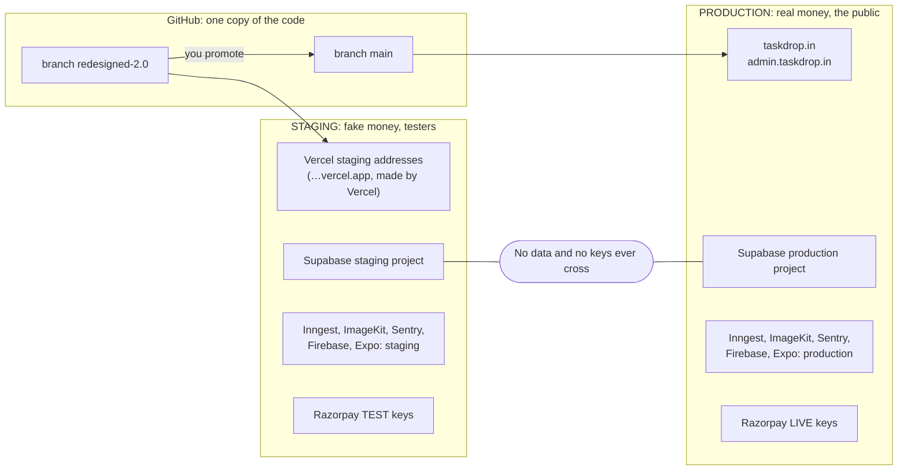
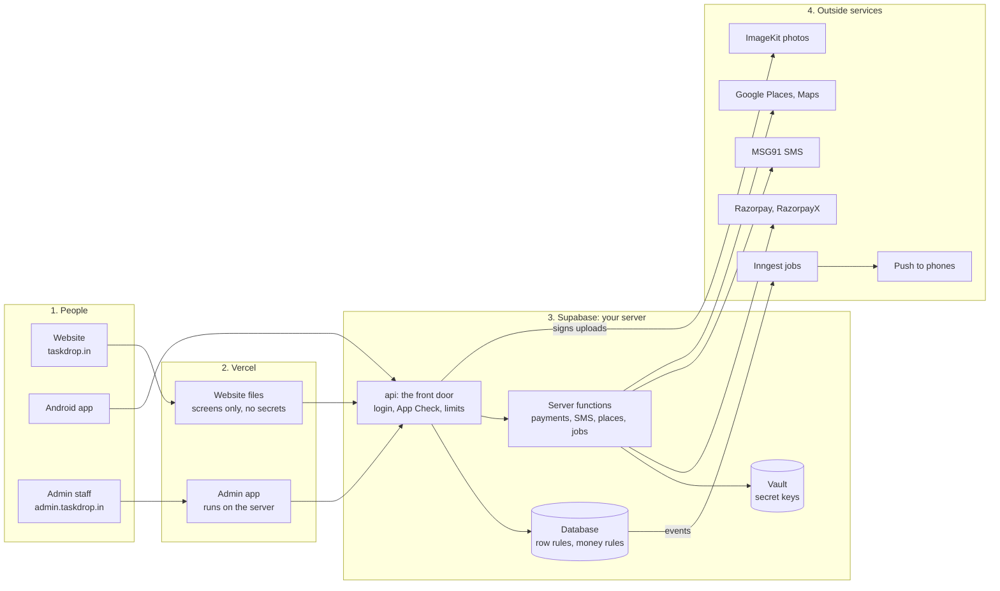
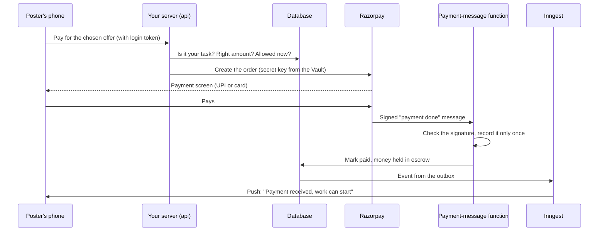

# TaskDrop: the ultimate plan

**This is the only plan you need.** It is in order. Do the steps from top to bottom, click a task to open its steps, and tick it when it is done.

The clickable version is `docs/ULTIMATE_PLAN.html`. Open it in Chrome. Your ticks are saved there.

Rethought on 30 October 2026. What changed: the steps now follow the order a product owner would choose (fix what is broken, make it hacker-proof, prove it with testers, get ready to market, build production, launch, grow). Every slow task that waits on other people sits in one "Start now" track. Future ideas sit in a separate **Future scope** section, so they never count against your progress. The accounts for staging and production are drawn as two maps. Security and marketing each have their own section. The previous version is kept unchanged in `docs/archive/2026-10-30-before-rethink/`.

Checked against best practice on 31 October 2026 (see the changelog). New: 2-step sign-in on your accounts (2.1b), money safety limits (2.11), the marketplace numbers (3.3b), a dispute and safety policy (4.9), backups you control and a real restore practice, a production that is safe from its first minute, releases in small slices, and an earlier start for the 14-day tester clock (Gate 2 is now two gates, 2a and 2b). Vercel security check (31 October): a table of what Vercel secures and what stays yours, holes H18 and H19, and a new task 5.8b (spending stop, firewall rule, preview safety).

---

## How to use this plan

**Every task has a tag:**

| Tag | Means |
|---|---|
| **You** | You do it yourself, in a browser or on your phone |
| **Claude** | You copy one sentence to Claude. Claude does the work and reports back in plain words |
| **Both** | Claude does part of it, you click the rest |
| **Later** | Future scope. Shown so nothing is forgotten, but it is not part of your progress |

**Every step inside a task is one of three kinds:**

- **CLICK**: you do it yourself.
- **SAY**: copy the text in the purple box into the Claude chat.
- **TELL**: write in the chat what you saw. A screenshot is fine.

**Six rules:**

1. **Go in order.** Start the whole **Start now** track in week 1 as well. It is slow, so it runs beside Steps 1 to 4.
2. **Pass each gate.** A gate is a short checklist at the end of each step. Do not start the next step until every line is true.
3. **Never paste a password, key or secret into the chat.** Claude will never ask you for one.
4. **If a screen looks different** from the steps, stop and send Claude a screenshot. Websites rename their buttons.
5. **When you finish a task, tell Claude its number** (for example "done 2.1"), so Claude ticks it here as well.
6. **Claude pushes, opens the pull request and merges it without asking you** (your rule, 31 Oct). Merging is never a question for you. Claude still asks you first only before: publishing an app update to testers, wiping or resetting data, rotating a key, or touching `main` or production.

---

## Where you are today (30 October 2026)

**Already done**

- The app works on the website and on Android with fake money (checked "finished" on 2026-10-28).
- Staging safety is live: the "Staging" ribbon, the block on real payment keys, the site hidden from Google, the staging notice in Terms and Privacy.
- The app tour, the admin app with staff roles, Google sign-in, error alerts (Sentry), uptime monitors and GitHub secret scanning all work.
- Your 20-minute phone walkthrough (30 Oct): 11 fixes are merged into `redesigned-2.0` and published to the phone app (31 Oct, task 1.2).

**Not done yet**

- 4 phone problems from 28 Oct, about 8 small bugs, and 10 design changes you asked for. New on 31 Oct: content and alerts hidden behind the phone keyboard (task 1.8).
- Security: Claude's check on 30 Oct found real open holes (see the **Security** section). None can move money today, because staging has only fake money, but every one must be closed before real money.
- Google Play: 12 testers for 14 days have not started. (Google's ID check is done: verified 27 Oct, task S.1.)
- All the business paperwork for real money: company, bank, lawyer, payment approval, SMS registration.
- Production, the real-money copy of TaskDrop, does not exist yet.

**The three things that matter most right now**

1. **Start the slow track today** (S.1 and S.2). Google's ID check and the company paperwork take weeks, and launch cannot happen without them.
2. **Fix the bugs you can see** (Step 1), so testers judge a good app, not a broken one.
3. **Close the security holes** (Step 2) before anyone outside your circle uses the app.

**Your first week, in order**

| Day | Do this | Task |
|---|---|---|
| 1 | Start Google Play's ID check (done: Google verified your identity on 27 Oct) | S.1 |
| 1 | Book a meeting with a Chartered Accountant | S.2 |
| 1 | Answer the decisions (20 minutes) | 1.1 |
| 1 | Open the staging app on your phone twice and try the walkthrough fixes (done by Claude 31 Oct) | 1.2 |
| 2 | Set up and protect your secrets file | 2.1 |
| 2 | Turn on 2-step sign-in on your 8 most important accounts (deferred to future scope on 31 Oct 2026) | 2.1b |
| 2 | Ask Razorpay and Cashfree for quotes (one email) (sent 31 Oct, waiting for their call back) | S.4 |
| 3 | Name check and trademark search (1 hour) | S.5 |
| 3 to 7 | Approve the design drawings Claude sends; say "start key protection" | 1.5, 2.5 |

---

## The map

```map
 START NOW (week 1): the slow track. Runs beside Steps 1 to 4. All done before Step 5.
 S.1 Play ID check   S.2 company + bank   S.3 lawyer   S.4 payment quotes
 S.5 name + trademark   S.6 SMS registration   S.7 legal contacts   S.8 payment approval

 STEP 1          STEP 2            STEP 3            STEP 4            STEP 5             STEP 6            STEP 7
 Fix what is  -> Make it        -> Prove it with  -> Get ready to   -> Build           -> Launch one     -> Run and
 broken          hacker-proof      real testers      market            production         city              grow
 week 1          weeks 1-3         weeks 3-6         weeks 4-8         1-2 weeks          real money        every week
   GATE 1          GATE 2a, 2b       GATE 3            GATE 4            GATE 5             GATE 6

 FUTURE SCOPE (separate, not part of your progress): passkeys, iOS, second city, referrals, ads ...
```

**The two copies of TaskDrop**

| | Staging (now) | Production (from Step 5) |
|---|---|---|
| Money | Fake. Razorpay test mode | Real. Live Razorpay keys, real UPI and bank |
| Data | Fake. Test accounts Asha, Ravi, Meera and what testers create | Real customers. Starts empty |
| Who uses it | You and invited testers | The public |
| Sign-in code | Shown on screen. Any phone number works | Real SMS |
| Web address | The address Vercel makes: `taskdrop-git-redesigned-20-hitenduteam.vercel.app` (admin: `taskdrop-admin-git-redesigned-20-hitenduteam.vercel.app`). Staging has no name of its own, and `taskdrop.in` is never staging's | `taskdrop.in`, `www.taskdrop.in` and `admin.taskdrop.in` |
| Code branch | `redesigned-2.0` | `main` (you promote by hand) |
| Accounts | Today's account or project in every tool | Its own new account or project in every tool. Nothing is copied |
| Cost | Free plans. Google Play $25 once | About $45 a month plus fees |

---

## Your accounts map: which Gmail owns which tool

You use **two Google accounts**, plus one email alias. When Google shows an account chooser, check the colour below.

```html
<div class="fig">
<div class="fig-title">The logins you use</div>
<div class="logins">
<div class="am-owner g1"><span class="am-ic">1</span><div><b>hitendureacts@gmail.com</b><small>Chrome profile /u/2 · almost every tool, and the only login the admin website accepts</small></div></div>
<div class="am-owner g2"><span class="am-ic">2</span><div><b>narasimharaju7c@gmail.com</b><small>Chrome profile /u/0 · only Google Play Console</small></div></div>
<div class="am-owner g3"><span class="am-ic">+</span><div><b>hitendureacts+prod@gmail.com</b><small>not a new Gmail: the same inbox as login 1, used only where a tool needs a second account for production (ImageKit, maybe Inngest)</small></div></div>
<div class="am-owner gh"><span class="am-ic">GH</span><div><b>GitHub username hitendureacts77</b><small>the code, shared by both copies</small></div></div>
</div>
</div>
```

### Map 1: STAGING (the test copy, fake money)

```html
<div class="fig">
<div class="fig-title"><span class="pill stg">Staging</span> Fake money, fake data, testers only</div>
<div class="fig-sub">Web address: the ones Vercel makes, <code>taskdrop-git-redesigned-20-hitenduteam.vercel.app</code> and <code>taskdrop-admin-git-redesigned-20-hitenduteam.vercel.app</code> (no DNS records needed). <code>taskdrop.in</code> belongs to production, not staging; until task 5.10 the staging project still answers on it by leftover, and nothing new should rely on that. Built from branch <code>redesigned-2.0</code>. Names marked "today" get the ending <code>-staging</code> later (future scope F.12).</div>

<div class="am-band g1">
<div class="am-owner"><span class="am-ic">1</span><div><b>hitendureacts@gmail.com</b><small>Chrome profile /u/2 · owns every staging tool below</small></div></div>
<div class="am-cards">
<div class="am-card"><div class="am-tool">Vercel <span>hosts website + admin</span></div><dl><dt>Workspace</dt><dd>team <code>hitenduteam</code> (Hobby, free)<br><code>team_ZEyzabHJSWRmHgiiy8ZZ655y</code></dd><dt>Projects</dt><dd><code>taskdrop</code> and <code>taskdrop-admin</code> (today)</dd><dt>Project IDs</dt><dd><code>prj_4j5lBW5qhmpl1egxznEyAQK2RzkE</code><br><code>prj_AWdsUdG8vre4LLPYP1VEhsdldJqq</code></dd></dl></div>
<div class="am-card"><div class="am-tool">Supabase <span>database, sign-in, server</span></div><dl><dt>Workspace</dt><dd>organization "hitendureacts@gmail.com's Org" (Free)</dd><dt>Project</dt><dd><code>taskdrop</code> (today), Mumbai</dd><dt>Project ID</dt><dd><code>wjxvingpfbfvkfqhrguj</code> (never changes)</dd></dl></div>
<div class="am-card"><div class="am-tool">Firebase + Google Cloud <span>push, App Check, maps, Google sign-in</span></div><dl><dt>Workspace</dt><dd>organization <code>hitendureacts-org</code>; billing "My only billing account"</dd><dt>Project</dt><dd><b>Taskdrop</b> (today)</dd><dt>Project ID</dt><dd><code>project-a19d1da9-6903-4168-905</code><br>number <code>629108039430</code></dd><dt>Budget</dt><dd><code>taskdrop-monthly-100</code> (₹100)</dd></dl></div>
<div class="am-card"><div class="am-tool">Expo (EAS) <span>Android builds + updates</span></div><dl><dt>Workspace</dt><dd>account <code>hitendureacts</code></dd><dt>Project</dt><dd><code>@hitendureacts/taskdrop</code> (today)</dd><dt>Project ID</dt><dd><code>08aa002b-4eea-4952-a62a-ec9245e77953</code></dd><dt>Channel</dt><dd><code>beta</code></dd></dl></div>
<div class="am-card"><div class="am-tool">Sentry <span>error alerts</span></div><dl><dt>Workspace</dt><dd>organization <code>hitendu</code></dd><dt>Projects</dt><dd><code>taskdrop</code> (app + server), <code>taskdrop-admin</code> (today)</dd></dl></div>
<div class="am-card"><div class="am-tool">Inngest <span>background jobs</span></div><dl><dt>Workspace</dt><dd>organization <code>taskdrop</code> (today)</dd><dt>Plan</dt><dd>Hobby (free)</dd></dl></div>
<div class="am-card"><div class="am-tool">ImageKit <span>photos</span></div><dl><dt>Account</dt><dd>"Hitendu"</dd><dt>ImageKit ID</dt><dd>not written down yet (Claude reads it in task 2.3)</dd></dl></div>
<div class="am-card"><div class="am-tool">Razorpay <span>payments</span></div><dl><dt>Account</dt><dd>your business account</dd><dt>Mode</dt><dd><b>Test mode</b> only</dd></dl></div>
<div class="am-card"><div class="am-tool">Uptime Robot <span>"site is down" emails</span></div><dl><dt>Monitors</dt><dd>website and admin (renamed "staging website", "staging admin" in 5.11)</dd></dl></div>
<div class="am-card shared"><div class="am-tool">Spaceship <span>owns taskdrop.in</span></div><dl><dt>Domain</dt><dd><code>taskdrop.in</code>, one domain for both copies</dd><dt>Staging names</dt><dd>none. Staging uses the addresses Vercel makes</dd></dl></div>
<div class="am-card"><div class="am-tool">Admin website <span>run TaskDrop</span></div><dl><dt>Address</dt><dd><code>taskdrop-admin-git-redesigned-20-hitenduteam.vercel.app</code> (stays; Vercel makes it)</dd><dt>Who signs in</dt><dd>only this Gmail. Dummy staff Priya, Kiran, Neha</dd></dl></div>
<div class="am-card shared new"><div class="am-tool">.env.all-secrets <span>secrets file on your PC</span></div><dl><dt>Status</dt><dd>protected in task 2.1</dd><dt>Holds</dt><dd>every login, key, recovery code, account detail and the keystore passwords, staging and production. It is the only copy: there is no password manager (one-file rule)</dd></dl></div>
</div>
</div>

<div class="am-band g2">
<div class="am-owner"><span class="am-ic">2</span><div><b>narasimharaju7c@gmail.com</b><small>Chrome profile /u/0 · Google Play only</small></div></div>
<div class="am-cards">
<div class="am-card shared"><div class="am-tool">Google Play Console <span>Android store</span></div><dl><dt>Workspace</dt><dd>Personal developer account <b>NLNarasimhaRaju</b></dd><dt>App</dt><dd><code>com.taskdrop.app</code>, made in task 3.1</dd><dt>Staging uses</dt><dd>the Internal and Closed <b>testing</b> tracks only</dd></dl></div>
</div>
</div>

<div class="am-band gh">
<div class="am-owner"><span class="am-ic">GH</span><div><b>GitHub: hitendureacts77</b><small>the code, the same for both copies</small></div></div>
<div class="am-cards">
<div class="am-card shared"><div class="am-tool">GitHub <span>code + checks</span></div><dl><dt>Repositories</dt><dd><code>taskdrop</code>, <code>taskdrop-admin</code></dd><dt>Staging branch</dt><dd><code>redesigned-2.0</code></dd></dl></div>
</div>
</div>
<div class="am-legend"><span>Solid box: belongs to staging only</span><span>Dashed box: one account used by both copies</span></div>
</div>
```

### Map 2: PRODUCTION (the real copy, real money)

Everything here is **new and separate** and is made in Step 5. Nothing is copied from staging. The IDs are written in here as each one is made.

```html
<div class="fig">
<div class="fig-title"><span class="pill prd">Production</span> Real money, real customers</div>
<div class="fig-sub">Web address <code>taskdrop.in</code>, <code>www.taskdrop.in</code> and <code>admin.taskdrop.in</code>. Built from branch <code>main</code>, which only you merge into. Green dashed box = a new account or project you create.</div>

<div class="am-band g1">
<div class="am-owner"><span class="am-ic">1</span><div><b>hitendureacts@gmail.com</b><small>Chrome profile /u/2 · owns almost every production tool, as new projects</small></div></div>
<div class="am-cards">
<div class="am-card new"><div class="am-tool">Vercel <span>task 5.8</span></div><dl><dt>Workspace</dt><dd>same team <code>hitenduteam</code>, upgraded to <b>Pro</b> ($20/month)</dd><dt>Projects</dt><dd><code>taskdrop-production</code>, <code>taskdrop-admin-production</code></dd><dt>Project IDs</dt><dd>written here after 5.8</dd></dl></div>
<div class="am-card new"><div class="am-tool">Supabase <span>task 5.2</span></div><dl><dt>Workspace</dt><dd><b>new</b> organization "TaskDrop Production" (Pro, $25/month, spend cap on)</dd><dt>Project</dt><dd><code>taskdrop-production</code>, Mumbai</dd><dt>Project ID</dt><dd>written here after 5.2</dd></dl></div>
<div class="am-card new"><div class="am-tool">Firebase + Google Cloud <span>task 5.3</span></div><dl><dt>Workspace</dt><dd>same organization <code>hitendureacts-org</code>, same billing account</dd><dt>Project</dt><dd><code>taskdrop-production</code></dd><dt>Budget</dt><dd><code>taskdrop-production-monthly</code> (₹1,000, alerts 50/90/100%)</dd><dt>Keys</dt><dd><code>taskdrop-production-android-maps</code>, <code>taskdrop-production-server-places</code></dd></dl></div>
<div class="am-card new"><div class="am-tool">Expo (EAS) <span>task 5.7</span></div><dl><dt>Workspace</dt><dd>same account <code>hitendureacts</code></dd><dt>Project</dt><dd><code>@hitendureacts/taskdrop-production</code></dd><dt>Channel</dt><dd><code>production</code>. Never a debug token</dd></dl></div>
<div class="am-card new"><div class="am-tool">Sentry <span>task 5.6</span></div><dl><dt>Workspace</dt><dd>same organization <code>hitendu</code></dd><dt>Projects</dt><dd><code>taskdrop-production</code>, <code>taskdrop-admin-production</code></dd></dl></div>
<div class="am-card new"><div class="am-tool">Inngest <span>task 5.4</span></div><dl><dt>Workspace</dt><dd><b>new</b> organization "TaskDrop Production", paid plan</dd><dt>If refused</dt><dd>a second account with <code>hitendureacts+prod@gmail.com</code></dd></dl></div>
<div class="am-card shared"><div class="am-tool">Razorpay + RazorpayX <span>task 6.1</span></div><dl><dt>Account</dt><dd>the same business account</dd><dt>Mode</dt><dd><b>Live mode</b>. Razorpay keeps test and live data apart</dd></dl></div>
<div class="am-card new"><div class="am-tool">MSG91 <span>task S.6</span></div><dl><dt>Account</dt><dd>new, made in S.6</dd><dt>Sender</dt><dd>DLT header such as <code>TSKDRP</code>; production only</dd></dl></div>
<div class="am-card new"><div class="am-tool">Uptime Robot <span>task 5.11</span></div><dl><dt>Monitors</dt><dd>"production website", "production admin", "production server"</dd></dl></div>
<div class="am-card shared"><div class="am-tool">Spaceship <span>task 5.10</span></div><dl><dt>Domain</dt><dd><code>taskdrop.in</code></dd><dt>Production names</dt><dd><code>taskdrop.in</code>, <code>www</code>, <code>admin</code></dd></dl></div>
<div class="am-card new"><div class="am-tool">Admin website <span>task 5.9</span></div><dl><dt>Address</dt><dd><code>admin.taskdrop.in</code></dd><dt>Who signs in</dt><dd>only this Gmail. Starts with no staff</dd></dl></div>
<div class="am-card shared"><div class="am-tool">.env.all-secrets <span>task 2.1</span></div><dl><dt>Holds</dt><dd>every key, login and recovery code, production included, in its <code>PROD_</code> section. One file on your PC with an encrypted backup (one-file rule)</dd></dl></div>
</div>
</div>

<div class="am-band g3">
<div class="am-owner"><span class="am-ic">+</span><div><b>hitendureacts+prod@gmail.com</b><small>same inbox as login 1 · only where a tool needs a second account</small></div></div>
<div class="am-cards">
<div class="am-card new"><div class="am-tool">ImageKit <span>task 5.5</span></div><dl><dt>Account</dt><dd>new, separate account</dd><dt>ImageKit ID</dt><dd><code>taskdropproduction</code></dd></dl></div>
</div>
</div>

<div class="am-band g2">
<div class="am-owner"><span class="am-ic">2</span><div><b>narasimharaju7c@gmail.com</b><small>Chrome profile /u/0 · Google Play only</small></div></div>
<div class="am-cards">
<div class="am-card shared"><div class="am-tool">Google Play Console <span>task 6.6</span></div><dl><dt>Workspace</dt><dd>the same developer account <b>NLNarasimhaRaju</b></dd><dt>App</dt><dd><b>TaskDrop</b> <code>com.taskdrop.app</code>, <b>Production</b> track</dd><dt>Linked to</dt><dd>Google Cloud project <code>taskdrop-production</code> (5.3)</dd></dl></div>
</div>
</div>

<div class="am-band gh">
<div class="am-owner"><span class="am-ic">GH</span><div><b>GitHub: hitendureacts77</b><small>no new account</small></div></div>
<div class="am-cards">
<div class="am-card shared"><div class="am-tool">GitHub <span>task 5.9</span></div><dl><dt>Repositories</dt><dd>the same <code>taskdrop</code>, <code>taskdrop-admin</code></dd><dt>Production branch</dt><dd><code>main</code>, protected: a pull request and green checks are required</dd></dl></div>
</div>
</div>
<div class="am-legend"><span>Green dashed box: new for production</span><span>Grey dashed box: one account used by both copies, kept apart by mode or project</span></div>
</div>
```

### What may cross from staging to production

```html
<div class="fig">
<div class="fig-title">Only code crosses. Never data, never keys.</div>
<div class="flowline"><span class="fb">You ask Claude</span><span class="fa">→</span><span class="fb">short branch + checks</span><span class="fa">→</span><span class="fb"><span class="pill stg">Staging</span> <code>redesigned-2.0</code></span><span class="fa">→</span><span class="fb">you and testers try it</span><span class="fa">→</span><span class="fb">you merge into <code>main</code></span><span class="fa">→</span><span class="fb"><span class="pill prd">Production</span></span></div>
<div class="fig-sub" style="margin:10px 0 0">Never copied: users, tasks, wallets, chats, photos, staff, test accounts, keys. A staging key used in production is refused, and the reverse.</div>
</div>
```

**Account rules**

1. Make every new account with **hitendureacts@gmail.com**. Where a tool needs a different email for its production account, use **hitendureacts+prod@gmail.com** (same inbox). Google Play stays on narasimharaju7c@gmail.com, because your developer account lives there.
2. **The one-file rule (owner decision, 31 Oct 2026).** Every secret you hold lives in one place: `C:\complete taskdrop\Taskdrop user\.env.all-secrets`. There is no password manager. It holds keys, passwords, account details (email and username), 2-step recovery codes and the keystore passwords, staging and production alike. Wherever a task below says "save it in the secrets file", add it the same day. In the file, production values sit in their own section and every name starts with `PROD_`; Claude keeps `PROD_` names out of anything that copies the file's values to staging. The file is plain text and the only copy, so task 2.1 makes device encryption required and adds an encrypted backup. Never in the chat. (Task 2.1 sets this up.)
3. Names: staging names end in `-staging`, production names end in `-production`. Today's staging tools keep their old names until future task F.12. Never renamed: the GitHub repositories, the Supabase project ID and the Firebase project ID.

<details id="c-tools">
<summary>[CARD] Every tool in one table (the same facts as the two maps, with links)</summary>

| Tool | What it does for TaskDrop | Open it at | Signed in as (staging) | Project name (staging) | What is inside (staging) | Gmail to use (production) | Project name (production) | What is inside (production) |
| --- | --- | --- | --- | --- | --- | --- | --- | --- |
| **GitHub** | The code | [Open](https://github.com/hitendureacts77) | Username **hitendureacts77** (checked) | `taskdrop`, `taskdrop-admin` | Repositories `taskdrop` and `taskdrop-admin`. Branch `redesigned-2.0` | No new account. Same username **hitendureacts77** | `taskdrop`, `taskdrop-admin` (the same two repositories) | Branch `main`, protected. Only code moves from staging to production (5.9) |
| **Vercel** | Hosts the website and the admin | [Open](https://vercel.com/hitenduteam) | **hitendureacts@gmail.com**, username `hitendureacts-2625` (checked) | `taskdrop-staging`, `taskdrop-admin-staging` (today `taskdrop`, `taskdrop-admin`) | Team `hitenduteam` on the free Hobby plan. Built from `redesigned-2.0`. Staging's addresses are the ones Vercel makes (`taskdrop-git-redesigned-20-hitenduteam.vercel.app` and `taskdrop-admin-git-redesigned-20-hitenduteam.vercel.app`). `taskdrop.in` is production's; staging stops answering on it in task 5.10 | **hitendureacts@gmail.com** (same team `hitenduteam`, upgraded to Pro) | `taskdrop-production`, `taskdrop-admin-production` | Same team `hitenduteam`, upgraded to Pro ($20 a month). Built from `main`. Addresses `taskdrop.in`, `www.taskdrop.in` and `admin.taskdrop.in` (5.8, 5.10) |
| **Supabase** | Database, sign-in, files, server code, Vault | [Open](https://supabase.com/dashboard) | **hitendureacts@gmail.com** (checked) | `taskdrop-staging` (today `taskdrop`; the ref `wjxvingpfbfvkfqhrguj` never changes) | Organization "hitendureacts@gmail.com's Org", free plan. Mumbai. Fake data only | **hitendureacts@gmail.com** (a new organization, not a new login) | `taskdrop-production` | New organization "TaskDrop Production", Pro plan ($25 a month), spend cap on. Mumbai. Starts empty (5.2) |
| **Firebase console** | Push messages to Android, App Check (proves a request comes from the real app) | [Open](https://console.firebase.google.com) | **hitendureacts@gmail.com** (`/u/2`) | `taskdrop-staging` (today **Taskdrop**; the ID `project-a19d1da9-6903-4168-905` and number `629108039430` never change) | Pay-as-you-go plan. An Android app and a web app are registered | **hitendureacts@gmail.com** (`/u/2`) | `taskdrop-production` | New project, Analytics off. Android app `com.taskdrop.app`, web app `taskdrop-web-production`, its own push key and App Check (5.3) |
| **Google Cloud console** | The keys behind maps, place search and Google sign-in, plus billing and the budget | [Open](https://console.cloud.google.com/?authuser=2) | **hitendureacts@gmail.com** (`/u/2`) | `taskdrop-staging` (today **Taskdrop**, the same project as Firebase), under organization `hitendureacts-org` | Keys `taskdrop-android-maps`, `taskdrop-server-places` and the Firebase "Browser key" (no extra website limit on staging for now). Sign-in client `TaskDrop Supabase`. Billing account "My only billing account". Budget `taskdrop-monthly-100` (₹100 a month, alerts only) | **hitendureacts@gmail.com** (`/u/2`) | `taskdrop-production` (the same project as Firebase) | Keys `taskdrop-production-android-maps`, `taskdrop-production-server-places` and its own "Browser key". Sign-in client `TaskDrop Supabase production`. Same billing account. Budget `taskdrop-production-monthly` (₹1,000 a month, alerts at 50%, 90%, 100%). Places search capped at 2,000 a day (5.3) |
| **Google Play Console** | The Android app store | [Open](https://play.google.com/console/u/0/developers) | **narasimharaju7c@gmail.com** (`/u/0`) | No app yet (task 3.1). After launch: "TaskDrop Staging" | Personal developer account **NLNarasimhaRaju**. Testing tracks only. After launch, staging moves to the app `com.taskdrop.app.staging` (decision 9) | **narasimharaju7c@gmail.com** (`/u/0`), where your developer account is | **TaskDrop** (`com.taskdrop.app`) | The same developer account. The app's **Production** track, linked to the `taskdrop-production` Google Cloud project (5.7, 6.6) |
| **Expo (EAS)** | Android builds, app updates, the push key | [Open](https://expo.dev/accounts/hitendureacts) | Username **hitendureacts**, email hitendureacts@gmail.com (checked) | `@hitendureacts/taskdrop-staging` (today `@hitendureacts/taskdrop`; project ID `08aa002b-4eea-4952-a62a-ec9245e77953`) | Update channel `beta`. Has the staging-only App Check debug token | **hitendureacts@gmail.com**, username **hitendureacts** | `@hitendureacts/taskdrop-production` | New project under the same account. Update channel `production`. Its own push key and variables, and never a debug token (5.7) |
| **Sentry** | Error reports and alerts | [Open](https://sentry.io) | **hitendureacts@gmail.com** (checked) | `taskdrop-staging`, `taskdrop-admin-staging` (today `taskdrop` for the app and server functions, and `taskdrop-admin`) | Organization `hitendu` | **hitendureacts@gmail.com** (same organization `hitendu`) | `taskdrop-production`, `taskdrop-admin-production` | Same organization `hitendu`. Same alert rules. Source-map token `taskdrop-production-sourcemaps` (5.6) |
| **Inngest** | Background jobs | [Open](https://app.inngest.com) | **hitendureacts@gmail.com** (checked) | Organization `taskdrop-staging` (today `taskdrop`) | Free Hobby plan | **hitendureacts@gmail.com** (a new organization). Only if Inngest refuses a second organization: **hitendureacts+prod@gmail.com** | Organization **TaskDrop Production** | Separate organization on a paid plan, with its own Event key and Signing key. If Inngest does not allow a second organization, a second account with `hitendureacts+prod@gmail.com` (5.4) |
| **ImageKit** | Photo storage and delivery | [Open](https://imagekit.io/dashboard) | **hitendureacts@gmail.com**, name "Hitendu" (checked) | Today's photo account (name not recorded here) | Staging photos | **hitendureacts+prod@gmail.com** (a different address for the same inbox, so ImageKit makes a separate account) | ImageKit ID `taskdropproduction` | Separate account, signed up with `hitendureacts+prod@gmail.com`. Its own URL endpoint and keys (5.5) |
| **Razorpay** | Payments in (test mode now) | [Open](https://dashboard.razorpay.com) | **hitendureacts@gmail.com** (you confirmed, 2026-10-30) | The business account, **Test mode** | Test mode only | **hitendureacts@gmail.com** (same business account, Live mode) | The same business account, **Live mode** | Live keys. Razorpay already keeps test and live data apart (6.1) |
| **Uptime Robot** | "Site is down" emails | [Open](https://dashboard.uptimerobot.com) | **hitendureacts@gmail.com** (you confirmed, 2026-10-30) | "staging website", "staging admin" (renamed in 5.11) | Two monitors (website and admin), pointed at the two Vercel staging addresses (5.11) | **hitendureacts@gmail.com** | "production website", "production admin", "production server" | Three new monitors: `taskdrop.in`, `admin.taskdrop.in` and the production `app-config` address (5.11) |
| **Spaceship** | Owns the domain `taskdrop.in` and its DNS | [Open](https://www.spaceship.com) | **hitendureacts@gmail.com** (you confirmed, 2026-10-30), account holder name Narasimha Raju | Domain `taskdrop.in` (one domain for both copies) | Today the domain points at staging. Staging needs no DNS names: it uses the addresses Vercel makes | **hitendureacts@gmail.com** | Domain `taskdrop.in` (one domain for both copies) | `taskdrop.in`, `www` and `admin` point at the production Vercel projects (5.10) |
| **MSG91** | Sign-in text messages | [Open](https://msg91.com) | Not created yet (task S.6) | Not used | The sign-in code shows on screen instead | **hitendureacts@gmail.com** | Your MSG91 account from S.6 | Real SMS. Use **hitendureacts@gmail.com**, like your other tools. Its key goes into production only (6.1) |
| **Cashfree** | Possible second payment company | [Open](https://www.cashfree.com) | No account (you asked for a quote only, task S.4) | None |  | **hitendureacts@gmail.com**, only if you open an account | None | Only if you choose it after the quote |
| **.env.all-secrets** | Your secrets file (on your PC) | Not a website | Exists; protected in task 2.1 | None |  | None (a file, not an account) | None | Holds every key, login, recovery code and account detail, including every production key and the "TaskDrop production database password", under `PROD_` names. It is the only copy (one-file rule, 2.1) |
| **Admin website** | Running TaskDrop | [Open](https://taskdrop-admin-git-redesigned-20-hitenduteam.vercel.app) | Only **hitendureacts@gmail.com** can sign in (your rule, 2026-10-25) | `taskdrop-admin-staging` (today `taskdrop-admin`; Vercel's own address) | Staff roles. Dummy staff Priya, Kiran and Neha | Only **hitendureacts@gmail.com** can sign in | `taskdrop-admin-production` (`admin.taskdrop.in`) | Starts with no staff. Only you can sign in. `ADMIN_PHONE` stays empty |

</details>

---

## Security: your shield, and the holes found today

**The honest goal.** No app can be made unhackable. TaskDrop aims for this: a break-in is **unlikely**, it is **noticed within minutes**, a stolen key **does little damage**, and recovery is **written down and fast**. Step 2 builds this. The tests are done the way a real attacker would work, but only against staging, never against production or the payment companies.

```html
<div class="fig">
<div class="fig-title">Five layers of protection</div>
<div class="fig-sub">Each layer catches what the one above misses.</div>
<div class="layers">
<div class="layer"><span class="ln">L1</span><span class="lt"><b>Stop leaks</b><small>A scanner blocks keys before they reach GitHub; secrets hidden from logs; a test fails if a secret reaches the app. Tasks 2.5, 2.6</small></span><span class="st part">Scanning on, rest in 2.5</span></div>
<div class="layer"><span class="ln">L2</span><span class="lt"><b>Guard the places keys live</b><small>One secrets file with an encrypted backup, 2-step sign-in on every important account, keystore out of OneDrive, device encryption, Sensitive settings. Tasks 2.1, 2.3 (2-step sign-in 2.1b deferred, passkeys F.1: future scope)</small></span><span class="st no">Not started</span></div>
<div class="layer"><span class="ln">L3</span><span class="lt"><b>Lock the doors</b><small>Every database function checks who is calling; CORS, limits, SMS caps; direct database access closed; test shortcuts off in production. Tasks 2.6 to 2.9, 3.9, 5.9</small></span><span class="st part">Partly</span></div>
<div class="layer"><span class="ln">L4</span><span class="lt"><b>Notice fast</b><small>Budget alerts, Sentry spike alerts, the decoy key, the monthly check. Tasks 2.2, 2.10, 7.4</small></span><span class="st part">Partly</span></div>
<div class="layer"><span class="ln">L5</span><span class="lt"><b>Recover fast</b><small>Key emergency guide, rollback rehearsal, a nightly database copy outside Supabase, one real restore. Tasks 2.10, 3.7, 5.9, 6.5</small></span><span class="st no">Not started</span></div>
</div>
</div>
```

**The holes found (checked by Claude on 30 October 2026, on staging; H15 to H17 added on 31 October from the best-practices check; H18 and H19 added on 31 October from the Vercel security check)**

Sources: Supabase's own security check on the staging database (rerun on 31 October: the same 113 functions, the same signed-out `get_app_controls`, the same 7 private tables and leaked-password protection off, so nothing new), `npm audit` on both code folders, the break-it pass of 25 October, and a read of both `vercel.json` files, the admin's `next.config.mjs` and `middleware.ts`, and the Edge Functions' CORS settings.

**What Vercel already gives you, and what stays yours** (checked 31 October 2026 against Vercel's plan pages)

| Vercel does it | Still yours |
|---|---|
| HTTPS certificates and renewal; flood (DDoS) blocking on every plan; the servers and their updates | Who may see which task: row rules, checks inside every `api` function and every admin route |
| A firewall (3 custom rules on the free plan, 40 on Pro), IP blocking, Attack Challenge Mode | Limits on sign-in codes, SMS and task posting. They live in Supabase, where Vercel's firewall cannot see (H18) |
| Preview builds locked behind a Vercel login | Keeping production values out of preview builds (5.8b) |
| Secrets stored encrypted when marked Sensitive | Never putting a master key in a `NEXT_PUBLIC_` or `EXPO_PUBLIC_` name (the 2.5 test checks this) |
| Free plan is for non-commercial use only; Pro is $20 a month with $20 of usage included | A hard spending stop (Pro only emails you by default), set in 5.8b |
| Looks after nothing in your code | Security headers (already set in both `vercel.json` files and the admin's middleware), package warnings (H7), Sentry alerts, backups (H16) |

What the audit found good: the website sends HSTS, `nosniff`, a frame block and a referrer rule; the admin has a nonce-based content policy, a 30-minute idle timeout and a 12-hour cap; no master key appears in the mobile app; and the only `NEXT_PUBLIC_` and `EXPO_PUBLIC_` names are addresses, public keys and business details.

| # | The hole, in plain words | How bad | Closed in |
|---|---|---|---|
| H1 | Any phone number signs in with a code shown on screen (`dev_otp_for_all`). Fine for testing; a disaster with real users | Critical in production (on purpose in staging) | 5.9 switches it off |
| H2 | **113 special database functions can be called by any signed-in person.** Each one must check who is calling. None is known to be broken, but they have not all been tested | High until tested | 2.7 tests every one |
| H3 | A script with the public key can talk to the database directly, skipping the `api` front door (row rules still apply) | High: the biggest open door | Production is built with it closed from day one (5.9). Staging closes it in 3.9 |
| H4 | The admin app falls back to the master database key if its own secret is missing | High | 2.5 |
| H5 | No secret scanner runs on code changes, and nothing stops a commit that contains a key | High | 2.5 |
| H6 | The secrets file and the keystore passwords sit together in OneDrive | High | 2.1 |
| H7 | 15 package warnings in the user app, **7 of them high** (the admin app has 0) | Medium | 2.6 |
| H8 | Server functions answer requests from any website (CORS `*`). Not open today because a login token is needed, but wider than needed | Medium | 2.6 |
| H9 | The full content security policy only reports problems; it does not block them yet | Medium | 2.6 |
| H10 | Sign-in limits trust a network address that can be faked, and there is no daily cap on SMS | Medium (costs money once SMS is real) | 2.8 |
| H11 | Leaked-password protection is off (Supabase only offers it on the paid plan) | Medium | 5.2 turns it on in production |
| H12 | An unused key, `OMNIROUTE_API_KEY`, is still set | Low | 2.6 |
| H13 | An old column `payout_upi` is readable by signed-in people (it is empty) | Low | 3.9 |
| H14 | No 2-step sign-in on your accounts. Most real hacks steal a login, not a key, and with your no-key-replacement rule a stolen login does more damage | High | **Left open by your decision (31 Oct 2026).** The fix, 2.1b (authenticator app on 8 accounts), is future scope. Passkeys stay in F.1 |
| H15 | A brand-new database built from the code starts with "any phone signs in" on (migration 053), and the `production` app build setting in `eas.json` still points at the staging database. Staging also records every session as a video replay | High for production (fine on staging) | 5.7 and 5.9 fix them; a safety alarm (5.9) catches them if they ever come back |
| H16 | No database copy kept outside Supabase, and no restore ever practised. Staging's free plan has no backups at all | High for production | 5.9 (nightly copy), 6.5 (restore practice) |
| H17 | Nothing stops a brand-new account from moving large amounts at once, or one person posting a task and "doing" it from a second account | Medium (high once money is real) | 2.11 |
| H18 | Vercel's firewall and flood protection only guard the website and the admin. Sign-in codes, `api`, payments and the Edge Functions are answered by Supabase, so no Vercel rule can slow an attacker there. Their limits must live in the server (and the server functions still answer any website, H8) | Medium | 2.8 (server limits), 2.6 (CORS). Nothing to buy; just never assume "Vercel has it" |
| H19 | Vercel Pro does not stop spending by default (it only emails at $200), the production projects have no firewall rules, no limit on admin sign-in tries at the Vercel door, and nothing proves that preview builds hold no production values | Medium | 5.8b |
| — | Accepted on purpose: an old Razorpay **test** key in the code history; `get_app_controls` readable signed out; 7 private tables closed to the app | Info | Nothing to do |

**The bugs found (your walkthrough, the phone runs and the break-it pass)**

| # | The bug | How bad | Fixed in |
|---|---|---|---|
| B1 | 11 walkthrough fixes (under-18 warning, nonsense posts, connected questions, one photo/video button, price slider, ₹500 chip and more) | Medium | Made on a branch; 1.2 merges them |
| B2 | After choosing an offer, Back shows the offer still "Open" with a live button | Medium | 1.3 |
| B3 | In chat, the message box hides behind the keyboard | Medium | 1.3 |
| B4 | The word "phone" in a title turns any post into phone repair | Low | 1.3 |
| B5 | After a review, the app lands on a screen with no tab bar | Medium | 1.3 |
| B6 | A closed account just clears the code, with no message | Medium | 1.4 |
| B7 | The slide-to-start handle is the only way to start a job (no button, no screen reader) | Low | 1.4 |
| B8 | "Offer accepted" shows the time the offer was sent | Low | 1.4 |
| B9 | The offers screen says names are hidden, but the name already shows | Low | 1.4 |
| B10 | A too-short proof text gets the vague "Please check what you entered" | Low | 1.4 |
| B11 | A job opens as grey boxes for about a second | Low | 1.4 |
| B12 | Google sign-in needs one more check on every path | Medium | 1.4 |
| B13 | Razorpay test mode ran out of payment links and shows no UPI | Medium (testing only) | Dropped 31 Oct: test keys have no UPI |
| B14 | 10 design changes you asked for (birth-date wheel, sharper splash, shorter categories, clearer price and more) | Design | 1.5 and 1.6 |

---

## START NOW: the slow track (start in week 1, runs beside Steps 1 to 4)

**Why start now:** each of these waits on other people (Google, banks, a lawyer, Razorpay, phone companies) for days or weeks. Starting costs little. Waiting only delays launch. **All eight must be done before Step 5.** Tick each one when it is finished, not when you start it.

Best order: S.1 and S.2 on day 1. S.3, S.4 and S.5 in the first week. S.6, S.7 and S.8 after S.2 (they ask for your PAN and bank account).

<details id="tS-1" data-short="Verify Play account">
<summary>[YOU] <b>S.1</b> Verify your Google Play account (start now: Google takes days) <small>· Done 27 Oct (Google notified "Your identity has been verified successfully"; seen 31 Oct)</small></summary>

**Why:** nothing can be published on Google Play until Google has checked your ID. It takes several days, so start now.

Your Play account is the **Personal** account **NLNarasimhaRaju**, owned by `narasimharaju7c@gmail.com`. In Chrome it is the profile at `/u/0`.

1. CLICK: open https://play.google.com/console/u/0/developers. If Chrome asks which Google account to use, pick **narasimharaju7c@gmail.com**. Click the developer account **NLNarasimhaRaju**.
2. CLICK: on **Home**, under "Finish setting up your developer account", click **Get started** next to **Verify your identity**.
3. CLICK: choose an ID type from Google's list and upload a clear photo or scan. The name must match the name on the Play account. Do not edit or crop the image.
4. CLICK: back on **Home**, click **View details** next to **Verify your contact phone number**, and enter the code Google sends to your phone. If Google asks you to check an Android device, install the **Google Play Console** app on your phone, sign in as narasimharaju7c@gmail.com and approve.
5. Wait. The two banners disappear when Google is done (several days).
6. TELL Claude: "done S.1, the Play account is verified". A screenshot of Home without the two banners is fine.

**Done when:** the Play Console home page no longer shows the two "Verify" banners.
</details>

<details id="tS-2" data-short="Company, PAN, bank">
<summary>[YOU] <b>S.2</b> Business basics: who owns TaskDrop, PAN, GST, bank account <small>· 1 to 3 weeks · bank and CA fees</small></summary>

**Why:** Razorpay, the SMS registration and the lawyer all ask for these first.

1. Book one meeting with a **Chartered Accountant (CA)**. Ask which business type fits TaskDrop: sole proprietor (simplest, uses your own PAN), LLP, or private limited company (the usual choice if you want investors later). This plan is not tax or legal advice. The CA decides with you.
   Also ask the CA these marketplace questions. Their answers can change how payouts are built, so write them down:
   - Is TaskDrop an "e-commerce operator" for GST? Must we collect tax at source (TCS) on what workers earn through us?
   - Must we deduct income tax (TDS) when we pay workers? At what rate, and above what amount?
   - Must workers give us their PAN before they can withdraw?
   - Is GST due on our 3% service fee and on the worker commission? What must our invoice show?
2. Get the documents the CA says you need: PAN (a business PAN for an LLP or company), a GST registration if required, and address proof.
3. Open a **current account** in the business name at any bank. Ask for net banking and UPI.
4. If you chose an LLP or a company: ask the CA about a free **D-U-N-S number** for it. You need one for decision 10 (a Google Play organization account).
5. TELL Claude: "done S.2. Business type: ___, name: ___", and paste the CA's answers to the four marketplace questions. Do not send account numbers. Claude records the answers and, if tax must be deducted or PAN collected, adds that work to the plan before Step 5.

**Done when:** you have the business name, its PAN, a current account and the CA's written answers to the four marketplace questions.
</details>

<details id="tS-3" data-short="Lawyer">
<summary>[YOU] <b>S.3</b> Find a lawyer and ask the money question <small>· weeks · lawyer's fee</small></summary>

**Why:** the lawyer's answer decides how payouts and refunds are built. Until then, the real-money jobs stay switched off.

1. Shortlist 2 or 3 lawyers in India who work with startups and payments (fintech). Ask your CA, friends or LinkedIn.
2. Email each one. Attach `docs/LAWYER_BRIEF.md` (it explains how TaskDrop moves money). Add the links https://taskdrop.in/?page=terms and https://taskdrop.in/?page=privacy. Ask for a **fixed-fee quote**.
3. The questions to ask:
   - May TaskDrop hold a poster's money until they approve, then pay the worker? Or must a payment company (for example Razorpay Route) hold it?
   - Does the wallet need RBI permission?
   - Please review our Terms and Privacy pages.
   - What do we need for India's data law (DPDP)? How fast must a data breach be reported, and to whom? How long may we keep chats, photos and ID details after an account is deleted?
   - Above what amount must we check a worker's identity (KYC) before paying them out?
   - How fast must we acknowledge and settle a complaint or a dispute (the IT rules for platforms)? Please review our dispute policy (task 4.9) once it exists.
4. Choose one lawyer and pay.
5. When the answer arrives, SAY the text below and paste the lawyer's answer after it.

```say
Here is the lawyer's answer:
```

**Done when:** you have the answer in writing and Claude has recorded it.
</details>

<details id="tS-4" data-short="Payment quotes">
<summary>[YOU] <b>S.4</b> Ask Razorpay and Cashfree for written price quotes <small>· Emailed 31 Oct, waiting for their call back · free</small></summary>

**Why:** your rule is "take the cheaper one". It counts only if that company also approves TaskDrop's way of handling money, in writing.

1. Copy this email, fill in the blanks, and send it to the sales teams of **Razorpay** and **Cashfree** (use the "Contact sales" form on each website):

```say
Subject: Pricing quote for TaskDrop (online task marketplace, India)

Hello,
I run TaskDrop (taskdrop.in), a marketplace where a person posts a task, a worker does it, and the payment is held until the poster approves the work. It is then paid out to the worker.

Please send me, in writing:
1. Your rate for UPI, cards and netbanking, separately.
2. Whether your fee is returned when we refund a cancelled task.
3. Your split-payment or payout product, its fee, and what each worker must do to be set up.
4. Whether our use case (money held until approval, then paid to a third party) is approved under the RBI payment aggregator rules.
5. Your settlement time (T+1, T+2).
6. Whether your KYC accepts a ___ (your business type).

Expected volume at the start: about ___ payments a month, ₹150 to ₹1,000 each.

Thank you,
___
```

2. Write the date down. If there is no reply by the deadline, send a reminder. Suggested deadline: **2 November 2026**.
3. When both have replied, SAY the text below and paste only the numbers (never any keys).

```say
Here are the payment quotes:
```

4. Claude fills a comparison table (it includes the cost of switching: Razorpay is already built, Cashfree would take about one phase of work) and recommends one.
5. Make decision 3 in the "Decisions" section.

**Done when:** both quotes are in and you have chosen.
</details>

<details id="tS-5" data-short="Name and trademark">
<summary>[YOU] <b>S.5</b> Check the name, file the trademark, claim the handles <small>· 1 hour, then filing · trademark fee</small></summary>

1. **Company names.** CLICK: https://www.mca.gov.in → **MCA services** → **Check Company/LLP name**. Search "taskdrop". Note what you find.
2. **Trademarks.** CLICK: https://tmrsearch.ipindia.gov.in/eregister → **Trade Mark Search** (or start from https://ipindia.gov.in). Search the word "taskdrop" and "task drop" in classes **9** (app), **35** (online marketplace) and **42** (software).
3. **Social handles.** CLICK: https://namechk.com → type "taskdrop" and see which handles are free.
4. TELL Claude what you found.
5. If the name is free: file the trademark for the word "taskdrop" and the drop-and-check logo in classes 9, 35 and 42. File yourself on IP India or through your lawyer. The fee is lower for individuals, startups and small businesses. Check the current fee on IP India.
6. Claim the free handles on Instagram, X, YouTube, LinkedIn (a company page) and Reddit.
7. TELL Claude: "done S.5".

**Done when:** the trademark is filed and the handles are yours.
</details>

<details id="tS-6" data-short="SMS registration">
<summary>[YOU] <b>S.6</b> SMS registration (DLT) and MSG91 <small>· days · about ₹5,000 once + ₹1,250 + GST</small></summary>

**Why:** in India, an SMS from an unregistered sender is silently blocked. Real phone sign-in needs this. Do it after S.2, because it asks for PAN and GST.

1. CLICK: pick one DLT portal (Jio, Airtel or Vi; one is enough). Register your business (the "entity") with PAN, GST and a letter of authorisation on your letterhead. The fee is about ₹5,000, one time. Approval takes a few working days. Note your **Entity ID**.
2. CLICK: register a **header** (the sender name), 6 letters such as `TSKDRP`. Choose **transactional**, not promotional. Promotional SMS does not reach people on Do-Not-Disturb.
3. CLICK: register this **template**, exactly as written, character for character:

```say
{#var#} is your TaskDrop verification code. It is valid for 10 minutes. Do not share it with anyone.
```

4. CLICK: make an account at https://msg91.com. Go to **SMS** → **DLT** and link your Entity ID and header. Go to **SMS** → **Templates** and create the same template with `##OTP##` where the code goes. Note its **template ID**.
5. CLICK: buy the **5,000 SMS pack** (₹1,250 + 18% GST). No bigger pack yet. Set a **daily send limit** and a **low-balance alert** in MSG91.
6. CLICK: in MSG91 → **Settings** → **API** → copy the **Auth Key** straight into the `PROD_` section of `.env.all-secrets`. It goes into production in task 6.1. Never put it into staging or the chat.
7. TELL Claude the template ID and the header (these are not secrets).

**Done when:** the template is approved, the credits are bought, and the key is saved in `.env.all-secrets`.
</details>

<details id="tS-7" data-short="Legal contacts">
<summary>[YOU] <b>S.7</b> Legal contacts: DMCA agent and grievance officer <small>· 15 minutes · $6</small></summary>

**Why:** the law expects a marketplace to name a grievance officer, and a DMCA agent protects you when users upload photos.

1. CLICK: https://dmca.copyright.gov → **Register** → make an account → designate an agent (name, address, email, phone) → pay **$6** (valid 3 years).
2. Decide who the **grievance officer** is (it can be you) and which email they use. Find the PIN code of your business address.
3. SAY the text below and fill it in. These details are public, because they appear on the Privacy page.

```say
DMCA agent registered: name ___, email ___, address ___, phone ___. Grievance officer: name ___, email ___. Address PIN code: ___.
```

**Done when:** Claude confirms the legal pages show these details.
</details>

<details id="tS-8" data-short="Payment approval">
<summary>[YOU] <b>S.8</b> Payment approval (Razorpay and RazorpayX KYC) <small>· days to weeks · fee per payment</small></summary>

**Why:** live payment keys exist only after the payment company has checked your business. Do this after S.2, and best after the lawyer (S.3) and your gateway choice (S.4).

1. SAY the text below first. Payment companies check your website for these pages.

```say
Add the cancellations-and-refunds page and the contact-us page with the business address.
```

2. CLICK: https://dashboard.razorpay.com → **Activate account** → enter the business type, PAN, GST (if any), your current account and the website `https://taskdrop.in` → upload the documents it asks for → **Submit**. If you chose Cashfree in decision 3, do the same on Cashfree instead.
3. CLICK: https://x.razorpay.com → activate RazorpayX (for paying workers) with the same business.
4. Wait for the approval emails.
5. TELL Claude: "done S.8, Razorpay and RazorpayX are approved". **Do not create or copy live keys yet.** That is task 6.1.

**Done when:** both approval emails have arrived.
</details>

---

## STEP 1: Fix what is broken (week 1)

**Goal:** every bug you have seen is fixed or has your written "accept", and the design changes you asked for are decided. Testers should judge a good app, not a broken one.

<details id="t1-1" data-short="Your decisions">
<summary>[YOU] <b>1.1</b> Make your decisions <small>· 20 minutes</small></summary>

1. Read the **Decisions** section near the end of this file. Each decision has a recommended answer.
2. For each one, SAY its sentence (or your own answer).
3. TELL Claude: "done 1.1".

**Done when:** every decision has an answer. Decisions 3, 10 and 12 are still open (3 waits for the payment quotes, S.4).
</details>

<details id="t1-2" data-short="Merge walkthrough fixes">
<summary>[BOTH] <b>1.2</b> Merge the 11 fixes from your phone walkthrough <small>· Done 31 Oct</small></summary>

On 2026-10-30 you recorded 20 minutes of using the staging app and said what felt wrong. Claude watched it and made these fixes. **Merged into `redesigned-2.0` on 31 Oct** (pull request 116, all checks green; pull request 117 first cleared new dependency warnings that were blocking every pull request). Checked in the browser; not yet seen on a phone. Times in brackets are where it happens in your video.

| # | What you saw | What it does now |
|---|---|---|
| 1 | The under-18 warning flashed and jumped back to the first screen (2:40–3:10) | The warning stays until you tap OK |
| 2 | The warning did not say why (1:30) | "TaskDrop is for adults only. You need to be 18 or older…" |
| 3 | Nonsense like "Jdjshrjensjjsks" became a post (8:00) | Blocked with a friendly message. Hindi, Telugu and short words like "AC" still pass |
| 4 | "Looks good" under the text box (5:40) | Removed |
| 5 | "Online or computer work" still asked "At my home?" (8:30–9:00) | The questions now match the kind of task |
| 6 | Separate "Add photo" and "Add video" buttons (10:00–10:30) | One "Add photo or video" button with Take photo, Record video, Choose from gallery |
| 7 | Tapping ₹500 did not fill in ₹500 (13:30) | It does, even with the keypad open |
| 8 | The slider stopped at ₹10,000 (13:00) | It reaches 5 times the usual price, and typing more stretches it |
| 9 | Scrolling changed the price by accident (14:00) | The slider moves only on a deliberate sideways drag |
| 10 | "1 Post 2 Offers 3 Pay 4 Approve" broke onto two lines (5:00) | One line |
| 11 | "Reel editing" and "Govt form help" did not look like examples (7:30) | They start with "Try:" |

Also done on 30 Oct with your OK: your test numbers +91 12345 67890 and +91 12345 67899 were unbanned, and the 30-day under-18 lock on a phone was removed (each new number is asked afresh).

1. ~~SAY "merge the walkthrough fixes"~~ Done 31 Oct.
2. ~~SAY "publish the app update"~~ Done 31 Oct.
3. Open the staging app on your phone twice (the first open downloads the update) and try items 1, 3, 6 and 7 again.
4. TELL Claude: "done 1.2", or what still looks wrong.

**Done when:** the fixes are merged and you have seen them on your phone. **Done 31 Oct:** merged (pull request 116) and the phone update published; tell Claude if anything still looks wrong on the phone.
</details>

<details id="t1-3" data-short="Fix phone problems">
<summary>[CLAUDE] <b>1.3</b> Fix the problems found on the phone <small>· Done 31 Oct · your time: 10 minutes</small></summary>

**Done 31 Oct (merged, pull request 118):** Claude fixed all four on branch `fix/phone-problems-2026-10-31` (commit 5fb5934, cut from `redesigned-2.0`). Checks are green. Offers screen text was seen on a real phone on 31 Oct; the Back-after-choosing check (B2) and the review landing (B5) need a money step (choose offer, approve) that you tap yourself, so they were checked by code and a test only; the chat box was checked on a real phone on 31 Oct: the message box stays above the keyboard. The app update was published to testers on 31 Oct (update group fe7f3305).

The phone test runs on 2026-10-28 found four small problems:

- After choosing an offer, **Back** shows the offers screen still saying "Open" with a live "Choose offer" button.
- In chat, the message box hides **behind the keyboard** while typing.
- A post with the word "phone" in the title gets phone-repair wording and the Repairs category.
- After writing a review, the app lands on the wrong screen (no tab bar).

1. SAY:

```say
Fix the four phone problems from the 2026-10-28 phone run.
```

2. Read Claude's summary and SAY "merge it".
3. ~~Restrict the staging Firebase browser key to the staging web address.~~ **Not doing this on staging for now (your decision, 31 Oct).** Everything is being tested on staging only, with fake money and fake data, and production has not been started. Staging's Google keys stay as they are (the Android maps key was already limited to this app and the map and push services on 22 Oct, and the server's place-search key is limited to Places). **Production is different: its keys are restricted when they are created, in task 5.3 (steps 5, 6 and 14), and Gate 5 checks it.**

~~Make the Vercel build retry the function deploy.~~ Done 31 Oct (pull request 120, merged).

~~Fix the Sentry slow items in the admin.~~ Done 31 Oct (pull request 31 in the admin repo, merged into redesigned-2.0). Sentry itself could not be reached, so the slow spots were found by reading the code and fixed by reading independent data together.

**Done when:** the fixes are merged and Claude has published the app update to your testers. **Done 31 Oct:** merged (pull request 118). The app update was published to testers the same day (update group fe7f3305). Chat box checked on a real phone on 31 Oct: it stays above the keyboard.
</details>

<details id="t1-4" data-short="Small bugs pack">
<summary>[BOTH] <b>1.4</b> Fix the small bugs pack <small>· Done 31 Oct · your time: 20 minutes</small></summary>

**Done 31 Oct (merged, pull request 119):** Claude fixed B6 to B12 on branch `fix/small-bugs-pack-2026-10-31` (commit 0f6bf52, cut from `redesigned-2.0`). Checks are green. Seen on a real phone on 31 Oct: the Start button next to the slider (B7), the new offers-screen text "Phone numbers are shared once the work starts" (B9), and the proof button stays off until the text is long enough (B10). Not seen on a phone: B8 (the seed data stamps every offer with the seed time, so it cannot show the fix), B11 (the grey boxes are too quick to catch) and B12. The `api` and `password-auth` functions were deployed by the Vercel build three minutes after the merge (checked on 31 Oct). The Razorpay part (B13) is dropped: UPI is not offered with test keys.

**What Claude fixes in one pull request** (bugs B6 to B12 in the Security section):

- A closed account gets a clear message ("This account is closed. Contact support.") instead of a silently cleared code.
- A **Start** button next to the slide-to-start handle, usable with a keyboard and a screen reader.
- "Offer accepted" shows when it was accepted, not when it was sent.
- The offers screen text matches what is really shown before work starts.
- A too-short proof text gets a clear message ("Write at least 10 characters about what you did").
- The grey boxes when a job opens: Claude finds what loads slowly and fixes it.
- Every Google sign-in path is checked again: website, Android, new user, returning user, cancelled sign-in.

**Dropped 31 Oct:** the Razorpay steps (bug B13). You checked that UPI is not offered with test keys, so there is nothing to click or fix in test mode. UPI can only be checked once live keys are in use.

1. ~~SAY "fix the small bugs pack"~~ Done 31 Oct.
2. ~~SAY "merge it"~~ Done 31 Oct.
3. ~~TELL Claude: "done 1.4"~~ Done 31 Oct.

**Done when:** merged and the functions deployed. **Done 31 Oct:** merged (pull request 119); the build deployed `api` and `password-auth` the same day (checked) and the app update is published (update group fe7f3305).
</details>

<details id="t1-5" data-short="Approve the designs">
<summary>[BOTH] <b>1.5</b> Approve the design changes you asked for <small>· Done 31 Oct · your time: 30 minutes · design first, then build</small></summary>

**Why design first:** your rule is that a design is drawn and approved before anything is built.

These came from your 30 Oct walkthrough (times are in your video):

| # | What you asked for |
|---|---|
| D1 | Birth date picked from a calendar or wheel, like Instagram (2:30) |
| D2 | A sharper splash logo (2:00) |
| D3 | Tapping the "Drop a task" card goes straight in, like a quick post (6:00) |
| D4 | A shorter category list: the top few plus a search box (9:30–10:00) |
| D5 | "When should it be done?" laid out in order, with clearer pictures (11:30) |
| D6 | The usual price comes from the description, not the same for every task (12:30). Today it comes from a word list; a smarter estimate is server work |
| D7 | "Send an offer" and "Send a detailed offer with a proposal" made clearer (18:30) |
| D8 | Poster things in green and worker things in blue, also on a poster's profile seen in Earn mode (19:00) |
| D9 | Explore and the map easier to understand (17:00) |
| D10 | An overall more premium, easier look (19:30) |

1. SAY (start with the three that testers will notice first):

```say
draw D1, D3 and D4
```

2. Claude sends pictures of each screen, light and dark, with the motion described. Reply "approved", or say what to change.
3. Then SAY "draw D2, D5, D6 and D7", and after that "draw D8, D9 and D10".
4. For any item you decide to drop, SAY "drop D_".
5. TELL Claude: "done 1.5".

**Done when:** each of D1 to D10 is approved or dropped. **Done 31 Oct:** you looked at the drawings for D1 to D10 (light and dark, with motion) and said to build them.
</details>

<details id="t1-6" data-short="Build the approved designs">
<summary>[CLAUDE] <b>1.6</b> Build the approved designs and two small features <small>· Built and merged 31 Oct, waiting for the phone check · your time: 20 minutes</small></summary>

**What Claude builds:**

- Every design you approved in 1.5.
- **Ask for the location** right after sign-in when the profile has none (from your video, 7:00). New sign-ups are asked; returning members are not.
- **Drafts:** leaving a half-written post saves it, shown under Drafts in My Tasks (15:00).

1. SAY:

```say
build the approved designs
```

2. Claude builds them in small pull requests and publishes each to your phone. Try each one and SAY "merge it" or what to change.
3. TELL Claude: "done 1.6".

**Done when:** everything approved in 1.5 and the two features are merged and on your phone.

**Built 31 Oct and merged into `redesigned-2.0` (pull requests 121 and 122). `npm run check` is green.** **Published to testers 31 Oct** (your OK): EAS update group `bdd9c44b-f198-44ac-af49-f65b61877720` on channel `beta`, from `d244b48`, with readable Sentry stacks (maps uploaded, debug id `a9c57bf5…`). Open the staging app on your phone **twice** (the first open downloads it, the second runs it), then try each item. **Seen on the phone 31 Oct (by Claude over USB):** the new Home (pencil button, one-row "Try:" chips), the Drop a task card opening the full-screen composer with Next, and the 7-step flow. The other items are still yours to try. **Newer update, same day (your OK):** group `94d39d2d-af5f-47fe-bfd2-4861c21a73bc` adds "Post a request" step 2 asking three or four questions instead of one (pull request 130); it was built from the code at `8ccd984` (EAS labels it `880840f`, which only adds a small fix on the task screen from pull request 131).

- **Built:** D1 birth-date wheels, D2 larger and sharper splash drop, D3 the Home card opens a full-screen composer with Next, D4 six category chips plus search, D5 the When step in order with its own pictures, D6 the Usual price card with a reason that now scales with quantities in the description ("5 pages", "3 hours"), D7 one offer card (Price only or Price + proposal), D8 posters green and workers blue on profiles, D9 the Explore list plus a Map view (you as a blue dot, jobs as green price tags, close ones joined into a number), D10 first step on Home (more air between sections, softer cards), the location ask for new sign-ups, and Drafts in My Tasks.
- **Still to do:** D10 on the other screens, one at a time, each shown to you first. A server-side AI price estimate for D6 was not built: the estimate stays in the app.
- **Differences from the drawings:** the birth-date screen does not say 18 (the code keeps that number off the sign-up screen on purpose); the splash stays dark because the app always opens dark.
</details>

<details id="t1-7" data-short="Notifications in plain words">
<summary>[CLAUDE] <b>1.7</b> Make every notification clear and short <small>· Built and applied to staging 31 Oct, waiting for your phone check · your time: 10 minutes</small></summary>

**What you saw (31 Oct):** notifications were ambiguous. They used the build team's words ("escrow", "poster", "quote", "clearing"), told you a task name but not what happened or what to do, and the test tasks called "[e2e] ..." filled the bell with fake alerts. A customer who reads that does not trust the app.

**Four rules, now in every notification** (the bell list and the phone alert are the same text):

1. **The title says what happened and who did it,** in a few words. The first line on a lock screen must be enough on its own.
2. **The body names the task, then gives the one next step** (if there is one).
3. **Only the app's own words:** "offer" (not quote), "customer" and "worker" (not poster), "held safely" (not escrow), "wallet", amounts as ₹.
4. **A person is called by first name** when they have a real one. Otherwise "The customer" or "Your worker", never "New user", a phone number or a handle. A task name is cut at 40 characters.

**What each person now reads** (the person's name and the task are filled in):

| When | Who reads it | Title | Body |
|---|---|---|---|
| A worker sends an offer | Customer | Ravi offered ₹1,500 | To do "Fix a leaking kitchen tap". Open it to compare offers. |
| An offer is accepted for you | Worker | Asha picked you | For "Fix a leaking kitchen tap". You can start once they have paid. |
| The customer has paid | Worker | Asha has paid. You can start | "…": your payment is held safely until the work is approved. |
| The worker starts | Customer | Ravi started your task | "…" is now in progress. |
| The worker sends the work | Customer | Ravi sent in the work | For "…". Approve it to pay them, or ask for changes. |
| The customer asks for changes | Worker | Asha asked for changes | On "…". Open it to see what to fix, then send it again. |
| The work is approved | Worker | Asha approved your work | "…": your earnings will show in your wallet soon. |
| The work is approved automatically | Worker | Your work was approved | "…": approved automatically. Your earnings will show in your wallet soon. |
| A task is cancelled | Both | Task cancelled | "…" was cancelled. (The worker adds: You can offer on other tasks.) |
| The worker leaves the task | Customer | Ravi left your task | "…" is open again, so new offers can come in. |
| A problem is reported | Both | A problem was reported | On "…". Our team is looking into it and will update you here. |
| New chat message | Other side | Ravi sent you a message | "…": the message (or 📷 Photo) |
| An offer is accepted for you automatically | Customer | Offer accepted automatically | Ravi will do "…". Paid from your wallet, so they can start. |
| Same, but the wallet is short | Customer | Offer accepted: payment needed | Ravi is ready to do "…". Add money to your wallet so they can start. |
| The customer cancels after work started | Worker | Meera cancelled after you started | You were paid ₹50 for your time on "…". It is in your wallet. |
| Money goes back to the customer | Customer | ₹980 is back in your wallet | "…" was cancelled. ₹50 went to the worker for the time already spent. |
| A withdrawal is sent | Worker | ₹250 withdrawal sent | It is on its way to your bank or UPI account. |
| A withdrawal fails or comes back | Worker | ₹250 withdrawal failed (or: Your bank sent ₹250 back) | Your money is back in your earnings. Check your bank or UPI details and try again. Reason: … |
| Admin changes a wallet | Person | ₹500 added to your wallet (or: ₹25.50 taken from your wallet) | Open your wallet to see why. |
| Approval reminder | Customer | Work is waiting for your approval | "…": approve it or report a problem. If you do nothing, it is approved for you within 24 hours. |
| Due-soon reminder | Worker | Due within the hour | Send "…" before the deadline. |
| A help request is closed | Person | Your help request is closed | Open it to read our reply, or tell us if you still need help. |
| Repeated wrong passwords | Person | Wrong password entered on your account | Password sign-in is paused for 15 minutes. Not you? Set a new password in Account & settings. |
| Admin warns someone | Person | A warning from TaskDrop | The reason, then: Please follow the community rules. More problems can get your account suspended. |
| Admin cancels a task | Both | TaskDrop cancelled your task (worker: TaskDrop cancelled a task you were picked for) | "…" was cancelled. Reason: … |

**Not changed on purpose:** copyright notices (they wait for the lawyer review), staff alerts, messages an admin writes by hand, support replies, "Your account is active again", "Your promotion was stopped" and "Someone joined with your code".

**What Claude did:**

- Rewrote the wording in the database (migration 128, `supabase/migrations/20261031150000_128_plain_notification_wording.sql`). Only the text changed; the money and permission logic in those functions is the same as before. The wording rules live in four small helpers (`private.rupees`, `private.label`, `private.who`, `private.notify_payout`), so a new notification gets them for free.
- **Applied to the staging database on 31 Oct.** The app needs no update: it shows what the database writes. New notifications read the new way; the ones already stored keep their old words.
- Wrote a test (`supabase/tests/notification_wording.test.sql`) that runs a task from offer to payment, a cancel with a fine, and a problem report, and checks every line above. It passed on the staging database and left nothing behind.
- Changed the end-to-end test clean-up so test tasks no longer leave unread alerts on the test accounts.

**Checked 31 Oct:** migration 128 is listed as applied on the staging database, so the new wording is live there.

1. Use the staging app on your phone with two accounts: post a task, send an offer, pick it, and watch the alerts on each phone.
2. TELL Claude: "done 1.7", or what still reads badly.

**Done when:** you have read each alert on your phone and none of them needs explaining. **Cleaned up 31 Oct:** the 71 old "[e2e]" test notifications on staging (44 customer alerts and 27 staff alerts, all fake data) were removed at your OK; 147 notifications remain, none with "[e2e]". **Cleaned up again 31 Oct:** a later test run put 24 more on the bell (customer, worker and staff); they were removed, and the test run now removes its own alerts afterwards (`scripts/clear-e2e-notifications.mjs`, needs `DATABASE_URL`).
</details>

<details id="t1-8" data-short="Keyboard hides content">
<summary>[BOTH] <b>1.8</b> Keep content and alerts clear of the keyboard <small>· Built and merged 31 Oct, not yet tried on a phone · your time: 15 minutes</small></summary>

**Built and merged 31 Oct (pull request 134, `npm run check` green).** Not run on a phone yet: your phone was unplugged, so the problem was not reproduced and the 16-spot pass was not done. Not published to testers.

- **One shared rule:** `useKeyboardClearance` (now also re-measures when something appears while the keyboard is already open) and `KeyboardSafe`, a bar that lifts only by what the keyboard still covers.
- **Used by:** the chat message box (the chat-only helper is gone), the Post a request Back/Continue bar, the Help reply box, the shared bottom sheet (so every sheet built on it), Add money and the payout sheet.
- **Alerts:** the toast rises above the keyboard, also when it appears while you are typing. A confirm dialog closes the keyboard first.
- **Not done:** the two-lift question (`softwareKeyboardLayoutMode: "resize"` plus the keyboard-avoiding box) is left as it is, because choosing needs the phone; the other forms (offer box, review, withdraw, profile edit, address) are still to be seen in the pass; the website is untouched.

**What you saw (31 Oct):** on the phone, some content and some alerts end up hidden behind the on-screen keyboard.

**What Claude found in the code (31 Oct, by reading only; not yet reproduced on the phone):**

1. **Two things lift the screen at once on Android.** `app.json` says `softwareKeyboardLayoutMode: "resize"`, and `NativeRoot` also wraps every screen in a keyboard-avoiding box. Since Android 15 the app is drawn edge to edge, so what each of them does depends on the phone. The note in `useKeyboardClearance.ts` already says that on some phones the lift "falls short".
2. **Alerts are pinned to a fixed place.** The small message bar (toast) in `Overlays.tsx` sits 96 px from the bottom edge. A keyboard-avoiding box does not move things pinned like that, so the message is hidden whenever the keyboard is open.
3. **Pop-ups each deal with the keyboard alone.** Only the shared bottom sheet, Add money, payout details and the address form lift for the keyboard. The confirm dialog, the tour, the person sheet and the location sheet do not.
4. **Fixes are one screen at a time.** On 31 Oct (task 1.3) the chat box got its own fix, a helper used by the chat screen only. 21 files have text boxes, and the same problem is likely on the bottom buttons of Post a request, the offer box on a task, review, withdraw, profile edit and others.

**What Claude builds: one shared rule, not 21 patches**

- **One lift only.** Claude tries both ways on your phone, keeps the one that works, and removes the other.
- **One helper for the keyboard's height**, and one wrapper for bars and pop-ups that sit at the bottom. It replaces the chat-only helper.
- **Alerts rise above the keyboard:** the toast sits 16 px above the keyboard when it is open. A confirm dialog closes the keyboard first, or sits in the space left above it. A red error is never hidden.
- **The box you are typing in scrolls into view** in every form, with a small gap above the keyboard.
- **Every pop-up with a text box** uses the shared wrapper.
- **The website is not touched** (the browser handles its own keyboard); the Playwright tests must stay green.

**The keyboard pass (how it is proven).** Claude opens the keyboard on each of these 16 spots on your phone over USB and checks three things: the box you type in is fully visible; the main button is visible or one swipe away; a toast or error shown while typing is visible. The spots: sign-in code, the Drop a task composer, Post a request step 2 ("Something else" answer), the budget amount, place search, the offer box, chat, proof of work, the review text, Add money, withdraw amount, payout details, report a problem, search, edit profile, and a confirm dialog opened while the keyboard is up. It is repeated with a bigger text size and with the other navigation style (gestures or three buttons).

1. (Optional, 2 minutes) TELL Claude which screens you saw it on, so those are fixed first.
2. SAY:

```say
fix the keyboard problem
```

3. Keep the phone plugged in, unlocked and untouched while Claude tests (about 30 minutes). Claude builds it, runs the checks and merges it. It **asks you before** publishing the app update.
4. Open the staging app on your phone twice and try the five worst spots yourself.
5. TELL Claude: "done 1.8", or what is still hidden.

**Done when:** all 16 spots pass the keyboard pass on your phone, `npm run check` is green, and the chat-only helper is gone (replaced by the shared one). **Risk:** Android keyboards differ (Google's, Samsung's, taller ones with a suggestion row), so Claude tests the keyboard that is on your phone and says which others were not tried.
</details>

> **GATE 1: do not start Step 3 until all of these are true** (Step 2 can start at the same time as Step 1)

- [ ] Every decision has an answer (1.1)
- [ ] Bugs B1 to B12 are fixed, or you have written "accept" for a Low one
- [ ] Each design change D1 to D10 is built or dropped
- [ ] Every notification reads clearly on your phone (1.7)
- [ ] Nothing is hidden behind the keyboard: the 16-spot keyboard pass is green on your phone (1.8)
- [x] `npm run check` is green on `redesigned-2.0` (Claude reports this). **Checked 31 Oct:** typecheck, lint and 62 tests passed (exit 0) on the code of `redesigned-2.0` at `ce62f5c`.

---

## STEP 2: Make it hacker-proof (weeks 1 to 3)

**Goal:** nobody can steal your logins, your keys, your users' data or your money, and if someone tries, you hear about it within the hour. This step closes holes H2 to H12 and H17 from the Security section. H14 (2-step sign-in) is left open for now by your decision.

**Order inside this step:** your own accounts first (2.1 to 2.4, about 4 hours in total), then Claude's work (2.5 to 2.9 and 2.11), then the alarms and the proof (2.10).

**Two gates, so the tester clock starts sooner.** Google's 12-tester, 14-day test (Step 3) is the longest fixed wait in this plan, and testers only touch fake money. So **Gate 2a** (after 2.7) lets Step 3 start once the core protection is in place. Tasks 2.8 to 2.11 then run during the 14 days, and **Gate 2b** must pass before Step 5 (production).

<details id="t2-1" data-short="Secrets file">
<summary>[YOU] <b>2.1</b> Keep every secret safe in one file <small>· 1 hour · free</small></summary>

**Why:** you need one safe place for passwords, recovery codes and keys before the rest of Step 2. You chose a single file on your PC instead of a password manager.

**The one-file rule (your decision, 31 Oct 2026):** every key, password, recovery code, account detail and the keystore passwords, staging and production, is kept in `.env.all-secrets` and nowhere else. The trade-off you chose: the file is plain text and is the only copy, so a lost, broken or stolen PC is the risk. Steps 6 and 7 cover it with required device encryption and an encrypted backup, and the file must never sit in OneDrive or in a Git repository.

1. CLICK: open `C:\complete taskdrop\Taskdrop user\.env.all-secrets` in Notepad. At the very bottom add two heading lines: `# ===== LOGINS, RECOVERY CODES, KEYSTORE =====` and `# ===== PRODUCTION (every name starts with PROD_) =====`.
2. **Put every secret in the file.** Under the headings add one line per secret as `NAME=value` (put quotes around a value that has spaces), for example `LOGIN_VERCEL_EMAIL=...`, `LOGIN_VERCEL_PASSWORD=...`, `RECOVERY_GOOGLE_HITENDU_1=...`, `KEYSTORE_PASSWORD=...`, `PROD_SUPABASE_DB_PASSWORD=...`. Add every login you use for TaskDrop: both Google accounts, GitHub, Vercel, Supabase, Expo, Sentry, Razorpay, Cashfree, Inngest, ImageKit, MSG91, Spaceship, Google Play Console. Do this now, and again the same day for every later secret: **each time a task says "save it in the secrets file", add the line there**. Never type these values into the chat.
3. **A random value when a task asks for one.** CLICK: open **PowerShell**, paste this one line and press **Enter**: `$b=New-Object byte[] 48; [Security.Cryptography.RandomNumberGenerator]::Create().GetBytes($b); [Convert]::ToBase64String($b)`. It prints a 64-character random value. Copy it, and save it in the file inside quotes. The tasks in Steps 5 and 6 use this.
4. CLICK: find the Android keystore backup. In File Explorer, search your OneDrive folder for "keystore". **Move** (not delete) the zip to a folder outside OneDrive, for example `C:\TaskDrop-safe`. Copy it to a USB stick as well, and keep the stick at home.
5. If a text file with the keystore passwords sits next to the zip: copy the passwords into the file (`KEYSTORE_PASSWORD`, `KEY_PASSWORD`, `KEY_ALIAS`), then delete that text file. **Never delete the keystore itself.** Without it you cannot update the app. The keystore zip is a file, so it stays in `C:\TaskDrop-safe` and on the USB stick, not inside `.env.all-secrets`.
6. CLICK: Windows **Settings** → **Privacy & security** → **Device encryption** → **On**. First check that your recovery key is saved at https://account.microsoft.com/devices/recoverykey. If you do not see "Device encryption", tell Claude. This step is required: the file holds every secret in plain text, and encryption is what protects it if the PC is lost or stolen.
7. **An encrypted backup, because the file is the only copy.** If the PC dies, everything in the file is gone, and with it the keys you are never meant to regenerate. CLICK: install **7-Zip** (free) from https://www.7-zip.org. Right-click `.env.all-secrets` → **7-Zip** → **Add to archive**. Set **Archive format** to **7z**, **Encryption method** to **AES-256**, tick **Encrypt file names**, and enter a password of 4 or 5 random words that you use nowhere else. Press **OK**, then copy the new `.7z` file to the same USB stick as the keystore. Write the password on paper and keep it at home, apart from the stick. Make a fresh backup after every batch of new secrets, and at least once a month.
8. **Someone who can get in if you cannot.** You are the only person who holds TaskDrop's secrets. Tell one person you trust completely where the USB stick and the paper with the backup password are (a sealed envelope is enough). They open it only if you are unreachable.
9. TELL Claude: "done 2.1". Claude then checks two things **by name and path only, never by value**: (a) the file is not inside OneDrive and is ignored by Git in both repositories; (b) the step that copies values from the file to the staging server and to Vercel lists no `PROD_`, `LOGIN_`, `RECOVERY_` or `KEYSTORE_` name, so production values never reach staging. Claude reports any name that breaks this.

**Done when:** every login, key, recovery code and keystore password is in `.env.all-secrets` under its own name, the keystore zip is out of OneDrive and on a USB stick, device encryption is on, an encrypted backup of the file is on the USB stick, one trusted person knows where it is, and Claude's two name checks pass.
</details>

<details id="t2-1b" data-short="2-step sign-in">
<summary>[LATER] <b>2.1b</b> Future scope: turn on 2-step sign-in on the accounts that can move money or code <small>· 1 hour · free · deferred 31 Oct 2026, no gate waits on it</small></summary>

**Deferred (31 Oct 2026):** you chose not to do this now. It is future scope: it is not counted in your progress, and neither Gate 2a, Gate 2b nor the launch checks wait for it. Hole H14 stays open until you do it. Claude will remind you once, before Step 6 (launch), that real money is about to move with this still open.

**Why:** most real hacks steal a login, not a key. Today one stolen Gmail password opens almost every TaskDrop tool. With 2-step sign-in, a stolen password alone is useless: the thief also needs your phone. This closes hole H14. (Passkeys, the even stronger version, stay in future scope F.1.)

**Not the same as** the admin website's own authenticator, which you moved to future scope on 24 October. This task is about your accounts at Google, GitHub and the others.

**You need:** your phone, with the **Google Authenticator** or **Microsoft Authenticator** app from the Play Store, and your secrets file from task 2.1 for the recovery codes.

Do them in this order. Google and GitHub come first, because other sites let you sign in through them.

1. **Google, both accounts** (`hitendureacts@gmail.com` and the Play account `narasimharaju7c@gmail.com`). CLICK: https://myaccount.google.com → **Security** → **2-Step Verification** → turn it on → choose **Authenticator app**. Then **Backup codes** → **Get backup codes**.
2. **GitHub.** CLICK: https://github.com → your photo (top right) → **Settings** → **Password and authentication** → **Two-factor authentication** → **Enable**, using the authenticator app.
3. **Razorpay.** CLICK: https://dashboard.razorpay.com → **Account & Settings** → look for **Security** or **Two-factor authentication** → turn it on.
4. **Vercel.** CLICK: https://vercel.com → your photo → **Account Settings** → **Authentication** → turn on two-factor.
5. **Supabase.** CLICK: https://supabase.com/dashboard → your photo → **Account preferences** → **Security** → add an authenticator app.
6. **Spaceship** (it controls where `taskdrop.in` points). CLICK: https://www.spaceship.com → your account → **Security** → turn on two-factor.
7. **Expo.** CLICK: https://expo.dev → your photo → **Account settings** → **Two-factor authentication**.
8. Each site shows **recovery codes** when you turn this on. Save each set in `.env.all-secrets`, named `RECOVERY_` plus the site (for example `RECOVERY_GITHUB_1`), and refresh the backup (2.1). Without them, a lost phone locks you out.
9. Later, as you make each new account (Sentry, Inngest, ImageKit, MSG91, Cashfree, and every production account in Step 5), turn on 2-step sign-in the same day. If a site only offers SMS codes, use SMS: it is better than nothing.
10. TELL Claude: "done 2.1b", and name any site where you could not find the setting.

**Done when:** all 8 accounts above ask for a code from your phone when you sign in, and every set of recovery codes is in `.env.all-secrets`.
</details>

<details id="t2-2" data-short="Limits and alert emails">
<summary>[YOU] <b>2.2</b> Set spending limits and alert emails <small>· 45 minutes · free</small></summary>

**Why:** if a key ever leaks, a limit means you lose a little money, not a lot, and an alert email means you hear about it in minutes.

**Which Google services can cost money today, and their limits** (checked from the code, 2026-10-30):

| Google service | Used for | Limit |
|---|---|---|
| Places API (New), "Text Search" | Address search, only through your server | **Already capped at 1,000 a day** (set 2026-10-22). Keep it |
| Maps SDK for Android | Showing the map in the app | Showing maps in an Android app is free, so no cap is needed |
| Firebase Cloud Messaging, Firebase Installations | Push messages | Free |
| Firebase App Check with reCAPTCHA Enterprise and Play Integrity | Proving requests come from your app | Free at the testers' scale. Claude rechecks this at launch (5.3) |

1. CLICK: https://console.cloud.google.com/?authuser=2 → choose project **Taskdrop** (top bar) → **Billing** → **Budgets & alerts**. The budget `taskdrop-monthly-100` (₹100 a month, alerts at ₹50, ₹90 and ₹100) already exists. Open it and check that the alert emails go to **hitendureacts@gmail.com**.
2. CLICK: **APIs & Services** → **Enabled APIs & services** → **Places API (New)** → **Quotas & System Limits**. Check that "SearchText requests per day" shows **1,000**.
3. CLICK: https://imagekit.io/dashboard → **Usage** or **Billing** → turn on usage alert emails if they are offered.
4. **GitHub leaked-key emails.** CLICK: https://github.com → your photo → **Settings** → **Notifications** → make sure **Email** is on for security alerts. Then open https://github.com/hitendureacts77/taskdrop and https://github.com/hitendureacts77/taskdrop-admin → **Watch** (top right) → **Custom** → tick **Security alerts** → **Apply**.
5. **Supabase.** CLICK: https://supabase.com/dashboard → organization "hitendureacts@gmail.com's Org" → **Settings** or **Billing** → check that the billing email is **hitendureacts@gmail.com**.
6. **Vercel.** CLICK: https://vercel.com → team **hitenduteam** → **Settings** → **Notifications** → turn on email for usage warnings and failed deployments.
7. **Razorpay.** CLICK: https://dashboard.razorpay.com → **Account & Settings** → look for **Notifications** or **Email preferences** → turn on emails for failed payments, refunds and webhook failures. This matters most after launch; setting it now means it is ready.
8. TELL Claude: "done 2.2". (MSG91 limits come later, in S.6.)

**Done when:** the Google budget alert reaches you, Places shows its 1,000-a-day cap, and GitHub, Supabase, Vercel and Razorpay send their warnings to an address you read.
</details>

<details id="t2-3" data-short="Lock down secret storage">
<summary>[YOU] <b>2.3</b> Lock down the places where keys are kept <small>· 20 minutes · free</small></summary>

**Why:** your keys live in Vercel, Expo and on your PC. Each place should hide them, even from someone who gets in.

**Already done (Claude checked on 2026-10-30, names only):**

- **Vercel, project `taskdrop`:** `API_GATEWAY_SECRET`, `SENTRY_AUTH_TOKEN_TASKDROP_USERAPP`, `SUPABASE_ACCESS_TOKEN`, `DATABASE_URL` and `EXPO_GOOGLE_MAPS_API_KEY` are all **Sensitive**. Everything left as plain text is public by design (legal details, Firebase web settings, the reCAPTCHA site key, `INNGEST_MONEY_JOBS`).
- **Vercel, project `taskdrop-admin`:** `SUPABASE_SERVICE_ROLE_KEY`, `ADMIN_SESSION_SECRET`, `API_GATEWAY_SECRET`, `SENTRY_AUTH_TOKEN`, `SENTRY_AUTH_TOKEN_ADMIN`, `IMAGEKIT_PRIVATE_KEY` and `IMAGEKIT_URL_ENDPOINT` are all **Sensitive**. The plain ones (the Supabase address, the public key, the dashboard links) are public.
- **Expo, project `taskdrop`:** `EXPO_GOOGLE_MAPS_API_KEY`, `GOOGLE_SERVICES_JSON` and `SENTRY_AUTH_TOKEN` are **Secret**. `EXPO_PUBLIC_APP_CHECK_DEBUG_TOKEN` is Sensitive and exists only for the staging build; it must never be set for production (task 5.9 checks this).

So there is nothing to change in Vercel or Expo. What is left is on your PC and in your habits:

1. **New tokens from now on.** When you next create an access token (GitHub, Vercel, Supabase, Expo), give it an end date of **90 days** and only the permissions it needs, one token per job. Do not replace the tokens you have now (your no-rotation rule).
2. CLICK: Windows **Settings** → **Windows Update** → install all updates. Open **Windows Security** → **Virus & threat protection** and check it is on.
3. CLICK: look in your **Downloads** and **Desktop** folders for any file with keys or passwords in it (for example a Razorpay "key details" file or a `google-services.json`). Copy what is needed into `.env.all-secrets` (one-file rule), then delete the file. Do not touch the keystore (task 2.1 handles it).
4. CLICK: in the Chrome profile you use for Vercel, Supabase and Google Cloud (`/u/2`), open `chrome://extensions` and remove every extension you do not know or do not use.
5. TELL Claude: "done 2.3".

**Done when:** no key files sit in Downloads or on the Desktop, and Chrome has only extensions you trust.
</details>

<details id="t2-4" data-short="Read the emergency guide">
<summary>[YOU] <b>2.4</b> Read the emergency guide once <small>· 20 minutes</small></summary>

**Why:** if something breaks at night, you need to know the first steps already.

1. CLICK: open `docs/RUNBOOK.md` in the `Taskdrop user` folder (VS Code or GitHub) and read it once.
2. TELL Claude anything that is wrong, or different from how you would really handle it.
3. TELL Claude: "done 2.4".

**Done when:** you have read it and Claude has fixed anything you flagged.
</details>

<details id="t2-5" data-short="Key protection">
<summary>[CLAUDE] <b>2.5</b> Key protection <small>· your time: 10 minutes</small></summary>

**What Claude builds (one pull request):**

- A secret scanner (gitleaks) that checks every code change, plus a full scan of the history once a week.
- A check on your PC that stops a commit that contains a key.
- Safer settings for the automatic checks on GitHub.
- The admin app stops falling back to the master database key when its own secret is missing.
- A deploy fails if a required secret is missing or too short.
- Keys, phone numbers and emails are hidden from error reports.
- A test that fails if any secret name or value ever ends up in the website or Android code.
- A check that the two fake Razorpay strings in one test file are made up, not real keys.

**What you do:**

1. SAY:

```say
start key protection
```

2. Wait. Claude sends a short summary in plain words and a link to the pull request.
3. Read the summary and ask about anything that is unclear.
4. SAY "merge it".

**Done when:** Claude says it is merged and all the checks are green.
</details>

<details id="t2-6" data-short="Close the holes">
<summary>[BOTH] <b>2.6</b> Close the holes found on 30 October <small>· your time: 20 minutes</small></summary>

**What Claude fixes (one pull request):**

| Hole | Fix |
|---|---|
| H7: 7 high package warnings | Update the affected packages, or write down why one cannot be updated yet and why it is safe |
| The accepted `decode-uri-component` warnings | You accepted the new high one on 2026-10-31 so the walkthrough fixes could merge (review by 2026-12-13). The real fix is moving to the next Expo SDK (expo-router 58). Claude plans that upgrade here and does it before 13 December |
| H8: server functions answer any website | Each copy allows only its own addresses. Staging: the two addresses Vercel makes (`…vercel.app`), plus `taskdrop.in` until 5.10. Production: `taskdrop.in`, `www.taskdrop.in` and `admin.taskdrop.in`. The Android app keeps working (it is not a website) |
| H9: the content security policy only reports | Read a week of reports in Sentry, then switch it to blocking |
| Exposed files | Check `/.env`, `/.git/config`, `.map` files and backup files on every address. All must be "not found" |
| Same checks on the admin | The admin's security headers and exposed files get the same check |
| From now on | Claude runs a security review on every pull request before you are asked to merge it |

**What you do:**

1. SAY:

```say
close the holes found on 30 October
```

2. Claude tells you where `OMNIROUTE_API_KEY` (H12) is set. CLICK: open that place (Vercel or Supabase) → find the name → **Delete**. Removing an unused key is not a key change; nothing uses it.
3. Read Claude's summary, then SAY "merge it".
4. TELL Claude: "done 2.6".

**Done when:** the pull request is merged, `npm audit` shows 0 high warnings (or each is explained), and Claude has shown you the exposed-file check passing.
</details>

<details id="t2-7" data-short="Stop-ship tests">
<summary>[CLAUDE] <b>2.7</b> Stop-ship tests (security round 1) <small>· your time: 20 minutes</small></summary>

**What Claude does:** tries to break your own app on the fake-money staging copy, in the seven ways money or private data could leak:

| Test | What it tries |
|---|---|
| T0, T1 | Test setup and the automatic checks |
| T2 Keys | Find a secret key in the website, the Android file or the code history |
| T3 Database rules | As a stranger, read or change someone else's tasks, chats or wallet |
| T5 Storage | Open someone else's private photos or files |
| T7 Server permissions | Call each server action logged out, or as the wrong person. Includes all 113 special database functions |
| T8 Money | Double payments, fake payment messages, wrong amounts, refunds |

Each problem gets a level. **Critical** or **High** means money or private data is at risk, and Claude fixes it. **Medium** or **Low** means you decide: fix or accept.

1. SAY:

```say
run stop-ship tests
```

2. Wait (this can take a few sessions). Claude sends a list of findings in plain words.
3. For each Medium or Low finding, reply "fix" or "accept".
4. SAY "merge the fixes" when Claude asks.

**Done when:** no Critical or High problem is open.
</details>

> **GATE 2a: Step 3 (testers) may start when all of these are true**

- [ ] Tasks 2.1, 2.5, 2.6 and 2.7 are ticked
- [ ] No Critical or High problem from 2.7 is open
- [ ] Holes H4 to H9 and H12 are closed

Tasks 2.2 to 2.4 and 2.8 to 2.11 carry on while the testers use the app. They must all be done by Gate 2b.

<details id="t2-8" data-short="SMS safety">
<summary>[CLAUDE] <b>2.8</b> SMS safety (stop bots wasting SMS money) <small>· your time: 10 minutes</small></summary>

**Why:** bots can request sign-in codes to thousands of numbers, and you pay for every SMS. This is called "SMS pumping".

**What Claude adds:** limits per number, per device and per network address; a daily cap that you can raise from the admin; Indian numbers only; an alert when far fewer codes are used than sent; and Google sign-in shown first, because it costs no SMS (Claude shows you the screen first).

1. SAY:

```say
start SMS safety
```

2. Approve the sign-in screen layout when Claude shows it, then SAY "merge it".

**Done when:** merged, and Claude has shown you the limits working on staging.
</details>

<details id="t2-9" data-short="Security tests round 2">
<summary>[CLAUDE] <b>2.9</b> Security tests, round 2: attacks on forms, sign-in, the app and privacy <small>· your time: 20 minutes</small></summary>

**What Claude tries on staging, like an attacker would:**

| Test | In plain words |
|---|---|
| T4 Hostile input | Typing attacks into every form and every server action (script code, database tricks, huge text, odd characters) |
| T6 Sign-in tricks | Guessing codes, stolen sessions, banned users, the 18+ gate, and error messages that reveal whether an account exists |
| T11 The Android app | Again, on the newest build: no keys inside, nothing secret in the phone's log, safe storage |
| T13 Privacy | The address stays hidden until work starts; account deletion really deletes; only the data that is needed is collected |
| The 30-minute review | From the "Secure Vibe Coding" guide you saved: call every action with no login and with someone else's login, and change every id to another user's. The server must refuse each one |

1. SAY:

```say
run security tests round 2
```

2. For each Medium or Low finding, reply "fix" or "accept". Critical and High are always fixed.
3. SAY "merge the fixes".

**Done when:** no Critical or High problem is open and every Medium has your answer.
</details>

<details id="t2-10" data-short="Alarms + key emergency guide">
<summary>[BOTH] <b>2.10</b> Alarms and the key emergency guide <small>· your time: 30 minutes</small></summary>

**Why:** if someone does get a key, you want to know within the hour, and you want written steps ready.

1. **A decoy key.** CLICK: https://canarytokens.org → choose the token type **AWS API key** → enter your email and the note "TaskDrop decoy file" → **Create**. Copy the lines it shows.
2. CLICK: open Notepad, paste the lines, and save the file as `C:\complete taskdrop\.env.production-old` (set "Save as type" to **All files**). Nothing uses this file and it is fake. If anyone ever steals your files and tries that key, Canarytokens emails you. Never put it inside the `Taskdrop user` or `Taskdrop administrator` folders.
3. **Security alerts.** SAY the text below. Claude makes the server report refused logins, App Check failures, wrong payment signatures and sign-in codes per hour to Sentry, then gives you the Sentry clicks (or does them in your Chrome with your OK) so a sudden spike emails you.

```say
Set up the security alerts in Sentry.
```

4. **The key emergency guide.** SAY the text below. Claude writes `docs/KEY_RUNBOOK.md`: for every secret, where it is set, where it is cancelled, what stops working while it changes, and who does each step. The target is any key replaced in under 15 minutes. Read it once. The "If something goes wrong" card in this file points to it.

```say
Write the key emergency guide.
```

5. **Proof.** SAY the text below. Claude checks the six things listed under "Done when" and reports each one.

```say
Prove the key protection works.
```

6. TELL Claude: "done 2.10".

**Done when** all six are true:

- a fake key in a test branch is **blocked** when pushed, and fails the automatic checks
- the website and the Android file contain no secret name or value
- a request with only the public key reads nothing private
- the admin deploy **fails** when its own secret is removed
- the decoy file is in place and Canarytokens shows your email for it
- the emergency guide exists and you have read it (a reading-only practice, no key is replaced)
</details>

<details id="t2-11" data-short="Money safety limits">
<summary>[BOTH] <b>2.11</b> Money safety limits: new accounts, self-dealing, and money mismatches <small>· your time: 20 minutes</small></summary>

**Why:** the tests in 2.7 and 2.9 stop hackers. This task stops people who use the app as designed, but dishonestly: a brand-new account paying a large amount with a stolen card, or one person posting a task and "doing" it from a second account to move money. Apps that hold money are a target for both. This closes hole H17.

**What Claude builds (one pull request, on staging):**

| Protection | In plain words |
|---|---|
| Limits for new accounts | For an account's first 30 days: a cap on the value of one task and on withdrawals per day. The caps rise by themselves after finished tasks with good reviews. The 7-day earnings clearing you already have stays as it is |
| Self-dealing flag | If the poster and the chosen worker share a phone, a UPI ID or a device, the task is **flagged** (not blocked) and shows on the admin **Alerts** page for a person to look at |
| Money mismatch alarm | The job that compares TaskDrop's records with Razorpay's already exists. Claude checks that a mismatch really emails you, and adds the email if it does not |
| Admin controls | The caps are settings in the admin, so you can change them without a new release |

1. Choose the starting numbers (or keep the recommended ones, see decision 12):
   - largest single task for a new account: **₹5,000**
   - largest withdrawal per day for a new account: **₹5,000**
   - when an account stops counting as new: **30 days and 3 finished tasks**
2. SAY:

```say
start money safety limits
```

3. Read the summary, then SAY "merge it".
4. TELL Claude: "done 2.11".

**Done when:** merged, Claude has shown you each limit working on staging, a test self-dealing task appears on the admin Alerts page, and a test mismatch email has reached you.
</details>

> **GATE 2b: do not start Step 5 (production) until all of these are true**

- [ ] Gate 2a has passed
- [ ] Tasks 2.1 to 2.11 are ticked
- [ ] The six proofs in task 2.10 are all true
- [ ] Holes H2 to H10, H12 and H17 are closed (H3 closes in 3.9 for staging and is never open in production; H11 closes in 5.2; H1, H15 and H16 in 5.9)
- [ ] No Critical or High security problem is open

---

## STEP 3: Prove it with real testers (weeks 3 to 6)

**Goal:** the whole app works with fake money for 12 real testers for 14 days, you can see whether tasks get offers, and you know how to undo a bad release. **Needs S.1 done** (Google has checked your ID) **and Gate 2a passed.** Step 3 runs at the same time as the rest of Step 2.

**Keep staging awake.** Supabase pauses a free project after about a week with no activity. While testers use it every day this does not happen. In a quiet week, open the staging app once yourself. If it pauses anyway, tell Claude.

<details id="t3-1" data-short="Create the Play app">
<summary>[YOU] <b>3.1</b> Create the app in Play Console and enter the answers <small>· 1 hour · needs S.1 done</small></summary>

Sign in to Play Console as **narasimharaju7c@gmail.com** (Chrome profile `/u/0`). The icon and the feature graphic are in `docs/store/` (`icon-512.png`, `feature-graphic.png`). All the answers are below. They come from the code, and Google holds you responsible for them, so read each one before you tick it.

1. CLICK: Play Console → **Create app**, and fill it in with these answers:

| Field | Answer |
|---|---|
| App name | `taskdrop` |
| Default language | English (India) |
| App or game | App |
| Free or paid | Free |
| Declarations | Tick them, then **Create app** |

2. CLICK: on the app's **Dashboard**, open each item under **Set up your app** and enter these answers:

| Item | Answer |
|---|---|
| Privacy policy | `https://taskdrop.in/?page=privacy` |
| App category | Business (or Lifestyle) |
| Contact email | `hitendureacts@gmail.com` |
| Website | `https://taskdrop.in` |
| Account deletion URL | `https://taskdrop.in/?page=support` (in the app it is Account → Delete account) |
| Ads | **No**, the app does not contain ads. Paid promotions of your own tasks are not third-party ads |
| Target audience | **18 and over only**. Answer "No" to "appeals to children" |
| Content rating | Category **Utility, productivity, communication or other**. Violence, sexual content, bad language, drugs, gambling: **No**. Users can talk to each other or share content: **Yes** (chat, photos, reviews). Users can share location: **Yes** (an area only, until work starts). Digital purchases: **No**. Unrestricted web access: **No** |

3. **App access:** choose "All or some functionality is restricted" and paste this:

```say
Sign in with phone number 9990000001 on the "Sign in" screen. The 6-digit code is shown on screen in a "Test mode" box on this test build; type it in. No other credentials are needed. Switch between Hire and Earn with the mode switch on the Home screen.
```

4. **Data safety:** encrypted in transit: **Yes**. Users can ask for deletion: **Yes**. "Processed ephemerally": tick for **none**. Then for each data type:

| Google's data type | Collected | Shared | Why |
|---|---|---|---|
| Approximate location | Yes | Yes (shown as an area to other users) | App functionality |
| Precise location | Yes | Only after work starts, to the chosen person | App functionality |
| Name | Yes | Yes (shown to other users) | App functionality, account management |
| Email address | Yes (Google sign-in only) | No | Account management |
| Phone number | Yes | Only with the other person once work starts | Account management, app functionality |
| User IDs (username) | Yes | Yes | Account management |
| Other info: date of birth | Yes | No | Account management (the 18+ check) |
| Financial info: payment info | Yes | Yes, with Razorpay and RazorpayX | App functionality |
| Financial info: other (legal name and PAN before the first withdrawal) | Yes | Yes, with RazorpayX | Compliance |
| Messages: other in-app messages | Yes | Yes (to the other person in the chat) | App functionality |
| Photos and videos | Yes | Yes (to people who can see the task) | App functionality |
| Files and docs (proof of work) | Yes | Yes, to the other person | App functionality |
| App activity: in-app actions | Yes (promotion views and taps) | No | App functionality |
| Crash logs and diagnostics | Yes (Sentry) | Yes, with Sentry | Analytics, app functionality |
| Device or other IDs | Yes (install id, push token) | Yes, with Expo for push | App functionality |

Not collected: contacts, calendar, SMS, call logs, health, web history, audio recordings.

5. Plug in your phone and unlock it, then SAY the text below. Claude takes the store screenshots from the finished app.

```say
Take the final Play screenshots.
```

6. CLICK: **Grow users** → **Store presence** → **Main store listing**. Upload the icon, the feature graphic and the screenshots, and paste these texts → **Save**:

Short description (80 characters at most):

```say
Ask for anything. Someone gets it done for you.
```

Full description:

```say
taskdrop. is where you post a task in plain words and people near you, or online from anywhere, send offers to do it. You pick the person you like, and TaskDrop holds your money until you approve the work.

HIRE
• Describe what you need in a few lines, add photos, set a budget and a deadline.
• Local tasks (carry a sofa, fix a tap) and remote tasks (design a logo, write a report) both work.
• Compare offers, check profiles and reviews, then choose.
• Your payment is held safely until you approve the finished work.

EARN
• Switch to Earn with one tap. Find work near you or online, and send an offer with your own price.
• Chat with the poster, send proof of your work, and get paid after approval.
• Withdraw your earnings to UPI or your bank account.

BUILT FOR TRUST
• Only the area of a task shows until a worker is chosen; the exact address unlocks when work starts.
• Money is held until approval. If something goes wrong, open a dispute and the TaskDrop team looks at it.
• Report or block anyone, and delete your account any time from Account → Delete account.
• You must be 18 or older to use TaskDrop.

One account does both hiring and earning. India first: prices in ₹, pay with UPI.

taskdrop. is in testing: some features are still being finished.
```

7. TELL Claude: "done 3.1".

If you would rather not type all this, SAY "Fill the Play Console for me" and watch your Chrome. You click every declaration and every **Save** yourself.

**Done when:** every item under "Set up your app" shows a green tick.
</details>

<details id="t3-2" data-short="Upload the AAB">
<summary>[BOTH] <b>3.2</b> Build the store file (AAB) and upload it for testers <small>· 1 hour</small></summary>

**Why now:** the store file is a snapshot of the app. It is built from the finished code and goes only to the testing tracks, never to Production.

1. SAY:

```say
The app is finished. Build the store version (AAB).
```

2. Wait about 20 minutes. Claude tells you where the `.aab` file is on your PC.
3. CLICK: Play Console → your app → **Test and release** → **Testing** → **Internal testing** → **Create new release**. Upload the `.aab`. If Google asks about **Play App Signing**, accept. **Next** → **Save** → **Start rollout**.
4. CLICK: in Internal testing, open the **Testers** tab → **Create email list** → add the Gmail addresses of your first few testers → **Save**. Copy the **opt-in link** and send it to them.
5. CLICK: **Testing** → **Closed testing** → **Create track** (name it `staging testers`) → **Create new release** → upload the **same** `.aab` → **Save** → **Send for review**. Google may take a day or more.
6. CLICK: **Setup** → **App signing** → copy the **SHA-256 certificate fingerprint** and paste it to Claude. It is not a secret. Claude adds it so the app's security check works for Play copies.
7. TELL Claude: "done 3.2, the AAB is in Internal and Closed testing".

**Never** upload this file to the **Production** track. Small fixes later reach testers automatically, without a new upload.

**Done when:** the release shows in both Internal testing and Closed testing.
</details>

<details id="t3-3" data-short="12 testers, 14 days">
<summary>[YOU] <b>3.3</b> Get 12 testers for 14 days <small>· 1 afternoon, then 14 days</small></summary>

**Why:** Google requires at least 12 testers who stay opted in for 14 days in a row before it allows a public release. It cannot be sped up.

1. Send this message on WhatsApp to at least **15 people** (some will drop out). Mix people who will post tasks, people who want to earn, and a few who like breaking things. At least 12 must use Android.

```say
Hi! I'm building taskdrop., an app where you ask for anything and someone gets it done for you. Tasks can be nearby (fix a tap) or online (write a logo brief). It's in testing and I'd love your help for two weeks. It takes about 10 minutes a day, and all money in it is fake.

What I need: install it, make an account, post one task, send an offer on someone else's, and tell me what's confusing or broken. Use a phone number no other tester uses. The sign-in code is shown on screen in a "Test mode" box.

Reply with the Gmail address you use on your Android phone, and your phone model, and I'll send the install link.
```

2. Keep their names and Gmail addresses in a **private** Google Sheet. Never put it in the code folder.
3. CLICK: Play Console → **Testing** → **Closed testing** → your track → **Testers** → create an email list with their addresses → **Save**.
4. Copy the **opt-in link** and send it with this note:

```say
This is a test version. All money and all data are fake. Do not type a real address, ID number or bank account. Tap the link, accept, then install TaskDrop from Google Play. Report problems in this group with a screenshot, your phone model and what you tapped.
```

5. Make one WhatsApp group with all testers for feedback.
6. Write down the date the **12th** person opted in. Count 14 days from it. Do not remove anyone during those days.
7. TELL Claude: "done 3.3, the 14 days started on ___".

**Done when:** 12 or more testers have been opted in for 14 days in a row.
</details>

<details id="t3-3b" data-short="Marketplace numbers">
<summary>[CLAUDE] <b>3.3b</b> Put the two marketplace numbers on the admin dashboard <small>· your time: 10 minutes</small></summary>

**Why:** "posted tasks get no offers" is your second-biggest risk. Every marketplace watches two numbers above all, and you should start reading them with the testers, not after launch:

- **Time to first offer:** how long a new task waits for its first offer.
- **Fill rate:** of all tasks posted, the share that got done and paid. Shown per category and per area.

The admin already has business numbers (migration 096). Claude checks that these two are there, adds them if not, and makes them part of the weekly numbers (7.1). No new tool is needed. Product analytics (PostHog) stays in future scope F.7.

1. SAY:

```say
start marketplace numbers
```

2. Claude shows you the two numbers on the staging admin, then opens the pull request. SAY "merge it".
3. TELL Claude: "done 3.3b".

**Done when:** the admin dashboard shows time to first offer and fill rate, per category and per area.
</details>

<details id="t3-4" data-short="Tester rounds">
<summary>[BOTH] <b>3.4</b> Two tester rounds (during the 14 days) <small>· 2 weeks, a few minutes a day</small></summary>

1. Ask the testers, in the WhatsApp group, to do this at least twice: sign up, post one local and one online task, send an offer on someone else's task, choose an offer on their own, chat, start the work, mark it done, approve, review, and try a (fake) withdrawal.
2. Every 2 or 3 days, copy the problems from the group and SAY the text below, followed by the problems:

```say
Tester problems:
```

3. Claude records them, fixes them and publishes an app update. Ask testers to **open the app twice**: the first open downloads the update, the second runs it.
4. Once a week, open the admin dashboard and look at the two numbers from 3.3b. Write down the categories where tasks waited longest. They tell you which workers to look for first in 4.6.
5. After the second round with no serious problem, TELL Claude: "done 3.4".

**Done when:** two rounds have passed with no serious open problem.
</details>

<details id="t3-5" data-short="Fewer requests">
<summary>[CLAUDE] <b>3.5</b> Fewer server requests (same design) <small>· your time: 10 minutes · decision 5 answered: yes</small></summary>

**What it is:** a trial already exists. The same walk through the app went from **56 requests to 37** (34% fewer) and from **171 operations to 73** (57% fewer). No screen looks different. The one trade-off: when you come back to a screen, something another person changed can take up to 30 seconds longer to appear. Your own actions still show at once, and pull to refresh still works.

1. Decision 5 is answered (yes, accept the 30-second rule).
2. SAY:

```say
start API calls
```

3. Claude first explains why the Explore screen once waited 13 seconds in the trial, checks Android and the desktop website, then opens the pull request.
4. SAY "merge it" when Claude reports it is safe.

**Done when:** merged, and the new numbers are recorded.
</details>

<details id="t3-6" data-short="Quality tests round 3">
<summary>[CLAUDE] <b>3.6</b> Quality tests, round 3: speed, every screen, outages <small>· your time: 20 minutes</small></summary>

**What Claude checks:**

| Test | In plain words |
|---|---|
| T9 Speed | Request counts, how fast each screen opens on a mid-range phone, and a small load test on staging |
| T10 Everything works | Every screen at every phone size, light and dark, keyboard use and screen-reader use |
| T12 Recovery | What the app shows when SMS, payments or photos are down, and the undo for each database change. Staging's free plan has no backups, so the restore itself is practised on a scratch copy with the nightly-copy script Claude writes for production (5.9) |
| Lighthouse | Google's page-quality score for the website (speed, accessibility, best practices) |

1. SAY:

```say
run quality tests round 3
```

2. For each finding, reply "fix" or "accept" (only Medium and Low can be accepted).
3. SAY "merge the fixes".

**Done when:** no Critical or High problem is open and every Medium has your answer.
</details>

<details id="t3-7" data-short="Release guide">
<summary>[CLAUDE] <b>3.7</b> Release guide and an undo rehearsal <small>· your time: 15 minutes</small></summary>

**Why:** before real money, you must know how to undo a bad release in minutes.

1. SAY:

```say
Write the release guide and rehearse a rollback on staging.
```

2. Claude writes `docs/RELEASE.md` (how a change goes from branch to staging to production, the 5-minute check after each release, and how to undo each part), then practises an undo on staging. The guide includes the habits every careful app team uses:
   - **Small slices.** A new Android version goes to **20%** of phones first on Google Play (a "staged rollout"). An app update goes to a share of phones first, the same way. Watch Sentry for a day, then go to 100%. A bad release then reaches a few people, not everyone.
   - **Database first.** A database change goes out before the code that needs it, and it only ever adds (the rule you already have).
   - **A button, not a command, for production.** Database changes reach production only through a GitHub "production" environment that waits for **your approval**. This keeps your rule that only you promote to `main`, with a record of every approval.
3. Read the "How every change reaches users" card near the end of this file. It is the short version.

**Done when:** the guide exists, one undo has been practised, and the GitHub "production" approval step is set up (it stays unused until Step 5).
</details>

<details id="t3-8" data-short="Staging exit gate">
<summary>[BOTH] <b>3.8</b> Check the staging exit gate <small>· 10 minutes</small></summary>

1. When the 14 days are over, SAY:

```say
Check the staging exit gate.
```

2. Claude checks everything in Gate 3 below and replies with what is still open.
3. Fix what is open, then ask again.

**Done when:** Claude replies that every line of Gate 3 is true.
</details>

<details id="t3-9" data-short="Switch-over">
<summary>[BOTH] <b>3.9</b> Switch everyone to the new app (Phase 9) <small>· 1 hour · cannot be undone</small></summary>

**What it is:** your testers move from the old app to the new one, the old doors to the database are closed, and the old code is removed. It does **not** start real money.

1. SAY:

```say
Phases 0 to 8 are done. I approve the switch-over.
```

2. Send your testers the install link Claude gives you, with: "Please install the new TaskDrop app from this link:".
3. SAY:

```say
Do the switch-over, one step at a time.
```

4. Claude asks before each step (redirects, closing direct database access, removing old code, updating `main`). Read each one and reply **yes**, or ask a question.
5. CLICK: open https://taskdrop-five.vercel.app (it should take you to the staging app, `https://taskdrop-git-redesigned-20-hitenduteam.vercel.app`) and https://taskdrop-admin.vercel.app (it should open the staging admin, `https://taskdrop-admin-git-redesigned-20-hitenduteam.vercel.app`). The redirects point at the staging addresses, never at `taskdrop.in`, which becomes production's in 5.10. TELL Claude what you saw.

**Done when:** every tester is on the new app, and the old addresses lead to the new ones.
</details>

> **GATE 3 (staging exit gate): do not start Step 5 until all of these are true**

- [ ] The automatic tests are green
- [ ] Sentry has been quiet for 7 days, and the uptime monitors are green
- [ ] The whole job works with fake money on the website, Android and the admin: post, offer, pay, work, approve, review, withdraw
- [ ] Account deletion, report and block work, and push notifications arrive on Android
- [ ] 12 testers have used the closed test for 14 days
- [ ] The lawyer has answered (S.3), or you have decided to launch with the money jobs off and pay workers by hand
- [ ] No Critical or High problem is open (security or quality)
- [ ] You have read the two marketplace numbers (3.3b) for at least 2 weeks
- [ ] The switch-over (3.9) is done on staging, or has a date. Production does not wait for it, because production is built already switched over (5.9)

---

## STEP 4: Get ready to market (weeks 4 to 8, beside Step 3)

**Goal:** on launch day, the launch city already has workers waiting, the public pages can be found on Google, and you know which messages work. The full strategy is in the **Marketing playbook** section below; these are the tasks.

<details id="t4-1" data-short="City and task types">
<summary>[BOTH] <b>4.1</b> Confirm the launch city and find the first task types <small>· 30 minutes</small></summary>

**Why:** a marketplace dies when a posted task gets no offer. One city that is full of workers beats ten empty ones.

1. The city is **Hyderabad** (decided 2026-10-31, the city in your Terms).
2. You do not pick the task types in advance. They follow what posters and workers actually post. Online (remote) tasks can be offered all over India from day one.
3. SAY the text below. Claude reads the tasks and worker profiles in the app (fake data now, real data after launch) and lists the five most common task types, with how many workers there are for each:

```say
Show me the first five task types, from what posters and workers post.
```

4. Reply "approved" or change the list.

**Done when:** Claude has recorded the city and the five task types you approved.
</details>

<details id="t4-2" data-short="Marketing plan + 30 days">
<summary>[BOTH] <b>4.2</b> Your one-page marketing plan and the first 30 days of posts <small>· your time: 45 minutes</small></summary>

**Why:** a plan written down once saves you deciding every day what to post.

**What Claude does:**

- Installs the eight free marketing skills you saved (content strategy, copywriting, ad creative, emails, cold email, SEO audit, social, marketing plan), after reading each one first.
- Writes `docs/MARKETING.md`, one page: who TaskDrop is for (posters and workers in your launch city, plus online work across India), the one-line promise, the three proof points (money held until approval, real local people, one account to hire and earn), the channels in the order of the playbook below, and the numbers to watch.
- Writes a 30-day calendar: what to post, where, on which day, with every post drafted in your voice for you to edit.

1. Do task 4.1 first (city and task types).
2. SAY:

```say
write my marketing plan and the first 30 days of posts
```

3. Read both. Change anything that does not sound like you. Reply "approved".
4. TELL Claude: "done 4.2".

**Done when:** `docs/MARKETING.md` and the 30-day calendar are approved.
</details>

<details id="t4-3" data-short="Public pages">
<summary>[CLAUDE] <b>4.3</b> Build the public pages that Google can read <small>· your time: 30 minutes</small></summary>

**Why:** Google cannot properly read the app's screens. Plain, fast pages can be found on Google. They go live at `taskdrop.in`, next to the production app, on launch day.

**Pages:** Home, How it works, Earn with TaskDrop, Fees (3% service fee, 10% commission, the 5% cancel fine, shown plainly), Safety, Categories, Help, Contact, the legal pages, and a "Request TaskDrop in your area" form.

1. SAY:

```say
build the public pages
```

2. Claude shows you the design first. Reply "approved" or say what to change.
3. Claude builds them with a sitemap, so Google can list every page. You see them on staging first.

**Done when:** the pages are approved and ready for launch.
</details>

<details id="t4-4" data-short="Business Profile">
<summary>[YOU] <b>4.4</b> Google Business Profile for the launch city <small>· 30 minutes, then Google's check</small></summary>

**Why:** for a local service, this free listing shows TaskDrop on Google Maps and in local search. It is also where the first reviews go.

1. CLICK: https://business.google.com → **Add your business** → name **TaskDrop**.
2. Pick the closest category Google suggests.
3. Choose **I deliver goods and services to my customers** and set the service area to the launch city. This keeps your home address hidden.
4. Add your support email. Leave the website empty for now. You add `https://taskdrop.in` in task 6.4, when it shows the real app.
5. Complete Google's verification (a video, a phone call or a postcard; Google chooses).
6. Add the logo (`docs/store/icon-512.png`) and a short description. Ask Claude for one if you want.
7. TELL Claude: "done 4.4".

**Never** post fake reviews or ask friends to review a service they did not use.

**Done when:** the profile shows "Verified".
</details>

<details id="t4-5" data-short="Smart alerts">
<summary>[CLAUDE] <b>4.5</b> Smart alerts: tell the right workers about a new task (your idea) <small>· your time: 20 minutes</small></summary>

**What it is:** when a task is posted, the app notifies workers who have done that kind of task before, are near the task's area (remote tasks: by category only), and were active recently. There is a daily limit so nobody is spammed, and every worker can switch the alerts off. It starts simple, without AI, and is measured by how fast tasks get their first offer.

1. SAY:

```say
design smart alerts
```

2. Claude shows you the alert wording and any screen change as a picture first. Reply "approved" or say what to change.
3. SAY:

```say
build smart alerts
```

4. Test it on staging with your testers, then SAY "merge it".

**Done when:** merged, tested on staging, with a switch in the admin to turn it off.
</details>

<details id="t4-6" data-short="20+ workers">
<summary>[YOU] <b>4.6</b> Line up 20+ workers in the launch city <small>· 2 to 3 weeks, an hour a day</small></summary>

**Why:** posters leave if nobody offers. Workers first, then posters.

1. Copy this message (change the city and the task types if yours are different):

```say
Hi! I'm launching taskdrop. in Hyderabad: an app where people post small jobs (fix a tap, help with moving, cleaning, tutoring, design or writing work) and people nearby, or online, send offers to do them.

You set your own price for each job. The person who posts pays up front, and the app holds the money until they approve your work, so you always get paid for finished work. You can withdraw to UPI or your bank.

It's free to join. I'm looking for the first 20 reliable people before launch, and I'll personally help you get your first job.

Interested? Reply with your name, area and the kind of work you do.
```

2. Share it where people already look for work or help: local WhatsApp and Telegram groups, resident associations, colleges, coworking spaces, and the city's subreddit. Read each group's rules first, and never paste the same post into many groups.
3. Keep a **private** Google Sheet of interested workers: name, phone, skills, area. Never put it in the code folder.
4. Tell them the launch date. They sign up on the real app on launch day; nothing from staging carries over. On launch day you personally help the first **10 workers** and the first **10 posters** to finish one task. Write down what confused each of them.
5. TELL Claude: "done 4.6, ___ workers lined up".

**Done when:** at least 20 real workers have said yes.
</details>

<details id="t4-7" data-short="Real-people video tests">
<summary>[BOTH] <b>4.7</b> Test 10 short videos with real people <small>· 2 weeks, 1 hour a week · free</small></summary>

**Why:** short videos are free to post, and they tell you which message makes people care before you spend any money. This is the "silent video" method from the videos you saved, done honestly: real people, real tasks.

1. SAY:

```say
write 10 video hooks for TaskDrop
```

2. Claude writes 10 short ideas. Each one is a text line on screen plus 10 to 20 seconds of a real task, for example "I didn't know you could get a tap fixed in 2 hours for ₹300" over a clip of a tester's real (fake-money) task.
3. CLICK: film them on your phone with testers or workers who **agree to be filmed**. Ask for their OK in writing (a WhatsApp "yes" is enough).
4. CLICK: post one or two a week on Instagram Reels and YouTube Shorts from the TaskDrop accounts you claimed in S.5. Start slowly; a new account that posts 30 videos on day one looks like a bot.
5. After 2 weeks, TELL Claude the views and saves of each. Claude picks the 2 that worked best. They become your launch videos, and later the only ones you ever pay to promote.

**Rules:** real people only. Never present an AI-made person as a customer. Never copy another creator's video. If you use AI for a drawing or a voice, label it.

**Done when:** you know your 2 best hooks.
</details>

<details id="t4-8" data-short="Launch posts">
<summary>[BOTH] <b>4.8</b> Prepare the launch posts <small>· 1 hour</small></summary>

These are first drafts. Change anything that does not sound like you. The rules: real people only, no fake reviews, no AI "customers", one post per community, follow each community's self-promotion rules, and post on Reddit by hand.

**LinkedIn (founder story):**

```say
I built taskdrop. because asking for help is still harder than it should be. Finding someone to fix a tap, carry a sofa or design a logo usually means ten phone calls and a guess about the price.

On taskdrop. you describe the job in plain words, people nearby (or online) send offers with their own price, and you choose. Your money is held until you approve the work, so both sides are protected.

We are live in Hyderabad today, starting with home repairs, cleaning, moving help, tutoring and online work. If you need something done, or want to earn on your own time, try it: https://taskdrop.in

I'd love your honest feedback.
```

**City subreddit (check the subreddit's rules first; some only allow this in a weekly thread):**

```say
Title: I built a local app for getting small jobs done in Hyderabad; looking for honest feedback

Hi all, I'm a Hyderabad-based founder. I made taskdrop.: you post a job (fix a tap, help moving, cleaning, tutoring, online work), people nearby send offers with their price, and you pick one. The payment is held until you approve the work.

It launched today and I personally answer every message. What would make you trust an app like this for jobs at home? Link in the comments if the rules allow it.
```

**WhatsApp (friends and groups):**

```say
taskdrop. is live in Hyderabad 🎉 Post any small job in plain words, get offers from people nearby or online, and pay only when the work is done. Need something done, or want to earn on your own time? https://taskdrop.in
```

**Product Hunt tagline (60 characters at most) and first comment:**

```say
Tagline: Ask for anything. Someone gets it done for you.

First comment: Hi Product Hunt! taskdrop. is a task marketplace for India: post a job in plain words, people nearby or online send offers, and the money is held until you approve the work. Local and remote tasks, UPI payments, one account to hire and earn. We started in Hyderabad and I'd love your feedback on the posting flow.
```

**Show HN:**

```say
Title: Show HN: taskdrop. – a local and remote task marketplace for India with held payments

Text: I built a two-sided marketplace where a person posts a task, others send priced offers, and the payment is held until the poster approves. Stack: Expo (React Native) for web and Android from one codebase, Supabase (Postgres with row-level security, Edge Functions), Inngest for background jobs, Razorpay for payments. Happy to talk about how the money rules are enforced in the database.
```

1. Read them and change anything you want.
2. TELL Claude: "done 4.8" (or what to change).
3. Keep them ready for task 6.7.

**Done when:** the posts are written and approved by you.
</details>

<details id="t4-9" data-short="Dispute + safety policy">
<summary>[BOTH] <b>4.9</b> Write the dispute policy and the safety rules for in-person tasks <small>· your time: 45 minutes · design first, then build</small></summary>

**Why:** you hold people's money, so the first dispute will come soon after launch. It needs a fair, written rule before it arrives, not a decision made up on the day. And a stranger coming to someone's home needs a few simple safety rules.

**What Claude drafts for you to approve:**

| Part | What it says |
|---|---|
| Dispute policy | What counts as proof (photos, chat, the proof-of-work files), who decides (you, then staff with the dispute role), how fast (acknowledged within 24 hours, decided within the time the lawyer confirms in S.3), and what each outcome means for the money |
| Tasks we do not allow | A short, plain list (for example: anything illegal, weapons, medicines, adult content, cash handling for others), shown when posting and in the Terms |
| Safety inside a job | A **Report a problem** button on an active job, and an option to share the job's details (who, where, when) with a trusted contact |
| Where it shows | The Support page, the Terms, and the dispute screen in the app |

1. SAY:

```say
draft the dispute policy and safety rules
```

2. Claude sends the text and a drawing of any new screen. Change what you want, then SAY "approved" (your rule: design before building).
3. Claude builds it on staging and sends the pull request. SAY "merge it".
4. Send the dispute policy to your lawyer as part of S.3.
5. TELL Claude: "done 4.9".

**Done when:** the policy and the rules are approved by you, built on staging, and sent to the lawyer.
</details>

> **GATE 4: do not start Step 5 until all of these are true**

- [ ] Gate 3 has passed
- [ ] Gate 2b has passed (all of Step 2, including 2.8 to 2.11)
- [ ] The dispute policy and safety rules (4.9) are live on staging
- [ ] The whole Start now track (S.1 to S.8) is finished
- [ ] At least 20 workers are lined up in the launch city
- [ ] The public pages and the marketing plan are approved
- [ ] You know your 2 best video hooks

---

## STEP 5: Build production, a separate copy of every tool (1 to 2 weeks, after Gate 4)

**Goal:** production gets its own account or project in **every** tool, exactly as drawn in **Map 2** of the accounts map. Staging keeps the one set it has today. Nothing is copied from staging, and no key is shared.

**Your addresses (decided 2026-10-30, changed 2026-10-31):** `taskdrop.in` and `admin.taskdrop.in` are both **production**. Staging does not get a name of its own: it uses the addresses Vercel makes, `taskdrop-git-redesigned-20-hitenduteam.vercel.app` for the app and `taskdrop-admin-git-redesigned-20-hitenduteam.vercel.app` for the admin. These are Vercel's fixed address for the branch `redesigned-2.0`, not the random one in each build, so they do not change. Until task 5.10, `taskdrop.in` still shows staging.



**Every tool, side by side:** see **Map 2** in "Your accounts map" near the top. Each production card there names its task number, and the card "Every tool in one table" has the same facts with links. They are kept in those two places only, so it is easy to keep them in step. Production keys live in the production tool, in the `PROD_` section of `.env.all-secrets` (one-file rule, 2.1; 6.1).

**Rules for the two copies**

1. **Nothing is copied from staging to production:** no users, tasks, wallets, chats, photos, staff or test accounts. Production starts empty.
2. **Only code moves**, through GitHub (`redesigned-2.0` → `main`). Both copies run the same code with their own settings.
3. **No key is shared.** A staging key used in production (or the reverse) is refused.
4. **Staging stays one set** (one project per tool, as today), and Claude keeps deploying to it as now.
5. **Production settings are set fresh:** fees, the 7-day earnings clearing, the app controls. The full list, with each value, is in task 5.9.

<details id="t5-1" data-short="Say: I want to launch">
<summary>[YOU] <b>5.1</b> Say "I want to launch" <small>· 1 minute</small></summary>

1. Check that Gate 4 is true.
2. SAY:

```say
I want to launch.
```

3. Claude checks the paperwork and the gates and replies with anything still missing. From here on, the production accounts below start to cost money.

**Done when:** Claude confirms that everything is in place.
</details>

<details id="t5-2" data-short="Production Supabase">
<summary>[BOTH] <b>5.2</b> Production Supabase: a new organization and project <small>· 30 minutes · $25 a month</small></summary>

**Why a new organization:** Supabase charges the Pro plan per organization. With production in its own organization, only production pays, and staging stays free in today's organization.

Sign in to https://supabase.com/dashboard as **hitendureacts@gmail.com**.

1. CLICK: the organization menu (top left) → **New organization** → name **TaskDrop Production** → plan **Pro** → add your card → **Create**.
2. CLICK: in that organization → **New project** → name `taskdrop-production`, region **South Asia (Mumbai)**. Let Supabase generate the database password and save it straight into the `PROD_` section of `.env.all-secrets` as `PROD_SUPABASE_DB_PASSWORD`. Never paste it into the chat.
3. CLICK: organization **Billing** → check that the **spend cap** is on.
4. CLICK: in the new project → **Authentication** → **Sign In / Providers**. Match staging, which Claude checked on 2026-10-30:
   - **Email: on.** Phone and username sign-in use it behind the scenes.
   - **Phone: off.** TaskDrop sends its own codes through MSG91.
   - **Google: on.** Paste the Client ID and Client Secret from task 5.3, step 7.
   - Everything else: off.
5. CLICK: **Authentication** → **URL Configuration**:
   - **Site URL:** `https://taskdrop.in`
   - **Redirect URLs:** add exactly these four: `https://taskdrop.in/**`, `https://www.taskdrop.in/**`, `https://admin.taskdrop.in/auth/callback`, `taskdrop://**`
   - Do **not** add the staging addresses (`localhost`, `vercel.app`, `exp://`). They stay only on staging.
6. CLICK: **Authentication** → **Sessions**: access token expiry **3600** seconds, **Detect and revoke potentially compromised refresh tokens: on**, reuse interval **10** seconds. These are the same values as staging.
7. CLICK: **Authentication** → **Attack Protection** → turn on **leaked password protection** (it is a Pro feature, so it can be on here).
8. CLICK: your Supabase account → **Account preferences** → **Security**: if you later do the future-scope 2-step sign-in (task 2.1b), it protects this new organization too.
9. **Backups.** CLICK: in the project → **Database** → **Backups**. Check that daily backups show as on (Pro keeps 7 days). Also look at **Point in time** recovery, which can go back to any minute: it is a paid add-on, so note its price and tell Claude. Recommended: turn it on once real money flows (Step 6), if the price fits. The nightly copy outside Supabase is set up by Claude in 5.9.
10. TELL Claude: "done 5.2, the production project is `taskdrop-production`", and the point-in-time price. Claude reads only its address, never its keys.

**Done when:** the empty production project exists, in its own Pro organization, with the spend cap, daily backups and the sign-in settings above.
</details>

<details id="t5-3" data-short="Production Google + Firebase">
<summary>[BOTH] <b>5.3</b> Production Firebase and Google Cloud project <small>· 1 to 2 hours · pay as you use</small></summary>

**Production only.** Nothing is created or restricted here until you are in Step 5; staging is left as it is (see task 1.3). **Every production Google key is limited when it is made. An unlimited key can be copied from the app or the website and run up your bill or be used for abuse.**

**What lives here:** push messages, App Check, the Android map key, the server's place-search key, the Google sign-in client and the reCAPTCHA key. Each one gets a production copy, so a staging key can never touch real users. Sign in everywhere as **hitendureacts@gmail.com** (`/u/2`). Button names change sometimes; if a screen looks different, send Claude a screenshot.

**Part A: the project and the money**

1. CLICK: https://console.firebase.google.com/?authuser=2 → **Create a project** → name `taskdrop-production` → Google Analytics **off** → **Create project**.
2. CLICK: https://console.cloud.google.com/?authuser=2 → pick `taskdrop-production` → **Billing** → link "My only billing account".
3. CLICK: **Billing** → **Budgets & alerts** → **Create budget** → name `taskdrop-production-monthly`, amount **₹1,000** a month, alerts at 50%, 90% and 100% → **Finish**.

**Part B: turn on the Google services TaskDrop uses**

4. CLICK: **APIs & Services** → **Library** → search for and **Enable** each one:
   - Places API (New)
   - Maps SDK for Android
   - Firebase Installations API
   - Firebase Cloud Messaging API
   - Firebase App Check API
   - reCAPTCHA Enterprise API
   - Play Integrity API

**Part C: the keys** (save each one straight into the `PROD_` section of `.env.all-secrets`)

5. CLICK: **APIs & Services** → **Credentials** → **Create credentials** → **API key**. Name it `taskdrop-production-server-places`, set **API restrictions** to **Places API (New)** only → **Save**. This is the server's key for address search (`GOOGLE_MAPS_API_KEY` in production).
6. CLICK: **Create credentials** → **API key** again. Name it `taskdrop-production-android-maps`:
   - **Application restrictions:** Android apps → package `com.taskdrop.app` → the **SHA-1** of the Play app-signing key (Play Console → **Setup** → **App signing**).
   - **API restrictions:** Maps SDK for Android, Firebase Installations API, FCM Registration API.
   - **Save.** This is the app's map key (`EXPO_GOOGLE_MAPS_API_KEY` in production).
7. **Google sign-in.**
   - CLICK: **Google Auth Platform** → **Branding**: app name **TaskDrop**, support email hitendureacts@gmail.com, logo `docs/store/icon-512.png`.
   - **Audience:** External → **Publish app**.
   - **Clients** → **Create client** → type **Web application**, name `TaskDrop Supabase production`.
   - Under **Authorized redirect URIs**, add `https://<your production project>.supabase.co/auth/v1/callback`. The project address is shown in Supabase → `taskdrop-production` → **Project Settings** → **API**.
   - **Create.** Copy the Client ID and the Client Secret into the `PROD_` section of `.env.all-secrets`, then paste them into production Supabase → **Sign In / Providers** → **Google** (task 5.2, step 4).
8. CLICK: **Security** → **reCAPTCHA** → **Create key** → type **Website**, domains `taskdrop.in` and `www.taskdrop.in`, no checkbox challenge → **Create**. The site key is public: give it to Claude.

**Part D: Firebase apps, push and App Check**

9. CLICK: Firebase console → `taskdrop-production` → **Project settings** → **Add app** → **Android**:
   - Package name `com.taskdrop.app`.
   - Add the **SHA-1** and **SHA-256** of the Play app-signing key.
   - **Register app**, then download `google-services.json` and save it in `C:\TaskDrop-safe\prod\`.
   - It goes to the production Expo project as the Secret file variable `GOOGLE_SERVICES_JSON` in task 5.7.
10. CLICK: **Add app** → **Web** → nickname `taskdrop-web-production` → **Register**. Copy the web settings (apiKey, appId, projectId, messagingSenderId); these are public, so give them to Claude.
11. CLICK: **Project settings** → **Service accounts** → **Generate new private key** and save the file in `C:\TaskDrop-safe\prod\`. This is the push key for the production Expo project (5.7).
    - If Google says **"Key creation is not allowed"**, it is the same organization rule you relaxed for staging on 2026-10-22.
    - To relax it: Google Cloud → **IAM & Admin** → **Organization policies** → "Disable service account key creation" → for project `taskdrop-production`, set it to **Not enforced** → wait a few minutes → try again.
12. CLICK: Firebase → **App Check** → **Apps**:
    - Web app: register with **reCAPTCHA Enterprise** and the site key from step 8.
    - Android app: register with **Play Integrity**.
    - Leave enforcement **off**. Claude switches it on after testing.
13. CLICK: Play Console (narasimharaju7c@gmail.com) → your app → **Test and release** → **App integrity** → **Link a Cloud project** → choose `taskdrop-production`. An app can link to only one project, which is why staging moves to its own app after launch (decision 9).
14. CLICK: Google Cloud → **Credentials** → open the key Firebase made automatically, named "Browser key (auto created by Firebase)":
    - **Application restrictions:** Websites → `https://taskdrop.in/*` and `https://www.taskdrop.in/*` → **Save**.
    - **This one is required.** The browser key is public by design (it sits in the website's code), so the website limit is what stops others using it.
15. CLICK: **APIs & Services** → **Places API (New)** → **Quotas & System Limits** → set "SearchText requests per day" to **2,000** to start.
16. TELL Claude: "done 5.3", and give the public values: the reCAPTCHA site key, the web settings and the project number.

**Done when:** all seven Google services are on, all three production keys are restricted (the place-search key to Places only, the Android maps key to this app and its three services, the Firebase browser key to `taskdrop.in` and `www.taskdrop.in`), sign-in, App Check and push are set up, and the budget alert and daily cap are in place. Claude opens each key in the console (read only) and writes what it found in the proofs of 5.11.
</details>

<details id="t5-4" data-short="Production Inngest">
<summary>[YOU] <b>5.4</b> Production Inngest: a separate organization <small>· 15 minutes · paid plan</small></summary>

**Why separate:** the free plan's run limit (50,000 a month) was already more than half used by testers alone. In a separate organization, staging tests can never use up production's runs, and the keys are different.

1. CLICK: https://app.inngest.com → your name or organization menu → **Create organization** → name it **TaskDrop Production**. If Inngest does not offer this, sign up for a second Inngest account with **`hitendureacts+prod@gmail.com`** (Gmail delivers it to your normal inbox), and tell Claude.
2. CLICK: in the new organization → **Settings** → **Billing** → choose a paid plan. Check the price on that page first.
3. CLICK: copy the **Event key** and the **Signing key** straight into the `PROD_` section of `.env.all-secrets`. You put them into production in task 6.1, never into the chat.
4. TELL Claude: "done 5.4".

**Done when:** the production organization exists on a paid plan, and its two keys are in `.env.all-secrets`.
</details>

<details id="t5-5" data-short="Production ImageKit">
<summary>[YOU] <b>5.5</b> Production ImageKit: a separate account <small>· 15 minutes · free to start</small></summary>

**Why separate:** with its own account, the staging server's key cannot read or delete real users' photos, and staging uploads never use production's bandwidth.

1. CLICK: https://imagekit.io → **Sign up** with **`hitendureacts+prod@gmail.com`** (Gmail delivers it to your normal inbox, and ImageKit treats it as a new account) → ImageKit ID `taskdropproduction`.
2. CLICK: **Developer options** → copy the **URL endpoint**, the **Public key** and the **Private key** straight into the `PROD_` section of `.env.all-secrets`.
3. CLICK: under **Usage** or **Billing**, turn on usage alert emails.
4. TELL Claude: "done 5.5" and give the **URL endpoint** only. It is not a secret; it is the web address of the photos.

**Done when:** the account exists and its keys are in `.env.all-secrets`.
</details>

<details id="t5-6" data-short="Production Sentry">
<summary>[BOTH] <b>5.6</b> Production Sentry projects <small>· 20 minutes · free to start</small></summary>

**Why separate:** real errors are never buried under test errors, and alerts for real users go only to you. Sign in at https://sentry.io as **hitendureacts@gmail.com** (organization `hitendu`).

1. CLICK: **Projects** → **Create project** → platform **React Native** → name `taskdrop-production` → **Create**. Like staging's `taskdrop`, it takes errors from the app and the server functions.
2. CLICK: **Create project** → platform **Next.js** → name `taskdrop-admin-production` → **Create**.
3. CLICK: in each production project → **Alerts** → **Create alert**, and make these (the same as staging):
   - **Money errors:** any new issue whose level is `fatal`, or whose message mentions payment, payout or refund → email you at once.
   - **Error spikes:** more than 10 errors in 5 minutes → email you.
   - **Security alerts** from task 2.10: spikes of refused logins, App Check failures and wrong payment signatures.
4. CLICK: copy each project's **DSN** (Project Settings → **Client Keys**). DSNs are safe to share: give them to Claude.
5. CLICK: **Settings** → **Auth Tokens** → **Create new token** named `taskdrop-production-sourcemaps`, with a 90-day end date and only the "Release: Admin" and "Project: Write" permissions. Save it in the `PROD_` section of `.env.all-secrets`. It goes into the production Vercel and Expo projects as `SENTRY_AUTH_TOKEN` (5.7, 5.8).
6. TELL Claude: "done 5.6" with the two DSNs.

**Done when:** both production projects exist with their alerts, and their DSNs are with Claude.
</details>

<details id="t5-7" data-short="Production Expo + Play">
<summary>[BOTH] <b>5.7</b> Production Expo project and the Android app identity <small>· 30 minutes · free to start</small></summary>

**Why separate:** the Expo project holds the app's build secrets, the push key and the update channels. With a separate production project, a staging update can never reach real users' phones. Sign in at https://expo.dev as **hitendureacts**.

**The plan** (Claude checks it against the current Expo documentation before anything is made):

- A new Expo project `taskdrop-production` under your account, with the update channel `production`. Staging keeps `@hitendureacts/taskdrop` with the channel `beta`.
- The real app keeps the name `com.taskdrop.app` and its Google Play signing key.
- After launch, staging builds go to a separate "TaskDrop Staging" app, `com.taskdrop.app.staging` (decision 9).

1. CLICK: https://expo.dev → **Create a project** → name `taskdrop-production`. Tell Claude the project ID it shows.
2. CLICK: in `taskdrop-production` → **Environment variables** → add these for the **production** environment:
   - `GOOGLE_SERVICES_JSON`: a file (from 5.3, step 9), visibility **Secret**
   - `EXPO_GOOGLE_MAPS_API_KEY`: the `taskdrop-production-android-maps` key (5.3, step 6), **Secret**
   - `SENTRY_AUTH_TOKEN`: from 5.6, step 5, **Secret**
   - `EXPO_PUBLIC_SUPABASE_URL` and `EXPO_PUBLIC_SUPABASE_ANON_KEY`: the production project's address and public key, **Plain text**
   - **Never** add `EXPO_PUBLIC_APP_CHECK_DEBUG_TOKEN` here
3. CLICK: **Credentials** → **Android** → `com.taskdrop.app` → **FCM V1 service account key** → upload the push key from 5.3, step 11. Then **Android upload keystore**: upload the same keystore staging uses, from your safe copy (task 2.1). Google Play needs the same signing key for the same app.
4. TELL Claude: "done 5.7" with the project ID. Claude then fixes the app's build settings (`apps/mobile/eas.json`, hole H15) in a pull request:
   - the `production` build points at the **production** project and the `production` update channel. Today it still points at the staging database
   - session video replays in production: a small share of sessions only (for example 5%), and the wallet, payment, chat and ID screens always blurred. Staging records every session, which is fine with fake data but not with real people's money and chats

**Done when:** `taskdrop-production` exists with its own push key, keystore and production variables, no debug token, and the `production` build settings point only at production.
</details>

<details id="t5-8" data-short="Production Vercel">
<summary>[BOTH] <b>5.8</b> Production Vercel projects for the website and the admin <small>· 40 minutes · $20 a month</small></summary>

**Why separate projects:** the production projects hold only production settings, so a staging value can never end up in production. Vercel's free plan is for non-commercial use, so production needs Pro. Sign in at https://vercel.com as **hitendureacts@gmail.com**.

1. CLICK: team **hitenduteam** → **Settings** → **Billing** → upgrade to **Pro** ($20 a month).
2. SAY the text below. Claude creates both projects from the GitHub repositories (or gives you the clicks), with **Production Branch** set to `main` and no preview builds from other branches.

```say
Create the production Vercel projects taskdrop-production and taskdrop-admin-production, built from main.
```

3. CLICK: add these to each project → **Settings** → **Environment Variables**, environment **Production**. Copy the values from `.env.all-secrets`. Every secret gets **Sensitive** on; "public" means plain text is fine.

**`taskdrop-production` (the app and website):**

| Name | Value comes from | Type |
|---|---|---|
| `EXPO_PUBLIC_SUPABASE_URL`, `EXPO_PUBLIC_SUPABASE_ANON_KEY` | Production Supabase → Project Settings → API | public |
| `EXPO_PUBLIC_APP_URL` | `https://taskdrop.in` | public |
| `EXPO_PUBLIC_SENTRY_DSN` | `taskdrop-production` DSN (5.6) | public |
| `EXPO_PUBLIC_SENTRY_ENVIRONMENT` | `production` | public |
| `EXPO_PUBLIC_FIREBASE_API_KEY`, `_APP_ID`, `_PROJECT_ID`, `_SENDER_ID` | Firebase web settings (5.3, step 10) | public |
| `EXPO_PUBLIC_RECAPTCHA_SITE_KEY` | 5.3, step 8 | public |
| `FIREBASE_PROJECT_NUMBER` | Firebase project number | public |
| `EXPO_PUBLIC_LEGAL_ENTITY`, `_ADDRESS`, `_EMAIL`, `_JURISDICTION`, `EXPO_PUBLIC_GRIEVANCE_OFFICER_NAME`, `_EMAIL`, `EXPO_PUBLIC_COPYRIGHT_AGENT_NAME`, `_EMAIL`, `_ADDRESS`, `_PHONE` | Your business details (S.2, S.7) | public |
| `EXPO_PUBLIC_LEGAL_REVIEWED` | `yes`, only after the lawyer has reviewed (S.3) | public |
| `INNGEST_MONEY_JOBS` | `off` until task 6.2 | public |
| `API_GATEWAY_SECRET` | A new random value (the command in 2.1, step 3), 64 characters | **Sensitive** |
| `SUPABASE_ACCESS_TOKEN` | A new production access token (Supabase → Account → Access Tokens), 90-day end date | **Sensitive** |
| `DATABASE_URL` | Production Supabase → **Connect** → connection string, with the password from 5.2 | **Sensitive** |
| `SENTRY_AUTH_TOKEN_TASKDROP_USERAPP` | 5.6, step 5 | **Sensitive** |
| `EXPO_GOOGLE_MAPS_API_KEY` | `taskdrop-production-android-maps` (5.3, step 6) | **Sensitive** |

Never add `EXPO_PUBLIC_APP_CHECK_DEBUG_TOKEN` to production.

**`taskdrop-admin-production` (the admin):**

| Name | Value comes from | Type |
|---|---|---|
| `NEXT_PUBLIC_SUPABASE_URL`, `NEXT_PUBLIC_SUPABASE_ANON_KEY` | Production Supabase → Project Settings → API | public |
| `ADMIN_EMAIL` | `hitendureacts@gmail.com` | public |
| `ADMIN_PHONE` | Leave empty (your rule: no phone sign-in for the admin) | public |
| `INNGEST_DASHBOARD_URL`, `IMAGEKIT_DASHBOARD_URL` | `https://app.inngest.com`, `https://imagekit.io/dashboard` | public |
| `SENTRY_PROJECT_URL` | The `taskdrop-admin-production` page address in Sentry | public |
| `SUPABASE_SERVICE_ROLE_KEY` | Production Supabase → Project Settings → API → secret key | **Sensitive** |
| `ADMIN_SESSION_SECRET` | A new random value, **at least 32 characters** (the command in 2.1, step 3) | **Sensitive** |
| `API_GATEWAY_SECRET` | The **same** value as in `taskdrop-production` | **Sensitive** |
| `SENTRY_AUTH_TOKEN`, `SENTRY_AUTH_TOKEN_ADMIN` | 5.6, step 5 | **Sensitive** |
| `IMAGEKIT_PRIVATE_KEY`, `IMAGEKIT_URL_ENDPOINT` | Production ImageKit (5.5) | **Sensitive** |

4. TELL Claude: "done 5.8". Claude compares the names (never the values) against the code and lists anything missing.

**Done when:** both production projects exist on Pro, built from `main`, with every variable above, and every secret marked Sensitive.
</details>

<details id="t5-8b" data-short="Vercel hardening">
<summary>[BOTH] <b>5.8b</b> Harden the production Vercel projects (firewall, spending stop, preview safety) <small>· 30 minutes · free, inside Pro</small></summary>

**Why:** Vercel blocks floods for you, but on Pro it does not stop spending, the firewall starts empty, and a preview build can see whatever values it is given. This closes hole H19. It does not cover sign-in codes, `api` or payments: those are answered by Supabase, so their limits stay in the server (2.8, hole H18).

Do this in **both** production projects (`taskdrop-production` and `taskdrop-admin-production`), signed in as **hitendureacts@gmail.com**. If a screen looks different, send Claude a screenshot.

1. **A spending stop.** CLICK: team **hitenduteam** → **Settings** → **Billing** → **Spend Management**. Vercel only emails at $200 by default. Set the amount to **$50** a month, tick the email alert, and, if the screen offers it, choose **Pause production deployments** when the amount is reached. Raise it later when real traffic proves you need to. TELL Claude if the pause option is missing.
2. **Preview builds hold nothing real.** CLICK: each project → **Settings** → **Environment Variables**. Every production name must be ticked for **Production** only. **Preview** and **Development** must hold no production value. If a name is ticked for Preview too, untick it.
3. **Preview builds need a login.** CLICK: each project → **Settings** → **Deployment Protection** → **Vercel Authentication** must be on for **Standard Protection** (all deployments except production).
4. **Firewall: turn on the free protections first.** CLICK: each project → **Firewall**. If **Bot Protection** is offered, turn it on in **Log** mode for the first week, then switch it to **Challenge** once the log shows no real users blocked. Leave **Attack Challenge Mode** off (it is the emergency switch from the card "Someone is attacking"), but know where it is.
5. **Firewall: one rule for the admin sign-in.** SAY the text below. Claude gives you the exact fields to click. Pro allows 40 custom rules, so this is well inside the plan.

```say
Add a Vercel firewall rule on taskdrop-admin-production that rate-limits POST /api/auth/* to 20 a minute per network address, and one on taskdrop-production that rate-limits all paths to a high ceiling (for example 600 a minute per address) as a flood backstop. Give me the clicks.
```

6. **Logs.** Vercel Pro keeps only 1 day of runtime logs. The plan's real record is Sentry (5.6); check that the production admin's server errors reach Sentry, and write down that older Vercel logs are gone.
7. **Vercel members.** CLICK: team **Settings** → **Members**: only **hitendureacts@gmail.com** should be an Owner, and there should be no other member until you hire one.
8. TELL Claude: "done 5.8b", and name any screen that looked different.

**Done when:** a $50 spending stop with an email alert exists, preview and development hold no production value, previews need a Vercel login, the admin has its sign-in rate rule, and the team has one Owner.
</details>

<details id="t5-9" data-short="Connect production">
<summary>[CLAUDE] <b>5.9</b> Connect everything and switch off the test shortcuts <small>· your time: 30 minutes</small></summary>

**What Claude does in production:**

- Builds the empty database from the code on `main`. No staging rows at all.
- **Builds it already switched over** (the "after Phase 9" state): the direct door to the database (hole H3) is closed from the first minute, because the old app never uses production.
- **Safe from the first minute** (hole H15): a brand-new database built from the code starts with the test sign-in on, so Claude switches every test shortcut off as part of the build, then adds a **safety alarm**. If production ever has the test sign-in on, an App Check debug token, or a Razorpay test key, Sentry emails you at once and the 5.11 proof fails.
- **A nightly copy outside Supabase** (hole H16): every night a GitHub job makes an encrypted copy of the production database and keeps 30 days of copies, apart from Supabase's own backups. Its password lives only in the `PROD_` section of `.env.all-secrets`.
- Deploys the server functions.
- Protects the `main` branch on GitHub: a pull request and green checks are required, and no force-push. Database changes to production go through the GitHub "production" approval step from 3.7.
- Creates your production admin account (hitendureacts@gmail.com). Staff are added again by name; none are copied.

**The settings production starts with** (read from staging on 2026-10-30; change any you want before saying yes):

| Setting | Production value | Staging today |
|---|---|---|
| Poster's service fee | **3%** | 3% |
| Worker's commission | **10%** | 10% |
| Fine for cancelling after work starts | **5%** | 5% |
| Days the poster has to approve or report | **3** | 3 |
| Days before earnings can be withdrawn | **7** | 7 |
| Smallest wallet top-up | **₹50** | ₹50 |
| Smallest withdrawal | **₹100** | ₹100 |
| Largest withdrawal | **₹1,00,000** | ₹1,00,000 |
| Longest video | **60 seconds** | 60 seconds |
| Promotion budgets per day | **₹50, ₹80, ₹150, ₹300** | the same |
| Promotion lengths | **1, 3 or 7 days** | the same |
| How workers are paid | **By hand** until task 6.2, then **RazorpayX** | by hand |
| Push messages through Inngest | **On** | on |
| Any number signs in with an on-screen code (`dev_otp_for_all`) | **Off** | on |
| Admin extra sign-in check (`admin_require_mfa`) | **On** | off |
| App environment setting | **`production`**, so any test payment key is refused | `staging` |
| Staging ribbon | **Gone** | shown |
| `ALLOW_ANY_OTP`, `TEST_PHONES`, `EXPO_PUBLIC_APP_CHECK_DEBUG_TOKEN` | **Not set anywhere** | set |
| New-account limits (2.11) | **₹5,000** per task and per day's withdrawals, for 30 days and 3 finished tasks (decision 12) | the same |
| Session video replays | **A small share, money and chat screens blurred** (5.7) | every session |
| Direct database access with the public key | **Closed** (built switched over) | open until 3.9 |
| Sign-ups, posting, offers, top-ups, withdrawals, promotions, chat photos | **On** | on |

1. SAY:

```say
Set up production.
```

2. When Claude asks for a login it cannot do alone, do that click yourself.
3. Read each list Claude shows you and reply **yes**, or say what to change.
4. TELL Claude: "done 5.9".

**Done when:** Claude reports production is built with the settings above, the safety alarm and the nightly copy are running, and a Google sign-in works there.
</details>

<details id="t5-10" data-short="Move the addresses">
<summary>[YOU] <b>5.10</b> Give taskdrop.in and admin.taskdrop.in to production <small>· 20 minutes, then up to an hour of waiting</small></summary>

**What changes:** `taskdrop.in`, `www.taskdrop.in` and `admin.taskdrop.in` move to the production projects. Staging gets **no new name**: it keeps the addresses Vercel makes for it (`taskdrop-git-redesigned-20-hitenduteam.vercel.app` and `taskdrop-admin-git-redesigned-20-hitenduteam.vercel.app`). Claude reads them from Vercel and uses those for staging. `taskdrop.in`'s own DNS record stays the same; only `admin` needs a new record.

1. SAY the text below. Claude first gets staging ready to leave `taskdrop.in`: it reads the staging addresses from Vercel, puts them in the Supabase redirect URLs and site URL, the App Check and reCAPTCHA website list and the site's security policy, and takes `taskdrop.in` out of those staging lists. Staging's Google keys have no website limit for now (task 1.3), so there is nothing to change on them. It also checks that your testers can open the staging address without a Vercel sign-in, and tells you the one setting to change if they cannot.

```say
Get staging ready to leave taskdrop.in and use its Vercel address.
```

2. CLICK: https://www.spaceship.com → **Domains** → `taskdrop.in` → **DNS** (or **Advanced DNS**) → **Add record**, and add this → **Save**:

| Type | Host / name | Value |
|---|---|---|
| CNAME | `admin` (only if it is not there already) | `cname.vercel-dns.com` |

If Vercel's **Domains** page shows a different value, use Vercel's value.

3. CLICK: https://vercel.com → team **hitenduteam**, project by project. In each one, go to **Settings** → **Domains**:
   - **`taskdrop`** (staging): **Remove** `taskdrop.in` and `www.taskdrop.in`. Leave its Vercel address alone.
   - **`taskdrop-production`**: **Add** `taskdrop.in` and `www.taskdrop.in`.
   - **`taskdrop-admin`** (staging): nothing to change.
   - **`taskdrop-admin-production`**: **Add** `admin.taskdrop.in`.
4. Wait up to an hour. Then TELL Claude: "done 5.10". Claude checks every address:
   - `taskdrop.in` shows production, with the public pages from 4.3, and Google may list it
   - the staging app address shows staging, with the ribbon, and stays hidden from Google
   - `admin.taskdrop.in` opens the production admin, and the staging admin address opens the staging admin
5. Message your testers the staging web address Claude gives you, `https://taskdrop-git-redesigned-20-hitenduteam.vercel.app`. The Android test app keeps working; it talks to the staging server, not to a web address.

**Done when:** all four addresses open the right copy.
</details>

<details id="t5-11" data-short="Prove they are separate">
<summary>[BOTH] <b>5.11</b> Monitors, and prove the two copies are separate <small>· your time: 20 minutes</small></summary>

1. CLICK: https://dashboard.uptimerobot.com → **Add new monitor** → **HTTP(s)**, and add three:
   - `https://taskdrop.in`, named "production website"
   - `https://admin.taskdrop.in`, named "production admin"
   - `https://<your production project>.supabase.co/functions/v1/app-config`, named "production server"
   - Rename the old monitors "staging website" and "staging admin", and change their addresses to Vercel's two staging addresses.
2. SAY:

```say
Prove that staging and production are separate.
```

3. Claude checks and reports each line under "Done when".

**Done when** all of these are true:

- a staging test account (Asha, `9990000001`) does **not** exist in production
- the production database has **no** staging tasks, wallets, chats or photos
- a staging key used against production is **refused**, and the reverse
- an error made on purpose in staging appears only in staging's Sentry, and the same for production
- a test photo uploaded in staging lands only in staging's ImageKit
- the production app shows no ribbon and asks for a real SMS code; the staging app shows the ribbon
- the safety alarm reports "all clear" for production, and Claude has shown it firing on a practice run (on staging set to look like production, never by switching a test shortcut on in production)
- last night's copy of the production database exists outside Supabase
- 2-step sign-in on the production accounts is deferred by your decision (31 Oct 2026, task 2.1b, future scope). Claude reminds you of this once before you go live
</details>

> **GATE 5: do not start Step 6 until all of these are true**

- [ ] Tasks 5.1 to 5.11 are ticked, including 5.8b (Vercel firewall, spending stop, preview safety)
- [ ] Every tool on Map 2 has its own production account or project, and its ID is written on the map
- [ ] All the proofs in 5.11 are true
- [ ] Production's Google keys are restricted: the Android maps key (this app only), the place-search key (Places only) and the Firebase browser key (`taskdrop.in` and `www.taskdrop.in` only), as written in 5.3
- [ ] `taskdrop.in` shows production and the staging address (Vercel's own) shows staging

---

## STEP 6: Launch one city (real money)

**Goal:** real customers pay real money, safely, in one city.

<details id="t6-1" data-short="Live keys in vault">
<summary>[YOU] <b>6.1</b> Put the live keys into production yourself <small>· 45 minutes · never in the chat</small></summary>

**Why you, not Claude:** live keys move real money and reach real people. Only you handle them. They are brand new keys, so this is not a key rotation. Under the one-file rule (2.1), each key goes into the `PROD_` section of `.env.all-secrets`. Never into the staging section, and never copied to staging.

**Where each key goes** (Claude re-checks this list against the code before you start):

| Key | Comes from | Goes into |
|---|---|---|
| `RAZORPAY_KEY_ID`, `RAZORPAY_KEY_SECRET` | Razorpay Live Mode → API Keys | Production Supabase → **Integrations** → **Vault** |
| `RAZORPAY_WEBHOOK_SECRET` | A new random value you make (step 3) | Vault |
| `RAZORPAYX_KEY_ID`, `RAZORPAYX_KEY_SECRET`, `RAZORPAYX_ACCOUNT_NUMBER` | RazorpayX Live → API Keys and account details | Vault |
| `RAZORPAYX_WEBHOOK_SECRET` | A new random value you make (step 4) | Vault |
| `MSG91_AUTHKEY`, `MSG91_TEMPLATE_ID` | MSG91 (S.6) | Vercel `taskdrop-production`, **Sensitive** (the build copies it to the server) |
| `INNGEST_EVENT_KEY`, `INNGEST_SIGNING_KEY` | Production Inngest (5.4) | Vercel `taskdrop-production`, **Sensitive** |
| `IMAGEKIT_PRIVATE_KEY`, `IMAGEKIT_PUBLIC_KEY`, `IMAGEKIT_URL_ENDPOINT` | Production ImageKit (5.5) | Vercel `taskdrop-production`, **Sensitive** |
| `GOOGLE_MAPS_API_KEY` | `taskdrop-production-server-places` (5.3, step 5) | Vercel `taskdrop-production`, **Sensitive** |
| `SENTRY_DSN` | `taskdrop-production` DSN (5.6) | Vercel `taskdrop-production` |

1. CLICK: https://dashboard.razorpay.com → switch to **Live Mode** (top) → **Account & Settings** → **API Keys** → **Generate Live Key** → **Download Key Details**. The secret is shown only once.
2. CLICK: open production Supabase → **Integrations** → **Vault** → **Add new secret** → name `RAZORPAY_KEY_ID`, then `RAZORPAY_KEY_SECRET`, each with its value → **Save**.
3. **Payment messages (webhook).** Make a 64-character random value (the command in 2.1, step 3) and save it in `.env.all-secrets` as `PROD_RAZORPAY_WEBHOOK_SECRET`.
   - CLICK: Razorpay (Live) → **Account & Settings** → **Webhooks** → **Add New Webhook**:
     - URL: `https://<your production project>.supabase.co/functions/v1/razorpay-webhook`
     - Secret: the value you just made
     - Active event: **`payment_link.paid`**
     - **Create**
   - Put the same value into Vault as `RAZORPAY_WEBHOOK_SECRET`.
4. **Payouts.** CLICK: https://x.razorpay.com (Live) → **Settings** → **API Keys** → generate them, and copy the account number. Add `RAZORPAYX_KEY_ID`, `RAZORPAYX_KEY_SECRET` and `RAZORPAYX_ACCOUNT_NUMBER` to Vault.
   - Make a second 64-character secret the same way and save it as `PROD_RAZORPAYX_WEBHOOK_SECRET`.
   - **Webhooks** → **Add**:
     - URL: `https://<your production project>.supabase.co/functions/v1/razorpayx-webhook`
     - Events: `payout.processed`, `payout.failed`, `payout.reversed`, `payout.rejected`, `payout.updated`, `payout.queued`, `payout.pending`, `payout.initiated`
   - Put the same secret into Vault as `RAZORPAYX_WEBHOOK_SECRET`.
5. CLICK: Vercel → `taskdrop-production` → **Settings** → **Environment Variables** → add the MSG91, Inngest, ImageKit, Google and Sentry names from the table, each **Sensitive** → **Save** → **Deployments** → **Redeploy** the latest.
6. Save every key in the `PROD_` section of `.env.all-secrets` (one-file rule, 2.1), then refresh the encrypted backup (2.1, step 7). Then delete any downloaded key file from your Downloads folder.
7. TELL Claude: "done 6.1, the live keys are in". Do not send the keys themselves.

**Done when:** Claude confirms each production function sees its key (without ever seeing the key), and a test webhook from Razorpay is accepted.
</details>

<details id="t6-2" data-short="Real money on">
<summary>[CLAUDE] <b>6.2</b> Switch on real money, one part at a time <small>· your time: 15 minutes</small></summary>

**Order:** live payments in, then RazorpayX payouts (after you add money to its balance), then the money jobs (automatic refunds and payouts), each tested before the next.

1. CLICK: add the starting balance to RazorpayX that the lawyer's answer and Claude say is needed. This is working money you hold, to pay workers.
2. SAY:

```say
Switch on real money, one part at a time.
```

3. Claude asks before each part. Reply **yes** after reading each one.

**Done when:** all money parts are on, and the safety check refuses any test key in production.
</details>

<details id="t6-3" data-short="₹10 test">
<summary>[YOU] <b>6.3</b> The ₹10 real-money test <small>· 20 minutes · ₹10 plus fees</small></summary>

1. CLICK: on the production app (`https://taskdrop.in`), sign in as yourself with a real SMS code. Post a ₹10 job and pay with your own UPI.
2. CLICK: on a second account (another phone, or Chrome Incognito with **Ctrl + Shift + N**), send an offer, then do the job: start, upload proof, mark it done.
3. CLICK: on your first account, approve and review.
4. CLICK: on the second account, withdraw to your own bank account.
5. Check your bank app. The money must arrive.
6. TELL Claude: "done 6.3, the money arrived", or what went wrong.

**Done when:** the money arrived and every amount matched.
</details>

<details id="t6-4" data-short="Search Console">
<summary>[YOU] <b>6.4</b> Google Search Console, Bing and your Business Profile link <small>· 30 minutes, then 10 minutes a week</small></summary>

1. CLICK: https://search.google.com/search-console → **Add property** → choose **Domain** → type `taskdrop.in` → **Continue**. Copy the **TXT record** Google shows.
2. CLICK: in Spaceship DNS (as in 5.10) → **Add record** → type **TXT** → paste the value → **Save**. Back in Search Console, click **Verify** (it can take up to an hour).
3. CLICK: in Search Console → **Sitemaps** → type `sitemap.xml` → **Submit**.
4. CLICK: https://www.bing.com/webmasters → sign in → **Import** from Google Search Console.
5. CLICK: in your Google Business Profile (4.4), add the website `https://taskdrop.in`.
6. Every week (10 minutes): look at the **Pages** and **Performance** reports, and tell Claude if a page has an error. Only `taskdrop.in` is listed; the staging `vercel.app` address must never appear.
7. TELL Claude: "done 6.4".

**Done when:** the sitemap shows "Success" and pages start to appear as indexed.
</details>

<details id="t6-5" data-short="Go / no-go">
<summary>[BOTH] <b>6.5</b> Final launch check and your go / no-go <small>· 15 minutes</small></summary>

1. **One real restore practice** (hole H16). SAY the text below. Claude restores last night's copy of production into a scratch project, checks that every wallet and held payment adds up to the same totals as production, times it, writes the steps into `docs/RELEASE.md`, and then deletes the scratch project. Nothing touches production itself.

```say
Practise a restore of production.
```

2. SAY:

```say
Check the launch gate.
```

3. Claude checks Gate 6 below and replies with the result.
4. If everything is true, SAY the text below, filled in:

```say
GO. Date: ___. Version: the one you just checked.
```

**Done when:** the restore practice worked, you have said GO, and Claude has recorded the date and the version.
</details>

<details id="t6-6" data-short="Play release">
<summary>[YOU] <b>6.6</b> Release on Google Play (production) <small>· 45 minutes, then Google's review</small></summary>

1. SAY the text below. Claude builds the production AAB from the `taskdrop-production` Expo project and gives you its file path.

```say
Build the production AAB.
```

2. **A reviewer account.** In production the test shortcut is off, so Google's reviewer needs a real login. Sign up once on `https://taskdrop.in` with **username and password**: username `playreviewer`, and a strong password saved in `.env.all-secrets` as `PROD_PLAY_REVIEWER_PASSWORD`. Claude marks this account as a reviewer so it is never shown to customers.
3. CLICK: Play Console (narasimharaju7c@gmail.com) → **Production** → **Apply for production access** (Google asks about your closed test; answer honestly).
4. CLICK: **App content** → **App access** → replace the old text with this (fill in the password from `.env.all-secrets`):

```say
Sign in with the "Username" option on the sign-in screen. Username: playreviewer. Password: ___. No other credentials are needed. Switch between Hire and Earn with the mode switch on the Home screen.
```

5. CLICK: **Data safety** → check every answer again against task 3.1 (nothing should have changed) → **Save**.
6. CLICK: **Main store listing** → in the full description, delete the last line: "taskdrop. is in testing: some features are still being finished." → **Save**.
7. CLICK: **Test and release** → **Production** → **Create new release** → upload the **production** AAB from step 1 (never the staging one) → release notes "First public release" → **Next**. If Google offers a **rollout percentage**, choose **20%** (a staged rollout, from 3.7) → **Save** → **Send for review**.
8. Wait for Google's approval email. After one quiet day in Sentry, CLICK: **Production** → the release → **Update rollout** → **100%**. Do the same 20%-first rollout for every later version.
9. CLICK: **Testing** → **Closed testing** → your track → **Pause track**, so testers receive the real app from the Production track. Then SAY "start the TaskDrop Staging app" to set up the separate staging app (decision 9).
10. TELL Claude: "done 6.6, live on Google Play".

**Done when:** TaskDrop is public on Google Play.
</details>

<details id="t6-7" data-short="Launch day">
<summary>[YOU] <b>6.7</b> Launch day <small>· 1 day</small></summary>

1. Check: the store listing is live, `taskdrop.in` is live, 20+ workers are ready, and the posts from 4.8 are ready.
2. Post the launch posts (city subreddit and WhatsApp groups by hand, LinkedIn, then Product Hunt and Show HN on a Tuesday to Thursday).
3. Personally help the first 10 posters and 10 workers. Write down what confused them.
4. Reply to every comment the same day.
5. Keep watching your email (support and error alerts) and the production admin **Alerts** page all day.
6. If something breaks: see the "If something goes wrong" card near the end of this file.

**Done when:** launch day is over and the first real tasks are done.
</details>

> **GATE 6 (launch gate): all must be true before 6.6**

- [ ] Gate 5 has passed (production is built and separate)
- [ ] The ₹10 test passed (6.3)
- [ ] The automatic tests are green, Sentry has been quiet for 7 days, and the monitors are green
- [ ] Production is checked: backups on, test shortcuts off and the safety alarm quiet (holes H1, H15), leaked-password protection on (H11), live keys work, the Google keys still carry their restrictions (5.3), direct database access closed (H3)
- [ ] Undo is ready: website rollback, app update rollback, database backups, the nightly copy outside Supabase, a written undo for each database change, and **one restore practised** (6.5, hole H16)
- [ ] The new-account limits (2.11) and the dispute policy (4.9) are live in production
- [ ] If the CA said tax must be deducted or PAN collected (S.2), that is built and tested
- [ ] No Critical or High problem is open, and every Medium has your written OK
- [ ] You have said GO (6.5)

---

## STEP 7: Run and grow (the first 90 days, then every week)

**The one number that matters most:** of all tasks posted in your city, how many got an offer **within 30 minutes**. If it is low, find more workers before anything else.

<details id="t7-1" data-short="Weekly numbers">
<summary>[YOU] <b>7.1</b> Weekly numbers check <small>· 15 minutes every week</small></summary>

1. Every Monday, SAY:

```say
Show me this week's numbers.
```

2. Claude shows: active workers in the city, tasks posted, the share with an offer within 30 minutes and the typical time to first offer, the fill rate (share done and paid) per category and area (3.3b), posters who came back, sign-ups by channel, open disputes and how long they have waited (4.9), self-dealing flags (2.11), and any money problem (this must stay zero).
3. Decide one thing to improve this week. Usually: more workers in the areas where tasks got no offer.

**Done when:** it is a weekly habit.
</details>

<details id="t7-2" data-short="After-release checks">
<summary>[CLAUDE] <b>7.2</b> Safety checks after every release (first month) <small>· your time: 2 minutes per release</small></summary>

1. After every production release in the first month, SAY:

```say
Run the after-release checks.
```

2. Claude re-runs the most important security tests (keys, database rules, server permissions) and checks Sentry and the money totals.
3. Every quarter, and after any big change, SAY "run the full test plan again". All attack-style tests run on **staging**, never on production.

**Done when:** the first month is over with no money problem.
</details>

<details id="t7-3" data-short="Weekly marketing rhythm">
<summary>[YOU] <b>7.3</b> Your weekly marketing rhythm <small>· about 30 minutes a day</small></summary>

**Why:** marketing works by doing small things every week, not one big push. This is the playbook's routine. Claude drafts; you post and reply in your own voice.

| When | What | Time |
|---|---|---|
| Every day | Answer 2 or 3 real "need help" or "looking for work" posts in your city's subreddit, Quora and WhatsApp groups. Help first: about 9 helpful replies for every 1 that mentions TaskDrop | 15 minutes |
| Every day | Reply to every comment, review and message the same day | 10 minutes |
| Monday | The weekly numbers (7.1), then SAY "draft this week's posts" | 15 minutes |
| Tuesday or Thursday | One short video (Reels and Shorts) using a hook that worked in 4.7 | 30 minutes |
| Wednesday | One LinkedIn founder post (what you learned this week) | 15 minutes |
| After each finished task | Ask the poster, kindly, for an honest Google review. Never ask friends to review a service they did not use | 1 minute |
| Once a month | One helpful page with real numbers, for example "What a plumber costs in Hyderabad (TaskDrop data)", and a look at Search Console (6.4) | 1 hour |

1. Every Monday, SAY:

```say
draft this week's posts
```

2. Edit what Claude drafts, then post by hand. Reddit is always written by hand, one subreddit at a time, following its rules.
3. Once a month, TELL Claude which posts brought sign-ups. Claude moves time from the weak channels to the strong ones.

**Done when:** it is a weekly habit. This task stays open; tick it after your first 4 weeks.
</details>

<details id="t7-4" data-short="Monthly security check">
<summary>[YOU] <b>7.4</b> Monthly 10-minute security check <small>· first Monday of every month</small></summary>

1. CLICK: put a monthly reminder in your phone's calendar: "TaskDrop security check".
2. Each month, follow the card **Monthly 10-minute security check** in the Cards section.
3. TELL Claude: "monthly check done", and anything that looked strange.

**Done when:** the reminder exists and you have done the first check. Tick it then; keep doing it every month.
</details>

<details id="t7-5" data-short="Bigger servers">
<summary>[BOTH] <b>7.5</b> When to pay for bigger servers <small>· only when a number says so</small></summary>

Do not pay for bigger servers in advance. Claude watches these signals in **production** and tells you when one fires. The "How it grows" table in the Architecture section has the full picture.

| Signal | What to do |
|---|---|
| The database is more than 70% busy for an hour a day | A bigger database size in Supabase (a few clicks, more per month) |
| The app gets slower than the speed targets | Claude finds the slow part first; extra servers only if needed |
| Inngest or another plan's limit warns | Upgrade that one plan |
| A second busy city | Read copies of the database and caching (Claude plans it) |

**Done when:** this is ongoing; act only when a signal fires.
</details>

---

## Marketing playbook: how TaskDrop gets its first users

**The big idea.** A marketplace grows by being **full in one place**, not visible everywhere. One city where every task gets an offer fast beats ten cities where nothing happens. So: **workers first, then posters**, in **one city**, starting with a handful of task types. Online (remote) tasks can be offered across India from day one, because they do not need workers nearby.

**What TaskDrop says** (the same everywhere)

- **The promise:** "Ask for anything. Someone gets it done for you."
- **For posters:** describe the job in plain words, get offers from people nearby or online, and your money is held until you approve the work.
- **For workers:** set your own price, get paid for finished work, withdraw to UPI or your bank.
- **The proof:** money held until approval; real local people with reviews; one account to hire and earn.

**The 90-day timeline**

```html
<div class="fig">
<div class="fig-title">From now to three months after launch</div>
<div class="tl">
<div class="tl-col"><b>Before launch</b><small>Steps 3 and 4, about 6 weeks</small><ul><li>Claim the handles (S.5)</li><li>Google Business Profile (4.4)</li><li>Public pages and the "request your area" form (4.3)</li><li>Recruit 20+ workers (4.6)</li><li>Test 10 video hooks (4.7)</li><li>Write the launch posts (4.8)</li></ul></div>
<div class="tl-col c2"><b>Launch week</b><small>Step 6</small><ul><li>City subreddit and WhatsApp groups, by hand</li><li>LinkedIn founder story</li><li>Product Hunt and Show HN, Tuesday to Thursday</li><li>Personally help the first 10 posters and 10 workers</li><li>Reply to every comment the same day</li></ul></div>
<div class="tl-col c3"><b>Days 1 to 30</b><small>Find what works</small><ul><li>The weekly rhythm (7.3)</li><li>Answer real "need help" posts with real offers</li><li>Ask every finished poster for an honest review</li><li>Watch: offers within 30 minutes</li></ul></div>
<div class="tl-col c4"><b>Days 31 to 90</b><small>Do more of what works</small><ul><li>Helpful pages with real price data</li><li>City and category pages only where real workers exist</li><li>Longer YouTube videos ("earn on weekends in Hyderabad")</li><li>More workers where tasks got no offer</li></ul></div>
<div class="tl-col c5"><b>Later</b><small>Future scope, only when the numbers say so</small><ul><li>Small paid ads behind your 2 best hooks (F.8)</li><li>Referral rewards, after the lawyer (F.6)</li><li>A second city (F.4)</li></ul></div>
</div>
</div>
```

**Channels, ranked for TaskDrop**

| # | Channel | Why it fits | What to do | Watch |
|---|---|---|---|---|
| 1 | Local communities: WhatsApp and Telegram groups, resident associations, colleges, coworking spaces | Where neighbours already ask for help | Founder posts, a QR poster, student ambassadors who recruit workers | Sign-ups per group |
| 2 | Reddit (city subreddits; r/IndianStartups for building in public) | High trust, and Reddit posts rank on Google | Read each subreddit's rules; help first (9 to 1); never paste the same post into many places | Visits and sign-ups per post |
| 3 | Google Business Profile and Google reviews | Local searches show it on Maps | Verified profile (4.4); honest reviews from finished tasks | Profile views, calls |
| 4 | Public pages and helpful articles | Grows every month on its own | Price guides with real data, "how to earn on weekends" | Search clicks |
| 5 | Instagram Reels and YouTube Shorts (the same clips) | Shows a real task done in 15 seconds | One short a week, real people | Views to sign-ups |
| 6 | LinkedIn | Your founder story; small offices that post tasks | One post a week | Business sign-ups |
| 7 | Long YouTube videos | Its own search engine | Monthly, after launch | Subscribers |
| 8 | Product Hunt, Show HN, r/SideProject, Indie Hackers | One-day spike and credibility | Launch week only. They bring founders, not Hyderabad customers | — |

**What the Ghosla story teaches** (the Indian rental marketplace on the same stack as TaskDrop, from the YouTube interview you saved)

| What Ghosla did | What TaskDrop does |
|---|---|
| Planned marketing before finishing the app | This playbook starts in Step 4, before launch |
| Found supply where it was already being posted on social media | People already post "need a plumber" and "available for work" in city subreddits and WhatsApp groups. Start there |
| Answered day-old posts nobody had replied to, with exactly what that person needed | Answer real "need help" posts with a real offer, not a generic link |
| Wrote in plain words, was upfront ("I'm building this"), put the link in comments where links in posts were banned | The same. **Not copied:** posting the link from a second account. That breaks Reddit's rules and gets accounts banned |
| Real pages for real listings got thousands of Google visits | City and category pages only where real tasks and workers exist |
| A "request your city" button collected demand from 40+ cities | The "request TaskDrop in your area" form (4.3) chooses the next city |
| Kept 30 to 40 of every 100 users before spending on ads | Measure who comes back before paying for anything |

**Rules that protect the brand**

1. Real people only. No fake reviews, no AI "customers", no bought followers.
2. One post per community, written for that community. Reddit always by hand.
3. Every fee is shown before anyone pays. No false urgency, no pre-ticked extras.
4. Never claim "verified", "safe" or "guaranteed" beyond what TaskDrop really checks.
5. No paid ads until a free post or video has clearly worked. Then spend a little, only behind that exact message, and only with your OK for each campaign.
6. Never give an AI tool or agency your Instagram, email or Google passwords.

**The numbers** (no invented targets; set them after the first month)

| Number | Why |
|---|---|
| Share of tasks with an offer within 30 minutes | The north star: proves the city is "full" |
| Active workers in the city | Supply comes first |
| Tasks posted, tasks completed | Demand, and whether it works end to end |
| Posters who come back | The best sign people like it |
| Sign-ups by channel | Where to spend your time |
| Money problems | Must stay at zero |

**Money for marketing:** ₹0 until something free works. Your only early costs are the trademark (S.5) and printing a few QR posters.

**Where this comes from:** the marketing links and groups you saved and Claude read on 29 Oct (the Ghosla interview, the silent-video method, Starter Story, Consumer Club, the "Marketing app ideas vibe" WhatsApp group, the "One-Person Marketing Team" Google Doc with the free marketing skills), plus the marketplace books in the learning list below. Spoken Instagram reels whose content was only behind "comment X for the link" could not be read.

<details id="c-learn">
<summary>[CARD] Where to learn marketing and cybersecurity (free unless marked)</summary>

**Marketing and growth**

- "The Cold Start Problem" by Andrew Chen: how marketplaces start. The most useful book for TaskDrop.
- "Traction" by Gabriel Weinberg and Justin Mares: 19 ways to find users, and how to test them.
- "The Mom Test" by Rob Fitzpatrick: how to talk to users without fooling yourself.
- The Ghosla interview on YouTube ("He got 10,000 users from one Reddit post").
- Google Search Central (documentation and YouTube): SEO from the source.
- Lenny's Newsletter and a16z's marketplace guides: marketplace numbers.
- Y Combinator Startup School: the whole startup basics course.

**Cybersecurity**

- OWASP Top 10 and OWASP API Security Top 10: the most common holes. Claude's tests are built on them.
- OWASP MASVS: the same for mobile apps.
- PortSwigger Web Security Academy: free hands-on labs for every web attack. The best single course.
- Supabase docs: "Row Level Security" and "Production checklist".
- TryHackMe (beginner paths) and Hack The Box Academy (deeper).

</details>

---

## FUTURE SCOPE: ideas for later (not part of your progress)

These are recorded so nothing is lost. **None of them is needed to launch, and none counts in your progress bar.** Each starts only when you say its start words.

<details id="tF-1" data-short="Passkeys on all logins">
<summary>[LATER] <b>F.1</b> Future scope: add passkeys on top of 2-step sign-in <small>· 1 hour · free · after 2.1b</small></summary>

**What changed (31 Oct 2026):** the 2-step sign-in part moved into Step 2 as task **2.1b**, because it must be in place before real money. What is left here is the next level: **passkeys**, which sign you in with your phone's fingerprint or screen lock and cannot be tricked by a fake sign-in page.

1. **Google, both accounts.** CLICK: https://myaccount.google.com → **Security** → **Passkeys and security keys** → **Create a passkey**.
2. **GitHub.** CLICK: https://github.com → your photo → **Settings** → **Password and authentication** → **Passkeys** → **Add a passkey**.
3. **Vercel**, and any other site that offers it: **Account Settings** → **Authentication** → add a passkey.
4. TELL Claude: "done F.1".

**Done when:** Google and GitHub sign in with a passkey.
</details>

<details id="tF-2" data-short="iOS app">
<summary>[LATER] <b>F.2</b> iPhone app and Sign in with Apple <small>· start words: "start iOS" · $99 a year</small></summary>

**What it is:** the same app on the Apple App Store. The code already runs on iOS; it was never tested there.

**Start when:** Android in your city works well and posters ask for an iPhone app. It needs an Apple developer account ($99 a year) and testing on an iPhone.
</details>

<details id="tF-3" data-short="Smart alerts v2 and v3">
<summary>[LATER] <b>F.3</b> Smart alerts version 2 and 3 <small>· after a few months of real tasks</small></summary>

**What it is:** version 2 ranks the workers who are alerted by rating and speed. Version 3 lets AI read the task and pick the right workers.

**Start when:** you have a few months of real task data from production.
</details>

<details id="tF-4" data-short="Second city">
<summary>[LATER] <b>F.4</b> A second city <small>· when the numbers say so</small></summary>

**Start when:** most tasks in city 1 get an offer within 30 minutes, and the "request TaskDrop in your area" form shows strong demand in one place.
</details>

<details id="tF-5" data-short="WhatsApp codes">
<summary>[LATER] <b>F.5</b> WhatsApp sign-in codes <small>· when SMS gets expensive</small></summary>

**Start when:** you send more than about 30,000 sign-in codes a month, or SMS delivery is poor.
</details>

<details id="tF-6" data-short="Referral rewards">
<summary>[LATER] <b>F.6</b> Referral rewards ("give ₹50, get ₹50") <small>· after the lawyer</small></summary>

**Start when:** the lawyer confirms credits are allowed (they are money owed), and the numbers show a profit on each task.
</details>

<details id="tF-7" data-short="Product analytics">
<summary>[LATER] <b>F.7</b> Product analytics (PostHog) <small>· after launch</small></summary>

**What it is:** see where people get stuck in the app. Set up the safe way: consent asked on the website first, nothing typed is recorded, people identified only by an internal number, a line in the privacy policy.

**Start when:** after launch, when you have enough users for the charts to mean something.
</details>

<details id="tF-8" data-short="Paid ads">
<summary>[LATER] <b>F.8</b> Paid ads <small>· only behind a proven message</small></summary>

**Start when:** a free post or video has clearly worked (4.7, 7.3). Then a small budget, behind that exact message only, and only with your OK for each campaign.
</details>

<details id="tF-9" data-short="Server-side savings">
<summary>[LATER] <b>F.9</b> Fewer requests, server side (S1 to S7) <small>· when the bill or speed says so</small></summary>

**What it is:** seven new server actions that each save one request on a busy screen. The list is in the card "Fewer server requests: the details".

**Start when:** the server bill or the app's speed makes it worth it.
</details>

<details id="tF-10" data-short="Advice tasks">
<summary>[LATER] <b>F.10</b> Advice as its own kind of task, and the everyday jobs no big app covers <small>· after launch</small></summary>

**What it is:** your idea from the 30 Oct walkthrough (15:30–16:00): a place to ask for advice and suggestions, and the small jobs that no big app serves.

**Start when:** the first real tasks show what people ask for most.
</details>

<details id="tF-11" data-short="One-click posting">
<summary>[LATER] <b>F.11</b> One-click posting to many networks (Postiz) <small>· when posting takes too long</small></summary>

**What it is:** an open-source tool that posts one message to X, LinkedIn, Instagram, YouTube and Threads from one screen. It needs its own small server and a developer app for each network. Reddit stays by hand.

**Start when:** posting by hand takes you more than an hour a week.
</details>

<details id="tF-12" data-short="Rename staging tools">
<summary>[LATER] <b>F.12</b> Rename the staging tools to end in "-staging" <small>· tidy-up</small></summary>

**What it is:** `taskdrop` becomes `taskdrop-staging` in Vercel, Sentry, Expo and Inngest, and "Taskdrop" becomes `taskdrop-staging` in Firebase. The build settings point at the old names, so it is its own careful task. Never renamed: the GitHub repositories, the Supabase project ID and the Firebase project ID.

**Start when:** after launch, on a quiet week.
</details>

<details id="tF-13" data-short="Outside security review">
<summary>[LATER] <b>F.13</b> An outside security review, and automated attack tools <small>· before you grow beyond one city</small></summary>

**What it is:** a paid security expert (or an automated attack tool such as PentAGI, run on a separate computer against staging only) tries to break TaskDrop. Claude's tests in Step 2 cover the common holes; an outside person finds what an inside view misses.

**Start when:** before a second city, or when real money volume grows.
</details>

<details id="tF-14" data-short="More growth experiments">
<summary>[LATER] <b>F.14</b> More growth experiments from your saved links <small>· after launch</small></summary>

| Idea | Verdict |
|---|---|
| Trustpilot reviews | After launch. Google reviews matter more for a local service |
| A phone line that takes task requests in Telugu (AI voice agent) | A post-launch experiment for people who do not type |
| Microsoft Clarity heatmaps | Public pages only, after a consent banner |
| Meta ads run with Claude (TalkToAds) | Only with F.8, every campaign paused until you approve |
| Lead generation for small businesses (ProspecX) | After launch, for the business side |
| AI short-video makers | Optional; real task videos build more trust. Always label AI content |

</details>

---

## Architecture and system design

How TaskDrop is built, why it is built this way, and how it grows. This is the same for staging and production; each copy has its own set of these boxes (Step 5). The addresses in the pictures are production's (`taskdrop.in`, `admin.taskdrop.in`); staging uses the addresses Vercel makes.

**The big picture**



Not drawn, to keep the picture readable: sign-in (phone code, Google, username) and private file storage are part of Supabase, Razorpay sends signed "payment done" messages back to a server function (see the next diagram), and every part sends its errors to Sentry.

**One payment, step by step**



The app never decides the amount and never sees the secret key. If the payment message arrives twice, it is recorded once.

**What each part does**

| Part | Its job | Not its job |
|---|---|---|
| **The app** (Expo: website and Android from one codebase) | Screens and buttons | Rules, prices or secrets: anyone can read app code |
| **Vercel** | Hosts the website and the admin; blocks network floods | Business rules |
| **api** (Supabase server function) | The front door for every read and write: checks login, App Check, limits and input | Holding data |
| **Database** (Postgres) | Owns all data and all money rules; row rules decide who sees each row | Slow outside calls |
| **Vault** | Keeps the secret keys, readable only by the server | Anything else |
| **Inngest** | Reminders, pushes, retries and money sweeps, with a log of every run | Holding data (the database is the source of truth) |
| **ImageKit** | Stores photos, resizes them, serves them fast | Videos and documents (kept in Supabase files) |
| **Razorpay / RazorpayX** | Takes payments; pays workers | Deciding amounts (the server does) |
| **MSG91** | Sends sign-in codes | Deciding who gets a code |
| **Google Places and Maps** | Address search (only through the server) and maps | Being called from the app with a secret key |
| **Firebase** (in Google Cloud) | Delivers push messages to Android phones (through Expo push), and App Check, which proves a request comes from the real app | Deciding what to send, or who may do what |
| **Sentry** | Errors, crashes and slow requests, with alerts | Analytics |
| **GitHub** | The code, pull requests and automatic checks | Holding secrets |

**Where attackers are stopped**

| Where | The attack | The defence | Status |
|---|---|---|---|
| Website | Network floods | Vercel blocks them automatically, on every plan | On |
| Website | Floods of requests, bad bots, scrapers | Vercel firewall rules, bot protection and Attack Challenge Mode (5.8b) | At production (Pro) |
| `api` | Abuse, guessing, scraping | Login token required, limits per user and per network address, App Check. Vercel's firewall never sees this traffic (it goes to Supabase), so these limits must be in the server | Partly on |
| Database, directly | Calls with the public key that skip `api` | Row rules now; the switch-over (3.9) closes this door | Biggest open door until 3.9 |
| Sign-in | SMS pumping, guessing codes | 60-second wait and 5 tries per code now; task 2.8 adds more | Partly on |
| Payments | Fake payment messages, card testing | Signature checks, record-once rule, limits on new orders | Mostly on |
| Photos and files | Huge uploads, stealing links | Private storage, 50 MB limit, allowed types only, expiring links | On |
| Admin | A stolen staff login | Staff roles, sign-out when idle, extra sign-in check at production | Partly on |
| Your own accounts | A stolen Google, GitHub, Razorpay or Vercel login | Recovery codes in the secrets file, with device encryption and an encrypted backup (2.1). 2-step sign-in on every important account is deferred to future scope (2.1b), so this row is only partly covered | Task 2.1; 2.1b deferred |
| Money, used dishonestly | A new account paying big amounts with a stolen card; one person on both sides of a task | New-account limits, the self-dealing flag, the money mismatch alarm (2.11) | Task 2.11 |
| Your data | A deleted table, a bad change, a broken provider | Supabase daily backups, a nightly copy outside Supabase, a practised restore (5.9, 6.5) | At production |
| Your bills | Someone runs up your SMS, map or photo costs | Daily limits and budget alerts (2.2, 5.3) | Being set up |
| Marketplace | Fake accounts, fake reviews, paying outside the app | Phone check, one review per finished task, report and block, moderation | On |

**The design rules TaskDrop follows** (the good system-design habits from the backend-concepts list you saved)

1. **The app asks, the server decides.** The app is a remote control. Every price, permission and limit is checked on the server.
2. **One front door.** Every request goes through `api`, where login, limits and input checks happen once.
3. **Money changes happen in one database step** (a transaction), so money can never be half-moved. No complex multi-service money dance is needed.
4. **Slow work goes to a queue** (the outbox, then Inngest), with automatic retries. A slow outside service never makes a user wait.
5. **Every payment message is recorded once** (idempotency), so a repeat cannot pay twice.
6. **Server functions keep no memory between requests** (stateless), so more copies can run when traffic grows.
7. **Photos come from a fast delivery network** (ImageKit's CDN), not from the database.
8. **Every list is paged**, and app settings are cached for 60 seconds.
9. **Busy counters are written as new rows**, not by changing one row over and over, so a popular task does not slow everything down.
10. **Outside calls have time limits.** A slow provider fails fast with a plain message; jobs that keep failing raise an alert.
11. **Safe by default.** A brand-new production starts with every test shortcut off and an alarm that fires if one ever comes back (5.9). A forgotten setting must fail safe, never open.
12. **Release in small slices.** New versions reach 20% of phones first, and database changes go out before the code that needs them (3.7).

Already handled for you by Vercel and Supabase, so there is nothing to build: load balancing, reverse proxies, an API gateway, servers and containers (Docker, Kubernetes), certificates, and 7 days of daily backups (Pro). Because you hold people's money, production also keeps its own nightly copy outside Supabase, and a restore is practised before launch (5.9, 6.5).

Deliberately not used: Cloudflare in front of Vercel (Vercel advises against it), splitting the app into many small services (microservices), and separate servers that you would have to run yourself.

**How it grows**

| Stage | Users (rough) | What runs | Move on when |
|---|---|---|---|
| Now | You and about 12 testers | Free plans (staging only) | You say "I want to launch" |
| Launch | Up to a few thousand a month | Production: Supabase Pro, Vercel Pro (the website is a static export, so almost no function calls; Pro includes 1M CDN requests and 1 TB of transfer a month, roughly 40,000 to 50,000 visits per million requests, an estimate to check against real numbers), Inngest paid | The database is busy more than 70% for an hour a day, the app is slower than its targets, or connections pass 80% of the limit |
| One busy city | Tens of thousands a month | A bigger database, connection pooling, a read copy of the database for lists and search, cached lists | The same signals again |
| Many cities | Hundreds of thousands and up | Read copies per region, busy tables split by city, a search service, a separate queue for chat | Only with real traffic data |

**Where this comes from:** the code itself (checked 2026-10-30); the old plan's architecture section and attack-defence workstream (now in the archive); the backend-concepts list you saved (the first 24 of 111 points were readable); Vercel's own guidance on Cloudflare; and Supabase's production checklist. The architecture-tool reel you saved keeps its content behind a "comment to get the link" message, so it could not be read.


---

## Decisions (only you can make these)

For each one, SAY the sentence to record your answer, or write your own.

| # | Question | Recommended | Say |
|---|---|---|---|
| 1 | **Addresses.** `taskdrop.in` is production (the app plus the public pages), and `admin.taskdrop.in` is the production admin. Staging uses the address Vercel makes for it (no name of our own) | **Decided by you, 2026-10-31.** Both `taskdrop.in` and `admin.taskdrop.in` are production. Staging gets no name of its own: it uses the address Vercel makes, which Claude reads from Vercel (task 5.10). Done | Nothing to say |
| 2 | **Launch city and first 5 task types** | **Decided by you, 2026-10-31.** City: Hyderabad. The task types are not picked up front: they follow what posters and workers actually post (task 4.1). Done | Nothing to say |
| 3 | **Payment company** | Your rule: take the cheaper quote, but only if it approves TaskDrop's use case in writing. Wait for the quotes (S.4) | "Decision 3: ___." |
| 4 | **Key replacement.** Your rule is "never replace keys". Allow one exception: replace a key only if it is confirmed leaked? | **Decided by you, 2026-10-31.** Yes. Replace a key only when it is confirmed leaked. Done | Nothing to say |
| 5 | **Fewer requests.** Accept that some screens can take up to 30 seconds longer to show other people's changes when you return to them? | **Decided by you, 2026-10-31.** Yes. Done | Nothing to say |
| 6 | **Smart alerts for workers** | **Decided by you, 2026-10-31.** Yes. Design first (task 4.5). Done | Nothing to say |
| 7 | **Block screenshots on the money screens** (wallet, payment) on Android? | **Decided by you, 2026-10-31.** No. Screenshots stay allowed on the money screens. Done | Nothing to say |
| 8 | **Promotions.** When a user cancels a promotion, refund the unused part only (what "Stop" does today), or the full amount? | **Decided by you, 2026-10-31.** Refund the unused part only: money already spent on the promotion is not given back. Done | Nothing to say |
| 9 | **The staging Android app after launch.** Before launch, testers use the TaskDrop app (`com.taskdrop.app`) on Google Play's testing tracks, because Google's 12-tester, 14-day rule must run on the app that goes public. After launch, should staging move to its own "TaskDrop Staging" app (`com.taskdrop.app.staging`, internal testing only)? | **Decided by you, 2026-10-31.** Yes, a separate staging app after launch. Done | Nothing to say |
| 10 | **Google Play account type.** Today it is a personal account. Once your company or LLP exists (S.2), move TaskDrop to a Google Play **organization** account (it needs a free D-U-N-S number)? | Yes, if S.2 makes a company or LLP. The store then shows the company name, not you; your home address stays private; it matches the Razorpay KYC; and organization accounts do not need the 12-tester rule. If S.2 picks a sole proprietor, stay personal | "Decision 10: ___." |
| 11 | **Business email for production accounts.** Make the production accounts (Step 5) with a business address such as `ops@taskdrop.in` instead of your Gmail? | **Decided by you, 2026-10-31.** Keep the Gmail. No business email, because it costs more. Done | Nothing to say |
| 12 | **New-account limits** (task 2.11) | ₹5,000 per task and ₹5,000 of withdrawals per day, until an account is 30 days old and has 3 finished tasks. You can change them later in the admin | "Decision 12: use the recommended limits." |

---

## Cards: use these again and again

<details id="c-release">
<summary>[CARD] How every change reaches users</summary>

```
 You ask Claude --> Claude works on a short branch --> automatic checks run
   --> pull request into redesigned-2.0 --> you say "merge it"
   --> STAGING updates (website at once; Android after you open the app twice)
   --> you and the testers try it (fake money)
   --> you say "promote to production" --> you press Merge on GitHub (into main)
   --> you approve the GitHub "production" step
   --> PRODUCTION updates: database first, then server functions, then website, then app update
   --> new Android versions and app updates go to 20% of phones first, 100% after a quiet day
   --> Claude runs a 5-minute check --> if broken: "roll back"
```

Rules:

- Nothing reaches production without passing staging first.
- Database changes only add, and go out before the code that needs them.
- Small slices: 20% first, then everyone.
- Claude never changes `main`. You merge into `main` yourself.
- An Android change to screens or text reaches phones as an update. A change to the app's built-in parts needs a new store file.
- Before production exists, everything stops at STAGING.

</details>

<details id="c-emergency">
<summary>[CARD] If something goes wrong</summary>

**The website or app is down** (an Uptime Robot email, or users tell you)

1. SAY "The site is down. Check and roll back if needed."
2. If Claude is not available: CLICK https://vercel.com → team **hitenduteam** → the project that is down (**taskdrop-production** or **taskdrop-admin-production** for the real site; **taskdrop** or **taskdrop-admin** for staging) → **Deployments** → open the last one that worked → **⋯** → **Promote to Production** (or **Instant Rollback**).

**Money looks wrong** (a wrong balance, a double charge)

1. Switch on **maintenance mode** in the admin (**App controls**). The app then pauses for users.
2. SAY "Money problem: ___ (what you saw). Check the money totals."
3. Do not refund anyone by hand until Claude has checked.

**Data was deleted or broken** (rows missing, a bad database change)

1. Switch on **maintenance mode** in the admin, so nothing new is written on top.
2. SAY "Data problem: ___ (what you saw, and roughly when it started)."
3. Claude follows the restore steps practised in 6.5 (`docs/RELEASE.md`): the nightly copy or Supabase's backup goes into a scratch project first, the missing rows are checked there, and only then copied back. Never restore over production without Claude checking first.

**You lost your phone** (your 2-step sign-in codes are on it)

1. Use the recovery codes in `.env.all-secrets` (they exist only for accounts where you turned on 2-step sign-in, task 2.1b) to sign in to Google first, then the others. Passwords are in the same file.
2. Set up the authenticator app on your new phone, and save the new recovery codes in `.env.all-secrets` and refresh the backup (2.1).

**A key may have leaked** (a GitHub alert email, or you pasted one somewhere)

1. SAY "A key may have leaked: ___ (the key's NAME, never its value), seen at ___ (where)."
2. Under decision 4, Claude guides you with `docs/KEY_RUNBOOK.md` (task 2.10): first cancel the old key at the provider, then make a new one and put it in the vault yourself, then check the provider's log for any use in between. Always cancel the old key; never just add a new one.
3. Do not try to delete the key from the code history. Copies may already exist, so it does not help.

**Bots or an attack** (a flood of sign-ups, SMS costs jumping)

1. SAY "Possible attack: ___ (what you see)."
2. Claude tightens the limits from the admin, and on Vercel Pro switches on **Attack Challenge Mode**. If money paths are at risk, switch on maintenance mode.

**A tester or user reports a bug**

1. Ask for a screenshot, their phone model and what they tapped.
2. SAY "Bug report:" and paste it.

</details>

<details id="c-addresses">
<summary>[CARD] Addresses and test accounts</summary>

Which login owns each tool is in "Your accounts map" near the top.

| What | Address |
|---|---|
| Staging app | https://taskdrop-git-redesigned-20-hitenduteam.vercel.app (the address Vercel makes; staging has no name of its own) |
| Staging admin | https://taskdrop-admin-git-redesigned-20-hitenduteam.vercel.app (sign in to vercel.com first) |
| Production app and admin (live from task 5.10) | https://taskdrop.in and https://admin.taskdrop.in. Until 5.10 the staging project still answers on `taskdrop.in` by leftover; do not use it for staging work |
| Old app / old admin (until 3.9) | https://taskdrop-five.vercel.app / https://taskdrop-admin.vercel.app |
| Staging database | https://supabase.com/dashboard/project/wjxvingpfbfvkfqhrguj |
| Firebase (staging) | https://console.firebase.google.com/?authuser=2, project **Taskdrop** |
| Google Cloud (staging) | https://console.cloud.google.com/?authuser=2, project **Taskdrop** |

The admin website signs in only with `hitendureacts@gmail.com` (Chrome profile `/u/2`).

**Fake test accounts (staging only).** Any phone number signs in. The code shows in a yellow "Test mode" box.

| Name | Phone | Use for |
|---|---|---|
| Asha | 9990000001 | the person hiring |
| Ravi | 9990000002 | the person working |
| Meera | 9990000003 | a third person |

</details>

<details id="c-monthly">
<summary>[CARD] Monthly 10-minute security check (first Monday of each month)</summary>

Put a monthly reminder in your phone's calendar. Then:

1. CLICK: look at the sign-in history of each account, and check for any sign-in you do not recognise:
   - Google: https://myaccount.google.com → **Security** → **Recent security activity** (do both Google accounts)
   - GitHub: your photo → **Settings** → **Security log**
   - Vercel: team **hitenduteam** → **Settings** → **Activity** (or **Audit log**)
   - Supabase, Razorpay, Expo, Sentry: open account or organization settings and look for **Audit log**, **Activity** or **Security**
2. CLICK: on each billing page (Google Cloud, Supabase, Vercel, ImageKit, MSG91, Razorpay), check for usage you did not expect.
3. CLICK: on each code page on GitHub (`taskdrop` and `taskdrop-admin`) → **Security** → **Secret scanning**. There should be **0 open alerts**.
4. SAY the text below. Claude compares a fingerprint of each server secret with last month's (never the values themselves) and tells you if anything changed that you did not change. Claude also checks that last night's database copy exists, that the safety alarm is quiet, and that the encrypted backup of `.env.all-secrets` on your USB stick is less than a month old (you tell Claude its date) and that the file is still outside OneDrive and Git (paths only, never values; the one-file rule from 2.1).

```say
Run the monthly secrets check.
```

5. Every 3 months: SAY "practise a restore of production" (the same practice as 6.5), so you know the copies still work.

6. If anything looks wrong, use the "If something goes wrong" card.

</details>

---

## Reference: the details behind the tasks

You do not need these to follow the tasks above. They are here so that nothing lives in another file.

<details id="c-phases">
<summary>[CARD] Build phases 0 to 10: status and the rules (from UPGRADE_PLAN.md)</summary>

| # | Phase | Status | What is left, and where it is in this plan |
|---|---|---|---|
| 0 | Foundations (automatic checks, deploys, test data) | **Done** | Nothing |
| 1 | See problems (error alerts, uptime monitors, app updates, push) | **Done** | Nothing |
| 2 | Make it work (bug fixes, tests) | Nearly done. App checked "finished" on 2026-10-28 | A phone check of the 1.3 and 1.4 fixes. Top-up and promote on the phone wait for live keys (test keys have no UPI) |
| 3 | The server decides everything | In progress | Closing direct database access and enforcing App Check (both in 3.9) |
| 4 | Accounts and sign-in | In progress | Remaining sign-in checks on each platform |
| 5 | Background jobs (Inngest) | In progress. The money sweeps already run in Inngest | Payouts, refund retries and payment-message handling wait for the lawyer (S.3) |
| 6 | Photos and speed (ImageKit) | Mostly done. Uploads checked on web and phone, admin photos and mobile-data speed checked | A few check boxes, listed in the archived plan |
| 7 | Moderation and admin tools | In progress | Promotion refund rule (decision 8), the reports queue, report and block on Android |
| 8 | Store readiness | In progress. Staging safety live (2026-10-26), app tour built (2026-10-28) | Play account check, Play app, AAB upload, 12 testers (S.1, 3.1 to 3.3) |
| 9 | Switch-over to the new app | Not started | Task 3.9 |
| 10 | Customer launch | Not started | Steps 5 and 6 |

**Rules that always hold:**

1. **All new code goes to `redesigned-2.0`**, through a short branch and a pull request. Only `main` and `redesigned-2.0` exist. You move it to `main` by hand. Claude never changes `main`.
2. **One shared database until the switch-over (3.9).** Database changes only add things. Nothing old is removed or renamed, so the old app keeps working.
3. **The app asks, the server decides.** Money, permissions, prices and limits are always checked on the server.
4. **The staging database is the test place.** Fake data only. Wiping or reloading it needs your OK.
5. **Staging = fake money.** Only Razorpay test keys. Live keys exist only in production.
6. **Website, Android and admin only.** iOS, Safari testing and Sign in with Apple are future scope.
7. **Nothing is built until you say "start ..."**, and nothing is pushed, merged or deployed unless you ask.
8. **The code stays public** on GitHub (your decision, 2026-10-24). That keeps secret scanning free.

</details>

<details id="c-testing">
<summary>[CARD] Testing: the 15 test groups, who to test as, and the rules (from testing_checks.md)</summary>

**The 15 test groups** (184 checks in all; Claude has the exact steps of each check in the archived file)

| Group | In plain words | Round | In this plan |
|---|---|---|---|
| T0 Setup | Test accounts and tools ready | 1 | 2.7 |
| T1 Safety net | Checks that run on every code change; secret scanner; risky packages | 1 | 2.5, 2.7 |
| T2 Keys | Can anyone find a secret key in the app, the website, the Android file or the code history? | 1 | 2.7, 2.10 |
| T3 Database rules | Can a stranger read or change someone else's data? Every table, every kind of user | 1 | 2.7 |
| T4 Hostile input | Typing attacks into every form | 2 | 2.9 |
| T5 Storage | Are photo and file stores private? Do share links expire? | 1 | 2.7 |
| T6 Sign-in | Guessing codes, stolen sessions, banned users, the 18+ gate, messages that reveal too much | 2 | 2.9 |
| T7 Server permissions | Every server action, logged out or as the wrong person | 1 | 2.7 |
| T8 Money | Escrow, wallet, refunds, double payments, fake payment messages, rounding | 1 | 2.7 |
| T9 Speed | Request counts, screen speed, a small load test | 3 | 3.6, 3.5 |
| T10 Everything works | Every screen and phone size, accessibility, keyboard | 3 | 3.6 |
| T11 Android security | No keys inside, nothing secret in logs, safe storage | 2 | 2.9 |
| T12 Recovery | Restore a backup; outages of SMS, payments, photos; undo for each database change | 3 | 3.6, 3.7 |
| T13 Privacy | Address hidden until work starts; deletion works; only needed data | 2 | 2.9 |
| T14 Final sign-off | The launch gate | gate | Gate 6 |

**Results so far**

- **T11 Android app (2026-10-28, on your phone): passed.** It is not debuggable, backups are off, there is no unencrypted traffic, there are no secret keys in the app file, and nothing secret appears in the phone log. Secure storage was checked in the code only.
- **T2 Google map key (2026-10-28):** calls from outside the app were refused.
- Everything else: not run yet.

**Problem levels**

- **Critical:** someone can take or create money, take over an account, or read private data.
- **High:** the same, with more effort.
- **Medium:** real harm, but only in special conditions.
- **Low:** tidying.
- **Critical and High block launch and cannot be accepted.** Each Medium or Low needs your "fix" or "accept".

**Who Claude tests as**

| Who | Must be able to | Must NOT be able to |
|---|---|---|
| Nobody (logged out) | See public pages | Read anything private, use money or admin actions |
| A: the poster | Post, pay, approve, cancel (with the fine), review | Change protected fields, see a worker's contacts early |
| B: the worker | Offer, chat, upload proof, withdraw | Read A's other tasks, act on someone else's offer |
| C: a stranger | Use the app normally | Read, change or delete anything of A or B |
| Banned, or under 18 | Nothing | Sign up, post, withdraw |
| Admin roles (finance, support, sales, viewer) | Only their own area | Anything outside it, above all money |

**Known open problems the tests must close (or you accept)**

| Problem | Test |
|---|---|
| Rate limits trust a forwarded network address; no overall daily SMS limit | T6, T12, task 2.8 |
| The test sign-in shortcut is on (on purpose in staging) | T6; switched off in 5.9 |
| An old `razorpay-setup` server function is still deployed | T7 |
| Server functions answer any website (CORS `*`). Not open today, because they need a login token, but wider than needed | T7 |
| Leaked-password protection is off in Supabase | T6 |
| Earnings cleared after 0 days in staging (finding F-19) | **Fixed:** staging shows 7 days (checked 2026-10-30); production starts with 7 (5.9) |
| 15 package warnings (4 high) in the user app | T1 |
| The admin can fall back to the master database key | T2; fixed in 2.5 |

**Testing rules**

1. Fake data on the staging database only. Never attack production, and never attack Razorpay, MSG91, Google or Expo. Use their test modes.
2. Every problem is written down in `docs/audit/FINDINGS_TESTING.md`: a number (TF-001), the test that found it, its level, how to repeat it (no secrets), the fix, the new test that guards it, and its status.
3. Prove it both ways: "B must not see this" and "A still can".
4. Re-run the database-rules tests (T3) after every database change.
5. Write down what was not tested. An honest gap beats a green board.

</details>

<details id="c-keys">
<summary>[CARD] Key safety: the five layers and what the check found (from KEY_SECURITY_PLAN.md)</summary>

**The honest goal.** No one can promise a key that can never be stolen. The aim is: a leak is **unlikely**, it is **noticed within minutes**, a stolen key **does little damage**, and recovery is **written down and fast**.

| Layer | What it means | Tasks |
|---|---|---|
| L1 Stop leaks | Scanners stop a key before it reaches GitHub; secrets hidden from logs; a test fails if a secret reaches the app | 2.5 (scanning was switched on 2026-10-29) |
| L2 Guard the places | Every secret in one file, `.env.all-secrets`, with required device encryption and an encrypted backup; keystore out of OneDrive; encryption; Sensitive settings; token end dates (2-step sign-in and passkeys: future scope) | 2.1, 2.3, 2.1b (deferred), F.1 |
| L3 Limit the damage | Spending caps; the admin stops using the master key; separate test and live keys; rate limits; test shortcuts off at launch; a separate production copy of every tool | 2.2, 2.5, 2.8, Step 5 |
| L4 Notice fast | Alert emails, Sentry spike alerts, the decoy key, the monthly check | 2.2, 2.10, monthly card |
| L5 Recover fast | The key emergency guide; cancel first, then replace, then check the logs | 2.10, "If something goes wrong" card |

**Where the keys are today (checked 2026-10-30).** Secret keys (Razorpay, RazorpayX, MSG91, Google Places, ImageKit, Inngest, the master database key) are only on the server, in the server settings or the locked Vault. Only the server can open the Vault: the live database refuses strangers and signed-in users. The live website code and the Android file contain only keys that are public by design: the Supabase public key, the Firebase web key, the reCAPTCHA site key, the Sentry address, and the Android map key, which only works inside your app.

**What the check found (2026-10-29)**

| Finding | Status |
|---|---|
| Secret scanning was off on GitHub | **Fixed** 2026-10-29 |
| An old Razorpay **test** key is in the code history (test account only, no real money) | Accepted under your no-rotation rule |
| The ImageKit private key was pasted into a chat once | Protected by the bandwidth limit (2.2); replace only under decision 4 |
| No scanner in the automatic checks, no check before a commit | Task 2.5 |
| The secrets file and the keystore passwords were together in OneDrive | Task 2.1 |
| The admin can fall back to the master database key | Task 2.5 |
| Staging's Google keys carry no extra website or app limit beyond what was set on 22 Oct | **Accepted for staging** (31 Oct): it is a test copy with fake money. Production's keys are restricted when they are made (5.3) and checked at Gate 5 |
| Good already: no secret file in the code, no master key in the app, map keys restricted, App Check live | Keep |

</details>

<details id="c-requests">
<summary>[CARD] Fewer server requests: the details (from API_CALLS.md)</summary>

**The trial** (local branch `perf/fewer-api-calls`, not merged): the same walk through the app went from **56 requests to 37** (34% fewer) and from **171 operations to 73** (57% fewer), with no change to how anything looks. It becomes a pull request in task 3.5, after decision 5.

| # | Waste found | Fix | Visible change |
|---|---|---|---|
| 1 | Up to 5 identical "unread count" questions at once, one per screen header | Ask once and share the answer | None |
| 2 | 16 questions sent on their own beside a group | Put them in the group | None |
| 3 | Opening a job took 3 requests in a row | Ask the permission check together with the job | None |
| 4 | Worker Home started some lists late and looked up posters three times | Start earlier; one poster lookup | None |
| 5 | Every return to a screen re-read everything | Reuse what was read less than 30 seconds ago, unless something changed | Other people's changes can take up to 30 s longer to show (decision 5) |

**Before merging:** explain why Explore once waited 13 seconds in the trial, and check Android and the desktop website.

**Later, server-side savings** (new server actions added beside the old ones; see F.9)

| # | Change | Saves |
|---|---|---|
| S1 | Lists come with their posters attached | 1 request per list screen |
| S2 | Notifications come with their side | 1 per visit |
| S3 | My Tasks comes with offer counts | 1 per load |
| S4 | One wallet summary | 2 per Wallet visit |
| S5 | Job details include the poster's count | 1 per job opened |
| S6 | Device record and first "online" ping together | 1 per app start |
| S7 | Any request counts as being online | up to 1 a minute |

**How Claude measures again:** `npx expo export -p web --output-dir <folder>`, then `node scripts/count-api-calls.mjs <folder> --idle 130`.

</details>

---

## What it costs

| When | What | Amount |
|---|---|---|
| Now (staging) | Everything is on free plans. Only the Google Play account | **$25 once** |
| Start now track (S.2 to S.8) | CA and bank | their fees |
| | Lawyer | a fee (ask for a fixed quote) |
| | Trademark | the IP India fee (lower for individuals, startups and small businesses) |
| | DLT registration (SMS) | about ₹5,000 once |
| | First 5,000 SMS (MSG91) | ₹1,250 + 18% GST |
| | DMCA agent | $6 per 3 years |
| Production (Step 5) | Supabase Pro, in its own organization (staging stays free) | $25 a month |
| | Vercel Pro (includes $20 of usage, 1M CDN requests and 1 TB transfer; more is pay-as-you-go, stopped by the $50 limit from 5.8b) | $20 a month |
| | Inngest paid plan, in its own organization (staging stays free) | check its billing page |
| | Google Cloud and Firebase for production | pay as you use, with a budget alert |
| | ImageKit, Sentry, Expo for production | free plans to start; pay only when a limit warns |
| | Nightly database copy outside Supabase (5.9) | free at launch size (GitHub's free minutes and storage) |
| From Step 6, optional | Supabase point-in-time recovery (go back to any minute) | a paid add-on; you note the price in 5.2 and decide |
| | RazorpayX balance to pay workers | working money you hold |
| Each payment | Razorpay, about 2% + GST | about ₹3.65 on a ₹150 task |
| Every year | Domain `taskdrop.in` | about $6 |

**A ₹150 task, worked out:** the poster pays ₹154.50 (₹150 plus the 3% fee). The worker gets ₹135 (₹150 minus the 10% commission). Razorpay takes about ₹3.65. **TaskDrop keeps about ₹15.85.** Not counted: the cost of paying the worker out, and whether the fee comes back on a refund (that is what the S.4 quotes answer).

Prices were checked between 26 and 29 October 2026. Check again when you pay. This is not tax advice.

---

## Risks: the 8 biggest, and what protects you

| Risk | What protects you |
|---|---|
| The way money is held is not allowed | The lawyer first (S.3). Money jobs stay off until the answer |
| Posted tasks get no offers | One city, workers first (4.6), smart alerts (4.5), helping the first 20 users yourself |
| A security hole moves money or leaks data | Tests 2.7 and 2.9; the switch-over (3.9) closes direct database access |
| Bots run up bills (SMS, maps, photos) | Limits and alerts (2.2), SMS safety (2.8) |
| Growth tricks backfire | Real people only. No fake reviews, no AI "customers", no copy-paste spam |
| Someone steals one of your logins | Recovery codes in the secrets file, with device encryption and an encrypted backup (2.1). 2-step sign-in on every important account is deferred to future scope (2.1b) |
| Data is lost or broken | Daily backups, a nightly copy outside Supabase, and a practised restore (5.9, 6.5) |
| Tax rules for marketplaces are missed | The CA's written answers in S.2, built before launch (Gate 6) |

---

## Skipped on purpose (so you never have to think about them)

| Idea | Why not |
|---|---|
| iOS and Sign in with Apple | Future scope since 2026-10-20 |
| Cloudflare in front of Vercel | Vercel advises against it, and it already stops large floods |
| Dodo Payments | Built for selling digital products, not for paying a local worker |
| A Chrome extension | Nothing shows it would bring users |
| Automated attack robots (PentAGI) | Fix what the test checklist finds first |
| Posting tools, AI video tools, plugin packs, design galleries, courses | They add work, not users. Post by hand; real people on camera beat AI |
| Buying more tools | What you have is enough |
| Extra restrictions on staging's Google keys (website limit on the Firebase browser key) | Staging is a test copy with fake money. Production's keys are restricted at creation (5.3, Gate 5) |

---

## Words you will see

| Word | Meaning |
|---|---|
| **Staging** | The test copy. Fake money, fake data |
| **Production** | The real thing. Real money, real people |
| **Gate** | A checkpoint. Every line must be true before you go on |
| **Critical / High / Medium / Low** | How serious a problem is. Critical or High blocks launch |
| **Key / secret** | A password a program uses to reach a service. Never in the app, the code or the chat |
| **Vault** | The locked place in Supabase where secret keys are kept |
| **Decoy key** | A fake key left where a thief would look. If anyone uses it, you get an email |
| **Sensitive / Secret** (Vercel, Expo) | A setting that stops anyone, even you, from reading a saved key again |
| **Passkey / 2FA** | A second proof that it is really you when you sign in (your phone or fingerprint) |
| **Pull request (PR)** | A proposed code change that is checked before it is merged |
| **Merge** | Accepting a pull request into the code |
| **AAB** | The file you upload to Google Play |
| **KYC** | The check a payment company does on your business |
| **DLT** | India's registration for SMS senders. Without it, SMS is blocked |
| **Escrow** | TaskDrop holds the poster's money until they approve the work |
| **Rollback** | Undoing a release and going back to the last good version |

---

## Changelog

- **2026-10-31 (keyboard hides content and alerts, task 1.8):** You found that on the phone some content and alerts are hidden by the keyboard and asked for a plan. **Found by reading the code (not yet reproduced on the phone):** two lift mechanisms on Android (`softwareKeyboardLayoutMode: "resize"` plus a keyboard-avoiding box in `NativeRoot`); the toast pinned 96 px from the bottom, which the keyboard covers; only four pop-ups lift for the keyboard; and the 31 Oct chat fix is a one-screen helper while 21 files have text boxes. **Added:** task 1.8 (one shared rule, a 16-spot keyboard pass, asks you before the app update), a Gate 1 box, and a line under "Not done yet". Nothing is built yet.
- **2026-10-31 (Claude merges without asking):** You said Claude should push, open the pull request and merge it every time, and not ask. **Changed:** rule 6 under "How to use this plan"; rule 7 in `AGENTS.md` (the agent guide read at the start of every session) now says push, open the PR and merge without asking, and lists what Claude still asks first (app update to testers, wipes and resets, key rotation, `main` and production); the Claude settings allow the push, pull request and merge commands so no permission box appears; the admin repo gets the same rule in a new `CLAUDE.md`. **Why Claude had been asking:** a rule written earlier said "do not push or merge without being asked", and CI could not be watched without polling.
- **2026-10-31 (staging keys, production keys):** You said that everything being done and tested is on **staging**, and that production has not been started. You decided: **no extra key restrictions on staging for now; production keys must be restricted.** Claude read the whole plan for key restrictions. **Changed:** task 1.3's optional "restrict the staging Firebase browser key" is struck out with the reason; task 5.3 now says production only, that every key is restricted when it is made, that the Firebase browser key's website limit is required, and lists what each of the three production keys is limited to; task 5.10 no longer touches a staging key; Gate 5 has a new box for the three restrictions and Gate 6's production check says they must still be on; the accounts map, the key-safety card and "Skipped on purpose" record the staging decision. **Not changed:** the Android maps key limits set on staging on 22 Oct stay as they are. My notes say the Firebase "Browser key" was deleted on 22 Oct and can be restored for 30 days; this was not rechecked in the console, so 5.3 still creates and restricts a fresh one in production.
- **2026-10-31 (one-file rule, Bitwarden dropped):** You decided not to use a password manager. **Changed:** every key, password, recovery code, account detail and keystore password now lives only in `.env.all-secrets`; this replaces the two-copy rule from earlier today (account rule 2, task 2.1, the map cards, the tools table, 5.4 to 5.9, 6.1, the Play reviewer steps, the lost-phone steps, the monthly check, the risk tables). Task 2.1 is now "Keep every secret safe in one file". **Added because the file is now the only copy:** an AES-256 encrypted backup on the USB stick (2.1, step 7) and a one-line command that makes random 64-character values (2.1, step 3). Device encryption stays required, Claude still checks by name and path only, and production names still start with `PROD_`. **Dropped:** Bitwarden emergency access (replaced by telling one person where the USB stick and the paper are). Older changelog entries below still mention Bitwarden; they are history.
- **2026-10-31 (notifications in plain words, task 1.7):** You said the notifications were ambiguous ("E2E and everything"). **Found:** two causes. The wording used build-team words (escrow, poster, quote, clearing) and often said which task but not what happened; and automated test runs create tasks called "[e2e] ...", whose alerts sat beside real ones (71 of the 218 stored on staging: 44 customer alerts and 27 staff alerts). **Done:** every customer-facing alert now follows four rules (what happened and who, then the task and one next step; the app's own words; first names; short) and is written in one migration (128) with four helpers. The full wording table is in task 1.7. **Applied to the staging database, tested** (a new test runs a task from offer to payment, a cancel with a fine, and a problem report). The test clean-up also marks "[e2e]" alerts as read. **Not done:** copyright notices (lawyer review), staff alerts, hand-written admin messages; the 71 old "[e2e]" notifications were removed at your OK (147 remain); nothing is committed or pushed.
- **2026-10-31 (two-copy rule, 2-step sign-in deferred, "emergency guide"):** Three owner decisions. **1. Two-copy rule:** every key, password, recovery code and keystore password, staging and production, is kept in **both** Bitwarden and `.env.all-secrets` under the same name (account rule 2, task 2.1 steps 5, 6, 8, 9 and 11, 6.1 step 6, the monthly check). This replaces the old rule "production keys never in a file". Production names start with `PROD_` and Claude keeps them out of anything that copies the file to staging; device encryption in 2.1 is now required; Claude checks by name only. Corrected the file path in 2.1 to `Taskdrop user\.env.all-secrets`. **2. 2-step sign-in (2.1b) moved to future scope:** no gate waits on it, hole H14 is left open, and Claude reminds you once before launch. **3. "Runbook" is now "emergency guide"** in task 2.4. The file names `docs/RUNBOOK.md` and `docs/KEY_RUNBOOK.md` are unchanged because other documents link to them.
- **2026-10-31 (addresses, whole-plan pass):** Claude read the whole plan again for one rule: `taskdrop.in` is production's, and staging uses only the addresses Vercel makes. **Fixed:** the two-copies table and Map 1 no longer say staging is on `taskdrop.in`; task 1.3's Firebase key now restricts the **staging** key to the staging address (the `taskdrop.in`-only restriction is the production key, 5.3); the CORS fix for H8 lists each copy's own addresses; the switch-over check in 3.9 sends the old addresses to the staging addresses, not to `taskdrop.in`; the "site is down" card names the production projects as well as the staging ones; the Addresses card and the Vercel row of the tools table match; the old `beta.*` entries are marked replaced. **Left as they are on purpose:** `taskdrop.in` in the lawyer, Razorpay and Play Store texts (it is the product's public address), and in the production tasks 5.2 to 5.10, 6.x. One leftover remains until 5.10: the staging project still answers on `taskdrop.in`.
- **2026-10-31 (tasks 1.3 and 1.4 done):** Both are merged into `redesigned-2.0`: task 1.3 as pull request 118 and task 1.4 as pull request 119. The Vercel build deployed the `api` and `password-auth` functions three minutes after the merge (checked: the new closed-account and proof-text messages are in the deployed code). The app update was published to the `beta` channel (update group fe7f3305, readable Sentry stacks uploaded). The Razorpay steps (B13) were dropped: you checked that UPI is not offered with test keys. Still not seen on a phone: the chat-keyboard fix (B3).
- **2026-10-31 (tasks 1.3 and 1.4 fixed, not merged):** Claude fixed bugs B2 to B5 (branch `fix/phone-problems-2026-10-31`) and B6 to B12 (branch `fix/small-bugs-pack-2026-10-31`), both from `redesigned-2.0`, checks green, nothing pushed. Found: B7 to B10 had mostly been fixed on 25 Oct already (a tap link, the accepted time, the offers text, the proof message); this adds a real Start button, the screen-reader action, the exact B10 wording and removes the last fallback to the post time. The chat keyboard fix (B3) is an Android safety net that lifts the message box only if it is still behind the keyboard; it could not be seen on a phone.

- **2026-10-31 (decisions answered):** You answered the decisions table. **Changed:** staging gets no `beta.taskdrop.in` or `beta-admin.taskdrop.in`; it uses the addresses Vercel makes (`taskdrop-git-redesigned-20-hitenduteam.vercel.app` and `taskdrop-admin-git-redesigned-20-hitenduteam.vercel.app`), and task 5.10 now only moves `taskdrop.in`, `www` and `admin` to production. Task 4.1 no longer asks you to pick five task types: they follow what posters and workers post, and the city is Hyderabad. **Decided:** 4 yes (replace a key only if confirmed leaked), 5 yes, 6 yes, 7 no (screenshots stay allowed), 8 refund the unused part only, 9 yes (separate staging app after launch), 11 keep the Gmail. **Still open:** 3 (waits for the payment quotes), 10 and 12.
Entries from before the 30 October rethink use the old task numbers (for example 1.8, 1.9, 2.5b and 4.1 to 4.11). They are kept as they were written.

- **2026-10-31 (S.1 done):** You showed the Play Console notifications: "Your identity has been verified successfully" (27 Oct) on the Personal account NLNarasimhaRaju. Home no longer shows the two Verify banners, so S.1 is done. Still open on this account: the 12 testers for 14 days (Step 3).
- **2026-10-31 (Vercel security check):** Claude read both `vercel.json` files, the admin's `next.config.mjs` and `middleware.ts`, the Edge Functions' CORS settings and the staging database's security check (rerun: identical to 30 October, nothing new). **Found good:** HSTS, `nosniff`, frame block and referrer rule on both sites; a nonce-based content policy plus idle and absolute timeouts on the admin; no master key in the mobile app; the public-name list holds only addresses and public keys. **New holes:** H18 (Vercel's firewall cannot see sign-in, `api` or payment traffic, which Supabase answers, so those limits stay in the server) and H19 (Pro has no spending stop by default, the production firewall starts empty, and preview builds must be proven free of production values). **New:** the "what Vercel does, what stays yours" table in the Security section, task **5.8b** (a $50 spending stop, Bot Protection, an admin sign-in rate rule, preview safety, one Owner), a Gate 5 line, a launch-traffic estimate (the website is a static export, so Vercel's 1M requests a month is the number to watch) and the Vercel Pro cost note. The table in "Where attackers are stopped" now says the `api` limits must be in the server. **Not changed:** still no Cloudflare in front of Vercel, as before. Facts about Vercel's limits come from its Hobby and Pro plan pages (updated September 2026); the pause-at-limit option and rate-limit rules on Pro were not confirmed on screen, so 5.8b asks you to say if either is missing.

- **2026-10-31 (best-practices check):** Claude checked the whole plan against best practice and against the code (migrations 053, 096 and 127, the CI checks, `apps/mobile/eas.json`, the money reconciliation job, and the staging database's performance check, which is clean). The plan's design and order stay; these were added. **New tasks:** 2.1b 2-step sign-in on 8 accounts (moved out of future scope F.1, which now covers only passkeys), 2.11 money safety limits (new-account caps, the self-dealing flag, the money mismatch alarm), 3.3b the two marketplace numbers on the admin, 4.9 the dispute policy and safety rules. **Changed tasks:** 2.1 adds Bitwarden emergency access; S.2 adds four marketplace tax questions for the CA and the D-U-N-S number; S.3 adds worker ID checks, breach reporting, data keeping and complaint times; 3.6 practises the restore on a scratch copy (staging has no backups); 3.7 adds 20%-first releases, database-first changes and a GitHub "production" approval step; 5.2 checks backups and notes the point-in-time price; 5.7 fixes the production build settings (they still pointed at staging) and limits video replays; 5.9 builds production already switched over (hole H3 never open there), safe by default with a safety alarm, and with a nightly copy outside Supabase; 5.11 adds three proofs; 6.5 adds a real restore practice; 6.6 releases to 20% first; 7.1 adds fill rate, disputes and flags; the monthly check adds backups, the alarm and 2-step sign-in. **Gates:** Gate 2 is now Gate 2a (after 2.7, so the 14-day tester clock starts sooner) and Gate 2b (before production); Gates 3 to 6 gain the matching lines. **New holes** H15 to H17, new decisions 10 to 12, three new risks, two cost lines, and design rules 11 and 12. The Step 5 tool table was replaced by a pointer to Map 2, so the tool facts live in two places instead of three. Gate checklist ticks in the HTML may start fresh, because lines were added.
- **2026-10-30 (rethink):** The whole plan was rethought and reordered the way a product owner would run it. Seven steps instead of six: **1 Fix what is broken** (walkthrough fixes, the four phone problems, a small-bugs pack, your design changes), **2 Make it hacker-proof** (all the security work in one place, plus a new task 2.6 for the holes found on 30 Oct and a new round-2 security test), **3 Prove it with real testers**, **4 Get ready to market** (new tasks 4.2 marketing plan and 4.7 video tests), **5 Build production**, **6 Launch one city**, **7 Run and grow** (new 7.3 weekly marketing rhythm and 7.4 monthly security check). The paperwork and the Play ID check became one **Start now** track (S.1 to S.8). Everything that is not needed to launch moved to a separate **Future scope** section (F.1 to F.14) that never counts in your progress. New sections: **Your accounts map** (one map for staging, one for production, showing which Gmail owns each tool, its workspace, project name and ID), **Security** (five layers, 14 holes and 14 bugs found, each with the task that closes it), and the **Marketing playbook** (90-day timeline, ranked channels, rules, numbers). Task numbers changed; ticks from the old page start fresh. The old version is in `docs/archive/2026-10-30-before-rethink/`.
- **2026-10-31:** The 11 walkthrough fixes are merged into `redesigned-2.0` (pull request 116). Pull request 117 updated node-forge and added dated exceptions for new glob, minimatch and decode-uri-component warnings, which had blocked every pull request. The phone update was published the same day, and task 1.2 is done.
- **2026-10-30 (walkthrough, later):** Your decisions: the 30-day under-18 lock on a phone is removed, and your test numbers +91 12345 67890 and +91 12345 67899 are unbanned.
- **2026-10-30 (walkthrough):** New task **2.5b** lists everything from your 20-minute phone walkthrough: 11 fixes already made on a branch, a banned test account, the under-18 lockout decision, 10 design items and 5 builds.
- **2026-10-30 (last):** You confirmed that Razorpay, Uptime Robot and Spaceship also use hitendureacts@gmail.com. Every tool except Google Play now uses that one login.
- **2026-10-30 (late night):** A new section, "Your tools and which account owns each one", lists every tool, Firebase and Google Cloud console included, with its link and the login that owns it (checked on each tool where possible). Every "Claude will tell you" step now has the actual details written in: the Google service limits (1.3), what is already locked in Vercel and Expo (1.8), all the Play Console answers and texts (2.2), the worker message and launch posts (3.5, 3.6), the production sign-in settings (4.2), the full Firebase and Google Cloud set-up (4.3), the Sentry projects (4.6), the Expo set-up (4.7), every Vercel variable (4.8), the production settings table (4.9), the DNS and Vercel domain steps (4.10), where each live key goes, with the webhook events (5.1), and the reviewer login for Google Play (5.6).
- **2026-10-30 (night):** Decision 1 answered: staging lives at `beta.taskdrop.in` and `beta-admin.taskdrop.in`. **Replaced on 31 Oct:** staging uses the addresses Vercel makes; there is no `beta.*`.
- **2026-10-30 (evening):** Your decisions: `taskdrop.in` is production, staging gets its own address (`beta.taskdrop.in`, replaced on 31 Oct by the address Vercel makes), and production gets a separate account or project in every tool, with no data copied. A new **Step 4, Build production** (tasks 4.1 to 4.11, with a tool-by-tool table and a separation diagram) was added. The old Step 4 (launch) is now Step 5, and Grow is Step 6. Smart alerts, workers and launch posts are 3.4 to 3.6, and Search Console moved to 5.4. The **Architecture and system design** section is back, with three diagrams (big picture, one payment step by step, staging versus production), what each part does, where attackers are stopped, the design rules, and how it grows. Decision 9 (the staging Android app after launch) was added.
- **2026-10-30 (latest):** Everything from the four other plan files is now here. New tasks 1.8 (lock down where keys are kept) and 1.9 (decoy key, security alerts, key emergency guide, six proofs). Alert emails added to 1.3, an app-code secret test added to 1.6, a monthly security check card, and a Reference section (phases and rules, testing, key safety, fewer requests).
- **2026-10-30 (later):** One complete step-by-step plan. Every task opens to its own clicks. The paperwork track, the decisions, the costs and the emergency cards are now in this one file. Corrected the status: the staging safety, the app tour and the "app finished" check were already done on 26 to 28 October.
- **2026-10-30:** First short version. The originals are in `docs/archive/2026-10-30-before-simplify/`.

