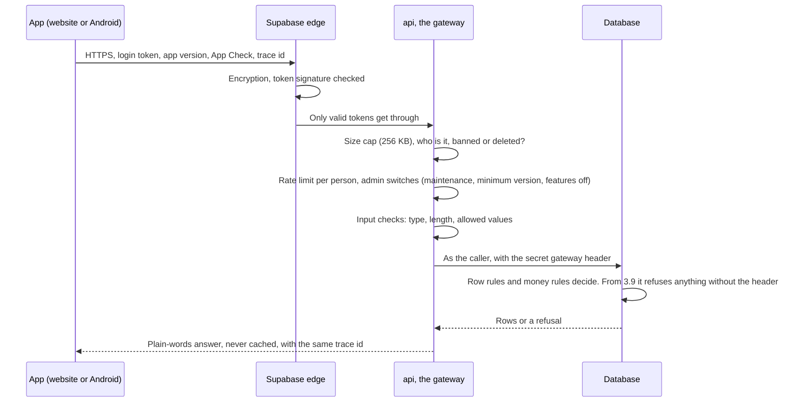
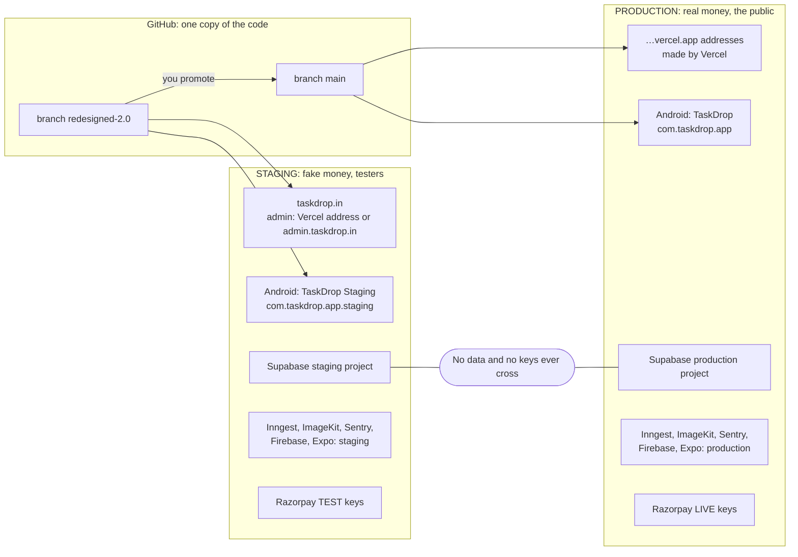
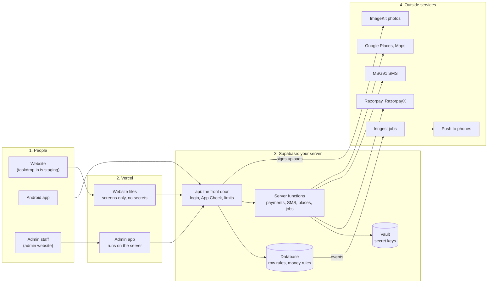
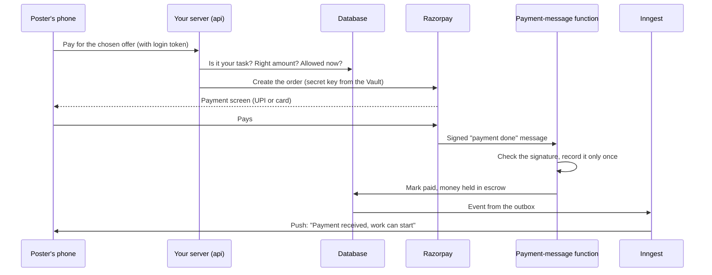

# TaskDrop: the ultimate plan

**The only plan you need.** Read it in this order:

1. **The plan on one page** (5 minutes): the road to launch as one picture, the three things that decide launch day, and what to do now. Rewritten on 11 November.
2. **Start here:** your progress, and the green **Next** button at the top, which always opens the next task. Click a task to open its steps; tick it when it is done.
3. **Your app in one page** (2 minutes), if you want to see how TaskDrop works.
4. **The playbook,** whenever you wonder how something is done: coding, testing, debugging, security, Google Play, search, email, marketing.
5. **Staging and production, step by step,** when you set up the two copies.

Everything below those four is detail. You open it only when a task sends you there.

---

## The plan on one page {open}

**CEO rewrite, 11 November 2026.** The plan was read from top to bottom, the app's code was checked for screen sizes, and the rules and prices were checked online on the same day.

**The verdict in four lines**

- **The product is ahead. The paperwork is behind.** Nothing in the code decides launch day any more. The CA, the payment company and Google's 14-day test do.
- **The plan grew faster than it got done.** The top of this page had five summaries that said the same things, and Step 2 grew to 20 tasks with six whole-app checks. This page replaces the five summaries, and rule 11 stops new checks.
- **The freeze had no date,** so work kept arriving after it (1.13, the map bar). It now has one: **Sunday 22 November** (decision 41, decided 11 Nov).
- **One real gap was found today:** on an Android tablet or an unfolded foldable the app shows a stretched phone screen, and Android no longer lets an app stay upright there. The fix is task **1.14**.

**Is this plan final? Yes for its shape, no for its answers (final pass, 11 Nov night).** The steps, gates, costs and order are final: from now on the plan changes only when you answer a decision, a task is done, or a bug or a rule (Google, RBI, GST) changes. Four things are still open, and none of them is Claude's to close:

| Open | Who | What closes it |
|---|---|---|
| Decision 3: Razorpay or Cashfree | You | The two written quotes (S.4) |
| Decision 38: the names of your 2 or 3 launch areas | You | SAY "Decision 38: these areas: ___" |
| Decision 43: who the marketing speaks to first | You | Nothing waits on it before Step 4; 4.2 uses the recommended three unless you say otherwise |
| The paperwork lane: S.2 not booked yet | You | Book the CA. It is still the one task that moves launch day most |

**What changed most recently** is always in the **Changelog** at the end (newest first). On 14 November the plan gained **The playbook** (one place for how every kind of work is done) and a plain-words line at the top of every big section.

**The road to launch, as one picture**

```html
<div class="fig">
<div class="fig-title">The road to launch <span class="pill mut">three lanes at the same time</span></div>
<div class="fig-sub">Inside a lane, a line cannot start before the line above it is done. Launch waits for the slowest lane, and today that is lane 1.</div>
<div class="tl">
<div class="tl-col c3"><b>Lane 1: Paperwork</b><small>You · the slowest lane, 3 to 6 weeks</small><ul><li><strong>First:</strong> S.2 business, GST and the bank account</li><li><strong>Then:</strong> S.6 SMS registration and S.8 the payment company's approval (both need S.2)</li><li><strong>Beside them:</strong> S.4 two written quotes, which answer decision 3 (Razorpay or Cashfree), and S.3 the lawyer's written yes</li></ul></div>
<div class="tl-col c2"><b>Lane 2: Product</b><small>Claude · waits for lane 1 in the middle</small><ul><li><strong>First:</strong> finish 1.13 and 1.14, then freeze (Gate 1, 22 November)</li><li><strong>Then:</strong> build the Plan B money flow (2.21). It needs decision 3 and the lawyer's yes from lane 1</li><li><strong>Then:</strong> one security round on the final code (2.16, decision 30), and Gate 2b</li></ul></div>
<div class="tl-col"><b>Lane 3: Proof</b><small>Testers and workers · 14 days that cannot be shortened</small><ul><li><strong>First:</strong> Gate 2a, the Play Console app and the store file (3.1, 3.2)</li><li><strong>Then:</strong> 12 testers for 14 days (3.3), while the debug loop (2.19) runs</li><li><strong>Beside them:</strong> 20 workers in 2 or 3 areas (4.6), then Gates 3 and 4</li></ul></div>
</div>
<div class="fig-sub" style="margin:14px 0 8px">When all three lanes are done:</div>
<div class="flowline"><span class="fb">Step 5: build production<br><small>about $45 a month starts here</small></span><span class="fa">&rarr;</span><span class="fb">6.3 The ₹10 real-money test</span><span class="fa">&rarr;</span><span class="fb">6.5 You say GO</span><span class="fa">&rarr;</span><span class="fb">6.6 Google Play</span><span class="fa">&rarr;</span><span class="fb"><strong>6.7 Launch day</strong></span></div>
</div>
```

**The three clocks that decide launch day**

| Clock | Why it is slow | It starts on | Whose move |
|---|---|---|---|
| **1. Paperwork:** S.2, then S.6 and S.8 | GST, the bank and the payment company's check take 3 to 6 weeks, and nothing in the code can shorten them | The day you book the CA | **You** |
| **2. The money flow:** S.4 and S.3, then decision 3, then the Plan B build (2.21) and one security round | The Plan B code waits for two written answers: the payment company's and the lawyer's | The day both quotes are in | You, then Claude |
| **3. Google's 14 days:** Gate 2a, 3.1, 3.2, then 3.3 | Google fixes it: 12 testers, opted in for 14 days in a row. It cannot be shortened, but it can start early | The day the 12th tester joins | You and Claude |

Launch day is about **two weeks after the last of these three clocks finishes** (Step 5 and Step 6). If S.2 starts this week, 8 to 10 weeks is realistic. It is an estimate, not a promise.

**Do these now**

| | You (about 4 hours this week) | Claude |
|---|---|---|
| 1 | **Book the CA** (S.2). It is the most important task in the plan: S.6, S.8 and decisions 10 and 17 all wait for it | Finish 1.13 (order 1 and 2), then 1.14 level 1 |
| 2 | Send the Plan B questions to Razorpay and Cashfree (S.4) and the brief to two lawyers (S.3) | Check Gate 2a and tick it (its four tasks show as done; Claude checks its holes list) |
| 3 | **Name your 2 or 3 launch areas** (decision 38). The other defaults are recorded: you said "Use the CEO defaults" on 11 Nov | Get one store file built (3.2). Expo's free builds are used up until 1 December, so first a free build on this PC from a folder with no spaces in its name |
| 4 | Message **20** people for the Google Play test (3.3). Finding them takes days, so start before the store file is ready | Run the audit prompt (2.20, read-only) and fix the six holes from 2.18 |
| 5 | Your clicks: 2.2, 2.3 and 2.4 (about 1.5 hours), and look at the new map on your laptop ("done 1.12") | Write the Plan B design (2.21) when you say "design the Plan B money flow" |

<details id="c-ceo-defaults">
<summary>[CARD] The CEO defaults: accepted by you on 11 November. Still open: decision 3 and the area names</summary>

**Accepted on 11 November 2026:** you said "Use the CEO defaults", so every line below is now your decision, and the Decisions table says so. **Two things are still open:** decision 3 (it waits for the two written quotes, S.4) and the names of your launch areas. For the areas, SAY:

```say
Decision 38: these areas: ___
```

| # | Question | Your decision (the CEO default) |
|---|---|---|
| 3 | Razorpay or Cashfree | **No default.** Take the cheaper one that says yes in writing (S.4). This is the only decision that must wait |
| 10 | Google Play account type | Stay personal while TaskDrop is a sole proprietorship. Move to an organization account only if S.2 makes a company |
| 12 | Limits for new accounts | The recommended limits (₹5,000 a task and ₹5,000 of withdrawals a day, for 30 days and 3 finished tasks) |
| 17 | Name and PAN before a withdrawal | Wait for the CA's answer in S.2, then add the screen before Step 5 |
| 22 | The hands-on tour in guest mode | Yes |
| 25 | An "I am 18 or older" tap for guests | Yes, add it |
| 28 | Production's web address | `taskdrop.in` moves to production at launch; staging moves to `staging.taskdrop.in` |
| 30 | A paid outside tester | One small fixed-price round, after the Plan B flow is built |
| 31 | Where `taskdrop.in/get` sends people | The staging APK now, Google Play from launch day |
| 38 | Launch areas | 2 or 3 neighbouring areas. **The names are still open** |
| 40 | Android tablets at launch | "Never broken" (task 1.14, level 1). The full tablet design waits until after launch |
| 41 | The freeze day | Sunday 22 November |
| F1 (in 3.6) | The website's slow first load on a phone | Fix it, the cheap way: load heavy parts late, and make the pages a link lands on fast |
</details>

<details id="c-best-practice">
<summary>[CARD] The best-practice check, 11 November: 12 habits kept, 9 changed</summary>

**Kept, because they are already the right way to do it**

| Habit | Why it is right |
|---|---|
| Two separate copies, staging and production, with nothing shared | A test can never touch real money or real people |
| The app asks, the server decides; one front door (`api`); row rules in the database | Anyone can read app code, so no rule may live there |
| Every payment message recorded once; money moved in one database step | Money can never be paid twice or half-moved |
| Plan B: pay per task, the payment company holds the money | TaskDrop never holds a balance, so it needs no RBI wallet licence. RBI's payment rules of September 2025 leave the timing of the payout to the contract between the payment company and the merchant, so **"hold until the poster approves" must be written in that contract**. Ask for it in S.4 |
| Free plans until a limit warns; a spending stop and budget alerts on every tool | The bill stays near $45 a month and cannot run away |
| Secrets in one file and the server stores, never in the app | A leaked app cannot leak a key |
| Workers first, in 2 or 3 areas | A task only gets an offer fast where workers are close together |
| Daily backups, a nightly copy outside Supabase, and a practised restore | A backup that was never restored is only a hope |
| New versions to 20% of phones first | A bad release reaches few people |
| Feature freeze before launch | Each new feature must be tested, secured and explained again |
| The lawyer is asked about the data law (DPDP) and complaint times | The data law applies in full from **13 May 2027**; the consent notice, the breach notice and deletion must be ready before then |
| Google's 12 testers for 14 days is planned, with two gates so it starts early | It is still Google's rule for a personal account (checked 11 Nov) |

**Changed today, because they were not yet the best way**

| # | Before | Now | Where |
|---|---|---|---|
| 1 | The freeze had no date, and work kept arriving | A freeze day, Sunday 22 November. What is not built by then moves to after launch | Gate 1, decision 41 |
| 2 | Six whole-app checks, added one by one, with no order | One order, each run once, and no new kind of check before launch | Rule 11, top of Step 2 |
| 3 | Five summaries at the top of the plan | One page (this one). The 9 November review stays below, closed, as the reasons | Top of the plan |
| 4 | The Android app always used the phone layout and was locked upright | Laid out by width on every device. Tablets and foldables are "never broken" at launch | Task 1.14, decision 40 |
| 5 | The automatic browser tests ran at two sizes (390 and 1280) | Six sizes, from 320 to 1920, with a check on every screen for sideways scrolling | Task 1.14 |
| 6 | "How it grows" had no prices and no numbers for the business | The scaling ladder: what to buy at each step, what it costs, and the number that says when. Plus the area ladder for opening the next area and city | Architecture, How it grows |
| 7 | 15 people asked for the Google Play test | 20, because Google counts only the testers who stay opted in for all 14 days, and some always leave | 3.3 |
| 8 | The store file waited for Expo's free builds | A free build on this PC first; one month of Expo's paid plan only if that fails, because three lost weeks cost more than the fee | 3.2 |
| 9 | The website's first load scored 35 of 100 on a phone-sized test, and the fix was left open | Fix it the cheap way before marketing starts: target 70 on the pages a link lands on | 3.6 (F1), Gate 4 |

**Checked online on 11 November 2026:** Google Play's target level (new apps must target Android 16, API 36, since 31 August 2026); Android 16's rule for large screens; Google Play's testing rule for personal accounts; Supabase's prices (Pro $25, bigger database sizes, point-in-time recovery $100 a month); RBI's payment aggregator directions (15 September 2025); the DPDP rules' dates; and the most common phone screens in India (StatCounter, October 2026). Prices change: check again when you pay.
</details>

---

## Start here {open}

<div id="dash"></div>

**How to read a task**

| Tag | Who does it |
|---|---|
| **You** | You, in a browser or on your phone |
| **Claude** | You copy one sentence to Claude; Claude does the work and reports back |
| **Both** | Claude does part, you click the rest |
| **Later** | Future scope: shown so nothing is lost, never counted in your progress |

Inside a task, every line is one of three kinds: **CLICK** (you do it), **SAY** (copy the purple box to Claude), **TELL** (write what you saw; a screenshot is fine).

<details id="c-rules">
<summary>[CARD] The twelve rules (go in order, pass each gate, never paste a secret, and nine more)</summary>

1. **Go in order.** Start the whole **Start now** track in week 1 as well. It is slow, so it runs beside Steps 1 to 4.
2. **Pass each gate.** A gate is a short checklist at the end of each step. Do not start the next step until every line is true.
3. **Never paste a password, key or secret into the chat.** Claude will never ask you for one.
4. **If a screen looks different** from the steps, stop and send Claude a screenshot. Websites rename their buttons.
5. **When you finish a task, tell Claude its number** (for example "done 2.1"), so Claude ticks it here as well.
6. **Claude pushes, opens the pull request and merges it without asking you** (your rule, 31 Oct). Merging is never a question for you. Claude still asks you first only before: publishing an app update to testers, wiping or resetting data, rotating a key, or touching `main` or production.
7. **After every new feature, check it fits the browser and the screen** (your rule, 1 Nov). Claude does not call a feature done until the website works in Chrome, Edge, Firefox and Safari (latest versions) at phone, tablet and laptop widths, and the Android app works on your phone: nothing cut off, no sideways scrolling, every button easy to reach and tap, text readable (also with bigger text and with the keyboard open). The steps are in the card "Fits every browser and screen".
8. **Secrets live only in the server-side env file** (your rule, 1 Nov). Every secret, new or old, is stored only in `.env.all-secrets` on your PC and in the server-side store that needs it (Supabase function secrets or Vault, Vercel Sensitive variables, Expo Secret variables). Claude never puts a secret in the app or website code, in a name that starts with `EXPO_PUBLIC_` or `NEXT_PUBLIC_`, in Git, in this plan, in a pull request or in chat, and never prints one. Only public values (the Supabase public key, the Sentry address, Firebase web settings) may sit in public names. The details are in task 2.1.
9. **Feature freeze on Sunday 22 November** (decisions 37 and 41). Until then, only what is already in Step 1 is finished (1.13, 1.14, the 1.16 and 1.17 checks). From 22 November only fixes go in. Every new idea goes to **Future scope**, however good it is: a new feature must be tested, secured and explained again, and it moves launch day. **A fix** is a change that makes something already in the app work, read or fit better; **a feature** is anything a person could not do before. When unsure, it is a feature.
10. **Spend only when a number says so** (CEO review, 9 Nov). Before launch, money goes only to what launch cannot happen without (see **What it costs**). A tool is upgraded only when its limit warns (task 7.5). No paid ads until a free post has clearly worked.
11. **No new kind of check before launch** (CEO rewrite, 11 Nov). Step 2 already holds six whole-app checks. Each one runs once, in the order written at the top of Step 2. A new idea for a check becomes one round of the debug loop (2.19), never a new task.
12. **Every screen is laid out by its width, never by the device** (CEO rewrite, 11 Nov). A new screen must work from 320 to 1920 wide, on Android and in the browser. The eight layout rules are in task 1.14.
</details>

---

## The CEO review, 9 November 2026: the cheapest safe path to launch

**This section is the reasons behind the plan.** The up-to-date picture and to-do list are in **The plan on one page** above (11 November); where the two differ, that page wins.

**The short answer.** The plan is safe and complete, but it was not yet the cheapest or the fastest way to launch. The code is weeks ahead of the paperwork, new features kept arriving before the first real customer, and the way money moves (decision 29) is still open, although almost everything after Step 4 depends on it. The seven changes below fix that. They are already written into this plan, and every task number stays the same.

| # | Change | Why it saves money or time | Where |
|---|---|---|---|
| 1 | **Freeze the features now.** **Decided 9 Nov.** Finish the map work in progress (1.12 and the D20 map tab), then build nothing new before launch. New ideas go to Future scope | Every new feature must be tested, secured and explained again. No customer has asked for one yet, because there are no customers yet | Gate 1, decision 37 |
| 2 | **Do the paperwork this week.** S.2 first (a sole proprietorship with GST and Udyam, and a current account), then one fixed-fee lawyer (S.3) and the trademark (S.5) | S.2 has not started, and S.6, S.8 and decisions 10 and 17 all wait for it. Paperwork, not code, now decides launch day | Start now |
| 3 | **Settle the money flow before production.** **Decided 9 Nov: Plan B** (pay per task; the payment company holds the money until approval). **Razorpay or Cashfree is still your choice (decision 3)**, after both quotes. Say "design the Plan B money flow" now: the design works for either, a design costs nothing, and the code waits for the chosen company's and the lawyer's written yes | The wallet (Plan A) needs an RBI PPI licence, which needs about ₹5 crore net worth. Building production, KYC and security tests on the wallet and then switching means doing all of it twice | Decision 29 |
| 4 | **Give production the real name.** At launch, `taskdrop.in` moves to production and staging moves to `staging.taskdrop.in` (free, same domain) | The payment company, the SMS registration, Google sign-in and Google Play each want a real website. The pages Google can read (4.3) and the Business Profile (4.4) only help if they sit on the address customers use. No second domain to buy | Decision 28 |
| 5 | **Keep the monthly bill near $45.** Only Supabase Pro ($25) and Vercel Pro ($20) are paid at launch. Inngest, Sentry, PostHog, ImageKit, Loops and Expo start on free plans in their own production accounts, and one is upgraded only when its limit warns (7.5) | Task 5.4 asked for Inngest's paid plan; its free plan already gives production its own 50,000 runs a month, and 3.5c moves the database-only jobs to pg_cron, so far fewer runs are used | 5.4, What it costs |
| 6 | **Test security once, on the final code.** The automatic guards keep running on every change. The AI attacker (2.16) and any paid tester (decision 30) run after the money flow is built | Testing money code that is about to be rewritten is wasted money | 2.16, decision 30 |
| 7 | **Launch in 2 or 3 neighbourhoods, not all of Hyderabad.** Workers first, then posters, in the same few square kilometres | A task needs an offer within 30 minutes, and that only happens where workers are close together. A whole city is too big to fill at once | 4.1, 4.6, decision 38 |

**Parked until after launch** (nothing is deleted; say "unpark" and the number to bring one back): **1.9** (ideas from Qwikyo and Heplo), **3.5b** (caching: the database is far from busy), **4.10** (email sequences: with no users there is no one to nudge, so they start in month 2).

**New in S.2: a tax that can eat the margin.** For house-keeping tasks such as cleaning, plumbing and carpentry done by a worker who is not GST-registered, GST law (section 9(5)) makes the platform pay the GST, reportedly 5% of the task price with no credit back. On a ₹150 cleaning task that is about ₹7.50, more than half of what TaskDrop keeps. The CA must answer this before the fees are final. The sums are in **What it costs**.


---

## Your app in one page {open}

**TaskDrop: "Ask for anything. Someone gets it done for you."** A person posts a task (in person nearby, or remote), helpers send offers, the poster picks one, and TaskDrop holds the money until the work is approved.

```html
<div class="fig">
<div class="fig-title">How one task works</div>
<div class="journey">
<div class="jstep"><b>1. Post</b><small>Write one sentence ("What's on your mind?"). AI turns it into a task with a budget, a time and a place, or "remote".</small></div>
<div class="jstep"><b>2. Offers</b><small>Helpers nearby see it on the list and the map and send offers. The poster can chat and compare.</small></div>
<div class="jstep"><b>3. Accept</b><small>The poster accepts one offer. The money is held (escrow), not paid yet: by TaskDrop's wallet in staging today, by the payment company under Plan B.</small></div>
<div class="jstep"><b>4. Done</b><small>The helper finishes. The poster has 3 days to approve or report a problem.</small></div>
<div class="jstep"><b>5. Paid</b><small>The helper is paid to a bank. Today earnings clear after 7 days and are withdrawn; Plan B pays out per task.</small></div>
</div>
</div>
```

**The people**

| Who | What they do |
|---|---|
| **Poster** | Asks for help, pays from the wallet, approves the work, leaves a review |
| **Helper (worker)** | Finds tasks on the list or the map, sends offers, does the work, withdraws earnings |
| **Guest** | Looks around without an account; signs up to post or offer |
| **You and your staff** | Run the admin website: users, tasks, money, disputes, reports, app settings, staff roles |

**What is in the app today:** AI-assisted posting, Explore, Find Work, the nearby map of tasks and helpers, offers and chat, wallet top-up and withdrawal, promotions, streaks and reviews, push notifications, the app tour, guest mode, TaskDrop Together (City Hunt, Big Days), the Ideas and feedback board, account deletion and the 18+ age check.

**The money rules today** (the wallet flow built in staging; Plan B, decision 29, may change how money is held and paid out, and the fees are set after the CA answers in S.2): poster's service fee **3%**, helper's commission **10%**, a **5%** fine for cancelling after work starts, **3** days to approve, **7** days before earnings can be withdrawn.

**The parts and the tool behind each**

| Part | Tool | Job |
|---|---|---|
| Android app and website | One React Native (Expo) codebase | The same screens on the phone and in the browser |
| Admin website | Next.js, its own repository | Only you and your staff sign in |
| Server, database, sign-in | Supabase | `api` is the one front door: login, App Check and limits are checked there |
| Background jobs | Inngest | Push messages, alerts, clean-ups, from database events |
| Photos and videos | ImageKit | Uploads are signed by the server |
| Payments and payouts | Razorpay and RazorpayX today; Plan B uses Razorpay Route or Cashfree Easy Split (decision 3, open) | Test mode in staging; live mode in production once the money flow is built |
| Sign-in text messages | MSG91 | Production only; staging shows the code on screen |
| Push, maps, App Check, Google sign-in | Firebase and Google Cloud | Each key limited to its own app |
| Errors and funnels | Sentry, PostHog | Where problems and drop-offs show up |
| Hosting and phone builds | Vercel, Expo (EAS) | Vercel serves the websites; Expo builds and updates the Android app |
| Code | GitHub | `redesigned-2.0` feeds staging; `main` feeds production |

**There are two copies of everything.** **Staging** (`taskdrop.in`, fake money, testers) and **production** (real money, the public, built in Step 5). Code moves from staging to production; data and keys never do. Every tool and ID is in **Your accounts map**; the deeper drawings are in **Architecture and system design**.

---

## The playbook: how every kind of work is done {open}

**In plain words:** one place that says how TaskDrop is planned, built, tested, fixed, secured, released and marketed. Each row is the rule in one sentence and a link to the task or card with the steps. When you wonder "how do we do this?", look here first.

**Where it comes from (14 November 2026).** Three sources you shared, each checked line by line against what this plan already does: the Starter Story **AI App Bootcamp** (all 36 lessons; the four on debugging and design were already in), the **Vibe Coder OS** Notion page (its 12-day checklist and prompt library), and Nick Saraev's 4-hour **How to Build Mobile Apps with Claude Code** course with its store guide and security prompt. TaskDrop already follows most of their advice, often more strictly. Rows marked **New** are what they added. What was left out, and why, is the last card.

| Area | The rule, in one line | Where the steps are | Status |
|---|---|---|---|
| Planning | Every task lives in this plan; Claude reads it before working and ticks it in the same pull request | [The twelve rules](#c-rules) | Have |
| Asking for a change | Name the task, the screen, what should happen, what happens to the data next, and add a screenshot | Card "Working with Claude" below | **New** |
| A new outside service | Before a new provider is coded, Claude reads its official docs and writes a one-page brief you approve | Card "Working with Claude" | **New** |
| Risky edits | For money, migrations, row rules and sign-in, Claude writes the plan and why it will work, waits for your yes, then changes only that | Card "Working with Claude" | **New** (was only for bugs) |
| New packages | A package is checked before it goes in: real, widely used, not brand new, works with Expo 58 | Card "Working with Claude" | **New** |
| Who does what | Opus plans and reviews the hard parts; Sonnet helpers build and check | Your model-split rule | Have |
| Design | Borrow proven patterns, rebuild them in TaskDrop's own components and colours, you approve the still first | [Design card](#c-design) | Have |
| Fits every screen | 320 to 1920 wide, four browsers, Android, bigger text | [Card](#c-compat), [1.14](#t1-14) | Have |
| Testing on a phone | Website at phone size, then the staging app, then your phone on mobile data; after a phone-found fix, start again from the top | [Real-phone checklist](#c-phone) | **New** |
| Debugging | Rounds, a ledger, one bug at a time, evidence before code, a failing test first | [2.19](#t2-19), [DEBUGGING_PLAN.html](DEBUGGING_PLAN.html) | Have |
| Security | 12 checks, the hunt, and the 41-item audit run in rounds, each round from a fresh start | [Security](#security-your-shield-and-the-holes-found-today), [2.20](#t2-20) | Have, **rounds added** |
| Releasing a change | Staging first, one quiet day, then production to 20% of phones | [Release card](#c-release), [5.0e](#t5-0e) | Have |
| Google Play | Listing, data safety checked against a scan of the code, a reviewer login, 12 testers for 14 days, 20% rollout | [3.1](#t3-1), [3.3](#t3-3), [6.6](#t6-6) | Have, **code scan added** |
| Found on Google and WhatsApp | One heading per page, a title and description, a share preview that looks right on WhatsApp, a sitemap, Search Console | [4.3](#t4-3), [6.4](#t6-4) | **Checklist added** |
| Moving to the real address | Every place that names the web address is changed in one pass | [5.10](#t5-10) | Have, **3 lines added** |
| Email | The sender domain is proven (SPF, DKIM, DMARC), no test links in emails, one test in a real inbox | [4.10](#t4-10), decision 48 | **Checklist added** |
| Backups | A nightly copy outside Supabase and one practised restore before GO | [5.9](#t5-9), [6.5](#t6-5) | Have |
| Marketing before launch | Workers first in 2 or 3 areas; Reddit only from an account warmed up for two weeks; three versions of every post | [Marketing playbook](#marketing-playbook-how-taskdrop-gets-its-first-users), [4.8](#t4-8) | Have, **warm-up added** |
| After launch | 20% of your time building, 40% getting attention, 40% talking to customers, and one feedback loop every week | [Step 7](#step-7-run-and-grow-the-first-90-days-then-every-week), [7.3](#t7-3) | **New** |

<details id="c-claude-habits">
<summary>[CARD] Working with Claude: five habits added on 14 November, and two optional helpers</summary>

1. **Ask for a change in five parts** (Starter Story, "Writing effective prompts"). Which task, which screen or component, what should happen, what happens to the data next, and a screenshot of how it looks now (and of what you want, if you have one). Copy this and fill the blanks:

```say
Change request. Task: ___. Screen: ___. What should happen: ___. What happens to the data next: ___. Screenshot attached.
```

   Claude ends every piece of work by saying what is done, how you can test it, and what is next; anything it skipped or could not check is said in the same message (Starter Story, "Building your knowledge base").
2. **A one-page brief before any new outside service** (Starter Story, "API research workflow"; Vibe Coder OS, Day 4). Before a new provider is coded (Razorpay Route or Cashfree for 2.21, MSG91 for S.6, Loops for 4.10, DataFast if decision 49 says yes), Claude reads the provider's official documentation and writes `docs/integrations/<provider>.md`: what it is for, the calls used, how each side proves who it is (keys, webhook signatures), the data stored, the limits and prices, the errors and retries, and the test plan on staging. You approve the brief, then it is built. On any pay-as-you-go provider, automatic top-up stays off and a spending alert is set.
3. **Scope lock on risky edits** (Vibe Coder OS, prompt library). For money, database migrations, row rules, sign-in, and anything that touches production, Claude first writes the plan and "why this will work", waits for your yes, and then changes only what it wrote, keeping everything else working. The debug loop's fix path A already did this for bugs; it now covers planned work too.
4. **A new package is checked before it goes in** (Nick Saraev course; the security prompt, item 5.2). AI tools sometimes name packages that do not exist, and attackers register those names. Before adding one, Claude checks that it exists on npm, has real weekly downloads, is not brand new, is still kept up to date, and works with Expo SDK 58 (some native packages need a new app build, not just an update). These facts go in the pull request.
5. **A fresh start after two failed tries** (Vibe Coder OS, Context Engineering 101; Nick Saraev course). A long session full of wrong guesses gets worse, not better. After two failed fixes, Claude stops, writes what it learned into the ledger entry, and carries on in a fresh session that starts from that entry and this plan. Each new phase of work (build, design, security audit) also starts from a clean session.

**Optional, your yes first.** Each is a small tool for building and testing, not an app feature, so the freeze does not block it.

- **Three narrow helper agents** in `.claude/agents/`: a **migration and row-rule reviewer** (runs before a migration merges, because merging one into `redesigned-2.0` applies it to staging at once), a **payments reviewer** for the Plan B code (webhook signatures, money moved once, amounts checked on the server), and a **release checker** (every check green, migrations listed, whether an app build or only an update is needed, staging and production values never mixed). The Vibe Coder OS page lists eleven such agents; three narrow ones give the benefit without the noise. SAY "build the three helper agents".
- **A staging "time machine"** in the staging admin only: buttons that move a test task past its 3-day approval window or its 7-day clearing, or send a test push, so the debug loop can test the slow money steps in seconds instead of days. It is never built into production, and the 2.14 door tests prove that. SAY "plan the staging time machine".
</details>

<details id="c-phone">
<summary>[CARD] The real-phone checklist: what only a real Android phone shows</summary>

**The ladder** (Nick Saraev course). Every change goes through three steps, and each finds different bugs: **1.** the website at phone size in Chrome; **2.** the staging app on your phone over USB (or an emulator); **3.** your phone on its own, on mobile data. After any fix that step 2 or 3 found, start again from step 1.

**Only a real phone shows:** vibration and sounds; push notifications arriving and opening the right screen; the camera and the photo picker; the status bar (time and battery still readable on a dark header); emoji or icons cut off; the keyboard covering a field; what your thumb can reach; slow mobile data.

**On the phone, every round, try:**

- A fresh sign-up from nothing
- Airplane mode in the middle of a step
- A permission refused (location, camera, notifications), and the app still usable
- Close the app fully and reopen it: still signed in, the draft still there
- A reminder set 2 minutes ahead actually arrives
- Very long text in every box
- The narrowest screen, with nothing pushed off the side
- The app opens in about 3 seconds

**Permissions only when they are needed.** Location when the map or "near me" first needs it, the camera when you tap to add a photo, notifications when you turn alerts on, each with one plain sentence saying why. Asking for everything on the first screen makes people say no. If the app asks earlier today, moving the ask is a fix, so it is allowed inside the freeze.

**Used by:** charter G of the debug loop (2.19), the tester rounds (3.4) and Gate 3.
</details>

<details id="c-left-out">
<summary>[CARD] What was left out of the three sources, and why</summary>

- **Lovable** (its credits, "Try to fix", visual edit, knowledge settings, hosting) and **Cursor**: TaskDrop is built with Claude Code; `CLAUDE.md`, this plan and the ledger do those jobs.
- **Stripe** and its lessons: TaskDrop uses Razorpay or Cashfree (decision 3). The one general lesson (start with the simplest payment step; check every webhook signature on the raw message; record each payment once) is already done.
- **Resend:** decision 48 (not yet). **DataFast:** decision 49 (after launch).
- **Skipping Claude's permission prompts, pasting keys into chat or into an app screen, one Supabase project for testing and real use, switching email confirmation off for good:** each breaks a TaskDrop rule.
- **An eleven-agent "AI team" and paid add-ons** (SuperClaude, memory plugins, CodeRabbit): more cost and noise; the three narrow helpers above keep the useful part.
- **Google Analytics:** PostHog is planned (3.3c), and Google Analytics would need its own consent decision.
- **Web UI kits** (shadcn, Aceternity, Magic UI): they do not run in the React Native app; only the admin could use them.
- **Idea finding and idea validation:** TaskDrop is already built.
- **Sales content:** the bootcamp and coaching links, custom GPTs, discount bundles and affiliate tools.
- **A real-looking secret key** in one lesson's sample files was seen and not copied anywhere.
</details>

---

## Staging and production, step by step {open}

**The idea in one line:** staging already runs; production is built later as a **new project in every tool** (same Gmail, never the same keys), then switched on for real money. Click any step to open its full instructions.

```steps
# A · Staging, the test copy | Runs today on taskdrop.in. Finish these four now: they are free and do not wait for any gate.
5.0a | Make the code know which copy it is | One switch sets the app name, package, icon, server and update channel. A build guard refuses a build that mixes the two copies.
5.0b | Confirm taskdrop.in is staging, and name the staging admin | Claude checks the Staging ribbon and that Google cannot list it. Optional: point admin.taskdrop.in at the staging admin.
5.0c | Install the staging Android app, TaskDrop Staging | Register com.taskdrop.app.staging in Firebase, allow it on the maps key, one build, install from the link, move testers to it.
5.0e | Learn the release routine | Every merge into redesigned-2.0 reaches taskdrop.in and the staging app by itself. Production only gets code that ran a quiet day on staging.
# B · Before production | Production costs money, so it waits for the gates and the paperwork.
- | Pass Gate 4 and finish the slow track | Company and bank (S.2), lawyer (S.3), SMS registration (S.6) and payment approval (S.8). See [Start now](#start-now-the-slow-track-start-in-week-1-runs-beside-steps-1-to-4) and [Gate 4](#gate-4).
- | Decision 29: how money moves | Decided 9 Nov: Plan B, pay per task with the payment company holding the money. Production is built once, on the final money flow. See [Decisions](#decisions-only-you-can-make-these).
- | Decision 28: production gets the real web name | Decided 11 Nov: `taskdrop.in` moves to production at launch (task 5.10) and staging moves to `staging.taskdrop.in`. Google's sign-in screen, the payment company and the SMS registration all want a real website. See [Decisions](#decisions-only-you-can-make-these).
5.1 | Say "I want to launch" | Claude checks every gate and paper. From here, the production accounts start to cost money.
# C · Production, one tool at a time | Sign in as hitendureacts@gmail.com, make a NEW project in each tool, and save every key only in the PROD_ section of .env.all-secrets. Nothing is copied from staging.
5.2 | Supabase: organization "TaskDrop Production", project taskdrop-production | Pro plan ($25 a month), Mumbai, spend cap on, sign-in settings, production-only redirect addresses, daily backups.
5.3 | Google Cloud and Firebase: project taskdrop-production | ₹1,000 budget alert, seven Google services, three restricted keys, Google sign-in, reCAPTCHA, the Android and web apps, push key, App Check (left off).
5.4 | Inngest: organization "TaskDrop Production" | The free plan to start (its own 50,000 runs a month); upgrade only when the limit warns. The Event key and Signing key go into the PROD_ section.
5.5 | ImageKit: a second account, taskdropproduction | Sign up with hitendureacts+prod@gmail.com; turn on usage alerts.
5.6 | Sentry: taskdrop-production and taskdrop-admin-production | Money, spike and security alerts; give Claude the two DSNs.
5.6b | PostHog: project taskdrop-production | EU region; give Claude the project key.
5.7 | Expo: project taskdrop-production | Production variables, the push key and the upload keystore; update channel "production".
5.8 | Vercel: taskdrop-production and taskdrop-admin-production | Pro ($20 a month), built from main, every variable set, every secret marked Sensitive.
5.8b | Harden the two Vercel projects | A $50 spending stop, previews with nothing real and a login, the firewall and an admin sign-in limit.
5.9 | Claude connects everything | An empty database from main, every test shortcut off, a safety alarm, a nightly copy, main protected, your admin account.
5.10 | Production web addresses | Vercel's addresses written into Supabase, reCAPTCHA and Firebase. Production open to Google. Decision 28 (decided 11 Nov): `taskdrop.in` moves to production here and staging moves to `staging.taskdrop.in`.
5.0d | Production Android app | Rehearse with a production APK and a real SMS code, then the store file; App Check is switched on after the Play internal test.
5.11 | Monitors, and prove the two copies are separate | Three uptime monitors; Claude proves no data, key, push, update or sign-in crosses between the copies.
- | Pass Gate 5 | Every line must be true before real money. See [Gate 5](#gate-5).
# D · Switch on real money (Step 6) | One part at a time, with a ₹10 test first.
6.1 | Put the live keys into production yourself | Razorpay and RazorpayX keys into the Supabase Vault; MSG91, Inngest, ImageKit and Google keys into Vercel. Never in the chat.
6.2 | Claude switches on real money, one part at a time | Live payments, then RazorpayX payouts, then the money jobs, each tested before the next.
6.3 | The ₹10 real-money test | Post a ₹10 job, do it from a second account, approve it and withdraw: the money must reach your bank.
6.4 | Google Search Console, Bing and your Business Profile | So people can find the production address.
6.5 | Final launch check: your go or no-go | One restore practice, then Claude checks Gate 6 and you say GO.
6.6 | Release on Google Play | Only after Gate 6: the production store file, then Google's review.
6.7 | Launch day | Launch posts, help the first 10 posters and 10 helpers yourself, watch the alerts all day.
# E · Every change after launch | The same path every time (the full routine is task 5.0e).
- | Staging first | A change merges into redesigned-2.0 and goes to taskdrop.in and TaskDrop Staging by itself.
- | You promote it | After a quiet day in Sentry, you merge redesigned-2.0 into main. A database change waits for your approval.
- | Production follows | Vercel rebuilds both production sites; the Android update waits for your approval, then 20% of users, then everyone.
```

<details id="c-two-copies-glance">
<summary>[CARD] At a glance: which copy uses what</summary>

| | Staging (the test copy) | Production (the real copy) |
|---|---|---|
| Money and data | Fake. Razorpay test mode; test accounts | Real. Live keys; starts empty |
| Website | `taskdrop.in` until launch, hidden from Google; `staging.taskdrop.in` from launch (decision 28, decided 11 Nov) | The Vercel address (expected `taskdrop-production.vercel.app`) while it is built, then `taskdrop.in` from launch (task 5.10) |
| Admin | `taskdrop-admin` (or `admin.taskdrop.in`) | `taskdrop-admin-production` |
| Android app | TaskDrop Staging, `com.taskdrop.app.staging` | TaskDrop, `com.taskdrop.app` on Google Play |
| Code branch | `redesigned-2.0` (automatic) | `main` (you promote) |
| Sign-in code | Shown on screen | A real SMS |
| Cost | Free plans | About $45 a month plus fees |
</details>

---

## The map

```map
 START NOW (week 1): the slow track. Runs beside Steps 1 to 4. All done before Step 5.
 S.1 Play ID check   S.2 company + bank   S.3 lawyer   S.4 payment quotes
 S.5 name + trademark   S.6 SMS registration   S.7 legal contacts   S.8 payment approval

 STEP 1          STEP 2            STEP 3            STEP 4            STEP 5             STEP 6            STEP 7
 Finish, then -> Make it        -> Prove it with  -> Get ready to   -> Build           -> Launch one     -> Run and
 freeze          hacker-proof      real testers      market            production         city              grow
 now             weeks 1-3         weeks 3-6         weeks 4-8         1-2 weeks          real money        every week
   GATE 1          GATE 2a, 2b       GATE 3            GATE 4            GATE 5             GATE 6

 FUTURE SCOPE (separate, not part of your progress): passkeys, iOS, second city, referrals, ads ...
```

**How the steps depend on each other** is drawn in **The plan on one page**. **The two copies** (staging and production) are compared in the card "At a glance: which copy uses what" above, and in full at the start of Step 5.

---

## Your accounts map: staging and production, side by side

**In plain words:** which login owns each tool, and every ID, for the test copy (staging) and the real copy (production), side by side. Open it when a task asks for an account or an ID.

**How to read this section.** The **left side, gold, is STAGING** (the test copy: fake money, fake data, testers only). The **right side, green, is PRODUCTION** (the real copy: real money, real customers). Every tool has its own row, so you can see at a glance, tool by tool: where each copy runs, which account owns it, what project it is, and what is inside. Nothing is hidden behind a click: the reference cards on this page open by themselves, and any task still collapsed shows a dashed "collapsed: click to open" label.

You use **two Google accounts**, plus one email alias. When Google shows an account chooser, check the colour below.

```html
<div class="fig">
<div class="fig-title">The logins you use</div>
<div class="logins">
<div class="am-owner g1"><span class="am-ic">1</span><div><b>hitendureacts@gmail.com</b><small>Chrome profile /u/2 · almost every tool, and the only login the admin website accepts</small></div></div>
<div class="am-owner g2"><span class="am-ic">2</span><div><b>narasimharaju7c@gmail.com</b><small>Chrome profile /u/0 · only Google Play Console</small></div></div>
<div class="am-owner g3"><span class="am-ic">+</span><div><b>hitendureacts+prod@gmail.com</b><small>not a new Gmail: the same inbox as login 1, used only where a tool needs a second account for production (ImageKit, maybe Inngest)</small></div></div>
<div class="am-owner gh"><span class="am-ic">GH</span><div><b>GitHub username hitendureacts77</b><small>the code, shared by both copies</small></div></div>
</div>
</div>
```

### Every tool, side by side (staging left, production right)

| Tool | What it does for TaskDrop | Open it at | Signed in as (staging) | Project name (staging) | What is inside (staging) | Gmail to use (production) | Project name (production) | What is inside (production) |
| --- | --- | --- | --- | --- | --- | --- | --- | --- |
| **GitHub** | The code | [Open](https://github.com/hitendureacts77) | Username **hitendureacts77** (checked) | `taskdrop`, `taskdrop-admin` | Repositories `taskdrop` and `taskdrop-admin`. Branch `redesigned-2.0` | No new account. Same username **hitendureacts77** | `taskdrop`, `taskdrop-admin` (the same two repositories) | Branch `main`, protected. Only code moves from staging to production (5.9) |
| **Vercel** | Hosts the website and the admin | [Open](https://vercel.com/hitenduteam) | **hitendureacts@gmail.com**, username `hitendureacts-2625` (checked) | `taskdrop-staging`, `taskdrop-admin-staging` (today `taskdrop`, `taskdrop-admin`) | Team `hitenduteam` on the free Hobby plan. Built from `redesigned-2.0`. Staging's addresses: `taskdrop.in`, `www.taskdrop.in` and (optional, 5.0b) `admin.taskdrop.in`, plus Vercel's own `taskdrop-git-redesigned-20-hitenduteam.vercel.app` and `taskdrop-admin-git-redesigned-20-hitenduteam.vercel.app` | **hitendureacts@gmail.com** (same team `hitenduteam`, upgraded to Pro) | `taskdrop-production`, `taskdrop-admin-production` | Same team `hitenduteam`, upgraded to Pro ($20 a month). Built from `main`. Addresses made by Vercel, expected `taskdrop-production.vercel.app` and `taskdrop-admin-production.vercel.app` (5.8, 5.10). `taskdrop.in` stays staging's unless you choose to swap it (decision 28) |
| **Supabase** | Database, sign-in, files, server code, Vault | [Open](https://supabase.com/dashboard) | **hitendureacts@gmail.com** (checked) | `taskdrop-staging` (today `taskdrop`; the ref `wjxvingpfbfvkfqhrguj` never changes) | Organization "hitendureacts@gmail.com's Org", free plan. Mumbai. Fake data only | **hitendureacts@gmail.com** (a new organization, not a new login) | `taskdrop-production` | New organization "TaskDrop Production", Pro plan ($25 a month), spend cap on. Mumbai. Starts empty (5.2) |
| **Firebase console** | Push messages to Android, App Check (proves a request comes from the real app) | [Open](https://console.firebase.google.com) | **hitendureacts@gmail.com** (`/u/2`) | `taskdrop-staging` (today **Taskdrop**; the ID `project-a19d1da9-6903-4168-905` and number `629108039430` never change) | Pay-as-you-go plan. Android apps `com.taskdrop.app` and (from 5.0c) `com.taskdrop.app.staging`, and a web app, are registered | **hitendureacts@gmail.com** (`/u/2`) | `taskdrop-production` | New project, Analytics off. Android app `com.taskdrop.app`, web app `taskdrop-web-production`, its own push key and App Check (5.3) |
| **Google Cloud console** | The keys behind maps, place search and Google sign-in, plus billing and the budget | [Open](https://console.cloud.google.com/?authuser=2) | **hitendureacts@gmail.com** (`/u/2`) | `taskdrop-staging` (today **Taskdrop**, the same project as Firebase), under organization `hitendureacts-org` | Keys `taskdrop-android-maps`, `taskdrop-server-places` and the Firebase "Browser key" (no extra website limit on staging for now). Sign-in client `TaskDrop Supabase`. Billing account "My only billing account". Budget `taskdrop-monthly-100` (₹100 a month, alerts only) | **hitendureacts@gmail.com** (`/u/2`) | `taskdrop-production` (the same project as Firebase) | Keys `taskdrop-production-android-maps`, `taskdrop-production-server-places` and its own "Browser key". Sign-in client `TaskDrop Supabase production`. Same billing account. Budget `taskdrop-production-monthly` (₹1,000 a month, alerts at 50%, 90%, 100%). Places search capped at 2,000 a day (5.3) |
| **Google Play Console** | The Android app store | [Open](https://play.google.com/console/u/0/developers) | **narasimharaju7c@gmail.com** (`/u/0`) | No app yet (task 3.1). "TaskDrop Staging" is not on Play | Personal developer account **NLNarasimhaRaju**. The testing tracks hold `com.taskdrop.app` (the 14-day clock) with a staging-server build. The separate staging app `com.taskdrop.app.staging` is installed from an Expo link, not from Play (decision 9, moved earlier on 5 Nov: task 5.0c) | **narasimharaju7c@gmail.com** (`/u/0`), where your developer account is | **TaskDrop** (`com.taskdrop.app`) | The same developer account. The app's **Production** track, linked to the `taskdrop-production` Google Cloud project (5.7, 6.6) |
| **Expo (EAS)** | Android builds, app updates, the push key | [Open](https://expo.dev/accounts/hitendureacts) | Username **hitendureacts**, email hitendureacts@gmail.com (checked) | `@hitendureacts/taskdrop-staging` (today `@hitendureacts/taskdrop`; project ID `08aa002b-4eea-4952-a62a-ec9245e77953`) | Update channel `staging` (was `beta` until 5.0c). Builds `com.taskdrop.app.staging`. Has the staging-only App Check debug token | **hitendureacts@gmail.com**, username **hitendureacts** | `@hitendureacts/taskdrop-production` | New project under the same account. Update channel `production`. Its own push key and variables, and never a debug token (5.7) |
| **Sentry** | Error reports and alerts | [Open](https://sentry.io) | **hitendureacts@gmail.com** (checked) | `taskdrop-staging`, `taskdrop-admin-staging` (today `taskdrop` for the app and server functions, and `taskdrop-admin`) | Organization `hitendu` | **hitendureacts@gmail.com** (same organization `hitendu`) | `taskdrop-production`, `taskdrop-admin-production` | Same organization `hitendu`. Same alert rules. Source-map token `taskdrop-production-sourcemaps` (5.6) |
| **PostHog** | Funnels and screen recordings (3.3c) | [Open](https://posthog.com) | **hitendureacts@gmail.com** (not made yet) | `taskdrop-staging` | EU cloud, free plan. Public Project API key only; no personal API key | **hitendureacts@gmail.com** (same organization) | `taskdrop-production` | Same organization and region, its own Project API key (5.6b) |
| **Inngest** | Background jobs | [Open](https://app.inngest.com) | **hitendureacts@gmail.com** (checked) | Organization `taskdrop-staging` (today `taskdrop`) | Free Hobby plan | **hitendureacts@gmail.com** (a new organization). Only if Inngest refuses a second organization: **hitendureacts+prod@gmail.com** | Organization **TaskDrop Production** | Separate organization on a paid plan, with its own Event key and Signing key. If Inngest does not allow a second organization, a second account with `hitendureacts+prod@gmail.com` (5.4) |
| **ImageKit** | Photo storage and delivery | [Open](https://imagekit.io/dashboard) | **hitendureacts@gmail.com**, name "Hitendu" (checked) | Today's photo account (name not recorded here) | Staging photos | **hitendureacts+prod@gmail.com** (a different address for the same inbox, so ImageKit makes a separate account) | ImageKit ID `taskdropproduction` | Separate account, signed up with `hitendureacts+prod@gmail.com`. Its own URL endpoint and keys (5.5) |
| **Razorpay** | Payments in (test mode now) | [Open](https://dashboard.razorpay.com) | **hitendureacts@gmail.com** (you confirmed, 2026-10-30) | The business account, **Test mode** | Test mode only | **hitendureacts@gmail.com** (same business account, Live mode) | The same business account, **Live mode** | Live keys. Razorpay already keeps test and live data apart (6.1) |
| **Uptime Robot** | "Site is down" emails | [Open](https://dashboard.uptimerobot.com) | **hitendureacts@gmail.com** (you confirmed, 2026-10-30) | "staging website", "staging admin" (renamed in 5.11) | Two monitors (website and admin), pointed at `taskdrop.in` and the staging admin address (5.11) | **hitendureacts@gmail.com** | "production website", "production admin", "production server" | Three new monitors: the production website address, the production admin address and the production `app-config` address (5.11) |
| **Spaceship** | Owns the domain `taskdrop.in` and its DNS | [Open](https://www.spaceship.com) | **hitendureacts@gmail.com** (you confirmed, 2026-10-30), account holder name Narasimha Raju | Domain `taskdrop.in` | Staging uses it: `taskdrop.in`, `www` and, optionally, `admin` (5.0b) | **hitendureacts@gmail.com** | None for now | Production uses the addresses Vercel makes. Option: swap `taskdrop.in` onto production at launch (decision 28, 5.10) |
| **MSG91** | Sign-in text messages | [Open](https://msg91.com) | Not created yet (task S.6) | Not used | The sign-in code shows on screen instead | **hitendureacts@gmail.com** | Your MSG91 account from S.6 | Real SMS. Use **hitendureacts@gmail.com**, like your other tools. Its key goes into production only (6.1) |
| **Cashfree** | Possible second payment company | [Open](https://www.cashfree.com) | No account (you asked for a quote only, task S.4) | None |  | **hitendureacts@gmail.com**, only if you open an account | None | Only if you choose it after the quote |
| **.env.all-secrets** | Your secrets file (on your PC) | Not a website | Exists; protected in task 2.1 | None |  | None (a file, not an account) | None | Holds every key, login, recovery code and account detail, including every production key and the "TaskDrop production database password", under `PROD_` names. It is the only copy (one-file rule, 2.1) |
| **Admin website** | Running TaskDrop | [Open](https://taskdrop-admin-git-redesigned-20-hitenduteam.vercel.app) | Only **hitendureacts@gmail.com** can sign in (your rule, 2026-10-25) | `taskdrop-admin-staging` (today `taskdrop-admin`; Vercel's own address, or `admin.taskdrop.in`, 5.0b) | Staff roles. Dummy staff Priya, Kiran and Neha | Only **hitendureacts@gmail.com** can sign in | `taskdrop-admin-production` (Vercel's address, expected `taskdrop-admin-production.vercel.app`) | Starts with no staff. Only you can sign in. `ADMIN_PHONE` stays empty |

### The two maps with every ID (staging left, production right)

<div class="sbs"><div class="sbs-col stg">

### Map 1: STAGING (the test copy, fake money)

```html
<div class="fig">
<div class="fig-title"><span class="pill stg">Staging</span> Fake money, fake data, testers only</div>
<div class="fig-sub">Web address: <code>taskdrop.in</code> and <code>www.taskdrop.in</code> (decided 5 Nov), plus Vercel's own <code>taskdrop-git-redesigned-20-hitenduteam.vercel.app</code> for the app and <code>taskdrop-admin-git-redesigned-20-hitenduteam.vercel.app</code> for the admin (<code>admin.taskdrop.in</code> if you do the optional step in 5.0b). Built from branch <code>redesigned-2.0</code>. Hidden from Google. Android app: <b>TaskDrop Staging</b>, <code>com.taskdrop.app.staging</code> (task 5.0c). Names marked "today" get the ending <code>-staging</code> later (future scope F.12).</div>

<div class="am-band g1">
<div class="am-owner"><span class="am-ic">1</span><div><b>hitendureacts@gmail.com</b><small>Chrome profile /u/2 · owns every staging tool below</small></div></div>
<div class="am-cards">
<div class="am-card"><div class="am-tool">Vercel <span>hosts website + admin</span></div><dl><dt>Workspace</dt><dd>team <code>hitenduteam</code> (Hobby, free)<br><code>team_ZEyzabHJSWRmHgiiy8ZZ655y</code></dd><dt>Projects</dt><dd><code>taskdrop</code> and <code>taskdrop-admin</code> (today)</dd><dt>Project IDs</dt><dd><code>prj_4j5lBW5qhmpl1egxznEyAQK2RzkE</code><br><code>prj_AWdsUdG8vre4LLPYP1VEhsdldJqq</code></dd></dl></div>
<div class="am-card"><div class="am-tool">Supabase <span>database, sign-in, server</span></div><dl><dt>Workspace</dt><dd>organization "hitendureacts@gmail.com's Org" (Free)</dd><dt>Project</dt><dd><code>taskdrop</code> (today), Mumbai</dd><dt>Project ID</dt><dd><code>wjxvingpfbfvkfqhrguj</code> (never changes)</dd></dl></div>
<div class="am-card"><div class="am-tool">Firebase + Google Cloud <span>push, App Check, maps, Google sign-in</span></div><dl><dt>Workspace</dt><dd>organization <code>hitendureacts-org</code>; billing "My only billing account"</dd><dt>Project</dt><dd><b>Taskdrop</b> (today)</dd><dt>Project ID</dt><dd><code>project-a19d1da9-6903-4168-905</code><br>number <code>629108039430</code></dd><dt>Budget</dt><dd><code>taskdrop-monthly-100</code> (₹100)</dd></dl></div>
<div class="am-card"><div class="am-tool">Expo (EAS) <span>Android builds + updates</span></div><dl><dt>Workspace</dt><dd>account <code>hitendureacts</code></dd><dt>Project</dt><dd><code>@hitendureacts/taskdrop</code> (today)</dd><dt>Project ID</dt><dd><code>08aa002b-4eea-4952-a62a-ec9245e77953</code></dd><dt>Channel</dt><dd><code>staging</code> (was <code>beta</code> until 5.0c)</dd><dt>Android app</dt><dd>TaskDrop Staging, <code>com.taskdrop.app.staging</code></dd></dl></div>
<div class="am-card"><div class="am-tool">Sentry <span>error alerts</span></div><dl><dt>Workspace</dt><dd>organization <code>hitendu</code></dd><dt>Projects</dt><dd><code>taskdrop</code> (app + server), <code>taskdrop-admin</code> (today)</dd></dl></div>
<div class="am-card"><div class="am-tool">PostHog <span>funnels, task 3.3c</span></div><dl><dt>Account</dt><dd><b>hitendureacts@gmail.com</b> (not made yet)</dd><dt>Project</dt><dd><code>taskdrop-staging</code>, EU cloud</dd></dl></div>
<div class="am-card"><div class="am-tool">Inngest <span>background jobs</span></div><dl><dt>Workspace</dt><dd>organization <code>taskdrop</code> (today)</dd><dt>Plan</dt><dd>Hobby (free)</dd></dl></div>
<div class="am-card"><div class="am-tool">ImageKit <span>photos</span></div><dl><dt>Account</dt><dd>"Hitendu"</dd><dt>ImageKit ID</dt><dd>not written down yet (Claude reads it in task 2.3)</dd></dl></div>
<div class="am-card"><div class="am-tool">Razorpay <span>payments</span></div><dl><dt>Account</dt><dd>your business account</dd><dt>Mode</dt><dd><b>Test mode</b> only</dd></dl></div>
<div class="am-card"><div class="am-tool">Uptime Robot <span>"site is down" emails</span></div><dl><dt>Monitors</dt><dd>website and admin (renamed "staging website", "staging admin" in 5.11)</dd></dl></div>
<div class="am-card shared"><div class="am-tool">Spaceship <span>owns taskdrop.in</span></div><dl><dt>Domain</dt><dd><code>taskdrop.in</code>, used by staging (5 Nov)</dd><dt>Staging names</dt><dd><code>taskdrop.in</code>, <code>www</code> and, optionally, <code>admin</code> (task 5.0b). Production uses the addresses Vercel makes</dd></dl></div>
<div class="am-card"><div class="am-tool">Admin website <span>run TaskDrop</span></div><dl><dt>Address</dt><dd>Vercel's <code>taskdrop-admin-git-redesigned-20-hitenduteam.vercel.app</code>, or <code>admin.taskdrop.in</code> (optional, 5.0b)</dd><dt>Who signs in</dt><dd>only this Gmail. Dummy staff Priya, Kiran, Neha</dd></dl></div>
<div class="am-card shared new"><div class="am-tool">.env.all-secrets <span>secrets file on your PC</span></div><dl><dt>Status</dt><dd>protected in task 2.1</dd><dt>Holds</dt><dd>every login, key, recovery code, account detail and the keystore passwords, staging and production. It is the only copy: there is no password manager (one-file rule)</dd></dl></div>
</div>
</div>

<div class="am-band g2">
<div class="am-owner"><span class="am-ic">2</span><div><b>narasimharaju7c@gmail.com</b><small>Chrome profile /u/0 · Google Play only</small></div></div>
<div class="am-cards">
<div class="am-card shared"><div class="am-tool">Google Play Console <span>Android store</span></div><dl><dt>Workspace</dt><dd>Personal developer account <b>NLNarasimhaRaju</b></dd><dt>App</dt><dd><code>com.taskdrop.app</code>, made in task 3.1</dd><dt>Staging uses</dt><dd>the Internal and Closed <b>testing</b> tracks only, with a staging-server build. TaskDrop Staging (<code>com.taskdrop.app.staging</code>) is not on Play</dd></dl></div>
</div>
</div>

<div class="am-band gh">
<div class="am-owner"><span class="am-ic">GH</span><div><b>GitHub: hitendureacts77</b><small>the code, the same for both copies</small></div></div>
<div class="am-cards">
<div class="am-card shared"><div class="am-tool">GitHub <span>code + checks</span></div><dl><dt>Repositories</dt><dd><code>taskdrop</code>, <code>taskdrop-admin</code></dd><dt>Staging branch</dt><dd><code>redesigned-2.0</code></dd></dl></div>
</div>
</div>
<div class="am-legend"><span>Solid box: belongs to staging only</span><span>Dashed box: one account used by both copies</span></div>
</div>
```

</div><div class="sbs-col prd">

### Map 2: PRODUCTION (the real copy, real money)

Everything here is **new and separate** and is made in Step 5. Nothing is copied from staging. The IDs are written in here as each one is made.

```html
<div class="fig">
<div class="fig-title"><span class="pill prd">Production</span> Real money, real customers</div>
<div class="fig-sub">Web address: the ones Vercel makes, expected <code>taskdrop-production.vercel.app</code> and <code>taskdrop-admin-production.vercel.app</code> (decided 5 Nov; <code>taskdrop.in</code> stays with staging, see decision 28). Built from branch <code>main</code>, which only you merge into. Android app: <b>TaskDrop</b>, <code>com.taskdrop.app</code>. Green dashed box = a new account or project you create.</div>

<div class="am-band g1">
<div class="am-owner"><span class="am-ic">1</span><div><b>hitendureacts@gmail.com</b><small>Chrome profile /u/2 · owns almost every production tool, as new projects</small></div></div>
<div class="am-cards">
<div class="am-card new"><div class="am-tool">Vercel <span>task 5.8</span></div><dl><dt>Workspace</dt><dd>same team <code>hitenduteam</code>, upgraded to <b>Pro</b> ($20/month)</dd><dt>Projects</dt><dd><code>taskdrop-production</code>, <code>taskdrop-admin-production</code></dd><dt>Addresses</dt><dd>made by Vercel, expected <code>taskdrop-production.vercel.app</code> and <code>taskdrop-admin-production.vercel.app</code></dd><dt>Project IDs</dt><dd>written here after 5.8</dd></dl></div>
<div class="am-card new"><div class="am-tool">Supabase <span>task 5.2</span></div><dl><dt>Workspace</dt><dd><b>new</b> organization "TaskDrop Production" (Pro, $25/month, spend cap on)</dd><dt>Project</dt><dd><code>taskdrop-production</code>, Mumbai</dd><dt>Project ID</dt><dd>written here after 5.2</dd></dl></div>
<div class="am-card new"><div class="am-tool">Firebase + Google Cloud <span>task 5.3</span></div><dl><dt>Workspace</dt><dd>same organization <code>hitendureacts-org</code>, same billing account</dd><dt>Project</dt><dd><code>taskdrop-production</code></dd><dt>Budget</dt><dd><code>taskdrop-production-monthly</code> (₹1,000, alerts 50/90/100%)</dd><dt>Keys</dt><dd><code>taskdrop-production-android-maps</code>, <code>taskdrop-production-server-places</code></dd></dl></div>
<div class="am-card new"><div class="am-tool">Expo (EAS) <span>task 5.7</span></div><dl><dt>Workspace</dt><dd>same account <code>hitendureacts</code></dd><dt>Project</dt><dd><code>@hitendureacts/taskdrop-production</code></dd><dt>Channel</dt><dd><code>production</code>. Never a debug token</dd><dt>Android app</dt><dd>TaskDrop, <code>com.taskdrop.app</code> (5.0d)</dd></dl></div>
<div class="am-card new"><div class="am-tool">Sentry <span>task 5.6</span></div><dl><dt>Workspace</dt><dd>same organization <code>hitendu</code></dd><dt>Projects</dt><dd><code>taskdrop-production</code>, <code>taskdrop-admin-production</code></dd></dl></div>
<div class="am-card new"><div class="am-tool">PostHog <span>task 5.6b</span></div><dl><dt>Account</dt><dd>same organization, <b>hitendureacts@gmail.com</b></dd><dt>Project</dt><dd><code>taskdrop-production</code>, EU cloud, its own Project API key</dd></dl></div>
<div class="am-card new"><div class="am-tool">Inngest <span>task 5.4</span></div><dl><dt>Workspace</dt><dd><b>new</b> organization "TaskDrop Production", paid plan</dd><dt>If refused</dt><dd>a second account with <code>hitendureacts+prod@gmail.com</code></dd></dl></div>
<div class="am-card shared"><div class="am-tool">Razorpay + RazorpayX <span>task 6.1</span></div><dl><dt>Account</dt><dd>the same business account</dd><dt>Mode</dt><dd><b>Live mode</b>. Razorpay keeps test and live data apart</dd></dl></div>
<div class="am-card new"><div class="am-tool">MSG91 <span>task S.6</span></div><dl><dt>Account</dt><dd>new, made in S.6</dd><dt>Sender</dt><dd>DLT header such as <code>TSKDRP</code>; production only</dd></dl></div>
<div class="am-card new"><div class="am-tool">Uptime Robot <span>task 5.11</span></div><dl><dt>Monitors</dt><dd>"production website", "production admin", "production server"</dd></dl></div>
<div class="am-card shared"><div class="am-tool">Spaceship <span>task 5.10</span></div><dl><dt>Domain</dt><dd><code>taskdrop.in</code> stays with staging</dd><dt>Production names</dt><dd>none for now (Vercel's addresses). Option: swap <code>taskdrop.in</code> onto production at launch (decision 28)</dd></dl></div>
<div class="am-card new"><div class="am-tool">Admin website <span>task 5.9</span></div><dl><dt>Address</dt><dd><code>taskdrop-admin-production.vercel.app</code> (expected)</dd><dt>Who signs in</dt><dd>only this Gmail. Starts with no staff</dd></dl></div>
<div class="am-card shared"><div class="am-tool">.env.all-secrets <span>task 2.1</span></div><dl><dt>Holds</dt><dd>every key, login and recovery code, production included, in its <code>PROD_</code> section. One file on your PC with an encrypted backup (one-file rule)</dd></dl></div>
</div>
</div>

<div class="am-band g3">
<div class="am-owner"><span class="am-ic">+</span><div><b>hitendureacts+prod@gmail.com</b><small>same inbox as login 1 · only where a tool needs a second account</small></div></div>
<div class="am-cards">
<div class="am-card new"><div class="am-tool">ImageKit <span>task 5.5</span></div><dl><dt>Account</dt><dd>new, separate account</dd><dt>ImageKit ID</dt><dd><code>taskdropproduction</code></dd></dl></div>
</div>
</div>

<div class="am-band g2">
<div class="am-owner"><span class="am-ic">2</span><div><b>narasimharaju7c@gmail.com</b><small>Chrome profile /u/0 · Google Play only</small></div></div>
<div class="am-cards">
<div class="am-card shared"><div class="am-tool">Google Play Console <span>task 6.6</span></div><dl><dt>Workspace</dt><dd>the same developer account <b>NLNarasimhaRaju</b></dd><dt>App</dt><dd><b>TaskDrop</b> <code>com.taskdrop.app</code>, <b>Production</b> track</dd><dt>Linked to</dt><dd>Google Cloud project <code>taskdrop-production</code> (5.3)</dd></dl></div>
</div>
</div>

<div class="am-band gh">
<div class="am-owner"><span class="am-ic">GH</span><div><b>GitHub: hitendureacts77</b><small>no new account</small></div></div>
<div class="am-cards">
<div class="am-card shared"><div class="am-tool">GitHub <span>task 5.9</span></div><dl><dt>Repositories</dt><dd>the same <code>taskdrop</code>, <code>taskdrop-admin</code></dd><dt>Production branch</dt><dd><code>main</code>, protected: a pull request and green checks are required</dd></dl></div>
</div>
</div>
<div class="am-legend"><span>Green dashed box: new for production</span><span>Grey dashed box: one account used by both copies, kept apart by mode or project</span></div>
</div>
```

</div></div>

### What may cross from staging to production

```html
<div class="fig">
<div class="fig-title">Only code crosses. Never data, never keys.</div>
<div class="flowline"><span class="fb">You ask Claude</span><span class="fa">→</span><span class="fb">short branch + checks</span><span class="fa">→</span><span class="fb"><span class="pill stg">Staging</span> <code>redesigned-2.0</code></span><span class="fa">→</span><span class="fb">you and testers try it</span><span class="fa">→</span><span class="fb">you merge into <code>main</code></span><span class="fa">→</span><span class="fb"><span class="pill prd">Production</span></span></div>
<div class="fig-sub" style="margin:10px 0 0">Never copied: users, tasks, wallets, chats, photos, staff, test accounts, keys. A staging key used in production is refused, and the reverse.</div>
</div>
```

**Account rules**

1. Make every new account with **hitendureacts@gmail.com**. Where a tool needs a different email for its production account, use **hitendureacts+prod@gmail.com** (same inbox). Google Play stays on narasimharaju7c@gmail.com, because your developer account lives there.
2. **The one-file rule (owner decision, 31 Oct 2026).** Every secret you hold lives in one place: `C:\complete taskdrop\Taskdrop user\.env.all-secrets`. There is no password manager. It holds keys, passwords, account details (email and username), 2-step recovery codes and the keystore passwords, staging and production alike. Wherever a task below says "save it in the secrets file", add it the same day. In the file, production values sit in their own section and every name starts with `PROD_`; Claude keeps `PROD_` names out of anything that copies the file's values to staging. The file is plain text and the only copy, so task 2.1 makes device encryption required and adds an encrypted backup. Never in the chat. (Task 2.1 sets this up.)
3. Names: staging names end in `-staging`, production names end in `-production`. Today's staging tools keep their old names until future task F.12. Never renamed: the GitHub repositories, the Supabase project ID and the Firebase project ID.
4. **Addresses and apps (5 Nov 2026).** `taskdrop.in` is staging. Production uses the addresses Vercel makes (decision 28). Staging's Android app is `com.taskdrop.app.staging` ("TaskDrop Staging"); production's is `com.taskdrop.app`. The full plan is the section "The two copies, side by side" at the start of Step 5. Where an older task below says `taskdrop.in` for the public or production site, read it as "the production web address" (5.10).


---

## Security: your shield, and the holes found today

**In plain words:** no app can be made unhackable. This table is TaskDrop's 12 safety checks and where each one stands; the list of every hole found is folded underneath. What is left to do is in order at the top of Step 2.

**The honest goal.** No app can be made unhackable. TaskDrop aims for this: a break-in is **unlikely**, it is **noticed within minutes**, a stolen key **does little damage**, and recovery is **written down and fast**. Step 2 builds this. The tests are done the way a real attacker would work, but only against staging, never against production or the payment companies.

**Security in one page** (made simpler on 4 November 2026). If you read only one thing about security, read this table. Its 12 checks hold everything: the checks already in this plan, every point from the 8 Upwork proposals (task 2.18), all 16 lines of [Matt Palmer's security checklist for vibe-coded apps](https://gist.github.com/mattppal/5c01ef4447e94515a03314db1ef2403e), the Betterleaks secrets audit you shared (task 2.15) and [Strix](https://github.com/usestrix/strix), the free AI attacker (task 2.16), and the 41-item audit prompt from the vibe-coded security guide (task 2.20). What is left, in order, is the **security path** at the top of Step 2. The full detail (every hole, the Vercel table, the bug list) is in the card under the picture. **Both code folders, every check (owner, 13 Nov).** Every check in this table, and every task from 2.5 to 2.20, covers the app and its server (`taskdrop`) **and** the admin panel (`taskdrop-admin`, staging `admin.taskdrop.in`). A finding in either folder takes the same H or B number series and the same "fix" or "accept" rule.

| # | The check, in plain words | Where TaskDrop stands | Finished in |
|---|---|---|---|
| 1 | **Safe connection.** Nobody can listen in or show the site inside another page; the browser gets safety headers | **Done.** HTTPS only (Vercel and Supabase); HSTS, `nosniff`, a frame block and a referrer rule on both sites. The website's content policy now blocks bad scripts instead of only reporting them (H9 closed 4 Nov, PR 233); the report address stays on | 2.6 (done) |
| 2 | **No key leaks, now or ever.** No secret in the app, the website, Git or chat | **Done.** New changes: rule 8, a scanner on every change, a test that fails if a secret reaches the app. Every file and the whole history were scanned and judged key by key on 4 Nov (2.15): nothing exposed that is a real live secret; one old test key pair (accepted) and one before-launch step (H56). Both code folders are still public until you click (H27) | 2.5 and 2.15 done; 2.13 H (your click) |
| 3 | **Real sign-in.** A proper sign-in provider, passwords stored safely | **Done.** Supabase Auth: one-time codes, hashed passwords, Google sign-in, signed login tokens. The OWASP check found two small gaps for your answer (H30, H31) | 2.13 C |
| 4 | **Every door checks who you are and what you may do.** Person A never reaches person B's data | **Done on staging.** All 113 database functions check the caller; a test fails if a new door has no lock; a two-person test over every `api` action found nothing leaked (built 4 Nov). The last side door (H3) closes in 3.9 | 2.7, 2.12, 2.13 A and G; 3.9 |
| 5 | **A limit on every door.** Bots cannot spam sign-in, SMS, posts, uploads or withdrawals, or flood the site | **Mostly.** Every server door has a per-person limit, and a test stops a new door without one (built 4 Nov); Vercel blocks floods on the website. Added 5 and 6 Nov: a daily text-message cap per phone number (10 a day, with 20% of the day's allowance held for numbers that already have an account), daily caps on the place search (150 a person, 3,000 in all, then the free OpenStreetMap search takes over), on ad clicks and views, on files stored a day, and on posting tasks and ideas (20 a day, 5 for a new account) (H39, H40, H43, H44, H47). Left: the rush and spammer test's results (H29) | 2.8, 2.8b, 2.13 A; 2.13 J |
| 6 | **Hostile input is refused.** Script code, database tricks and odd values do nothing | **Done.** Every `api` input is checked; database queries are never built from typed text; a code scanner (Semgrep) reads every change and runs every Monday (built 4 Nov) | 2.9, 2.13 B |
| 7 | **Sessions and cookies are safe.** A forged request from another website cannot act for you, and a session can be ended | **Mostly.** The app sends a login token, not a cookie; "Sign out of all devices" and the admin's button stop a session at once (on staging 4 Nov). The hunt (4 Nov) found that forged requests from another website are stopped, and on 6 Nov the admin's login cookies were locked down: page scripts can no longer read them (HttpOnly, Secure, SameSite Lax, 12 hours at most), and the live panel and the authenticator go through server routes (H37 partly closed, admin PR 46). Still open: Supabase itself does not yet enforce the 30-minute idle and 12-hour limits, and the Google sign-in button still uses the browser's own client, so its one-time cookie is readable; the new login also needs a manual Google sign-in check (cookie flags, sign-out, live indicator, authenticator) | 2.13 I; 2.14 F |
| 8 | **Errors and logs say nothing private.** No keys, phone numbers or codes in error messages, Sentry or the logs | **Mostly.** Sentry hides secrets; the OWASP checklist went through errors and logs line by line (built 4 Nov). The hunt read the background jobs and logs on 4 Nov: nothing private in them; one small leak fixed (B19, the export log kept the search text); lock-screen pushes for chat, questions, money, support, security and admin warnings now show a plain line such as "You have a new message" (H42 closed 6 Nov, PR 260, your decision 26); offers and task updates keep their text. Left: a rare double push (B18, Low) | 2.13 C; 2.14 H |
| 9 | **Uploads are safe and files are private.** Only real photos and videos of a fair size; nobody opens another person's file | **Mostly.** Private files only, shown through short-lived links; 20 uploads a minute and 15 MB each; a test that no file is public. The hunt (4 Nov) found photos in ImageKit are fine (ImageKit removes the hidden location). Left: your click to make the code folders private (H27), and the location stored inside videos (H38). **Fixed 5 and 6 Nov:** pictures go only through ImageKit in production, upload links expire after 5 minutes, a weekly job finds stray files in ImageKit (H41; needs a deploy to start and a dry run first), and a daily cap on stored files (H44). The location inside videos is **not** stripped yet: a plain notice tells people, and the real fix is a step on the server (ffmpeg), still open | 2.13 H; 2.14 H |
| 10 | **Packages kept up to date.** Old libraries are where most holes come from | **Mostly.** `npm audit` on every change and every Monday (built 4 Nov); Dependabot suggests new versions. One accepted warning waits for review by 13 December | 2.6, 2.13 B |
| 11 | **Attacked for real before launch.** Someone tries to break in on purpose and proves each hole | **In progress.** Claude's hunt: rounds 1 and 2 done 4 Nov; it found 2 Critical and 2 High (money could be created from nothing) and both Critical bugs and the High "old helper presses Start" are fixed and live (PR 236, migration 148); the High "direct database access" (H52) is the known open door H3 and closes in 3.9. **On 5 and 6 Nov the Medium finds were fixed** in five pull requests (259 to 264) and two admin ones (45, 46): H33, H39 to H44, H47, H61 to H63, H66, H67 and B31 are closed, H37 and H38 partly; all on staging, production untouched. Still to come: the wallet record list (H34, design done, waiting for your "start H34"), the outside testers' advice (2.18), Strix (waiting for you), then 2 or 3 testers you invite | 2.14, **2.16**, 2.13 E |
| 12 | **Notice fast, recover fast, guard your own logins.** Alarms, an emergency guide, backups, your accounts | **Partly.** Budget and Sentry alarms, the decoy key and the emergency guide are in place. Yours: the clicks in 2.2 to 2.4. Backups outside Supabase come with production. 2-step sign-in is deferred by you (H14) | 2.2 to 2.4, 2.10, 5.9, 6.5 |

**Questions for you from the security work** (4 Nov). The full wording is in the Decisions list at the end. Each has a recommended answer; say it, or say your own.

- **Decision 17, PAN before withdrawals.** **Decided 11 Nov:** ask your CA in S.2, then Claude adds the screen before Step 5.
- **Decision 18, H33: who may download everyone's phone numbers and emails** (open since round 1). Recommended: only Admin and Support. **Built with the recommended answer on 6 Nov (admin PR 45);** say "Decision 18: keep for all roles" to change it.
- **Decision 25, H68: an 18+ check for guests.** **Decided 11 Nov:** add a one-tap "I am 18 or older" before guest mode, because the Terms are 18+ only. Not built yet.
- **Decision 26, H42: lock-screen notifications show private detail** (names, rupee amounts, the start of a chat). Recommended: show a plain line such as "You have a new message" and keep the detail inside the app. **Decided: the recommended answer, plain line. Built 6 Nov (PR 260).**
- **Decision 27, H47: the cost and limits of new accounts** (daily cap on posting tasks and ideas; sign-up is cheap while codes show on screen). Recommended: 20 tasks and 20 ideas a day, fewer for brand-new accounts. **Built with the recommended answer on 6 Nov (PR 262): 20 a day, 5 a day for a new account;** say it to change.
- **Decision 29, 3.5b: how old the same-for-everyone lists may be** (Trending, Top helpers, today's numbers). Recommended: up to 10 minutes. Money, tasks, offers and chats are never shown old.

```html
<div class="fig">
<div class="fig-title">Five layers of protection</div>
<div class="fig-sub">Each layer catches what the one above misses.</div>
<div class="layers">
<div class="layer"><span class="ln">L1</span><span class="lt"><b>Stop leaks</b><small>A scanner blocks keys before they reach GitHub; secrets hidden from logs; a test fails if a secret reaches the app; a full audit of every key ever committed. Tasks 2.5, 2.6, 2.15</small></span><span class="st part">Scanning on, rest in 2.5</span></div>
<div class="layer"><span class="ln">L2</span><span class="lt"><b>Guard the places keys live</b><small>One secrets file with an encrypted backup, 2-step sign-in on every important account, keystore out of OneDrive, device encryption, Sensitive settings. Tasks 2.1, 2.3 (2-step sign-in 2.1b deferred, passkeys F.1: future scope)</small></span><span class="st no">Not started</span></div>
<div class="layer"><span class="ln">L3</span><span class="lt"><b>Lock the doors</b><small>Every database function checks who is calling; CORS, limits, SMS caps; direct database access closed; test shortcuts off in production; a test that every server door has a lock and a limit, a code scanner, the OWASP checklist, an AI attacker. Tasks 2.6 to 2.9, 2.13, 2.16, 3.9, 5.9</small></span><span class="st part">Partly</span></div>
<div class="layer"><span class="ln">L4</span><span class="lt"><b>Notice fast</b><small>Budget alerts, Sentry spike alerts, the decoy key, the monthly check. Tasks 2.2, 2.10, 7.4</small></span><span class="st part">Partly</span></div>
<div class="layer"><span class="ln">L5</span><span class="lt"><b>Recover fast</b><small>Key emergency guide, rollback rehearsal, a nightly database copy outside Supabase, one real restore. Tasks 2.10, 3.7, 5.9, 6.5</small></span><span class="st no">Not started</span></div>
</div>
</div>
```

<details id="c-security-detail">
<summary>[CARD] The detail: every hole found (H1 onwards), what Vercel gives you and what stays yours, and the bug list</summary>

**The holes found (checked by Claude on 30 October 2026, on staging; H15 to H17 added on 31 October from the best-practices check; H18 and H19 added on 31 October from the Vercel security check; H20 and H21 added on 2 November from Supabase's rate-limit guide; H22 to H25 added on 3 November from the WhatsApp advice, task 2.13; H29 added on 3 November from a second paste, task 2.13 part J; H35 to H55 and H61 to H68 added on 4 November from the second round of the hunt, task 2.14; H56 added on 4 November from the secrets audit, task 2.15; H71 to H76 added on 6 November from the Upwork proposals, task 2.18)**

Sources: Supabase's own security check on the staging database (rerun on 31 October: the same 113 functions, the same signed-out `get_app_controls`, the same 7 private tables and leaked-password protection off, so nothing new), `npm audit` on both code folders, the break-it pass of 25 October, and a read of both `vercel.json` files, the admin's `next.config.mjs` and `middleware.ts`, and the Edge Functions' CORS settings.

**What Vercel already gives you, and what stays yours** (checked 31 October 2026 against Vercel's plan pages)

| Vercel does it | Still yours |
|---|---|
| HTTPS certificates and renewal; flood (DDoS) blocking on every plan; the servers and their updates | Who may see which task: row rules, checks inside every `api` function and every admin route |
| A firewall (3 custom rules on the free plan, 40 on Pro), IP blocking, Attack Challenge Mode | Limits on sign-in codes, SMS and task posting. They live in Supabase, where Vercel's firewall cannot see (H18) |
| Preview builds locked behind a Vercel login | Keeping production values out of preview builds (5.8b) |
| Secrets stored encrypted when marked Sensitive | Never putting a master key in a `NEXT_PUBLIC_` or `EXPO_PUBLIC_` name (the 2.5 test checks this) |
| Free plan is for non-commercial use only; Pro is $20 a month with $20 of usage included | A hard spending stop (Pro only emails you by default), set in 5.8b |
| Looks after nothing in your code | Security headers (already set in both `vercel.json` files and the admin's middleware), package warnings (H7), Sentry alerts, backups (H16) |

What the audit found good: the website sends HSTS, `nosniff`, a frame block and a referrer rule; the admin has a nonce-based content policy, a 30-minute idle timeout and a 12-hour cap; no master key appears in the mobile app; and the only `NEXT_PUBLIC_` and `EXPO_PUBLIC_` names are addresses, public keys and business details.

| # | The hole, in plain words | How bad | Closed in |
|---|---|---|---|
| H1 | Any phone number signs in with a code shown on screen (`dev_otp_for_all`). Fine for testing; a disaster with real users | Critical in production (on purpose in staging) | 5.9 switches it off |
| H2 | **113 special database functions can be called by any signed-in person.** Each one must check who is calling. None is known to be broken, but they have not all been tested | High until tested | 2.7 tests every one |
| H3 | A script with the public key can talk to the database directly, skipping the `api` front door (row rules still apply) | High: the biggest open door | Production is built with it closed from day one (5.9). Staging closes it in 3.9 |
| H4 | The admin app falls back to the master database key if its own secret is missing | High | 2.5 |
| H5 | No secret scanner runs on code changes, and nothing stops a commit that contains a key | High | 2.5 |
| H6 | The secrets file and the keystore passwords sit together in OneDrive | High | 2.1 |
| H7 | 15 package warnings in the user app, **7 of them high** (the admin app has 0) | Medium | 2.6 |
| H8 | Server functions answer requests from any website (CORS `*`). Not open today because a login token is needed, but wider than needed | Medium | 2.6 |
| H9 | The full content security policy only reports problems; it does not block them yet | Medium | **Closed 4 Nov** (2.6, PR 233: the website's policy now blocks bad scripts; the report address stays on) |
| H10 | Sign-in limits trust a network address that can be faked, and there is no daily cap on SMS | Medium (costs money once SMS is real) | 2.8 |
| H11 | Leaked-password protection is off (Supabase only offers it on the paid plan) | Medium | 5.2 turns it on in production |
| H12 | An unused key, `OMNIROUTE_API_KEY`, is still set | Low | 2.6 |
| H13 | An old column `payout_upi` is readable by signed-in people (it is empty) | Low | 3.9 |
| H14 | No 2-step sign-in on your accounts. Most real hacks steal a login, not a key, and with your no-key-replacement rule a stolen login does more damage | High | **Left open by your decision (31 Oct 2026).** The fix, 2.1b (authenticator app on 8 accounts), is future scope. Passkeys stay in F.1 |
| H15 | A brand-new database built from the code starts with "any phone signs in" on (migration 053), and the `production` app build setting in `eas.json` still points at the staging database. Staging also records every session as a video replay | High for production (fine on staging) | 5.7 and 5.9 fix them; a safety alarm (5.9) catches them if they ever come back |
| H16 | No database copy kept outside Supabase, and no restore ever practised. Staging's free plan has no backups at all | High for production | 5.9 (nightly copy), 6.5 (restore practice) |
| H17 | Nothing stops a brand-new account from moving large amounts at once, or one person posting a task and "doing" it from a second account | Medium (high once money is real) | 2.11 |
| H18 | Vercel's firewall and flood protection only guard the website and the admin. Sign-in codes, `api`, payments and the Edge Functions are answered by Supabase, so no Vercel rule can slow an attacker there. Their limits must live in the server (and the server functions still answer any website, H8) | Medium | 2.8 (server limits), 2.6 (CORS). Nothing to buy; just never assume "Vercel has it" |
| H20 | Supabase has its own sign-in speed limits (Authentication → Rate Limits), counted per network address. Username sign-in goes through the server function `password-auth`, so Supabase sees **every** username sign-in coming from one server address: all users share one limit of 150 a 5 minutes, and one attacker could use it up for everyone. Many Indian mobile users also share one address (carrier NAT). The limits have never been set on purpose, and the app shows a vague error when they hit | Medium (high once many people sign in at launch) | **Closed on staging 2 Nov** (2.8b); production in 5.9 |
| H21 | Anyone with the public key could create an email account directly at Supabase (`/auth/v1/signup`), skipping TaskDrop's sign-up. **Worse than junk:** an attacker could sign up as `p<someone's phone>@phone.taskdrop.app` with a password they choose. That person's "Create account" then says the number already exists; "Sign in" opens the squatter's account and confirms its email, and the attacker's password then opens it too. Staging has one old probe account made this way (September, a Gmail address, not a phone address) | **High** (raised from Low on 2 Nov after reading `phone-auth`) | **Closed on staging 2 Nov** (PR 191: migration 138 hook switched on, `phone-auth` guard); production in 5.9 |
| H19 | Vercel Pro does not stop spending by default (it only emails at $200), the production projects have no firewall rules, no limit on admin sign-in tries at the Vercel door, and nothing proves that preview builds hold no production values | Medium | 5.8b |
| H22 | No written OWASP check. Claude's tests are built on the OWASP lists, but nobody has gone through a checklist line by line and written down the proof, so a missed item would go unnoticed | Medium | **Closed 4 Nov** (2.13 part C: `docs/SECURITY_OWASP.md`, 0 Critical or High) |
| H23 | No code scanner. Secrets and package warnings are scanned, but nothing reads the code itself for unsafe patterns, and both code folders were public, so an attacker could read it | Medium | **Closed 4 Nov** (2.13 part B: Semgrep on every change and every Monday, both code folders) |
| H24 | Not every server door has a per-person limit, and nothing stops a new door being added without a lock or a limit. The withdrawal function `razorpayx-payouts` has no limit of its own, and the admin's server routes have none in the code (checked 3 Nov) | Medium | **Closed 4 Nov** (2.13 part A: `scripts/check-endpoints.mjs` in both folders; limits on `razorpayx-payouts`, `razorpay` and the admin routes; the Vercel door for admin sign-in stays in 5.8b) |
| H25 | A security researcher who finds a hole has no way to tell you: no `security.txt`, no rules and no promise that a good-faith report is not treated as an attack | Low today, Medium at launch | **Closed 4 Nov** (2.13 part D: `security.txt` is written by the website build; the rules are on the Support page) |
| H26 | Sign-in sessions cannot be ended properly. "Sign out" only signs out the device in your hand; no one (the person or the admin) can end all of a person's sessions; a password change leaves old devices signed in; an old session token keeps working for up to an hour | Medium (high if a phone is stolen) | **Closed on staging 4 Nov** (2.13 part I: migration 142; production in 5.9) |
| H27 | Both GitHub code folders (`taskdrop`, `taskdrop-admin`) are public, so this plan with its list of open holes, the security reports and the emergency guide can be read by anyone. No secret is in them (2.5 proves it), but they are a map for an attacker | Medium | **Open until you click** Make private (2.13 part H, step 4). The file side is checked: `scripts/check-private-files.mjs` |
| H28 | No test goes through every `api` action as a second person, so a new action that showed person B's data to person A would pass every check | Medium | **Closed 4 Nov** (2.13 part G: `scripts/two-person-test.mjs`, 126 operations, nothing leaked, run again after every change) |
| H29 | Nobody has measured what happens when many people arrive at once, or when one person hammers sign-in, sign-up, code sending and uploads. The load test in 3.6 is small and only counts speed; it does not try to break the limits, so a launch-day rush or a spammer would be the first real test | Medium at launch | 2.13 part J (`scripts/rush-test.mjs`; the run is written in `docs/LOAD_TEST.md`) |
| H30 | Password rules are below the OWASP checklist (found 4 Nov, 2.13 part C): 8 characters instead of 12, changing the password needs only the open session and not the old password, no strength hint, no message after a change. A password is only an extra way in beside the phone code | Low | **Your reply "fix" or "accept"** (fix is about half a day) |
| H31 | A text-message code is the main way to sign in, where the checklist wants it only as a second check (found 4 Nov, 2.13 part C). It is how phone-first apps in India work and is limited per number, per address and per day, but a stolen SIM can sign in | Low | **Your reply "accept"** (recommended: it is the product) **or "fix"** |
| H32 | Migration 071 (4 Oct) rewrote the withdrawal function from an older copy and lost three checks: the most per withdrawal (₹1 lakh), "add your name and PAN first", and the holder's name on a bank account. Proven on staging: an established account could ask for more than ₹1 lakh at once. Found by the 2.14 hunt | High (before real money) | **Fixed 3 Nov** (migration 145 and a test; a new test now fails if any database function loses a check this way). PAN: decision 17 |
| H33 | Every staff role, including the read-only Viewer, can download one spreadsheet with every person's name, email and phone number (the People export) | Medium | **Fixed 6 Nov (admin PR 45).** Only Admin and Support see or export the full phone and email; every other role sees them masked, and opening a person's page writes an audit row. Built with the recommended answer to decision 18 |
| H34 | Each wallet is one running number, changed in place by many functions, with no record of each movement, so the books cannot be proven to balance and a wrong change would be hard to trace | Medium (High once money is real) | Build before Step 5: an add-only list of wallet movements and a test that every balance equals its list (2.14). **Still open:** the design is merged (`docs/WALLET_LEDGER_DESIGN.md`, PR 269); nothing built. It waits for your "start H34" and your answers to its nine questions |
| H35 | Any staff login, even the read-only Viewer, could send a refund or trigger RazorpayX withdrawal actions by calling the two money server functions directly, with no authenticator code. The amount and the receiver were right (the database works them out), so no theft, but "Viewer changes nothing" and "money needs a code" were both untrue for these paths. Found by hunt round 2 | Medium | **Fixed 4 Nov (PR 234 + admin PR 44, migration 147)** |
| H36 | Refunds and RazorpayX give-backs left no row in the admin audit log, so nobody could say which staff member pressed the button | Medium | **Fixed 4 Nov (PR 234 + admin PR 44, migration 147)** |
| H37 | The admin's login cookies can be read by page scripts, and the 30-minute idle and 12-hour limits are enforced only by the admin website, not by Supabase. A script that got onto an admin page could steal the login and keep using it directly | Medium | **Partly fixed 6 Nov (admin PR 46).** The login cookies are now HttpOnly, Secure and SameSite Lax with a 12-hour maximum, and the live panel and the authenticator use server routes. **Still open:** the 30-minute idle and 12-hour limit inside the database (`private.is_admin()`); the Google sign-in button still uses the browser client, so its one-time cookie is readable; a manual Google sign-in check is needed on the admin preview (cookie flags, sign-out, live indicator, authenticator) |
| H38 | Videos, documents and any picture sent to Supabase storage keep the location data stored inside them, and while a job is open every signed-in person can open its video. (Pictures kept in ImageKit are fine: ImageKit removes the hidden location. This corrects round 1) | Medium | **Partly fixed 6 Nov (PR 263).** In production pictures go only through ImageKit, so they lose the location; upload links expire after 5 minutes. **Still open:** the location inside videos is not stripped (a plain notice tells people instead; the real fix is a server step with ffmpeg) |
| H39 | The place search has no daily or overall limit, so one account or a few could run up the Google bill | Medium | **Fixed 6 Nov (PR 259, migration 153):** daily caps of 150 a person and 3,000 in all; past the cap the search uses OpenStreetMap, which is free |
| H40 | A person's phone can be texted 120 times a day by someone else, and one bot with about 17 network addresses can use up the whole day's SMS allowance (500 on staging), so nobody new can sign in by text until midnight | Medium | **Fixed 6 Nov (PR 259, migration 153):** 10 texts a day per phone number, 20% of the day's total held for numbers that already have an account, and only real sends are counted |
| H41 | A signed-in person can upload files to ImageKit under their own names and folders, outside the path TaskDrop checks. They take space and are never found or removed | Medium | **Fixed 6 Nov (PR 263), not yet running:** a weekly job (`stray-imagekit-files`) finds files outside TaskDrop's paths; it needs a deploy to register, a dry run first (`IMAGEKIT_ORPHAN_DRY_RUN=1`), and does nothing until the ImageKit keys are set |
| H42 | Notifications on a locked phone show private detail: the other person's name and task, rupee amounts, the first 100 characters of a chat message | Medium (your decision) | **Fixed 6 Nov (PR 260, migration 155), decision 26 = plain line.** Chat, questions, payouts, wallet, refunds, cancel fines, support, security and admin warnings now show a plain line on the lock screen; offers and task updates keep their text |
| H43 | Ad clicks are free, unlimited and unchecked, and they raise a promotion's rank. An advertiser could click their own promotion to win the top slot | Medium | **Fixed 6 Nov (PR 262, migration 152):** daily caps on ad clicks and views, and old ad events are pruned |
| H44 | Nothing limits the total number of files one person can store, so one account could fill the storage | Medium | **Fixed 6 Nov (PR 262, migration 152):** daily caps on the number of uploads and on the bytes a person can add |
| H45 | Three profile fields are readable by every signed-in person: when someone last signed out of all devices, and their weekly earnings goal | Low | **Waiting for your "fix" or "accept"** |
| H46 | The money and place-search functions do not check that the person is suspended or deleted (the `api` does) | Low | **Fixed 4 Nov (PR 234 + admin PR 44, migration 147)** |
| H47 | No daily cap on posting tasks, services or feedback, so a new account could fill the public feed with fake jobs | Medium (before launch) | **Fixed 6 Nov (PR 262, migration 152), the recommended answer to decision 27:** 20 a day, and 5 a day for a new account; the same for feedback. Staging test runs that post more than 5 jobs as one new account in a day now need the setting `post_cap_new_day` raised |
| H48 | Sign-in codes are kept in plain text in the database for the 10 minutes they live | Low | **Waiting for your "fix" or "accept"** |
| H49 | Anyone can learn whether a phone number has a TaskDrop account (the sign-in screen says "no account" or "already exists") | Low | **Waiting for your "fix" or "accept"** (same question as the 2.9 account-existence messages) |
| H50 | The check that background jobs really come from Inngest switches off if a test setting (`INNGEST_DEV`) is ever set on production by mistake | Low | **Fixed 4 Nov (PR 234 + admin PR 44, migration 147)** |
| H51 | **A quote with a negative price creates money.** The database does not insist that a quote is above zero. A quote of minus ₹1,000, written straight into the database, makes the poster's wallet go up by ₹1,030 when accepted, and cancelling gives nothing back. Proven on staging (rolled back) | Critical | **Fixed 4 Nov (PR 236, migration 148, proved on staging)** |
| H52 | The database's own data door is open to every signed-in person, so every check that lives only in the `api` (amount limits, text checks, suspended people, the admin's switches, per-person limits) can be skipped. This is the same open door as H3 | High | Same open door as H3 (direct database access): **closes with 3.9 (gateway-only); until then the new price rules from the H51 fix reduce the damage** |
| H53 | **A job paid by card stays "paid" after the helper backs out**, so the poster can hire a far dearer quote with the old money and the new helper is paid the new price. Proven on staging: ₹1,236 paid in, ₹10,800 of earnings out (rolled back) | Critical | **Fixed 4 Nov (PR 236, migration 148, proved on staging)** |
| H54 | A helper who backed out can come back and press Start after the poster chose someone else, and take the job over. Proven on staging (rolled back) | High | **Fixed 4 Nov (PR 236, migration 148, proved on staging)** |
| H55 | Streaks, "jobs done" and five-star counts can be farmed with a second account of the same person | Low | **Waiting for your "fix" or "accept"** |
| H56 | The beta Android builds carry the App Check debug token (found by the secrets audit, task 2.15). Anyone who got a beta build could use it to pass TaskDrop's app check. FIX SOON: before launch, delete that token in Firebase and confirm the store builds are made without it | Low | 5.9 (before launch) |
| H61 | Guest mode (no account): old full addresses typed before the fix still sit in the public place label, next to the rounded point. Anyone could read them from the feed and the profile cards | Medium | **Fixed 6 Nov (PR 264, migration 154):** guests get an area-only place label, worked out when read |
| H62 | The guest task card is built as "every column except these", so any column added to tasks later would go onto the open internet unreviewed | Medium | **Fixed 6 Nov (PR 264, migration 154):** the guest card is now a fixed list of columns, and a test fails when the tasks table gains a column nobody has decided on |
| H63 | The guest limit counts per network address only: many phones behind one mobile address can lock each other out, and someone with many addresses has no overall ceiling on the database load | Medium | **Fixed 6 Nov (PR 264, migration 154):** a cost-weighted limiter (heavy reads count more), counted per address and for all guests together, with a soft ceiling that serves light reads only and a hard ceiling. Independent review: nothing Critical or High; one Medium left over (a cheap way to push all guests into a "busy" answer), fixed in PR 268 (migration 157) and retested on staging on 6 Nov |
| H64 | Suspended people stay fully visible to guests (their open posts and helper card) | Low | **Waiting for your "fix" or "accept"** |
| H65 | Every public card shows the exact "last seen" time, so anyone can watch when a named person is on their phone | Low | **Waiting for your "fix" or "accept"** |
| H66 | The automatic check of server doors (`check-endpoints`) does not know about the no-login guest door | Low | **Fixed 6 Nov (PR 264)** |
| H67 | If the guest limiter itself breaks, guest calls run anyway instead of being refused | Low | **Fixed 6 Nov (PR 264, migration 154):** if the counter is down, a small per-server budget for light reads applies, so the door is limited, never open |
| H68 | Guests browse every post and profile without any 18+ question (the age check is only at sign-up) | Low (your decision) | **Waiting for your "fix" or "accept"** (decision 25) |
| H69 | Two short memories in the app (answers reused for 30 seconds, and signed photo links) are kept per device, not per person. Signing in or out stops the reuse, but the photo links stay in memory for the next person on a shared phone. They only open pictures the server had already shown that phone, so nothing new is exposed (found 4 Nov while designing caching) | Low | 3.5b (layer A) |
| H70 | When a new server copy starts, a second request that arrives while the first is still loading the secrets gets an empty value instead of waiting. That request can then fail, or skip a check, for no reason (found 4 Nov while designing caching) | Low | 3.5b (layer D) |
| H71 | New doors start open. A new database function can be called by everyone, and a new table can be read by every signed-in person, until a migration says otherwise, and no test covers every table's row rules. Nothing is open today (all 68 tables have row rules, and the signed-out role can run 1 function, on purpose), so this is a trap for the next change, not a leak (found 6 Nov, 2.18) | Low | 2.18 part C |
| H72 | The built-bundle secret test skips itself when no build is present, which is the case in the main CI check; the admin's test has the same "when one exists" shape, and the Android bundle was checked by hand once (1 Nov). Today's scan of `taskdrop.in` found no server key, and the source is scanned on every change (found 6 Nov, 2.18) | Low | 2.18 part D |
| H73 | `razorpayx-webhook` runs without Supabase's login check on staging, which is right, but that setting is not in `supabase/config.toml` and `check-endpoints` does not look for it. On a new production project the function may be created with the login check on: RazorpayX sends no login, so payout updates would be refused with no error in the app. 5.9's test only covers the Razorpay webhook. Not proven on a new project; found by reading the settings on 6 Nov (2.18) | Medium (production only) | 2.18 part E |
| H74 | Row rules guard rows, not columns. Every signed-in person can read 28 columns of `profiles` and 51 of `tasks`, including a task's funding fields, and 29 database calls in `api` ask for every column, so a column added later would reach people unreviewed. No private value was found (`payout_upi` is empty on every row; profile locations are rounded). The same trap as H62, for signed-in people. Includes H13 and H45 (found 6 Nov, 2.18) | Medium | 2.18 part A |
| H75 | The built Android app has been checked from its settings and for keys, but never opened up the way an attacker would: entry points, app links, debug settings (found 6 Nov, 2.18) | Low | 2.18 part G |
| H76 | The Razorpay webhook does not compare the amount Razorpay reports with the amount on record. The signature is checked and the link is made by the server, so this is a second net, not a known way in (found 6 Nov, 2.18) | Low | 2.18 part E |
| H77 | The admin's rate limiter lets every call through when its counter cannot be reached (`src/lib/rate-limit.ts` returns "allowed" on an error), so the 10-a-minute admin sign-in limit and the authenticator limit vanish during a database hiccup (found 13 Nov) | Medium | 2.14 part F, round 3 |
| H78 | The admin sends no security events to Sentry: failed staff sign-ins, wrong authenticator codes and calls refused for the wrong role are not tagged `security_event`, so the "Security spike" alert (2.10) cannot see an attack on the admin (found 13 Nov) | Medium | 2.14 part F, round 3 |
| H79 | The admin's door check (`scripts/check-endpoints.mjs`) proves every route has a role check and a limit, but not that a plain person or a lower staff role is actually refused; only `live/token` is tested that way (`docs/SECURITY_ROLES.md` F3) | Low | 2.18 part B |
| H80 | The admin has no browser tests: no Playwright smoke on `admin.taskdrop.in`, so a broken page or a lost role gate ships unseen, and the debug loop's "admin golden path" is not written down (found 13 Nov) | Low | 2.14 part G, 2.19 |
| — | Accepted on purpose: an old Razorpay **test** key in the code history; `get_app_controls` readable signed out; 7 private tables closed to the app | Info | Nothing to do |

**The bugs found (your walkthrough, the phone runs and the break-it pass)**

| # | The bug | How bad | Fixed in |
|---|---|---|---|
| B1 | 11 walkthrough fixes (under-18 warning, nonsense posts, connected questions, one photo/video button, price slider, ₹500 chip and more) | Medium | Made on a branch; 1.2 merges them |
| B2 | After choosing an offer, Back shows the offer still "Open" with a live button | Medium | 1.3 |
| B3 | In chat, the message box hides behind the keyboard | Medium | 1.3 |
| B4 | The word "phone" in a title turns any post into phone repair | Low | 1.3 |
| B5 | After a review, the app lands on a screen with no tab bar | Medium | 1.3 |
| B6 | A closed account just clears the code, with no message | Medium | 1.4 |
| B7 | The slide-to-start handle is the only way to start a job (no button, no screen reader) | Low | 1.4 |
| B8 | "Offer accepted" shows the time the offer was sent | Low | 1.4 |
| B9 | The offers screen says names are hidden, but the name already shows | Low | 1.4 |
| B10 | A too-short proof text gets the vague "Please check what you entered" | Low | 1.4 |
| B11 | A job opens as grey boxes for about a second | Low | 1.4 |
| B12 | Google sign-in needs one more check on every path | Medium | 1.4 |
| B13 | Razorpay test mode ran out of payment links and shows no UPI | Medium (testing only) | Dropped 31 Oct: test keys have no UPI |
| B14 | 10 design changes you asked for (birth-date wheel, sharper splash, shorter categories, clearer price and more) | Design | 1.5 and 1.6 |
| B15 | The test-data seed files load with triggers off, so 13 staging tasks show a point about 11 m precise on the map instead of the rounded area (about 1 km). Found by the 2.14 hunt | Low (fake data) | **Fixed 3 Nov** in the seed files; the 13 rows correct at the next test-data reset (needs your yes) |
| B16 | A payment that is paid but whose job could not be funded (one short database hiccup at the wrong second) is never retried by itself. The poster sees "paid", the helper cannot start, and only the nightly check notices | Medium | **Fixed 4 Nov (PR 234 + admin PR 44, migration 147)** |
| B17 | A double tap on a slow network can make two payment links for the same job, and both can be paid | Low | **Fixed 4 Nov (PR 234 + admin PR 44, migration 147)** |
| B18 | Rare double push or double alert after a slow moment (the message was sent, then the step is retried) | Low | **Waiting for your "fix" or "accept"** (recommended: accept) |
| B19 | The people-export audit line stores the text typed in the search box, so a searched phone number would stay in the audit log | Low | **Fixed 4 Nov (PR 234 + admin PR 44, migration 147)** |
| B20 | A poster can open a dispute on a task where no work was sent, even an open task with no helper. On a started job it also dodges the 5% fine, because staff then decide | Medium | **Fixed 4 Nov (PR 236, migration 148, proved on staging)** |
| B21 | Nothing ever expires: open tasks stay open after their due time, and a locked task that is never paid stays locked (on staging, 21 open tasks past due and 2 unpaid locks over 2 days) | Low | **Waiting for your "fix" or "accept"** |
| B30 | The "New talent" list shows deleted accounts (3 of 30 cards on staging), to guests and signed-in people | Low | **Waiting for your "fix" or "accept"** |
| B31 | On a shared phone, a guest's drafts and saved tasks move into whichever account signs in next. Drafts are free text, often with a flat number or a phone number | Medium | **Fixed 6 Nov (PR 264):** a guest's drafts and saves move into an account only when the guest signs in from the sign-up pop-up's own sign-in page |
| B32 | The home counter "open tasks" counts posts nobody can see (59 shown, 38 live) | Low | **Waiting for your "fix" or "accept"** |

New holes and bugs found by the bug and security hunt (task 2.14) are added to these two tables, holes from H30 and bugs from B15, each with its proof and the task that fixes it. **From 10 Nov, new bugs come from the debug loop (task 2.19)** and live in `docs/debug-loop/LEDGER.md`, numbered from B33, with their status after every round; B18, B21, B30 and B32 are copied there as its starting list. New security holes still go in the holes table above.

**Hunt round 2 (4 Nov) in numbers:** 38 findings (H35 to H55, H61 to H68, B16 to B21, B30 to B32): 2 Critical (H51, H53), 2 High (H52, H54), 17 Medium and 17 Low. The numbers H56 to H60 are not all used: H56 came from the secrets audit (2.15), and H57 to H60 are simply unused. Critical and High are always fixed; the Critical and High fixes are merged and live (PR 236, migration 148), except H52, which is the known open door H3 and closes in 3.9. The Medium and Low ones marked "Waiting" need your "fix" or "accept".

**Where the hunt stands on 6 Nov.** The Medium finds were fixed on 5 and 6 Nov, all merged into `redesigned-2.0` and deployed to staging (production untouched): **closed** H33, H39, H40, H41 (needs a deploy and a dry run first), H42, H43, H44, H47, H61, H62, H63, H66, H67 and B31; **partly closed** H37 (the admin cookies; the database-side idle limit and the Google button are still open) and H38 (pictures; the location inside videos is not stripped). **Still open:** H34 (the wallet record list: design in `docs/WALLET_LEDGER_DESIGN.md`, PR 269, waiting for your "start H34"), H52 (closes in 3.9), Strix (2.16, needs Docker and an AI key from you), part G of 2.14, your "fix" or "accept" on the Low finds H45, H48, H49, H55, H56 (before launch), H64, H65, H68, B18, B21, B30 and B32, decisions 17, 25 and the password questions H30 and H31, and your click to make both code folders private (H27). One leftover from the independent review of the guest fixes (PR 264, which found nothing Critical or High): a cheap way to push every guest into a "busy" answer; its follow-up fix (PR 268, migration 157) is merged and passed the guest door checks on staging on 6 Nov, with the review's Low notes.

</details>

---

## START NOW: the slow track (start in week 1, runs beside Steps 1 to 4)

**In plain words:** the paperwork only you can do: the business and bank account, the lawyer, the payment company, the SMS registration and the trademark. It is slow and nothing in the code can speed it up, so it runs beside the steps from week 1. Launch day waits for this more than for anything else.

**Why start now:** each of these waits on other people (Google, banks, a lawyer, Razorpay, phone companies) for days or weeks. Starting costs little. Waiting only delays launch. **All eight must be done before Step 5.** Tick each one when it is finished, not when you start it.

Best order: S.1 and S.2 on day 1. S.3, S.4 and S.5 in the first week. S.6, S.7 and S.8 after S.2 (they ask for your PAN and bank account).

**Behind schedule (CEO review, 9 Nov):** only S.1 is done and S.4 is waiting for a reply. **S.2 is now the most important task in the whole plan**, because S.6, S.8 and decisions 10 and 17 all wait for it, and none of them can be hurried later.

<details id="tS-1" data-short="Verify Play account">
<summary>[YOU] <b>S.1</b> Verify your Google Play account (start now: Google takes days) <small>· Done 27 Oct (Google notified "Your identity has been verified successfully"; seen 31 Oct)</small></summary>

**Why:** nothing can be published on Google Play until Google has checked your ID. It takes several days, so start now.

Your Play account is the **Personal** account **NLNarasimhaRaju**, owned by `narasimharaju7c@gmail.com`. In Chrome it is the profile at `/u/0`.

1. CLICK: open https://play.google.com/console/u/0/developers. If Chrome asks which Google account to use, pick **narasimharaju7c@gmail.com**. Click the developer account **NLNarasimhaRaju**.
2. CLICK: on **Home**, under "Finish setting up your developer account", click **Get started** next to **Verify your identity**.
3. CLICK: choose an ID type from Google's list and upload a clear photo or scan. The name must match the name on the Play account. Do not edit or crop the image.
4. CLICK: back on **Home**, click **View details** next to **Verify your contact phone number**, and enter the code Google sends to your phone. If Google asks you to check an Android device, install the **Google Play Console** app on your phone, sign in as narasimharaju7c@gmail.com and approve.
5. Wait. The two banners disappear when Google is done (several days).
6. TELL Claude: "done S.1, the Play account is verified". A screenshot of Home without the two banners is fine.

**Done when:** the Play Console home page no longer shows the two "Verify" banners.
</details>

<details id="tS-2" data-short="Company, PAN, bank">
<summary>[YOU] <b>S.2</b> Business basics: who owns TaskDrop, PAN, GST, bank account <small>· start this week: S.6, S.8 and decisions 10 and 17 wait for it · 1 to 3 weeks · bank and CA fees</small></summary>

**Why:** Razorpay, the SMS registration and the lawyer all ask for these first.

1. Book one meeting with a **Chartered Accountant (CA)**. Ask which business type fits TaskDrop: sole proprietor (simplest, uses your own PAN), LLP, or private limited company (the usual choice if you want investors later). This plan is not tax or legal advice. The CA decides with you.
   **CEO recommendation (9 Nov):** a sole proprietorship with GST and Udyam. It is the cheapest and fastest, uses your own PAN, meets the payment companies' list, and lets you file the trademark at the lower fee (S.5). Turn it into a private limited company later, only if you raise money. Ask the CA for one fixed fee that covers the registration and the six questions below.
   Also ask the CA these marketplace questions. Their answers can change how payouts are built, so write them down:
   - Is TaskDrop an "e-commerce operator" for GST? Must we collect tax at source (TCS) on what workers earn through us?
   - Must we deduct income tax (TDS) when we pay workers? At what rate, and above what amount?
   - Must workers give us their PAN before they can withdraw?
   - Is GST due on our 3% service fee and on the worker commission? Should our fees be shown with GST included or added on top? What must our invoice show?
   - **New (9 Nov):** for house-keeping tasks (cleaning, plumbing, carpentry and similar) done by a worker who is not GST-registered, must TaskDrop pay the GST itself under section 9(5) of the CGST Act (reportedly 5%, with no input credit)? Which of our task types count, and may we add it to the poster's price?
   - Must we register for GST from day one as an e-commerce operator, even with a small turnover?
2. Get the documents the CA says you need: PAN (a business PAN for an LLP or company), a GST registration if required, and address proof.
3. Open a **current account** in the business name at any bank. Ask for net banking and UPI.
   Razorpay's list (5 Nov) is: a registered entity (shop establishment, import and export code or utility bill) or GST, plus a business bank account. A **sole proprietorship** with GST, or a Shop & Establishment certificate with Udyam, meets it. The "Individual / Unregistered" Razorpay account does not suit a marketplace. See the Razorpay PPI note under S.4.
4. If you chose an LLP or a company: ask the CA about a free **D-U-N-S number** for it. You need one for decision 10 (a Google Play organization account).
5. TELL Claude: "done S.2. Business type: ___, name: ___", and paste the CA's answers to the marketplace questions. Do not send account numbers. Claude records the answers and, if tax must be deducted or PAN collected, adds that work to the plan before Step 5.

**Done when:** you have the business name, its PAN, a current account and the CA's written answers to the marketplace questions. If section 9(5) applies, Claude reworks the fee sums in **What it costs** and you set the fees before Gate 6.
</details>

<details id="tS-3" data-short="Lawyer">
<summary>[YOU] <b>S.3</b> Find a lawyer and ask the money question <small>· weeks · lawyer's fee</small></summary>

**Why:** the lawyer's answer decides how payouts and refunds are built. Until then, the real-money jobs stay switched off.

1. Shortlist 2 or 3 lawyers in India who work with startups and payments (fintech). Ask your CA, friends or LinkedIn.
2. Email each one. Attach `docs/LAWYER_BRIEF.md` (it explains how TaskDrop moves money). Add the links https://taskdrop.in/?page=terms and https://taskdrop.in/?page=privacy. Ask for a **fixed-fee quote**.
3. The questions to ask:
   - May TaskDrop hold a poster's money until they approve, then pay the worker? Or must a payment company (for example Razorpay Route) hold it?
   - Does the wallet need RBI permission? Razorpay asked for a PPI license on 5 Nov. Is Plan B enough, so TaskDrop never holds a balance: pay per task, with Cashfree Easy Split or Razorpay Route holding the money until approval (see the note under S.4)? **Ask this one first** (CEO review, 9 Nov): its answer decides how production is built.
   - Please review our Terms and Privacy pages.
   - What do we need for India's data law (DPDP)? How fast must a data breach be reported, and to whom? How long may we keep chats, photos and ID details after an account is deleted?
   - Above what amount must we check a worker's identity (KYC) before paying them out?
   - How fast must we acknowledge and settle a complaint or a dispute (the IT rules for platforms)? Please review our dispute policy (task 4.9) once it exists.
4. Choose one lawyer and pay.
5. When the answer arrives, SAY the text below and paste the lawyer's answer after it.

```say
Here is the lawyer's answer:
```

**Done when:** you have the answer in writing and Claude has recorded it.
</details>

<details id="tS-4" data-short="Payment quotes">
<summary>[YOU] <b>S.4</b> Ask Razorpay and Cashfree for written price quotes <small>· Emailed 31 Oct, waiting for their call back · free</small></summary>

**Why:** your rule is "take the cheaper one". It counts only if that company also approves TaskDrop's way of handling money, in writing.

1. Copy this email, fill in the blanks, and send it to the sales teams of **Razorpay** and **Cashfree** (use the "Contact sales" form on each website):

```say
Subject: Pricing quote for TaskDrop (online task marketplace, India)

Hello,
I run TaskDrop (taskdrop.in), a marketplace where a person posts a task, a worker does it, and the payment is held until the poster approves the work. It is then paid out to the worker.

Please send me, in writing:
1. Your rate for UPI, cards and netbanking, separately.
2. Whether your fee is returned when we refund a cancelled task.
3. Your split-payment or payout product, its fee, and what each worker must do to be set up.
4. Whether our use case (money held until approval, then paid to a third party) is approved under the RBI payment aggregator rules.
5. Your settlement time (T+1, T+2).
6. Whether your KYC accepts a ___ (your business type).

Expected volume at the start: about ___ payments a month, ₹150 to ₹1,000 each.

Thank you,
___
```

2. Write the date down. If there is no reply by the deadline, send a reminder. Suggested deadline: **2 November 2026**.
3. When both have replied, SAY the text below and paste only the numbers (never any keys).

```say
Here are the payment quotes:
```

4. Claude fills a comparison table (it includes the cost of switching: Razorpay is already built, Cashfree would take about one phase of work) and recommends one.
5. Make decision 3 in the "Decisions" section.

**Done when:** both quotes are in and you have chosen.

**How TaskDrop uses a payment company (ready to copy).** Use this when a form, a sales call or a person asks "How will you use our payments for your business?". It was written for Cashfree's sign-up form on 4 Nov. If the form allows only 300 characters, use the short version below it.

```say
TaskDrop is a task marketplace for India (web and Android app). A user ("poster") posts a task with a price, for example picking up groceries, small repairs, deliveries or remote work. A verified helper accepts it and completes it.

We'd use Cashfree for:
1. Payment Gateway: the poster pays the task amount when posting or assigning the task, using UPI, cards, netbanking or wallets.
2. Holding funds until completion: Cashfree holds the payment (Easy Split with the settlement on hold) until the poster confirms the work is done, or a dispute is settled. TaskDrop never holds a balance. This protects both sides.
3. Easy Split: on approval, Cashfree settles the helper's share to their bank account or UPI ID (each helper is a vendor with their own KYC), and our platform fee as commission.
4. Refunds: if a task is cancelled or a dispute is decided in the poster's favour, we refund the poster.

Typical tickets are small, around ₹150 to ₹1,000 per task. All users are 18+ and sign in with a verified phone number.
```

```say
TaskDrop (taskdrop.in) is a marketplace where people post local and remote tasks and verified helpers complete them. We'll use Cashfree to collect each task payment via UPI, cards and netbanking; Cashfree holds it with Easy Split until the task is approved, then settles the helper's share and our fee. We never hold a balance. Cancelled tasks are refunded to the original payment method.
```

For Razorpay, change "Cashfree" to "Razorpay" and "Easy Split" to "Route with settlements on hold". In a form, choose a category like "Marketplace / Online services", not "Escrow": payment companies treat real escrow as a separate regulated product.

**Razorpay asked for a PPI license (5 Nov 2026): what it means and what to do.** Razorpay asked for a **PPI license** and listed these documents: a registered entity (shop establishment, import and export code, or utility bill) or GST, and a business bank account. You asked whether you need a registered business, or whether an individual plan works. This is the answer, saved word for word in substance. It is general guidance, not legal or tax advice, and the figures come from general knowledge, not from Razorpay's current pages. Confirm them with Razorpay in writing (S.4), with your lawyer (S.3) and with your CA (S.2) before you rely on them. Nothing was built or changed.

**Short answer:** an individual account won't work for TaskDrop, and you should not try to get a PPI license. Razorpay is asking two separate things, and each has a different fix.

**1. The PPI license is about the wallet, not your paperwork.**

A PPI (Prepaid Payment Instrument) license is an RBI license for anyone who holds money for users, such as a wallet balance that people can spend or withdraw. Razorpay asks for it when it sees that a platform stores user balances. TaskDrop has withdrawal rules and limits in its database (for example `supabase/tests/withdrawal_rules.test.sql`), so Razorpay probably reads TaskDrop as a wallet.

- To get a PPI license you need a **Private Limited company with about ₹5 crore net worth** when you apply, and that has to grow to about ₹15 crore within 3 years. Registering as a business does not get you this. It is not realistic for TaskDrop now.
- **The fix is to change how money moves, not to get the license.** The usual approach for marketplaces is **Razorpay Route** (split payments):
  - The poster pays, and Razorpay holds the money on its side ("on hold").
  - When the task is done, Route sends the money straight to the helper's bank account, which is a "linked account" with its own KYC.
  - TaskDrop takes its fee from that split and never holds anyone's balance, so no PPI is needed.
- A "closed" wallet (credits usable only inside TaskDrop, never withdrawn as cash) does not need a license either. But helpers need to be paid out, so that does not fit TaskDrop.

**2. A registered business: yes, but it can be small.**

Razorpay does have an "Individual / Unregistered" account that needs only your PAN and a personal bank account. It is meant for freelancers selling their own work. A marketplace that collects money from one person and pays another almost always needs a registered business, and Route needs one too.

The cheapest option that meets Razorpay's list is a **sole proprietorship**. It is not a new company, just you trading under a business name:

- **Proof of registration:** GST registration (free, done online). Or, if you do not have GST, a Shop & Establishment certificate from your state, usually with Udyam (MSME) registration, which is also free.
- **Business bank account:** a current account in the business name. You open it with the GST or Shop & Establishment certificate.
- **Utility bill:** for the business address. This can be your home address, with a rent agreement or owner's NOC if it is not in your name.

This usually takes 1 to 3 weeks. One thing to check with a CA: GST law has special rules for online marketplaces ("e-commerce operators"). TaskDrop may have to register for GST no matter how small its turnover is, so GST is probably the right document to get anyway.

**Later:** if you plan to raise money or want limited liability, convert to a Private Limited company. You do not need to do that now.

**What to tell Razorpay:** say that TaskDrop will use **Route with settlements on hold**, not a stored-value wallet, and send the proprietorship documents. That usually makes the PPI request go away.

**What this changes in the plan:**

- **S.2** now names the sole proprietorship papers as the minimum for Razorpay (GST or Shop & Establishment plus Udyam, a current account, a utility bill).
- **S.3** already asks the lawyer "Does the wallet need RBI permission?". Add: "Is Razorpay Route with held settlements enough, so TaskDrop never holds a balance?".
- **Decision 29** (below) is the one choice only you can make: keep the wallet as built and risk the PPI request, or move to Route.
- **Not built:** TaskDrop today keeps a wallet balance (earnings clear after 7 days, then withdraw through RazorpayX). Moving to Route would change the money flow, so it needs the lawyer's answer (S.3), Razorpay's written reply (S.4) and a design step before any code. Say "design the Route money flow" when you want that started.

**Payment Plan A and Plan B, side by side (saved 7 Nov 2026, advice only, nothing built).** These are the two answers to decision 29. Plan A is what is built; Plan B is the fallback if Plan A is blocked. The RBI points come from law-firm summaries of the draft PPI directions of 22 Apr 2026 (the rbi.org.in links did not open), so your lawyer (S.3) must confirm them.

| | **Plan A: the wallet (built today)** | **Plan B: pay per task, the payment company holds the money** |
|---|---|---|
| **In one line** | One real TaskDrop balance holds top-ups, earnings and refunds; it pays workers and can be withdrawn any time (migration 066, your decision of 29 Sep) | Pay per task, with a **virtual wallet that is only a ledger**. The poster pays for the task at checkout; the payment company holds the real money until approval, then pays the worker. TaskDrop keeps no real balance |
| **Who holds the money** | TaskDrop (a balance in its own database) | The payment company (Cashfree Easy Split first, up to 45 days on hold; Razorpay Route "Settlements On Hold" is the fallback) |
| **Top up and park money in the app** | Yes | No. Users cannot park money and withdraw it later |
| **Paying a task** | From the balance, or by topping up first | UPI or card at checkout when the task is posted |
| **How a worker gets paid** | Earnings land in the balance, clear after 7 days, then withdraw to UPI or bank | The worker completes KYC once; on approval the provider pays out to bank or UPI |
| **Refunds** | Back into the balance (or out to the source) | Back to the original payment method, never into a balance |
| **Credits** | Balance can include credits | Promo credit only: spendable on tasks, not withdrawable |
| **Wallet screen** | Real balance: the number is money TaskDrop holds | **Virtual wallet = ledger**: the same screen, showing tasks, earnings, pending holds and payouts as records. The numbers are a view of what the provider holds, not money TaskDrop holds |
| **RBI risk** | **High.** A balance that can be topped up, withdrawn and spent on other users looks like a regulated PPI wallet. The draft rules reportedly do not exempt marketplaces. Razorpay has already asked for a PPI licence (5 Nov), which needs a Private Limited company with about ₹5 crore net worth | **Low.** TaskDrop never holds a balance, so no PPI licence is needed |
| **Provider catch** | Razorpay may refuse | Route needs more than ₹40 lakh domestic turnover, which a new TaskDrop will not have. Cashfree's turnover rule is not stated, so ask in writing. Stripe Connect is not true escrow and leaves KYC and AML with TaskDrop |
| **Work to build** | None; already built | The money code changes: checkout payment, split and hold, worker KYC, refunds to source, and the wallet screen becomes a record list. Needs a design step first |
| **Safe either way** | The wallet record list (H34) is safe to build under Plan A or Plan B | Same |
| **Reverses an old decision** | No | **Yes**, your 29 Sep wallet decision, so it needs your yes first |

**When to switch from A to B:** if the lawyer says Plan A needs an RBI PPI licence, or Razorpay or Cashfree refuse in writing, or the licence is out of reach. Until then, nothing changes. **What to ask first:** (1) Cashfree, in writing: does Easy Split need a turnover minimum, and does it allow a hold for a marketplace like TaskDrop? (2) The lawyer: is Plan B enough so TaskDrop never needs a PPI licence? **Plan B chosen (decision 29, 9 Nov):** the Cashfree sign-up text above now uses Plan B wording (Cashfree holds the money until approval). Use the Plan B pitch in the PDF, not its old "the money stays with us" text. **A printable explainer is saved as [`docs/PLAN_A_PLAN_B_RAZORPAY_CASHFREE.pdf`](PLAN_A_PLAN_B_RAZORPAY_CASHFREE.pdf):** 11 pages with a picture of each plan, stage-by-stage flows (how the poster pays, how the helper is paid, top-up or no top-up), the differences table, real examples, questions for customer care and a ready-to-paste Plan B pitch for Cashfree and Razorpay.
</details>

<details id="tS-5" data-short="Name and trademark">
<summary>[YOU] <b>S.5</b> Check the name, file the trademark, claim the handles <small>· 1 hour, then filing · ₹4,500 for one class</small></summary>

1. **Company names.** CLICK: https://www.mca.gov.in → **MCA services** → **Check Company/LLP name**. Search "taskdrop". Note what you find.
2. **Trademarks.** CLICK: https://tmrsearch.ipindia.gov.in/eregister → **Trade Mark Search** (or start from https://ipindia.gov.in). Search the word "taskdrop" and "task drop" in classes **9** (app), **35** (online marketplace) and **42** (software).
3. **Social handles.** CLICK: https://namechk.com → type "taskdrop" and see which handles are free.
4. TELL Claude what you found.
5. If the name is free: file the word "taskdrop" in **class 35** (online marketplace) first, as an individual or a Udyam MSME: **₹4,500** a class on e-filing, against ₹9,000 for a company or LLP (checked 9 Nov 2026; confirm on IP India). Classes 9 and 42 and the drop-and-check logo are each another filing: add them when money comes in (CEO review: all six at once would cost about ₹27,000). File yourself on IP India or through your lawyer.
6. Claim the free handles on Instagram, X, YouTube, LinkedIn (a company page) and Reddit.
7. TELL Claude: "done S.5".

**Done when:** the trademark is filed and the handles are yours.
</details>

<details id="tS-6" data-short="SMS registration">
<summary>[YOU] <b>S.6</b> SMS registration (DLT) and MSG91 <small>· days · about ₹5,000 once + ₹1,250 + GST</small></summary>

**Why:** in India, an SMS from an unregistered sender is silently blocked. Real phone sign-in needs this. Do it after S.2, because it asks for PAN and GST.

1. CLICK: pick one DLT portal (Jio, Airtel or Vi; one is enough). Register your business (the "entity") with PAN, GST and a letter of authorisation on your letterhead. The fee is about ₹5,000, one time. Approval takes a few working days. Note your **Entity ID**.
2. CLICK: register a **header** (the sender name), 6 letters such as `TSKDRP`. Choose **transactional**, not promotional. Promotional SMS does not reach people on Do-Not-Disturb.
3. CLICK: register this **template**, exactly as written, character for character:

```say
{#var#} is your TaskDrop verification code. It is valid for 10 minutes. Do not share it with anyone.
```

4. CLICK: make an account at https://msg91.com. Go to **SMS** → **DLT** and link your Entity ID and header. Go to **SMS** → **Templates** and create the same template with `##OTP##` where the code goes. Note its **template ID**.
5. CLICK: buy the **5,000 SMS pack** (₹1,250 + 18% GST). No bigger pack yet. Set a **daily send limit** and a **low-balance alert** in MSG91.
6. CLICK: in MSG91 → **Settings** → **API** → copy the **Auth Key** straight into the `PROD_` section of `.env.all-secrets`. It goes into production in task 6.1. Never put it into staging or the chat.
7. TELL Claude the template ID and the header (these are not secrets).

**Done when:** the template is approved, the credits are bought, and the key is saved in `.env.all-secrets`.
</details>

<details id="tS-7" data-short="Legal contacts">
<summary>[YOU] <b>S.7</b> Legal contacts: DMCA agent and grievance officer <small>· 15 minutes · $6</small></summary>

**Why:** the law expects a marketplace to name a grievance officer, and a DMCA agent protects you when users upload photos.

1. CLICK: https://dmca.copyright.gov → **Register** → make an account → designate an agent (name, address, email, phone) → pay **$6** (valid 3 years).
2. Decide who the **grievance officer** is (it can be you) and which email they use. Find the PIN code of your business address.
3. SAY the text below and fill it in. These details are public, because they appear on the Privacy page.

```say
DMCA agent registered: name ___, email ___, address ___, phone ___. Grievance officer: name ___, email ___. Address PIN code: ___.
```

**Done when:** Claude confirms the legal pages show these details.
</details>

<details id="tS-8" data-short="Payment approval">
<summary>[YOU] <b>S.8</b> Payment approval (Razorpay and RazorpayX KYC) <small>· days to weeks · fee per payment</small></summary>

**Why:** live payment keys exist only after the payment company has checked your business. Do this after S.2, and best after the lawyer (S.3) and your gateway choice (S.4).

1. SAY the text below first. Payment companies check your website for these pages.

```say
Add the cancellations-and-refunds page and the contact-us page with the business address.
```

2. CLICK: https://dashboard.razorpay.com → **Activate account** → enter the business type, PAN, GST (if any), your current account and the website → upload the documents it asks for → **Submit**. The website is the address Razorpay will open and review: use the production web address from 5.10 if it is ready, and ask Razorpay first whether a `.vercel.app` address is accepted (decision 28). If you chose Cashfree in decision 3, do the same on Cashfree instead.
3. CLICK: https://x.razorpay.com → activate RazorpayX (for paying workers) with the same business.
4. Wait for the approval emails.
5. TELL Claude: "done S.8, Razorpay and RazorpayX are approved". **Do not create or copy live keys yet.** That is task 6.1.

**Done when:** both approval emails have arrived.
</details>

---

## STEP 1: Finish the features, then freeze (fix what is broken first)

**In plain words:** finish the features already started, fix what is broken, and stop adding features on Sunday 22 November. After that day only fixes go in; new ideas wait in Future scope.

**Goal:** every bug you have seen is fixed or has your written "accept", and the design changes you asked for are decided. Testers should judge a good app, not a broken one. Every screen change follows the card "Design from proven patterns" (under Cards).

<details id="t1-1" data-short="Your decisions">
<summary>[LATER] <b>1.1</b> Future scope: make your decisions <small>· 20 minutes · deferred 1 Nov 2026, no gate waits on it</small></summary>

**Deferred to future scope (your decision, 1 Nov 2026).** Decisions 3, 10 and 12 stay open. Each one is answered when the task that needs it comes up (3 when the payment quotes are in, S.4). Nothing in Step 1 waits for them.

1. Read the **Decisions** section near the end of this file. Each decision has a recommended answer.
2. For each one, SAY its sentence (or your own answer).
3. TELL Claude: "done 1.1".

**Done when:** every decision has an answer. This is future scope, so it is not part of your progress and Gate 1 does not wait for it.
</details>

<details id="t1-2" data-short="Merge walkthrough fixes">
<summary>[BOTH] <b>1.2</b> Merge the 11 fixes from your phone walkthrough <small>· Done 31 Oct</small></summary>

On 2026-10-30 you recorded 20 minutes of using the staging app and said what felt wrong. Claude watched it and made these fixes. **Merged into `redesigned-2.0` on 31 Oct** (pull request 116, all checks green; pull request 117 first cleared new dependency warnings that were blocking every pull request). Checked in the browser; not yet seen on a phone. Times in brackets are where it happens in your video.

| # | What you saw | What it does now |
|---|---|---|
| 1 | The under-18 warning flashed and jumped back to the first screen (2:40–3:10) | The warning stays until you tap OK |
| 2 | The warning did not say why (1:30) | "TaskDrop is for adults only. You need to be 18 or older…" |
| 3 | Nonsense like "Jdjshrjensjjsks" became a post (8:00) | Blocked with a friendly message. Hindi, Telugu and short words like "AC" still pass |
| 4 | "Looks good" under the text box (5:40) | Removed |
| 5 | "Online or computer work" still asked "At my home?" (8:30–9:00) | The questions now match the kind of task |
| 6 | Separate "Add photo" and "Add video" buttons (10:00–10:30) | One "Add photo or video" button with Take photo, Record video, Choose from gallery |
| 7 | Tapping ₹500 did not fill in ₹500 (13:30) | It does, even with the keypad open |
| 8 | The slider stopped at ₹10,000 (13:00) | Replaced on 1 Nov 2026: no price slider or usual price any more; you type any amount, and a top-up bar adds 2–25% on top |
| 9 | Scrolling changed the price by accident (14:00) | The slider moves only on a deliberate sideways drag |
| 10 | "1 Post 2 Offers 3 Pay 4 Approve" broke onto two lines (5:00) | One line |
| 11 | "Reel editing" and "Govt form help" did not look like examples (7:30) | They start with "Try:" |

Also done on 30 Oct with your OK: your test numbers +91 12345 67890 and +91 12345 67899 were unbanned, and the 30-day under-18 lock on a phone was removed (each new number is asked afresh).

1. ~~SAY "merge the walkthrough fixes"~~ Done 31 Oct.
2. ~~SAY "publish the app update"~~ Done 31 Oct.
3. Open the staging app on your phone twice (the first open downloads the update) and try items 1, 3, 6 and 7 again.
4. TELL Claude: "done 1.2", or what still looks wrong.

**Done when:** the fixes are merged and you have seen them on your phone. **Done 31 Oct:** merged (pull request 116) and the phone update published; tell Claude if anything still looks wrong on the phone.
</details>

<details id="t1-3" data-short="Fix phone problems">
<summary>[CLAUDE] <b>1.3</b> Fix the problems found on the phone <small>· Done 31 Oct · your time: 10 minutes</small></summary>

**Done 31 Oct (merged, pull request 118):** Claude fixed all four on branch `fix/phone-problems-2026-10-31` (commit 5fb5934, cut from `redesigned-2.0`). Checks are green. Offers screen text was seen on a real phone on 31 Oct; the Back-after-choosing check (B2) and the review landing (B5) need a money step (choose offer, approve) that you tap yourself, so they were checked by code and a test only; the chat box was checked on a real phone on 31 Oct: the message box stays above the keyboard. The app update was published to testers on 31 Oct (update group fe7f3305).

The phone test runs on 2026-10-28 found four small problems:

- After choosing an offer, **Back** shows the offers screen still saying "Open" with a live "Choose offer" button.
- In chat, the message box hides **behind the keyboard** while typing.
- A post with the word "phone" in the title gets phone-repair wording and the Repairs category.
- After writing a review, the app lands on the wrong screen (no tab bar).

1. SAY:

```say
Fix the four phone problems from the 2026-10-28 phone run.
```

2. Read Claude's summary and SAY "merge it".
3. ~~Restrict the staging Firebase browser key to the staging web address.~~ **Not doing this on staging for now (your decision, 31 Oct).** Everything is being tested on staging only, with fake money and fake data, and production has not been started. Staging's Google keys stay as they are (the Android maps key was already limited to this app and the map and push services on 22 Oct, and the server's place-search key is limited to Places). **Production is different: its keys are restricted when they are created, in task 5.3 (steps 5, 6 and 14), and Gate 5 checks it.**

~~Make the Vercel build retry the function deploy.~~ Done 31 Oct (pull request 120, merged).

~~Fix the Sentry slow items in the admin.~~ Done 31 Oct (pull request 31 in the admin repo, merged into redesigned-2.0). Sentry itself could not be reached, so the slow spots were found by reading the code and fixed by reading independent data together.

**Done when:** the fixes are merged and Claude has published the app update to your testers. **Done 31 Oct:** merged (pull request 118). The app update was published to testers the same day (update group fe7f3305). Chat box checked on a real phone on 31 Oct: it stays above the keyboard.
</details>

<details id="t1-4" data-short="Small bugs pack">
<summary>[BOTH] <b>1.4</b> Fix the small bugs pack <small>· Done 31 Oct · your time: 20 minutes</small></summary>

**Done 31 Oct (merged, pull request 119):** Claude fixed B6 to B12 on branch `fix/small-bugs-pack-2026-10-31` (commit 0f6bf52, cut from `redesigned-2.0`). Checks are green. Seen on a real phone on 31 Oct: the Start button next to the slider (B7), the new offers-screen text "Phone numbers are shared once the work starts" (B9), and the proof button stays off until the text is long enough (B10). Not seen on a phone: B8 (the seed data stamps every offer with the seed time, so it cannot show the fix), B11 (the grey boxes are too quick to catch) and B12. The `api` and `password-auth` functions were deployed by the Vercel build three minutes after the merge (checked on 31 Oct). The Razorpay part (B13) is dropped: UPI is not offered with test keys.

**What Claude fixes in one pull request** (bugs B6 to B12 in the Security section):

- A closed account gets a clear message ("This account is closed. Contact support.") instead of a silently cleared code.
- A **Start** button next to the slide-to-start handle, usable with a keyboard and a screen reader.
- "Offer accepted" shows when it was accepted, not when it was sent.
- The offers screen text matches what is really shown before work starts.
- A too-short proof text gets a clear message ("Write at least 10 characters about what you did").
- The grey boxes when a job opens: Claude finds what loads slowly and fixes it.
- Every Google sign-in path is checked again: website, Android, new user, returning user, cancelled sign-in.

**Dropped 31 Oct:** the Razorpay steps (bug B13). You checked that UPI is not offered with test keys, so there is nothing to click or fix in test mode. UPI can only be checked once live keys are in use.

1. ~~SAY "fix the small bugs pack"~~ Done 31 Oct.
2. ~~SAY "merge it"~~ Done 31 Oct.
3. ~~TELL Claude: "done 1.4"~~ Done 31 Oct.

**Done when:** merged and the functions deployed. **Done 31 Oct:** merged (pull request 119); the build deployed `api` and `password-auth` the same day (checked) and the app update is published (update group fe7f3305).
</details>

<details id="t1-5" data-short="Approve the designs">
<summary>[BOTH] <b>1.5</b> Approve the design changes you asked for <small>· Done 31 Oct · your time: 30 minutes · design first, then build</small></summary>

**Why design first:** your rule is that a design is drawn and approved before anything is built.

These came from your 30 Oct walkthrough (times are in your video):

| # | What you asked for |
|---|---|
| D1 | Birth date picked from a calendar or wheel, like Instagram (2:30) |
| D2 | A sharper splash logo (2:00) |
| D3 | Tapping the "Drop a task" card goes straight in, like a quick post (6:00) |
| D4 | A shorter category list: the top few plus a search box (9:30–10:00) |
| D5 | "When should it be done?" laid out in order, with clearer pictures (11:30) |
| D6 | Dropped on 1 Nov 2026 (your call): no usual price, no Fair / Low / Generous, no suggested amounts. You type any price and can top it up; Home shows nearby tasks with their prices instead (12:30) |
| D7 | "Send an offer" and "Send a detailed offer with a proposal" made clearer (18:30) |
| D8 | Poster things in green and worker things in blue, also on a poster's profile seen in Earn mode (19:00) |
| D9 | Explore and the map easier to understand (17:00) |
| D10 | An overall more premium, easier look (19:30) |
| D11 | Added 1 Nov, **approved 1 Nov, not built yet:** calm animated map circles (the exact spot blurs into an area, the price pops, then still; only just-posted tasks ripple), nearby tasks merge into one circle with a count, and a full-screen map like Snap Map (zoomed out: busy areas glow; zoomed in: cards you swipe and a ring that follows). Workers see tasks (green, with prices); posters see helpers (blue, with face, main skill, rating, green dot when active now). Drawings: [map design canvas](https://claude.ai/artifact/V1H4cdfbWqiNeeQw2wZzRy) |
| D13 | Added and **built 3 Nov** (OTA on beta 3 Nov, update group f25514e7; phone check pending): on the Hire side, the Explore map and the full map show helpers by **what they offer, never their name**: a service icon and their newest service with its starting price ("AC repair · ₹399"), a dashed skill tag for someone with no service listed, "+N" for more services, green ring when active now. The faces-and-names row became "Services nearby". Tapping a helper opens a sheet with their name, face, rating, area, skills and swipeable service cards (each opens the service); "View full profile" and "Post a task" stay. Server: `workersNear` also sends each helper's newest open service and how many they list (people with a service but no skills now count); new read `workerServices`. No database change. Drawings: [helpers map services canvas](https://claude.ai/artifact/AHz9PQzM1SK8AV6BieW4Xk) |
| D15 | Added and **approved 4 Nov; built 4 Nov** (migration 146, `api/guest.ts`, `lib/guest.ts`); **finished 5 Nov** (PR 243, migration 151: guests also read task questions, the Ideas board, the nearby pulse and shared before/after photos; the pop-up now opens in front of an open sheet, and the offer is sent by itself after sign-up; checked on the website; **on the Android phone 5 Nov** after PR 250 (beta updates edb64274 and 7f7e2f52): tabs, pop-up in front, Not now keeps the offer; sign-up then offer sent not yet tried on the phone): guest mode. The taskdrop.in sign-in page stays as it is (number, Text me a code, Google, Username) and gets one new button, **Continue as guest**. A guest can use the whole app: Home, Explore, the map, task and service pages, the full Post a request writer, the full Offer a service form, Drafts, Wallet and Profile with zeros. At the last step (Post my request, Publish service, + Add money, Withdraw, Edit my profile, Send offer, Hire, Messages) a **Make your account** pop-up opens: Create account, Sign in, or Not now. Create account runs today’s real steps in a sheet (number, date of birth, under 18 = “TaskDrop is for adults only.”, code, About you), then the action finishes by itself. Server: guest read-only calls for the feed, services, map pins and pulse (area names only, rate-limited, App Check) and a guest AI writer with a daily limit; posting, offers, money and chat stay refused without an account. Decisions 19 to 24. Drawings: [guest mode canvas](https://claude.ai/artifact/MMVE2kP8sj1GXV9RW9FoSX), files in `docs/design/guest-d15/` |
| D16 | Added 6 Nov 2026 (PRs 265 and 270, on beta as update `665b4a8d`): **Welcome story.** The Welcome page drops the Earn money and Hire help cards and plays a five-part story by itself: Ask for anything, Offers come to you, Your money stays safe, Approve and they get paid, Need help or want to earn? The referral code box stays. Also fixed the same day: the birth-date wheels on Android phones (swipe and flick now work, and a tap on a row picks it) and a required username in first-time setup. **Checked by Claude on your phone (6 Nov):** the wheels swipe, flick and tap-to-pick on the update, and the story played all five parts on a test page in Expo Go, with no errors. **Open:** `[ ]` your own look at the story inside a real new sign-up, which Claude cannot reach because it does not create accounts, and your say on its look and speed |
| D17 | Added 7 Nov 2026, **built and live on `taskdrop.in` on 7 Nov** (PR 283; drawn in today's dark design after you said to keep the old design). Not yet checked on a real phone, and the QR code is not yet scanned with a camera. The APK link is an Expo artifact link and may expire: **the website offers the Android app.** (A1) In an Android phone's browser, a slim bar at the top of every page: the TaskDrop icon, "TaskDrop for Android", **Get app** and ✕; closing it hides it for 14 days. (A2) Once, after the visitor searches or opens a task, a sheet with three reasons (alerts the second someone replies, the live map, opens in one tap), **Download for Android** and **Keep using the website**. (A3) A page, `taskdrop.in/get`: the download button, version and size, three install steps (open the file, allow it once, Install then Open), a safety line ("only download TaskDrop from taskdrop.in"), and "On an iPhone? Use the website". (A4) On a computer: a **Get the app** button and a sidebar card with a QR code that opens `/get` on the phone. Never shown inside the installed app or on an iPhone. `/get` is one fixed address that points at the newest APK today and at Google Play later, so the bar, the sheet and the QR code never change (decision 31). **Note on "searches":** people who search Google only land on the production website once it is indexed (6.4); `taskdrop.in` is staging and tells search engines not to list it. Drawings: [canvas](https://claude.ai/artifact/NprdWrye3bs6swEBGvDVgT), row 1, in today's look |
| D18 | Added 7 Nov 2026, **turned down by you the same day: not to be built.** You said to keep the old design and only add the features you asked for. The lighter, simpler drawings (a calmer Home, posting in three steps, a next-step tracker, one card rule) were taken off the canvas, and nothing in the app changes. What was seen on `taskdrop.in` that day is kept in case it helps later: the Hire / Earn switch is small and not explained; Home stacks six or more sections before the first job; one job card carries seven labels; "Set your location" is asked twice; after posting nothing says what happens next |
| D19 | Added 7 Nov 2026, **approved 7 Nov; City Hunt and Big Days built 7 to 8 Nov** (PRs 284 and 286, live on `taskdrop.in`): **TaskDrop Together, a new vertical:** tasks that get better when more people join. You dropped Same Here, Learner Seat and Help Swap on 7 Nov, so Together is now two features: City Hunt and Big Days. A Hunt pays the finder the moment the poster taps "This is it", so it has no 3-day review window. Big Days plans are kept on the phone or browser, not in the database. The full plan, what rivals have, the order to build and the rules are in task **1.11**. Drawn in today's dark design, and the Home order does not change. Drawings: [canvas](https://claude.ai/artifact/NprdWrye3bs6swEBGvDVgT), row 2. Decisions 32 to 34 |
| D21 | Added 8 Nov 2026, **approved 8 Nov, built and live on `taskdrop.in` 9 Nov (PR 297)** (task 1.12, [canvas](https://claude.ai/artifact/GZWrpbyrk6eYQvbXBNwdoT)): the map zooms like Google Maps (scroll, pinch, double-click, smooth, never blank, stays on India), jobs refresh by themselves instead of "Search this area", a smarter "Work near you" panel with a big hero card and no scroll bars, and a tidier Explore list with no empty box and one List / Map switch. Added on your approval: a **Custom** distance (type any number from 1 to 100 km, e.g. 45 or 50) next to 5, 10 and 25 km. |
| D23 | Added and **approved 9 Nov** (your second map video; inside task 1.12): the ring and list stay on your place or a place you pick, the map moves over the whole world, All / In person / From home with from-home jobs in the list, one Filters sheet (where, distance slider, pay, type of work, order, "Show N jobs") in place of Custom, a simpler best-offer card. |
| D24 | Added 10 Nov (your third map video; inside task 1.12): on a phone the Explore map fills the screen, and a slim pull-up bar (best offer or nearest helper on one line, a "See all" button, the Jobs / Helpers / People chips) opens the list with a tap, a drag or the mouse wheel; the list, filters and best-offer card scroll together so a short phone still shows the list. Desktop unchanged. |
| D26 | Added 11 Nov 2026 (your video of Hire Home; task 1.16, [canvas](https://claude.ai/artifact/3h6ztDAE5yaAyQYhuhZwsZ)): **only the jobs no other app does.** Everyday help leaves Home; "No app does these" (Chase my refund, Make a call for me, Check before I buy, Shortlist for me, Speak for me, Govt form help) takes its place; More ideas becomes "Ideas for you" by audience; Busy becomes "Done near you"; Earn opens with "Earn from what you already know". Replaces D22 A1. Hire stays jade green, Earn royal blue (guests too, fixed in PR 323). **Drawn, waiting for your look; nothing built** |
| D27 | Added 11 Nov 2026 (your message about filters and unique Home ideas; tasks 1.17 and 1.16, [D27 board](https://claude.ai/artifact/L9YwHsix5s7NtnuAfdWLE6)): **one Filters sheet for the Find work map and the Find work list** (Nearby or Remote, how far, price range, Auto-hire, Open to counter offers, any number of categories, due in 24 hours, show first), the same chips on both, a "drop one to see more" empty state; and **Home v2**: "No app does these" grows to 8 brand-new jobs plus an Idea book of 14, with 8 example stories. **Drawn, waiting for your look; nothing built** |
| D28 | Added 11 Nov 2026 (your message about the Hire Home order; task 1.16): a **"Just posted" strip** between your area and the ask box (titles of tasks people are posting, scrolling; tap for the full list, tap a title to post one like it), then the ask box, **Only on TaskDrop**, a new **Manage my tasks** grid of 9 (Hand off a task, Reel editing, Job referral, Grow my page, Talk to someone who did it, Scooter repair, Govt form help, Legal services help, Queue for me), Your published tasks, Busy on TaskDrop, Services near you. Everyday help and More ideas are gone; no "No app does these" heading. **Built** |
| D29 | Added 11 Nov 2026 (your message: "give the posters ideas they can solve with the app", then "you make the decisions"; task 1.16): **18 poster ideas in 6 groups** right under Only on TaskDrop, no heading: Money back (Get my PF out, Claim my insurance, Get my deposit back, Fix my credit score), Earn from it (Sell my stuff, Rent out my empty flat, Shoot my products), Be there for me (Watch my plot, Watch my house being built, Hospital runner, Surprise them for me), Before I buy (Check my new flat, Check this plot before I buy, Flat hunt for me), Grow my business (Put my shop online, Launch me in my area), My career (Apply for me, Fill my college options). Each card: the problem in one line and a price from; a tap opens the ask box with the sentence ready. Replaces the D27 "second pass" tiles you turned down. **Built** |

1. SAY (start with the three that testers will notice first):

```say
draw D1, D3 and D4
```

2. Claude sends pictures of each screen, light and dark, with the motion described. Reply "approved", or say what to change.
3. Then SAY "draw D2, D5, D6 and D7", and after that "draw D8, D9 and D10".
4. For any item you decide to drop, SAY "drop D_".
5. TELL Claude: "done 1.5".

**Done when:** each of D1 to D10 is approved or dropped. **Done 31 Oct:** you looked at the drawings for D1 to D10 (light and dark, with motion) and said to build them.
</details>

<details id="t1-6" data-short="Build the approved designs">
<summary>[CLAUDE] <b>1.6</b> Build the approved designs and two small features <small>· Built and merged (D10 finished 1 Nov), waiting for the phone check · your time: 20 minutes</small></summary>

**What Claude builds:**

- Every design you approved in 1.5.
- **Ask for the location** right after sign-in when the profile has none (from your video, 7:00). New sign-ups are asked; returning members are not.
- **Drafts:** leaving a half-written post saves it, shown under Drafts in My Tasks (15:00).

1. SAY:

```say
build the approved designs
```

2. Claude builds them in small pull requests and publishes each to your phone. Try each one and SAY "merge it" or what to change.
3. TELL Claude: "done 1.6".

**Done when:** everything approved in 1.5 and the two features are merged and on your phone.

**Built 31 Oct and merged into `redesigned-2.0` (pull requests 121 and 122). `npm run check` is green.** **Published to testers 31 Oct** (your OK): EAS update group `bdd9c44b-f198-44ac-af49-f65b61877720` on channel `beta`, from `d244b48`, with readable Sentry stacks (maps uploaded, debug id `a9c57bf5…`). Open the staging app on your phone **twice** (the first open downloads it, the second runs it), then try each item. **Seen on the phone 31 Oct (by Claude over USB):** the new Home (pencil button, one-row "Try:" chips), the Drop a task card opening the full-screen composer with Next, and the 7-step flow. The other items are still yours to try. **Newer update, same day (your OK):** group `94d39d2d-af5f-47fe-bfd2-4861c21a73bc` adds "Post a request" step 2 asking three or four questions instead of one (pull request 130); it was built from the code at `8ccd984` (EAS labels it `880840f`, which only adds a small fix on the task screen from pull request 131).

- **Built:** D1 birth-date wheels, D2 larger and sharper splash drop, D3 the Home card opens a full-screen composer with Next, D4 six category chips plus search, D5 the When step in order with its own pictures, D6 the Usual price card (removed again on 1 Nov 2026, see the changelog), D7 one offer card (Price only or Price + proposal), D8 posters green and workers blue on profiles, D9 the Explore list plus a Map view (you as a blue dot, jobs as green price tags, close ones joined into a number), D10 first step on Home (more air between sections, softer cards), the location ask for new sign-ups, and Drafts in My Tasks.
- **D10 on the other screens, built 1 Nov (you asked for all of it at once):** Explore, Profile and Wallet now use the same 32-point gap between sections as Home. The other screens already used the shared soft card and 32-point gaps, so nothing else moved. D6 is dropped (1 Nov 2026), so no price estimate is needed. Waits for a new app update before you can see it on the phone.
- **Differences from the drawings:** the birth-date screen does not say 18 (the code keeps that number off the sign-up screen on purpose); the splash stays dark because the app always opens dark.
</details>

<details id="t1-7" data-short="Notifications in plain words">
<summary>[CLAUDE] <b>1.7</b> Make every notification clear and short <small>· Built and applied to staging 31 Oct, waiting for your phone check · your time: 10 minutes</small></summary>

**What you saw (31 Oct):** notifications were ambiguous. They used the build team's words ("escrow", "poster", "quote", "clearing"), told you a task name but not what happened or what to do, and the test tasks called "[e2e] ..." filled the bell with fake alerts. A customer who reads that does not trust the app.

**Four rules, now in every notification** (the bell list and the phone alert are the same text):

1. **The title says what happened and who did it,** in a few words. The first line on a lock screen must be enough on its own.
2. **The body names the task, then gives the one next step** (if there is one).
3. **Only the app's own words:** "offer" (not quote), "customer" and "worker" (not poster), "held safely" (not escrow), "wallet", amounts as ₹.
4. **A person is called by first name** when they have a real one. Otherwise "The customer" or "Your worker", never "New user", a phone number or a handle. A task name is cut at 40 characters.

**What each person now reads** (the person's name and the task are filled in):

| When | Who reads it | Title | Body |
|---|---|---|---|
| A worker sends an offer | Customer | Ravi offered ₹1,500 | To do "Fix a leaking kitchen tap". Open it to compare offers. |
| An offer is accepted for you | Worker | Asha picked you | For "Fix a leaking kitchen tap". You can start once they have paid. |
| The customer has paid | Worker | Asha has paid. You can start | "…": your payment is held safely until the work is approved. |
| The worker starts | Customer | Ravi started your task | "…" is now in progress. |
| The worker sends the work | Customer | Ravi sent in the work | For "…". Approve it to pay them, or ask for changes. |
| The customer asks for changes | Worker | Asha asked for changes | On "…". Open it to see what to fix, then send it again. |
| The work is approved | Worker | Asha approved your work | "…": your earnings will show in your wallet soon. |
| The work is approved automatically | Worker | Your work was approved | "…": approved automatically. Your earnings will show in your wallet soon. |
| A task is cancelled | Both | Task cancelled | "…" was cancelled. (The worker adds: You can offer on other tasks.) |
| The worker leaves the task | Customer | Ravi left your task | "…" is open again, so new offers can come in. |
| A problem is reported | Both | A problem was reported | On "…". Our team is looking into it and will update you here. |
| New chat message | Other side | Ravi sent you a message | "…": the message (or 📷 Photo) |
| An offer is accepted for you automatically | Customer | Offer accepted automatically | Ravi will do "…". Paid from your wallet, so they can start. |
| Same, but the wallet is short | Customer | Offer accepted: payment needed | Ravi is ready to do "…". Add money to your wallet so they can start. |
| The customer cancels after work started | Worker | Meera cancelled after you started | You were paid ₹50 for your time on "…". It is in your wallet. |
| Money goes back to the customer | Customer | ₹980 is back in your wallet | "…" was cancelled. ₹50 went to the worker for the time already spent. |
| A withdrawal is sent | Worker | ₹250 withdrawal sent | It is on its way to your bank or UPI account. |
| A withdrawal fails or comes back | Worker | ₹250 withdrawal failed (or: Your bank sent ₹250 back) | Your money is back in your earnings. Check your bank or UPI details and try again. Reason: … |
| Admin changes a wallet | Person | ₹500 added to your wallet (or: ₹25.50 taken from your wallet) | Open your wallet to see why. |
| Approval reminder | Customer | Work is waiting for your approval | "…": approve it or report a problem. If you do nothing, it is approved for you within 24 hours. |
| Due-soon reminder | Worker | Due within the hour | Send "…" before the deadline. |
| A help request is closed | Person | Your help request is closed | Open it to read our reply, or tell us if you still need help. |
| Repeated wrong passwords | Person | Wrong password entered on your account | Password sign-in is paused for 15 minutes. Not you? Set a new password in Account & settings. |
| Admin warns someone | Person | A warning from TaskDrop | The reason, then: Please follow the community rules. More problems can get your account suspended. |
| Admin cancels a task | Both | TaskDrop cancelled your task (worker: TaskDrop cancelled a task you were picked for) | "…" was cancelled. Reason: … |

**Not changed on purpose:** copyright notices (they wait for the lawyer review), staff alerts, messages an admin writes by hand, support replies, "Your account is active again", "Your promotion was stopped" and "Someone joined with your code".

**What Claude did:**

- Rewrote the wording in the database (migration 128, `supabase/migrations/20261031150000_128_plain_notification_wording.sql`). Only the text changed; the money and permission logic in those functions is the same as before. The wording rules live in four small helpers (`private.rupees`, `private.label`, `private.who`, `private.notify_payout`), so a new notification gets them for free.
- **Applied to the staging database on 31 Oct.** The app needs no update: it shows what the database writes. New notifications read the new way; the ones already stored keep their old words.
- Wrote a test (`supabase/tests/notification_wording.test.sql`) that runs a task from offer to payment, a cancel with a fine, and a problem report, and checks every line above. It passed on the staging database and left nothing behind.
- Changed the end-to-end test clean-up so test tasks no longer leave unread alerts on the test accounts.

**Checked 31 Oct:** migration 128 is listed as applied on the staging database, so the new wording is live there.

1. Use the staging app on your phone with two accounts: post a task, send an offer, pick it, and watch the alerts on each phone.
2. TELL Claude: "done 1.7", or what still reads badly.

**Checked 1 Nov (Claude):** the alerts that the real test runs on staging saved that morning were read one by one against the table above: offer, picked you, paid, started, work sent, approved, cancelled (both sides), money back, problem reported, and the cancel-after-start payment each read exactly as written, with a short title and the task name in the body. The code that draws the bell list shows both the title and the body. Alerts saved before 31 Oct keep their old words, and your own bell still holds only those (the newest is three days old), so the new words have not yet been seen on your phone. **Live alert sent later on 1 Nov:** the test worker sent an offer on a test task, and the database saved "A worker offered ₹550 / To do "TEST map and top up check - ignore this …". Open it to compare offers." (the worker has no first name, so it reads "A worker", as the rules say). It went to the task's poster, the seed account Asha, which is what the phone was signed in as when the task was posted, not to your own number, so your bell does not show it. **Then seen on your own phone (1 Nov, later):** a task was posted from your number (a clearly marked test task), the test worker sent an offer, and the top of your Hire bell read "A worker offered ₹400 / To do "TEST alert check - ignore this task". Open it to compare offers." Short title, the task named, one next step, no build-team words, so each line of the 1.7 table that could be triggered without money reads as written. The older alerts in your bell (3 days and more) keep their old wording by design, since only new ones use the new text.

**Done when:** you have read each alert on your phone and none of them needs explaining. **Cleaned up 31 Oct:** the 71 old "[e2e]" test notifications on staging (44 customer alerts and 27 staff alerts, all fake data) were removed at your OK; 147 notifications remain, none with "[e2e]". **Cleaned up again 31 Oct:** a later test run put 24 more on the bell (customer, worker and staff); they were removed, and the test run now removes its own alerts afterwards (`scripts/clear-e2e-notifications.mjs`, needs `DATABASE_URL`).
</details>

<details id="t1-8" data-short="Keyboard hides content">
<summary>[BOTH] <b>1.8</b> Keep content and alerts clear of the keyboard <small>· Built and published, 14 of 16 spots seen on the phone, accepted by you 1 Nov · your time: 15 minutes</small></summary>

**Keyboard pass so far (31 Oct and 1 Nov, Claude over USB; each line is what the screenshot showed).** Passed on the phone: the Drop a task composer; Add money (amount, chips, main button and Cancel above the keyboard); chat (message box and Send); Withdraw (the Withdraw button above the keyboard, after fix 1); Post a request step 2 (the button bar above the keyboard, and the "Your own answer" box fully visible, after fix 2); Edit profile (the About you box and its character counter above the keyboard, after fix 3); the offer form in Earn mode (price box, Why you box and Send offer above the keyboard, nothing sent); Help & support new-message form (the box and Send message above the keyboard); the Help reply box (the reply box, send button and Mark as resolved above the keyboard; to reach it Claude sent one test message to support on staging with your permission and marked it resolved); and an alert while the keyboard is open (the message "Enter an amount to withdraw", shown by pressing Withdraw at ₹0, sits above the keyboard; no money moved, the balance stayed ₹3,312). **Found and fixed on the way:** (1) the pinned Withdraw button was hidden behind the keyboard; the same pinned bar on Review, Post details, Promote, Offer detail, Pay and Compare, and the address Save bar, are fixed the same way (pull request 137, update group `58d51c07`). (2) The Post a request "Your own answer" box was cut off by the lifted button bar; a shared scroll (`KeyboardScrollView`, with the text field asking it to reveal itself) now scrolls the typed-in box into view on 14 form screens, the shared sheet and sign-in (pull request 138, update group `d73f7148`). (3) On Edit profile the keyboard covered the lower part of the page instead of shrinking it, so the About box stayed half hidden; the scroll now measures against the keyboard top and adds room at the bottom (pull request 140, update group `f66a4067-18a4-4d05-85c6-4af8896eed4c`, published 1 Nov). **Also passed later on 1 Nov:** the Report sheet (on a worker's profile: the "What is wrong?" box and Send report above the keyboard, nothing sent; the Report a problem sheet on a task in progress is built from the same pieces) and the Explore search box. **Not opened on the phone:** Review text (the only task waiting for approval on staging belongs to a seed account, not yours, and Claude does not approve other people's payments; its footer and field use the same pieces as Withdraw), sign-in code, proof of work, payout details, the budget amount and a confirm dialog opened with the keyboard up. **Not done, and Claude will not do them even with your permission, because they change the phone's own settings:** the repeats at a bigger text size (Settings, Display, Font size) and with the other navigation style (Settings, System, Navigation). **Update 1 Nov, later (Claude, phone free):** the sign-in code (new fix) and the budget amount step now also pass on the phone, which makes 14 of 16 spots seen working. **Left, and why Claude could not do them:** the review text and the proof-of-work box need a task that is funded and in progress, and your wallet holds ₹32 while the test task costs ₹412 to fund; adding money means a Razorpay payment, which Claude never enters. Payout details opens only from Withdraw, which stays greyed out under the ₹100 minimum, and a confirm dialog opened while the keyboard is up could not be reached from any screen (tapping anywhere else closes the keyboard first, which is the designed behaviour). **Status before this update:** 12 of 16 spots seen working; 1.8 is left open on purpose, so that Gate 1 does not claim more than was seen. Tell Claude "done 1.8" when you have tried those, or "accept 1.8" to close it as it stands.

**Built and merged 31 Oct (pull request 134, `npm run check` green) and published to testers the same day** (EAS update group `ab7844e9-daef-4925-84ab-4563b21f52a7`, channel `beta`, from `7467777`, source maps uploaded). **Keyboard pass, started 31 Oct over USB:** spot 2 (the Drop a task composer) passes: with the keyboard open, the text box and the character counter sit above it and Next is visible. The pass then stopped because the phone locked itself (screen timeout) and unlocking needs your PIN, which Claude does not enter. Not checked: the other 15 spots, and a toast shown while the keyboard is open (it was not possible to trigger one reliably by typing over USB). The problem itself was never reproduced before the fix, so a pass is the only proof.

- **One shared rule:** `useKeyboardClearance` (now also re-measures when something appears while the keyboard is already open) and `KeyboardSafe`, a bar that lifts only by what the keyboard still covers.
- **Used by:** the chat message box (the chat-only helper is gone), the Post a request Back/Continue bar, the Help reply box, the shared bottom sheet (so every sheet built on it), Add money and the payout sheet.
- **Alerts:** the toast rises above the keyboard, also when it appears while you are typing. A confirm dialog closes the keyboard first.
- **Not done:** the two-lift question (`softwareKeyboardLayoutMode: "resize"` plus the keyboard-avoiding box) is left as it is, because choosing needs the phone; the other forms (offer box, review, withdraw, profile edit, address) are still to be seen in the pass; the website is untouched.

**What you saw (31 Oct):** on the phone, some content and some alerts end up hidden behind the on-screen keyboard.

**What Claude found in the code (31 Oct, by reading only; not yet reproduced on the phone):**

1. **Two things lift the screen at once on Android.** `app.json` says `softwareKeyboardLayoutMode: "resize"`, and `NativeRoot` also wraps every screen in a keyboard-avoiding box. Since Android 15 the app is drawn edge to edge, so what each of them does depends on the phone. The note in `useKeyboardClearance.ts` already says that on some phones the lift "falls short".
2. **Alerts are pinned to a fixed place.** The small message bar (toast) in `Overlays.tsx` sits 96 px from the bottom edge. A keyboard-avoiding box does not move things pinned like that, so the message is hidden whenever the keyboard is open.
3. **Pop-ups each deal with the keyboard alone.** Only the shared bottom sheet, Add money, payout details and the address form lift for the keyboard. The confirm dialog, the tour, the person sheet and the location sheet do not.
4. **Fixes are one screen at a time.** On 31 Oct (task 1.3) the chat box got its own fix, a helper used by the chat screen only. 21 files have text boxes, and the same problem is likely on the bottom buttons of Post a request, the offer box on a task, review, withdraw, profile edit and others.

**What Claude builds: one shared rule, not 21 patches**

- **One lift only.** Claude tries both ways on your phone, keeps the one that works, and removes the other.
- **One helper for the keyboard's height**, and one wrapper for bars and pop-ups that sit at the bottom. It replaces the chat-only helper.
- **Alerts rise above the keyboard:** the toast sits 16 px above the keyboard when it is open. A confirm dialog closes the keyboard first, or sits in the space left above it. A red error is never hidden.
- **The box you are typing in scrolls into view** in every form, with a small gap above the keyboard.
- **Every pop-up with a text box** uses the shared wrapper.
- **The website is not touched** (the browser handles its own keyboard); the Playwright tests must stay green.

**The keyboard pass (how it is proven).** Claude opens the keyboard on each of these 16 spots on your phone over USB and checks three things: the box you type in is fully visible; the main button is visible or one swipe away; a toast or error shown while typing is visible. The spots: sign-in code, the Drop a task composer, Post a request step 2 ("Something else" answer), the budget amount, place search, the offer box, chat, proof of work, the review text, Add money, withdraw amount, payout details, report a problem, search, edit profile, and a confirm dialog opened while the keyboard is up. It is repeated with a bigger text size and with the other navigation style (gestures or three buttons).

1. (Optional, 2 minutes) TELL Claude which screens you saw it on, so those are fixed first.
2. SAY:

```say
fix the keyboard problem
```

3. Keep the phone plugged in, unlocked and untouched while Claude tests (about 30 minutes). Claude builds it, runs the checks and merges it. It **asks you before** publishing the app update.
4. Open the staging app on your phone twice and try the five worst spots yourself.
5. TELL Claude: "done 1.8", or what is still hidden.

**Found and fixed 1 Nov, in the pass on the sign-in code:** with the keyboard open, the six code beads and the test-mode code sat below it and could not be seen (the code box is an invisible field, so the page never scrolled to it). The beads and the test code now scroll up clear of the keyboard when the code box is used (`RevealWhen`, in `KeyboardScrollView`). Built and merged (pull request 153) and published to testers the same day (update group `e3d4a19c-936e-4e17-90df-df48658176b0`, channel `beta`, from `ba70869`, source maps uploaded). **Seen on your phone, 1 Nov, with two accounts (your number and the test worker):** with the keyboard open, the six beads and the test code sit fully above it. Also seen with the keyboard open: the budget amount step (the price box, the top-up bar and the Continue button all visible). The wider section gap showed on Profile; on Explore it was not clearly visible. The proof-of-work box uses the same page scroll and box as the review text, so it is covered by the same checks; the confirm dialog closes the keyboard first by design.

**Done when:** all 16 spots pass the keyboard pass on your phone, `npm run check` is green, and the chat-only helper is gone (replaced by the shared one). **Risk:** Android keyboards differ (Google's, Samsung's, taller ones with a suggestion row), so Claude tests the keyboard that is on your phone and says which others were not tried.
</details>

<details id="t1-9" data-short="Ideas from Qwikyo and Heplo">
<summary>[LATER] <b>1.9</b> Add the best ideas from Qwikyo and Heplo, on today's design <small>· Parked 9 Nov (CEO review: feature freeze) · drawn 2 Nov, kept for after launch · say "unpark 1.9" to bring it back</small></summary>

**What happened (2 Nov):** you installed Qwikyo and Heplo on your phone and asked what TaskDrop should take from them. Claude used both apps and the staging TaskDrop app on your phone over USB. **Nothing was posted or saved in any app**; one test draft in TaskDrop's My Tasks was deleted, and Qwikyo's "Complete your profile" box was closed with Cancel, your names unchanged.

**Your rules for this task (2 Nov):** English only (no Hindi or Telugu). The 8 numbered steps of posting stay. Nothing is described as AI. Follow the redesigned-2.0 design exactly and add only on top of it: no other design changes.

**TaskDrop's edge nobody else has:** the money is held until the customer approves. Neither rival offers it.

**Drawings (version 2, today's screens with only the new parts outlined):** [design canvas](https://claude.ai/artifact/Go1AwUdAZrjRwHAtjT51yB): a summary board and seven phone screens (Home, New task, step 3 Your post, step 8 Review, My Tasks, the task page in Earn mode, your task in Hire mode).

| # | What is added or fixed | Where | Taken from |
|---|---|---|---|
| 1 | **Questions on a task.** Workers ask before they offer; the customer answers once and everyone sees it. Phone numbers, emails and links are removed automatically; the customer gets an alert for each new question | Task page (Earn), your task page (Hire) | Qwikyo. New feature: a database table, server rules, alerts, admin moderation |
| 2 | **Speak your task.** A mic beside the pencil on the Drop a task card, and a Speak button in the New task box. You talk in English; the words appear in the box | Home, New task | Qwikyo. Needs a new app build (EAS), not only an update |
| 3 | **Two promises above "Post my request":** "Your number and exact address stay hidden until you pick someone" and "Nothing is paid now; TaskDrop holds the money until you approve" | Step 8 Review | Heplo shows a privacy line; the money promise is TaskDrop's own |
| 4 | **What's happening near you:** one line under your area, e.g. "6 tasks done near you today · 2 helpers active now". Real numbers only; hidden when there are none | Home (Hire) | Heplo |
| 5 | **Ask for alerts at the right moment.** Today the phone asks for notification permission straight after sign-in. Instead, after the first post a card says "Get told when offers arrive · Turn on alerts / Not now", and only then does the phone ask | My Tasks | Heplo asks before showing anything; this avoids that |
| 6 | **Bug: the Home map took the swipe.** Three swipes on Home moved the map and the page never scrolled. The small map stays still; one tap opens the full map you already have | Home | Found on your phone |
| 7 | **Bug: the drop button covered things** (list arrows, the map's zoom buttons, prices). Every page ends with room under it | Every page with the drop button | Found on your phone |
| 8 | **Bug: the title box opened at its end** ("g of my 2BHK flat including…"). It shows the title from the first word, on two lines | Step 3 Your post | Found on your phone |
| 9 | **Bug: "How TaskDrop works" words cut** ("1 P…", "4 Appro…") | Home (Hire) | Found on your phone; the How-it-works pill in your 1 Nov edits replaces this card; those edits are being merged into redesigned-2.0 |

**Dropped (your call, 2 Nov):** Hindi and Telugu; posting in 3 stages; AI wording; a shorter Home and renaming "Hire" (no design changes). **Corrected:** the earlier "your tapped answers do not reach the post" was Claude's mistake (the test tap missed the chip); the app does add them ("Supplies: Cleaner brings everything").

**Seen and not copied, on purpose:** price hints and quick amounts (you dropped suggested prices, D6); "Coming soon" tiles; a buy-and-sell marketplace; a progress bar on the task page (yours already has an Activity timeline).

1. Open the [design canvas](https://claude.ai/artifact/Go1AwUdAZrjRwHAtjT51yB) and look at each screen.
2. SAY "approved", or what to change, or which numbers to drop:

```say
approve 1.9
```

3. Claude then builds in this order, in small pull requests, and asks you before each app update: the bugs first (6 to 8), then 3, 4 and 5, then 1, then 2 (needs a new app build).
4. TELL Claude: "done 1.9" when each is on your phone.

**Done when:** every item is built and seen on your phone, or dropped. **Gate 1 is not reopened:** testers can start Step 3 while this is built.
</details>

<details id="t1-10" data-short="Desktop, phone and Android layouts">
<summary>[CLAUDE] <b>1.10</b> Make every screen fit a desktop browser, a phone browser and the Android app <small>· Planned and built 3 Nov · layout only, no new design · does not reopen Gate 1</small></summary>

**What you saw (3 Nov):** on a desktop browser the "Work near you" map sat in a thin strip in the middle of the page with empty space on both sides. You asked for every screen to be checked on desktop, phone browser and Android, and for a plan, built in the same session.

**How it was checked:** Claude opened 37 screens of the staging app, signed in as the seed accounts (Asha and Ravi, fake data), at four sizes: phone 390 wide, tablet 820, laptop 1440 and big monitor 1920. Android uses the phone layout on every screen, so the 390 pictures stand for it too.

**Also seen in your picture:** your Chrome tab was zoomed out (the magnifier icon in the address bar), which makes every word tiny. Press `Ctrl` + `0` on that tab to go back to 100%.

| # | What is wrong on a desktop | Screens | The fix |
|---|---|---|---|
| L1 | **The full map is squeezed and spills.** It is held to the 760-wide reading column, and the map pieces draw outside it, over the orange staging bar and the empty margins | Work near you, Helpers near you | The full map fills everything right of the side menu on desktop and tablet; the map pieces stay inside the map; the title bar and the card rail keep a readable width |
| L2 | **Lists of your work are one long row each.** On a 1440 screen each job is a strip 1,100 wide with the price far away on the right, while Explore and My Tasks (Hire) already show 2 or 3 cards side by side | My Work (Earn), My offers, Saved, My services | The same 2 or 3 cards per row as Explore |
| L3 | **Settings and forms are stretched.** Profile's menu rows and Search's sliders run the full 1,120 width | Profile, Search | They use the 760 reading width, like Account and Help |
| L4 | **Big monitors leave a lot of empty space.** At 1920 wide the feed stays 1,120 wide with about 270 empty on each side | Home, Explore, My Tasks, Wallet, Inbox and the other feeds | From a 1,600-wide window the feed grows to 1,360 |
| L5 | **The main button floats at the very bottom of the window**, far from the form it belongs to (on a phone it is pinned there on purpose) | Withdraw, Promote, Offer a service, Post a service, Set up worker profile, Review, New task | On desktop and tablet the button sits right under the form; when the form is taller than the window, it stays pinned as today |

**Left alone on purpose:** the phone browser and the Android app (the pictures at 390 wide looked right, and every fix above only applies from 600 wide, on the web); the tablet icon rail; the sign-in screens' split layout; the bell and messages buttons at the top (they also show counts); the Inbox's two panes (already side by side when there are messages).

**Not in this task (would change the design, so it needs your OK first):** a two-pane task page (details on the left, offers on the right) and a two-column Profile.

1. Claude builds L1 to L5 in one pull request into `redesigned-2.0` and checks each at 390, 820, 1440 and 1920 wide.
2. LOOK at the staging website on your laptop (Ctrl + 0 first) and on your phone's browser.
3. TELL Claude: "done 1.10", or what still looks wrong.

**Done when:** L1 to L5 are built and checked at the four sizes, `npm run check` is green, and you say "done 1.10". Android needs no app update for this (nothing changes on the phone layout).
</details>

<details id="t1-11" data-short="TaskDrop Together (new vertical)">
<summary>[CLAUDE] <b>1.11</b> TaskDrop Together: a new vertical, tasks that get better when more people join <small>· Done 8 Nov: City Hunt and Big Days built and live; Same Here, Learner Seat and Help Swap dropped by you</small></summary>

**What you asked (7 Nov):** new features customers will love, as a new vertical that no one else has. Plan first, then the screens.

**The idea in one line.** Every task app today is one person hiring one person. TaskDrop already lets one poster hire a crew. Together adds the shapes nobody offers: many people helping one person find something (**City Hunt**), one person planning many tasks for one big day (**Big Days**), neighbours sharing one helper (**Same Here**), a skilled helper bringing a learner (**Learner Seat**), and people trading help without money (**Help Swap**).

**Checked against rivals (web search, 7 Nov).** Ideas that already exist elsewhere were dropped: errands for parents booked by their children from another city or country (Chestha, ElderTask, Ok Boss), paying someone nearby for a live photo of a place (ProxyPics, PhotoTask), and gifting a service (InstaService). For the five that were kept, this is the closest thing found:

| Feature | Closest thing found | How TaskDrop's is different |
|---|---|---|
| City Hunt | A lost-and-found reward app (Bounty), and a medicine finder whose own staff phone pharmacies (Medfinder) | Any "find it" job, worked on by many people nearby at once, and only the find the poster accepts is paid. Nothing like it found in India |
| Big Days | Fixed service packages in home-service apps | One date in, a whole plan out, across every kind of task, local and online, each done by a different helper, on one board |
| Same Here | US apps that group neighbours for lawn care (StreetFair, OneNeighbor) | Any task, joined from a live post near you, in India, and each person pays only their own share |
| Learner Seat | Training schemes (NSDC with Rapido), not on a real job | The learner works beside a trusted helper on a real job and earns a skill stamp |
| Help Swap | Time-bank websites abroad (TimeRepublik) | Inside a paid task app, so someone with time but no money can start here and earn later |

A search cannot prove that nobody has a feature; these are the closest things found.

### The five features

**1. City Hunt: "Find it for me".**

- **For the poster:** drop a task as today. When the writer sees a "find" job (a medicine in stock, a spare part, a lost pet, a flat that fits a list, a tailor who does zardosi work), the options step suggests **Make it a Hunt**. The poster sets a reward (from ₹50), a time limit (2 hours, today or 3 days) and what counts as found (for example a photo of the shelf, the shop's name and its pin).
- **For people earning:** a Hunt shows in the job lists they already see, with a gold **HUNT** tag and the reward. There is no offer and no waiting to be hired: tap **I'm looking**, then **Send a find** with a photo taken now, a pin and a note.
- **The fair part, "unlock on accept":** the poster sees each find's photo blurred, how far away it is, when it was sent and which proof checks it passed, but not the shop's name or pin until they tap **This is it**, which pays the reward. **Not it** needs a reason. A poster who turns down finds and then closes the Hunt is shown to the admin, and a finder can report a problem, as on any task.
- **Money:** the reward is held the same way as any task's payment (Plan A or Plan B, decision 29). If nothing is found by the time limit, the whole reward goes back.
- **Not allowed:** finding a person, a phone number, someone's home address or their documents, or anything illegal. For a medicine, the finder only says where it is in stock; the poster buys it.
- **Built from:** a new kind of task and a table of finds (a database change, asked first), the options step, the job lists, the map and alerts.

**2. Big Days: "Plan my big day".**

- A new idea tile, **Plan a big day**: Moving house, New baby, Wedding at home, Festival cleaning (Diwali, Sankranti), Parents visiting, Exam month, Opening a shop.
- Pick the day. The writer (it runs on the phone and costs nothing) suggests the tasks, each on the right day. For a move on 15 Dec: clean the new flat on the 13th, packing help on the 14th, fit the fans and geyser on the 15th, deep clean the old flat on the 16th, move the internet connection (online) and help changing the address (online).
- Tick the ones you want and change any line. **Post them** turns each one into a normal task with its date, all at once or each one two days before.
- One board, **Your big day**, shows every task: offers, who is hired, what is done and the total spent.
- **Built from:** today's writer, posts, Crew and Repeat. No new kind of payment; one small table for the board.

**3. Same Here: share one helper with neighbours.**

- On an open task near you of the same kind and the same week, a button: **Same here, I need this too**. While posting, the app may say: "2 neighbours within 600 m want AC service this week. Join them?"
- The helper gives a group price once the group fills, for example ₹600 alone or ₹480 each for 3 or more, in one trip.
- Each person pays only their own share, inside their own task. There is no shared pot, so no money is pooled.
- Neighbours never see each other's names, flats or addresses; they see "3 people near Road 4".
- **Why after launch:** it needs many posts in one small area. It is switched on area by area once there are enough (decision 33).

**4. Learner Seat: a learner beside a trusted helper (Earn side).**

- A helper at the Trusted level can bring one learner. Their offer says "Suresh may bring a learner, Ravi. You pay the same." The poster can say no.
- The helper says up front what share of their pay the learner gets. TaskDrop's fee is taken once.
- After 3 jobs of one kind, each marked good by the helper, the learner gets a **Learned with** stamp on their profile (for example "Tap repair · learned with Suresh, 3 jobs").
- Helpers who teach get a **Teacher** badge and are alerted to new jobs a little sooner.
- Learners are adults with a full account; in-person jobs only; the poster sees the learner's profile before saying yes.

**5. Help Swap: help for help, no money.**

- "I can teach spoken English for an hour. I need my laptop cleaned." The app shows people near you who need what you give and give what you need.
- Hours given and hours received show on the profile. An hour is only an hour: it cannot be bought, sold, cashed or moved, so it is not money.
- No fee. It brings in students, homemakers and retired people who have time, and many of them later earn on TaskDrop.
- **Before building:** the lawyer (S.3) confirms that hours are not a payment instrument, and how swaps are taxed.

### Where it shows, in today's design (the Home order does not change)

- **Home, Hire side:** two new tiles at the start of the existing **Start from an idea** row: **Find it for me** and **Plan a big day**. The eight ideas stay; the row scrolls.
- **Posting:** **Make it a Hunt** and **Let neighbours join** become choices in the existing options step, suggested with a reason and never switched on without a tap (your 1 Nov rule).
- **Home, Earn side:** Hunts appear inside the existing **Jobs near you** and **Needed today** lists with the gold HUNT tag. No new section.
- **Task pages:** the Same Here button and the group price; the learner line on an offer.
- **Profile:** Learned with stamps, the Teacher badge and Swap hours.

### The order to build

| Phase | What | When | Why |
|---|---|---|---|
| A | City Hunt and Big Days | In Step 1, before Gate 1, if you say so (decision 33); about 1 to 2 weeks | The newest ideas, they work with few users, and both make strong launch posts |
| B | Same Here and Learner Seat | After launch, area by area | They need many posts and many Trusted helpers in one place |
| C | Help Swap | After the lawyer's yes | It needs the legal check first |

**What is measured (PostHog, 3.3c):** Hunts posted and found, the time to the first find, and the share found before the time limit; Big Day plans started and the tasks posted from them; for Same Here, the groups that fill and the saving per person.

**Steps:**

1. LOOK at the [canvas](https://claude.ai/artifact/NprdWrye3bs6swEBGvDVgT), row 2.
2. TELL Claude "approve D19", or what to change, with your answers to decisions 32 to 34.
3. Claude builds Phase A on `redesigned-2.0` (asking before the database change), checks it on the website and the phone, then you look.

**Done when:** Phase A is on the beta app and you have tried a Hunt and a Big Day. Phases B and C then move to Step 7 with their own start words.
</details>

<details id="t1-12" data-short="Map feel, smart panel, Explore list (D21)">
<summary>[CLAUDE] <b>1.12</b> Map zoom like Google Maps, a smarter map panel and a tidy Explore list (D21) <small>· Built 9 Nov (PR 297), live on taskdrop.in · waiting for your look on the laptop · Android needs an app update</small></summary>

**What you saw (video, 8 Nov):** a trackpad pinch zoomed the whole browser page instead of the map; zooming out with − went dark and the map drifted to America; the top bar ("7 jobs within 5 km", 5 / 10 / 25 km, "Search this area") was confusing; the List view showed an empty grey box; the "Work near you" panel had a scroll bar and squeezed its hero, and scroll bars show in many places.

**The design (D21, [canvas](https://claude.ai/artifact/GZWrpbyrk6eYQvbXBNwdoT)):** scroll, pinch or double-click zooms the map smoothly, the old map never disappears while the new one loads, the map stops at India's edge; jobs refresh by themselves when the map stops; small + / − stay at the bottom right; the panel gets a big hero card (best offer, nearest, open jobs, most pay) and a list that fills the space with no scroll bar; the List view loses the empty box (a short live map strip, or "Set your area" for a guest), keeps one List / Map switch and even cards. Every feature stays. Full plan: `docs/design/map-feel-d21/PLAN.md`.

**Steps:**

1. LOOK at the [canvas](https://claude.ai/artifact/GZWrpbyrk6eYQvbXBNwdoT): the desktop map, the zoom motion row, the List view and the three phone screens.
2. TELL Claude "approve D21" (or what to change) and your answer to decision 36.
3. Claude builds it in one pull request (about 2 working days), checks it in Chrome at four sizes and sends screenshots; merging puts it on `taskdrop.in` by itself.
4. TRY it on your laptop (pinch, scroll, zoom right out, the List view signed out). The panel and list changes reach the Android app only with an app update: Claude asks before publishing it.

**Your second video (9 Nov) and the fix (D23, approved 9 Nov):** picking 10 km drew the circle somewhere else, the list said "no jobs" after you dragged the map or switched Jobs and Helpers, the map would not move past India, "Custom" was hard to use, and remote jobs were one grey line. Now: the circle, the list and the best offer always sit on **your place** (or a place you pick, such as Bangalore, without changing your own area; "My area" brings you back, and "Back to Kondapur" shows when you drag far away); the map moves over the **whole world**; an **All / In person / From home** switch puts from-home jobs in the list with a "From home" tag (From home alone shows only those); one **Filters** sheet holds where, how far (slider and 2 / 5 / 10 / 25 / 50 / 100 km), pay (Any, ₹500+, ₹1,000+, ₹2,000+), type of work and order (best pay, nearest, newest), and its button says how many you will get ("Show 7 jobs"); the best-offer card is simpler (price, job, place, one "View job" button and one line such as "4 jobs within 10 km · 3 from home"); an empty list says why and offers the one tap that fixes it. Filters are kept on the device. Code: `lib/mapFilters.ts` (tested), `components/MapFilterParts.tsx`, `components/NearMap.tsx`.

**Your third video (10 Nov) and the fix (D24):** on a phone the bottom card covered half the map, it could not be pushed down, and only a thin strip at its top could be dragged, so scrolling up did not bring the list. Now the map opens full screen with a slim bar at the bottom: one line with the best offer (or the nearest helper), a "See all" button with an up arrow that nudges a few times, and the Jobs / Helpers / People chips with Filters. Drag the bar up anywhere, tap it, or use the mouse wheel or trackpad over it, and the list comes up; the sheet follows your finger. Pulled up, the list takes nearly the whole screen, and the controls and best-offer card scroll with it. Drag the handle down or tap "Map" to go back. Code: `components/MapSheet.tsx`, `components/NearMap.tsx`; test `e2e/mapPeek.spec.ts` (phone size 400 x 608, tap, drag and wheel).

**Done when:** the six boards are built or dropped, the map zooms with the wheel and a pinch without zooming the page, no scroll bar shows in the panel, the List view has no empty box, `npm run check` and the map e2e tests pass, and you say "done 1.12".
</details>

<details id="t1-13" data-short="Useful in the first minute (D22)">
<summary>[CLAUDE] <b>1.13</b> Useful in the first minute: posters get it done, helpers see money, everyone comes back (D22) <small>· Approved 9 Nov (v4) · decision 39: yes · building from 10 Nov</small></summary>

**What you said (9 Nov):** you gave the app to a few people and, on opening it, they did not find it useful. Your goal: the moment someone opens TaskDrop, it should make their life easier, whether they want a task done or want to earn, and they should keep using it for a long time. You like the map (what work, where, when, for how much, who pays most) and want it to help both sides.

**Drawings (9 Nov, [design canvas](https://claude.ai/artifact/C6hFHXK2YZirnPwKnWRCfS)):** eight phone screens in four rows, today on the left and D22 on the right: Hire Home, Earn Home, the first open, then the map with When and Sort and the coming-back cards and alerts. Orange tags (U1 to U7, A1 to E3) match the lists below; the numbers on the D22 screens are examples.

**v3 (9 Nov, later, your asks):** the canvas now has 13 screens in six rows. Hire Home is drawn as the whole scroll, with a dashed line where the phone's first screen ends; Earn Home gets filters plus a full filter sheet; the map is a full-screen tab on both sides; My Tasks, Wallet and Profile are drawn too. What you asked, and where it is:

| You asked | In the design |
|---|---|
| "Your published tasks" on Home | **Back on Home**, right under the ideas: a row of cards, each with its one next step (**Choose** when offers wait, **Track** when the helper is on the way). A passed date says "Move the date", never a red "overdue" |
| "How TaskDrop works" is missing | **H2:** a **?** icon in the corner of the Home card (Hire and Earn), like the help ? elsewhere; it opens the How sheet that exists today (pictures, or the short story) |
| Find it for me and Plan a big day as icons; ideas no other app has as the hero | **H1 "Only on TaskDrop":** a second hero card right under the ask box with five big icons: Find it for me (NEW), Plan a big day, Many hands (crew job, several helpers on one task), Get opinions, Price check. All five exist today; they move up from the idea rail. The everyday tiles (A1) move below the fold |
| Fix the other tabs; a map tab that fills the screen, like Snapchat | **Map tab, M1 to M5 (Explore is renamed Map):** edge to edge, no header, no List pill; your face top left, the area pill in the middle, search top right; filter chips float on the map; a layers button (Jobs / Helpers / My people); busy areas glow. Earn: one small card for the best job, swipe sideways for the next, pull up for the list. Hire: helper faces with what they do and the price, people you hired before with a gold ring (opt-in, D20), and **"Ask these 12 helpers"** with a Post box on the map. The tab bar is see-through over the map. **My Tasks, T1 to T3:** a 5-step track and one next-step button per task; a passed date offers Move the date / Raise the price / Close; Recently done with Book again. **Wallet, W1 and W2:** "Yours to use" and "Held safely", every held rupee tied to its task and what releases it; works for Plan A or Plan B. **Profile, P1 and P2:** you as others see you, a big Hire / Earn switch, finish your profile one step at a time, My regulars as faces, the menu cut to 5 rows |
| Better filters for workers: price, time, location, money | **B5:** a filter bar on Earn Home (₹ floor, When, distance, type) with Sort: Highest pay / Nearest / Soonest, quick picks (Starts within 2 h, ₹1,000+ jobs, Walk to it 1 km) and "Alert me for these" (4.5). The filter sheet asks: **price** of the job (a range, with how many jobs sit at each price), **how it pays** (fixed price / open to offers / first to accept), **time** (day and time of day) and **location** (1 to 25 km, from where I am / my home / an area, online on or off), plus type of work. **No per-hour pay anywhere:** tasks are a fixed price (your call, 9 Nov) |

Notes: A4 ("ideas cut to 4 tiles") is replaced by H1; the other idea templates stay on Home as "More ideas". **Approved 9 Nov (v4), with two changes:** "How TaskDrop works" is a ? icon, and nothing per hour. The tab is renamed **Map** on both sides, as drawn; Find work stays the list inside it. Building started 10 Nov, one pull request per screen.

**The goal in one line.** Within **60 seconds** of opening the app, a poster thinks "this can sort out my problem today" and a helper thinks "I can earn ₹___ near me today". Everything below serves that one moment, and then brings people back.

### What a new person sees today (checked on taskdrop.in, 9 Nov)

Claude opened the website in Hire and Earn, opened the map, and read the code of the first screens. **Nothing was posted or changed** (the Hire / Earn switch was put back to Hire).

- **Before Home:** a 2.6-second splash, then a 5-part story with **Create my account** (big) and **Skip for now** (small). Signing up means the phone code and then **6 setup steps** (Welcome, Username, What brings you here?, Skills, About you, Done) before the person sees anything useful.
- **Home (Hire):** "Drop a task" with "Try: Reel editing · Govt form help", then Your published tasks, **Start from an idea** (10 tiles: Find it for me, Plan a big day, Get opinions, Price check, Hand off a task, Reel editing, Job referral, Talk to someone experienced, Grow my page, Logo & design), Busy on TaskDrop, and Services near you ("1 offered", that helper last seen 28 days ago). A one-line pulse (tasks done today, helpers nearby) exists but hides when both are zero.
- **Posting:** 8 steps (Ask, Details, Post, When, Budget, Place, Extras, Review) before "Post my request".
- **Home (Earn):** a blue card "Find your next job · Starter · 5 jobs to Trusted · 0 on the go", then a search box, Matches your skills, Jobs near you (3 / 10 / 25 / 50 km), Remote & online, Needed today.
- **Becoming a helper:** switching to Earn asks for a bio of at least 20 letters, a skill and a language before **Start earning**.
- **Map (Explore):** Earn shows "Best offer near you ₹2,000", nearest 2.1 km, open jobs, most pay, and price pins by area: good. Hire shows helpers ("Active now 0", "Skill only", no faces). No "when" filter; the job list has no sort by pay.
- **Coming back:** offers and messages send a push. **No alert tells a helper about a new job near them** (4.5 is not built). Repeat, Regulars, Saved and Streaks exist but are deep inside Profile or the Extras step.

### Why people did not find it useful

| # | The problem | What the person thinks |
|---|---|---|
| U1 | **The first screen asks, but does not show.** An empty box ("What do you need done?") with two niche examples (Reel editing, Govt form help). Everyday jobs (cleaning, repairs, errands, which are the busiest on TaskDrop) are not one tap away | "What am I supposed to type?" |
| U2 | **Ten idea tiles, mostly online and unusual** (Get opinions, Job referral, Grow my page, Logo & design). Clever, but not the problems people have every week | "This is not for me" |
| U3 | **No proof it works near me.** Nothing says how many helpers are close, how fast they answer, or that tasks like mine got done here. The helpers map shows "Active now 0" and helpers without faces | "Will anyone even come?" |
| U4 | **Dead-looking content.** A service "Last seen 28 days ago", your own tasks marked "overdue", seed jobs about to expire | "Nobody uses this" |
| U5 | **Earn opens with a level bar, not money.** "Starter · 5 jobs to Trusted · 0 on the go". The best thing for a helper ("Best offer near you ₹2,000") is only inside the map | "How much can I make?" |
| U6 | **Too many steps before anything useful.** A story, the phone code and 6 setup steps before Home; then 8 steps to post; a 20-letter bio before a helper can apply | "Too much" |
| U7 | **Nothing brings people back.** Smart alerts for helpers (4.5) are not built; posters get no reminder to repeat a job they liked | They forget the app |

### The fix: 5 parts

**Part A · Posters: an everyday job posted in under a minute (Home, Hire)**

- **A1 Everyday jobs first.** *(Replaced by D26, task 1.16, on 11 Nov: your video asked for no everyday tiles; Home offers only jobs no other app does.)* Under "Drop a task", six big tiles for the jobs people really need, picked from the busiest categories: Cleaning, Repairs (fan, tap, switch), Pick up & drop, Stand in a queue, Shifting help, Online help (forms, documents). One tap fills the composer with a ready sentence the person only edits. The "Try:" chips change to everyday examples too.
- **A2 Proof line.** The pulse line that exists today grows into one clear line under the composer, real numbers only, hidden when zero: "12 helpers within 3 km · usually answer in 15 min · 31 tasks done near you this month". (Close to item 4 of the parked 1.9.)
- **A6 Post now.** The 8 posting steps stay. From the When step onwards a **Post now** button posts with what is filled in; Details, Place and Extras stay open for anyone who wants them. A tile from A1 fills most steps already, so an everyday job is: tap the tile, check the words, pick when, type the price, Post now.
- **A3 Two promises,** always visible near the button: "Pay only when it's done" and "Your number and address stay hidden until you choose someone". (Item 3 of 1.9.)
- **A4 A shorter Home.** Ideas show 4 tiles (Find it for me, Plan a big day, Price check, See all); the rest stay one tap away under **See all** (nothing is removed). Sections with nothing fresh hide by themselves: a service whose helper was last seen more than 7 days ago, a "Busy" row with fewer than 3 tasks. Your own overdue tasks show as one line, "2 tasks need you", that opens My Tasks.
- **A5 The first offer is guaranteed to be chased.** If a task has no offer after 20 minutes, the helpers who fit get a second, wider alert, and the admin sees it in a "Waiting for an offer" list so you can phone a helper yourself (the marketing playbook's "the first 50 tasks are yours"). The person sees "We're finding someone for you" instead of silence.

**Part B · Helpers: money first (Home, Earn)**

- **B1 Money at the top.** Earn Home opens with the map's hero card: "₹8,450 of work open within 5 km today · best ₹2,000 · nearest 2.1 km", with **Open map** and **Show jobs**. The level bar ("Starter") moves below the first jobs.
- **B2 Jobs I can do now.** The first list is "Near you, today", sorted by pay, each card with when ("today 5 pm", "this week"), where (area, km) and pay. "Matches your skills" comes second, or first once skills are set.
- **B3 Ready in 2 minutes.** A new helper only needs skills and an area to send the first offer; the 20-letter bio, photo, languages and services are asked after the first offer, with a nudge ("Helpers with a photo get picked 2 times more" only once the real number is known).
- **B4 Tell me when a job comes.** One switch on Earn Home, "Alert me about jobs near me like these", which is task **4.5 Smart alerts**, brought forward from Step 4.

**Part C · The first open: see first, sign up later**

- **C1 Look around first.** After the story, **Look around** becomes as big as **Create my account** (today "Skip for now" is a small link). Guests already land on Home and are asked to sign in only at Post or Apply: that stays.
- **C2 One question, then Home.** The first open asks only **"What brings you here?"** (Get something done / Earn money / Both, which already exists as setup step 3) and the area, then opens the right Home.
- **C3 Setup in 2 steps, not 6.** After the phone code: name and area, then Home. Username, skills and About you are asked when they are first needed (the first post, the first offer, the profile page). Nothing is removed; it moves to the moment it is useful.

**Part D · The map: what, where, when, how much (Explore)**

You already have pay, place and the best offer on the map (D20, D21). What is missing is **time** and a fair way to compare.

- **D1 When.** A **When** row on the map panel: **Now · Today · This week · Any**. Pins of jobs that start within 2 hours pulse gently (reduced-motion: no pulse).
- **D2 Highest pay, fairly.** A **Sort: Highest pay · Nearest · Soonest** switch on the list, and for jobs with hours given, "≈ ₹300 an hour" under the price.
- **D3 Helpers with faces (Hire map).** Helpers with a photo, a rating and "Active today" come first; a helper with no photo and no jobs is shown last. Each card gets **Ask for a price**, which starts a task for that helper with the job filled in.
- **D4 Small map on Home.** A small, still map card on both Homes ("6 jobs on the map near you" / "12 helpers on the map near you"); one tap opens the full map.

**Part E · Coming back for a long time (after the first task)**

- **E1 Book again.** When a task is approved: "Book Ravi again?" with **Same job next week / next month**. It uses Repeat and Regulars, which already exist.
- **E2 Reminders that help.** Only for jobs people did: "Your AC service was 3 months ago, book again?"; before festivals, Big Days suggestions (Diwali cleaning, Sankranti). At most one a week, and every reminder has an off switch.
- **E3 Helpers: a reason to open every day.** A morning line at 8 am: "5 new jobs near you · best ₹1,200" (only when there are new ones), and on Sunday "This week you earned ₹2,400 · 3 jobs · ★ 4.9".
- **E4 Trust grows.** After each job both sides rate; helpers with good ratings rise on the map and in lists; bad ones sink. Repeat posters see their regulars first.
- **E5 Speed stays the promise.** The number to watch is **"first offer within 30 minutes"** (A5); if it drops below 7 in 10 tasks in an area, more helpers are found there before more posters are invited.

### How we prove it worked: the 5-person test

Before building and again after, Claude writes a short script and **you** run it with 5 people who have never used TaskDrop (friends' friends, neighbours, a shopkeeper):

1. Hand them the phone, open the app, say nothing except: **"You need your kitchen cleaned tomorrow"** (poster) or **"You want to earn ₹500 this weekend"** (helper).
2. Watch, and write down: seconds until they understood what the app does, seconds until they posted or applied, and where they stopped or frowned.
3. Ask at the end: "Would you use this next week? For what?"

**Today's measure is your 9 Nov test (not useful).** The target after D22: 4 of 5 people post or apply within **2 minutes**, without help.

From the database (no new tool: posts, offers and sign-ins are already saved there; Claude adds them to the admin's numbers page), three numbers are watched every week (7.1): **share of new people who post or apply on day 1**, **minutes to the first offer**, and **share who come back within 7 and 30 days**.

### The order, and what fits the freeze

| Order | What | Kind of change | Before launch? |
|---|---|---|---|
| 1 | A1, A3, A6, H1, H2, published tasks with next step, B1, B2, B3, B5 (on the filters the list already has), C1, C2, C3, M1 to M3 (map layout), T1 to T3, W1, W2, P1, P2 | Moves, hides and rewords what exists; no database change | **Yes**, if decision 39 says it is a fix |
| 2 | A2, A5, B4 (4.5) | Small server work: reply-time count, the 20-minute check, job alerts | **Yes** (A5 and 4.5 are what makes the first task succeed) |
| 3 | D1 to D4, M4, M5, and B5's time of day | Map additions and a new filter field | Recommended yes for D1, D2 and time of day (small); D3, D4, M4, M5 after launch |
| 4 | E1 to E5 | Retention | After launch, in Step 7, once people have finished tasks |

### Steps

1. SAY your answer to **decision 39**.
2. SAY:

```say
design D22
```

3. Claude draws the screens first (Home Hire, Home Earn, the first-open question, the map panel with When and Sort, the proof line and the "finding someone" state), phone and desktop, on one canvas. Nothing is built before you approve (your rule: design sign-off first).
4. Run the **5-person test** on today's app (before), write down the three numbers.
5. SAY "approve D22" (or what to change). Claude builds order 1, then order 2, in small pull requests; merging puts them on `taskdrop.in`; the Android app needs an update, and Claude asks you before publishing it.
6. Run the **5-person test** again on the new app and TELL Claude the numbers: "done 1.13".

**Done when:** order 1 and 2 are built and live, the 5-person test shows 4 of 5 posting or applying within 2 minutes, and `npm run check` is green. Order 3 and 4 move to Step 7 if not built before launch.
</details>

<details id="t1-14" data-short="Fits every screen">
<summary>[CLAUDE] <b>1.14</b> Fits every phone, tablet and laptop: one layout that follows the width of the screen <small>· added 11 Nov · decision 40: level 1 before launch (a fix, allowed inside the freeze) · not started · your time: 20 minutes · free</small></summary>

**What you asked (11 Nov):** TaskDrop must work on every mobile, tablet and laptop screen, and the plan must say how.

**The short answer:** the website already does this well. The Android app does not: it shows the phone screen at any size. Level 1 below closes that gap before launch without a new design.

**What is true today** (checked in the code on 11 Nov)

| Where | Today | Verdict |
|---|---|---|
| Website, any device | Four layouts chosen by the width of the window (`apps/mobile/src/lib/layout.ts`). Task 1.10 checked 37 screens at 390, 820, 1440 and 1920 wide | **Good.** Not yet checked: small phones (320 to 360), a phone turned sideways, 200% zoom, short laptop screens |
| Android phone | The phone layout, kept upright | **Good** |
| Android tablet, an opened foldable, a Chromebook | The app uses the phone layout at any width and asks to stay upright | **Gap.** Since 31 August 2026 Google Play only accepts new apps built for Android 16, and TaskDrop is. On a screen 600 or wider, Android 16 ignores "stay upright" and "do not resize": the app turns and fills the screen. People would see a phone screen stretched across a tablet. A temporary switch can turn this off, but it stops working once an app is built for Android 17, and Google raises the required level every August |
| The website installed as an app | Its settings file says "portrait" | Small gap: change it to "any" |
| Automatic browser tests | Two sizes: 390 and 1280 wide | Too few to catch a broken size |
| Admin website | Built for a laptop | Fine, staff use laptops. It must not break at tablet width |

```html
<div class="fig">
<div class="fig-title">One app, four layouts, chosen by the width of the window</div>
<div class="fig-sub">The same rule on the website and, after 1.14, in the Android app. Widths are in points (what a layout measures), not screen pixels.</div>
<div class="tl">
<div class="tl-col"><b>Phone</b><small>320 to 599 wide</small><ul><li>One column</li><li>Bottom tabs and the drop button</li><li>Sheets slide up from the bottom</li><li>Most phones in India are 360 to 432 wide</li></ul></div>
<div class="tl-col c2"><b>Tablet</b><small>600 to 1023 wide</small><ul><li>Two columns</li><li>Content held to 720 wide, in the middle</li><li>Website: a slim icon rail. Android app: the bottom tabs stay at launch</li><li>Sheets become centred boxes</li></ul></div>
<div class="tl-col c3"><b>Laptop</b><small>1024 to 1599 wide</small><ul><li>The full side menu</li><li>Two or three columns, feeds up to 1,120 wide</li><li>Forms and reading held to 760</li><li>The map fills the space</li></ul></div>
<div class="tl-col c4"><b>Big monitor</b><small>1600 and wider</small><ul><li>The laptop layout</li><li>Feeds grow to 1,360 wide</li><li>Nothing stretches past that</li></ul></div>
</div>
</div>
```

**Three levels, so launch does not wait for a tablet design**

| Level | The promise | When | A design for you to approve? |
|---|---|---|---|
| **1. Never broken** | On any screen from 320 to 1920 wide, upright or sideways: nothing cut off, nothing overlapping, no sideways scrolling, every button within reach, and nothing you typed is lost when the screen turns | Before launch (Gate 3). It is a fix, so it is allowed inside the freeze | No. It reuses today's layouts |
| **2. Feels made for it** | Android tablets get the icon rail, and the list and the task side by side. The laptop task page shows the details on the left and the offers on the right. Keyboard shortcuts | After launch, once tablets and laptops are more than 1 visit in 20 (PostHog shows it) | Yes, design first |
| **3. More devices** | iPhone and iPad (F.2) | Future scope | Yes |

**Level 1: what Claude builds and checks**

1. **One rule for every device.** The Android app chooses its layout by width, as the website does. From 600 wide it holds the content to 720 in the middle and shows two columns. The five bottom tabs stay: changing the app's navigation needs your OK, so it is level 2.
2. **Turning and resizing lose nothing.** A half-written task, an offer, a chat message, the map's place and an open sheet all survive when a tablet is turned, a foldable is opened or the app is put in split-screen.
3. **Small phones.** Every screen at 320 and 360 wide: no clipped button, no tab label on two lines, no price broken across lines.
4. **A phone turned sideways, in the browser.** The bottom tabs and the main button must not cover the form. (The Android app stays upright on phones; that is still allowed.)
5. **Big text.** Android's text size at 130% and 200%, and the browser zoomed to 200%: text may wrap, but nothing overlaps and no button loses its label.
6. **Short laptop screens** (1366 × 768 and 1280 × 720). Sheets, dialogs and the map panel fit in the height and scroll inside themselves.
7. **Touch and mouse.** Every tap target is at least 48 points. Anything that appears on hover can also be reached by a tap, for touch laptops and tablets.
8. **The installed website:** orientation "portrait" becomes "any".
9. **The automatic tests grow from two sizes to six:** 320, 360, 768, 1024, 1440 and 1920 wide. One new test opens every screen at every size and fails if the page scrolls sideways or a button sits outside the window. It runs on every pull request, so a new screen can never quietly break a size.
10. **Android devices, for free.** In the emulator: a small phone (360 wide), a foldable (closed and open) and a 10-inch tablet (upright and sideways). If the emulator cannot run on this PC, Claude asks your phone over USB to behave like a tablet for a few minutes (`adb shell wm size`), then sets it back. Plus your own phone as it is.
11. **The admin website** at 768, 1024 and 1440 wide. Fixes only where something is cut off.

**Who checks which device**

| Device | Size, in points | How | Who |
|---|---|---|---|
| Small phone | 320 and 360 wide | Browser test and Android emulator | Claude |
| Usual phone | 390 to 432 wide | Browser test and your phone | Claude, you |
| Phone sideways | about 800 × 360 | Browser test | Claude |
| Foldable, opened | about 670 to 840 wide | Android emulator | Claude |
| Tablet | 768 × 1024 and 1280 × 800 | Browser test and Android emulator | Claude |
| Small laptop | 1280 × 720 and 1366 × 768 | Browser test | Claude |
| Laptop | 1440 × 900 | Browser test and your laptop | Claude, you |
| Big monitor | 1920 × 1080 | Browser test | Claude |
| Browsers | Chrome, Edge, Firefox, Safari | The same tests in all three browser engines | Claude |

**The eight layout rules for every new screen** (rule 12 in the rules card)

1. Read the width from `useLayout`. Never choose a layout by asking "is this Android?".
2. No fixed width for content. Boxes stretch up to a largest width: 760 for forms and reading, 1,120 for feeds.
3. Lists use the shared column count (1, 2 or 3), never their own.
4. Every tap target is at least 48 points, with 8 points between neighbours.
5. No fixed height on anything that holds text. Text may wrap and grow.
6. Pictures and maps keep their shape (a ratio), never a fixed size.
7. Nothing sits under the status bar, the notch, the home bar or the keyboard (the helpers from 1.8).
8. A screen is not done until it has been opened at 320, 768 and 1440 wide and the size test passes.

**Steps**

1. SAY:

```say
start 1.14
```

2. Claude writes the size tests first (they show what is broken), then the fixes, in small pull requests into `redesigned-2.0`. The website updates by itself. The Android app gets it as an app update, and Claude asks you before publishing it.
3. LOOK at the website on your phone and your laptop. If you can borrow an Android tablet for five minutes, open the app on it and turn it sideways.
4. TELL Claude: "done 1.14", or what looks wrong.

**Done when:** the size test passes on every screen at the six sizes in the three browser engines; the Android pass (small phone, foldable, tablet) is written in the pull request with what was seen and what could not be checked; `npm run check` is green; and you say "done 1.14". Level 2 opens only after launch.

**What it costs:** nothing. The emulator, the browser tests and the three engines are free.

**Checked online on 11 Nov 2026:** Google Play's target level rule (Android 16, API 36, from 31 August 2026); Android 16's and Android 17's rules for screens 600 and wider (Android Developers); Google's size classes, which change at 600, 840, 1200 and 1600 wide (TaskDrop changes at 600, 1024 and 1600, which is close enough to keep); and the most common phone screens in India (StatCounter, October 2026: 360 × 800 first, the rest between 360 and 432 wide).
</details>
<details id="t1-16" data-short="Only unique tasks">
<summary>[CLAUDE] <b>1.16</b> Only the jobs no other app does: who TaskDrop is for, and a Home that shows it (D26) <small>· added 11 Nov, from your video · Home built 11 Nov in your order (D28) with the poster ideas (D29), live on taskdrop.in · open: the Android phone check and the 5-person test · order 2 after launch</small></summary>

**What you said (11 Nov, a 97-second video of Hire Home):** you do not want **Everyday help** (cleaning, repairs, pick-up and drop, queue, shifting, online help). Big apps already do those. You want only the unique tasks, like **Find it for me** and **Plan a big day**, and the creative ones from **More ideas** (Hand off a task, Reel editing). Replace Everyday help with more creative, innovative tasks, so every part of Home is unique. In the same message: **bring back the worker colour palette** (Hire green, Earn blue, always clearly different) and use Opus 5.5 for complex work, Sonnet 5.5 for regular builds.

**The worker colour, fixed the same day (PR 323):** since guest mode, a guest who switched to Earn still saw green, because the blue only turned on with a sign-in. Now one rule (`apps/mobile/src/lib/roleColours.ts`) makes Earn royal blue for everyone, signed in or guest, and a test stops it from being removed again. Checked on a localhost build as a guest; the Android app gets it with its next update.

**Drawings:** [D26 canvas](https://claude.ai/artifact/3h6ztDAE5yaAyQYhuhZwsZ): the plan on one page, Hire Home in green (the whole scroll), Earn Home in blue, and the first-open story.

**The core in one line.** *If another app already does it, use that app. For everything else, there is TaskDrop.* The tagline stays: "Ask for anything. Someone gets it done for you." What changes is what we **show**: TaskDrop is the place for jobs that need a person's time, legs, judgment, language or know-how, and that no app sells as a product.

### Who we go after first (decision 43)

| Who | What they need that no app does | Where to find them |
|---|---|---|
| **Small shops and creators** (home bakers, boutiques, Instagram sellers) | Reels, page growth, real signups, supplier price checks, a mystery visit to their own shop, opinions on a new product | Local markets, Instagram, WhatsApp business groups. They come back every month |
| **New in the city, working** (22 to 32, IT corridor) | Chase a refund, call an office, govt forms, check a flat or PG before renting, someone who speaks Telugu beside them | Office parks and PGs in the launch areas (decision 38), LinkedIn, flat-hunting groups |
| **Students and job seekers** | A referral, a talk with someone who already did it, a resume fix, a mock interview, a revision plan | Colleges and coaching centres. Many also become earners |
| **Earners: "what you know pays"** | Students, homemakers, retired people, people who speak two languages or know an area well. No tools or training needed, unlike repair and cleaning apps | The same colleges and neighbourhoods; every poster above can also earn |

### What changes on Home (drawn on the canvas)

**Hire Home (jade green):**

- **The ask box** keeps "What do you need done?". The example changes from "clean my kitchen" to unique ones that rotate: "find this medicine near me", "get my refund from…", "check this used bike before I buy".
- **Only on TaskDrop** (Find it for me, Plan a big day, Many hands, Get opinions, Price check) stays at the top.
- **Everyday help is removed.** In its place, **"No app does these"**: six tiles, one tap fills the composer:

| Tile | Under it | Today |
|---|---|---|
| Chase my refund | Refunds, claims, complaints | **New** template |
| Make a call for me | Banks, offices, landlords | Exists (`make-call`), moves up |
| Check before I buy | Used bike, phone, a flat | Grows from `check-this` (On-the-spot check) |
| Shortlist for me | Schools, PGs, halls, visited | **New** template |
| Speak for me | Telugu, Hindi, Kannada, Tamil | **New** template |
| Govt form help | Filled in, ready to submit | Exists (`govt-form`), moves up |

- **More ideas becomes "Ideas for you":** chips for who you are (My business, My career, New in the city, Studies, Family); the cards change with the chip, and the app remembers the choice on the device. Every idea that exists today stays; **Mystery visit** (a stranger tries your shop) is new.
- **Busy on TaskDrop becomes "Done near you":** only the unique kinds, real numbers only, a row hides under 3 a week. Today it shows Home Services, Repairs and Errands, the everyday list again.

**Earn Home (royal blue):** the hero says **"Earn from what you already know"** with the money line from D22 B1. Under it, **"What you know pays"**: chips (I speak 2 languages, I know my area, Good on calls, Good with forms, I edit videos, Cleared an exam, I have a bike) that set the helper's skills and show jobs that need them. Then **Hunts near you** (Find it for me rewards), then **Jobs that need you**, each card showing its kind. The level bar moves below the jobs (as D22 B1 already says).

**The first-open story (D16)** gets new words only: 1 "No app for it?", 2 "Drop it on TaskDrop", 3 "Pay only when it's done", 4 (blue) "Earn from what you know".

**Every drawing and every build keeps the two palettes:** Hire is jade green, Earn is royal blue, guests too. Never one palette for both.

**This replaces D22 A1** ("Everyday jobs first", 1.13). D22 A1 was Claude's advice on 9 Nov; your video of 11 Nov overrules it.

### Rival check (first pass, from what Claude knows; step 2 checks each new tile on the web)

| On Home | Who already does it in India | D26 |
|---|---|---|
| Everyday help | Urban Company, Housejoy (cleaning, repairs); Swiggy Genie, Porter, Rapido (pick-up); NoBroker, Porter (shifting) | Removed from Home |
| Only on TaskDrop | Nobody does pay-only-the-finder, life-event plans, crews, real opinions and shop prices together | Stays |
| No app does these | No Indian app sells refund chasing, calls on your behalf, a used-bike check, visit-and-compare, or a language helper beside you | New section |
| More ideas | Some exist online (Fiverr, Upwork, Topmate), but not local, same day, fixed price, pay when done | "Ideas for you" |

### The order, and what fits the freeze

| Order | What | Kind of change | Before launch? |
|---|---|---|---|
| 1 | Home Hire (ask box examples, remove Everyday help, "No app does these", "Ideas for you", "Done near you"), Earn hero and "What you know pays", the story words, three new templates, the fake staging tasks rewritten to unique jobs (so the map and lists match) | Words, tiles and sections; no database change | **Yes, if decision 44 says it counts as a fix** (like decision 39), before Sunday 22 November |
| 2 | **Ask someone there** (a quick paid answer from a person at a place within 10 minutes), **Bargain for me** (a local who knows prices gets you a better deal), the kinds as map filters, numbers by kind on the admin numbers page | Server work, maybe a new money rule | After launch (Step 7) |
| 3 | A page per audience on the website (`/for/business`, `/for/new-in-city`, `/for/students`), the "No app for that" post series (with 4.7 B), outreach per audience | Marketing (Step 4) | Pages before launch if 4.3 is built; posts from launch |

### How we prove it worked

The **5-person test** (1.13) with unique jobs instead of "clean my kitchen": *"This medicine is out of stock at your chemist"* (poster) and *"You speak Telugu and Hindi; earn ₹500 this weekend"* (helper). **Target:** 4 of 5 post or apply within 2 minutes, and 4 of 5 can say in one line what TaskDrop is for. After launch (7.1), one more weekly number: **the share of new tasks that are a unique kind** (target 7 in 10).

### Ideas, second pass (11 Nov, later the same day; decision 46)

You asked again for ideas that **no well-known app offers**, not the regular ones, with real use cases, and for Home to show them. Claude (Opus 5.5) thought them through and checked the boldest four on the web on 11 Nov: couriers only carry sealed packets (nobody collects a certificate at an office counter for you); OLX and the police only *advise* you to check a seller first; footfall counting is camera hardware for malls, and small shops are told to stand outside and count themselves; crowd apps only guess how busy a place is. None of the four exists as a service in India.

**"No app does these" becomes 8 tiles** (if decision 46 says yes, these replace the six above): **Be my eyes there** (a live photo from a place in 15 minutes) · **Is this real?** (check a seller or landlord before you pay) · **From my hometown** (papers collected there and sent to you) · **Chase my refund** · **Count the crowd** (people walking past a shop spot) · **Read before I sign** (rent agreement or offer letter, risky lines marked, "a second pair of eyes, not legal advice") · **Speak for me** · **Name it for me** (pay only for the name you pick, built on Find it for me). A "See all 14" link opens the **Idea book**, which adds Day-and-night flat check, Go with Amma to the doctor, Teach my parents the phone, Ask a resident, Settle me in (first week in a new city) and Mystery visit. Make a call for me and Govt form help move to an "Also popular" row.

**Your own list stays, in "Ideas for you":** Hand off a task, Rate it honestly (Get opinions), Job referral, Talk to someone who did it, Grow my page, Logo design, Reel editing, Make a call for me. A fifth audience chip, **My parents**, is added for people who live away from their parents.

**Trust rules for the new jobs:** Is this real? helpers never pay or take anything; Read before I sign always says it is not legal advice; Go with Amma and Is this real? are offered only to helpers with a confirmed phone and 4.5 stars or more (decision 47).

**Eight example stories** (Sravani's TC from Tenali, Imran's police verification, Lakshmi's two shop spots, Arjun's fake OLX seller, Neha's mother's eye check-up, Kiran's flat at 10 pm, Rahul's ₹8,400 refund, Priya's startup name) are on the [D27 board](https://claude.ai/artifact/L9YwHsix5s7NtnuAfdWLE6), with the Hire Home v2 phones (green), the Earn Home phone (blue: "What you know pays" chips now point at these jobs) and the full Idea book.


### Home order, your call (11 Nov evening; D28, built)

You set the Hire Home order yourself, and it is built: **your area → "Just posted" strip → the ask box → Only on TaskDrop → Manage my tasks → Your published tasks (when you have some) → Busy on TaskDrop → Services near you.**

- **No "No app does these" heading.** The Only on TaskDrop card stays as it is.
- **Manage my tasks** (9 tiles, one tap opens the ask box with a sentence to finish): Hand off a task, Reel editing, Job referral, Grow my page, Talk to someone who did it, Scooter repair, Govt form help, Legal services help, Queue for me. It replaces Everyday help and More ideas.
- **"Just posted" strip:** the titles of the newest tasks people posted scroll across, so a new customer sees at once what TaskDrop is used for. Tapping it opens "What people are posting" (up to 30, with category, price and how long ago); tapping one opens the ask box with that title. It uses the open-tasks list guests can already read: no database or server change. With reduced motion on, it shows the newest title without moving.
- The 8 tiles and the Idea book above (decision 46) are not built: you turned them down on 11 Nov; the poster ideas below take their place.

### Poster ideas (11 Nov night; D29, built)

You asked for ideas a poster can solve with the app, ones that pull posters in and can make money, and then told Claude to decide. Claude (Opus 5.5) picked **jobs that promise an outcome** (money back, a sale made, a flat checked), are **worth much more than ₹500** to the poster, and in some cases **come back every week or month**. None of them is cleaning, repairs or delivery, and none repeats Manage my tasks.

| Group | Ideas (price from) | Why posters come |
|---|---|---|
| Money back | Get my PF out (₹800) · Claim my insurance (₹1,000) · Get my deposit back (₹1,000) · Fix my credit score (₹700) | Money they already lost; they pay without bargaining |
| Earn from it | Sell my stuff (10% of the sale) · Rent out my empty flat (₹3,000) · Shoot my products (₹1,500) | The job pays for itself |
| Be there for me | Watch my plot (₹500 a month) · Watch my house being built (₹700 a visit) · Hospital runner (₹1,500 a day) · Surprise them for me (₹2,000) | People living away from home; the first two repeat every month or week |
| Before I buy | Check my new flat (₹3,000) · Check this plot before I buy (₹2,500) · Flat hunt for me (₹1,500) | A small fee before a very big spend |
| Grow my business | Put my shop online (₹2,000) · Launch me in my area (₹3,000) | Small shops, again and again |
| My career | Apply for me (₹1,000) · Fill my college options (₹800) | Students and job seekers, every season |

- **On Home:** right under Only on TaskDrop, no heading: a row of the 6 group chips (Money back first), then that group's cards (a sideways rail on phones, a grid on wide screens). Jade, like the rest of Hire.
- **A tap** opens the ask box with the sentence ready to finish ("Visit my plot once a month, send photos of the fence and boundary, and tell me if anyone builds near it. The plot is in …").
- **Code:** `POSTER_IDEAS` and `PosterIdeas` in `apps/mobile/src/components/HomeSections.tsx`. No database or server change.
- **Still to do:** the Android phone check (with the next app update), and the 5-person test of step 4 below with these cards.
### Steps

**Final pass, 11 Nov night:** the old steps ("look at the D26 canvas", "approve D26") were overtaken the same evening, when you set the Home order yourself (D28) and Claude built the poster ideas (D29). Order 1 of the table above is therefore done in the form you chose. What is left:

1. LOOK at Home on `taskdrop.in`, as a guest and signed in, in Hire (green) and Earn (blue). SAY what to change, or nothing.
2. With the next Android update (Claude asks you before publishing it), open Home on your phone and TELL Claude what you see.
3. Run the 5-person test of 1.13 with the poster-idea cards and the unique-job lines, and TELL Claude the numbers: "done 1.16".

**Done when:** Home shows no everyday tiles in either mode on the website and the phone, Earn is blue and Hire is green for guests and signed-in people, `npm run check` is green, and the 5-person test meets the target. Order 2 (Ask someone there, Bargain for me) is a new feature: it waits until after launch.
</details>

<details id="t1-17" data-short="Find work filters">
<summary>[CLAUDE] <b>1.17</b> One set of filters for the Find work map and the Find work list (D27) <small>· added 11 Nov, from your message · built 11 Nov, live on taskdrop.in · no category (your call) · Android phone check open</small></summary>

**What you said (11 Nov):** add more filters, all optional, and put them in the Find work **list** too, not only on the map: Open to counter offers, Auto-hire, Price range, Nearby or Remote, and Category (each category on its own).

**What is there today (checked in the code):** the map has a Filters sheet (where, how far, lowest pay, In person or From home, order: `apps/mobile/src/components/MapFilterParts.tsx`, `apps/mobile/src/lib/mapFilters.ts`). The list (`FindWork` in `apps/mobile/src/screens/ExploreScreen.tsx`) has its own row of pills where only **one** can be on at a time (Nearby, Remote, Auto-hire, Due soon, Under ₹300, Open to offers) and a category row with one category at a time. The two do not share anything except the category and the search.

**Drawings:** [D27 board](https://claude.ai/artifact/L9YwHsix5s7NtnuAfdWLE6): the map with chips, the Filters sheet, the list with the same chips, the "nothing matches" screen, the rules, and the motion.

### What changes

| Filter | Shows a job when | Nothing picked means |
|---|---|---|
| Nearby or Remote | Nearby: it has a pin within your distance. Remote: it has no pin | Both |
| How far (hidden for Remote) | Its pin is within the km you chose of your place, never of where the map was dragged | 10 km |
| Price range (new: min **and** max) | Its price is between the two; quick picks Under ₹300, ₹300 to 1,000, ₹1,000 to 5,000, ₹5,000+ | Any price |
| Auto-hire | The poster turned on auto-hire (quote their price or less, hired at once) | Both kinds |
| Open to counter offers | The poster picks from offers (send your own price) | Both kinds |
| Category (new: any number) | It is in any one of the categories picked; all 15 shown, each on its own | Every category |
| Due in 24 hours | It is urgent or due within a day | Any date |
| Show first | Best pay, Nearest or Newest; order only | Best pay |

- **One filter set, two views.** It moves up into the Explore screen, so the map and the list show the same jobs; it is kept on the phone (the saved filters from D23 carry over). The search box still narrows both.
- **The same chips on both:** a Filters button with the number on, then one chip per filter that is on, with ✕ to drop it. The list's one-at-a-time pills go; "Under ₹300" becomes a price quick pick, "Open to offers" becomes "Open to counter offers".
- **Never a dead end:** when nothing matches, the list says which filter to drop and how many jobs that brings back ("Drop Auto-hire → 6 jobs").
- **Labels use your words:** All · Nearby · Remote (the map said In person · From home).
- **Hire side stays as it is:** Hire sees helpers only (your rule of 11 Nov).
- **No database change and no server change:** every job already carries its price, category, pin and hire type; the list loads 60 jobs and filters them on the phone, as today. Sending the filters to the server comes later, when there are more jobs than that (order 2).

### Built (11 Nov night)

Built as drawn, with your changes:

- **No category filter** (your message, 11 Nov). The category row is gone from the list; tapping a busy category under "Busy now" puts its name in the search box instead.
- **One set, kept on the device:** `apps/mobile/src/lib/jobFiltersStore.ts` holds it; the map (`NearMap.tsx`) and the list (`FindWork` in `ExploreScreen.tsx`) both read it, so a filter set on one is on in the other, and it is still there after a reload. The rules are in `apps/mobile/src/lib/mapFilters.ts` with 13 tests.
- **The Filters sheet:** Where, Nearby or remote, How far, Price (5 quick picks and Min and Max boxes), How they hire (Auto-hire, Open to counter offers: one, both or neither), When (Due in 24 hours), Show first. The button says how many jobs it will show.
- **Chips with ✕** on both the map and the list; **"never a dead end":** when nothing matches, one button per filter says what it brings back ("Drop Auto-hire · 35").
- **The list asks for 200 jobs** (was 60), the server's most, like the map. A guest's list is capped at 100 by the server, so a guest can see fewer in the list than on the map; sending the filters to the server (order 5) fixes that for good.
- **Checked** in Chrome on a localhost build (map, sheet, chips, list, reload). Only one open job on the test database uses Auto-hire, so that filter mostly shows the "drop one" buttons there.

### The order

| Order | What | Who |
|---|---|---|
| 1 | The filter model: min and max price, the two hire types, many categories, due soon; reading old saved filters; one function used by map and list; tests | Opus 5.5 writes the rules, Sonnet 5.5 the tests |
| 2 | The shared Filters sheet (price range bar, hire cards, category chips), the list chips and the "drop one" empty state | Sonnet 5.5 |
| 3 | The map chips and the summary line read the new filters | Sonnet 5.5 |
| 4 | Review, `npm run check`, a localhost web build, the Android phone over USB | Opus 5.5 |
| 5 | Filters sent to the server search, when one area has more than 60 open jobs | After launch |

### Steps

1. ~~LOOK at the D27 board and answer decision 45~~ (you said "build it", 11 Nov; built).
2. On the next Android app update, CHECK the Filters sheet and the list chips on the phone, and SAY:

```say
done 1.17
```

   (or what to change). Claude builds orders 1 to 4 in one or two pull requests. Merging puts it on `taskdrop.in`; the Android app needs an update, and Claude asks you before publishing it.

**Done when:** every filter in the table works the same on the map and the list, the chips match, the empty state names a filter to drop, saved filters from before still load, `npm run check` is green, and it is checked on the web and on the Android phone in Earn (blue), signed in and as a guest.
</details>

> **GATE 1: do not start Step 3 until all of these are true** (Step 2 can start at the same time as Step 1)

- [-] Every decision has an answer (1.1). **Future scope (your decision, 1 Nov 2026):** no gate waits on it; each open decision is answered when the task that needs it comes up.
- [x] Bugs B1 to B12 are fixed, or you have written "accept" for a Low one. **Checked 1 Nov:** B1 to B12 are all fixed and merged (1.2, 1.3, 1.4; B13 was dropped). B8, B11 and B12 could not be seen on a phone (seed data, too quick, and a sign-in that needs signing out), so they were checked by code and tests only.
- [x] Each design change D1 to D10 is built or dropped. **Checked 1 Nov:** D1 to D5 and D7 to D9 were built and merged on 31 Oct, D6 was dropped (1 Nov), and D10 is now built: Home's 32-point gap between sections and its softer cards also reach Explore, Profile and Wallet. Seen on your phone: D3 (the Drop a task composer), D5 (When step), D7 (Price only / Price + proposal), D8 (blue for workers) and D9 (the Google map on Home and Find work). Not seen: D1, because the birth-date wheels only show when a new number signs up and Claude does not create accounts; and the D10 spacing on Explore, Profile and Wallet, which needs a new app update.
- [x] Every notification reads clearly on your phone (1.7). **Checked 1 Nov:** the new words were read on your own phone ("A worker offered ₹400 ..."), and every other line of the table was read from what the staging test runs saved. Old alerts keep their old words.
- [x] Nothing is hidden behind the keyboard: the 16-spot keyboard pass is green on your phone (1.8). **Accepted by you, 1 Nov 2026, as it stands:** 14 of 16 spots seen working on the phone; review text, proof of work, payout details and a confirm dialog opened with the keyboard up were not opened (they need money in a wallet), and the bigger-text and navigation-style repeats were not done (they change the phone settings). Open them again if a tester finds one hidden.
- [ ] **Feature freeze** (CEO review, 9 Nov; decision 37): 1.12 (D21), the D20 map tab and 1.13 order 1 and 2 are finished or dropped. From here only fixes go in; every new idea goes to Future scope. **The freeze day is Sunday 22 November (decision 41, decided 11 Nov):** what is not built by then moves to after launch. Task 1.14 level 1 is a fix, so it may finish after the freeze day; Gate 3 waits for it, this gate does not
- [x] `npm run check` is green on `redesigned-2.0` (Claude reports this). **Checked 31 Oct:** typecheck, lint and 62 tests passed (exit 0) on the code of `redesigned-2.0` at `ce62f5c`.

---

## STEP 2: Make it hacker-proof (weeks 1 to 3)

**In plain words:** make the app safe enough to hold real money: every key hidden, every door locked and tested, the money flow (Plan B) built and checked, and bugs hunted in rounds until new ones stop appearing. Most of it is done; what is left is listed in order just below.

**Goal:** nobody can steal your logins, your keys, your users' data or your money, and if someone tries, you hear about it within the hour. This step closes holes H2 to H12, H17, H20 to H29 and H71 to H76 from the Security section. H14 (2-step sign-in) is left open for now by your decision.

**No new kind of check before launch (rule 11, CEO rewrite, 11 Nov).** Step 2 now holds six whole-app checks: the invited testers (2.13 E), the hunt (2.14), the AI attacker (2.16), the outside testers' advice (2.18), the debug loop (2.19) and the audit prompt (2.20). That is enough. Each runs **once**, at the time that makes it worth the most:

| When | Check | Why then |
|---|---|---|
| Now | The audit prompt (2.20) and the six holes from 2.18 | 2.20 only reads, and takes 5 minutes of yours. The 2.18 holes are already known |
| During the 14 tester days | The debug loop (2.19), one round at a time | Real people are using the app, so real bugs show up |
| After the Plan B money flow is built | The AI attacker (2.16), then one small paid tester (decision 30) | Attacking money code that is about to be rewritten is wasted money |

A new idea for a check becomes one round ("charter") of the debug loop. It does not become a new task.

**What is left in Step 2, in order** (final pass, 11 Nov night: this list replaces the 4 November "security path"). Do one line at a time. Each line is one sentence to Claude, or a few clicks of yours.

| # | Do this | Who | Time | Needed for |
|---|---|---|---|---|
| 1 | **The audit prompt** (2.20): SAY "start 2.20". Read-only | Claude | 5 minutes of yours | Gate 2b, only if it finds a Critical or High |
| 2 | **The six holes from the outside testers** (2.18, H71 to H76): SAY "start 2.18". Decision 30 is decided | Claude | 30 minutes of yours | Gate 2b |
| 3 | **Your clicks:** spending alerts (2.2), lock the key stores (2.3), read the emergency guide (2.4, also proof 6 of 2.10) | You | about 1.5 hours | Gate 2b |
| 4 | **The rest of 2.13:** make both code folders private (part H), invite 2 or 3 free testers (part E), the spend-stop clicks (part F) | You | 30 minutes | Gate 2b (part E may follow, before 6.5) |
| 5 | **The rest of the hunt** (2.14): H34 wallet record list, H37 admin idle limit and Google button, H38 location inside videos, the admin round 3 (F: H77, H78; G: H80, the admin smoke), your "fix" or "accept" on the Low finds, part G on the phone | Both | 45 minutes of yours | Gate 2b |
| 6 | **Your OK on the Google-first sign-in screen** (2.8) | You | 2 minutes | Gate 2b |
| 7 | **The money flow, Plan B** (2.21): design now, build after decision 3 and the lawyer's yes | Claude, then you | see 2.21 | Gate 2b, then Step 5 |
| 8 | **The AI attacker** (2.16), on the finished Plan B code, then one small paid tester (decision 30) | Both | 45 minutes of yours | Gate 2b |
| 9 | **Tick Gate 2b.** Then Step 5 (production) may start once Gates 3 and 4 also pass | Claude | | Step 5 |

**Beside these, during the 14 tester days:** the debug loop (2.19), one round at a time. Gate 3 waits for it to settle; Gate 2b does not.

**Already done and not repeated:** the leaked-key search (2.15, 4 Nov), one home per secret (2.17, 5 Nov), key protection (2.5), the stop-ship tests (2.7), round 2 (2.9), the money limits (2.11) and Supabase's sign-in limits (2.8b).

Every finding from 2.13 to 2.16 reaches you in one short form: a level, what happened, why it matters and what to do. Critical and High are always fixed. For everything else you reply "fix" or "accept".

**Where Step 2 stands (brought up to date 11 Nov).** Claude's side is done except the open checks (2.18, 2.20), the money flow (2.21) and what needs your phone or your answer.

| Task | State | What is left |
|---|---|---|
| 2.1 Secrets file | Done by you | Device encryption, the encrypted backup, the trusted person and the blank Google, GitHub and Expo passwords are not confirmed |
| 2.2 Limits and alerts | Part done | Google budget alert and Places cap (Google identity check due 19 Feb 2027), ImageKit alerts, Razorpay notifications |
| 2.3 Lock down key storage | Yours | All four clicks |
| 2.4 Read the emergency guide | Yours | Read `docs/KEY_RUNBOOK.md` once (this is also proof 6 of 2.10) |
| 2.5 Key protection | Done | Nothing |
| 2.6 Close the holes | Done 4 Nov | H9 closed (PR 233). The accepted warnings wait for review by 13 Dec |
| 2.7 Stop-ship tests | Done | Nothing |
| 2.8 SMS safety | Mostly done | Google sign-in shown first needs your OK on the layout |
| 2.8b Supabase sign-in limits | Done (2 Nov) | Nothing. H21, found on the way, is closed on staging too |
| 2.9 Security tests, round 2 | Done 4 Nov | T11 passed on build 1.1.0. Your answer on the account-existence messages (H49) |
| 2.10 Alarms and emergency guide | Part done | Proof 6 (you read the guide); optional second Sentry rule for `fatal` issues |
| 2.11 Money safety limits | Done | Nothing |
| 2.13 The WhatsApp advice (added 3 Nov) | Built 4 Nov | H30 waits for the CA (decision 17); H31 was built 6 Nov (decision 18). Yours: the Make-private click (part H), invite the testers (part E), the spend-stop clicks in the part F table |
| 2.14 The bug and security hunt (added 3 Nov) | Rounds 1 and 2 done 4 Nov; Medium finds fixed 5 and 6 Nov (staging) | H52 (direct database access) closes in 3.9; H34 wallet record list (design done); H37 database-side idle limit and Google button, with a manual Google sign-in check; H38 location inside videos; your "fix" or "accept" on the Low finds (H45, H48, H49, H55, H56, H64, H65, H68, B18, B21, B30, B32); part G (needs the phone); admin round 3 (H77, H78, H80), added 13 Nov. Decisions 17 and 25 were decided 11 Nov (CEO defaults) |
| 2.15 The secrets audit (added 4 Nov) | Done 4 Nov | H56 before launch (5.9); make the code folders private (2.13 H) |
| 2.16 The AI attacker, Strix (added 4 Nov) | Not started | Waiting for you: Docker Desktop (not installed on this PC, checked 4 Nov) and an AI key with a spending limit, then say "start 2.16" |
| 2.17 One home per secret (added 5 Nov) | Done 5 Nov | Nothing of yours. `push-payment-secrets.sh` now reads the master file too. Does not block Gate 2b; production (Step 5) uses `--production` |
| 2.18 The outside testers' advice (added 6 Nov) | Checked 6 Nov, fixes not started | Decision 30 was decided 11 Nov; part B now also proves admin refusals (H79); say "start 2.18" |
| 2.19 The debug loop (added 10 Nov) | Planned 10 Nov ([DEBUGGING_PLAN.html](DEBUGGING_PLAN.html)); Starter Story debugging lessons added 11 Nov (dig-deeper ladder, `BUG_PROMPT.md`; then "Advanced Debugging (Day 6)": code and live backend, context first, logs before code, fix path A or B); rounds 0 to 3 run 12 Nov, round 4 run 13 Nov (live web, Android, admin); not settled; whole-app coverage map, charters I to K and round 5 added 13 Nov | Do the owner-only steps in section 19 of the plan page, then say "start debug round"; then your "fix" or "accept" after each round. Gate 3 waits for it to settle; Gate 2b does not |
| 2.20 The audit prompt for vibe-coded apps (added 10 Nov) | Not run | Say "start 2.20"; then your "fix" or "accept" on the Medium and Low finds. Does not block Gate 2b unless it finds a Critical or High |
| 2.21 The money flow, Plan B (added 11 Nov, final pass) | Not started | Say "design the Plan B money flow" now; the build waits for decision 3 (S.4) and the lawyer's yes (S.3) |

**On hold:** `ADMIN_SESSION_SECRET` is too short, but lengthening it is a key change. Razorpay says the account cannot be activated (you said "Later"). 2.1b is deferred by your choice. Gates 2a and 2b are not ticked yet.

**Two gates, so the tester clock starts sooner.** Google's 12-tester, 14-day test (Step 3) is the longest fixed wait in this plan, and testers only touch fake money. So **Gate 2a** (after 2.7) lets Step 3 start once the core protection is in place. Tasks 2.8 to 2.11 then run during the 14 days, and **Gate 2b** must pass before Step 5 (production).

<details id="t2-1" data-short="Secrets file">
<summary>[YOU] <b>2.1</b> Keep every secret safe in one file <small>· Done 1 Nov</small></summary>

**Why:** you need one safe place for passwords, recovery codes and keys before the rest of Step 2. You chose a single file on your PC instead of a password manager.

**The one-file rule (your decision, 31 Oct 2026):** every key, password, recovery code, account detail and the keystore passwords, staging and production, is kept in `.env.all-secrets` and nowhere else. The trade-off you chose: the file is plain text and is the only copy, so a lost, broken or stolen PC is the risk. Steps 6 and 7 cover it with required device encryption and an encrypted backup, and the file must never sit in OneDrive or in a Git repository.

**The server-side rule (your rule, 1 Nov 2026):** whenever Claude creates or is handed a secret, it goes into `.env.all-secrets` and into the server-side store that uses it, and nowhere else. The app and website code read secrets from environment variables only, and what is committed to Git is names and placeholders, never values. Names that start with `EXPO_PUBLIC_` or `NEXT_PUBLIC_` are for public values only, because anyone can read them in the app or the page. The secret scan (gitleaks) and the commit guard check this on every pull request. If a secret is ever found in code, Git or chat, Claude tells you at once and removes it from the code; whether to replace the key is your decision.

1. CLICK: open `C:\complete taskdrop\Taskdrop user\.env.all-secrets` in Notepad. At the very bottom add two heading lines: `# ===== LOGINS, RECOVERY CODES, KEYSTORE =====` and `# ===== PRODUCTION (every name starts with PROD_) =====`.
2. **Put every secret in the file.** Under the headings add one line per secret as `NAME=value` (put quotes around a value that has spaces), for example `LOGIN_VERCEL_EMAIL=...`, `LOGIN_VERCEL_PASSWORD=...`, `RECOVERY_GOOGLE_HITENDU_1=...`, `KEYSTORE_PASSWORD=...`, `PROD_SUPABASE_DB_PASSWORD=...`. Add every login you use for TaskDrop: both Google accounts, GitHub, Vercel, Supabase, Expo, Sentry, Razorpay, Cashfree, Inngest, ImageKit, MSG91, Spaceship, Google Play Console. Do this now, and again the same day for every later secret: **each time a task says "save it in the secrets file", add the line there**. Never type these values into the chat.
3. **A random value when a task asks for one.** CLICK: open **PowerShell**, paste this one line and press **Enter**: `$b=New-Object byte[] 48; [Security.Cryptography.RandomNumberGenerator]::Create().GetBytes($b); [Convert]::ToBase64String($b)`. It prints a 64-character random value. Copy it, and save it in the file inside quotes. The tasks in Steps 5 and 6 use this.
4. CLICK: find the Android keystore backup. In File Explorer, search your OneDrive folder for "keystore". **Move** (not delete) the zip to a folder outside OneDrive, for example `C:\TaskDrop-safe`. Copy it to a USB stick as well, and keep the stick at home.
5. If a text file with the keystore passwords sits next to the zip: copy the passwords into the file (`KEYSTORE_PASSWORD`, `KEY_PASSWORD`, `KEY_ALIAS`), then delete that text file. **Never delete the keystore itself.** Without it you cannot update the app. The keystore zip is a file, so it stays in `C:\TaskDrop-safe` and on the USB stick, not inside `.env.all-secrets`.
6. CLICK: Windows **Settings** → **Privacy & security** → **Device encryption** → **On**. First check that your recovery key is saved at https://account.microsoft.com/devices/recoverykey. If you do not see "Device encryption", tell Claude. This step is required: the file holds every secret in plain text, and encryption is what protects it if the PC is lost or stolen.
7. **An encrypted backup, because the file is the only copy.** If the PC dies, everything in the file is gone, and with it the keys you are never meant to regenerate. CLICK: install **7-Zip** (free) from https://www.7-zip.org. Right-click `.env.all-secrets` → **7-Zip** → **Add to archive**. Set **Archive format** to **7z**, **Encryption method** to **AES-256**, tick **Encrypt file names**, and enter a password of 4 or 5 random words that you use nowhere else. Press **OK**, then copy the new `.7z` file to the same USB stick as the keystore. Write the password on paper and keep it at home, apart from the stick. Make a fresh backup after every batch of new secrets, and at least once a month.
8. **Someone who can get in if you cannot.** You are the only person who holds TaskDrop's secrets. Tell one person you trust completely where the USB stick and the paper with the backup password are (a sealed envelope is enough). They open it only if you are unreachable.
9. TELL Claude: "done 2.1". Claude then checks two things **by name and path only, never by value**: (a) the file is not inside OneDrive and is ignored by Git in both repositories; (b) the script that sets the server keys from the file (`scripts/set-function-secrets.mjs`, since 2.17; before that the Vercel copy step) lists no `PROD_`, `LOGIN_`, `RECOVERY_` or `KEYSTORE_` name for staging, so production values never reach staging. Claude reports any name that breaks this.

**Done when:** every login, key, recovery code and keystore password is in `.env.all-secrets` under its own name, the keystore zip is out of OneDrive and on a USB stick, device encryption is on, an encrypted backup of the file is on the USB stick, one trusted person knows where it is, and Claude's two name checks pass.

**Done 1 Nov:** you marked this done. Claude's two name checks passed (the file is outside OneDrive and ignored by Git in both repositories, and the sync step lists no `PROD_`, `LOGIN_`, `RECOVERY_` or `KEYSTORE_` name). The keystore zip is in `C:\TaskDrop-safe`, its passwords are in the file, the two headings and the `LOGIN_` lines are added, and Google sign-in is recorded for Vercel, Supabase, Expo, Sentry, Inngest, ImageKit, UptimeRobot, Razorpay and Spaceship. **Left open by your choice:** the Google, GitHub and Expo passwords are blank (the script `fill-login-passwords.ps1` fills them), Cashfree and MSG91 wait for those accounts, and device encryption, the encrypted backup, the trusted person and emptying the Recycle Bins are not confirmed. Until the backup exists, a lost PC loses every secret.
</details>

<details id="t2-1b" data-short="2-step sign-in">
<summary>[LATER] <b>2.1b</b> Future scope: turn on 2-step sign-in on the accounts that can move money or code <small>· 1 hour · free · deferred 31 Oct 2026, no gate waits on it</small></summary>

**Deferred (31 Oct 2026):** you chose not to do this now. It is future scope: it is not counted in your progress, and neither Gate 2a, Gate 2b nor the launch checks wait for it. Hole H14 stays open until you do it. Claude will remind you once, before Step 6 (launch), that real money is about to move with this still open.

**Why:** most real hacks steal a login, not a key. Today one stolen Gmail password opens almost every TaskDrop tool. With 2-step sign-in, a stolen password alone is useless: the thief also needs your phone. This closes hole H14. (Passkeys, the even stronger version, stay in future scope F.1.)

**Not the same as** the admin website's own authenticator, which you moved to future scope on 24 October. This task is about your accounts at Google, GitHub and the others.

**You need:** your phone, with the **Google Authenticator** or **Microsoft Authenticator** app from the Play Store, and your secrets file from task 2.1 for the recovery codes.

Do them in this order. Google and GitHub come first, because other sites let you sign in through them.

1. **Google, both accounts** (`hitendureacts@gmail.com` and the Play account `narasimharaju7c@gmail.com`). CLICK: https://myaccount.google.com → **Security** → **2-Step Verification** → turn it on → choose **Authenticator app**. Then **Backup codes** → **Get backup codes**.
2. **GitHub.** CLICK: https://github.com → your photo (top right) → **Settings** → **Password and authentication** → **Two-factor authentication** → **Enable**, using the authenticator app.
3. **Razorpay.** CLICK: https://dashboard.razorpay.com → **Account & Settings** → look for **Security** or **Two-factor authentication** → turn it on.
4. **Vercel.** CLICK: https://vercel.com → your photo → **Account Settings** → **Authentication** → turn on two-factor.
5. **Supabase.** CLICK: https://supabase.com/dashboard → your photo → **Account preferences** → **Security** → add an authenticator app.
6. **Spaceship** (it controls where `taskdrop.in` points). CLICK: https://www.spaceship.com → your account → **Security** → turn on two-factor.
7. **Expo.** CLICK: https://expo.dev → your photo → **Account settings** → **Two-factor authentication**.
8. Each site shows **recovery codes** when you turn this on. Save each set in `.env.all-secrets`, named `RECOVERY_` plus the site (for example `RECOVERY_GITHUB_1`), and refresh the backup (2.1). Without them, a lost phone locks you out.
9. Later, as you make each new account (Sentry, Inngest, ImageKit, MSG91, Cashfree, and every production account in Step 5), turn on 2-step sign-in the same day. If a site only offers SMS codes, use SMS: it is better than nothing.
10. TELL Claude: "done 2.1b", and name any site where you could not find the setting.

**Done when:** all 8 accounts above ask for a code from your phone when you sign in, and every set of recovery codes is in `.env.all-secrets`.
</details>

<details id="t2-2" data-short="Limits and alert emails">
<summary>[YOU] <b>2.2</b> Set spending limits and alert emails <small>· 45 minutes · free</small></summary>

**Why:** if a key ever leaks, a limit means you lose a little money, not a lot, and an alert email means you hear about it in minutes.

**Which Google services can cost money today, and their limits** (checked from the code, 2026-10-30):

| Google service | Used for | Limit |
|---|---|---|
| Places API (New), "Text Search" | Address search, only through your server | **Already capped at 1,000 a day** (set 2026-10-22). Keep it |
| Maps SDK for Android | Showing the map in the app | Showing maps in an Android app is free, so no cap is needed |
| Firebase Cloud Messaging, Firebase Installations | Push messages | Free |
| Firebase App Check with reCAPTCHA Enterprise and Play Integrity | Proving requests come from your app | Free at the testers' scale. Claude rechecks this at launch (5.3) |

1. CLICK: https://console.cloud.google.com/?authuser=2 → choose project **Taskdrop** (top bar) → **Billing** → **Budgets & alerts**. The budget `taskdrop-monthly-100` (₹100 a month, alerts at ₹50, ₹90 and ₹100) already exists. Open it and check that the alert emails go to **hitendureacts@gmail.com**.
2. CLICK: **APIs & Services** → **Enabled APIs & services** → **Places API (New)** → **Quotas & System Limits**. Check that "SearchText requests per day" shows **1,000**.
3. CLICK: https://imagekit.io/dashboard → **Usage** or **Billing** → turn on usage alert emails if they are offered.
4. **GitHub leaked-key emails.** CLICK: https://github.com → your photo → **Settings** → **Notifications** → make sure **Email** is on for security alerts. Then open https://github.com/hitendureacts77/taskdrop and https://github.com/hitendureacts77/taskdrop-admin → **Watch** (top right) → **Custom** → tick **Security alerts** → **Apply**.
5. **Supabase.** CLICK: https://supabase.com/dashboard → organization "hitendureacts@gmail.com's Org" → **Settings** or **Billing** → check that the billing email is **hitendureacts@gmail.com**.
6. **Vercel.** CLICK: https://vercel.com → team **hitenduteam** → **Settings** → **Notifications** → turn on email for usage warnings and failed deployments.
7. **Razorpay.** CLICK: https://dashboard.razorpay.com → **Account & Settings** → look for **Notifications** or **Email preferences** → turn on emails for failed payments, refunds and webhook failures. This matters most after launch; setting it now means it is ready.
8. TELL Claude: "done 2.2". (MSG91 limits come later, in S.6.)

**Done when:** the Google budget alert reaches you, Places shows its 1,000-a-day cap, and GitHub, Supabase, Vercel and Razorpay send their warnings to an address you read.

**Checked in your Chrome on 1 Nov (Claude changed nothing):** GitHub already emails security alerts and failed workflows, and Dependabot alerts, to hitendureacts@gmail.com; Supabase's billing email is hitendureacts@gmail.com; Vercel already emails deployment failures to hitendureacts@gmail.com; the Google budget `taskdrop-monthly-100` exists. **Not done:** the Google budget's alert email and the Places cap (a Google page blocks the console until the account's identity verification, due 19 Feb 2027, is done by you), the ImageKit usage alerts, and Razorpay's notification settings. **Razorpay shows "Your account could not be activated: your business is not supported by Razorpay at this time" on its dashboard (test mode only works).** Live payments cannot start until that is resolved with Razorpay; this affects Step 5 and Step 6.
</details>

<details id="t2-3" data-short="Lock down secret storage">
<summary>[YOU] <b>2.3</b> Lock down the places where keys are kept <small>· 20 minutes · free</small></summary>

**Why:** your keys live in Vercel, Expo and on your PC. Each place should hide them, even from someone who gets in.

**Already done (Claude checked on 2026-10-30, names only):**

- **Vercel, project `taskdrop`:** `API_GATEWAY_SECRET`, `SENTRY_AUTH_TOKEN_TASKDROP_USERAPP`, `SUPABASE_ACCESS_TOKEN`, `DATABASE_URL` and `EXPO_GOOGLE_MAPS_API_KEY` are all **Sensitive**. Everything left as plain text is public by design (legal details, Firebase web settings, the reCAPTCHA site key, `INNGEST_MONEY_JOBS`).
- **Vercel, project `taskdrop-admin`:** `SUPABASE_SERVICE_ROLE_KEY`, `ADMIN_SESSION_SECRET`, `API_GATEWAY_SECRET`, `SENTRY_AUTH_TOKEN`, `SENTRY_AUTH_TOKEN_ADMIN`, `IMAGEKIT_PRIVATE_KEY` and `IMAGEKIT_URL_ENDPOINT` are all **Sensitive**. The plain ones (the Supabase address, the public key, the dashboard links) are public.
- **Expo, project `taskdrop`:** `EXPO_GOOGLE_MAPS_API_KEY`, `GOOGLE_SERVICES_JSON` and `SENTRY_AUTH_TOKEN` are **Secret**. `EXPO_PUBLIC_APP_CHECK_DEBUG_TOKEN` is Sensitive and exists only for the staging build; it must never be set for production (task 5.9 checks this).

So there is nothing to change in Vercel or Expo. What is left is on your PC and in your habits:

1. **New tokens from now on.** When you next create an access token (GitHub, Vercel, Supabase, Expo), give it an end date of **90 days** and only the permissions it needs, one token per job. Do not replace the tokens you have now (your no-rotation rule).
2. CLICK: Windows **Settings** → **Windows Update** → install all updates. Open **Windows Security** → **Virus & threat protection** and check it is on.
3. CLICK: look in your **Downloads** and **Desktop** folders for any file with keys or passwords in it (for example a Razorpay "key details" file or a `google-services.json`). Copy what is needed into `.env.all-secrets` (one-file rule), then delete the file. Do not touch the keystore (task 2.1 handles it).
4. CLICK: in the Chrome profile you use for Vercel, Supabase and Google Cloud (`/u/2`), open `chrome://extensions` and remove every extension you do not know or do not use.
5. TELL Claude: "done 2.3".

**Done when:** no key files sit in Downloads or on the Desktop, and Chrome has only extensions you trust.
</details>

<details id="t2-4" data-short="Read the emergency guide">
<summary>[YOU] <b>2.4</b> Read the emergency guide once <small>· 20 minutes</small></summary>

**Why:** if something breaks at night, you need to know the first steps already.

1. CLICK: open `docs/RUNBOOK.md` in the `Taskdrop user` folder (VS Code or GitHub) and read it once.
2. TELL Claude anything that is wrong, or different from how you would really handle it.
3. TELL Claude: "done 2.4".

**Done when:** you have read it and Claude has fixed anything you flagged.
</details>

<details id="t2-5" data-short="Key protection">
<summary>[CLAUDE] <b>2.5</b> Key protection <small>· your time: 10 minutes · Done 1 Nov</small></summary>

**What Claude builds (one pull request):**

- A secret scanner (gitleaks) that checks every code change, plus a full scan of the history once a week.
- A check on your PC that stops a commit that contains a key.
- Safer settings for the automatic checks on GitHub.
- The admin app stops falling back to the master database key when its own secret is missing.
- A deploy fails if a required secret is missing or too short.
- Keys, phone numbers and emails are hidden from error reports.
- A test that fails if any secret name or value ever ends up in the website or Android code.
- A check that the two fake Razorpay strings in one test file are made up, not real keys.

**What you do:**

1. SAY:

```say
start key protection
```

2. Wait. Claude sends a short summary in plain words and a link to the pull request.
3. Read the summary and ask about anything that is unclear.
4. SAY "merge it".

**Done when:** Claude says it is merged and all the checks are green.

**Done 1 Nov (PRs 154 and admin 33, merged):** a commit guard on the PC (`scripts/secret-guard.mjs`, turned on by `npm install`), gitleaks on every change and weekly (`.github/workflows/secret-scan.yml`, both repos), CI with least-privilege permissions and actions pinned to commits, a Vercel build that fails when a required secret is missing or too short, keys, phone numbers and emails scrubbed from Sentry events and logs (`scrub.ts`), and tests that fail if a secret name or value reaches the website or app code or its built bundle. The admin no longer falls back to the master key. **Found by the new check:** the admin's `ADMIN_SESSION_SECRET` in Vercel is shorter than 16 characters. Lengthening it is a key change, which is on hold, so that deploy only warns until you lift the hold (then replace it with 64 random characters).
</details>

<details id="t2-6" data-short="Close the holes">
<summary>[BOTH] <b>2.6</b> Close the holes found on 30 October <small>· your time: 20 minutes · H9 closed 4 Nov</small></summary>

**What Claude fixes (one pull request):**

| Hole | Fix |
|---|---|
| H7: 7 high package warnings | Update the affected packages, or write down why one cannot be updated yet and why it is safe |
| The accepted `decode-uri-component` warnings | You accepted the new high one on 2026-10-31 so the walkthrough fixes could merge (review by 2026-12-13). The real fix is moving to the next Expo SDK (expo-router 58). Claude plans that upgrade here and does it before 13 December |
| H8: server functions answer any website | Each copy allows only its own addresses. Staging: `taskdrop.in`, `www.taskdrop.in`, `admin.taskdrop.in` (if used) and the two addresses Vercel makes (`…vercel.app`). Production: only the two addresses Vercel makes for it (5.10). The Android apps keep working (they are not websites) |
| H9: the content security policy only reports | Read a week of reports in Sentry, then switch it to blocking |
| Exposed files | Check `/.env`, `/.git/config`, `.map` files and backup files on every address. All must be "not found" |
| Same checks on the admin | The admin's security headers and exposed files get the same check |
| From now on | Claude runs a security review on every pull request before you are asked to merge it |

**What you do:**

1. SAY:

```say
close the holes found on 30 October
```

2. Claude tells you where `OMNIROUTE_API_KEY` (H12) is set. CLICK: open that place (Vercel or Supabase) → find the name → **Delete**. Removing an unused key is not a key change; nothing uses it.
3. Read Claude's summary, then SAY "merge it".
4. TELL Claude: "done 2.6".

**Done when:** the pull request is merged, `npm audit` shows 0 high warnings (or each is explained), and Claude has shown you the exposed-file check passing.

**Part done 1 Nov (PR 156, merged):** H8 closed (the Edge Functions answer CORS only for listed origins; production sets `ALLOWED_ORIGINS`, 5.9), the exposed-files check passes on all four staging addresses and the admin (`npm run check:exposed`), and the security-review-before-merge rule is in both agent guides. **H7:** the 6 accepted advisories (2 high) are unchanged and explained, review by 13 Dec; the Expo SDK upgrade that removes them is still to plan. **H12:** `OMNIROUTE_API_KEY` was not found in Vercel (both projects), Supabase function secrets or the Vault, so there is nothing to delete; check Expo's variables once. **Done 4 Nov (PR 233, merged): H9 closed.** The website's content policy now blocks bad scripts instead of only reporting them; the report address stays on, so Sentry still hears about anything blocked. H9 is the last open hole of this task. Still waiting on its own date: the accepted warnings (review by 13 Dec).
</details>

<details id="t2-7" data-short="Stop-ship tests">
<summary>[CLAUDE] <b>2.7</b> Stop-ship tests (security round 1) <small>· your time: 20 minutes · Done 1 Nov</small></summary>

**What Claude does:** tries to break your own app on the fake-money staging copy, in the seven ways money or private data could leak:

| Test | What it tries |
|---|---|
| T0, T1 | Test setup and the automatic checks |
| T2 Keys | Find a secret key in the website, the Android file or the code history |
| T3 Database rules | As a stranger, read or change someone else's tasks, chats or wallet |
| T5 Storage | Open someone else's private photos or files |
| T7 Server permissions | Call each server action logged out, or as the wrong person. Includes all 113 special database functions |
| T8 Money | Double payments, fake payment messages, wrong amounts, refunds |

Each problem gets a level. **Critical** or **High** means money or private data is at risk, and Claude fixes it. **Medium** or **Low** means you decide: fix or accept.

1. SAY:

```say
run stop-ship tests
```

2. Wait (this can take a few sessions). Claude sends a list of findings in plain words.
3. For each Medium or Low finding, reply "fix" or "accept".
4. SAY "merge the fixes" when Claude asks.

**Done when:** no Critical or High problem is open.

**Done 1 Nov (PR 157, merged):** no Critical or High problem. Results in `docs/SECURITY_ROUND1.md`: history scan clean (the 2 old Razorpay test values are the accepted ones), storage 13 of 13 refused, all 113 callable database functions check the caller or are public on purpose (new SQL test), break-it 284 of 285 held. Two Low problems found and fixed (the empty legacy `payout_upi` field, and two private money functions that had an open grant again, migration 131).
</details>

> **GATE 2a: Step 3 (testers) may start when all of these are true**

- [ ] Tasks 2.1, 2.5, 2.6 and 2.7 are ticked
- [ ] No Critical or High problem from 2.7 is open
- [ ] Holes H4 to H9 and H12 are closed

Tasks 2.2 to 2.4 and 2.8 to 2.11 carry on while the testers use the app. They must all be done by Gate 2b.

<details id="t2-8" data-short="SMS safety">
<summary>[CLAUDE] <b>2.8</b> SMS safety (stop bots wasting SMS money) <small>· your time: 10 minutes · Built 1 Nov, Google-first screen waits for you</small></summary>

**Why:** bots can request sign-in codes to thousands of numbers, and you pay for every SMS. This is called "SMS pumping".

**What Claude adds:** limits per number, per device and per network address; a daily cap that you can raise from the admin; Indian numbers only; an alert when far fewer codes are used than sent; and Google sign-in shown first, because it costs no SMS (Claude shows you the screen first).

1. SAY:

```say
start SMS safety
```

2. Approve the sign-in screen layout when Claude shows it, then SAY "merge it".

**Done when:** merged, and Claude has shown you the limits working on staging.

**Mostly done 1 Nov (PR 158 and admin 34, merged):** limits per number (5 an hour), per network address (30 an hour) and per app install (8 an hour); Indian mobile numbers only; a daily cap on real SMS (default 500, editable in admin Settings as "Sign-in codes a day") with alerts at 80% and when reached; a watch every 15 minutes for many codes sent and few used (migration 132). **Not built:** Google sign-in shown first on the sign-in screen. It is a screen change and waits for you to approve the layout.
</details>

<details id="t2-8b" data-short="Supabase sign-in limits">
<summary>[CLAUDE] <b>2.8b</b> Supabase's own sign-in limits: set them on purpose, and count each person separately <small>· your time: none · Done 2 Nov on staging</small></summary>

**Why:** 2.8 built TaskDrop's own limits in front of the SMS gateway. Supabase's sign-in service has a second set of limits behind them (Supabase guide: https://supabase.com/docs/guides/auth/rate-limits). When one is hit, Supabase answers "429 Too Many Requests". Two things in TaskDrop make them matter (hole H20):

- **Username sign-in all looks like one person.** The app sends username and password to the server function `password-auth`, which then signs in to Supabase from the server. So Supabase counts every username sign-in from every user against **one** network address: 150 sign-ins and token renewals per 5 minutes, shared by everyone. On a busy launch evening real people would be refused, and an attacker could fill the limit on purpose to lock everyone out.
- **Shared phone networks.** Many Indian mobile users share one network address. The per-address limits on token renewal (150 per 5 minutes) and on sign-in code checks (30 per 5 minutes) can then hit honest people on the same network.

**What Claude does, on staging:**

1. **Counts each person separately.** Turns on **IP Address Forwarding** (Supabase → Authentication → Rate Limits) and changes `password-auth` to pass the person's real address in the `Sb-Forwarded-For` header. Supabase only accepts that header with a **secret key** (`sb_secret_…`), never the public key or the old master key. If staging has no secret key yet, you make one (step 2 below); it is a new key, nothing is replaced. TaskDrop's own gate in `password-auth` (tries per username and per address) stays in front, unchanged.
2. **Sets the limits on purpose** and writes the numbers here:

| Door (what uses it in TaskDrop) | Supabase default | TaskDrop value | Why |
|---|---|---|---|
| Token: username sign-in, Google sign-in, session renewal | 150 per 5 min per address | **300** per 5 min | Shared phone networks; every app open renews a session |
| Code checks (the last step of phone sign-in) | 30 per 5 min per address | **60** per 5 min | Every phone sign-in ends here, from the phone |
| Sign-ups and sign-ins by email or SMS (`/otp`, `/signup`, `/recover`) | 30 per 5 min per address | **keep 30** | TaskDrop does not use these doors: phone codes go through `phone-auth` and MSG91 |
| SMS sent by Supabase | 30 an hour | **keep** | Supabase sends no SMS for TaskDrop; MSG91 does, capped by 2.8 |
| Emails sent by Supabase | 2 an hour (built-in sender) | **keep** | TaskDrop sends no Supabase sign-in emails. If that ever changes (email sign-in, password reset by email), connect your own email sender first (custom SMTP, with Loops from 4.10), or only 2 emails an hour go out |
| Anonymous sign-ins | 30 an hour | **keep** (switched off) | Anonymous sign-in is off in TaskDrop |
| Authenticator challenges | 15 a minute (fixed) | — | Admin authenticator is future scope |

3. **Makes a "too many tries" answer kind.** When Supabase answers 429, the app says "Too many tries. Please wait a minute and try again" instead of a vague error, and a refused session renewal tries again later instead of signing the person out.
4. **Checks the server's own calls.** `places-search`, `razorpay` and `razorpayx-payouts` (and one path in `api`) ask Supabase "who is this?" from the server. Claude checks these are not counted against a sign-in limit and, if they are, moves them to the local check `api` already uses (`getClaims`), which is also faster.
5. **Proves it.** A new T6 probe: from one address, 40 wrong passwords in a row are stopped by TaskDrop's own gate first; and 40 username sign-ins with 40 different test addresses all go through, which shows Supabase now counts each person. Claude shows you the result.

Steps for you:

1. SAY:

```say
start Supabase sign-in limits
```

2. Only if Claude says staging has no secret key: CLICK: https://supabase.com/dashboard → your staging project → **Project Settings** → **API Keys** → **Secret keys** → **Add new secret key** → name it `password-auth` → **Create**. Copy it **straight into** `.env.all-secrets` (never into chat), then TELL Claude "secret key added". Claude copies it into the server function secrets.
3. When Claude shows the proof, SAY "merge it".

**Done when:** merged; IP forwarding is on; the limits on the Rate Limits page match the table above; the app shows the kind message on a 429; and the T6 probe passed on staging. Production gets the same settings in 5.9.

**Done 2 Nov (staging):** staging already had a secret key, and Supabase gives it to every server function, so you made nothing. **Settings now:** IP forwarding on, token 300 and code checks 60 per 5 minutes, the rest unchanged (no SMTP set, anonymous sign-in off). **Code:** `password-auth` signs in with the secret key and `Sb-Forwarded-For` (new `_shared/forwardedFor.ts`, with tests), and a Supabase 429 now says "Too many tries" without counting as a wrong password; the app shows the same words for any 429 (`errors.ts`), and a refused session renewal keeps the session (`authFetch.ts`: supabase-js would otherwise sign the person out once the access token has expired). **Server calls:** Supabase does not limit "who is this?" (`GET /auth/v1/user`), so `places-search`, `razorpay`, `razorpayx-payouts` and `api` need no change. **Proof:** `node scripts/security-round2.mjs authlimits` held 2 of 2 (the right password signs in through the new path; TaskDrop's own gate stopped wrong passwords before Supabase's limit), and Supabase's auth log recorded that sign-in from this computer's address, not the server's. The probe set a test password on `seed_ravi`. The app changes reach phones with the next app update.
</details>

<details id="t2-9" data-short="Security tests round 2">
<summary>[CLAUDE] <b>2.9</b> Security tests, round 2: attacks on forms, sign-in, the app and privacy <small>· your time: 20 minutes · T4, T6, T13 done 1 Nov; T11 done 4 Nov</small></summary>

**What Claude tries on staging, like an attacker would:**

| Test | In plain words |
|---|---|
| T4 Hostile input | Typing attacks into every form and every server action (script code, database tricks, huge text, odd characters) |
| T6 Sign-in tricks | Guessing codes, stolen sessions, banned users, the 18+ gate, and error messages that reveal whether an account exists |
| T11 The Android app | Again, on the newest build: no keys inside, nothing secret in the phone's log, safe storage |
| T13 Privacy | The address stays hidden until work starts; account deletion really deletes; only the data that is needed is collected |
| The 30-minute review | From the "Secure Vibe Coding" guide you saved: call every action with no login and with someone else's login, and change every id to another user's. The server must refuse each one |

1. SAY:

```say
run security tests round 2
```

2. For each Medium or Low finding, reply "fix" or "accept". Critical and High are always fixed.
3. SAY "merge the fixes".

**Done when:** no Critical or High problem is open and every Medium has your answer.

**Part done 1 Nov:** T4 hostile input: `node scripts/security-round2.mjs fuzz` sent 1,011 hostile calls to 105 operations; 869 were handled by the app and 151 were stopped by the firewall before the app (an HTML block page); none caused a server error or leaked a database message. **T6 sign-in tricks also done:** 15 of 15 probes held (malformed numbers refused, guessing and resending give no extra tries, a code works once, bad tokens read nothing). **T13 privacy done 1 Nov:** the break-it run sent 285 probes (284 held); the one that got through was an email spelled out as "a (at) b (dot) com", fixed in PR 170 (server and app filters, with a test). The address-hidden and account-deletion checks are SQL tests that run in CI. **T11 done 4 Nov (Android app, build 1.1.0, over USB):** no server keys inside the app file (the counts of key patterns were all zero; only the public Google Maps key and the public Supabase key are present, on purpose); the phone's log held no token, phone number or code; the sign-in session is kept in the phone's secure storage; and Android backup is off. **For your decision:** the sign-in screen says whether a number has an account ("No account found" or "already exists"), which is needed to send people to the right door; the per-address limit slows anyone trying numbers. Fix or accept?
</details>

<details id="t2-10" data-short="Alarms + key emergency guide">
<summary>[BOTH] <b>2.10</b> Alarms and the key emergency guide <small>· your time: 30 minutes · proofs 1 to 5 done 1 Nov; proof 6 is yours</small></summary>

**Why:** if someone does get a key, you want to know within the hour, and you want written steps ready.

1. **A decoy key.** CLICK: https://canarytokens.org → choose the token type **AWS API key** → enter your email and the note "TaskDrop decoy file" → **Create**. Copy the lines it shows.
2. CLICK: open Notepad, paste the lines, and save the file as `C:\complete taskdrop\.env.production-old` (set "Save as type" to **All files**). Nothing uses this file and it is fake. If anyone ever steals your files and tries that key, Canarytokens emails you. Never put it inside the `Taskdrop user` or `Taskdrop administrator` folders.
3. **Security alerts.** SAY the text below. Claude makes the server report refused logins, App Check failures, wrong payment signatures and sign-in codes per hour to Sentry, then gives you the Sentry clicks (or does them in your Chrome with your OK) so a sudden spike emails you.

```say
Set up the security alerts in Sentry.
```

4. **The key emergency guide.** SAY the text below. Claude writes `docs/KEY_RUNBOOK.md`: for every secret, where it is set, where it is cancelled, what stops working while it changes, and who does each step. The target is any key replaced in under 15 minutes. Read it once. The "If something goes wrong" card in this file points to it.

```say
Write the key emergency guide.
```

5. **Proof.** SAY the text below. Claude checks the six things listed under "Done when" and reports each one.

```say
Prove the key protection works.
```

6. TELL Claude: "done 2.10".

**Done when** all six are true:

- a fake key in a test branch is **blocked** when pushed, and fails the automatic checks
- the website and the Android file contain no secret name or value
- a request with only the public key reads nothing private
- the admin deploy **fails** when its own secret is removed
- the decoy file is in place and Canarytokens shows your email for it
- the emergency guide exists and you have read it (a reading-only practice, no key is replaced)

**Part done 1 Nov:** the Sentry alert "Security spike" is created (an issue tagged `security_event` seen at least 10 times, one email an hour), the server now reports `refused_login`, `app_check_failed`, `bad_signature` and `sms_budget_hit` to Sentry, the nightly money check also raises a fatal Sentry issue on a mismatch, the decoy key exists at `C:\complete taskdrop\.env.production-old` (Canarytokens, emails hitendureacts@gmail.com), and `docs/KEY_RUNBOOK.md` and `docs/SECURITY_ALERTS.md` are written. **Proofs run 1 Nov (Claude):** (1) a fake Razorpay key was blocked by the PC guard, by the unit-test check and by gitleaks; this found that gitleaks had no Razorpay rule, now added (PR 168); (2) the website and the Android bundle hold no secret name or value; (3) the public key reads nothing private; (4) the admin deploy check exits with an error when a required secret is removed; (5) the decoy key tripped Canarytokens and the email reached hitendureacts@gmail.com. The Sentry spike email also arrived (15 wrong codes, issue TASKDROP-S). **Still to do:** proof 6, you read the key emergency guide (`docs/KEY_RUNBOOK.md`), and optionally a second Sentry rule for `fatal` issues.
</details>

<details id="t2-11" data-short="Money safety limits">
<summary>[BOTH] <b>2.11</b> Money safety limits: new accounts, self-dealing, and money mismatches <small>· your time: 20 minutes</small></summary>

**Why:** the tests in 2.7 and 2.9 stop hackers. This task stops people who use the app as designed, but dishonestly: a brand-new account paying a large amount with a stolen card, or one person posting a task and "doing" it from a second account to move money. Apps that hold money are a target for both. This closes hole H17.

**What Claude builds (one pull request, on staging):**

| Protection | In plain words |
|---|---|
| Limits for new accounts | For an account's first 30 days: a cap on the value of one task and on withdrawals per day. The caps rise by themselves after finished tasks with good reviews. The 7-day earnings clearing you already have stays as it is |
| Self-dealing flag | If the poster and the chosen worker share a phone, a UPI ID or a device, the task is **flagged** (not blocked) and shows on the admin **Alerts** page for a person to look at |
| Money mismatch alarm | The job that compares TaskDrop's records with Razorpay's already exists. Claude checks that a mismatch really emails you, and adds the email if it does not |
| Admin controls | The caps are settings in the admin, so you can change them without a new release |

1. Choose the starting numbers (or keep the recommended ones, see decision 12):
   - largest single task for a new account: **₹5,000**
   - largest withdrawal per day for a new account: **₹5,000**
   - when an account stops counting as new: **30 days and 3 finished tasks**
2. SAY:

```say
start money safety limits
```

3. Read the summary, then SAY "merge it".
4. TELL Claude: "done 2.11".

**Done when:** merged, Claude has shown you each limit working on staging, a test self-dealing task appears on the admin Alerts page, and a test mismatch email has reached you.

**Done 1 Nov (PR 159 and admin 35, merged; migration 133 applied on staging, the money end-to-end tests still pass with the limits live):** new accounts (under 30 days old or under 3 finished jobs) can post or hold a job worth at most Rs 5,000 and withdraw at most Rs 5,000 a day, rising by one step per finished job with 4 stars or more; a poster and worker who share a UPI id, bank account or app install leave one admin alert (flag, not block); all four numbers are editable in admin Settings; a money mismatch now also raises a Sentry issue. **Decision 12:** the starting numbers are the recommended ones until you say otherwise.
</details>

<details id="t2-12" data-short="One front door (API gateway)">
<summary>[CLAUDE] <b>2.12</b> One front door: nothing reaches the database except through the API gateway <small>· your time: none · Built 2 Nov, repeat keys too; the last door (H3) closes in 3.9</small></summary>

**Why:** you asked for a design where nothing goes to the main server directly: an API gateway in front of it, and the habits a good SaaS app follows. TaskDrop already has that gateway. It is the `api` server function: the app names what it wants (`placeBid`, `getTask`), and `api` decides how, under the caller's own login, with every check in one place. This task checked every road from the app to the database, closed the ones that skipped the gateway, and added a CI check so no new one can appear.

**The road every request takes:**



**What was already in place (checked 2 Nov):**

| Layer | What protects it |
|---|---|
| App | Holds no secret and decides nothing; calls `api` by name, one request for many reads at once |
| Supabase edge | HTTPS, and the login token's signature is checked before `api` runs |
| `api` | Sign-in check, banned or deleted accounts refused, 300 reads, 60 writes and 20 uploads a minute per person, admin switches, input checks on every field, App Check (watching, refuses at 3.9), CORS limited to TaskDrop's own websites, errors to Sentry with no database names shown |
| Other server functions | Payments, place search, sign-in and app config each check the caller and have their own limits |
| Database | Row rules on every table, money rules in SQL, the gateway check (`require_gateway`) built and waiting for 3.9 |
| Live updates | Private per-person pings that carry no data; the app then asks `api` |
| Admin | Runs on the server only; staff browsers never touch the database |

**Built 2 Nov (one pull request):**

| What | In plain words |
|---|---|
| The last direct read moved behind `api` | The Promote screen read its prices straight from the `settings` table. It now asks `api` (`promotionTiers`). Without this, the 3.9 switch-over would have silently broken the price list |
| A CI check: gateway only | `scripts/check-gateway-only.mjs` fails the tests if app code reads a table, calls a database function, opens Storage, calls an unlisted server function or subscribes to raw table changes. It is part of `npm test`, so it runs on every pull request |
| Size cap | `api` refuses a request over 256 KB before reading it (the biggest real one is a few KB; photos go straight to ImageKit) |
| Trace id | Every call carries an id that the server writes beside every log line and sends back, so a problem a tester reports can be found in the logs in seconds |
| Never cached | Every answer says `no-store` and `nosniff`, so a shared cache can never show one person's data to another |
| Supply-chain check | `scripts/check-lockfile.mjs` fails the tests if any package would be downloaded from anywhere but the npm registry, or without a checksum. This is the defence against look-alike packages ("slopsquatting") |

**Built 2 Nov, second pull request: repeat keys (idempotency keys)**

| What | In plain words |
|---|---|
| A key on every write | Each tap that changes something (pay, accept an offer, withdraw, post, send) carries a random key in the `Idempotency-Key` header. The server does a write once per key and saves its reply for 24 hours (migration 139, a private table only the server can reach). The same key sent again gets the first reply back, and nothing is done twice |
| A lost answer is safe to retry | Before, a write was sent once and never again, because a second send could pay twice. Now a write that hits a blip (a deploy, a dropped connection) is sent again with the same key, twice, like a read. If the connection drops for longer and the person taps again within 10 minutes, the app reuses the key, so the second tap gets the first answer instead of a second payment |
| A double tap is one request | Two identical taps while the first is still on its way share one key: the server answers the second with "still going through", the app waits and then shows the same answer for both |
| Honest when it cannot know | If the first request died before its answer was saved, a repeat is told "We could not confirm whether that went through. Please check before trying again" rather than being run again |
| Old app unchanged | A call with no key runs exactly as before. If the key store cannot be reached, the write runs once as it did before, and the money rules in the database still refuse a second payment |
| Tests | 7 server tests, 7 app tests, and a database test (`supabase/tests/repeat_keys.test.sql`, also run on staging inside a rolled-back transaction before merging) |

**Still open, and where it is planned:**

| What | Why | Where |
|---|---|---|
| Close direct database access on staging (hole H3) | The gateway check is built but off, because the old app still reads tables directly | 3.9 (production starts with it on, 5.9) |
| App Check refuses, not only watches | The old app cannot send the token | 3.9 |
| Firewall and bot rules on the website | Vercel's firewall, bot protection and Attack Challenge Mode | 5.8b (needs Vercel Pro) |
| Backups and a practised restore | Supabase daily backups plus a nightly copy outside Supabase | 5.9, 6.5 |

**The security checklist from the video you shared (2 Nov), against TaskDrop:**

| The video's point | TaskDrop |
|---|---|
| Never paste secret keys into the prompt or the front end | Keys live only in `.env.all-secrets` and the server secret stores; secret scanning on every commit and a bundle check (2.5, 2.10 proof 2) |
| A paywall must be a server check, not a browser switch | Rule 1: the app asks, the server decides. Every price, permission and limit is checked in `api` and the database |
| Watch what gets installed | The audit gate, Dependabot, and now the lockfile check above |
| Check every input on the server | `api` checks the type, length and allowed values of every field; the database checks again; the size cap above |
| Hosting with a firewall, DDoS protection and backups | Vercel and Supabase block floods today; firewall rules and backups come with production (5.8b, 5.9) |

**Done when:** merged into `redesigned-2.0`, `npm run check` passes with both new checks, and the `api` function is deployed by the staging build.
</details>

<details id="t2-13" data-short="Advice check: OWASP + researchers">
<summary>[BOTH] <b>2.13</b> The WhatsApp advice: a lock and a limit on every door, a code scanner, the OWASP checklist, a way for security researchers to report, no one sees another's data, private documents, sessions you can end <small>· your time: 30 minutes · built 4 Nov; your clicks and replies are open</small></summary>

**Where it stands (4 Nov):** parts A, B, C, D, F, G and I are built and merged, H and J are built (H waits for your click), E waits for your invitations. Open for you: reply "fix" or "accept" to H30 and H31, click Make private (step 4), invite the testers (E). Details are in each part below.

**Why:** on 3 November you shared advice from a WhatsApp group about security, cost and marketing, and asked for a security plan around it. Claude checked each point against the code and this plan. Most of it is already done or planned. Four things are new, holes **H22 to H25**. The same day you added three rules of your own (parts G to I, holes **H26 to H28**), and then a second paste about launch strain (part J, hole **H29**). One fact made all of it matter more: both code folders on GitHub (`taskdrop` and `taskdrop-admin`) were **public**, so an attacker could read the same code Claude reads. Part H makes them private. Every door and every check must still hold on its own, because what was public may already have been copied.

**The advice, point by point, against TaskDrop (checked 3 Nov 2026):**

| The advice | TaskDrop today | New in this task |
|---|---|---|
| Keep API keys only on the server, never in the app or website | **Done.** Rule 8; a scanner on every change and once a week over the whole history; a test fails if a secret reaches the app or the website (2.5, 2.10 proof 2) | Nothing |
| A login check on every endpoint | **Done.** All 113 database functions check the caller (2.7); `api` checks the login on every call (2.12); payments, place search and sign-in check the caller; the two Razorpay webhooks check Razorpay's signature instead | Part A: a test, so a new door can never be added without a lock |
| A rate limit on every endpoint | **Mostly.** `api` allows 300 reads, 60 writes and 20 uploads a minute per person; sign-in and SMS have their own limits (2.8, 2.8b). **Gap:** the withdrawal function `razorpayx-payouts` has no limit of its own, and the admin's server routes have none in the code (H24) | Part A |
| Run a dependency check | **Done.** `npm audit` gate on every pull request, Dependabot alerts, and the lockfile check (2.6, 2.12) | Part B: also once a week with no pull request, and a code scanner, which nothing runs today (H23) |
| Use the OWASP checklist | **Part.** Claude's tests are built on the OWASP lists, but nobody has gone through a checklist line by line and written down the proof (H22) | Part C |
| Get security researchers to run pentests | **Future scope** (F.13, a paid review before a second city). A researcher who finds a hole today has no way to tell you, and no promise that a good-faith report is not treated as an attack (H25) | Part D now (free); part E, a first outside test before launch, is your decision 15 |
| If the app calls AI services: a monthly spend limit, a cap per user, alerts | **TaskDrop calls no AI service** (checked in the code 3 Nov). The same three things apply to every paid service: SMS, maps, servers | Part F, plus a rule for any AI feature added later |
| Use the advisor's own product (Tolvyn) for AI cost limits | Not needed: it only meters AI calls, and TaskDrop makes none | Listed in **Skipped on purpose** |
| Launch in communities like that group, and Reddit | **Already planned:** the city subreddit and WhatsApp groups by hand at launch (4.8, 6.7), r/IndianStartups for building in public (Marketing playbook) | Nothing |
| Find people who have the problem and reach out to them | **Already planned:** 2 or 3 helpful replies a day to real "need help" and "looking for work" posts (7.3), 20+ workers lined up one by one (4.6), the 9-to-1 help-first rule | Nothing |

```html
<div class="fig">
<div class="fig-title">The ten parts of 2.13</div>
<div class="fig-sub">All are Claude's work on staging, except E (invited testers, decision 15) and the click that makes the code private (H).</div>
<div class="layers">
<div class="layer"><span class="ln">A</span><span class="lt"><b>A lock and a limit on every door</b><small>A test lists every server door in both code folders and fails if one has no login check and no limit, unless it is public on purpose. Closes H24</small></span><span class="st ok">Done 4 Nov</span></div>
<div class="layer"><span class="ln">B</span><span class="lt"><b>A code scanner and a weekly package check</b><small>Semgrep with its OWASP rules on every change (free, works on private code); npm audit every Monday. Closes H23</small></span><span class="st ok">Done 4 Nov</span></div>
<div class="layer"><span class="ln">C</span><span class="lt"><b>The OWASP checklist, line by line</b><small>ASVS level 1, API Top 10, MASVS for Android. Every line: pass with proof, fixed, or a new hole. Closes H22</small></span><span class="st ok">Done 4 Nov</span></div>
<div class="layer"><span class="ln">D</span><span class="lt"><b>A door for security researchers</b><small>security.txt, rules and a thank-you list on the Support page. Closes H25</small></span><span class="st ok">Done 4 Nov</span></div>
<div class="layer"><span class="ln">E</span><span class="lt"><b>A first outside test</b><small>2 or 3 invited people test staging for a week under part D's rules, before launch</small></span><span class="st no">Decision 15</span></div>
<div class="layer"><span class="ln">F</span><span class="lt"><b>A spending stop on every paid service</b><small>A hard limit, an alert and a cap per person for each one, checked and written in the table below</small></span><span class="st ok">Done 4 Nov</span></div>
<div class="layer"><span class="ln">G</span><span class="lt"><b>User A never reaches user B's data</b><small>A two-person test over every api action and every admin role, on every change. Closes H28</small></span><span class="st ok">Done 4 Nov</span></div>
<div class="layer"><span class="ln">H</span><span class="lt"><b>Every document private</b><small>Users' files only through 1-hour links (tested); both code folders made private. Closes H27</small></span><span class="st part">Partly</span></div>
<div class="layer"><span class="ln">I</span><span class="lt"><b>Sessions you can end</b><small>Sign out of all devices, automatic sign-out on password change or suspension, an admin button, no hour-long gap. Closes H26</small></span><span class="st ok">Done on staging</span></div>
<div class="layer"><span class="ln">J</span><span class="lt"><b>A rush and an abuse test</b><small>A load test of sign-in, sign-up and the main screens, a spammer test against every limit, and a check that slow work runs in the background and nothing private is cached. Closes H29</small></span><span class="st no">Not started</span></div>
</div>
</div>
```

**A. A lock and a limit on every door (closes H24).** Claude adds `scripts/check-endpoints.mjs` to `npm test` in both code folders. It lists every server function in `supabase/functions/` and every server route in the admin app. Each one must be on one of two lists inside the script: **"login and limit"** (the check looks for the shared login check and the shared limiter in its code), or **"public on purpose, and why"** (the two Razorpay webhooks, which check Razorpay's signature; `app-config`, which only reads the admin switches). A new door on neither list fails the tests, so it cannot be merged. Then Claude adds a per-person limit to `razorpayx-payouts` and a per-staff-member limit to the admin's server routes (sign-in per network address), with the same limiter `api` uses. A test proves that the call over the limit is refused with a plain-words message.

**B. A code scanner, and a weekly package check (closes H23).** Today only secrets and package warnings are scanned. Claude adds **Semgrep** (open source, free, runs inside GitHub Actions with no account, and works on private code; GitHub's own CodeQL is free only for public code, and part H makes the code private) with its OWASP Top 10 and JavaScript rules to both code folders. It reads every change for unsafe patterns: unchecked input reaching the database, open redirects, cross-site scripting. The `npm audit` gate also runs every Monday, so a new warning on an old package is found even in a week with no pull request. First run: Claude fixes every Critical and High finding; for each Medium or Low one you reply "fix" or "accept" (the same rule as 2.7).

**C. The OWASP checklist, ticked line by line (closes H22).** Claude goes through three lists, on staging only:

| List | What it covers |
|---|---|
| OWASP ASVS, level 1 | The website, the admin and the server: sign-in, sessions, who may do what, input checks, errors and logs, files, settings |
| OWASP API Security Top 10 (2023) | `api` and the other server functions: someone else's rows, broken sign-in, too much data in an answer, no limits, admin actions, unsafe use of other companies' answers |
| OWASP MASVS | The Android app: what it stores on the phone, its network safety, what a copied or changed app can do |

Every line gets one of three marks: **pass** (with the test or file that proves it), **fail** (fixed in this task, or written as a new hole H26 onwards with the task that closes it), or **does not apply** (with the reason). Every line that can be tested gets a test in the existing security tests, so it runs again on every change. The result goes in `docs/SECURITY_OWASP.md`, beside `docs/SECURITY_ROUND1.md`.

**D. A door for security researchers (closes H25).** Free, and the way most researchers expect to find:

1. `https://taskdrop.in/.well-known/security.txt` (the standard file, RFC 9116): where to write, a link to the rules, and an expiry date one year out. The monthly security check reminds you a month before it expires.
2. No GitHub report button: it only works on public code folders, and part H makes them private.
3. A short "Report a security problem" part on the Support page, with the rules: test only with your own test accounts; never touch other people's data; no floods, no SMS sending in bulk, no tricking staff, no attacks on Razorpay, MSG91 or Google; give TaskDrop time to fix before telling anyone. TaskDrop promises a reply within 3 working days, no legal action against a good-faith report that follows the rules, and a name on a thank-you list. No cash reward at first.
4. The rules go to the lawyer (S.3) with the Terms, because the "no legal action" promise is a legal text.

**E. A first outside test before launch (decision 15: free invites, decided 3 Nov).** The free way first. You invite 2 or 3 people who know security (from that WhatsApp group, a college security club, or a researcher you trust) to test staging for one week under part D's rules, with their own test accounts and fake money only. Every finding goes through the same fix or accept rule. A paid outside review stays in F.13 (before a second city). If you prefer to pay now, you already have 8 proposals (6 Nov); decision 30 and 2.18 part J hold the rules. Nothing is paid without your yes. Part E needs part D live first, and must be finished before the go / no-go (6.5).

**F. A spending stop on every paid service, and a cap per person.** Claude checks each row on the live dashboards (reading only; the clicks that change a setting are yours) and writes what it found here:

| Service | Hard stop or cap | Alert | Cap per person | Where it is set |
|---|---|---|---|---|
| Google Places search | 1,000 searches a day (set 22 Oct) | Budget `taskdrop-monthly-100` (2.2) | Claude checks the per-person limit in `places-search` (part A) | 2.2 |
| MSG91 (SMS codes) | A daily SMS cap | Low-balance email | Code limits per phone number and per network address (2.8) | S.6, 2.8 |
| Vercel | Spending stop (Pro) | Usage emails (2.2) | A firewall speed rule | 5.8b |
| Supabase | Claude checks the spend cap is on (production) | Billing email (2.2) | `api` limits per person | 5.2 |
| ImageKit | Claude checks what happens at the free limit | Usage emails (2.2) | 20 uploads a minute per person | 2.2, 5.5 |
| Inngest, Sentry, PostHog | Claude checks each free limit stops, not bills | Quota emails | Not needed (no person can trigger them directly) | 5.4, 5.6, 5.6b |
| **Any AI service, if one is ever added** | A monthly limit in the provider's dashboard | Alerts at half and at 90% | A daily cap per person in `api` | **Rule: all three before the feature ships** |

**What Claude checked on 4 Nov (code and the notes from 2.2; Claude cannot open the paid dashboards, so the dashboard side is yours):**

| Service | Checked in the code | Left for you (a click or a look, each in the page the row names) |
|---|---|---|
| Google Places | The search function counts 60 searches per 10 minutes per person (`take_places_quota`, migration 081) and falls back to the free map when Google refuses; it is now also on the door list (part A) | Nothing new: the 1,000 a day cap and the budget alert are set (2.2) |
| MSG91 | Sign-in codes: one a minute and 5 an hour per number, a cap per network address, a daily cap (`hit_sms_daily_cap`) and a watch for bulk sending (`run_sms_pumping_watch`) | Confirm the daily cap and the low-balance email in the MSG91 page (S.6) |
| Vercel | The server speed rule for the website is part of 5.8b | Switch on the spending stop and the usage emails when you move to Pro (5.8b) |
| Supabase | Every database call goes through limits: 300 reads, 60 writes, 20 uploads a minute per person, now 20 for withdrawals and 30 for payments | Switch on the spend cap on the production project (5.2) |
| ImageKit | Uploads: 20 a minute per person, 15 MB each, private files only (`scripts/check-private-files.mjs`) | Check what happens at the free limit when you set the usage emails (2.2) |
| Inngest, Sentry, PostHog | Nothing a person can trigger directly costs money; every job has a retry limit | The free plan stops, it does not bill: confirm once in each page (5.4, 5.6, 5.6b) |

**Added 3 Nov, your three rules: one person never sees another's data, every document private, sessions safe and easy to end.** Checked against the code the same day:

| Your rule | TaskDrop today | New in this task |
|---|---|---|
| User A must never reach user B's data | **Mostly.** Row rules on every table; all 113 database functions check the caller and storage refused 13 of 13 tries (2.7); `api` runs every read as the caller. **Gap:** no test goes through every `api` action as a second person, so a new action could leak and nothing would fail (H28) | Part G |
| Every document private, no public access | **Your users' files: done.** Photos, videos and proofs are private files on ImageKit and in a private storage bucket, shown only through links that stop working after 1 hour. **Gap:** both GitHub code folders are public, so this plan (with its list of open holes), the security reports and the emergency guide can be read by anyone (H27) | Part H |
| Secure the sign-in sessions, and be able to end them | **Part.** On the phone the session is kept in the encrypted key store; the admin ends a staff session after 30 idle minutes and always after 12 hours; a suspended or deleted person is refused by `api` on every call. **Gap:** "Sign out" only signs out the device in your hand, nobody can end all of a person's sessions, a password change leaves old devices signed in, and an old session token keeps working for up to an hour (H26) | Part I |

**G. User A can never reach user B's data (closes H28).** Claude adds a two-person test to `npm test`. It takes the list of every `api` action (the same list part A uses) and, on staging, signs in as two test people. For every action, person A asks for person B's things: tasks, offers, chats, wallet and payments, withdrawals, notifications, saved items, profile details that are not public (phone number, exact address, UPI), photos and proofs. Each one must be refused, or return only what anyone may see. A new `api` action with no entry in the test fails it, so it cannot be merged. The same test checks that no answer carries B's private fields by accident (for example a phone number inside a task card), and that a private file link asked for by A for B's file is refused. Admin pages get the same check for staff roles: a support agent cannot open what only finance may see.

**H. Every document private, no public access (closes H27).**

1. **Your users' files.** Claude adds a test that a private file opened without a fresh signed link is refused, that a signed link stops working within two hours (Supabase Storage links last one hour; ImageKit links last between one and two, because everyone who asks within the same clock hour gets the same link so the picture can be kept), and that no file is ever uploaded as public (profile pictures included: they are shown through signed links too, or Claude lists any that are public on purpose for you to approve).
2. **The code folders become private** (your rule, decision 16). Before the switch Claude checks three things and tells you: GitHub Actions minutes (private folders get 2,000 free minutes a month; if last month used more than 1,500, the browser tests run only on merges, not on every pull request), that Vercel and Expo still build from a private folder (they do on your plans; Claude confirms after the switch with one test build each), and that nothing links to a GitHub page in public (the Play listing, Terms and Privacy point at `taskdrop.in`, not GitHub).
3. Then you click it (step 4 below). Making a folder private does not hide what was already public: anyone may have copied it. That is fine because no secret was ever in it (2.5 and the weekly history scan prove it), but from now on the plan, the security reports and the emergency guide are no longer public.
4. Because GitHub's free code scanner (CodeQL) and its private report button only work on public folders, part B uses Semgrep and part D uses `security.txt` and the Support page instead.

**I. Safe sign-in sessions, and a way to end them (closes H26).**

| What | In plain words |
|---|---|
| "Sign out of all devices" | A new button in Profile → Settings. It ends every session of that person on every phone and browser at once, not only this one |
| Ended automatically | Every session ends when a person changes their password or phone number, is suspended, or deletes their account. The person who changed their password stays signed in on the device they used |
| No hour-long gap | `api` remembers when a person's sessions were last ended and refuses any older session token at once, instead of waiting up to an hour for it to run out |
| Admin button | "Sign out this person everywhere" on the admin's user page, for a stolen phone or a hacked account. Only owner and support roles see it, and it is written to the audit log |
| Staff sessions | Removing a staff member's role ends their admin session at once. An "end all staff sessions" button (owner only) for an emergency. The 30-minute idle and 12-hour caps stay |
| Renewal tokens | Staging gets the same settings production gets in 5.2: every renewal token can be used once, and a reused one ends that session (it means the token was copied) |
| Where the website keeps the session | Claude checks what a script injected into the website could read, and makes sure the content policy (2.6, H9) blocks such scripts before launch |
| Tests | A signed-out device is refused on its next call; a suspended person's other devices are refused within one call; the admin button works and appears in the audit log |

**Added 3 Nov, a second paste: "if people actually use it, make sure it does not break or get abused".** Checked against the code and this plan the same day:

| The advice | TaskDrop today | New in this task |
|---|---|---|
| Rate limits so people cannot spam login, signup or AI endpoints | **Mostly done.** Sign-in codes, password tries and SMS sending have limits per phone number and per network address, and Supabase's own sign-in limits are set (2.8, 2.8b); `api` limits every person per minute (2.12). TaskDrop has no AI endpoint (see part F for the rule if one is added). Gaps are H24 (part A). **Nobody has tried to break these limits at volume** (H29) | Part A closes the gaps; part J tries to break every limit |
| Use a real sign-in provider, like Clerk or Firebase | **Done.** Sign-in is Supabase Auth, a real provider: one-time codes, hashed passwords, Google sign-in, signed login tokens and its own limits. Clerk was rejected on purpose (a second provider would split the user list from the database rules that decide who sees what) | Nothing; added to **Skipped on purpose** |
| Lock the database with row-level security so users see only their own data | **Done.** Row rules on every table, all 113 database functions check the caller, storage refused 13 of 13 tries (2.7) | Part G adds the two-person test that keeps it true on every change |
| Never expose keys in the frontend; keep secrets server-side in environment files | **Done.** Rule 8 and the one-file rule: keys live only in `.env.all-secrets` and the server secret stores; scanner on every change and a test that fails if a secret reaches the app or website (2.5, 2.10 proof 2) | Nothing |
| Cache repeated requests with Redis | **Partly, by design without Redis.** Photos come from ImageKit's network, the website is static, app settings are cached 60 seconds, every list is paged, and `api` answers are `no-store` so a shared cache can never show one person's data to another. Cached lists and a read copy of the database are planned for "one busy city" (How it grows) | Part J measures first; no Redis until a number says so. The safe caching that needs no new tool is task **3.5b** (designed 4 Nov) |
| Move heavy work (email, AI, PDF parsing) into background jobs | **Done.** Design rule 4: slow work goes to the outbox and Inngest with automatic retries; email sequences run in Loops, passed by Inngest. TaskDrop parses no PDFs and calls no AI | Part J checks that no server function still makes a person wait for a slow outside call |
| Load test before launching | **Small.** 3.6 (T9) has a small speed test on staging, with no abuse and no step-by-step ramp up to a breaking point (H29) | Part J |
| Distribution: post your own videos, copy proven ideas in your niche with your own twist | **Already planned.** Task 4.7 tests 10 short videos with real people, and the weekly marketing rhythm posts one Reels and Shorts video using the hook that worked (Marketing playbook) | Nothing |

**J. A rush and an abuse test, plus slow work and caching (closes H29).** Claude runs this on staging, with fake data. Staging's test shortcut is on, so no real SMS is sent and no money moves.

| What | In plain words |
|---|---|
| The rush test | With k6 (free, open source, run from Claude's computer), many fake people sign up, sign in, scroll tasks and the map, post a task, send offers and chat at once. The number of people goes up step by step until something slows or fails, and Claude writes down where that happened. Pass means no wrong answers, no one sees another person's data, nothing is paid twice, and the app answers "please wait" in plain words instead of crashing |
| The spammer test | One script hammers sign-in, sign-up, code sending, offers, uploads, withdrawals (`razorpayx-payouts`) and the place search from one network address and one account. Each must start refusing within its limit, with the plain-words message, and the other fake people must keep working while it happens |
| Slow work check | Claude lists every server function that calls an outside service (SMS, payments, push, email, ImageKit, Google). Each must either run in the background through the outbox and Inngest, or have a short time limit and a plain failure message (design rule 10). Anything that makes a person wait for a slow call is moved to the background in this task |
| Caching check | Claude writes down what is cached today and what must never be: answers about a person are never cached or shared, and any cache added later is keyed per person. Redis or cached lists are added only if the rush test shows the database busy more than 70% for an hour, or one reading screen slower than its target, and the cause is something task 3.5b's layers cannot help. Then Claude proposes that single change |
| Result | Written in `docs/LOAD_TEST.md` in plain words: how many people at once staging handled, what failed first, and what to buy or change. Staging is the free plan, so production (Supabase Pro) should do better: the number is a floor, not a promise. Claude repeats the read-only part on production after 5.9 only with your yes |

**Your steps:**

1. Decisions 14 to 16 are answered (3 Nov): the Support address for reports, free invites for the outside test, and private code folders.
2. SAY:

```say
start 2.13
```

3. Wait (a few sessions; part C is the longest). For each Medium or Low finding, reply "fix" or "accept".
4. CLICK, when Claude says the checks in part H are done: on GitHub, open `taskdrop` → **Settings** → **General** → scroll to **Danger Zone** → **Change visibility** → **Make private**, and confirm. Do the same for `taskdrop-admin`. (A settings change, so it is yours.) TELL Claude when both are private, so Claude can run the test builds.
5. CLICK: the settings part F says are yours (each row names the page).
6. TELL Claude: "done 2.13".

**Done when:** merged in both code folders; Claude has shown you the test failing for a door with no lock or limit; Semgrep and the weekly audit run with no open Critical or High finding; `docs/SECURITY_OWASP.md` has every line marked and no Critical or High fail open; `security.txt` and the Support part are live; the part F table is filled in; the two-person test covers every `api` action and passes (G); both code folders are private and the website, admin and app still build (H); "Sign out of all devices", the automatic sign-outs and the admin button are shown working on staging (I); `docs/LOAD_TEST.md` is written, every limit refused the spammer test, and no server function makes a person wait for a slow outside call (J). Part E follows by decision 15, before 6.5.
</details>

<details id="t2-14" data-short="Bug and security hunt">
<summary>[CLAUDE] <b>2.14</b> The bug and security hunt: read the whole app end to end and attack it, to find the mistakes the tests do not know about <small>· your time: 45 minutes · rounds 1 and 2 done 4 Nov; Medium finds fixed 5 and 6 Nov; parts B, C, D, E, F, H, and a new part J: guest mode</small></summary>

**Why:** on 3 November you asked Claude to find the bugs and security problems in the app. The rounds so far (2.7 and 2.9 on 1 Nov, 3.6 on 2 Nov) test attacks we already knew to look for, and most bugs so far were found by you on the phone (B1 to B14). Since 1 November about 60 changes and 10 database changes (migrations 132 to 141) have landed: top-ups, poster options, helper streaks, the Ideas board, task questions, the nearby pulse, marketplace numbers, repeat keys, the sign-up guard, three map redesigns and the desktop layout. None of that has been through a security round. Nobody has yet read the whole app from start to finish asking "what could go wrong here?". This task does that, in nine parts (a tenth, J, the guest door, was added on 4 Nov), on staging only.

**How it differs from the other security tasks:**

| Task | What it does | How 2.14 uses it |
|---|---|---|
| 2.7, 2.9 | Fixed lists of attacks (keys, row rules, storage, the 113 functions, hostile input, sign-in tricks) | Reruns their scripts first (part B), so anything new that broke them shows at once. Does not repeat them by hand |
| 2.13 C (OWASP) | Ticks a published checklist line by line | Every hunt finding that matches an OWASP line is written there too |
| 2.13 G (two-person test) | Proves person A never reads person B's data | Part F and part E add a two-person case for every new action the hunt finds |
| 3.6 | Speed, every screen, outages | Part G is the bug side: wrong results, stuck screens, double taps, lost work |
| **2.14** | **Reads the code and the data for logic mistakes:** money that can move twice, a task that can skip a step, a screen that shows the wrong person, a new feature with no limit | Adds every finding to this plan's tables |

```html
<div class="fig">
<div class="fig-title">The nine parts of 2.14</div>
<div class="fig-sub">All Claude's work on staging with the fake people. Only part G's phone checks need you (the phone connected).</div>
<div class="layers">
<div class="layer"><span class="ln">A</span><span class="lt"><b>Map every door</b><small>One list of every screen, api action, database function, admin route, webhook and background job: who may call it, what it reads, what money it moves</small></span><span class="st no">Not started</span></div>
<div class="layer"><span class="ln">B</span><span class="lt"><b>The automatic sweep</b><small>Rerun every existing test and scanner, Supabase's own advisors, stricter code checks, and every open Sentry error of the last 30 days</small></span><span class="st no">Not started</span></div>
<div class="layer"><span class="ln">C</span><span class="lt"><b>Follow the money</b><small>Every path that moves money, read line by line and attacked: double taps, retried webhooks, wrong amounts. Plus a books-balance check on the database</small></span><span class="st no">Not started</span></div>
<div class="layer"><span class="ln">D</span><span class="lt"><b>The task's life, step by step</b><small>Every status a task can have and every move between them; try every move that should be refused, and two people at once</small></span><span class="st no">Not started</span></div>
<div class="layer"><span class="ln">E</span><span class="lt"><b>The new features since 1 Nov</b><small>Each one read and attacked: spam, gaming, private data on the map, missing limits</small></span><span class="st no">Not started</span></div>
<div class="layer"><span class="ln">F</span><span class="lt"><b>The admin app</b><small>Every route and every button checks the staff role on the server; no role can raise itself; every change is logged</small></span><span class="st no">Not started</span></div>
<div class="layer"><span class="ln">G</span><span class="lt"><b>Bugs people would feel</b><small>Every screen on the website and the phone: slow network, offline, double tap, Back, app closed half-way, wrong links, dates at midnight</small></span><span class="st no">Not started</span></div>
<div class="layer"><span class="ln">H</span><span class="lt"><b>Background work and outside services</b><small>Inngest jobs, the outbox, push, SMS, photo uploads, the place search: retries that send twice, location inside photos, cost abuse</small></span><span class="st no">Not started</span></div>
<div class="layer"><span class="ln">I</span><span class="lt"><b>Fix, prove, report</b><small>Critical and High fixed with a test that fails before the fix; the rest for your "fix" or "accept"; one plain-words report</small></span><span class="st no">Not started</span></div>
</div>
</div>
```

**The rules for the hunt:** staging only, never production and never the payment companies' live systems; only the fake people (Asha, Ravi, Meera and test accounts Claude creates); no wipe or reset of data and no key change without asking you first; spam and rush tests stay small (they are 2.13 part J's job). Each finding gets a level, the same as 2.7: **Critical** or **High** (money or private data at risk) is always fixed; **Medium** or **Low** is yours to "fix" or "accept". Every finding is added to the Security section of this plan, holes from **H30** and bugs from **B15**, with the proof and where it is fixed, and the details go in `docs/HUNT_ROUND1.md`.

**A. Map every door.** Claude lists in `docs/HUNT_ROUND1.md`: the 48 app screens; every `api` action (105 at the last count) and which of `reads.ts`, `writes.ts`, `ops.ts` and `media.ts` holds it; every database function and row rule; the other server functions (`phone-auth`, `password-auth`, `places-search`, `app-config`, `razorpay`, `razorpayx-payouts` and the two webhooks); every admin route and server action; every Inngest job. For each: who may call it (signed out, any person, the task's poster, its helper, a staff role), what private data it returns, whether it moves money, and its limit. Anything that cannot be placed on the list, or has no owner check, is the first finding. The list is also the work list for parts C to H.

**B. The automatic sweep.** Cheap and wide, run first:

| Check | What it finds |
|---|---|
| Rerun `npm run check`, `npm run test:db`, `npm run test:contract`, the break-it run and `scripts/security-round2.mjs fuzz` on today's code; in the admin folder `npm run typecheck`, `npm run lint`, `npm test`, `npm audit --audit-level=moderate` and `npm run build` (which runs the shipped-files scan) | Anything the last 60 changes broke |
| Supabase advisors (security and performance) on staging | Open row rules, functions without a fixed search path, missing indexes, new tables with no row rules |
| Stricter code checks, run once without changing the rules for everyone: unhandled promises, a missing `await`, React hooks with missing inputs, unused code and unused exports | Forgotten errors and dead code that hides bugs |
| `npm audit` in both code folders, the gitleaks scan over the history, and Semgrep (2.13 part B) run once early | Package warnings, secrets, unsafe code patterns |
| Sentry: every unresolved issue of the last 30 days in the app, the server and the admin | Real crashes people already hit; each one becomes a bug or a "known, harmless" note |
| Server logs on staging (Supabase and Vercel) for the last 7 days: every 500 answer and every slow call | Errors people saw only as "something went wrong" |
| Vercel runtime logs for `taskdrop-admin` and the admin's audit log for the last 7 days | Admin errors staff saw, and any action with no matching audit row |

**C. Follow the money.** The most important part. Claude reads every path that moves money from the tap to the database, line by line: paying for a task, top-ups, accepting an offer, the money held while work happens, releasing it at the end, cancels and refunds, promotion payments, withdrawals (`razorpayx-payouts`), manual payouts, and both webhooks. For each one Claude checks, and then tries on staging:

- **Twice at once:** the same button tapped twice, on two phones, and the same webhook sent twice or late. Money must move once. (The repeat keys of migration 139 cover the app; the hunt checks that every money action has one.)
- **Amounts from the app:** the server must work out every amount itself; a changed amount, a negative amount, zero, a fraction of a paisa or a huge number must be refused.
- **Check, then change:** wherever the code reads a balance or a status and then changes it, a second request in between must not slip through (the database must lock or check in the same step).
- **Webhooks:** the signature is checked before anything else, an old message cannot be replayed, and a webhook for one task cannot pay another.
- **The books balance:** Claude writes one read-only SQL check, added to `npm run test:db`: every wallet equals the sum of its money records; every paid task has exactly one payment; no money was released for a task that is not completed; no withdrawal was larger than the balance; and the 2.11 limits held for every new account. Any row that breaks it is a finding.

**D. The task's life, step by step.** Claude draws every status a task and an offer can have (posted, offers in, accepted, started, proof sent, completed, reviewed, and cancelled, disputed, expired) and every move the code allows between them. Then, through the `api`, as the wrong person or at the wrong time, it tries each move that should be refused: accept an offer on your own task as its helper, accept two offers, start before being accepted, finish with no proof, review twice or before the end, cancel after work starts, top up a closed task, ask a question on a finished task, and act on a task while your account is suspended or deleted. Two helpers accepted on the same task at the same moment must end with one helper. The picture goes in `docs/HUNT_ROUND1.md`, and every move that should be refused becomes a test.

**E. The new features since 1 November.** Each one read and attacked on its own:

| Feature | What the hunt tries |
|---|---|
| Ideas and feedback board | Vote stuffing from one account or many new ones, spam posts, script code in a post, reading hidden or removed posts |
| Task questions and the nearby pulse | Asking or reading questions on a task you have no part in; learning who is near you from the pulse |
| The maps (D11 to D14) and helpers' services | **Exact places:** the server must send a rounded area, never a home address or an exact point, for helpers and for tasks before work starts. Spreading the pins on the screen is not enough if the exact point is in the answer |
| Helper streaks, marketplace numbers, poster options | Gaming a streak with a second account; private numbers in a public answer; options the poster did not choose |
| Top-ups and repeat keys | A top-up on someone else's task; one repeat key reused for a different action |
| The sign-up guard and the 18+ gate | Getting past them through another door (the website, an old app build, a direct call) |

**F. The admin app.** Claude reads every admin route and server action: each must check the staff role **on the server** (a hidden button is not a lock); no role can give itself a higher role; every change is written to the audit log; a request from another website cannot make an admin act; the 30-minute and 12-hour sign-outs hold; the admin's sign-in cookie is marked HttpOnly, Secure and SameSite (so page scripts cannot read it and other websites cannot send it); search and export show only what the role needs, never full phone numbers or addresses to a role that does not need them; and the admin never falls back to the master database key (H4 stays closed).

**F, round 3: the admin, same depth as the app (added 13 Nov, owner: "include admin as well").** Claude reads, then tries on staging with one test login per staff role: (1) every tool that changes a person or money: refunds, payouts, the copyright (DMCA) takedowns, account deletion and its photo clean-up, suspensions, the settings switches, the team page and the money emergency stop (2.21); each must check the role and the authenticator code on the server and write one audit row naming the staff member; (2) every export (people, CRM, leads, reports): masked for roles that do not need full contacts (H33), formula-safe, and audited; (3) every server call that uses the master key (`src/lib/supabase/service.ts`) runs only after the role check; (4) a request from another website cannot make a server action or route act (Origin check, SameSite cookie); (5) no source map is served from `admin.taskdrop.in/_next/static` and `SENTRY_AUTH_TOKEN` stays build-only; (6) H77: the sign-in and authenticator limits fail closed, with a Sentry event when the counter is down; (7) H78: failed sign-ins, wrong codes and role refusals are reported to Sentry as `security_event`, so the 2.10 alert covers the admin. Each fix is a pull request into the admin's `redesigned-2.0` with a test that fails before it. **Since 13 Nov** the live part of round 3 runs as charter K of the debug loop (the per-role matrix in section 17 of [DEBUGGING_PLAN.html](DEBUGGING_PLAN.html)), and round 4's admin review (`docs/debug-loop/round-4/admin.md`, R4-X1 to X19) is its code-reading half, so it is done once, not twice.

**G. Bugs people would feel.** Every screen on the website (Playwright, in Chrome and Firefox) and on the Android phone, with one checklist: what it shows while loading, when empty, and on an error; a slow network and no network; every send button tapped twice; Back and the phone's back button at every step; the app closed half-way through posting, paying or sending proof, then opened again; a link to a task that is gone or belongs to someone else; signed out by time in the middle of a step; dates around midnight in India (IST against the server's UTC); long names, emoji and Hindi text; bigger text and the keyboard open. Anything that loses what a person typed, shows the wrong person, or gets stuck is at least Medium. The admin gets the same checklist in Chrome, plus a Playwright smoke on `admin.taskdrop.in` (closes H80): sign in as each staff role, open every page in the side menu, confirm each page loads with no console error, that a role's hidden pages answer "not authorised" when opened by address, and that one safe action per area (a note, a filter, an export) works and appears in the audit log. The smoke lives in the admin folder (`npm run test:e2e`) and is the "admin golden path" the debug loop (2.19) runs every round.

**H. Background work and outside services.** Inngest jobs and the outbox: a job that runs twice must not send two notifications, two SMS or two payouts. Push messages go only to the right person and show no private detail on a locked screen. Photo uploads: only real images and videos of a fair size are kept, and the **location that phones store inside photos is removed** before anyone else can open them (nothing in the code does this today, checked 3 Nov). SMS and the place search: a cost cap per person and per day so nobody can run up your bill (with 2.13 part F). Sentry and the logs never hold phone numbers, codes or addresses.

**I. Fix, prove, report.** Critical and High problems are fixed straight away, each with a test that fails before the fix and passes after, so it can never quietly come back. Fixes go in small pull requests into `redesigned-2.0`, and Claude merges them (rule 6). A fix that needs a database change still goes through the normal migration step, and anything that must reach the phone waits for your yes before an app update. Then Claude reruns everything in part B and writes the report: what was checked, what was found, what was fixed, and the open questions for you, in plain words.

**Your steps:**

1. SAY:

```say
start 2.14
```

2. Wait (several sessions; parts C and D are the longest). Claude sends the findings in plain words, a few at a time.
3. For each Medium or Low finding, reply "fix" or "accept". Critical and High are always fixed.
4. CLICK, when Claude asks for part G: connect the Android phone with the USB cable and open the staging app.
5. Read the summary at the top of `docs/HUNT_ROUND1.md`, then TELL Claude: "done 2.14".

**Done when:** every part has run; every finding is in this plan's tables (H30 onwards, B15 onwards) and in `docs/HUNT_ROUND1.md` with its proof; no Critical or High problem is open; every Medium has your answer; the books-balance check and the task-life tests are in `npm run test:db` and pass; and the part B reruns are all green.

**Round 1, 3 Nov (results in `docs/HUNT_ROUND1.md`):** **B** done: every check passes (256 unit tests, typecheck, lint), npm audit 0 high, Supabase's advisor shows nothing new; signed-in callable functions grew from 113 to 132. **C** done: the payment webhooks, top-up credits and withdrawal locking hold. **H32 (High) found and fixed:** migration 071 had silently dropped the ₹1 lakh per-withdrawal limit and two other checks; migration 145 puts back the limit and the bank-name check, with a test that failed before and passes after, and `scripts/check-lost-refusals.mjs` now fails `npm test` if any rewritten database function drops a check. **H34:** the books cannot be proven to balance because wallets keep no record of each movement. **A, E, F, H in part:** 123 `api` actions counted; task questions, the nearby counter and helpers' map areas are sound; B15 (precise points from the seed files) fixed; every admin route checks the sign-in; H33 (any staff role can export everyone's contacts). **For you:** decisions 17 and 18. **Next session:** part D, part G (needs the phone), the rest of E (Ideas board, streaks, crew jobs) and H (Inngest jobs, push, the location inside a real photo), then the H34 design.

**Round 2, 4 Nov (details in the Security section, H35 to H55, H61 to H68, B16 to B21, B30 to B32):** on staging only, with the fake people; every database attack ran inside a step that was rolled back, so nothing was left behind. **What was tried:** every one of the 128 `api` actions, the other server functions, the 40 admin pages, 61 admin server actions, 7 admin routes and the 18 background jobs were mapped, and each checked for who may call it. Every step of a task's life was tried the wrong way (a helper who backed out pressing Start, a poster disputing an untouched task, a negative quote, a card-paid job hiring a dearer quote). The new features were attacked (Ideas board, streaks, top-ups, poster options, repeat keys). The admin was read for roles, cookies and the audit log. Guest mode was attacked signed out (see part J). **What was found:** 38 findings: **2 Critical** (H51 a negative quote creates money; H53 a card-paid job lets the poster hire a dearer quote with the old money) and **2 High** (H52 the direct database door, the same as H3; H54 a helper who backed out can take the job back); all others are Medium or Low. **What held up:** every `api` action checks the caller, every admin page and button checks the staff role on the server, nobody can raise their own staff role, the payment messages are signed, a withdrawal cannot be sent twice, and photos kept in ImageKit lose their hidden location. **Fixes:** H35, H36, H46, H50, B16, B17 and B19 are fixed and merged (PR 234 + admin PR 44, migration 147). The Critical and High fixes (H51, H53, H54, B20) are merged and live (PR 236, migration 148); the database now refuses a quote or task price at or below zero (tried on staging: -₹1,000, 0 and an absurd price are all refused), a card-paid job refuses a dearer quote, an old helper cannot press Start, and payouts never pass what was paid in. H52 (direct database access) is the known door H3 and closes in 3.9. **Part G** (every screen on the phone) was partly done: the phone and the website basic screens were opened on the latest build and looked right; the full part G checklist is still to do. **Nothing here is ticked as done except what is named above.**

**Round 2 fixes, 5 and 6 Nov (staging; production untouched).** Each fix is merged into `redesigned-2.0` and deployed to staging. **PR 259 (migration 153):** a text-message cap of 10 a day per phone number, 20% of the 500-a-day total held for numbers that already have an account, counted only on real sends (H40); daily caps on the place search, 150 a person and 3,000 in all, with OpenStreetMap as the fallback (H39). **PR 260 (migration 155):** lock-screen pushes for chat, questions, payouts, wallet, refunds, cancel fines, support, security and admin warnings are a plain line (H42, decision 26); offers and task updates keep their text. **PR 262 (migration 152):** caps and pruning for ad clicks and views (H43), caps on uploads and bytes a day (H44), and 20 a day, or 5 for a new account, on posting tasks, services and feedback (H47); a staging test run that posts more than 5 jobs as one new account in a day needs `post_cap_new_day` raised. **PR 263:** pictures only through ImageKit in production, upload links that expire in 5 minutes, and the weekly job `stray-imagekit-files` (H41; it needs a deploy to register, a dry run with `IMAGEKIT_ORPHAN_DRY_RUN=1` first, and does nothing until the ImageKit keys are set); the location inside videos is **not** stripped (a plain notice instead; the real fix is a server ffmpeg step, still open), so H38 is partly closed. **PR 264 (migration 154):** guest cards are a fixed list of columns (H62), the guest place label shows the area only (H61), a cost-weighted guest limiter with a bounded fallback (H63, H66, H67), and the shared-phone hand-off fix (B31); the independent review found nothing Critical or High and one Medium (a cheap way to push all guests into a "busy" answer), whose fix is a follow-up PR (migration 157 reserved). **Admin PR 45:** only Admin and Support see or export the full phone and email, other roles see them masked, and opening a person's page writes an audit row (H33). **Admin PR 46:** admin login cookies are HttpOnly, Secure and SameSite Lax for 12 hours at most, and the live panel and authenticator use server routes (H37 partly closed); the database-side idle and 12-hour limit in `private.is_admin()` and the Google button (it still uses the browser client) are open, and a manual Google sign-in check is needed on the admin preview. **Still open:** H34 (design done), H52 (3.9), Strix (2.16), part G, the Low finds waiting for your word, decisions 17, 25 and the password questions H30 and H31, and making both code folders private (H27).

**J. The guest door (added 4 Nov, for guest mode D15).** All 128 actions were sent signed out: only the 24 public reads on the guest list answer; the other 104 say "Make your account first" and touch nothing. Fake, broken and tampered tokens are refused and never treated as a guest. Search text, limits and odd values were tried; places are rounded to about a kilometre; private pictures are never signed; nothing Critical or High. Found: H61 to H68 and B30 to B32.

**Then keep it going:** a hunt finds what is there today. After it, every new feature's pull request gets the short version before it merges: its doors added to the part A list, its money and status moves checked as in parts C and D, and a two-person test (2.13 G). Claude repeats the full hunt before Gate 5, and again after the first 30 days of real money (with 7.4's monthly check).
</details>

<details id="t2-15" data-short="Secrets audit (Betterleaks)">
<summary>[CLAUDE] <b>2.15</b> The secrets audit: find every key in today's files and in the whole history, and judge each one <small>· your time: 15 minutes · Done 4 Nov</small></summary>

**Result (done 4 Nov):** Betterleaks 1.9.0 was run over both code folders (`taskdrop` and `taskdrop-admin`): today's files and the whole history, with every value hidden. **Nothing is exposed that is a real, live secret.** Two cards, both Low:

```
[LOW] An old Razorpay TEST key pair is in the public code history
What happened: An old pair of Razorpay test keys was saved in the code once and later removed; old versions still hold it.
Why it matters: Test keys cannot move real money, but both code folders are public until you make them private.
What to do: Nothing now. You already accepted this. Make both code folders private (2.13 H).
Status: ACCEPT (already accepted)
```

```
[LOW] The beta Android builds carry the App Check debug token (H56)
What happened: The beta builds are made with a debug token that lets a build pass TaskDrop's app check.
Why it matters: Anyone who got a beta build could use that token to look like the real app.
What to do: Before launch, delete that token in Firebase and confirm the store builds are made without it (5.9).
Status: FIX SOON
```

**Non-actionable detections: 1,982.** 6 are public on purpose, 37 are test values, 1,823 are false alarms and 116 are safely stored. The two reports are on your PC outside the code folders. Nothing was changed, replaced or sent anywhere.

**Why:** gitleaks (2.5) stops a key in each new change and scans the history every week. But nobody has yet gone through every finding and asked the real question: is this key actually exposed, or is it safely stored, public on purpose, a test value or a false alarm? Both code folders on GitHub are still public (until 2.13 part H), so anything ever committed to them could be read by anyone. Betterleaks is the newer, open-source scanner from the people who made gitleaks. You shared a careful audit prompt on 4 Nov. It is saved word for word in `docs/SECRETS_AUDIT_PROMPT.md`, and Claude follows it in both code folders (`taskdrop` and `taskdrop-admin`).

**What Claude does, in six steps:**

| Step | What | In plain words |
|---|---|---|
| 1 | Check the set-up | The whole history is there; Betterleaks is installed from its GitHub release; which code runs in the browser and which only on the server; which names reach the browser (`EXPO_PUBLIC_`, `NEXT_PUBLIC_`); what `.gitignore` keeps out |
| 2 | Scan today's files | Every file in the folder, with the values hidden. The report is saved outside the code folder, so it can never be committed |
| 3 | Scan the whole history | Every old version of every file, to a second report |
| 4 | Sort every finding | Where it is (today, only in old versions, or both); what it is (a real key, public on purpose, a test value, a false alarm); how exposed it is (exposed, mishandled, safely stored, public on purpose, no longer works, or needs a closer look) |
| 5 | Follow each key | Is it used in the browser or only on the server? Does the build put it into the page or the app? Could a visitor, or a signed-in person, get it? |
| 6 | Report in plain words | One short card per real problem (the form is below). Everything else is counted in one line, "Non-actionable detections" |

**The safety rules** (from your prompt, and the same as your own rules):

- Every value stays hidden. It is never shown in chat, in this plan or in a pull request.
- No key is ever sent anywhere to "check" it. In Betterleaks the switches `-v` and `-a` do that, so they are never used.
- No key is replaced, switched off or changed at any company. That stays your decision, key by key (your no-key-rotation rule). Claude only explains the reason.
- No rewriting of the history. Nothing is committed, pushed or posted on GitHub during the audit, and no code changes until you have read the report. Fixes then go through the usual pull request.
- A key in your local `.env` or `.env.all-secrets` that only the server uses is safe where it is. It is counted, not reported as a problem. A public key (the Supabase public key, the Firebase web settings) belongs in the app on purpose, but only after Claude checks that it really is the public kind.

**How each finding reaches you** (a made-up example, not a real finding):

```
[HIGH] An old server key is in the code history
What happened: A server key was saved in a settings file in September and removed later, but old versions still hold it.
Why it matters: The code folder is public, so anyone can read the old versions and use the key to read the database.
What to do: Make the code folders private (2.13 H), then decide whether to replace this key.
Status: FIX NOW
```

**Your steps:**

1. SAY:

```say
start 2.15
```

2. Wait (about one session). Read the report: one card of four short lines per real problem.
3. Reply "fix" or "accept" for each card. Say "details" and the card's title to see its full proof (files, lines, reasoning).
4. TELL Claude: "done 2.15".

**Done 4 Nov, with one before-launch step (H56) left for 5.9.** **Done when:** both code folders are scanned (today's files and the whole history), with both reports kept outside the code folders; every finding is sorted; you have the plain-words report; every FIX NOW and FIX SOON card is fixed through the usual pull request or accepted by you; and any new hole is in the Security section under the next free H number.

**Then keep it going:** the weekly gitleaks history scan (2.5) stays. If Betterleaks found something gitleaks missed, Claude proposes moving the weekly scan to Betterleaks. Claude repeats 2.15 before Gate 5.

</details>

<details id="t2-16" data-short="AI attacker (Strix)">
<summary>[BOTH] <b>2.16</b> The AI attacker: let Strix attack staging and prove what it finds <small>· your time: 45 minutes · about $5 to $15 of AI use · added 4 Nov, not started; still waiting for you: Docker is not installed on this PC (checked 4 Nov)</small></summary>

**Why:** [Strix](https://github.com/usestrix/strix) is a free, open-source team of AI attackers, and one of the most popular projects on GitHub this week. It reads the code, runs the app, tries real attacks, and reports a hole only when it has a working proof, so it raises few false alarms. It is a second, independent pair of eyes after Claude's hunt (2.14): a different AI with a professional attacker's toolbox. It runs after 2.14, so it tests the app with the hunt's fixes in.

**What Strix tries:** reaching another person's data, sign-in and session tricks, hostile input (script code, database tricks), making the server fetch things it should not, logic tricks (two taps at once, a changed amount, a skipped step), missing limits, and wrong settings.

**The rules** (strict, because Strix really attacks):

- **Staging only.** Its targets are a clean copy of both code folders (`taskdrop` and `taskdrop-admin`) and the staging addresses: the two Vercel addresses, the staging server and the admin at `admin.taskdrop.in`, signed in with the staff test logins from 2.18 part B (one per role, never your own). Never production, and never Razorpay, MSG91, Google or Vercel's own systems. Strix's own warning says the same: only systems you own.
- **No secrets go to the AI.** Strix sends the code and the pages it sees to the AI company behind the key. So Claude gives it a fresh copy of the code with no `.env` files and no secrets file.
- **Only fake people.** Staging's test sign-in (any phone number; the code is shown on screen) and the test accounts Asha, Ravi and Meera. No password is written into Strix's instructions.
- **Small first.** The quick mode first, then the deeper mode. No flood tests (that is 2.13 part J's job).
- **The AI key is a secret.** It lives only in `.env.all-secrets` (rule 8), never in chat. Claude loads it for the run and removes it from Strix's own settings file (`~/.strix`) afterwards.
- **Results stay on your PC**, in a folder outside the code folders. Strix Cloud (the paid version, which uploads the code) is not used.

**Where it stands (4 Nov):** unchanged, waiting for you. Install Docker Desktop (it is not installed on this PC, checked 4 Nov) and save an AI key with a spending limit as `STRIX_LLM_API_KEY` in `.env.all-secrets`; then say "start 2.16".

**Your steps:**

1. CLICK: install Docker Desktop from https://www.docker.com/products/docker-desktop/ (free for personal use and small companies), open it once, and leave it running. Strix runs its attack tools inside it.
2. CLICK: make an AI key with a spending limit. Strix's first suggestion is the GLM-5.3 model through Vercel AI Gateway, which your Vercel team can already use: open https://vercel.com/hitenduteam → **AI Gateway** → **API Keys** → **Create key**. Add only $10 of credit, or set a limit if the page offers one. Save the key in `.env.all-secrets` as `STRIX_LLM_API_KEY`. Never paste it in the chat. If the screen looks different, send Claude a screenshot.
3. SAY:

```say
start 2.16
```

4. Wait (one or two sessions). Claude installs a fixed version of Strix, runs the quick mode and then the deeper mode, and checks every finding by hand on staging before telling you about it.
5. Reply "fix" or "accept" for each finding (the same short cards as 2.15). Critical and High are always fixed.
6. TELL Claude: "done 2.16".

**Done when:** Strix has run in both modes against staging, the app and the admin; Claude has checked every finding by hand (real, or a false alarm); real Critical and High holes are fixed, each with a test that fails before the fix; every other finding has your answer; new holes are in the Security section under the next free H numbers; and the AI key is gone from `~/.strix`.

**Then keep it going:** Claude runs Strix again before Gate 5 and after big features. Running Strix on every pull request (its GitHub Action) is future scope: it would put the AI key in GitHub and cost money on every change.

</details>

<details id="t2-17" data-short="One home per secret">
<summary>[BOTH] <b>2.17</b> Give every secret one home: set the server keys straight in Supabase, and stop the Vercel build copying them <small>· your time: 5 minutes · Done 5 Nov</small></summary>

**Why:** today the Edge Function keys are kept in Vercel, and every staging build copies them into Supabase (`scripts/sync-function-secrets.mjs`). So the same key sits in two stores, and Vercel holds keys its own builds never use. Your rule is one home per secret: the store that uses it, plus `.env.all-secrets` and its encrypted 7-Zip backup as the master copy. Supabase never shows a secret again after you save it, so that file is the only place you can read a value back. (You approved this split on 5 Nov.)

**Where each secret lives** (names only, never values):

| Secret name | Used by | Lives in | Moves? |
|---|---|---|---|
| `INNGEST_EVENT_KEY`, `INNGEST_SIGNING_KEY`, `INNGEST_MONEY_JOBS` | Edge Functions (background jobs) | Supabase function secrets | Yes: the copy in Vercel is deleted |
| `IMAGEKIT_PUBLIC_KEY`, `IMAGEKIT_PRIVATE_KEY`, `IMAGEKIT_URL_ENDPOINT`, `IMAGEKIT_ENV` | Edge Functions; the admin's own server code | Supabase function secrets; Vercel `taskdrop-admin` | The copy in Vercel `taskdrop` is deleted; the admin keeps its own |
| `SENTRY_DSN`, `SENTRY_ENVIRONMENT`, `GOOGLE_MAPS_API_KEY`, `FIREBASE_PROJECT_NUMBER` | Edge Functions | Supabase function secrets | Yes: the copy in Vercel is deleted |
| `ALLOWED_ORIGINS`, `TEST_PHONES`, `INNGEST_PUSH_RECEIPT_WAIT`, `ALLOW_ANY_OTP` (staging only) | Edge Functions | Supabase function secrets | No, now set by the new script |
| `MSG91_AUTHKEY`, `MSG91_TEMPLATE_ID` | Edge Functions (phone codes) | Supabase function secrets, once S.6 makes the account | No |
| `RAZORPAY_*`, `RAZORPAYX_*`, `API_GATEWAY_SECRET` (server side) | Edge Functions | Supabase Vault or function secrets: one of the two, never both | No |
| `SUPABASE_URL`, `SUPABASE_ANON_KEY`, `SUPABASE_SERVICE_ROLE_KEY`, `SUPABASE_SECRET_KEYS` | Edge Functions | Given by Supabase itself; they cannot be set | No |
| `SUPABASE_ACCESS_TOKEN`, `DATABASE_URL`, `SENTRY_AUTH_TOKEN_TASKDROP_USERAPP` | The Vercel build (deploy, migrations, source maps) | Vercel `taskdrop` | No |
| `SUPABASE_SERVICE_ROLE_KEY`, `ADMIN_SESSION_SECRET`, `API_GATEWAY_SECRET`, `SENTRY_AUTH_TOKEN*` | The admin website's server | Vercel `taskdrop-admin` | No |
| `EXPO_GOOGLE_MAPS_API_KEY`, `GOOGLE_SERVICES_JSON`, `SENTRY_AUTH_TOKEN` | Android builds | Expo Secret variables (`apps/mobile/eas.json`) | No |
| The Supabase address and public key, Firebase web settings, the reCAPTCHA site key | The app and the website | In the app, public on purpose (guarded by row rules, App Check and key limits) | No |
| Everything above | You (the master copy) | `.env.all-secrets` + the encrypted 7-Zip backup | No |

**What happens:**

1. SAY:

```say
start 2.17
```

**Where it stands (5 Nov):** the script, its test and the removal of the build copy step are built (the new test and `npm run check` are green). Claude compared Supabase staging with the allow-list by name: all 11 keys the old copy step sent are already there (plus `TEST_PHONES`), so nothing needed sending. `INNGEST_PUSH_RECEIPT_WAIT`, `ALLOWED_ORIGINS` and `ALLOW_ANY_OTP` are not set in Supabase and not in the file; the code has defaults, so they stay as they are. The `set` path of the script has not run live, because nothing needed sending. **Vercel cleaned (5 Nov, your OK "delete them"):** Claude searched Vercel `taskdrop` by name. Only 2 of the 11 were there, `FIREBASE_PROJECT_NUMBER` and `INNGEST_MONEY_JOBS`, and both were deleted (both already sit in Supabase; no website build reads them). The other 9 were never in Vercel: the old copy step had skipped them, so Supabase held the only copy. What stays in Vercel `taskdrop` is on purpose: the deploy and source-map tokens, `API_GATEWAY_SECRET`, `EXPO_GOOGLE_MAPS_API_KEY` (Android builds) and the public `EXPO_PUBLIC_*` names. Vercel says a new deployment is needed for the change to take effect; the next push does that. **Payment keys (5 Nov):** `scripts/push-payment-secrets.sh` now reads `.env.all-secrets` (same worktree fallback, `--file`, `--production` reading `PROD_<NAME>`), sends through a private temporary env file instead of the command line, and prints names only. Its failure paths were run on a fake file; the real send has not run, because the Razorpay keys are already set. **Left:** `ALLOWED_ORIGINS`, `INNGEST_PUSH_RECEIPT_WAIT` and `ALLOW_ANY_OTP` stay unset (the code has defaults).

2. Claude builds one pull request (merged into `redesigned-2.0` without asking, as usual):
   - a new `scripts/set-function-secrets.mjs` (with its test). It reads `.env.all-secrets`, sends **only** the names on its allow-list to staging Supabase through a private temporary file that is deleted at once, prints names only, and skips (never blanks) a name the file does not have. `--dry-run` shows what it would send; `--list-names` compares Supabase's name list with the allow-list. It always refuses any `LOGIN_`, `RECOVERY_` or `KEYSTORE_` name, and any `PROD_` name unless `--production` is given **and** the target is the production project. It refuses `ALLOW_ANY_OTP` with `--production`.
   - Claude runs it on staging, then checks with `--list-names` that every name is there.
   - Only after that check passes: step 4 "function secrets" comes out of `scripts/vercel-build.mjs`, and `scripts/sync-function-secrets.mjs` and its test are deleted.
   - Claude checks, by name only, that each Razorpay name and `API_GATEWAY_SECRET` sits in the Vault or in the function secrets, not both, and tells you if one is in both.
3. Claude shows you the list of Vercel copies that no website build reads (checked in the code first). CLICK nothing yet; just reply "delete them" or "keep them".
4. With your OK, Claude deletes those copies in Vercel `taskdrop`. **Deleting a copy is not changing a key:** the key itself stays the same and keeps working in Supabase.
5. TELL Claude: "done 2.17".

**Safe order (never skip a step):** set in Supabase → check the name list → remove the build copy → delete the Vercel duplicates, only with your OK. Removing the build copy changes nothing already stored in Supabase.

**Staging and production:** staging uses the plain names; production uses the `PROD_` names and the production project only, run in Step 5 with your OK (production always asks first). Nothing is ever copied between the two projects. `ALLOW_ANY_OTP` is never set on production.

**Files Claude changes:** new `scripts/set-function-secrets.mjs` and `scripts/set-function-secrets.test.mjs`; deletes `scripts/sync-function-secrets.mjs` and `scripts/sync-function-secrets.test.mjs`; updates `scripts/vercel-build.mjs` (the step list and the copy line), `package.json` (test list), `docs/DEPLOY.md` (the "Function secrets" step), `docs/UPGRADE_PLAN.md` (the Inngest secrets line and the changelog), this plan's rule 8 and task 2.1's name check (it now checks the new script), and `scripts/push-payment-secrets.sh` (now reads `.env.all-secrets`) with `docs/GOING_LIVE.md`.

**Gate:** this does **not** block Gate 2b. It must be done **before Step 5**, so production is set up the new way from day one (5.9 runs the script with `--production`).

**Done when:** every allow-listed name shows in Supabase's name list on staging; the staging build no longer copies secrets and still deploys; the Vercel copies you approved are gone; `npm run check` passes; and no secret value appears anywhere in the PR, the chat or the logs.

**Later (not started, each needs your go-ahead):**

- Take `EXPO_PUBLIC_APP_CHECK_DEBUG_TOKEN` out of release builds (H56, 5.9).
- Send Sentry reports through a TaskDrop function, so the app holds no Sentry address.
- A map tile proxy with MapLibre instead of the Google Maps SDK, so no Maps key sits in the Android app (needs a new Android build).
- Not hideable, so protected by limits instead: the Supabase address and public key, Firebase settings and the reCAPTCHA site key.
</details>

<details id="t2-18" data-short="Outside testers' advice">
<summary>[BOTH] <b>2.18</b> The outside testers' advice: every point from the 8 Upwork proposals, checked, and the new ones closed <small>· your time: 30 minutes · added 6 Nov · checked on staging the same day, fixes not started</small></summary>

**Why:** on 6 November you posted a security review job on Upwork, received 8 proposals, and asked for the best practices in them to go into this plan. Claude read all 8 in full, plus the two public worked examples one of them linked (a database review and a server-function review), and checked each point against the code and staging the same day, reading only. Most of it TaskDrop already does. Six things are new, holes **H71 to H76**, and four working habits are new (parts F, H, I and J). Nothing was changed on staging, and no code changed: this task is the plan for it.

**Read the proposals as sales letters.** None of the 8 has seen TaskDrop's code, their experience claims are not checked, and the prices ($50 to $90) buy a quick second opinion, not a full attack test. The advice below is here because it is good advice, not because of who wrote it.

**The advice, point by point, against TaskDrop (checked 6 Nov 2026):**

| The advice | Said by | TaskDrop, checked 6 Nov | New in this task |
|---|---|---|---|
| Row rules on every table, and test that one person cannot reach another's data | 8 of 8 | **Done.** All 68 tables have row rules on; the two-person test covers every `api` action (2.13 G) | Part B adds the doors it does not cover |
| Sign in as two people and attack the database directly, not only through the app's screens | 1 | **Part.** Row rules are tested by SQL tests, and signed-out direct reads were refused today. Signed-in direct reads are the known open door H3 and H52, which closes in 3.9 | Part B |
| Try every door signed out, as a normal person, as another person, and in the wrong role | 4 | **Part.** Guests: all 128 actions tried (2.14 J). Staff roles: 2.14 F. No single table shows every role against every door | Part B |
| **Row rules guard rows, not columns.** A person may change their own row, but which columns? Others may read a row, but which columns? | 1 | **Writes done:** since migration 073, signed-in people can change only named columns (16 on `profiles`, 18 on `tasks`, 3 on `bids`), none of them a balance, a payment or a role, and guard triggers check again (an offer's own price is one, held by the H51 rules). **Reads open:** every signed-in person can read 28 columns of `profiles` and 51 of `tasks`, and 29 database calls in `api` ask for every column (`select *`), so a column added later would go out unreviewed (H74) | Part A |
| Limits kept by the app can be skipped: the check and the change must happen together on the server | 1 | **Done.** Rule 1; the money and limit rules run inside database functions (2.11, 2.14 C) | Nothing |
| Database functions can be called by everyone unless that is taken away | 1 | **Part.** Of 207 functions that run with the owner's rights, 135 can be called by a signed-in person (the old figure of 113 is out of date) and 1 signed out, on purpose; all 207 have a fixed search path. A test fails if one of them does not check the caller. **Gap:** a new function still starts callable by everyone, a new table still starts readable by every signed-in person, and no test covers every table's row rules (H71) | Part C |
| Remove default rights: signed-out rights, and rights row rules do not cover, such as emptying a table | 1 | **Done.** The signed-out role holds no table rights, and signed-in people hold no empty-table, trigger or reference rights (migration 073) | Part C keeps it true |
| Storage buckets: who can read and change each file | 1 | **Done.** One bucket, private, 50 MB limit, 17 file types, reads scoped per task (2.7, 2.13 H) | Nothing |
| Server functions must take the person from the checked login token, never from the request | 2 | **Done.** `api` runs every call as the person in the checked token, and the two-person test found nothing leaked (2.13 G) | Part B keeps testing it |
| Check which server functions run without a login, and which use the master key | 2 | **Part.** 6 of the 10 run without Supabase's login check, each for a reason (sign-in, webhooks, Inngest, app settings). **Gap:** the setting for `razorpayx-webhook` is correct on staging but is not written in the code, so production may start wrong (H73) | Part E |
| Webhooks: check the signature on the exact bytes, refuse repeats, check the amount | 1 | **Part.** Signature on the raw bytes with a constant-time compare; repeats change nothing (2.14 C). **Gap:** the amount Razorpay reports is not compared with the amount on record. The link is made by the server, so this is a second net (H76) | Part E |
| No master key in the app or website: scan what actually ships | 4 | **Part.** No server key was found in `taskdrop.in`'s 3 script files today, and the source is scanned on every change. **Gap:** the built-bundle test skips itself when no build is present, which is the case in the main CI check, and the Android bundle was checked by hand once (H72) | Part D |
| Check every secret across Expo, Vercel, Inngest, Firebase, ImageKit and Sentry | 6 | **Done.** 2.5, 2.15, 2.17 | Nothing |
| Admin panel locked on the server, not just hidden; test the routes directly as a normal person; no role can raise itself | 8 of 8 | **Done.** 2.14 F, H35, the door list (2.13 A) | Part B writes it down per role |
| Auth flows: session handling, token expiry, password reset, sign-in tricks | 8 of 8 | **Done or waiting for you.** 2.9, 2.13 I, OWASP lines; a forgotten password goes through the phone code. H30 and H31 wait for your answer; H37 is partly open | Nothing new |
| The attack list: database tricks, making the server fetch other sites, running code, exposed GraphQL | 1 | **Done.** No query is built from typed text (2.9). Outgoing calls in the main functions go to fixed addresses. The GraphQL door is off on staging. **Note:** production is a new project, so it must be checked there | Part H |
| Attack like a person: use the wrong role, change the requests, **chain small issues into real damage** | 1 | **Part.** Hunts changed requests and roles, but nobody has combined the Low finds to see what they add up to | Part F |
| The Android build is in scope too | 1 | **Part.** Settings read line by line (2.13 C: no backups, no plain traffic); the built app has not been opened up as an attacker would (H75) | Part G |
| Report: severity, the exact request, the user impact in plain words, the fix | 8 of 8 | **Mostly.** Every finding has a level, what happened, why it matters and what to do | Part J adds the exact request or steps |
| A go-live checklist that separates what must close before launch from what can wait | 6 | **Scattered** across gates and the hole table | Part I |
| Testing on staging only, with written scope and dates, no real data, no production keys | 8 of 8 | **Done for Claude and Strix;** not yet written for a person you hire | Part J |
| Separate staging, with test accounts for each role | 3 | **Part.** Staging is separate with fake money; test accounts exist for ordinary people (Asha, Ravi, Meera). One for each staff role is not confirmed | Part B |
| Check AI-found issues by hand before reporting | 2 | **Done.** 2.14 and 2.16 rule | Nothing |
| A fix comes with a test that fails if the hole returns | 1 | **Done.** The Critical and High rule (2.14) | Nothing |
| Rate limits per person and address, narrow CORS, and prices set by the server | 1 | **Done.** 2.8, 2.13 A, H8, rule 1 | Nothing |
| Formal risk frameworks (ISO 27005, ISO 31000, NIST); HashiCorp Vault, Kubernetes and Cloudflare | 2 | **Not needed now** | Listed in **Skipped on purpose** |

**A. Columns, not only rows (closes H74).** Claude writes one table of every column a signed-in person can read on `profiles`, `tasks` and the other tables open to many people: public, parties only, or private. Then the 29 `select *` calls in `api` become fixed column lists, private columns go, and a test fails when a table gains a column nobody has decided on, the same way the guest card works since H62. H13 and H45 close with the same list, if you answer "fix".

**B. Every role against every door (extends 2.13 G).** One test, run on staging, with these callers: signed out, person A, person B, and one test account for each staff role (admin, finance, support, sales, viewer). It knocks directly on every table, database function, server function and admin route, not only the `api` actions. Each finding carries the exact request. The result is one table, `docs/SECURITY_ROLES.md`: who may do what. The H52 door stays expected until 3.9, then the same test proves it shut. For the admin, the same test calls each of its server actions and routes as signed out, a plain person and each lower staff role, and expects a refusal (403 or "not authorised"), not only a role check in the code; `scripts/check-endpoints.mjs` in the admin learns to fail a route that has no such test (closes H79).

**C. New doors start closed (closes H71).** One migration changes the database defaults so a new function and a new table give nobody rights until a migration says so, and a test fails if any table lacks row rules or any new function is callable signed out without being on the list. Rights already given stay as they are, because migrations only add.

**D. Scan what actually ships (closes H72).** The website build, the admin's browser files and the Android bundle are each scanned by the existing key patterns on every build, and a missing build fails the check instead of skipping it.

**E. Function settings and webhooks (closes H73 and H76).** `razorpayx-webhook` gets its login setting in `supabase/config.toml`, and `scripts/check-endpoints.mjs` learns that a door marked as a webhook must be set this way, so a missing line fails the tests. Both webhooks compare the amount Razorpay reports with the stored amount, and a mismatch is held and raised as an alert. The list of which functions use the master key goes into part B's table.

**F. Chain review.** Claude takes every Low and Medium find, open or accepted, and asks which two or three together reach someone's money, data or account. Anything that does is rated as what it adds up to. Strix (2.16) and any outside tester are asked the same question.

**G. The Android app, opened like an attacker (closes H75).** After the next Android build, Claude unpacks it and checks the list of open entry points, the app links, the debug settings, and every string for keys, including the debug token in H56. Done before the store build in 5.0d.

**H. Production's first-day checks (added to 5.9).** A new Supabase project does not copy staging's settings, so 5.9 now also proves: the GraphQL door is off, signed-out table rights are zero, the database defaults match part C, and each function's login setting matches the code.

**I. The go-live security checklist.** This is the one list to read before real money moves. It is kept up to date here.

| Must be closed before real money | Hole or task | Whose |
|---|---|---|
| Test sign-in shortcuts off, production build settings right | H1, H15 | Claude, 5.9 |
| Direct database door shut | H3, H52 | Claude: production from day one (5.9), staging in 3.9 |
| Wallet record list built and balancing | H34 | Claude, after your "start H34" |
| Backups outside Supabase, and one real restore | H16 | 5.9, 6.5 |
| Webhooks and function settings right in production | H73, H76 | Claude, part E |
| New doors start closed; what ships is scanned; columns decided | H71, H72, H74 | Claude, parts A, C, D |
| Android build inspected, debug token gone | H75, H56 | Claude, part G and 5.9 |
| Admin time limits in the database, Google button | H37 | Claude |
| Admin limits fail closed, admin security events reach Sentry, every admin door refuses a lower role, admin smoke passes | H77, H78, H79, H80 | Claude, 2.14 F and G, 2.18 B |
| Location inside videos stripped, or the notice accepted | H38 | Claude, or your "accept" |
| Spending stops, firewall, leaked-password protection | H19, H11 | 5.8b, 5.2 |
| Both code folders private | H27 | Your click |
| Rush and spammer test passed | H29 | Claude, 2.13 J |
| AI attacker run; an outside person has tested | 2.16, 2.13 E | Both |
| Every screen checked on the phone | 2.14 part G | Both |
| Your answers: PAN (decision 17), passwords (H30), text-message sign-in (H31) | Decisions | You |

**Can wait, with your "fix" or "accept":** H45, H48, H49, H55, H64, H65, H68 (decision 25), H69, H70, B18, B21, B30 and B32. **Left open by your choice:** 2-step sign-in on your own accounts (H14); Claude reminds you once before Step 6.

**J. If you hire an outside tester (decision 30).** Scope first, then a fixed price, paid through Upwork. Send the brief below and agree the dates in writing before anything is tested. Run it after H34 and Strix, so you do not pay to hear what is already known.

| Their question | The answer to send |
|---|---|
| Roles | Guest; one signed-in account that both hires and earns; staff roles admin, finance, support, sales, viewer |
| Staging | A separate Supabase project with fake data and fake money, at `taskdrop.in`, and the admin at `admin.taskdrop.in`; Claude makes one test account per role, staff roles included (part B) |
| Row rules and functions | Row rules on all 68 tables; 10 server functions, some use the master key after checking the caller |
| Admin panel | A separate Next.js app, in scope; staff are added by an admin, the server checks the role, money actions need an authenticator code, every change is audited. Try role escalation, exports, refunds and payouts, the DMCA and deletion tools, and cross-site requests |
| Mobile | Android is in scope (the staging build); iOS is not |
| Timeline | Your dates |

**Give them:** a clean copy of the code (the same no-secrets copy as 2.16), the test accounts, and the rules from 2.13 part D.

**Never give them:** any key, `.env.all-secrets`, a Supabase, Vercel, Firebase or Razorpay dashboard login, a seat on GitHub, or anything from production. Several applicants asked for "access to the staging project": the test accounts are that access. Because they never hold a key, nothing needs replacing afterwards.

**The rules for them:** staging addresses only; no floods and no bulk SMS; no attacks on Razorpay, MSG91, Google or Vercel; no other person's data; anything sent to an AI tool stays within the clean copy; findings go privately through Upwork, never in public.

**What the report must hold, for each finding:** the level, the exact request or steps, the harm to a person in plain words, and the fix. No raw scanner output. Claude reproduces every finding on staging before it counts, and it then goes through the same "fix" or "accept" rule. The same four things now apply to every finding from 2.14 and 2.16.

**Your steps:**

1. Decision 30 is answered (11 Nov): one small paid round, after the Plan B money flow is built.
2. SAY:

```say
start 2.18
```

3. Reply "fix" or "accept" to each Medium or Low finding.
4. TELL Claude: "done 2.18".

**Done when:** H71 to H76 are closed, each with a test that fails if the hole returns; `docs/SECURITY_ROLES.md` covers every role against every door; the chain review is written with the hunt's results; the go-live checklist is current; and 5.9 holds the first-day checks. Part G follows the next Android build, and part J follows your decision 30.
</details>

<details id="t2-19" data-short="Debug loop">
<summary>[BOTH] <b>2.19</b> The debug loop: find, fix and recheck in rounds until new bugs settle near zero <small>· your time: 10 to 15 minutes a round · added 10 Nov · rounds 0 to 4 run 12 and 13 Nov, not settled · whole-app plan and round 5 added 13 Nov · does not reopen Gate 1</small></summary>

**Status:** Round 4 run 13 Nov: 54+ findings logged B87-B140, fixes in progress (report: `docs/debug-loop/ROUND-4.md`; Android findings still to add).

**Why:** the hunt (2.14) and quality round 3 (3.6) are one-off deep passes. Bugs keep arriving between them: every fix can break something, testers find new ones, and Sentry shows errors nobody reported. You asked for a repeating cycle that shows, every time, which bugs are new and which are still not fixed. The full plan, with the loop drawn, is [DEBUGGING_PLAN.html](DEBUGGING_PLAN.html). It was built from David Agans' nine debugging rules, Stuart Halloway's talk "Debugging with the Scientific Method" (YouTube), Andreas Zeller's Debugging Book (GitHub `uds-se/debuggingbook`), gstack's `/qa` loop (GitHub `garrytan/gstack`), the "Ralph" loop (GitHub `ghuntley/how-to-ralph-wiggum`), Playwright's test agents, Maestro, Julia Evans' debugging guide, and open-source triage guides; the page links each one and says what it gave.

**One round, eight steps** (about half a day of Claude, 10 to 15 minutes of yours):

1. **Pin.** Write down the commit of each code folder (app and admin), what is live on staging and on `admin.taskdrop.in`, and the Android build being tested.
2. **Collect.** Sentry (app, server, admin), Vercel and Supabase errors, the Ideas board, support messages, testers' reports, PostHog once 3.3c is on, and the bugs waiting for a recheck.
3. **Sweep.** Every automatic check (`npm run check`, `test:contract`, `test:db`, `test:e2e`, `audit:gate`, and in the admin `typecheck`, `lint`, `test`, `audit`, `build` and the admin smoke `test:e2e`), run **twice**, so a flaky test shows up.
4. **Explore.** One charter from a deck of eight (A poster, B helper, C money and a task's life, D accounts and safety, E admin, F talk and alerts, G the edges, H the newest parts), plus the golden path every round: post, offer, pay, work, approve, review, withdraw. Charter E runs at least once in every three rounds, and the admin smoke runs every round.
5. **Log and triage.** One entry per bug in `docs/debug-loop/LEDGER.md`, with its repo (app or admin): matched against old bugs first (the same cause reopens the old number), new numbers from **B33**, a level as in 2.7. At most about 8 fixes a round.
6. **Fix.** Make it fail on demand, write a test that fails because of it, find the cause, the smallest fix, all checks green, a pull request into `redesigned-2.0`.
7. **Recheck.** The original steps again on staging once the fix is live, and the sweep once more. Only then "Verified".
8. **Report.** `docs/debug-loop/ROUND-N.md`: new, fixed and verified, still open, reopened, and the list that needs your "fix", "accept" or "after launch". Then the stop test.

**How many rounds:** at least 3, at most 8 before launch, every 2 to 3 days (every 3 to 4 days during the tester window, matched to 3.4). **The loop stops when** two rounds in a row found no new Critical or High, none is open, the last round found 2 or fewer new bugs and fewer than the round before, every fix is rechecked on staging, no test is flaky, the golden path passes on the website, Android and the admin, and every open Medium and Low has your answer. If round 8 is reached without that, or one area produces new bugs three rounds running, Claude stops and does a **hot-spot review** of that area instead. After the stop, and after launch, one shorter round a week (task 7.2).

**The dig-deeper ladder (added 11 Nov, from the Starter Story lesson "Debugging in Lovable", every step kept and changed for Claude Code and Supabase):** how hard Claude looks for a bug's cause. A bug climbs a rung only when the one below did not find it, and its ledger entry says which rung it reached.

1. **Quick try.** The error already names the line (typecheck, a red Vercel build, a Sentry stack): one obvious fix, then straight to rung 2 if it fails.
2. **Precise report and evidence pack.** Reproduce in a fresh tab with the console cleared; class it **UI, Backend or Both**; screenshot; current vs expected; every console line and failed network call; for Backend, the row-level security rules, the storage bucket rules and the `api` and Supabase logs. Cause and smallest fix written down before any code.
3. **Restore and re-plan.** After two failed tries, back to the pinned commit and one whole fix; never a third patch on top.
4. **Diagnostic SQL.** `docs/debug-loop/diagnostics/B<n>.sql`, numbered steps (who the user is, the row, what the rule allows, the stored file, a read-only copy of the failing filter), run read-only and rolled back on staging, results saved as JSON.
5. **Targeted logs.** A few `[DBG-B<n>]` lines on each step of the path (button, server call, Edge Function, database row count), ids only, removed in the same pull request; the sweep checks none is left.
6. **Retro and template.** A bug that took three or more tries gets three lines on why the first tries missed, and the lesson goes into the new standing template `docs/debug-loop/BUG_PROMPT.md`, which every round reads first.

**Advanced debugging: the code and the backend together (added 11 Nov, from the Starter Story lesson "Advanced Debugging (Day 6)", all ten steps kept and changed for Claude Code and Supabase; section 8 of the plan page):** a broken app is often broken in the backend (sign-in, security rules, storage, the Edge Function) while the screen only says "processing" or "something went wrong". So, for every Backend or Both bug:

1. **Patch or rebuild?** A file with three or more fix commits, or an area reopened in two rounds, may get a clean rewrite of that one file instead of another patch; the entry says which and why. Never a whole-app restart; a rewrite that changes a screen's look is your question.
2. **Reproduce, quick fix if there is one** (rung 1).
3. **Look in both places:** the code (repo) and the live backend (Supabase staging). Claude checks they agree: applied migrations against the migration files, the deployed `api` against the pinned commit, and the admin deployment on `admin.taskdrop.in` against the pinned admin commit.
4. **See the whole codebase without making it public:** the graphify code map lists the files at fault (the `api` operation and every app call site) instead of RepoMix. The repos stay private; no code goes to an outside site.
5. **Context first, then the bug:** the columns, every security rule and the bucket rules for the tables involved, then a written yes or no per action ("would a rule stop this person reading, adding, changing, renaming or deleting here?") with the rule's name. Saved as `diagnostics/B<n>-context.md`.
6. **Logs before code** when a server call failed: the last hour of `api` Edge Function, Postgres and Vercel logs (both projects, `taskdrop` and `taskdrop-admin`), the admin audit log for admin bugs, and the Sentry event, saved as `diagnostics/B<n>-logs.json` with personal details removed; the fix plan is revised from them.
7. **One fix path, never both:** **A** one whole fix, with 3 to 5 sentences on why it will work and a keep-as-is list (sign-in checks, secrets, no rule loosened, `api` inputs and replies unchanged); or **B** a full drop-in rewrite of the one failing file. Ledger entries say "Fix path A" or "B".
8. **Retest like a pro:** hard refresh, original steps; still failing means logs again at once, and a **different** error is a new bug with its own entry.
9. **Security hygiene:** nothing made public, no code, log or key in an outside chat, logs saved without personal details, a rule never loosened to make an error go away.
10. **Four copy-paste prompts** in `BUG_PROMPT.md`: start a bug, context first (don't fix yet), logs then update the plan, rewrite the whole file.

The first lesson's ground rules are in the loop too: test right after every finished build task (not only in rounds), one bug at a time, restore then retry, evidence before code, and a hard refresh (or cleared site data for sign-in mix-ups) before calling a fix failed. **When you find a bug yourself**, paste "Read docs/debug-loop/BUG_PROMPT.md. I have a bug." with what happens now, what should happen, where, and a screenshot; Claude collects the logs and rules itself.

**The rules:** staging only, fake people only, Claude never types into a payment page. Claude asks you first before an app update to phones, a fix that adds a database migration, a wipe or reset, or a key change. The freeze holds: the loop only fixes, and a finding that is really a new idea goes to Future scope.

**The whole-app debugging plan (added 13 Nov, after round 4; sections 14 to 21 of [DEBUGGING_PLAN.html](DEBUGGING_PLAN.html)).** You asked for one plan that debugs everything: the website, the Android app and the admin, as a guest and signed in, until the app is safe and the unneeded code is gone. It extends this task; there is no second plan and no new task number (rule 11).

1. **Coverage map.** One table: surface (website, Android, admin) and mode (guest, Hire, Earn, and each staff role: Admin, Finance, Support, Sales, Viewer) against five layers (screens and forms, server and database rules, money, privacy, abuse). Each box says Covered, Part or Empty and which charter fills it. After round 4: 12 Covered, 29 Part, 17 Empty, 2 do not apply. The next charter goes to the emptiest important box, and the loop cannot settle while a money or privacy box is Empty.
2. **Three new charters:** **I guest mode** (every screen a guest reaches, every action that must ask for an account, what a guest must never see, sign-up and the age gate, seven guest-to-signed-in moves, deep links, offline), **J forms** (every form in the app and the admin, taken from the code, with one standard bad-input set: empty, a space, very long, emoji, right-to-left, HTML, SQL characters, `%` and `_`, money edges, double tap, back button, two tabs, slow and no network) and **K roles and doors** (the security layer below).
3. **Security layer:** 11 tests, each with how it runs, how often, who, and a written pass rule: the admin role matrix with one login per role, person A against person B, the guest door, the money checks, limits and abuse caps, secrets (`secret-guard`, gitleaks, Betterleaks, build scans), packages, server functions and storage, admin-only items (session limits, other-site requests, exports, audit completeness, H77 to H80), code scans, and the one-off passes (2.14, 2.16, 2.18, 2.20).
4. **Clean-up track:** broken e2e tests fixed (not deleted), duplicate tests (`/test-audit`), unused exports (graphify proof), unused packages, leftover logs, TODO notes. One file per pull request, a test or graph proof, never an `api` operation, an old function or a database object, at most 5 a round, after the fixes.
5. **The loop to the end:** entry and exit rules per round, what runs by itself (every pull request, every merge, Mondays; the nightly e2e once promoted to `main`) and by hand, about one working day of Claude and 15 to 30 minutes of yours per round, Opus 5.5 for planning, money, security and hard causes, Sonnet 5.5 for sweeps, form walks, plain fixes and rechecks, three page widths (390, 768, 1440), one Chrome profile per staff role, and Claude never typing a password.
6. **Round 5** (12 ordered steps, each with "done means" lines), starting with everything round 4 could not cover: the rest of the admin walk, the four lower staff roles, 390 px and desktop widths, `test:db`, the full e2e suite, guest mode and phone sign-up on both surfaces, and the money steps on the phone.

**Only you can do these** (section 19 of the page): (1) install `psql` and say yes to Claude loading `DATABASE_URL` from `.env.all-secrets` into `test:db` only; (2) one staging admin test login per staff role, each signed in by you in its own Chrome profile; (3) add `EXPO_BUILDS_TOKEN` to the function secrets (the download page, N5); (4) your yes to apply migration 152 on staging (the abuse caps, N1); (5) sign back in to `admin.taskdrop.in` for the live admin walk; (6) the phone on USB and your yes to app updates; (7) your answers on Medium and Low bugs and on B21, B54, B55, B56, B85; (8) later: promote to `main` for the nightly e2e run, and turn on leaked-password protection.

**Today's open bugs** (B18, B21, B30, B32, all Low, waiting for your answer) are already in the ledger as the starting list.

1. SAY:

```say
start debug round
```

2. The first time, Claude runs round 0 (set up the ledger's baseline, the golden path, Sentry's starting count) and then round 1.
3. Read the round report; reply "fix", "accept" or "after launch" to each Medium and Low it lists.
4. SAY "start debug round" again after 2 or 3 days, until the report says **settled**.
5. TELL Claude: "done 2.19".

**Done when:** a round report says the stop test passes, and the ledger shows every bug as Verified, Closed, Accepted or After launch.
</details>

<details id="t2-20" data-short="Audit prompt">
<summary>[BOTH] <b>2.20</b> The 8-section audit prompt for vibe-coded apps: one checklist verdict per item, on both code folders <small>· your time: about 5 minutes · added 10 Nov · not run yet · read-only, does not reopen Gate 1</small></summary>

**Why:** you shared a security guide for vibe-coded apps (Google Doc "Security For Vibe-Coded Apps (+ Prompt)", from Maker School). Its numbers: about 45% of AI-written code brings in a serious hole, and most exposed Supabase databases came from row-rule mistakes. Its fix list (secrets, row rules, server-side checks, packages, sign-in checks, then limits, CORS and file uploads) is already covered by the Security table and by tasks 2.5 to 2.16. What the guide adds is a different way to check: one prompt that makes the AI give **every** checklist item its own PASS, FAIL, PARTIAL or N/A verdict with the file and line as proof, then a posture rating, quick wins and a fix order. It is a second pair of eyes with a fixed list, so nothing is skipped, and it costs one run.

**What it covers (41 items, 8 sections) and where TaskDrop already has the answer:**

| Prompt section | Items | Already covered by |
|---|---|---|
| 1. Secrets and environment variables | 1.1 to 1.6 | 2.5, 2.15, the bundle secret test (H72 is the gap) |
| 2. Database: row rules, storage, `SECURITY DEFINER` | 2.1 to 2.8 | 2.7, 2.12, 2.13 A and G, 2.18 C and A (H71, H74) |
| 3. Sign-in and sessions | 3.1 to 3.8 | 2.8b, 2.13 C and I (H26, H30, H31) |
| 4. Server-side checks and hostile input | 4.1 to 4.6 | 2.9, 2.13 B, Semgrep, 2.18 E (H76: webhook amount) |
| 5. Packages | 5.1 to 5.5 | 2.6 (`npm audit`, Dependabot) |
| 6. Rate limits | 6.1 to 6.3 | 2.8, 2.11, 2.13 A and J (H24, H29) |
| 7. CORS | 7.1 to 7.2 | 2.6, 2.13 A |
| 8. File uploads | 8.1 to 8.3 | The Phase 6 media registry; this run is the first full check of upload rules |

**How Claude runs it:**

1. Run the prompt below, word for word, against the app (`Taskdrop user`, which holds `supabase/`) and again against the admin (`taskdrop-admin`). Two runs, because the admin is a separate Next.js site.
2. TaskDrop is Expo and React Native with Supabase Edge Functions, not a plain Next.js site. The prompt says to adapt: items about `middleware.ts`, httpOnly cookies and `NEXT_PUBLIC_` apply to the admin and the website; on the phone app they become the Expo public prefix `EXPO_PUBLIC_`, the secure token store and the `api` door. Claude writes the adaptation next to each verdict instead of marking it N/A.
3. Read-only. Staging only. No secret value is printed; a finding names the file and line, never the key.
4. Every FAIL goes in the holes table as the next H number (from H81) with its level, in the same short form as 2.13 to 2.16. Critical and High are always fixed. A FAIL that is already a known hole points at the old number instead of adding a new one.
5. The report goes in `docs/SECURITY_AUDIT_PROMPT.md`: the rating, the Critical and High list, the quick wins, the fix order, what is already done right, and the one-line summary of all 41 verdicts for each folder.
6. Repeat the run after Step 3 changes the money flow, and once more before Step 5, so the final code gets the same list.
7. **Run it in rounds, each from a fresh start** (added 14 Nov, from Nick Saraev's course, which uses the same prompt). Every run starts in a new session with no memory of the last one. After the fixes, the same prompt runs again, because a fix can break an item that passed before (in the course, a sign-in check went back to failing in round 2). Stop when no FAIL is left, or after three rounds, whichever comes first, and report what is still open. Every finding is marked **Seen in the code** (file and line) or **Reasoned, not seen**, so a guess is never reported as a fact.

**The prompt** is in [`docs/prompts/AUDIT_PROMPT_2_20.md`](prompts/AUDIT_PROMPT_2_20.md) (moved out of the plan on 11 Nov to keep it short). Claude runs it word for word; you never paste it.

1. SAY:

```say
start 2.20
```

2. Claude runs the prompt on both folders and writes the report.
3. Read the rating and the Critical and High list; reply "fix" or "accept" to each Medium and Low.
4. TELL Claude: "done 2.20".

**Done when:** both reports are written, every FAIL has an H number or points at an old one, no Critical or High is open, and every Medium and Low has your answer.
</details>

<details id="t2-21" data-short="Plan B money flow">
<summary>[BOTH] <b>2.21</b> The money flow, Plan B: pay per task, the payment company holds the money <small>· added 11 Nov (final pass) · not started · design now, build after decision 3 and the lawyer's yes · the longest piece of Claude's work left before launch</small></summary>

**Why this task exists:** decision 29 (9 Nov) chose Plan B, and everything after Step 4 depends on it: production, the ₹10 test, the AI attacker (2.16) and the paid tester (decision 30). Until the final pass it had no number, no steps and no gate line. Plan B means TaskDrop never holds a balance, so it needs no RBI wallet licence (PPI).

**How money moves under Plan B**

| Moment | What happens | Who holds the money |
|---|---|---|
| The poster accepts an offer | The poster pays the offer + 3% service fee to the payment company, for this one task | The payment company, on hold |
| The worker finishes | Nothing moves yet. The poster has 3 days to approve or report | The payment company, on hold |
| The poster approves, or 3 days pass | The server tells the payment company to release the worker's share to the worker's bank or UPI; TaskDrop's 3% and the 10% commission go to TaskDrop's account | The worker and TaskDrop |
| The poster cancels before work starts | A full refund to the poster | Back to the poster |
| The poster cancels after work starts | The 5% fine goes to the worker; the rest is refunded | Split |
| A dispute | The money stays on hold until the dispute policy (4.9) decides | The payment company |

**What changes in the app:** the wallet stops being a balance. It becomes a **record of each task's money** (paid, on hold, released, refunded), read from one ledger table, which also closes H34. Top-up and "pay from the wallet" go; "pay for this task" comes in. Workers add their bank or UPI once; the payment company checks it. The money constants stay in `packages/rules`.

**Three safety rules built in, because they are the best practice for money:**

1. **Each payment message is recorded once** (the existing webhook rule), and every release and refund has its own key, so a repeated message or a double tap can never pay twice.
2. **A daily match:** each night the server compares its own ledger with the payment company's settlement report, and any difference raises the money-mismatch alarm from 2.11.
3. **An emergency stop for money:** one switch in the admin app (Admin role only, written to the audit log) pauses new payments and releases within a minute, without a new release of the app. Refunds keep working. Its main use is a bug or an attack on launch day.

**Steps**

1. SAY:

```say
design the Plan B money flow
```

   Claude writes the design (screens, tables, server calls, the provider's API for both Razorpay Route and Cashfree Easy Split, and the undo for each database change) and shows it to you before building. A design costs nothing and works for either company.
2. You send the S.4 answers when they arrive. **Decision 3** takes the cheaper company that agrees in writing to hold the money until the poster approves (RBI's rules leave that hold to the contract).
3. The lawyer's written yes (S.3).
4. SAY "build 2.21". Claude builds it on staging with the chosen company's **test keys**, in small pull requests, with `npm run test:db` money tests for every row of the table above.
5. Claude runs the whole job with test money on the website and the Android app, and shows you the result.
6. TELL Claude: "done 2.21".

**Done when:** on staging, with test keys, every row of the table above works and is covered by a money test; a repeated payment message changes nothing; the daily match runs and its alarm fires on a planted difference; the emergency stop pauses payments and releases within a minute and undoes cleanly; no screen shows a wallet balance any more; and the security review of every pull request has no Critical or High open. The live keys only arrive in Step 6 (6.1).
</details>

> **GATE 2b: do not start Step 5 (production) until all of these are true**

- [ ] Gate 2a has passed
- [ ] Tasks 2.1 to 2.16, 2.18 and 2.21 are ticked (2.13 part E may follow, by decision 15, before 6.5; 2.18 parts G and J follow the next Android build and decision 30, before 6.5)
- [ ] The six proofs in task 2.10 are all true
- [ ] Holes H2 to H10, H12, H17 and H22 to H34, H71 to H76, H77 and H78 are closed (H79 and H80, the admin's refusal test and smoke, before 6.5) (H3 closes in 3.9 for staging and is never open in production; H11 closes in 5.2; H1, H15 and H16 in 5.9)
- [ ] No Critical or High security problem is open, and every Medium from 2.14, 2.15 and 2.16 has your answer

---

## STEP 3: Prove it with real testers (weeks 3 to 6)

**In plain words:** put the app on Google Play for at least 12 real testers for 14 days in a row (Google requires this before the public can download it), fix what they find, and make the app fast and cheap to run.

**Goal:** the whole app works with fake money for 12 real testers for 14 days, you can see whether tasks get offers, and you know how to undo a bad release. **Needs S.1 done** (Google has checked your ID) **and Gate 2a passed.** Step 3 runs at the same time as the rest of Step 2.

**Keep staging awake.** Supabase pauses a free project after about a week with no activity. While testers use it every day this does not happen. In a quiet week, open the staging app once yourself. If it pauses anyway, tell Claude.

<details id="t3-1" data-short="Create the Play app">
<summary>[YOU] <b>3.1</b> Create the app in Play Console and enter the answers <small>· 1 hour · needs S.1 done</small></summary>

Sign in to Play Console as **narasimharaju7c@gmail.com** (Chrome profile `/u/0`). The icon and the feature graphic are in `docs/store/` (`icon-512.png`, `feature-graphic.png`). All the answers are below. They come from the code, and Google holds you responsible for them, so read each one before you tick it.

1. CLICK: Play Console → **Create app**, and fill it in with these answers:

| Field | Answer |
|---|---|
| App name | `taskdrop` |
| Default language | English (India) |
| App or game | App |
| Free or paid | Free |
| Declarations | Tick them, then **Create app** |

2. CLICK: on the app's **Dashboard**, open each item under **Set up your app** and enter these answers:

| Item | Answer |
|---|---|
| Privacy policy | `https://taskdrop.in/?page=privacy` |
| App category | Business (or Lifestyle) |
| Contact email | `hitendureacts@gmail.com` |
| Website | `https://taskdrop.in` |
| Account deletion URL | `https://taskdrop.in/?page=support` (in the app it is Account → Delete account) |
| Ads | **No**, the app does not contain ads. Paid promotions of your own tasks are not third-party ads |
| Target audience | **18 and over only**. Answer "No" to "appeals to children" |
| Content rating | Category **Utility, productivity, communication or other**. Violence, sexual content, bad language, drugs, gambling: **No**. Users can talk to each other or share content: **Yes** (chat, photos, reviews). Users can share location: **Yes** (an area only, until work starts). Digital purchases: **No**. Unrestricted web access: **No** |

3. **App access:** choose "All or some functionality is restricted" and paste this:

```say
Sign in with phone number 9990000001 on the "Sign in" screen. The 6-digit code is shown on screen in a "Test mode" box on this test build; type it in. No other credentials are needed. Switch between Hire and Earn with the mode switch on the Home screen.
```

4. **Data safety:** first SAY "list every piece of personal data the app collects" (added 14 Nov, from Nick Saraev's store guide). Claude reads both code folders and the server functions and writes a table: what is collected, where it is stored, whether it is linked to the person, who it is shared with, and why. The answers below and the privacy policy must match that table exactly; a mismatch is one of Google's most common reasons to reject or remove an app. Then: encrypted in transit: **Yes**. Users can ask for deletion: **Yes**. "Processed ephemerally": tick for **none**. Then for each data type:

| Google's data type | Collected | Shared | Why |
|---|---|---|---|
| Approximate location | Yes | Yes (shown as an area to other users) | App functionality |
| Precise location | Yes | Only after work starts, to the chosen person | App functionality |
| Name | Yes | Yes (shown to other users) | App functionality, account management |
| Email address | Yes (Google sign-in only) | No | Account management |
| Phone number | Yes | Only with the other person once work starts | Account management, app functionality |
| User IDs (username) | Yes | Yes | Account management |
| Other info: date of birth | Yes | No | Account management (the 18+ check) |
| Financial info: payment info | Yes | Yes, with Razorpay and RazorpayX | App functionality |
| Financial info: other (legal name and PAN before the first withdrawal) | Yes | Yes, with RazorpayX | Compliance |
| Messages: other in-app messages | Yes | Yes (to the other person in the chat) | App functionality |
| Photos and videos | Yes | Yes (to people who can see the task) | App functionality |
| Files and docs (proof of work) | Yes | Yes, to the other person | App functionality |
| App activity: in-app actions | Yes (promotion views and taps; sign-up and task steps, 3.3c) | Yes, with PostHog | App functionality, Analytics |
| Crash logs and diagnostics | Yes (Sentry) | Yes, with Sentry | Analytics, app functionality |
| Device or other IDs | Yes (install id, push token) | Yes, with Expo for push | App functionality |

Not collected: contacts, calendar, SMS, call logs, health, web history, audio recordings.

5. Plug in your phone and unlock it, then SAY the text below. Claude takes the store screenshots from the finished app.

```say
Take the final Play screenshots.
```

6. CLICK: **Grow users** → **Store presence** → **Main store listing**. Upload the icon, the feature graphic and the screenshots, and paste these texts → **Save**:

Short description (80 characters at most):

```say
Ask for anything. Someone gets it done for you.
```

Full description:

```say
taskdrop. is where you post a task in plain words and people near you, or online from anywhere, send offers to do it. You pick the person you like, and TaskDrop holds your money until you approve the work.

HIRE
• Describe what you need in a few lines, add photos, set a budget and a deadline.
• Local tasks (carry a sofa, fix a tap) and remote tasks (design a logo, write a report) both work.
• Compare offers, check profiles and reviews, then choose.
• Your payment is held safely until you approve the finished work.

EARN
• Switch to Earn with one tap. Find work near you or online, and send an offer with your own price.
• Chat with the poster, send proof of your work, and get paid after approval.
• Withdraw your earnings to UPI or your bank account.

BUILT FOR TRUST
• Only the area of a task shows until a worker is chosen; the exact address unlocks when work starts.
• Money is held until approval. If something goes wrong, open a dispute and the TaskDrop team looks at it.
• Report or block anyone, and delete your account any time from Account → Delete account.
• You must be 18 or older to use TaskDrop.

One account does both hiring and earning. India first: prices in ₹, pay with UPI.

taskdrop. is in testing: some features are still being finished.
```

7. TELL Claude: "done 3.1".

If you would rather not type all this, SAY "Fill the Play Console for me" and watch your Chrome. You click every declaration and every **Save** yourself.

**Done when:** every item under "Set up your app" shows a green tick.
</details>

<details id="t3-2" data-short="Upload the AAB">
<summary>[BOTH] <b>3.2</b> Build the store file (AAB) and upload it for testers <small>· 1 hour</small></summary>

**Why now:** the store file is a snapshot of the app. It is built from the finished code and goes only to the testing tracks, never to Production.

**Do not wait for the "finished" app (CEO rewrite, 11 Nov).** Google's 14 days count from the day the 12th tester joins, and you may upload newer store files during the test. So build the first store file as soon as Gate 2a is ticked, even while 1.13 and 1.14 are still being built. **If Expo's free Android builds are used up** (they were, until 1 December): Claude first builds on this PC, for free, from a folder with no spaces in its name (the 10 November try failed in `C:\complete taskdrop\...`). If that fails after one day of trying, one month of Expo's Starter plan is the right spend: three lost weeks cost more than the fee. Claude asks you before anything is paid.

1. SAY:

```say
The app is finished. Build the store version (AAB).
```

2. Wait about 20 minutes. Claude tells you where the `.aab` file is on your PC.
3. CLICK: Play Console → your app → **Test and release** → **Testing** → **Internal testing** → **Create new release**. Upload the `.aab`. If Google asks about **Play App Signing**, accept. **Next** → **Save** → **Start rollout**.
4. CLICK: in Internal testing, open the **Testers** tab → **Create email list** → add the Gmail addresses of your first few testers → **Save**. Copy the **opt-in link** and send it to them.
5. CLICK: **Testing** → **Closed testing** → **Create track** (name it `staging testers`) → **Create new release** → upload the **same** `.aab` → **Save** → **Send for review**. Google may take a day or more.
6. CLICK: **Setup** → **App signing** → copy the **SHA-256 certificate fingerprint** and paste it to Claude. It is not a secret. Claude adds it so the app's security check works for Play copies.
7. TELL Claude: "done 3.2, the AAB is in Internal and Closed testing".

**Never** upload this file to the **Production** track. Small fixes later reach testers automatically, without a new upload.

**Done when:** the release shows in both Internal testing and Closed testing.
</details>

<details id="t3-3" data-short="12 testers, 14 days">
<summary>[YOU] <b>3.3</b> Get 12 testers for 14 days <small>· 1 afternoon, then 14 days</small></summary>

**Why:** Google requires at least 12 testers who stay opted in for 14 days in a row before it allows a public release. It cannot be sped up.

1. Send this message on WhatsApp to at least **20 people** (CEO rewrite, 11 Nov: Google counts only testers who stay opted in for all 14 days, and some always leave). Start today; you do not need the store file to ask. Mix people who will post tasks, people who want to earn, and a few who like breaking things. At least 12 must use Android.

```say
Hi! I'm building taskdrop., an app where you ask for anything and someone gets it done for you. Tasks can be nearby (fix a tap) or online (write a logo brief). It's in testing and I'd love your help for two weeks. It takes about 10 minutes a day, and all money in it is fake.

What I need: install it, make an account, post one task, send an offer on someone else's, and tell me what's confusing or broken. Use a phone number no other tester uses. The sign-in code is shown on screen in a "Test mode" box.

Reply with the Gmail address you use on your Android phone, and your phone model, and I'll send the install link.
```

2. Keep their names and Gmail addresses in a **private** Google Sheet. Never put it in the code folder.
3. CLICK: Play Console → **Testing** → **Closed testing** → your track → **Testers** → create an email list with their addresses → **Save**.
4. Copy the **opt-in link** and send it with this note:

```say
This is a test version. All money and all data are fake. Do not type a real address, ID number or bank account. Tap the link, accept, then install TaskDrop from Google Play. Report problems in this group with a screenshot, your phone model and what you tapped.
```

5. Make one WhatsApp group with all testers for feedback.
6. Write down the date the **12th** person opted in. Count 14 days from it. Do not remove anyone during those days.
7. TELL Claude: "done 3.3, the 14 days started on ___".

**Done when:** 12 or more testers have been opted in for 14 days in a row.
</details>

<details id="t3-3b" data-short="Marketplace numbers">
<summary>[CLAUDE] <b>3.3b</b> Put the two marketplace numbers on the admin dashboard <small>· Built and merged 2 Nov, waiting for your look at Reports · your time: 10 minutes</small></summary>

**Why:** "posted tasks get no offers" is your second-biggest risk. Every marketplace watches two numbers above all, and you should start reading them with the testers, not after launch:

- **Time to first offer:** how long a new task waits for its first offer.
- **Fill rate:** of all tasks posted, the share that got done and paid. Shown per category and per area.

The admin already has business numbers (migration 096). Claude checks that these two are there, adds them if not, and makes them part of the weekly numbers (7.1). No new tool is needed for these two. PostHog (where people drop out, and screen recordings) is the next task, 3.3c; Mixpanel stays in future scope F.7.

1. SAY:

```say
start marketplace numbers
```

2. Claude shows you the two numbers on the staging admin, then opens the pull request. SAY "merge it".
3. TELL Claude: "done 3.3b".

**Done when:** the admin dashboard shows time to first offer and fill rate, per category and per area.

**Built 2 Nov (app PR 198, admin PR 38, merged; migration 141 applied to staging):** the admin **Reports** page has a new card, "Do tasks get offers, and get done?", with the typical wait for a first offer, the slowest 1 in 10, the share of tasks that got an offer, and the fill rate (tasks done and paid ÷ tasks posted), plus a table per category and per area (the 15 busiest). A task still being worked on counts as not filled yet, so the last few days look low. **Checked:** a SQL test with known timings (3 tasks, 2 offers, 1 done, median exactly 900 s; a group with no offers shows a dash, never 0), the real function answers on staging data, typecheck, lint and all admin tests green. The test caught a real bug first: tasks with no offer were counted as "0 seconds". **Not yet seen on screen:** the card needs your admin sign-in. Open **Reports** on the staging admin and TELL Claude "done 3.3b" or what looks wrong. The numbers are not yet in the weekly check (7.1).
</details>

<details id="t3-3c" data-short="PostHog (staging)">
<summary>[BOTH] <b>3.3c</b> PostHog on staging: see where the testers get stuck <small>· your time: 20 minutes · free to start</small></summary>

**Why:** 3.3b tells you how long tasks wait. PostHog shows where people give up on the way (signed up → posted a task → got a first offer → hired → paid) and replays the screen where they got stuck. Starting it with the 12 testers gives you real funnels before launch, so production (5.6b) starts with the events already proven.

**What it records, and what it never does:**

- Events are written once, in one tracking helper, and sent through the server (`api`). The first list: `User signed up`, `Task created`, `First offer received`, `Offer accepted`, `Task paid`.
- People are known only by their internal number: never a name, phone number or email.
- Screen recordings hide every text box, the chat, the money screens and the address. Nothing is recorded until the person says yes (a consent box on the website and on first start of the app).
- PostHog has no India region. Claude picks the **EU (Frankfurt)** cloud, and the privacy policy says where the data is kept. Your lawyer (S.3) confirms the wording, and the Play data-safety form gets the matching rows (3.1, step 4).

1. CLICK: sign up at https://posthog.com as **hitendureacts@gmail.com** → **Create project** → name it `taskdrop-staging` → region **EU**. Turn on 2-step sign-in the same day (2.1b).
2. CLICK: **Project settings** → copy the **Project API key** (it starts with `phc_`). It is public by design, so it may be shared: give it to Claude. Do not make a personal API key.
3. SAY:

```say
start posthog staging
```

4. Claude adds the tracking helper, the consent box, the hidden-text recording rules and the privacy-policy line, then opens the pull request. SAY "merge it".
5. Use the staging app yourself: sign up, post a task. CLICK: PostHog → **Product analytics** → **New insight** → **Funnels** → steps `User signed up`, `Task created`, aggregating by **Unique users**. Your own steps must show up.
6. TELL Claude: "done 3.3c".

**Done when:** the staging funnel shows your own sign-up and task, and a recording shows no typed text.
</details>

<details id="t3-4" data-short="Tester rounds">
<summary>[BOTH] <b>3.4</b> Two tester rounds (during the 14 days) <small>· 2 weeks, a few minutes a day</small></summary>

1. Ask the testers, in the WhatsApp group, to do this at least twice: sign up, post one local and one online task, send an offer on someone else's task, choose an offer on their own, chat, start the work, mark it done, approve, review, and try a (fake) withdrawal.
2. Every 2 or 3 days, copy the problems from the group and SAY the text below, followed by the problems:

```say
Tester problems:
```

3. Claude records them, fixes them and publishes an app update. Ask testers to **open the app twice**: the first open downloads the update, the second runs it.
4. Once a week, open the admin dashboard and look at the two numbers from 3.3b. Write down the categories where tasks waited longest. They tell you which workers to look for first in 4.6.
5. After the second round with no serious problem, TELL Claude: "done 3.4".

**Done when:** two rounds have passed with no serious open problem.
</details>

<details id="t3-5" data-short="Fewer requests">
<summary>[CLAUDE] <b>3.5</b> Fewer server requests (same design) <small>· Done 2 Nov (Android phone not seen) · your time: 10 minutes · decision 5 answered: yes</small></summary>

**What it is:** a trial already exists. The same walk through the app went from **56 requests to 37** (34% fewer) and from **171 operations to 73** (57% fewer). No screen looks different. The one trade-off: when you come back to a screen, something another person changed can take up to 30 seconds longer to appear. Your own actions still show at once, and pull to refresh still works.

1. Decision 5 is answered (yes, accept the 30-second rule).
2. SAY:

```say
start API calls
```

3. Claude first explains why the Explore screen once waited 13 seconds in the trial, checks Android and the desktop website, then opens the pull request.
4. SAY "merge it" when Claude reports it is safe.

**Done when:** merged, and the new numbers are recorded.

**Done 2 Nov 2026.** The trial reached `redesigned-2.0` on 1 Nov (PR 174). The 13-second wait is explained: Find work waited for two requests one after the other (the search, then the posters on the cards), both on newly started server copies while the Home's own requests were still running. Each spent about a second on the sign-in check and 1 to 2 seconds on queries that normally take a fifth of that (7.3 s + 5.8 s). Nothing was lost, and the 30-second rule played no part. **Fixed:** Find work now asks once (posts and posters together); the server checks the sign-in itself instead of asking the sign-in service on every call (P2-48), and still refuses suspended and deleted people on every call; a read with no answer after 15 seconds is asked again, so a screen cannot stay on "Loading..." for good. **New numbers** (today's app, which has more screens than on 29 Oct): **42 requests and 80 operations** for the same walk (44 and 82 until the server update that comes with this merge is live). Find work showed its list 1.8 s after the tap. Checked on the website at phone size and at desktop size. **Not checked:** the Android phone. Details: `docs/API_CALLS.md` section 7.
</details>

<details id="t3-5b" data-short="Safe caching">
<summary>[LATER] <b>3.5b</b> Safe caching: keep the same-for-everyone lists ready, never anyone's own data <small>· Parked 9 Nov (CEO review: the database is far from busy) · built offline on branch feat/cache-integration, kept · decision 29b · say "unpark 3.5b" when 7.5 says so</small></summary>

**What it is, in plain words:** some answers are the same for every person: the Trending list, the "Top helpers" list, the "today on TaskDrop" numbers, the promotion prices. Today the database works each one out again for every person who opens Home or Explore. Caching means working it out once, keeping the answer for a few minutes, and handing the same copy to everyone. Anything about one person (their money, their tasks, their offers, their chats) is **never** kept for someone else, and money is **never** shown from a kept copy. No Redis and no new paid tool: everything here uses what TaskDrop already has.

**Why now, and why not more:** measured on staging on 4 Nov (`pg_stat_statements`, since 7 Sep, 72 profiles and 261 tasks): the database is nowhere near busy. The biggest app costs were the admin switches (`get_app_controls`, 43,181 calls, 148 s in all), the secret loader (`app_secrets`, 53,875 calls, 113 s, once per new server copy), the ad ranking (`ad_auction`, 2,528 calls at 25 ms each) and Trending (1,144 calls at 11 ms). "Top helpers" is cheap today (5 ms) but it counts every helper's jobs and offers each time, so it grows with every new user; it is the one that would hurt first in a busy city. So this task is preparation, built in a safe order, each layer with its own off switch, and measured before and after.

**The five layers (each can be switched off on its own):**

| Layer | What it does | How old an answer can be | Off switch |
|---|---|---|---|
| A. The app remembers | The phone keeps the same-for-everyone lists in memory for a few minutes, and wipes everything it remembers when anyone signs in or out | Trending and Top helpers 5 min, today's numbers 1 min, promotion prices 10 min, ad order 30 s. Your own screens keep today's 30-second rule (decision 5) | Admin switch "public cache: app" (reaches phones within 5 min) |
| B. Browser and network | Unchanged on purpose: every `api` answer stays "never store", so no shared network cache can ever hand one person's answer to another. Only the public admin switches (`app-config`, 60 s) and the website's own files are cached | Website files: until a new release | Not needed |
| C. The database keeps a ready copy | Every 10 minutes an Inngest job works out Trending, Top helpers and today's numbers once and saves them in one private table; the app's requests read the saved copy | 10 minutes; if the copy is ever older than 30 minutes, the live answer is used instead | Admin switch "public cache: snapshots" (instant) |
| D. The server shares one answer | Inside each server copy, the same-for-everyone answer is kept for up to a minute, and 20 people asking at the same moment cause one database question, not 20 | 15 to 60 s | Admin switch "public cache: memo" (within 30 s) |
| E. Never cached | Money, balances, escrow, payouts, fees, task status, offers, chat, notifications, addresses and phone numbers, sign-in state, admin numbers, and every list whose answer depends on who is asking | Always live | Not applicable: a test fails if anything here is ever cached |

**When Redis would be worth it (the Part J rule, unchanged):** only if, after layers A to D are live, the rush test (2.13 J) or production (7.5) shows the database more than 70% busy for an hour, a reading screen slower than its target because of the database, or connections above 80% of the limit, **and** the slow part is something A to D cannot help. Even then the cheaper steps come first: a missing index, a bigger database, a read copy of the database. Redis is proposed only after those, needs your yes (it is a new tool with a cost and a new server-only secret), and would hold only same-for-everyone answers unless a per-person design is approved separately.

**Your steps:**

1. Answer decision 29 (in the Decisions list): is it fine that Trending, Top helpers and today's numbers can be up to 10 minutes old? Recommended: yes.
2. SAY:

```say
start 3.5b
```

3. Claude builds it in the order below, proves no one can see another person's data and that money is never old, measures before and after, and merges it.
4. After it is live, open Home and Explore on your phone once and TELL Claude whether anything looks wrong or old.

**Done when:** all five layers are live on staging, the leak and money tests pass, the before-and-after numbers are written in `docs/API_CALLS.md`, and each off switch has been tried once.

**For Claude: the design (checked against the code on 4 Nov)**

| Layer | Files | Keys and times | Clears when | If it fails / undo | Leak risk and the guard |
|---|---|---|---|---|---|
| A. App | `apps/mobile/src/lib/freshness.ts` (one place for every rule), `lib/gateway.ts`, `data/extras.ts`, `data/api.ts`, `lib/media.ts`, `lib/live.ts`, `navigation/ScreenHost.tsx`, `providers/NavProvider.native.tsx`, `lib/appConfig.ts` | Key `<personId or guest>:op:args`. Public class: `trendingCategories` 5 min, `topEarners` 5 min, `platformHighlights` 1 min, `promotionTiers` 10 min, `adAuctionRanks` 30 s, shown at once and refreshed in the background after half its time. Personal class: today's 30 s rule. Memory only; nothing personal is written to the phone's storage | Every map is emptied (not only the change counter) on sign-in, sign-out, user change and guest to account. Personal entries also on any write or live ping (today's rule). `createTask` also clears Trending and today's numbers | Error: the answer is never kept (today's rule). Off: `features.publicCache=false` in `app-config` turns the public class off | Today the 30 s map and the signed-photo map are kept per device, not per person (H69). Fixed here: person in every key, maps wiped on sign-out. The **wallet leaves the 30 s rule**: it always asks again when shown |
| B. HTTP | `supabase/functions/api/http.ts` (no change: `no-store` stays on every answer, public ones too), `vercel.json` | `/_expo/static` stays a year (immutable). `/assets/*` gets a year only if its file names carry a content hash (check the export first), otherwise one day. `index.html` stays revalidated | A new release changes the file names | Revert `vercel.json` | No new public GET door: it would undo batching and add an unguarded door. Nothing relies on a shared CDN in front of Supabase functions |
| C. Database | New migration (next free number, 149 today) with its undo file in `supabase/undo/`; `supabase/functions/inngest/index.ts` + `jobs.ts`; `supabase/tests/` | Table `private.public_snapshots(key text primary key, body jsonb, refreshed_at timestamptz, took_ms int)`, row rules on, no policies, closed to everyone. `private.refresh_public_snapshots()` saves `highlights`, `trending` (the most, 20) and `top_earners:<kind>` for the 3 kinds (the most, 30), wrapped by a service-role-only function for Inngest. `platform_highlights`, `trending_categories` and `top_earners` keep their exact inputs and outputs (rule 2) and read the saved copy, cut to `p_limit`, when the switch is on and the copy is under 30 min old. Inngest `public-snapshots`: every 10 min, one at a time, 2 retries, `reportFailure` (about 4,300 runs a month, a small part of the free plan) | Every 10 min; a suspension or deletion is out within 10 min (or at once if that action already sends an outbox event) | Job fails: copy ages, then the live answer after 30 min, and Sentry is told. Off: `settings` row `public_cache.snapshots=false`. Undo: drop the table and the refresh function, restore the three old bodies | Only public profile fields and counts go in (the same SQL as today, so fixing B30 and B32 fixes both). **`platform_stats` is not cached anywhere:** it is admin-only and holds money totals; `docs/audit/SCALE_READINESS.md` row 12 called it public by mistake (corrected). Why not a materialised view: the answers take inputs, a refresh needs table ownership and locks, and the table is simpler to undo |
| D. Server | New `supabase/functions/api/publicMemo.ts` (no Deno imports, tested from Node), `api/reads.ts`, `api/guest.ts`, `api/index.ts`, `_shared/controls.ts`, `_shared/secrets.ts` | Closed list `PUBLIC_MEMO_OPS`: `trendingCategories` 60 s, `topEarners` 60 s, `platformHighlights` 30 s, `promotionTiers` 60 s, `adAuctionRanks` 15 s; plus the guest-only shared post read (`posts()` in `guest.ts`, keyed without the guest's location) 15 s. Key `op:sorted args`. At most 500 entries per server copy; one database question for callers arriving together; each caller gets its own copy | TTL; a new server copy starts empty | Errors are never kept. Off: `public_cache.memo=false`, read through `get_app_controls` (new fields, added only) within 30 s. `secrets.ts`: the second caller during the first Vault read waits for it instead of getting an empty value (H70) | Signed-in feed reads are **never** shared: their answer depends on who is asking (row rules, blocked people). A test fails if any op is added to the list that is not a same-for-everyone read |
| E. Never | `freshness.ts` exports `NEVER_REUSE`; `publicMemo.ts` exports the closed list | `getWallet`, `getEscrowHeld`, `listWalletActivity`, `listPayouts`, `listPayoutDestinations`, `feesSince`, `platformFees`, `settleClearedEarnings`, `getTask`, `getTaskDetail`, `canQuoteOn`, `getMyBid`, `listBidsForTask`, `taskContactPhone`, `getProof`, `listMessages`, `getNotification`, `accountDeletionCheck`, `ageStatus`, `isAdmin`, `platformStats`, and every write | Not applicable | Not applicable | The 5 s suspended-person memo in `api` stays 5 s and is never made longer |

**Proof (all in `npm run check` or `npm run test:db`, and on staging):**

| Test | Proves |
|---|---|
| Two-person test (`scripts/two-person-test.mjs`) | Person A, person B and a guest get exactly the same bytes for every op on the shared list (so nothing personal is inside); a second run with the memo on shows B never receives anything A caused to be kept |
| Closed-list contract test (`api/contract.test.ts`) | Every op in `PUBLIC_MEMO_OPS` is one of the guest's shared reads; no op in `NEVER_REUSE` or any write is in it; every `api` answer, a memo hit included, carries `Cache-Control: no-store` |
| App tests (`freshness.test.ts`, a new `media` test) | Sign in as A, read, sign out, sign in as B: nothing is reused; `NEVER_REUSE` ops can never pass through a reuse helper; the wallet asks again every time it is shown |
| Money stays live (staging, two people) | B approves work; A opens the wallet within 30 s and sees the new balance on the first look; a withdrawal right after shows the live balance |
| SQL tests | The refresh is service-role only; the saved copy and the live answer are the same rows; a copy older than 30 min or the switch off gives the live answer; a deleted or suspended helper is gone after one refresh; the saved copy holds only the listed public fields |
| Off switches | Each switch tried once on staging, and the answer goes live within its time |

**Seeing it work:** each server copy writes one log line every 5 minutes with hits and misses per op; the snapshot rows carry `refreshed_at` and `took_ms`, and Sentry is told if any copy is over 30 minutes old; before and after, Claude records the calls and total time of the three lists, `ad_auction`, `get_app_controls` and `app_secrets` from `pg_stat_statements`, and the request count of the standard walk (`node scripts/count-api-calls.mjs`). Not caching, but found on the way: the largest database time on staging is Realtime's change polling (1.4 million ms), not from this app's code (the app uses broadcast only); Claude checks where it comes from in 3.9.

**Build order:** D's `secrets.ts` fix and the closed lists (E) first, then A, then C, then D's memo, then B; each merged on its own so any one can be undone.

**Build status, 5 Nov 2026 (offline only: no database, no deployed service, nothing pushed or merged).** All five layers are written on the branch `feat/cache-integration`; `npm run check` is the proof for what is marked built. How each layer works now, its switch, the steps to turn it off and the measuring steps are in `docs/API_CALLS.md` section 8.

| Item | State |
|---|---|
| D's `secrets.ts` fix (H70) and the closed lists (E: `NEVER_REUSE`, `PER_PERSON_REUSE`, `PUBLIC_MEMO_OPS`, and the contract test that classifies every `api` read) | Built, tested offline |
| A. App: per-person keys and wipes on sign-in, sign-out, switch and deletion (H69), signed-link memory per person, wallet always asks, public reuse behind `public_cache.app` | Built, tested offline (`freshness.test.ts`, `signedLinks.test.ts`, `cacheLeak.test.ts`). Built with 15 to 60 s reuse (the server's own times), not the 5 minutes in the design table above; longer can be chosen later |
| B. `no-store` unchanged; content-hashed `/assets/` files cached for a year in `vercel.json` | Built (the rule is in the file); not seen on a deployed site |
| C. Migration 149, undo file, SQL tests, Inngest job `public-snapshots` | **Live in staging (5 Nov).** Applied by PR 253 (PR 249 first missed it: the deploy script skips versions older than the newest applied one, so 149 was renamed to `20261105140000`). The SQL test passed on a free in-memory Postgres and on CI's real Postgres. The job filled all five kept copies; they matched the live queries. A bug found on the way: the text "true" counted as on (fixed). Switch `snapshots` is ON |
| D. Per-server memo with single-flight behind `public_cache.memo` | Built, tested offline (`publicMemo.test.ts`, `cacheLeak.test.ts`, `contract.test.ts`) |
| Offline leak and money tests; the cache section of the two-person script | Built. Run by hand on staging with the switches off and after each switch was turned on: clean, guests included. PR 255 fixed the test's guest call (it used the wrong header). The money check ran on staging and passed |
| `docs/API_CALLS.md` section 8: what each layer does, its switch, how to turn it off, how to measure | Written, with the first measured numbers (5 Nov, staging, small data). **Open:** per-screen request counts for two people and the load test |
| Switching on, each off switch tried once on staging, the money check by hand, the before-and-after numbers, your phone check | **Switched on in staging (5 Nov):** `public_cache` = app, snapshots and memo all true. Database work for the three lists is 5 to 8 times lower; people feel no change at this size. Each switch was turned off once and back on (works). The money check was run on staging with all switches on (`scripts/money-freshness-check.mjs`, passed twice: the worker saw the new money on the first look). **Open:** the load test, your phone check, and production (nothing is on there) |

**Found while checking the off switches (5 Nov):** with all three switches off, the lists and money behave as before, with three deliberate exceptions that have no switch because they are safety fixes: the app's 30-second memory and signed-link memory are now per person and wiped on sign-in and sign-out (H69), the wallet screen asks again every time it is shown, and a second request during a secrets load waits instead of getting an empty value (H70). Also: there is no admin-panel button for `public_cache` yet (the switch is a row in `settings`, changed in the SQL editor), and the 10-minute job keeps running when `snapshots` is off.
</details>

<details id="t3-5c" data-short="Fewer Inngest runs">
<summary>[CLAUDE] <b>3.5c</b> Background jobs, hybrid: database-only jobs move to pg_cron, Inngest keeps only outside calls <small>· added 9 Nov · Not started · your time: 20 minutes · free (no new tool) · answer Q1 to Q5 first</small></summary>

**What it is, in plain words:** Inngest's free plan ran out once. Most of what Inngest runs on a timer is a job that only asks the database to do something (tidy old rows, mark overdue tasks, send reminders, write the daily digest). The database can run those itself with its own timer (pg_cron, already used for the three money sweeps). Inngest then keeps only the jobs that talk to the outside world (push to phones, ImageKit, Razorpay, file clean-up) or need retries one person at a time.

**Your decision (9 Nov):** hybrid. Database-only jobs go to pg_cron, the money sweeps stay on pg_cron for good, Inngest keeps outside calls. This overrides agent rule 8 ("no new pg_cron jobs"); the new wording is in the detail drawer below and is written into `AGENTS.md` in PR 1, not before.

**What changes for you:** nothing you can see in the app. Inngest's scheduled runs fall from about **1,090 a day to about 430** (about **190** with Q2 and Q3). Failures are not hidden: every pg_cron failure leaves a team alert in the admin and goes to Sentry (a money sweep failure as a "fatal" issue, which emails you), and the database and Inngest watch each other, so if either one stops, the other tells you.

**Your steps:**

1. Read Q1 to Q5 in the drawer "3.5c in detail" below, and answer them, or say "3.5c: use the recommendations".
2. SAY:

```say
start 3.5c
```

3. Claude builds PR 1 to PR 5 in order, each merged on its own, and checks each one on staging before starting the next.
4. In PR 5, Claude asks you to remove the setting `INNGEST_MONEY_JOBS` from the Supabase function secrets (it is a switch, not a key), or to OK Claude doing it.
5. A week after PR 5: CLICK https://app.inngest.com → **Usage**, and TELL Claude the runs per day. CLICK **Functions**: anything listed as removed can be archived.

**Done when:** every job in the table below runs where its verdict says; each pg_cron job has a green run on staging at its time; one forced failure was seen as a team alert and in Sentry; Inngest lists only the jobs that stay; `AGENTS.md`, `docs/INNGEST.md` and the architecture page say hybrid; the runs per day after a week are written here.

**Status:** Not started (9 Nov). Plan only; nothing changed in the code or the database.
</details>

### 3.5c in detail: every background job, the design and the build steps (for Claude)

**Checked against the code on 9 Nov** (`supabase/functions/inngest/index.ts` on `redesigned-2.0` at `e00ac34`; migrations 038, 041, 057, 063, 090, 097, 101, 103, 105, 113, 128, 132, 149; `supabase/cutover/`). Nothing was run on the database; what is live in `cron.job` on staging is checked in PR 1.

**Every Inngest function today (20 always registered, 3 money sweeps only when `INNGEST_MONEY_JOBS=on`):**

| # | Function | Trigger in code | What it does | Outside call | Needs retry / back-off / per-person order | Verdict | Why |
|---|---|---|---|---|---|---|---|
| 1 | `outbox-sweeper` | `*/5 * * * *` | Re-sends outbox events the pg_net fast path missed (`outbox_pending`, `step.sendEvent`, `outbox_mark_sent`) | Yes (it is the bridge into Inngest) | Yes | **Stays on Inngest** | Only Inngest can put events into Inngest. Also becomes pg_cron's watcher (design 5). Q2: every 10 min |
| 2 | `outbox-prune` | 04:15 IST daily | `outbox_prune()`: sent events older than 14 days, team alerts older than 30 | No | No | **pg_cron** (PR 2) | One SQL function |
| 3 | `team-alert` | events `support.opened`, `withdrawal.requested`, `payout.failed`, `dispute.opened` | `record_admin_alert` with the words built in `alertFor` | No | Small | **Stays on Inngest** | Event-driven, a few runs a day; moving it means new triggers, not a schedule. Not in this task |
| 4 | `daily-digest` | 09:00 IST daily | `daily_digest()` totals, words built by `digestAlert` in `jobs.ts`, saved by `record_admin_alert` | No | No | **pg_cron** (PR 3) | The words move into SQL (design 7) |
| 5 | `crm-rules` | `0 */3 * * *` (no time zone: UTC) | `run_crm_rules()`: admin automation follow-ups, once per rule per person | No | No | **pg_cron** (PR 2) | One SQL function |
| 6 | `nightly-reconcile` | 02:30 IST daily | `run_reconciliation(3)`, then reads Razorpay payment links, `record_provider_reconciliation`, Sentry fatal on any difference | Yes (Razorpay) | Yes | **Stays on Inngest** | Outside call with a key |
| 7 | `push-notification` | event `notification.created` | Loads the message, sends it to **Expo's push service** (which forwards to FCM), waits 15 min, reads receipts, removes dead tokens | Yes (Expo) | Yes (4 retries) | **Stays on Inngest** | Outside call |
| 8 | `account-files` | event `user.deleted` | Removes a deleted account's files from Storage, marks its ImageKit pictures deleted | Yes (Storage API) | Yes (5 retries) | **Stays on Inngest** | Outside call |
| 9 | `media-purge` | `*/10 * * * *` | `media_expire_pending()`, then removes deleted pictures from ImageKit in batches | Yes (ImageKit) | Yes (4 retries) | **Stays on Inngest** | Outside call. Q3: every 30 min |
| 10 | `stray-imagekit-files` | Sunday 03:30 IST | Removes ImageKit files with no `media` row | Yes (ImageKit) | Yes (3 retries) | **Stays on Inngest** | Outside call |
| 11 | `overdue-tasks` | `*/10 * * * *` | `run_overdue_tasks()`: label only, no money | No | No | **pg_cron** (PR 2) | One SQL function |
| 12 | `public-snapshots` | `*/10 * * * *` | Age check of the kept lists (Sentry + one team alert), then `refresh_public_snapshots()` and the `public_snapshots_last_ok` settings row | No (Sentry report becomes the failure path, design 3) | No (the next tick is the retry; it has its own lock) | **pg_cron** (PR 3) | One SQL function plus a check that moves into SQL (design 6) |
| 13 | `housekeeping` | `17 * * * *` | `run_housekeeping()`: expired codes, counters, old notifications, live feed, free ad events | No | No | **pg_cron** (PR 2) | One SQL function |
| 14 | `outbox-watchdog` | `*/10 * * * *` | `run_outbox_watchdog()`: events unsent 15+ min mean Inngest is not receiving; one alert per 6 h | No | No | **pg_cron** (PR 4) | One SQL function, and it must not run on the system it watches |
| 15 | `sms-pumping-watch` | `*/15 * * * *` | `run_sms_pumping_watch()`: many codes sent, few used; one alert per 6 h | No | No | **pg_cron** (PR 3) | One SQL function |
| 16 | `task-reminders` | `*/15 * * * *` | `run_task_reminders()` (own advisory lock, once per task and person); writes notifications, whose push still goes through `push-notification` | No | No | **pg_cron** (PR 3) | One SQL function |
| 17 | `user-created` | event `user.signed_up` | `user_sync_apply` | No | Yes (per-person order, 5 retries) | **Stays on Inngest** | Per-person concurrency |
| 18 | `user-updated` | event `user.updated` | `user_sync_apply` | No | Yes (same) | **Stays on Inngest** | Per-person concurrency |
| 19 | `user-deleted` | event `user.deleted` | `user_sync_apply` | No | Yes (same) | **Stays on Inngest** | Per-person concurrency |
| 20 | `user-sync-repair` | 03:10 IST daily | `user_sync_repair()` | No | No | **pg_cron** (PR 2) | One SQL function |
| 21 | `auto-complete-due` | `*/15` (off) | `run_auto_complete_due()` | No | No | **Already pg_cron, stays for good** (PR 5) | pg_cron job `auto-complete-due` runs `private.auto_complete_due()` today; the Inngest copy is deleted |
| 22 | `settle-cleared-earnings` | `*/5` (off) | `settle_cleared_earnings()` | No | No | **Already pg_cron, stays for good** (PR 5) | pg_cron job `settle-cleared-often` (migration 063; the nightly copy went in 113) |
| 23 | `settle-finished-campaigns` | `7 * * * *` (off) | `settle_finished_campaigns()` | No | No | **Already pg_cron, stays for good** (PR 5) | pg_cron job `settle-finished-campaigns` (migration 046) |
| new | `job-failure-report` | event `job.failed` | Tells Sentry that a pg_cron job failed or stopped (design 3) | Yes (Sentry) | Yes (3 retries) | **New on Inngest** (PR 1) | Runs only when something fails |

**Where the first list (9 Nov) was not quite right:**

- There is **no `ledger-check` function**. The money check is `nightly-reconcile`, and it stays.
- Push goes to **Expo's push service**, not to FCM directly. Still an outside call, still stays.
- `crm-rules` has no time zone in code, so it runs at 00:00, 03:00 ... UTC (05:30, 08:30 ... IST). Kept as it is.
- **The biggest finding:** the three money sweeps on pg_cron today report a failure nowhere. They are bare `select private.auto_complete_due()` lines; a failure only lands in `cron.job_run_details`, which nobody reads. A sweep that stops paying workers would be silent. PR 5 fixes that, and Q5 asks whether it should go first.
- If `supabase/cutover/inngest_background_jobs.sql` was never run, the old pg_cron prunes `api-rate-prune` and `password-attempts-prune` still exist beside `housekeeping`. PR 1 reads `cron.job` on staging and writes the real list here.

**The design**

1. **Two private tables** (PR 1). Row rules on, no policies, closed to `anon`, `authenticated` and `service_role`:
   - `private.cron_jobs` (the list of pg_cron jobs): `job text primary key`, `max_gap interval` (how late a green run may be before the job counts as stopped), `money boolean`, `timeout interval default '5 minutes'`, `once_per_ist_day boolean`, `created_at`.
   - `private.job_runs` (one row per run): `id bigint identity`, `job`, `started_at` (clock time), `finished_at`, `status` (`ok`, `skipped` or `failed`), `result jsonb`, `sqlstate text`, `error text` (only `left(SQLERRM, 300)`, never the DETAIL part, which can hold row values). Index on `(job, started_at desc)`.
2. **One wrapper, `private.run_cron_job(p_job text)`**, security definer, closed to every API role. Every pg_cron command is exactly `select private.run_cron_job('<job>')`. In order:
   1. A job not in `private.cron_jobs` raises.
   2. **Lock (Inngest's `concurrency: 1`):** `pg_try_advisory_xact_lock(hashtextextended('cron:' || p_job, 0))`. Taken by a slower run: write a `skipped` row (`{"reason":"still running"}`) and stop.
   3. **Once a day:** for `once_per_ist_day` jobs, if an `ok` run exists for today's India date, write `skipped` (`done today`). This makes a catch-up run an hour later safe, and stops a second digest.
   4. `set_config('statement_timeout', <timeout>, true)` and `lock_timeout` 10 s, so a stuck run cannot hold locks for long.
   5. Inside `begin ... exception when others or query_canceled then ... end` (a sub-transaction): a fixed `case p_job` list that calls the existing function, for example `'overdue-tasks'` calls `public.run_overdue_tasks()`. No dynamic SQL. Success writes an `ok` row with the result.
   6. On an error, the job's own half-done work is rolled back by the sub-transaction; a `failed` row is written with the SQLSTATE and the short message; then the failure report (3).
   pg_cron runs each command as one transaction, the same as the single RPC Inngest made, so no job behaves differently. `private.assert_service_caller()` already lets a direct database session through (no JWT claims), so the existing functions need no change.
3. **Failure report, `private.report_job_failure(job, sqlstate, run_id)`:**
   - a team alert (`record_admin_alert('job_failed', 'Background job failed: <job>', ...)`) at most once per job per hour; for a money job, at most once per 15 minutes;
   - `private.emit_event('job.failed', {job, sqlstate, run_id, money})`: ids and fixed codes only, never message text (the outbox rule);
   - new Inngest function `job-failure-report` (event `taskdrop/job.failed`): `logServer` plus `captureServerError(new Error("pg_cron job <job> failed (<sqlstate>)"), {...}, money ? "fatal" : "error")`. "Fatal" reaches your email through the Sentry rule from task 2.10, like the money check's mismatch today.
   - If Inngest is down, the team alert still lands at once and the event waits in the outbox until Inngest is back.
4. **Heartbeat, `private.run_job_watchdog()`**, run by pg_cron job `job-watchdog` every 5 minutes (through the wrapper):
   - a job whose last `ok` or `skipped` run is older than its `max_gap` (or none since it was added plus `max_gap`) counts as stopped; a row in `cron.job_run_details` with status `failed` for one of our commands in the last 15 minutes counts as failed (catches a run the wrapper could not record, for example a killed process). Both go through the failure report with SQLSTATE `STALE` or `CRON`.
   - watches Inngest's money job too: no `reconciliation_runs` row (`ran_at`) in 26 hours means `nightly-reconcile` did not run, so one alert.
   - once an hour, deletes `private.job_runs` rows older than 30 days and `cron.job_run_details` rows older than 7 days (this task adds about 1,300 pg_cron runs a day).
5. **Who watches pg_cron if pg_cron itself stops?** Inngest. A new RPC `public.cron_health()` (service role only, `assert_service_caller`) returns the stopped jobs, whether one is a money job, and `report: true` at most once an hour (time kept in a `settings` row `cron_health_reported_at`). `outbox-sweeper` calls it **inside its existing "load unsent" step** (no extra step or run) and, when `report` is true, logs and tells Sentry (fatal if a money job). So the two watch each other: pg_cron's `outbox-watchdog` sees Inngest stuck, Inngest's sweeper sees pg_cron stuck. Only if both are down at once is nobody told; Supabase's own status emails cover that.
6. **public-snapshots:** the wrapper's case runs the age check in SQL (the same rule as `checkSnapshotFreshness`: marker older than 30 minutes is a failure report; a `public_snapshots_stale` team alert only while 45 minutes or less), then `private.refresh_public_snapshots()`, and when it was not skipped, writes the same `public_snapshots_last_ok` row.
7. **daily-digest:** a new `private.digest_alert(jsonb)` builds the same title and five lines as `digestAlert` in `jobs.ts` (same rupee format as `rupees()` there), then `record_admin_alert('digest', ...)`. Once a day, with a catch-up run an hour later.
8. **Schedules.** pg_cron counts in UTC; India is UTC + 5:30 all year. The 10- and 15-minute jobs start at different minutes so no more than three run at once (Supabase advises at most 8 at a time, each under 10 minutes).

| pg_cron job | Schedule (UTC) | India time | Before | `max_gap` | Once a day | Money |
|---|---|---|---|---|---|---|
| `housekeeping` | `17 * * * *` | :47 every hour | same (Inngest) | 2 h | no | no |
| `outbox-prune`, catch-up `outbox-prune-catchup` | `45 22 * * *`, `45 23 * * *` | 04:15, 05:15 | 04:15 IST | 26 h | yes | no |
| `user-sync-repair`, catch-up | `40 21 * * *`, `40 22 * * *` | 03:10, 04:10 | 03:10 IST | 26 h | yes | no |
| `crm-rules` | `0 */3 * * *` | 05:30, 08:30 ... | same | 4 h | no | no |
| `overdue-tasks` | `1-59/10 * * * *` | every 10 min | `*/10` | 30 min | no | no |
| `public-snapshots` | `3-59/10 * * * *` | every 10 min | `*/10` | 30 min | no | no |
| `outbox-watchdog` | `5-59/10 * * * *` | every 10 min | `*/10` | 30 min | no | no |
| `task-reminders` | `2-59/15 * * * *` | every 15 min | `*/15` | 45 min | no | no |
| `sms-pumping-watch` | `8-59/15 * * * *` | every 15 min | `*/15` | 45 min | no | no |
| `daily-digest`, catch-up | `30 3 * * *`, `30 4 * * *` | 09:00, 10:00 | 09:00 IST | 26 h | yes | no |
| `job-watchdog` (new) | `*/5 * * * *` | every 5 min | none | watched by Inngest (5) | no | no |
| `auto-complete-due` (existing name) | `*/15 * * * *` | every 15 min | same, pg_cron | 45 min | no | **yes** |
| `settle-cleared-often` (existing name) | `*/5 * * * *` | every 5 min | same, pg_cron | 15 min | no | **yes** |
| `settle-finished-campaigns` (existing name) | `7 * * * *` | :37 every hour | same, pg_cron | 2 h | no | **yes** |

9. **Running twice during the switch.** Each merge applies the migration first (the pg_cron job starts), then deploys the `inngest` function without the old job and syncs Inngest (`scripts/vercel-build.mjs`). For a few minutes both can run. The wrapper's lock only stops pg_cron from overlapping itself, so every job must be safe twice, and is:
   - `housekeeping`, `outbox-prune`, `user-sync-repair`, `overdue-tasks`: deletes and a label, the same result twice.
   - `crm-rules`: "not exists" and "on conflict do nothing"; two runs in the same second could in theory add one extra admin follow-up (no money). Do not merge within 10 minutes of a 3-hour mark (00:00, 03:00 ... UTC).
   - `task-reminders` and `public-snapshots`: their own advisory locks and once-only guards.
   - `outbox-watchdog`, `sms-pumping-watch`: 6-hour guard; worst case two alerts.
   - `daily-digest`: worst case two digests; do not merge PR 3 between 08:50 and 09:10 IST.
   - Money sweeps: already on pg_cron and the Inngest copies were never switched on, so there is no overlap. PR 5 only points the existing pg_cron jobs at the wrapper. Each sweep takes row locks and only touches work that is due (as today), so even a second run pays nobody twice. PR 5 first checks that Inngest does **not** list the three; if it does, someone turned `INNGEST_MONEY_JOBS` on: stop and ask.
   - If the Inngest sync after a deploy fails (the build only warns), Inngest may still call a removed function; the new code does not serve it, so Inngest reports an error and nothing runs twice. Check the build log for `Successfully registered`.
10. **`INNGEST_MONEY_JOBS` and `supabase/cutover/`.** The switch goes away (PR 5): the `sweep()` and `moneyJobs` code and its comment in `index.ts`, the name in `scripts/set-function-secrets.mjs` and `.env.example`, and (you, or Claude with your OK) `supabase secrets unset INNGEST_MONEY_JOBS` on staging. `supabase/cutover/inngest_money_jobs.sql` keeps its name but its SQL is replaced by a comment: "Retired by plan task 3.5c: the money sweeps stay on pg_cron for good. Do not unschedule them. The old file is in git history." So nobody can run it by mistake. `supabase/cutover/inngest_background_jobs.sql` stays (its push switch is still valid); its header gets one line saying `housekeeping` moved to pg_cron in 3.5c. `public.run_auto_complete_due()` stays (migrations never drop).
11. **Security.** No new door for people. `run_cron_job`, `report_job_failure`, `run_job_watchdog` and `digest_alert` are private and closed to every API role; `cron_health` is service role only. pg_cron runs inside the database: no pg_net call, no Edge Function call, no new secret anywhere. Events carry ids and fixed codes only. `security-review` runs on each PR's diff.

**The new wording for `AGENTS.md` (written in PR 1, not before):**

- Rule 8 becomes: "**Background work: pg_cron for database-only schedules, Inngest for everything that leaves the database** (owner, 2026-11-09, plan task 3.5c). A job that is one SQL function on a timer, with no outside call, runs on Supabase pg_cron through `private.run_cron_job` (listed in `private.cron_jobs`, every run written to `private.job_runs`, failures sent to the team and Sentry). Anything that calls an outside service, needs retries with back-off, or must run one person at a time runs on Inngest. The three money sweeps stay on pg_cron. Events leave the database only through `private.emit_event` (the outbox). Do not add another automation tool. One owner-approved exception (2026-11-02, plan decision 13): email sequences run in Loops (loops.so); Inngest only passes contacts and events to it. Move one job at a time, removing the old job in the same deploy as its replacement."
- The "Background jobs" sentence under Stack becomes: "**Background jobs:** hybrid (plan 3.5c). Postgres owns the rules and money, runs its own timed jobs on pg_cron (the money sweeps, prunes, reminders, watchdogs) and writes events to an outbox; Inngest runs outside calls and retries (push, file and ImageKit clean-up, Razorpay checks) (`supabase/functions/inngest/`, `docs/INNGEST.md`)."
- `docs/INNGEST.md` becomes "Background jobs: pg_cron and Inngest": the split table gets a pg_cron column, the functions table keeps only Inngest's, a new "pg_cron jobs" table (the schedule table above), `job.failed` in the events table, "Moving the money sweeps off pg_cron" is replaced by "Why the money sweeps stay on pg_cron", and the closing "Do not add new pg_cron jobs" goes.
- This plan's "Architecture and system design" table: the Inngest row says "Pushes, file and picture clean-up, the Razorpay check, retries"; a new pg_cron row says "Timed database jobs: money sweeps, prunes, reminders, watchdogs". The two diagrams (`taskdrop-architecture.html`, `taskdrop-outbox-dataflow.html`) are refreshed in PR 6.

**The build: six pull requests, in this order.** Each on its own short-lived branch from `redesigned-2.0`, `npm run check` and `npm run test:db` green, a security-review note in the PR, merged by Claude. **Migration numbers:** 161 is the next free number on 9 Nov, but open PRs 290 and 293 hold 159 and 160, so re-check `supabase/migrations` and the open PRs when starting, and give the file a timestamp newer than every applied migration (`deploy-migrations.mjs` skips older versions; the 149 lesson). Each migration gets its undo file in `supabase/undo/`. A merge applies the migration on staging at once (the Vercel build), so merging is going live on staging.

| PR | Who | What | Files | Tests (added to `npm run test:db`) | Done when | Undo | Check on staging after |
|---|---|---|---|---|---|---|---|
| **1. Foundation** (no job moves) | Claude | Tables, wrapper, failure report, watchdog, `cron_health`, `job-failure-report`; rule 8 and docs say hybrid | New migration `<ts>_161_cron_job_runner.sql`; `supabase/undo/161_cron_job_runner.down.sql`; new `supabase/tests/cron_jobs.test.sql` and its line in `package.json`; `supabase/functions/inngest/index.ts` (new function; sweeper's first step also calls `cron_health`); `jobs.ts` + `jobs.test.ts` (a pure `cronHealthReport()` helper); `AGENTS.md`; `docs/INNGEST.md`; this plan | Unknown job raises; `selftest-fail` (a case that raises on purpose) leaves one `failed` row, one `job_failed` alert and one `job.failed` outbox row whose data has only `job`, `sqlstate`, `run_id`, `money`; a second failure within the hour adds a row but no alert; the wrapper's source holds `pg_try_advisory_xact_lock` (one test file cannot open a second session); `max_gap` passed means one alert; once-a-day job run twice is `skipped`; `anon`, `authenticated` and `service_role` cannot run the private functions, `anon` and `authenticated` cannot run `cron_health`; `cron.job` has `job-watchdog` at `*/5 * * * *` calling the wrapper; `error` is 300 characters at most | Merged; `job-watchdog` has a green row every 5 min for an hour; Claude runs `select private.run_cron_job('selftest-fail')` once on staging and sees the alert, the outbox row, a `job-failure-report` run in Inngest and the Sentry issue | Revert the PR; run the undo file (unschedules `job-watchdog`; the tables stay, harmless) | `select jobname, schedule, active from cron.job order by 1;` written into this task; `push_via_inngest` value written here |
| **2. Tidy jobs** | Claude | `housekeeping`, `outbox-prune`, `user-sync-repair`, `crm-rules`, `overdue-tasks` | Migration 162 (5 rows in `private.cron_jobs`, 7 `cron.schedule` lines with the two catch-ups) + undo; `index.ts` (remove the five functions); `docs/INNGEST.md` | Each of the five runs through the wrapper and leaves an `ok` row; each `cron.job` row has the schedule and command of the table above; the existing `inngest_jobs`, `watchdog_reminders` and `user_sync` tests still pass unchanged | Each job has a green run at its next time (the daily ones checked the next morning); Inngest no longer lists the five; no `job_failed` alert | Revert; run undo 162 (unschedules the seven) | Merge not within 10 min of 03:10 or 04:15 IST or a 3-hour UTC mark |
| **3. Reminders, alerts and lists** | Claude | `task-reminders`, `sms-pumping-watch`, `daily-digest`, `public-snapshots` | Migration 163 (rows, schedules, `private.digest_alert`, the snapshot age check) + undo; `index.ts` (remove the four and their now unused imports); `jobs.ts` + `jobs.test.ts` (remove the helpers only those four used); `docs/INNGEST.md` | The digest words equal the old ones for a fixed input (copy the expected text from `jobs.test.ts` before deleting it); marker 40 min old gives one `public_snapshots_stale` alert and a failure report, 50 min old a report but no new alert; a refresh moves the marker; reminders through the wrapper twice send once; the SMS watch alerts once | A reminder still arrives; the kept lists are under 10 minutes old (`select key, refreshed_at from private.public_snapshots`); the next 09:00 IST digest arrives once; Inngest no longer lists the four | Revert; run undo 163 | Merge not between 08:50 and 09:10 IST |
| **4. Watchdog, and fewer sweeper runs** | Claude | `outbox-watchdog` to pg_cron; the Razorpay-check heartbeat in `run_job_watchdog`; if Q2: sweeper every 10 min and the watchdog's "stuck" from 15 to 25 min; if Q3: `media-purge` every 30 min | Migration 164 (row, schedule; `create or replace` of `run_outbox_watchdog` with the same signature if Q2) + undo; `index.ts`; `docs/INNGEST.md` | Through the wrapper: an event unsent past the limit alerts once, a younger one does not; no `reconciliation_runs` row for 26 h alerts once, a recent row does not | Inngest lists only: `outbox-sweeper`, `team-alert`, `nightly-reconcile`, `push-notification`, `account-files`, `media-purge`, `stray-imagekit-files`, the three user functions and `job-failure-report` (11) | Revert; run undo 164 | `outbox-watchdog` green every 10 min |
| **5. Money sweeps for good** | Claude; **you** for the secret | The three existing pg_cron jobs point at the wrapper (same names, same times) with `money = true`; the Inngest copies and `INNGEST_MONEY_JOBS` go; the cutover file is retired | Migration 165 (3 rows; `cron.schedule` with the existing names replaces the command in pg_cron 1.3 or newer: check `select extversion from pg_extension where extname = 'pg_cron'` first, else unschedule and schedule in one `do` block) + undo (puts the bare commands back, copied from the retired file's history); `index.ts`; `scripts/set-function-secrets.mjs`; `.env.example`; `supabase/cutover/inngest_money_jobs.sql`; `docs/INNGEST.md`; this plan's 3.5c | Using the money test set-ups (`money_rules.test.sql`, `hunt2_money.test.sql`): each sweep through the wrapper does its due work and a second run changes no balance or ledger row; a `money = true` self-test failure gives a `fatal`-marked event; the three `cron.job` commands call the wrapper | Each money job green at its cadence for 24 h; one test task auto-completes and settles as before (`scripts/money-freshness-check.mjs`, fake money); `INNGEST_MONEY_JOBS` gone from staging's secrets | Run undo 165, then revert | Before merging: Inngest does not list the three sweeps |
| **6. Clean-up and measure** | Both | Diagrams refreshed (say "refresh the architecture diagrams"); task 5.4 note on the production Inngest plan (Q4); this task ticked with the runs per day | `docs/architecture/*`, this plan | none | You read Inngest's Usage page a week later and the number is written here | Not needed | Production is not touched in this task: the migrations reach it with everything else in Step 5 |

**What you need to answer first (Q1 to Q5), each with the recommendation:**

| # | Question | Recommended |
|---|---|---|
| Q1 | Rule 8 says "move one job at a time". Group the moves into PRs 2 to 4 (each job still swapped in the same deploy as its replacement), or one PR per job (about 14 PRs)? | **Group them.** Every job is safe to run twice and each PR has its own undo; 14 PRs only add waiting |
| Q2 | `outbox-sweeper` from every 5 to every 10 minutes, and the watchdog's "stuck" from 15 to 25 minutes? Events normally go out at once by the fast path; the sweeper only catches misses | **Yes.** Saves 144 runs a day; a missed event can wait up to about 10 minutes more |
| Q3 | `media-purge` from every 10 to every 30 minutes? A thrown-away picture stays in ImageKit up to 30 minutes (it is already hidden in the app) | **Yes.** Saves 96 runs a day. Making it run only when there is work is possible later |
| Q4 | Production Inngest (task 5.4) says a paid plan. After this task, start production on the free plan and upgrade only when usage passes 70%? | **Yes, start free and watch.** Push grows with users; the Usage page tells you before the limit |
| Q5 | The money sweeps report failures nowhere today. Build PR 5 right after PR 1 instead of last? | **Yes.** It is the worst silent failure, PR 1 is all it needs, and it changes no money rule |

**Inngest runs per day, from the timers in the code** (event-driven runs such as push, team alerts and user events are not counted; they do not change):

| | Runs a day | About a month |
|---|---|---|
| Today (money sweeps off): sweeper 288, overdue 144, snapshots 144, watchdog 144, media-purge 144, reminders 96, SMS watch 96, housekeeping 24, CRM 8, prune 1, digest 1, reconcile 1, user-sync repair 1, stray files 1 a week | **about 1,090** | about 33,000 |
| Today if `INNGEST_MONEY_JOBS` had been switched on | about 1,500 | about 45,000 |
| After PR 5: sweeper 288, media-purge 144, reconcile 1, stray files 1 a week (plus `job-failure-report`, about 0) | **about 430** (60% fewer) | about 13,000 |
| With Q2 and Q3: sweeper 144, media-purge 48, reconcile 1 | **about 190** (82% fewer) | about 5,900 |

Each moved job used one or two Inngest steps per run, so steps fall by about the same share. The database gains about 1,300 pg_cron runs a day, each a few milliseconds, at no cost.

<details id="t3-6" data-short="Quality tests round 3">
<summary>[CLAUDE] <b>3.6</b> Quality tests, round 3: speed, every screen, outages <small>· Website and server parts run 2 Nov (PR 200); phone parts and T12 still open · your time: 20 minutes</small></summary>

**What Claude checks:**

| Test | In plain words |
|---|---|
| T9 Speed | Request counts, how fast each screen opens on a mid-range phone, and a small load test on staging |
| T10 Everything works | Every screen at every phone size, light and dark, keyboard use and screen-reader use; the admin's pages at laptop width, light and dark |
| T12 Recovery | What the app shows when SMS, payments or photos are down, and the undo for each database change. Staging's free plan has no backups, so the restore itself is practised on a scratch copy with the nightly-copy script Claude writes for production (5.9); the admin shows its error page, not a blank screen, when Supabase is down, and its emergency switches still save |
| Lighthouse | Google's page-quality score for the website (speed, accessibility, best practices) |

1. SAY:

```say
run quality tests round 3
```

2. For each finding, reply "fix" or "accept" (only Medium and Low can be accepted).
3. SAY "merge the fixes".

**Done when:** no Critical or High problem is open and every Medium has your answer.

**Part done 2 Nov (PR 200, results in `docs/QUALITY_ROUND3.md`):** Lighthouse on the website: accessibility **100** on phone and laptop; performance **35** (phone-sized) and **62** (laptop). A staging load test (`npm run test:load`): 180 reads from 3 people, no errors; one person sent 330 reads in a minute and exactly 300 were answered and 30 refused with 429. **No Critical or High problem.** **For your decision:** **F1 (Medium)** the website's first load is slow on a phone-class processor because the app is one 1.3 MB script; fixing means splitting it, which is real work. Fix, or accept for now (the Android app is not affected)? **F2 (Low)** the "Continue with Google" button's spoken name does not contain its visible text; a one-line fix. Fix or accept? **F3 is a launch trap, now in 5.10 and 5.11:** `vercel.json` tells Google not to list `taskdrop.in`, which becomes production's name. **Still to do:** speed on the phone, a full every-screen light/dark/screen-reader pass, T12 (what the app shows when SMS, payments or photos are down) and the nightly database copy script. The phone was not connected.

**F1, answered 11 Nov ("Use the CEO defaults"): fix it, the cheap way. Not started yet.** People will first meet TaskDrop through a link on a mid-range phone, and a slow first screen loses them before task 1.13 can help. Do not rebuild the app. Do two things: load the heavy parts (the map, the composer, the charts) only when a screen needs them, and make the pages a link lands on (the guest Home and the public pages of 4.3) show their first screen in under 3 seconds on a phone-sized test. **Target before Gate 4:** Lighthouse performance 70 or more on the phone-sized test for those pages (it was 35). SAY "start F1" when you want Claude to begin.
</details>

<details id="t3-7" data-short="Release guide">
<summary>[CLAUDE] <b>3.7</b> Release guide and an undo rehearsal <small>· Done 2 Nov · your time: 15 minutes</small></summary>

**Why:** before real money, you must know how to undo a bad release in minutes.

1. SAY:

```say
Write the release guide and rehearse a rollback on staging.
```

2. Claude writes `docs/RELEASE.md` (how a change goes from branch to staging to production, the 5-minute check after each release, and how to undo each part), then practises an undo on staging. The guide includes the habits every careful app team uses:
   - **Small slices.** A new Android version goes to **20%** of phones first on Google Play (a "staged rollout"). An app update goes to a share of phones first, the same way. Watch Sentry for a day, then go to 100%. A bad release then reaches a few people, not everyone.
   - **Database first.** A database change goes out before the code that needs it, and it only ever adds (the rule you already have).
   - **A button, not a command, for production.** Database changes reach production only through a GitHub "production" environment that waits for **your approval**. This keeps your rule that only you promote to `main`, with a record of every approval.
3. Read the "How every change reaches users" card near the end of this file. It is the short version.

**Done when:** the guide exists, one undo has been practised, and the GitHub "production" approval step is set up (it stays unused until Step 5).

**Done 2 Nov (PR 199, merged):** `docs/RELEASE.md` is written (the path of a change, small slices, database first, the 5-minute check, an undo for every part, restore, and a rehearsal log). **Approval step:** a GitHub environment named `production-database` now exists on the app repository, with you (`hitendureacts77`) as the required reviewer and only `main` allowed. It is separate from the `Production` and `Preview` environments that Vercel made, which were left alone. **Undo files:** every new migration from 141 on carries one in `supabase/undo/`. **Practised on staging:** migration 141's undo (removed and restored by a rolled-back run) and moving the staging address to the previous deployment and back (about 10 seconds each way). **Found:** staging has no "Instant Rollback" (that exists only for production), so its undo is moving the address or merging a revert. **Not practised:** the phone-update rollback (it is a publish to testers, so it needs your OK), Play's halt rollout and production's Instant Rollback (they need Step 5 or a store release). **Open for 5.9:** the Vercel build deploys the backend only for staging today, so the production backend step must move into a workflow that uses `production-database`.

- [ ] **Beta Android now updates itself (EAS Workflow, built 5 Nov, not live yet).** Every push to `redesigned-2.0` that changes `apps/mobile/**`, `packages/**` or `package*.json` makes expo.dev publish an update to the `beta` channel, or build a new beta APK when the native code changed. The runtime version policy switched to `fingerprint` on 2026-11-05, so an update only reaches APKs that can run it. Production stays manual. Open owner steps: O1 connect the Expo GitHub app, O2 set Base directory to `apps/mobile`, O4 add `EXPO_PUBLIC_SUPABASE_URL`, `EXPO_PUBLIC_SENTRY_DSN`, `EXPO_PUBLIC_SENTRY_ENVIRONMENT` and `EXPO_PUBLIC_SENTRY_REPLAY_RATE` to the EAS `preview` environment, O5 check the billing limits, O6 approve the merge. Details: `docs/EAS_AUTO_DEPLOY_PLAN.md`.
</details>

<details id="t3-8" data-short="Staging exit gate">
<summary>[BOTH] <b>3.8</b> Check the staging exit gate <small>· 10 minutes</small></summary>

1. When the 14 days are over, SAY:

```say
Check the staging exit gate.
```

2. Claude checks everything in Gate 3 below and replies with what is still open.
3. Fix what is open, then ask again.

**Done when:** Claude replies that every line of Gate 3 is true.
</details>

<details id="t3-9" data-short="Switch-over">
<summary>[BOTH] <b>3.9</b> Switch everyone to the new app (Phase 9) <small>· 1 hour · cannot be undone</small></summary>

**What it is:** your testers move from the old app to the new one, the old doors to the database are closed, and the old code is removed. It does **not** start real money.

1. SAY:

```say
Phases 0 to 8 are done. I approve the switch-over.
```

2. Send your testers the install link Claude gives you, with: "Please install the new TaskDrop app from this link:".
3. SAY:

```say
Do the switch-over, one step at a time.
```

4. Claude asks before each step (redirects, closing direct database access, removing old code, updating `main`). Read each one and reply **yes**, or ask a question.
5. CLICK: open https://taskdrop-five.vercel.app (it should take you to the staging app, `https://taskdrop-git-redesigned-20-hitenduteam.vercel.app`) and https://taskdrop-admin.vercel.app (it should open the staging admin, `https://taskdrop-admin-git-redesigned-20-hitenduteam.vercel.app`). The redirects point at the staging addresses (`taskdrop.in` is staging's since 5 Nov). TELL Claude what you saw.

**Done when:** every tester is on the new app, and the old addresses lead to the new ones.
</details>

> **GATE 3 (staging exit gate): do not start Step 5 until all of these are true**

- [ ] The automatic tests are green
- [ ] Sentry has been quiet for 7 days, and the uptime monitors are green
- [ ] Over the 14 tester days, Play Console's Android vitals stay under Google's bad-behaviour lines: fewer than 1.09% of users see a crash and fewer than 0.47% see a freeze ("App not responding"). Above those lines Google shows the app less in the store (final pass, 11 Nov)
- [ ] The whole job works with fake money on the website, Android and the admin: post, offer, pay, work, approve, review, withdraw
- [ ] Account deletion, report and block work, and push notifications arrive on Android
- [ ] 12 testers have used the closed test for 14 days
- [ ] The lawyer has answered (S.3), or you have decided to launch with the money jobs off and pay workers by hand
- [ ] No Critical or High problem is open (security or quality)
- [ ] The debug loop (2.19) has settled: a round report says its stop test passes (its stop test includes the admin smoke passing twice in a row)
- [ ] Every screen fits every size (1.14, level 1): the size test passes at the six widths, and the Android tablet and foldable pass is written down
- [ ] You have read the two marketplace numbers (3.3b) for at least 2 weeks
- [ ] The switch-over (3.9) is done on staging, or has a date. Production does not wait for it, because production is built already switched over (5.9)

---

## STEP 4: Get ready to market (weeks 4 to 8, beside Step 3)

**In plain words:** get ready to find your first helpers and posters: pick 2 or 3 neighbourhoods, sign up 20 helpers there, build the public pages Google and WhatsApp can show, and write the launch posts. No paid ads.

**Goal:** on launch day, the launch city already has workers waiting, the public pages can be found on Google, and you know which messages work. The full strategy is in the **Marketing playbook** section below; these are the tasks.

<details id="t4-1" data-short="City and task types">
<summary>[BOTH] <b>4.1</b> Confirm the launch city and find the first task types <small>· 30 minutes</small></summary>

**Why:** a marketplace dies when a posted task gets no offer. One city that is full of workers beats ten empty ones.

**CEO review (9 Nov), decision 38:** start in 2 or 3 neighbouring areas of Hyderabad, not the whole city. Pick them from where the testers and the first workers live, and where people already ask for help in local groups. Add the next area only when most tasks in the first ones get an offer within 30 minutes.

1. The city is **Hyderabad** (decided 2026-10-31, the city in your Terms).
2. You do not pick the task types in advance. They follow what posters and workers actually post. Online (remote) tasks can be offered all over India from day one.
3. SAY the text below. Claude reads the tasks and worker profiles in the app (fake data now, real data after launch) and lists the five most common task types, with how many workers there are for each:

```say
Show me the first five task types, from what posters and workers post.
```

4. Reply "approved" or change the list.

**Done when:** Claude has recorded the city and the five task types you approved.
</details>

<details id="t4-2" data-short="Marketing plan + 30 days">
<summary>[BOTH] <b>4.2</b> Your one-page marketing plan and the first 30 days of posts <small>· your time: 45 minutes</small></summary>

**Why:** a plan written down once saves you deciding every day what to post.

**What Claude does:**

- Installs the eight free marketing skills you saved (content strategy, copywriting, ad creative, emails, cold email, SEO audit, social, marketing plan), after reading each one first.
- Writes `docs/MARKETING.md`, one page: who TaskDrop is for (posters and workers in your launch city, plus online work across India), the one-line promise, the three proof points (money held until approval, real local people, one account to hire and earn), the channels in the order of the playbook below, and the numbers to watch.
- Writes a 30-day calendar: what to post, where, on which day, with every post drafted in your voice for you to edit.

1. Do task 4.1 first (city and task types).
2. SAY:

```say
write my marketing plan and the first 30 days of posts
```

3. Read both. Change anything that does not sound like you. Reply "approved".
4. TELL Claude: "done 4.2".

**Done when:** `docs/MARKETING.md` and the 30-day calendar are approved.
</details>

<details id="t4-3" data-short="Public pages">
<summary>[CLAUDE] <b>4.3</b> Build the public pages that Google can read <small>· your time: 30 minutes</small></summary>

**Why:** Google cannot properly read the app's screens. Plain, fast pages can be found on Google. They go live on the production web address (5.10), next to the production app, on launch day.

**Pages:** Home, How it works, Earn with TaskDrop, Fees (3% service fee, 10% commission, the 5% cancel fine, shown plainly), Safety, Categories, Help, Contact, the legal pages, and a "Request TaskDrop in your area" form.

1. SAY:

```say
build the public pages
```

2. Claude shows you the design first. Reply "approved" or say what to change.
3. Claude builds them with a sitemap, so Google can list every page. You see them on staging first.
4. **The search and share checklist** (added 14 Nov, from the Starter Story lesson "Fix your project SEO settings" and the Vibe Coder OS page). Every public page gets:
   - exactly **one main heading** (the logo is not a heading);
   - its own **title** (about 60 characters) and **description** (about 150);
   - a **canonical address** (the production address, never `taskdrop.in` while it is staging);
   - **share tags** (Open Graph and Twitter) with a 1200 × 630 picture, checked on a real **WhatsApp** message and on LinkedIn, because most links in India are shared on WhatsApp;
   - a favicon, and the business details for Google (schema.org Organization and WebSite);
   - a `sitemap.xml` and a `robots.txt` that allow the production address and block staging.
   
   These pages are plain and fast instead of being app screens, because the app's website draws itself in the browser and Google reads that poorly. Target: 70 or more on a phone-sized speed test (F1 in 3.6). Search Console comes in 6.4.

**Done when:** the pages are approved, every line of the checklist is true on staging, and they are ready for launch.
</details>

<details id="t4-4" data-short="Business Profile">
<summary>[YOU] <b>4.4</b> Google Business Profile for the launch city <small>· 30 minutes, then Google's check</small></summary>

**Why:** for a local service, this free listing shows TaskDrop on Google Maps and in local search. It is also where the first reviews go.

1. CLICK: https://business.google.com → **Add your business** → name **TaskDrop**.
2. Pick the closest category Google suggests.
3. Choose **I deliver goods and services to my customers** and set the service area to the launch city. This keeps your home address hidden.
4. Add your support email. Leave the website empty for now. You add the production web address (5.10) in task 6.4, when it shows the real app.
5. Complete Google's verification (a video, a phone call or a postcard; Google chooses).
6. Add the logo (`docs/store/icon-512.png`) and a short description. Ask Claude for one if you want.
7. TELL Claude: "done 4.4".

**Never** post fake reviews or ask friends to review a service they did not use.

**Done when:** the profile shows "Verified".
</details>

<details id="t4-5" data-short="Smart alerts">
<summary>[CLAUDE] <b>4.5</b> Smart alerts: tell the right workers about a new task (your idea) <small>· your time: 20 minutes</small></summary>

**What it is:** when a task is posted, the app notifies workers who have done that kind of task before, are near the task's area (remote tasks: by category only), and were active recently. There is a daily limit so nobody is spammed, and every worker can switch the alerts off. It starts simple, without AI, and is measured by how fast tasks get their first offer.

1. SAY:

```say
design smart alerts
```

2. Claude shows you the alert wording and any screen change as a picture first. Reply "approved" or say what to change.
3. SAY:

```say
build smart alerts
```

4. Test it on staging with your testers, then SAY "merge it".

**Done when:** merged, tested on staging, with a switch in the admin to turn it off.
</details>

<details id="t4-6" data-short="20+ workers">
<summary>[YOU] <b>4.6</b> Line up 20+ workers in the launch areas <small>· 2 to 3 weeks, an hour a day</small></summary>

**Why:** posters leave if nobody offers. Workers first, then posters.

1. Copy this message (change the city and the task types if yours are different):

```say
Hi! I'm launching taskdrop. in Hyderabad: an app where people post small jobs (fix a tap, help with moving, cleaning, tutoring, design or writing work) and people nearby, or online, send offers to do them.

You set your own price for each job. The person who posts pays up front, and the app holds the money until they approve your work, so you always get paid for finished work. You can withdraw to UPI or your bank.

It's free to join. I'm looking for the first 20 reliable people before launch, and I'll personally help you get your first job.

Interested? Reply with your name, area and the kind of work you do.
```

2. Share it where people already look for work or help: local WhatsApp and Telegram groups, resident associations, colleges, coworking spaces, and the city's subreddit. Read each group's rules first, and never paste the same post into many groups.
3. Keep a **private** Google Sheet of interested workers: name, phone, skills, area. Never put it in the code folder.
4. Tell them the launch date. They sign up on the real app on launch day; nothing from staging carries over. On launch day you personally help the first **10 workers** and the first **10 posters** to finish one task. Write down what confused each of them.
5. TELL Claude: "done 4.6, ___ workers lined up".

**Done when:** at least 20 real workers have said yes.
</details>

<details id="t4-7" data-short="Real-people video tests">
<summary>[BOTH] <b>4.7</b> Test 10 short videos with real people, and record 4 explainers <small>· 2 weeks, 1 to 2 hours a week · free</small></summary>

**Why:** short videos are free to post, and they tell you which message makes people care before you spend any money. This is the "silent video" method from the videos you saved, done honestly: real people, real tasks.

1. SAY:

```say
write 10 video hooks for TaskDrop
```

2. Claude writes 10 short ideas. Each one is a text line on screen plus 10 to 20 seconds of a real task, for example "I didn't know you could get a tap fixed in 2 hours for ₹300" over a clip of a tester's real (fake-money) task.
3. CLICK: film them on your phone with testers or workers who **agree to be filmed**. Ask for their OK in writing (a WhatsApp "yes" is enough).
4. CLICK: post one or two a week on Instagram Reels and YouTube Shorts from the TaskDrop accounts you claimed in S.5. Start slowly; a new account that posts 30 videos on day one looks like a bot.
5. After 2 weeks, TELL Claude the views and saves of each. Claude picks the 2 that worked best. They become your launch videos, and later the only ones you ever pay to promote.

**Rules:** real people only. Never present an AI-made person as a customer. Never copy another creator's video. If you use AI for a drawing or a voice, label it.

**Part B: the explainer series "TaskDrop in 60 seconds"** (added 11 Nov, from the Upwork escrow video you shared). The hook videos above win attention; explainers win trust. Each one answers one question that stops someone from posting or sending an offer, in under 60 seconds, like the 54-second "How to Use Escrow on Upwork" guide (Guide With Samuel, YouTube): a question, a plain answer, one pro tip, then the next episode. They keep working for months: YouTube search, the Support page, Google Business Profile, and a reply when someone asks "is it safe?" in a group.

**The beats (60 seconds):** 0 to 4 s the worry as a question ("Worried about paying a stranger before the job is done?"); 4 to 10 s the answer in one line; 10 to 38 s how it works in 3 steps, over a screen recording of the app; 38 to 48 s one pro tip; 48 to 54 s a question for the comments; 54 to 60 s the next episode and the link. Vertical 9:16, captions burned in, title "How to ___ on TaskDrop", one playlist.

**What the scripts may claim** (checked against the code on 11 Nov):

| The Upwork video says | TaskDrop today | Say |
|---|---|---|
| Money held until the work is approved | **Built** (TaskDrop's wallet in staging; the payment company under Plan B) | "Your money is held safely until you approve the work." Never "escrow", never "guaranteed" |
| Approve and the money is released | **Built.** 3 days to approve or report, then it completes by itself; earnings clear after 7 days, then UPI or bank | "Approve, and the worker gets paid. You have 3 days to check." |
| Milestones, each paid separately | **Partly.** A job can be split into 2 to 6 steps, but the steps are a checklist: the money is released **once**, at approval | "Split a big job into steps so you both know what done means." Never "paid per step" until it is built |
| Disputes | **Built.** "Report a problem"; the admin team looks at it | "Report it before approving, and our team looks at it." No promise about the outcome |

**The episodes:** before launch, 1 how your money is held until you approve, 2 how to post a task in plain words, 3 how to find work near you or online and send an offer, 4 when and how you get paid. After launch, one a week in the 7.3 rhythm: 5 comparing offers, 6 every fee shown before you pay, 7 reporting a problem, 8 online tasks from anywhere, 9 one account to hire and earn, 10 your address stays hidden until you choose. After that, a question asked 3 times in comments or Support becomes the next episode.

1. SAY:

```say
write the explainer script for episode 1
```

2. Claude writes the script with the beats above, using only the app's own words and the claims in the table.
3. CLICK: record the screen on your phone after the feature freeze (Gate 1), on staging with made-up names and fake money; never show a real person's name, phone number or address. Read the fees and days from the app on the day you record. Use your own voice, or a labelled AI voice.
4. CLICK: add captions in a free editor, post to YouTube and Instagram Reels, and add it to the playlist.
5. Repeat for episodes 2 to 4. If a screen changes later, re-record that episode.

**Done when:** you know your 2 best hooks, and explainers 1 to 4 are recorded and posted.
</details>

<details id="t4-8" data-short="Launch posts">
<summary>[BOTH] <b>4.8</b> Prepare the launch posts <small>· 1 hour</small></summary>

These are first drafts. Change anything that does not sound like you. The rules: real people only, no fake reviews, no AI "customers", one post per community, follow each community's self-promotion rules, and post on Reddit by hand.

**LinkedIn (founder story):**

```say
I built taskdrop. because asking for help is still harder than it should be. Finding someone to fix a tap, carry a sofa or design a logo usually means ten phone calls and a guess about the price.

On taskdrop. you describe the job in plain words, people nearby (or online) send offers with their own price, and you choose. Your money is held until you approve the work, so both sides are protected.

We are live in Hyderabad today, starting with home repairs, cleaning, moving help, tutoring and online work. If you need something done, or want to earn on your own time, try it: [the production web address from 5.10]

I'd love your honest feedback.
```

**City subreddit (check the subreddit's rules first; some only allow this in a weekly thread):**

```say
Title: I built a local app for getting small jobs done in Hyderabad; looking for honest feedback

Hi all, I'm a Hyderabad-based founder. I made taskdrop.: you post a job (fix a tap, help moving, cleaning, tutoring, online work), people nearby send offers with their price, and you pick one. The payment is held until you approve the work.

It launched today and I personally answer every message. What would make you trust an app like this for jobs at home? Link in the comments if the rules allow it.
```

**WhatsApp (friends and groups):**

```say
taskdrop. is live in Hyderabad 🎉 Post any small job in plain words, get offers from people nearby or online, and pay only when the work is done. Need something done, or want to earn on your own time? [the production web address from 5.10]
```

**Product Hunt tagline (60 characters at most) and first comment:**

```say
Tagline: Ask for anything. Someone gets it done for you.

First comment: Hi Product Hunt! taskdrop. is a task marketplace for India: post a job in plain words, people nearby or online send offers, and the money is held until you approve the work. Local and remote tasks, UPI payments, one account to hire and earn. We started in Hyderabad and I'd love your feedback on the posting flow.
```

**Show HN:**

```say
Title: Show HN: taskdrop. – a local and remote task marketplace for India with held payments

Text: I built a two-sided marketplace where a person posts a task, others send priced offers, and the payment is held until the poster approves. Stack: Expo (React Native) for web and Android from one codebase, Supabase (Postgres with row-level security, Edge Functions), Inngest for background jobs, Razorpay for payments. Happy to talk about how the money rules are enforced in the database.
```

1. Read them and change anything you want.
2. TELL Claude: "done 4.8" (or what to change).
3. Keep them ready for task 6.7.

**Done when:** the posts are written and approved by you.
</details>

<details id="t4-9" data-short="Dispute + safety policy">
<summary>[BOTH] <b>4.9</b> Write the dispute policy and the safety rules for in-person tasks <small>· Built 3 Nov with your default answers · waiting for the lawyer and your word "done 4.9" · your time: 15 minutes</small></summary>

**Why:** you hold people's money, so the first dispute will come soon after launch. It needs a fair, written rule before it arrives, not a decision made up on the day. And a stranger coming to someone's home needs a few simple safety rules.

**What Claude drafts for you to approve:**

| Part | What it says |
|---|---|
| Dispute policy | What counts as proof (photos, chat, the proof-of-work files), who decides (you, then staff with the dispute role), how fast (acknowledged within 24 hours, decided within the time the lawyer confirms in S.3), and what each outcome means for the money |
| Tasks we do not allow | A short, plain list (for example: anything illegal, weapons, medicines, adult content, cash handling for others), shown when posting and in the Terms |
| Safety inside a job | A **Report a problem** button on an active job, and an option to share the job's details (who, where, when) with a trusted contact |
| Where it shows | The Support page, the Terms, and the dispute screen in the app |

1. SAY:

```say
draft the dispute policy and safety rules
```

2. Claude sends the text and a drawing of any new screen. Change what you want, then SAY "approved" (your rule: design before building).
3. Claude builds it on staging and sends the pull request. SAY "merge it".
4. Send the dispute policy to your lawyer as part of S.3.
5. TELL Claude: "done 4.9".

**Done when:** the policy and the rules are approved by you, built on staging, and sent to the lawyer.

**Draft 2 Nov (PR 201): `docs/DISPUTE_POLICY_DRAFT.md`. Nothing is built.** It states how disputes work today (read from the code), the policy text, the not-allowed list and a 4-line safety card. **Five answers needed:** **A.** the Terms say TaskDrop "decides how the held money is split", but the app can only give everything to the worker or everything back to the poster. Recommended: keep all-or-nothing at launch and reword the Terms. **B.** acknowledge within 24 hours, decide within 3 working days (the lawyer confirms). **C.** the not-allowed list. **D.** the "share a job with a trusted contact" option is left out, because on 1 Nov you rejected Safety Shield, Live Track and Start Code. Say "include a plain share button" if you want it. **E.** who may decide disputes (today: admin and finance roles). Say "approved" with your answers and Claude builds it on staging.

**Built 3 Nov (you said "Use my defaults", so A to E went the recommended way: all-or-nothing, 24 hours and 3 working days, the list as drafted, no share button, admin and finance decide).** One file holds the wording, `apps/mobile/src/legal/disputePolicy.ts`, so every place says the same thing. **Where it shows:** the **Support** page has three new answers ("If something goes wrong on a job", "Staying safe on a job", "What tasks are not allowed?"); the **Terms** reword the dispute line to "decides who receives the held money" (no more "split"), say the 24-hour and 3-day aims, and carry the not-allowed list (Terms updated 3 November 2026; `docs/legal/TERMS_OF_SERVICE.md` re-exported); the **Report a problem** sheet says "We aim to look within 24 hours. The payment stays on hold until we decide."; the **last posting step** has the one line "Not allowed: ..." with a **See all** link to Support; and the **4-line safety card** shows once, before a person's first in-person job (when posting a job at a place, and when sending the first offer on one), remembered per account on that phone. **Checked:** typecheck and all unit tests pass (5 new copy tests: payment stays held, no split, 24 hours and 3 days, no compliance claim, no Safety Shield or Live Track wording, the list covers your items). **Not seen on screen:** the web preview could not start from a temporary worktree, so look at it on staging after the merge. **No server or money code changed:** the report button, the held payment and the two outcomes are exactly as before. **Still yours:** send the policy and the Terms to your lawyer in S.3 (the 24-hour and 3-day numbers are marked as aims until they confirm), then TELL Claude "done 4.9".
</details>

<details id="t4-10" data-short="Email sequences">
<summary>[LATER] <b>4.10</b> Email sequences: welcome and nudge emails that stop when the person acts <small>· Parked 9 Nov (CEO review): start in month 2, once there are users to welcome · design first, then build</small></summary>

**Why:** a new person who signs up and does nothing is lost. A few short, honest emails at the right time bring many of them back to post a first task or send a first offer. This task plans the whole system: who gets which email, when it stops, who sends it, and the rules that keep it from becoming spam.

**Who gets email at all.** TaskDrop signs people in by phone, so many have no email address. Emails go only to people who gave one (Google sign-in, or an email they add in Profile) **and** ticked a box that says "send me tips and reminders" (not pre-ticked). Everyone else is reached by the app's alerts (4.5), as today.

**Who does what** (decided by you, 2 Nov: Loops runs the sequences):

| Part | Job |
|---|---|
| **The database** | Knows the facts (signed up, posted, got an offer, finished) and writes each one as an event through the outbox (`private.emit_event`), like every other background job |
| **Inngest** | Only the messenger. It takes each event from the outbox and passes it to Loops with retries (a contact is created or updated, then an event such as `task_posted` is sent). It sends nothing for people who have not agreed, and it deletes the contact when an account is deleted. It does not time or write any email |
| **Loops (loops.so)** | Runs the five sequences in its own builder (its "loops"): the waits, the "stop when they act" checks, the templates, the contact list, the one-click unsubscribe page and the sender reputation. A sequence stops because the contact's facts change (for example `hasPostedTask` becomes true) and each email step checks that fact first |
| **The admin** | One switch per sequence: when off, the database stops sending that sequence's events, so nobody new enters it. A page shows how many contacts and events were sent. Sent, opened and unsubscribed counts are read in the Loops dashboard |

**The five sequences** (wording is drafted by Claude and approved by you; plain words, no tricks):

| # | Sequence | Emails | Stops when |
|---|---|---|---|
| 1 | Poster welcome | Day 0: "Post your first task in two minutes", with examples. Day 2: three real kinds of task people post (only if no task yet). Day 7: one last reminder (only if still no task) | The person posts a task |
| 2 | Worker welcome | Day 0: finish your profile and set your price. Day 2: how to send an offer that gets chosen (only if no offer yet). Day 5: how many open tasks are near you now (area names only) | The person sends an offer |
| 3 | No offers yet | 24 hours after posting, if nothing arrived: add more detail, a photo, or top up the price (the top-up bar). The 30-minute alert to nearby workers is 4.5, not this | The first offer arrives, or the task is closed |
| 4 | After a finished task | Day 1: thank-you and a kind ask for an honest review (and the Google review link, see 7.3). Day 14: "need anything else done?" (posters) or "new tasks near you" (workers) | The person starts another task |
| 5 | Come back | One email after 30 days away, one after 60 days. Then nothing more, ever (the sunset rule) | The person signs in |

**Rules that protect people and the brand**

- At most 1 email every 3 days to one person, across all sequences, and never before 9 am or after 8 pm India time.
- Every email has a one-click unsubscribe, and it works at once. Turning it off in Profile does the same.
- Never a phone number, exact address, someone else's name or private amounts. Fees are shown plainly. No false urgency and no "only 2 left" tricks.
- When an account is deleted (087), the contact is removed from Loops too.
- Receipts and security emails are a separate stream (they are not marketing and unsubscribing does not stop them). They are not built in this task; they use the same sender setup later.
- **Staging never emails a stranger:** it sends only to an allow-list of your own and your testers' addresses.
- The Privacy policy gets one plain line about these emails, and the lawyer (S.3) reads the consent wording. Do not claim legal compliance in the copy.

**The sender address.** Emails go out from an address at `taskdrop.in` (for example `hello@taskdrop.in`) set up for sending only (SPF, DKIM and DMARC records), with replies going to `hitendureacts@gmail.com`. That keeps your decision 11 (no business mailbox, no cost). This is done on the **production** Loops account in Step 5, because `taskdrop.in` is production's. Staging uses Loops' own test sending until then.

**Measure it.** The one number: of people who got the welcome email, how many posted a task or sent an offer within 7 days, compared with people who did not get it. Add it to the weekly numbers (7.1). If a sequence does not help after a month, turn it off.

1. SAY:

```say
design the email sequences
```

2. **Done 2 Nov.** Claude sends every email's wording and a picture of the flow, plus the new "send me tips" tick-box on sign-up and Profile. Change what you want, then SAY "approved" (your rule: design before building). You approved the [design page](https://claude.ai/artifact/62YPmQz9FvqzUQgon67hfo).
3. **Your turn, whenever you are ready:**
   1. CLICK: https://app.loops.so and sign up with **hitendureacts@gmail.com**. This is the **staging** account; production gets its own in Step 5.
   2. CLICK: **Settings** → **API** → create a key.
   3. Save the key only in `.env.all-secrets` as `LOOPS_API_KEY`. Never paste it in the chat.
   4. TELL Claude: "Loops key saved". If a screen looks different, send a screenshot.
4. SAY:

```say
build the email sequences
```

5. Claude builds the database and Inngest part on staging. Loops has no way to create sequences from code, so Claude builds the five loops in the Loops editor in your Chrome, with your OK for each (or gives you the clicks if you prefer). Claude then sends you a test of each email at your own address. Check each one on your phone and on a laptop. Then SAY "merge it".
6. TELL Claude: "done 4.10". In Step 5, when you make the production accounts, SAY "set up production email" and Claude walks you through the production Loops account, the three domain records, and rebuilding the five loops there by hand (nothing is shared with staging).
7. **The email launch checklist** (added 14 Nov, from the Starter Story lesson "Setting up Resend"; it applies to Loops the same way). Before the first real email: the sending domain is proven with its three records (**SPF, DKIM, DMARC**); the "from" address is a real TaskDrop address, never the provider's test sender; no email contains a `localhost`, staging or `vercel.app` link; one test of each email lands in a real Gmail inbox (not spam) on your phone; the unsubscribe link works. A separate transactional sender such as Resend is not needed unless decision 48 changes.

**One rule changes.** The agent guide (`AGENTS.md`, rule 8) says Inngest is the only automation tool. Your decision 13 makes Loops the one exception, for email sequences only. Everything else stays on Inngest.

**Two answers Claude still needs** (any time before the build): the **sign-off name** (the design uses "The taskdrop. team"; say if you want your own first name), and the **footer's business address** (it waits for the company paperwork in S.2, so the build uses a placeholder until then).

**Done when:** the wording is approved, the five sequences work on staging with test emails to you, each can be switched off in the admin, and the unsubscribe link works.
</details>

> **GATE 4: do not start Step 5 until all of these are true**

- [ ] Gate 3 has passed
- [ ] Gate 2b has passed (all of Step 2, including 2.8 to 2.11)
- [ ] The dispute policy and safety rules (4.9) are live on staging
- [ ] The whole Start now track (S.1 to S.8) is finished
- [ ] At least 20 workers are lined up in the launch areas (decision 38)
- [ ] The public pages and the marketing plan are approved
- [ ] The pages a link lands on load fast on a phone: Lighthouse performance 70 or more on the phone-sized test (3.6, F1), or you have written "F1: accept"
- [ ] You know your 2 best video hooks, and explainers 1 to 4 are posted

---

## STEP 5: Build production, a separate copy of every tool (1 to 2 weeks, after Gate 4)

**In plain words:** build the real copy of every tool (production), separate from the test copy, so real money and real people never touch test data. It starts the monthly bill (about $45), so it waits until the paperwork and testing are done.

**Goal:** production gets its own account or project in **every** tool, exactly as drawn in **Map 2** of the accounts map. Staging keeps the one set it has today. Nothing is copied from staging, and no key is shared.

**Your addresses (decided 2026-10-30, changed 2026-10-31, changed again 2026-11-05):** `taskdrop.in` is **staging**. Production uses the addresses Vercel makes for its own projects (expected `taskdrop-production.vercel.app` and `taskdrop-admin-production.vercel.app`). The first version of this rule made `taskdrop.in` production's; you reversed it on 5 November, and Vercel already had `taskdrop.in` on the staging project, so nothing has to move. The full plan for the websites, the Android apps and every backend tool is the section directly below, then tasks 5.1 to 5.11.



**Every tool, side by side:** see **Map 2** in "Your accounts map" near the top. Each production card there names its task number, and the section "Every tool, side by side" has the same facts with links. They are kept in those two places only, so it is easy to keep them in step. Production keys live in the production tool, in the `PROD_` section of `.env.all-secrets` (one-file rule, 2.1; 6.1).

**Rules for the two copies**

1. **Nothing is copied from staging to production:** no users, tasks, wallets, chats, photos, staff or test accounts. Production starts empty.
2. **Only code moves**, through GitHub (`redesigned-2.0` → `main`). Both copies run the same code with their own settings.
3. **No key is shared.** A staging key used in production (or the reverse) is refused.
4. **Staging stays one set** (one project per tool, as today), and Claude keeps deploying to it as now.
5. **Production settings are set fresh:** fees, the 7-day earnings clearing, the app controls. The full list, with each value, is in task 5.9.

### The two copies, side by side: websites, Android apps and every backend tool (decided 5 November 2026)

**What you asked for:** a staging website and a production website; a staging Android app and a production Android app; and every tool behind them (Supabase, Inngest, ImageKit, Sentry, PostHog, Firebase and the rest) split the same way, so staging can never touch production. This section is that plan. It uses the accounts already drawn in Map 1 and Map 2, so no tool is added except the staging Android app's own identity.

**What changed on 5 November** (it reverses the address rule of 30 and 31 October):

- `taskdrop.in`, `www.taskdrop.in` (and, if you want it, `admin.taskdrop.in`) are **staging**. Checked on 5 November through Vercel: the project `taskdrop` already answers on `taskdrop.in` and `www.taskdrop.in`, built from `redesigned-2.0`. Nothing has to be moved.
- **Production** starts on the addresses Vercel makes for its own projects: expected `taskdrop-production.vercel.app` and `taskdrop-admin-production.vercel.app` (Vercel shows the real names when the projects are made in 5.8; if a name is taken it adds letters, as it did for `taskdrop-five`). A real name can be added to production later without a rebuild. Read **decision 28** first: it lists three things that may need a real name.
- **Staging gets its own Android app**, `com.taskdrop.app.staging`, named "TaskDrop Staging", and production keeps `com.taskdrop.app`. Decision 9 said this would happen after launch. It now happens first (task 5.0c).

**The whole picture in one table**

| Part | Staging (fake money, testers) | Production (real money, public) | What keeps them apart |
|---|---|---|---|
| Website | `taskdrop.in`, `www.taskdrop.in`; Vercel project `taskdrop`; branch `redesigned-2.0`; hidden from Google | `taskdrop-production.vercel.app` (expected); Vercel project `taskdrop-production`; branch `main`; open to Google | Two Vercel projects. Each holds only its own variables |
| Admin website | `taskdrop-admin` project; Vercel's address, or `admin.taskdrop.in` (5.0b) | `taskdrop-admin-production`; `taskdrop-admin-production.vercel.app` (expected) | Two projects, each with its own session secret and database key |
| Android app | **TaskDrop Staging**, `com.taskdrop.app.staging`, an APK from an Expo link | **TaskDrop**, `com.taskdrop.app`: a production APK for you, and the store file for Google Play | Different package, name, icon corner and link name, so both sit on one phone and never share a sign-in |
| Phone updates | Expo project `@hitendureacts/taskdrop`, channel `staging` | Expo project `@hitendureacts/taskdrop-production`, channel `production` | Two Expo projects. A staging update cannot reach a production phone |
| Database, sign-in, server code | Supabase `wjxvingpfbfvkfqhrguj` (free) | Supabase `taskdrop-production` in its own organization (Pro) | Different address and different keys. The app is told its server when it is built, and a build that picks the wrong one is refused (5.0a) |
| Background jobs | Inngest organization `taskdrop` | Inngest organization "TaskDrop Production" | Own Event key and Signing key. Each syncs only with its own server's functions |
| Photos | ImageKit account "Hitendu" | ImageKit `taskdropproduction` (a second account) | Own URL endpoint and keys |
| Error alerts | Sentry `taskdrop`, `taskdrop-admin` | Sentry `taskdrop-production`, `taskdrop-admin-production` | Own address (DSN) per project, and an environment tag |
| Funnels | PostHog `taskdrop-staging` | PostHog `taskdrop-production` | Own Project API key |
| Push, maps, App Check, Google sign-in | Google project **Taskdrop** (Firebase) | Google project `taskdrop-production` | Own `google-services.json`, own keys, each limited to its own app |
| Payments | Razorpay test mode | Razorpay live mode | The server refuses a live key outside production and a test key inside it |
| Sign-in text messages | None. The code shows on screen | MSG91, production only | `dev_otp_for_all` is off in production |
| "Site is down" emails | Two staging monitors | Three production monitors | Named by copy |
| Google Play | The testing tracks of `com.taskdrop.app` (the 14-day clock) | The Production track of `com.taskdrop.app` | Same app, different tracks and different builds (below) |

**Android: four files, because Google forces one of them**

| # | File | Name on the phone, package | Talks to | Installed from | Updates by | Lives |
|---|---|---|---|---|---|---|
| 1 | **Staging APK** (profile `staging-apk`) | TaskDrop Staging, `com.taskdrop.app.staging` | staging | an Expo link or QR | by itself, channel `staging` (every merge into `redesigned-2.0`) | for good |
| 2 | Play testing file (AAB, profile `staging-store`) | taskdrop, `com.taskdrop.app` | **staging** (until launch) | Google Play, closed testing (the 12 testers) | a new upload to Play | until 6.6 step 9 |
| 3 | **Production APK** (profile `production-apk`) | TaskDrop, `com.taskdrop.app` | production | an Expo link, for you only | by hand, channel `production` | rehearsals; useless once App Check is enforced (5.0d) |
| 4 | **Production store file** (AAB, profile `production`) | TaskDrop, `com.taskdrop.app` | production | Google Play (Internal testing for you, then Production) | Play, plus channel `production` | for good |

The two you asked for are rows 1 and 3/4. Row 2 exists only because Google's 12-tester, 14-day rule must run on the app that goes public (decision 9), and the testing build points at staging so production stays empty. At launch (6.6 step 9) row 2 is paused and its testers receive row 4. Rows 2, 3 and 4 share one package, so they cannot be installed together on one phone; row 1 can sit beside any of them.

**Which accounts: new, or the same login?** You asked whether any tool needs a new account. Answer: **no tool needs a new Gmail.** The rule, already in the account rules above, stays:

| How production is made | Tools |
|---|---|
| Same login, a **new project or organization** (separate keys, separate bill, separate delete button) | Vercel (same team, Pro, two new projects), Supabase (new organization), Firebase and Google Cloud (new project), Expo (new project), Sentry (new projects), PostHog (new project), Uptime Robot (new monitors) |
| Same account, a **mode** the vendor keeps apart itself | Razorpay (test mode and live mode), GitHub (branch `main`) |
| A **new account**, because the tool has no projects | ImageKit (second account, `hitendureacts+prod@gmail.com`), Inngest (new organization; a second account with the plus address only if Inngest refuses), MSG91 (production only, made in S.6) |

**Do these in this order**

| # | Task | When | Cost |
|---|---|---|---|
| 1 | Decision 28 is answered (11 Nov): `taskdrop.in` moves to production at launch | Done | none |
| 2 | **5.0a** Make the code ready for two copies (Claude) | Now | none |
| 3 | **5.0b** Staging website: confirm, and name the staging admin | Now | none |
| 4 | **5.0c** Staging Android app and APK | Now | none (one EAS build) |
| 5 | **5.0e** The release routine, staging half | Now | none |
| 6 | **5.1 to 5.9** Production tools, with the production addresses below | After Gate 4 | as in the cost section |
| 7 | **5.0d** Production APK and store file | After 5.7 and 5.9 | none |
| 8 | **5.10** Production web addresses | After 5.8 | none |
| 9 | **5.11** Prove the two copies are separate (now includes the phone and the web) | After 5.10 | none |
| 10 | **5.0e** The release routine, production half; the switchboard card | From 5.11 on | none |

Steps 2 to 5 do not wait for Gate 4. They cost nothing and make staging match the way production will be built, so the rehearsal happens early.

<details id="t5-0a" data-short="Code ready for two copies">
<summary>[CLAUDE] <b>5.0a</b> Make the code ready for two copies <small>· your time: 2 minutes</small></summary>

**Why first:** every later task (the staging APK, the production APK, the two websites) depends on the code knowing which copy it is. Today it does not: `apps/mobile/eas.json` points the `production` build at the **staging** database (hole H15), the web header rules treat every `…vercel.app` address as staging, and the app's name and package are fixed.

1. SAY:

```say
Start 5.0a: make the code ready for two copies.
```

2. Claude makes one pull request into `redesigned-2.0` and merges it (rule 6). Nothing is published to phones in this task. It contains:

| What | Staging | Production |
|---|---|---|
| One switch, `APP_VARIANT`, in `app.config.js` (`apps/mobile/variant.cjs`). Not set or `play-testing` is today's app, unchanged on purpose (so the existing beta fingerprint does not move) | `staging` | `production` |
| App name on the phone | TaskDrop Staging | TaskDrop |
| Package | `com.taskdrop.app.staging` | `com.taskdrop.app` |
| Link name (so a link opens the right app) | `taskdrop-staging://` | `taskdrop://` |
| Icon | the normal icon with an orange "STG" corner | the normal icon |
| Expo project, slug, update address and channel | `@hitendureacts/taskdrop`, channel `staging` | `@hitendureacts/taskdrop-production`, channel `production` |
| Sentry project for the app | `taskdrop` | `taskdrop-production` |
| Google file | the staging `google-services.json` | the production one |

3. **Build profiles** in `eas.json` (built): `staging-apk`, `staging-store` (the Play testing build: the real package `com.taskdrop.app`, the staging server), `production-apk` and `production`. The old `preview` and `beta` profiles stay until testers have moved (5.0c), because the live beta workflow builds with `beta`. The production profiles hold **no** server address, key or token: every value comes from the production Expo project (5.7), and the old `production` profile that pointed at the staging database is gone (hole H15). The staging profiles still carry the three public staging values (server address, error-alert address, environment name) inside `eas.json`, because the staging Expo project's `preview` environment does not hold them yet (the gap in `docs/EAS_AUTO_DEPLOY_PLAN.md`, owner step O4); they move out when you approve that.
4. **A build guard** (built: `apps/mobile/variant.cjs`, read by `app.config.js`, so it runs on every build, update, web export and `expo start`; the command is `npm run build:guard` in `apps/mobile`). It stops the build in plain words, naming each problem and never printing a value, if: the production variant sees the staging server address; the staging variant sees any other server; a production build contains an App Check debug token, `ALLOW_ANY_OTP`, `TEST_PHONES` or a Razorpay `rzp_test_` key (or a staging build a `rzp_live_` key); `EXPO_PUBLIC_APP_ENV` is the wrong copy's, or a production build's error-alert environment name is not "production" (a staging build's name is not checked: the staging website's Vercel project labels its error reports "production", an old label found on 5 Nov when the check stopped the staging build); a production Android build has no server, no production Expo project id (`TASKDROP_PRODUCTION_EAS_PROJECT_ID`) or no production web address (`EXPO_PUBLIC_APP_URL`, which may not be a staging address); or `APP_VARIANT` is not one of: unset, `play-testing`, `staging`, `production`. A production config never keeps the staging Expo project, even by accident. This is what makes a mix-up impossible instead of unlikely (hole H15).
5. **Workflows** (written, not live): `staging-android.yml` and `production-android.yml` sit in `apps/mobile/.eas/workflows-pending/`, a folder EAS does not read, so merging this task builds nothing. Task 5.0c moves the staging one into `.eas/workflows/` (and removes `beta-android.yml`) after the staging app is registered in Firebase. The production one has no push trigger: you start it by hand, and a **Require Approval** step (checked against the Expo documentation on 5 Nov) waits for you before anything is built or published. It belongs to the production Expo project (5.7).
6. **Search-engine rules in `vercel.json`** (built): the catch-all `…vercel.app` rule and the dead `beta.taskdrop.in` rule are replaced by explicit staging hosts: `taskdrop.in`, `www.taskdrop.in`, `taskdrop-five.vercel.app`, the branch addresses `taskdrop-git-…-hitenduteam.vercel.app` and the per-deploy addresses. The production address and its own deploy addresses are not on the list, and a test proves it. The page tag and `robots.txt` still follow `EXPO_PUBLIC_APP_ENV`, so the production Vercel project must set `EXPO_PUBLIC_APP_ENV=production` (added to the 5.8 list; without it the production site would hide itself from Google). `security.txt` now names the address the build is served from (`EXPO_PUBLIC_APP_URL`), not staging's.
7. **Allow-lists per copy** (hole H8): already read from each copy's own setting, so no new code was needed. The server functions read `ALLOWED_ORIGINS` (staging falls back to its own list; production sets its own in 5.9), and the comments now say production never uses `taskdrop.in`.
8. **The "which copy is this" marker:** nothing to build. The admin already shows the "Staging: fake money and fake data" bar whenever its environment is not production, and the app and website show the ribbon. New: the staging app has an orange "STG" label on its icon (`assets/icon-staging.png` and the Android foreground), so the two apps tell apart on a phone.
9. Tests (built, all pass): 12 for the variant and the guard (including `app.config.js` refusing a mixed build), 3 new for the header rules and `security.txt`. The full `npm run check` runs in CI after the merge.
10. TELL Claude if anything in the list is not what you want.

**Status: built 5 Nov 2026 (not published to any phone, no build run).** Nothing in this task builds, publishes or changes a cloud setting.

**Done when:** the pull request is merged, `npm run check` is green in CI, and Claude has shown the guard refusing a mismatched build and the header check passing on both kinds of address (both are tests in the pull request).
</details>

<details id="t5-0b" data-short="Staging website and admin name">
<summary>[BOTH] <b>5.0b</b> Staging website: confirm it, and give the staging admin a name <small>· 20 minutes · free</small></summary>

**Where staging stands (checked 5 November through Vercel):** project `taskdrop` is built from `redesigned-2.0` and answers on `taskdrop.in` and `www.taskdrop.in`. Vercel's own addresses (`taskdrop-five.vercel.app`, and the branch address `taskdrop-git-redesigned-20-hitenduteam.vercel.app`) still work. The staging admin is `taskdrop-admin`. **Status (8 November): step 2 is done and `admin.taskdrop.in` opens the staging admin** (DNS record, Vercel domain, sign-in redirect and branch all set; see the notes under step 2). Waiting only for "done 5.0b".

1. SAY:

```say
Check that taskdrop.in is the staging copy and hidden from Google.
```

Claude checks and reports: the "Staging: fake money and fake data" ribbon shows, the server's `app-config` answers `environment: staging`, both the header and the page tag say noindex, the staging sign-in redirect lists include `taskdrop.in`, and no production value is anywhere in the `taskdrop` project's variables.

2. **Optional, recommended: a name for the staging admin** (so everything staging lives under the domain you own). Skipping it is fine.
   - CLICK: https://www.spaceship.com → **Domains** → `taskdrop.in` → **DNS** → **Add record** → type **CNAME**, host `admin`, value `cname.vercel-dns.com` (if Vercel's **Domains** page shows a different value, use Vercel's) → **Save**.
   - CLICK: https://vercel.com → team **hitenduteam** → project **`taskdrop-admin`** → **Settings** → **Domains** → **Add** `admin.taskdrop.in`.
   - **Then tie it to staging's branch** (the plan's first wording left this out, so the new name would have served `main`): **Settings** → **Domains** → `admin.taskdrop.in` → **Edit** → environment **Preview** → branch **`redesigned-2.0`** → **Save**.
   - **Vercel's own login in front of previews.** A name tied to a Preview branch is a Preview address, so Vercel's login protection (Vercel Authentication) would put a Vercel sign-in in front of the admin's own sign-in. On 8 November you chose to turn that protection off for `taskdrop-admin`; the admin's own sign-in is the gate, and the pages say noindex.
   - SAY:

```say
Add admin.taskdrop.in to the staging allow-lists.
```

   Claude adds `https://admin.taskdrop.in/auth/callback` to the staging sign-in redirect list (done 8 November) and confirms you can sign in there. The admin's allowed origins need no change: the admin calls the server from its own server actions, which send no Origin header, so `admin.taskdrop.in` is not in the server's browser allow-list. Claude checked on 8 November that the address answers `/login`, shows the Staging ribbon and sends noindex.
3. Wait up to an hour for the address to work. TELL Claude: "done 5.0b".

**Done when:** `taskdrop.in` is confirmed as staging and hidden from Google, and (if you did step 2) `admin.taskdrop.in` opens the staging admin.
</details>

<details id="t5-0c" data-short="Staging Android app">
<summary>[BOTH] <b>5.0c</b> Staging Android app: TaskDrop Staging (an APK) <small>· your time: about 1 hour · one build</small></summary>

**Why a new app and not the old one:** Android allows only one app per package on a phone. If staging and production both used `com.taskdrop.app`, you could never have both on one phone, and a sign-in, push token or link from one could land in the other. A separate package keeps them apart for good. The price is one more install for your testers. Their accounts and data live on the server, so nothing is lost.

**Needs:** 5.0a merged. Everything below touches staging only (the Google project **Taskdrop** and the Expo project `@hitendureacts/taskdrop`). Sign in to Google as **hitendureacts@gmail.com** (`/u/2`). Claude checks each Google and Expo screen against the current documentation first; if a screen looks different, send Claude a screenshot.

1. SAY:

```say
Start 5.0c: set up the staging Android app.
```

2. Claude creates the signing key for `com.taskdrop.app.staging` inside the staging Expo project, reads its **SHA-1** and **SHA-256** (public values, safe to show) and tells you. It saves a backup copy in your safe folder and the key's password name in `.env.all-secrets` (never in the chat).
3. CLICK: Firebase console → project **Taskdrop** → ⚙ **Project settings** → **General** → **Add app** → **Android** → package `com.taskdrop.app.staging`, nickname `TaskDrop Staging` → paste the SHA-1 and SHA-256 → **Register app** → **Download google-services.json** and save it in your safe folder. TELL Claude "got it". Claude puts it in the staging Expo project as the `GOOGLE_SERVICES_JSON` file variable. The new file lists **both** apps, so the testers' current app keeps working until they switch.
4. CLICK: Firebase → **App Check** → **Apps** → the new Android app → register it. A sideloaded staging APK cannot pass Play Integrity, so staging keeps using the debug token, as the current beta app does: **Manage debug tokens** → **Add** → paste the staging debug token from `.env.all-secrets` (the name is `EXPO_PUBLIC_APP_CHECK_DEBUG_TOKEN`; copy it from the file into Firebase, never into the chat). Enforcement stays as staging has it today.
5. CLICK: https://console.cloud.google.com/?authuser=2 → project **Taskdrop** → **APIs & Services** → **Credentials** → the key `taskdrop-android-maps` → **Application restrictions** → **Android apps** → **Add** package `com.taskdrop.app.staging` with the SHA-1 from step 2. **Keep the existing row** for `com.taskdrop.app`. **Save**. Without this the map is blank in the new app.
6. Claude adds the link name `taskdrop-staging://**` to the staging Supabase **Redirect URLs** (Authentication → URL Configuration) and checks that Google sign-in returns to the new app. If Google sign-in needs an Android client of its own, Claude gives you the clicks for it in the same project.
7. SAY:

```say
Build the staging APK.
```

   That is your OK for one EAS build of the profile `staging-apk` (about 20 minutes). Claude gives you the install link and a QR code.
8. CLICK: on your phone, open the link → download → install **TaskDrop Staging** (Android asks once to allow installs from this source). Sign in with a staging account and check: the "Staging" ribbon shows; the map shows tiles; a push message arrives; a photo uploads; Google sign-in comes back into this app; opening a `taskdrop-staging://` link opens **only** this app. The orange "STG" corner on the icon tells it apart from any other TaskDrop on the phone.
9. TELL Claude what you saw. When it works, Claude sends you the text to give your testers: install the new link, then uninstall the old TaskDrop (beta). The old `beta` channel receives no more updates after this.
10. Claude moves `apps/mobile/.eas/workflows-pending/staging-android.yml` into `.eas/workflows/` and removes `beta-android.yml` (the draft was written in 5.0a and is not live until now). From now on, every merge into `redesigned-2.0` goes to this app by itself through the `staging` workflow (a quick update if only the code changed, a new APK if the native part changed). Manual `eas update` runs are not needed.

**Done when:** TaskDrop Staging is installed on your phone, the checks in step 8 pass, and every tester has moved over.
</details>

<details id="t5-0d" data-short="Production APK and store file">
<summary>[BOTH] <b>5.0d</b> Production Android app: the production APK and the store file <small>· your time: about 40 minutes · after 5.7 and 5.9</small></summary>

**What you get:** a production APK you can install on your own phone to rehearse the real thing before Google's review, and the store file (AAB) that 6.6 uploads. Both are built from `main` only, so what you rehearse is the code that ships.

**Rules**

- Built by the **production** Expo project, with the production variables only. No debug token, ever.
- The production Firebase app `com.taskdrop.app` and the Android maps key `taskdrop-production-android-maps` must list **both** signing certificates: the Play upload key (the APK is signed with it) and the Play app-signing key (the store version is signed with it). 5.3 adds the second one after Google shows it; add the first one now.
- The production APK cannot sit beside the Play testing app (row 2) because they share a package and have different signatures. Use a different phone, or uninstall the testing app first. Row 1 (TaskDrop Staging) can stay.

1. Check that 5.2 to 5.7 and 5.9 are done. SAY:

```say
Build the production APK.
```

   Claude first runs the build guard on the production settings, shows you the result, then builds the profile `production-apk` from `main` in the production Expo project and gives you the install link. That SAY is your OK for the build.
2. CLICK: install it on your phone. Sign in with a **real SMS code** (production has the on-screen code off). Check: no ribbon, no "staging" anywhere, the name is "TaskDrop", the map shows, a push message arrives. Money steps wait for the live payment keys (6.1 and 6.2); do not try to pay yet.
3. **App Check and the sideloaded APK.** Google's Play Integrity check is made for apps that Google Play installed, so an APK from an Expo link is expected to fail it (Claude confirms this in the current Firebase documentation). That is fine while enforcement is **off** (5.3, step 12). Order of events: (a) rehearse with the APK; (b) upload the production store file to the **Internal testing** track in Play Console (only your own address as tester, separate from the closed-testing list); (c) install from Play, and confirm there are no App Check errors; (d) only then Claude switches enforcement **on**. After that the production APK stops working against production, by design; use the Play internal build for any later rehearsal.
4. **Clean-up.** Everything you do in this rehearsal is real production data. Before launch, with your OK, Claude removes the rehearsal accounts, tasks and photos so production starts empty (checked in Gate 6).
5. TELL Claude: "done 5.0d".

**Done when:** the production APK installs and signs in with a real SMS code, the Play internal build passes App Check, enforcement is on, and the rehearsal data is removed.
</details>

<details id="t5-0e" data-short="The release routine">
<summary>[CLAUDE] <b>5.0e</b> The release routine: how one change travels to both copies <small>· one page · Claude follows it every time</small></summary>

| Step | Staging | Production |
|---|---|---|
| Code | A short branch is merged into `redesigned-2.0` (rule 6) | You merge a pull request from `redesigned-2.0` into `main`. `main` is protected: checks must be green |
| Website | Vercel builds `taskdrop` by itself: `taskdrop.in` | Vercel builds `taskdrop-production` from `main`: the production address |
| Admin | `taskdrop-admin` builds by itself | `taskdrop-admin-production` builds from `main` |
| Database and server code | The Vercel build deploys them to the staging project | The GitHub workflow with the `production-database` environment: it waits for you to approve (3.7) |
| Background jobs | Staging's Inngest picks up the new functions | Production's Inngest picks them up after the production deploy |
| Android app | The `staging` workflow: a quick update, or a new APK if the native part changed | The production workflow builds, then waits for your approval. A quick update goes to channel `production`. A native change becomes a new store file and a 20% rollout on Google Play (6.6) |
| Who tries it first | You and the testers | You on Play Internal testing, then 20% of users, then everyone |

**Rules**

1. **A change reaches staging first, always.** Production receives only code that has run on staging for at least one quiet day in Sentry.
2. **A database change goes out with the code that needs it,** in the same release, and only adds (rule 2 of the agent guide).
3. **Nothing is run by hand against production** without your OK in the chat. Claude never reads a production key; it reads names only.
4. **Rollback.** Website and admin: promote the previous deployment in Vercel. Phone: republish the previous update, or stop the Play rollout. Database: a forward fix, or restore from the nightly copy (5.9).
5. **Which copy am I looking at?** Website and app: the ribbon (staging only). App on the phone: the name and the orange "STG" corner. Admin: the orange STAGING bar. Sentry, PostHog, Inngest, ImageKit: the project name ends in `staging` or `production`.
</details>

<details id="c-switchboard">
<summary>[CARD] The switchboard: every value that differs between the copies (and where it lives)</summary>

Each row is one tool. "Where" is the only place the value is stored, so there is no shared copy. None of the values is ever written in the chat or in code (rule 8).

| Tool | What differs | Staging keeps it in | Production keeps it in | Proof |
|---|---|---|---|---|
| Supabase | Project address, public key, secret key, database password, function secrets | Vercel and Expo staging variables; Supabase function secrets; `.env.all-secrets` | Vercel and Expo production variables; production function secrets; `PROD_` section of `.env.all-secrets` | A staging key against production is refused, and the reverse (5.11) |
| Razorpay | Key id and secret, webhook secret, webhook address | Staging function secrets (test keys) | Production function secrets (live keys) | The server refuses `rzp_live_` outside production and `rzp_test_` inside it |
| Inngest | Event key, Signing key, the address of the functions it syncs with | Staging function secrets | Production function secrets | An event sent in staging shows only in staging's Inngest |
| ImageKit | URL endpoint, public key, private key | Staging function secrets and admin variables | Production ones | A photo uploaded in staging lands only in staging's account |
| Sentry | App address (DSN), environment tag, source-map token | Expo `preview` environment, Vercel staging, function secrets | Expo `production` environment, Vercel production, function secrets | An error made on purpose shows only in its own project |
| PostHog | Project API key | Vercel and Expo staging variables | Production variables | An event shows only in its own project |
| Firebase and Google | `google-services.json`, push key, maps keys, reCAPTCHA key, browser key, App Check | Staging Expo project; staging function secrets | Production Expo project; production function secrets | Each key is limited to its own app or address (Gate 5) |
| Expo | Project, channel, signing key, variables | `@hitendureacts/taskdrop`, channel `staging` | `@hitendureacts/taskdrop-production`, channel `production` | An update on one channel never reaches the other |
| Vercel | Variables per project; production scope only | Project `taskdrop`, `taskdrop-admin` | Project `taskdrop-production`, `taskdrop-admin-production` | Preview and Development hold no production value (5.8b) |
| MSG91, Loops | Sign-in text messages, email sequences | Not connected to real people (the sign-in code shows on screen) | Own account and keys | The production app asks for a real SMS code |
| GitHub | Branch and approval | `redesigned-2.0`, repository secrets | `main`, the `production-database` environment | A direct push to `main` is refused |
| Uptime Robot | Monitors | Two, named staging | Three, named production | Named by copy |
</details>

<details id="t5-1" data-short="Say: I want to launch">
<summary>[YOU] <b>5.1</b> Say "I want to launch" <small>· 1 minute</small></summary>

1. Check that Gate 4 is true.
2. SAY:

```say
I want to launch.
```

3. Claude checks the paperwork and the gates and replies with anything still missing. From here on, the production accounts below start to cost money.

**Done when:** Claude confirms that everything is in place.
</details>

<details id="t5-2" data-short="Production Supabase">
<summary>[BOTH] <b>5.2</b> Production Supabase: a new organization and project <small>· 30 minutes · $25 a month</small></summary>

**Why a new organization:** Supabase charges the Pro plan per organization. With production in its own organization, only production pays, and staging stays free in today's organization.

Sign in to https://supabase.com/dashboard as **hitendureacts@gmail.com**.

1. CLICK: the organization menu (top left) → **New organization** → name **TaskDrop Production** → plan **Pro** → add your card → **Create**.
2. CLICK: in that organization → **New project** → name `taskdrop-production`, region **South Asia (Mumbai)**. Let Supabase generate the database password and save it straight into the `PROD_` section of `.env.all-secrets` as `PROD_SUPABASE_DB_PASSWORD`. Never paste it into the chat.
3. CLICK: organization **Billing** → check that the **spend cap** is on.
4. CLICK: in the new project → **Authentication** → **Sign In / Providers**. Match staging, which Claude checked on 2026-10-30:
   - **Email: on.** Phone and username sign-in use it behind the scenes.
   - **Phone: off.** TaskDrop sends its own codes through MSG91.
   - **Google: on.** Paste the Client ID and Client Secret from task 5.3, step 7.
   - Everything else: off.
5. CLICK: **Authentication** → **URL Configuration**:
   - **Site URL:** `https://taskdrop-production.vercel.app` (the address Vercel makes; Claude checks the real name in 5.8 and corrects this list in 5.10 if it differs)
   - **Redirect URLs:** add exactly these three: `https://taskdrop-production.vercel.app/**`, `https://taskdrop-admin-production.vercel.app/auth/callback`, `taskdrop://**`
   - Do **not** add `taskdrop.in`, `localhost`, `exp://`, `taskdrop-staging://` or any staging address. They stay only on staging.
6. CLICK: **Authentication** → **Sessions**: access token expiry **3600** seconds, **Detect and revoke potentially compromised refresh tokens: on**, reuse interval **10** seconds. These are the same values as staging.
7. CLICK: **Authentication** → **Attack Protection** → turn on **leaked password protection** (it is a Pro feature, so it can be on here).
8. CLICK: your Supabase account → **Account preferences** → **Security**: if you later do the future-scope 2-step sign-in (task 2.1b), it protects this new organization too.
9. **Backups.** CLICK: in the project → **Database** → **Backups**. Check that daily backups show as on (Pro keeps 7 days). Also look at **Point in time** recovery, which can go back to any minute: it is a paid add-on, so note its price and tell Claude. Recommended: turn it on once real money flows (Step 6), if the price fits. The nightly copy outside Supabase is set up by Claude in 5.9.
10. TELL Claude: "done 5.2, the production project is `taskdrop-production`", and the point-in-time price. Claude reads only its address, never its keys.

**Done when:** the empty production project exists, in its own Pro organization, with the spend cap, daily backups and the sign-in settings above.
</details>

<details id="t5-3" data-short="Production Google + Firebase">
<summary>[BOTH] <b>5.3</b> Production Firebase and Google Cloud project <small>· 1 to 2 hours · pay as you use</small></summary>

**Production only.** Nothing is created or restricted here until you are in Step 5; staging is left as it is (see task 1.3). **Every production Google key is limited when it is made. An unlimited key can be copied from the app or the website and run up your bill or be used for abuse.**

**What lives here:** push messages, App Check, the Android map key, the server's place-search key, the Google sign-in client and the reCAPTCHA key. Each one gets a production copy, so a staging key can never touch real users. Sign in everywhere as **hitendureacts@gmail.com** (`/u/2`). Button names change sometimes; if a screen looks different, send Claude a screenshot.

**Check first (decision 28):** Google's sign-in consent screen asks for a home page and a privacy link on a domain you own, and `vercel.app` is shared by everyone, so Google may refuse to verify it. Claude reads Google's current rule before step 7 and tells you. If Google refuses, the fix is option B in 5.10 (put a real domain on production) before the public launch.

**Part A: the project and the money**

1. CLICK: https://console.firebase.google.com/?authuser=2 → **Create a project** → name `taskdrop-production` → Google Analytics **off** → **Create project**.
2. CLICK: https://console.cloud.google.com/?authuser=2 → pick `taskdrop-production` → **Billing** → link "My only billing account".
3. CLICK: **Billing** → **Budgets & alerts** → **Create budget** → name `taskdrop-production-monthly`, amount **₹1,000** a month, alerts at 50%, 90% and 100% → **Finish**.

**Part B: turn on the Google services TaskDrop uses**

4. CLICK: **APIs & Services** → **Library** → search for and **Enable** each one:
   - Places API (New)
   - Maps SDK for Android
   - Firebase Installations API
   - Firebase Cloud Messaging API
   - Firebase App Check API
   - reCAPTCHA Enterprise API
   - Play Integrity API

**Part C: the keys** (save each one straight into the `PROD_` section of `.env.all-secrets`)

5. CLICK: **APIs & Services** → **Credentials** → **Create credentials** → **API key**. Name it `taskdrop-production-server-places`, set **API restrictions** to **Places API (New)** only → **Save**. This is the server's key for address search (`GOOGLE_MAPS_API_KEY` in production).
6. CLICK: **Create credentials** → **API key** again. Name it `taskdrop-production-android-maps`:
   - **Application restrictions:** Android apps → package `com.taskdrop.app` → the **SHA-1** of the Play app-signing key (Play Console → **Setup** → **App signing**).
   - **API restrictions:** Maps SDK for Android, Firebase Installations API, FCM Registration API.
   - **Save.** This is the app's map key (`EXPO_GOOGLE_MAPS_API_KEY` in production).
7. **Google sign-in.**
   - CLICK: **Google Auth Platform** → **Branding**: app name **TaskDrop**, support email hitendureacts@gmail.com, logo `docs/store/icon-512.png`.
   - **Audience:** External → **Publish app**.
   - **Clients** → **Create client** → type **Web application**, name `TaskDrop Supabase production`.
   - Under **Authorized redirect URIs**, add `https://<your production project>.supabase.co/auth/v1/callback`. The project address is shown in Supabase → `taskdrop-production` → **Project Settings** → **API**.
   - **Create.** Copy the Client ID and the Client Secret into the `PROD_` section of `.env.all-secrets`, then paste them into production Supabase → **Sign In / Providers** → **Google** (task 5.2, step 4).
8. CLICK: **Security** → **reCAPTCHA** → **Create key** → type **Website**, domain `taskdrop-production.vercel.app` (the production web address, 5.10), no checkbox challenge → **Create**. The site key is public: give it to Claude.

**Part D: Firebase apps, push and App Check**

9. CLICK: Firebase console → `taskdrop-production` → **Project settings** → **Add app** → **Android**:
   - Package name `com.taskdrop.app`.
   - Add the **SHA-1** and **SHA-256** of the Play upload key (the production APK is signed with it, 5.0d) and, once Google shows it, of the Play app-signing key.
   - **Register app**, then download `google-services.json` and save it in `C:\TaskDrop-safe\prod\`.
   - It goes to the production Expo project as the Secret file variable `GOOGLE_SERVICES_JSON` in task 5.7.
10. CLICK: **Add app** → **Web** → nickname `taskdrop-web-production` → **Register**. Copy the web settings (apiKey, appId, projectId, messagingSenderId); these are public, so give them to Claude.
11. CLICK: **Project settings** → **Service accounts** → **Generate new private key** and save the file in `C:\TaskDrop-safe\prod\`. This is the push key for the production Expo project (5.7).
    - If Google says **"Key creation is not allowed"**, it is the same organization rule you relaxed for staging on 2026-10-22.
    - To relax it: Google Cloud → **IAM & Admin** → **Organization policies** → "Disable service account key creation" → for project `taskdrop-production`, set it to **Not enforced** → wait a few minutes → try again.
12. CLICK: Firebase → **App Check** → **Apps**:
    - Web app: register with **reCAPTCHA Enterprise** and the site key from step 8.
    - Android app: register with **Play Integrity**.
    - Leave enforcement **off**. Claude switches it on after testing.
13. CLICK: Play Console (narasimharaju7c@gmail.com) → your app → **Test and release** → **App integrity** → **Link a Cloud project** → choose `taskdrop-production`. An app can link to only one project, so `com.taskdrop.app` is re-linked from the staging project to `taskdrop-production` at this point. That is why the staging APK is a different app, `com.taskdrop.app.staging` (decision 9, task 5.0c).
14. CLICK: Google Cloud → **Credentials** → open the key Firebase made automatically, named "Browser key (auto created by Firebase)":
    - **Application restrictions:** Websites → `https://taskdrop-production.vercel.app/*` (the production web address, 5.10) → **Save**.
    - **This one is required.** The browser key is public by design (it sits in the website's code), so the website limit is what stops others using it.
15. CLICK: **APIs & Services** → **Places API (New)** → **Quotas & System Limits** → set "SearchText requests per day" to **2,000** to start.
16. TELL Claude: "done 5.3", and give the public values: the reCAPTCHA site key, the web settings and the project number.

**Done when:** all seven Google services are on, all three production keys are restricted (the place-search key to Places only, the Android maps key to this app and its three services, the Firebase browser key to the production web address), sign-in, App Check and push are set up, and the budget alert and daily cap are in place. Claude opens each key in the console (read only) and writes what it found in the proofs of 5.11.
</details>

<details id="t5-4" data-short="Production Inngest">
<summary>[YOU] <b>5.4</b> Production Inngest: a separate organization <small>· 15 minutes · free to start</small></summary>

**Why separate:** the free plan's run limit (50,000 a month) was already more than half used by testers alone. In a separate organization, staging tests can never use up production's runs, and the keys are different.

1. CLICK: https://app.inngest.com → your name or organization menu → **Create organization** → name it **TaskDrop Production**. If Inngest does not offer this, sign up for a second Inngest account with **`hitendureacts+prod@gmail.com`** (Gmail delivers it to your normal inbox), and tell Claude.
2. Stay on the **free plan** (CEO review, 9 Nov): production gets its own 50,000 runs a month, and staging's tests no longer count against it. Claude checks the run count in the weekly numbers (7.1); when it passes about 70% of the month's limit, CLICK **Settings** → **Billing** and choose a paid plan, after checking the price on that page.
3. CLICK: copy the **Event key** and the **Signing key** straight into the `PROD_` section of `.env.all-secrets`. You put them into production in task 6.1, never into the chat.
4. TELL Claude: "done 5.4".

**Done when:** the production organization exists (free plan to start), and its two keys are in `.env.all-secrets`.
</details>

<details id="t5-5" data-short="Production ImageKit">
<summary>[YOU] <b>5.5</b> Production ImageKit: a separate account <small>· 15 minutes · free to start</small></summary>

**Why separate:** with its own account, the staging server's key cannot read or delete real users' photos, and staging uploads never use production's bandwidth.

1. CLICK: https://imagekit.io → **Sign up** with **`hitendureacts+prod@gmail.com`** (Gmail delivers it to your normal inbox, and ImageKit treats it as a new account) → ImageKit ID `taskdropproduction`.
2. CLICK: **Developer options** → copy the **URL endpoint**, the **Public key** and the **Private key** straight into the `PROD_` section of `.env.all-secrets`.
3. CLICK: under **Usage** or **Billing**, turn on usage alert emails.
4. TELL Claude: "done 5.5" and give the **URL endpoint** only. It is not a secret; it is the web address of the photos.

**Done when:** the account exists and its keys are in `.env.all-secrets`.
</details>

<details id="t5-6" data-short="Production Sentry">
<summary>[BOTH] <b>5.6</b> Production Sentry projects <small>· 20 minutes · free to start</small></summary>

**Why separate:** real errors are never buried under test errors, and alerts for real users go only to you. Sign in at https://sentry.io as **hitendureacts@gmail.com** (organization `hitendu`).

1. CLICK: **Projects** → **Create project** → platform **React Native** → name `taskdrop-production` → **Create**. Like staging's `taskdrop`, it takes errors from the app and the server functions.
2. CLICK: **Create project** → platform **Next.js** → name `taskdrop-admin-production` → **Create**.
3. CLICK: in each production project → **Alerts** → **Create alert**, and make these (the same as staging):
   - **Money errors:** any new issue whose level is `fatal`, or whose message mentions payment, payout or refund → email you at once.
   - **Error spikes:** more than 10 errors in 5 minutes → email you.
   - **Security alerts** from task 2.10: spikes of refused logins, App Check failures and wrong payment signatures.
4. CLICK: copy each project's **DSN** (Project Settings → **Client Keys**). DSNs are safe to share: give them to Claude.
5. CLICK: **Settings** → **Auth Tokens** → **Create new token** named `taskdrop-production-sourcemaps`, with a 90-day end date and only the "Release: Admin" and "Project: Write" permissions. Save it in the `PROD_` section of `.env.all-secrets`. It goes into the production Vercel and Expo projects as `SENTRY_AUTH_TOKEN` (5.7, 5.8).
6. TELL Claude: "done 5.6" with the two DSNs.

**Done when:** both production projects exist with their alerts, and their DSNs are with Claude.
</details>

<details id="t5-6b" data-short="Production PostHog">
<summary>[BOTH] <b>5.6b</b> Production PostHog project <small>· 15 minutes · free to start</small></summary>

**Why separate:** real users' funnels are never mixed with the testers' and your own test clicks. Sign in at https://posthog.com as **hitendureacts@gmail.com** (the same organization as staging, 3.3c).

1. CLICK: **Create project** → name `taskdrop-production` → region **EU** (the same as staging, so the privacy policy stays true).
2. CLICK: **Project settings** → copy its **Project API key** (starts with `phc_`) and give it to Claude. It goes into the production Vercel project and the production server secrets with the other production values (5.8, 5.9). Never reuse staging's key.
3. Claude copies the funnel from 3.3c into this project, and filters out your own and the testers' accounts by internal number.
4. TELL Claude: "done 5.6b".

**Done when:** an event made on production appears only in `taskdrop-production`, and one made on staging appears only in `taskdrop-staging` (add this to the 5.11 proof).
</details>

<details id="t5-7" data-short="Production Expo + Play">
<summary>[BOTH] <b>5.7</b> Production Expo project and the Android app identity <small>· 30 minutes · free to start</small></summary>

**Why separate:** the Expo project holds the app's build secrets, the push key and the update channels. With a separate production project, a staging update can never reach real users' phones. Sign in at https://expo.dev as **hitendureacts**.

**The plan** (Claude checks it against the current Expo documentation before anything is made):

- A new Expo project `taskdrop-production` under your account, with the update channel `production`. Staging keeps `@hitendureacts/taskdrop` with the channel `staging` (it was `beta` until 5.0c).
- The real app keeps the name `com.taskdrop.app` and its Google Play signing key.
- Staging already has its own app, `com.taskdrop.app.staging` (task 5.0c, decision 9), so the two never share a phone slot, a sign-in or a link.

1. CLICK: https://expo.dev → **Create a project** → name `taskdrop-production`. Tell Claude the project ID it shows.
2. CLICK: in `taskdrop-production` → **Environment variables** → add these for the **production** environment:
   - `GOOGLE_SERVICES_JSON`: a file (from 5.3, step 9), visibility **Secret**
   - `EXPO_GOOGLE_MAPS_API_KEY`: the `taskdrop-production-android-maps` key (5.3, step 6), **Secret**
   - `SENTRY_AUTH_TOKEN`: from 5.6, step 5, **Secret**
   - `EXPO_PUBLIC_SUPABASE_URL` and `EXPO_PUBLIC_SUPABASE_ANON_KEY`: the production project's address and public key, **Plain text**
   - `EXPO_PUBLIC_SENTRY_DSN` (the `taskdrop-production` address from 5.6) and `EXPO_PUBLIC_SENTRY_ENVIRONMENT` = `production`: **Plain text**
   - `EXPO_PUBLIC_APP_URL`: the production web address (5.10). **Plain text.** The build guard refuses a production Android build without it, and refuses a staging address
   - `TASKDROP_PRODUCTION_EAS_PROJECT_ID`: the project ID you tell Claude in step 4. **Plain text.** The app config uses it to point the production app at this project and its updates (build guard, 5.0a)
   - **Never** add `EXPO_PUBLIC_APP_CHECK_DEBUG_TOKEN` here
3. CLICK: **Credentials** → **Android** → `com.taskdrop.app` → **FCM V1 service account key** → upload the push key from 5.3, step 11. Then **Android upload keystore**: upload the keystore that signed the Play testing file for `com.taskdrop.app` (task 3.2), from your safe copy (task 2.1). Google Play needs the same signing key for the same app. TaskDrop Staging has its own, different key, made in 5.0c, and it is never uploaded here.
4. TELL Claude: "done 5.7" with the project ID. Claude then fixes the app's build settings (`apps/mobile/eas.json`, hole H15) in a pull request:
   - the `production` and `production-apk` builds point at the **production** project and the `production` update channel (the profiles and the build guard are made in 5.0a; before that, `eas.json` still pointed the `production` build at the staging database)
   - session video replays in production: a small share of sessions only (for example 5%), and the wallet, payment, chat and ID screens always blurred. Staging records every session, which is fine with fake data but not with real people's money and chats

**Done when:** `taskdrop-production` exists with its own push key, keystore and production variables, no debug token, and the `production` build settings point only at production.
</details>

<details id="t5-8" data-short="Production Vercel">
<summary>[BOTH] <b>5.8</b> Production Vercel projects for the website and the admin <small>· 40 minutes · $20 a month</small></summary>

**Why separate projects:** the production projects hold only production settings, so a staging value can never end up in production. Vercel's free plan is for non-commercial use, so production needs Pro. Sign in at https://vercel.com as **hitendureacts@gmail.com**.

1. CLICK: team **hitenduteam** → **Settings** → **Billing** → upgrade to **Pro** ($20 a month).
2. SAY the text below. Claude creates both projects from the GitHub repositories (or gives you the clicks), with **Production Branch** set to `main` and no preview builds from other branches.

```say
Create the production Vercel projects taskdrop-production and taskdrop-admin-production, built from main.
```

3. CLICK: add these to each project → **Settings** → **Environment Variables**, environment **Production**. Copy the values from `.env.all-secrets`. Every secret gets **Sensitive** on; "public" means plain text is fine.

**`taskdrop-production` (the app and website):**

| Name | Value comes from | Type |
|---|---|---|
| `EXPO_PUBLIC_SUPABASE_URL`, `EXPO_PUBLIC_SUPABASE_ANON_KEY` | Production Supabase → Project Settings → API | public |
| `EXPO_PUBLIC_APP_URL` | The production web address Vercel makes (expected `https://taskdrop-production.vercel.app`; 5.10 confirms it) | public |
| `EXPO_PUBLIC_APP_ENV` | `production` (without it the site tags itself noindex and hides from Google) | public |
| `APP_VARIANT` | `production` (the build guard then refuses the staging server, a debug token or a test key) | public |
| `EXPO_PUBLIC_SENTRY_DSN` | `taskdrop-production` DSN (5.6) | public |
| `EXPO_PUBLIC_SENTRY_ENVIRONMENT` | `production` | public |
| `EXPO_PUBLIC_FIREBASE_API_KEY`, `_APP_ID`, `_PROJECT_ID`, `_SENDER_ID` | Firebase web settings (5.3, step 10) | public |
| `EXPO_PUBLIC_RECAPTCHA_SITE_KEY` | 5.3, step 8 | public |
| `FIREBASE_PROJECT_NUMBER` | Firebase project number | public |
| `EXPO_PUBLIC_LEGAL_ENTITY`, `_ADDRESS`, `_EMAIL`, `_JURISDICTION`, `EXPO_PUBLIC_GRIEVANCE_OFFICER_NAME`, `_EMAIL`, `EXPO_PUBLIC_COPYRIGHT_AGENT_NAME`, `_EMAIL`, `_ADDRESS`, `_PHONE` | Your business details (S.2, S.7) | public |
| `EXPO_PUBLIC_LEGAL_REVIEWED` | `yes`, only after the lawyer has reviewed (S.3) | public |
| `INNGEST_MONEY_JOBS` | `off` until task 6.2 | public |
| `API_GATEWAY_SECRET` | A new random value (the command in 2.1, step 3), 64 characters | **Sensitive** |
| `SUPABASE_ACCESS_TOKEN` | A new production access token (Supabase → Account → Access Tokens), 90-day end date | **Sensitive** |
| `DATABASE_URL` | Production Supabase → **Connect** → connection string, with the password from 5.2 | **Sensitive** |
| `SENTRY_AUTH_TOKEN_TASKDROP_USERAPP` | 5.6, step 5 | **Sensitive** |
| `EXPO_GOOGLE_MAPS_API_KEY` | `taskdrop-production-android-maps` (5.3, step 6) | **Sensitive** |

Never add `EXPO_PUBLIC_APP_CHECK_DEBUG_TOKEN` to production.

**`taskdrop-admin-production` (the admin):**

| Name | Value comes from | Type |
|---|---|---|
| `NEXT_PUBLIC_SUPABASE_URL`, `NEXT_PUBLIC_SUPABASE_ANON_KEY` | Production Supabase → Project Settings → API | public |
| `ADMIN_EMAIL` | `hitendureacts@gmail.com` | public |
| `ADMIN_PHONE` | Leave empty (your rule: no phone sign-in for the admin) | public |
| `INNGEST_DASHBOARD_URL`, `IMAGEKIT_DASHBOARD_URL` | `https://app.inngest.com`, `https://imagekit.io/dashboard` | public |
| `SENTRY_PROJECT_URL` | The `taskdrop-admin-production` page address in Sentry | public |
| `SUPABASE_SERVICE_ROLE_KEY` | Production Supabase → Project Settings → API → secret key | **Sensitive** |
| `ADMIN_SESSION_SECRET` | A new random value, **at least 32 characters** (the command in 2.1, step 3) | **Sensitive** |
| `API_GATEWAY_SECRET` | The **same** value as in `taskdrop-production` | **Sensitive** |
| `SENTRY_AUTH_TOKEN`, `SENTRY_AUTH_TOKEN_ADMIN` | 5.6, step 5 | **Sensitive** |
| `IMAGEKIT_PRIVATE_KEY`, `IMAGEKIT_URL_ENDPOINT` | Production ImageKit (5.5) | **Sensitive** |

4. TELL Claude: "done 5.8". Claude compares the names (never the values) against the code and lists anything missing.

**Done when:** both production projects exist on Pro, built from `main`, with every variable above, and every secret marked Sensitive.
</details>

<details id="t5-8b" data-short="Vercel hardening">
<summary>[BOTH] <b>5.8b</b> Harden the production Vercel projects (firewall, spending stop, preview safety) <small>· 30 minutes · free, inside Pro</small></summary>

**Why:** Vercel blocks floods for you, but on Pro it does not stop spending, the firewall starts empty, and a preview build can see whatever values it is given. This closes hole H19. It does not cover sign-in codes, `api` or payments: those are answered by Supabase, so their limits stay in the server (2.8, hole H18).

Do this in **both** production projects (`taskdrop-production` and `taskdrop-admin-production`), signed in as **hitendureacts@gmail.com**. If a screen looks different, send Claude a screenshot.

1. **A spending stop.** CLICK: team **hitenduteam** → **Settings** → **Billing** → **Spend Management**. Vercel only emails at $200 by default. Set the amount to **$50** a month, tick the email alert, and, if the screen offers it, choose **Pause production deployments** when the amount is reached. Raise it later when real traffic proves you need to. TELL Claude if the pause option is missing.
2. **Preview builds hold nothing real.** CLICK: each project → **Settings** → **Environment Variables**. Every production name must be ticked for **Production** only. **Preview** and **Development** must hold no production value. If a name is ticked for Preview too, untick it.
3. **Preview builds need a login.** CLICK: each project → **Settings** → **Deployment Protection** → **Vercel Authentication** must be on for **Standard Protection** (all deployments except production).
4. **Firewall: turn on the free protections first.** CLICK: each project → **Firewall**. If **Bot Protection** is offered, turn it on in **Log** mode for the first week, then switch it to **Challenge** once the log shows no real users blocked. Leave **Attack Challenge Mode** off (it is the emergency switch from the card "Someone is attacking"), but know where it is.
5. **Firewall: one rule for the admin sign-in.** SAY the text below. Claude gives you the exact fields to click. Pro allows 40 custom rules, so this is well inside the plan.

```say
Add a Vercel firewall rule on taskdrop-admin-production that rate-limits POST /api/auth/* to 20 a minute per network address, and one on taskdrop-production that rate-limits all paths to a high ceiling (for example 600 a minute per address) as a flood backstop. Give me the clicks.
```

6. **Logs.** Vercel Pro keeps only 1 day of runtime logs. The plan's real record is Sentry (5.6); check that the production admin's server errors reach Sentry, and write down that older Vercel logs are gone.
7. **Vercel members.** CLICK: team **Settings** → **Members**: only **hitendureacts@gmail.com** should be an Owner, and there should be no other member until you hire one.
8. TELL Claude: "done 5.8b", and name any screen that looked different.

**Done when:** a $50 spending stop with an email alert exists, preview and development hold no production value, previews need a Vercel login, the admin has its sign-in rate rule, and the team has one Owner.
</details>

<details id="t5-9" data-short="Connect production">
<summary>[CLAUDE] <b>5.9</b> Connect everything and switch off the test shortcuts <small>· your time: 30 minutes</small></summary>

**What Claude does in production:**

- Builds the empty database from the code on `main`. No staging rows at all.
- **Builds it already switched over** (the "after Phase 9" state): the direct door to the database (hole H3) is closed from the first minute, because the old app never uses production.
- **Safe from the first minute** (hole H15): a brand-new database built from the code starts with the test sign-in on, so Claude switches every test shortcut off as part of the build, then adds a **safety alarm**. If production ever has the test sign-in on, an App Check debug token, or a Razorpay test key, Sentry emails you at once and the 5.11 proof fails.
- **A nightly copy outside Supabase** (hole H16): every night a GitHub job makes an encrypted copy of the production database and keeps 30 days of copies, apart from Supabase's own backups. Its password lives only in the `PROD_` section of `.env.all-secrets`.
- Deploys the server functions.
- Protects the `main` branch on GitHub: a pull request and green checks are required, and no force-push. Database changes to production go through the GitHub "production" approval step from 3.7.
- Creates your production admin account (hitendureacts@gmail.com). Staff are added again by name; none are copied.

**The settings production starts with** (read from staging on 2026-10-30; change any you want before saying yes):

| Setting | Production value | Staging today |
|---|---|---|
| Poster's service fee | **3%** | 3% |
| Worker's commission | **10%** | 10% |
| Fine for cancelling after work starts | **5%** | 5% |
| Days the poster has to approve or report | **3** | 3 |
| Days before earnings can be withdrawn | **7** | 7 |
| Smallest wallet top-up | **₹50** | ₹50 |
| Smallest withdrawal | **₹100** | ₹100 |
| Largest withdrawal | **₹1,00,000** | ₹1,00,000 |
| Longest video | **60 seconds** | 60 seconds |
| Promotion budgets per day | **₹50, ₹80, ₹150, ₹300** | the same |
| Promotion lengths | **1, 3 or 7 days** | the same |
| How workers are paid | **By hand** until task 6.2, then **RazorpayX** | by hand |
| Push messages through Inngest | **On** | on |
| Any number signs in with an on-screen code (`dev_otp_for_all`) | **Off** | on |
| Admin extra sign-in check (`admin_require_mfa`) | **On** | off |
| App environment setting | **`production`**, so any test payment key is refused | `staging` |
| Staging ribbon | **Gone** | shown |
| `ALLOW_ANY_OTP`, `TEST_PHONES`, `EXPO_PUBLIC_APP_CHECK_DEBUG_TOKEN` | **Not set anywhere** | set |
| New-account limits (2.11) | **₹5,000** per task and per day's withdrawals, for 30 days and 3 finished tasks (decision 12) | the same |
| Session video replays | **A small share, money and chat screens blurred** (5.7) | every session |
| Direct database access with the public key | **Closed** (built switched over) | open until 3.9 |
| The database's GraphQL door (`pg_graphql`) (2.18 H) | **Off**, proven on the new project | off |
| Signed-out table rights, and the defaults for new functions and tables (2.18 C and H) | **Zero, and closed by default** | zero; defaults change in 2.18 C |
| Each function's login setting, including `razorpayx-webhook` (H73) | **Matches the code** | right, but not yet in the code |
| Supabase sign-in limits and IP forwarding (2.8b) | **The 2.8b values, forwarding on**, with production's own secret key | the same |
| Sign-up guard hook (H21, migration 138) | **On** (Auth → Hooks → Before User Created → `hook_before_user_created`) | on |
| Supabase's own phone sign-up and anonymous sign-in (the hook lets both through) | **Off** (Auth → Sign In / Providers). Check with `node scripts/security-round2.mjs signupguard`: all refused | off |
| Sign-ups, posting, offers, top-ups, withdrawals, promotions, chat photos | **On** | on |

1. SAY:

```say
Set up production.
```

2. When Claude asks for a login it cannot do alone, do that click yourself.
3. Read each list Claude shows you and reply **yes**, or say what to change.
4. TELL Claude: "done 5.9".

**Done when:** Claude reports production is built with the settings above, the safety alarm and the nightly copy are running, and a Google sign-in works there.

**From 3.7:** the Vercel build deploys the backend only for staging. For production, the database and function steps run in a workflow that uses the `production-database` GitHub environment (already created, you are the reviewer), with the production Supabase secrets stored as secrets of that environment only. See `docs/RELEASE.md` section 4.
</details>

<details id="t5-10" data-short="Production web addresses">
<summary>[BOTH] <b>5.10</b> Production web addresses (Vercel makes them) <small>· 20 minutes · free</small></summary>

**What this is (changed 5 November):** `taskdrop.in` stays with **staging**. Production runs on the addresses Vercel makes for its two projects. There is no DNS record to add and nothing to wait for. A real name can be attached to production later (option B below).

1. SAY:

```say
Set up the production web addresses.
```

   Claude reads the real addresses from Vercel (expected `https://taskdrop-production.vercel.app` and `https://taskdrop-admin-production.vercel.app`), then writes them, and only them, into: the production Supabase **Site URL** and **Redirect URLs** (5.2), the reCAPTCHA domain list and the Firebase browser key's website limit (5.3), the production server's allowed websites, the admin's allowed origins, the content-security rules, and the variable `EXPO_PUBLIC_APP_URL` (5.8). If Vercel gave different names, Claude uses those everywhere.
2. Claude checks that the production address is **not** hidden from Google (no `noindex` header and no page tag) and that `taskdrop.in` still is.
3. CLICK: open each production address in Chrome. The app opens with no ribbon and asks for a real SMS code. The admin opens its sign-in page, and only hitendureacts@gmail.com can sign in.
4. **Where the production address must be written by hand** (do these in the tasks named, using the production address and not `taskdrop.in`):
   - Google Play listing: privacy policy, website and account-deletion addresses (3.1 wrote `taskdrop.in` for the testing stage; 6.6 changes them to production)
   - Razorpay activation and RazorpayX (S.8, 6.1) and the SMS registration (S.6): they ask for a website. Ask Razorpay in the quote email (S.4) whether a `.vercel.app` address is accepted; see decision 28
   - Google Search Console (6.4): a `vercel.app` address cannot be a **Domain** property, so use **URL prefix** with the HTML-tag check
   - Google Business Profile (4.4, 6.4) and the launch posts (4.8)
   - The website's own files: Claude checks that `/.well-known/security.txt` (2.13) and the public pages (4.3) answer on the production address too, with the production address inside them
   - **Added 14 Nov (Starter Story lessons "Deploy your project" and "Google auth"):** the production Google sign-in screen (5.3) lists the production address as an **authorised domain** and its home, privacy and terms pages; the payment company's **webhook address** points at production's server, not staging's; and the Android app-link file (`/.well-known/assetlinks.json`) answers on the production address, so links open the app. Then sign in once with Google on the production address itself, not a preview link
5. Staging needs nothing: `taskdrop.in` and its Vercel addresses stay as they are.
6. TELL Claude: "done 5.10".

**Option B: swap `taskdrop.in` onto production at launch.** If decision 28 ends up as "swap", this is the whole job and takes about 20 minutes: in Vercel, project `taskdrop` → **Settings** → **Domains** → **Remove** `taskdrop.in` and `www.taskdrop.in`; project `taskdrop-production` → **Add** them; add the CNAME `admin` for `taskdrop-admin-production` if you want `admin.taskdrop.in`. Before that, SAY "Get staging ready to leave taskdrop.in" so Claude moves staging's lists to its Vercel address, and removes the two `noindex` host rules for `taskdrop.in` so the real site is not hidden from Google (found 2 Nov by the website test, 3.6). Staging then lives on its Vercel address. Nothing else changes.

**Done when:** both production addresses open the right copy, the production address answers with no `noindex` (header and page tag), and `taskdrop.in` still answers as staging with `noindex`.
</details>

<details id="t5-11" data-short="Prove they are separate">
<summary>[BOTH] <b>5.11</b> Monitors, and prove the two copies are separate <small>· your time: 20 minutes</small></summary>

1. CLICK: https://dashboard.uptimerobot.com → **Add new monitor** → **HTTP(s)**, and add three:
   - the production website address (5.10), named "production website"
   - the production admin address (5.10), named "production admin"
   - `https://<your production project>.supabase.co/functions/v1/app-config`, named "production server"
   - Rename the old monitors "staging website" and "staging admin", and point them at `https://taskdrop.in` and the staging admin address.
2. SAY:

```say
Prove that staging and production are separate.
```

3. Claude checks and reports each line under "Done when".

**Done when** all of these are true:

- a staging test account (Asha, `9990000001`) does **not** exist in production
- the production database has **no** staging tasks, wallets, chats or photos
- a staging key used against production is **refused**, and the reverse
- the production address answers **without** `noindex` (header and page tag), and `taskdrop.in` (staging) still answers with it
- an error made on purpose in staging appears only in staging's Sentry, and the same for production
- a sign-up made on staging appears only in staging's PostHog, and the same for production
- a test photo uploaded in staging lands only in staging's ImageKit
- the production app shows no ribbon and asks for a real SMS code; the staging app shows the ribbon
- TaskDrop Staging and TaskDrop (production) sit on one phone together: different names and icons, and a `taskdrop-staging://` link opens only the staging app while a `taskdrop://` link opens only the production one
- a staging account cannot sign in to the production app, and the reverse; a push message sent by staging reaches only the staging app
- an update published to the `staging` channel never appears in the production app, and the reverse
- the build guard refuses a production build that sees the staging server (shown on a practice run)
- the safety alarm reports "all clear" for production, and Claude has shown it firing on a practice run (on staging set to look like production, never by switching a test shortcut on in production)
- last night's copy of the production database exists outside Supabase
- 2-step sign-in on the production accounts is deferred by your decision (31 Oct 2026, task 2.1b, future scope). Claude reminds you of this once before you go live
</details>

> **GATE 5: do not start Step 6 until all of these are true**

- [ ] Tasks 5.0a to 5.0e and 5.1 to 5.11 are ticked, including 5.8b (Vercel firewall, spending stop, preview safety)
- [ ] Every tool on Map 2 has its own production account or project, and its ID is written on the map
- [ ] All the proofs in 5.11 are true
- [ ] Production's Google keys are restricted: the Android maps key (this app only), the place-search key (Places only) and the Firebase browser key (the production web address only), as written in 5.3
- [ ] The production address shows production and `taskdrop.in` shows staging
- [ ] TaskDrop Staging is installed by every tester, the production APK rehearsal passed, and App Check is enforced after the Play internal test (5.0c, 5.0d)

---

## STEP 6: Launch one city (real money)

**In plain words:** switch real money on one piece at a time, prove it with a ₹10 test, say GO, release on Google Play to 20% of phones first, and launch in your first neighbourhoods.

**Goal:** real customers pay real money, safely, in one city.

<details id="t6-1" data-short="Live keys in vault">
<summary>[YOU] <b>6.1</b> Put the live keys into production yourself <small>· 45 minutes · never in the chat</small></summary>

**Why you, not Claude:** live keys move real money and reach real people. Only you handle them. They are brand new keys, so this is not a key rotation. Under the one-file rule (2.1), each key goes into the `PROD_` section of `.env.all-secrets`. Never into the staging section, and never copied to staging.

**Where each key goes** (Claude re-checks this list against the code before you start):

| Key | Comes from | Goes into |
|---|---|---|
| `RAZORPAY_KEY_ID`, `RAZORPAY_KEY_SECRET` | Razorpay Live Mode → API Keys | Production Supabase → **Integrations** → **Vault** |
| `RAZORPAY_WEBHOOK_SECRET` | A new random value you make (step 3) | Vault |
| `RAZORPAYX_KEY_ID`, `RAZORPAYX_KEY_SECRET`, `RAZORPAYX_ACCOUNT_NUMBER` | RazorpayX Live → API Keys and account details | Vault |
| `RAZORPAYX_WEBHOOK_SECRET` | A new random value you make (step 4) | Vault |
| `MSG91_AUTHKEY`, `MSG91_TEMPLATE_ID` | MSG91 (S.6) | Vercel `taskdrop-production`, **Sensitive** (the build copies it to the server) |
| `INNGEST_EVENT_KEY`, `INNGEST_SIGNING_KEY` | Production Inngest (5.4) | Vercel `taskdrop-production`, **Sensitive** |
| `IMAGEKIT_PRIVATE_KEY`, `IMAGEKIT_PUBLIC_KEY`, `IMAGEKIT_URL_ENDPOINT` | Production ImageKit (5.5) | Vercel `taskdrop-production`, **Sensitive** |
| `GOOGLE_MAPS_API_KEY` | `taskdrop-production-server-places` (5.3, step 5) | Vercel `taskdrop-production`, **Sensitive** |
| `SENTRY_DSN` | `taskdrop-production` DSN (5.6) | Vercel `taskdrop-production` |

1. CLICK: https://dashboard.razorpay.com → switch to **Live Mode** (top) → **Account & Settings** → **API Keys** → **Generate Live Key** → **Download Key Details**. The secret is shown only once.
2. CLICK: open production Supabase → **Integrations** → **Vault** → **Add new secret** → name `RAZORPAY_KEY_ID`, then `RAZORPAY_KEY_SECRET`, each with its value → **Save**.
3. **Payment messages (webhook).** Make a 64-character random value (the command in 2.1, step 3) and save it in `.env.all-secrets` as `PROD_RAZORPAY_WEBHOOK_SECRET`.
   - CLICK: Razorpay (Live) → **Account & Settings** → **Webhooks** → **Add New Webhook**:
     - URL: `https://<your production project>.supabase.co/functions/v1/razorpay-webhook`
     - Secret: the value you just made
     - Active event: **`payment_link.paid`**
     - **Create**
   - Put the same value into Vault as `RAZORPAY_WEBHOOK_SECRET`.
4. **Payouts.** CLICK: https://x.razorpay.com (Live) → **Settings** → **API Keys** → generate them, and copy the account number. Add `RAZORPAYX_KEY_ID`, `RAZORPAYX_KEY_SECRET` and `RAZORPAYX_ACCOUNT_NUMBER` to Vault.
   - Make a second 64-character secret the same way and save it as `PROD_RAZORPAYX_WEBHOOK_SECRET`.
   - **Webhooks** → **Add**:
     - URL: `https://<your production project>.supabase.co/functions/v1/razorpayx-webhook`
     - Events: `payout.processed`, `payout.failed`, `payout.reversed`, `payout.rejected`, `payout.updated`, `payout.queued`, `payout.pending`, `payout.initiated`
   - Put the same secret into Vault as `RAZORPAYX_WEBHOOK_SECRET`.
5. CLICK: Vercel → `taskdrop-production` → **Settings** → **Environment Variables** → add the MSG91, Inngest, ImageKit, Google and Sentry names from the table, each **Sensitive** → **Save** → **Deployments** → **Redeploy** the latest.
6. Save every key in the `PROD_` section of `.env.all-secrets` (one-file rule, 2.1), then refresh the encrypted backup (2.1, step 7). Then delete any downloaded key file from your Downloads folder.
7. TELL Claude: "done 6.1, the live keys are in". Do not send the keys themselves.

**Done when:** Claude confirms each production function sees its key (without ever seeing the key), and a test webhook from Razorpay and one from RazorpayX are each accepted.
</details>

<details id="t6-2" data-short="Real money on">
<summary>[CLAUDE] <b>6.2</b> Switch on real money, one part at a time <small>· your time: 15 minutes</small></summary>

**Order:** live payments in, then RazorpayX payouts (after you add money to its balance), then the money jobs (automatic refunds and payouts), each tested before the next.

1. CLICK: add the starting balance to RazorpayX that the lawyer's answer and Claude say is needed. This is working money you hold, to pay workers.
2. SAY:

```say
Switch on real money, one part at a time.
```

3. Claude asks before each part. Reply **yes** after reading each one.

**Done when:** all money parts are on, and the safety check refuses any test key in production.
</details>

<details id="t6-3" data-short="₹10 test">
<summary>[YOU] <b>6.3</b> The ₹10 real-money test <small>· 20 minutes · ₹10 plus fees</small></summary>

1. CLICK: on the production app (the production web address from 5.10), sign in as yourself with a real SMS code. Post a ₹10 job and pay with your own UPI.
2. CLICK: on a second account (another phone, or Chrome Incognito with **Ctrl + Shift + N**), send an offer, then do the job: start, upload proof, mark it done.
3. CLICK: on your first account, approve and review.
4. CLICK: on the second account, withdraw to your own bank account.
5. Check your bank app. The money must arrive.
6. TELL Claude: "done 6.3, the money arrived", or what went wrong.

**Done when:** the money arrived and every amount matched.
</details>

<details id="t6-4" data-short="Search Console">
<summary>[YOU] <b>6.4</b> Google Search Console, Bing and your Business Profile link <small>· 30 minutes, then 10 minutes a week</small></summary>

1. CLICK: https://search.google.com/search-console → **Add property** → choose **URL prefix** → type the production web address (5.10) → **Continue** → choose the **HTML tag** check and give Claude the tag; it adds it to the production site. (A `vercel.app` address cannot be a **Domain** property. If you swapped `taskdrop.in` onto production, choose **Domain** → type `taskdrop.in` and use the TXT record as before.)
2. After Claude has deployed the tag, click **Verify** in Search Console. (For a **Domain** property: in Spaceship DNS → **Add record** → type **TXT** → paste the value → **Save**, then **Verify**; it can take up to an hour.)
3. CLICK: in Search Console → **Sitemaps** → type `sitemap.xml` → **Submit**.
4. CLICK: https://www.bing.com/webmasters → sign in → **Import** from Google Search Console.
5. CLICK: in your Google Business Profile (4.4), add the production web address (5.10) as the website.
6. Every week (10 minutes): look at the **Pages** and **Performance** reports, and tell Claude if a page has an error. Only the production address is listed; `taskdrop.in` (staging) and the staging `vercel.app` addresses must never appear.
7. TELL Claude: "done 6.4".

**Done when:** the sitemap shows "Success" and pages start to appear as indexed.
</details>

<details id="t6-5" data-short="Go / no-go">
<summary>[BOTH] <b>6.5</b> Final launch check and your go / no-go <small>· 15 minutes</small></summary>

1. **One real restore practice** (hole H16). SAY the text below. Claude restores last night's copy of production into a scratch project, checks that every wallet and held payment adds up to the same totals as production, times it, writes the steps into `docs/RELEASE.md`, and then deletes the scratch project. Nothing touches production itself.

```say
Practise a restore of production.
```

2. SAY:

```say
Check the launch gate.
```

3. Claude checks Gate 6 below and replies with the result.
4. If everything is true, SAY the text below, filled in:

```say
GO. Date: ___. Version: the one you just checked.
```

**Done when:** the restore practice worked, you have said GO, and Claude has recorded the date and the version.
</details>

<details id="t6-6" data-short="Play release">
<summary>[YOU] <b>6.6</b> Release on Google Play (production) <small>· 45 minutes, then Google's review</small></summary>

1. SAY the text below. Claude builds the production AAB from the `taskdrop-production` Expo project and gives you its file path.

```say
Build the production AAB.
```

2. **A reviewer account.** In production the test shortcut is off, so Google's reviewer needs a real login. Sign up once on the production web address (5.10) with **username and password**: username `playreviewer`, and a strong password saved in `.env.all-secrets` as `PROD_PLAY_REVIEWER_PASSWORD`. Claude marks this account as a reviewer so it is never shown to customers.
3. CLICK: Play Console (narasimharaju7c@gmail.com) → **Production** → **Apply for production access** (Google asks about your closed test; answer honestly).
4. CLICK: **App content** → **App access** → replace the old text with this (fill in the password from `.env.all-secrets`):

```say
Sign in with the "Username" option on the sign-in screen. Username: playreviewer. Password: ___. No other credentials are needed. Switch between Hire and Earn with the mode switch on the Home screen.
```

5. CLICK: **Data safety** → check every answer again against task 3.1 (nothing should have changed) → **Save**.
6. CLICK: **Main store listing** → in the full description, delete the last line: "taskdrop. is in testing: some features are still being finished." → **Save**.
7. CLICK: **Test and release** → **Production** → **Create new release** → upload the **production** AAB from step 1 (never the staging one) → release notes "First public release" → **Next**. If Google offers a **rollout percentage**, choose **20%** (a staged rollout, from 3.7) → **Save** → **Send for review**.
8. Wait for Google's approval email. After one quiet day in Sentry, CLICK: **Production** → the release → **Update rollout** → **100%**. Do the same 20%-first rollout for every later version.
9. CLICK: **Testing** → **Closed testing** → your track → **Pause track**, so testers receive the real app from the Production track. Then SAY "start the TaskDrop Staging app" to set up the separate staging app (decision 9).
10. TELL Claude: "done 6.6, live on Google Play".

**Done when:** TaskDrop is public on Google Play.
</details>

<details id="t6-7" data-short="Launch day">
<summary>[YOU] <b>6.7</b> Launch day <small>· 1 day</small></summary>

1. Check: the store listing is live, the production web address (5.10) is live, 20+ workers are ready, and the posts from 4.8 are ready.
2. Post the launch posts (city subreddit and WhatsApp groups by hand, LinkedIn, then Product Hunt and Show HN on a Tuesday to Thursday).
3. Personally help the first 10 posters and 10 workers. Write down what confused them.
4. Reply to every comment the same day.
5. Keep watching your email (support and error alerts) and the production admin **Alerts** page all day.
6. If something breaks: see the "If something goes wrong" card near the end of this file.

**Done when:** launch day is over and the first real tasks are done.
</details>

> **GATE 6 (launch gate): all must be true before 6.6**

- [ ] Gate 5 has passed (production is built and separate)
- [ ] The ₹10 test passed (6.3)
- [ ] The automatic tests are green, Sentry has been quiet for 7 days, and the monitors are green
- [ ] Production is checked: backups on, test shortcuts off and the safety alarm quiet (holes H1, H15), leaked-password protection on (H11), live keys work, the Google keys still carry their restrictions (5.3), direct database access closed (H3)
- [ ] Undo is ready: website rollback, app update rollback, database backups, the nightly copy outside Supabase, a written undo for each database change, and **one restore practised** (6.5, hole H16)
- [ ] The new-account limits (2.11) and the dispute policy (4.9) are live in production
- [ ] The emergency stop for money (2.21) has been switched on and off once in production, and you know where it is
- [ ] If the CA said tax must be deducted or PAN collected (S.2), that is built and tested
- [ ] No Critical or High problem is open, and every Medium has your written OK
- [ ] You have said GO (6.5)

---

## STEP 7: Run and grow (the first 90 days, then every week)

**In plain words:** after launch, watch one number every week, keep marketing a little every day, and spend most of your time getting attention and talking to customers, not building. The split that works (Starter Story, "Shifting gears"): **20% building, 40% getting attention, 40% talking to customers.** If a feature took a week to build, the next three weeks go to sharing it and hearing what people think.

**The one number that matters most:** of all tasks posted in your city, how many got an offer **within 30 minutes**. If it is low, find more workers before anything else.

<details id="t7-1" data-short="Weekly numbers">
<summary>[YOU] <b>7.1</b> Weekly numbers check <small>· 15 minutes every week</small></summary>

1. Every Monday, SAY:

```say
Show me this week's numbers.
```

2. Claude shows: active workers in the city, tasks posted, the share with an offer within 30 minutes and the typical time to first offer, the fill rate (share done and paid) per category and area (3.3b), posters who came back, sign-ups by channel, open disputes and how long they have waited (4.9), self-dealing flags (2.11), and any money problem (this must stay zero).
3. Decide one thing to improve this week. Usually: more workers in the areas where tasks got no offer.

**Done when:** it is a weekly habit.
</details>

<details id="t7-2" data-short="After-release checks">
<summary>[CLAUDE] <b>7.2</b> Safety checks after every release (first month) <small>· your time: 2 minutes per release</small></summary>

1. After every production release in the first month, SAY:

```say
Run the after-release checks.
```

2. Claude re-runs the most important security tests in both code folders (keys, database rules, server permissions, the admin role checks) and checks Sentry (app, server and admin), the admin audit log and the money totals.
3. Every quarter, and after any big change, SAY "run the full test plan again". All attack-style tests run on **staging**, never on production.
4. Every week, and after every production release, SAY "start debug round" (task 2.19): one shorter round of the debug loop, on staging, so new bugs from real use are found and old fixes are rechecked.

**Done when:** the first month is over with no money problem, and the weekly debug round is a habit.
</details>

<details id="t7-3" data-short="Weekly marketing rhythm">
<summary>[YOU] <b>7.3</b> Your weekly marketing rhythm <small>· about 30 minutes a day</small></summary>

**Why:** marketing works by doing small things every week, not one big push. This is the playbook's routine. Claude drafts; you post and reply in your own voice.

| When | What | Time |
|---|---|---|
| Every day | Answer 2 or 3 real "need help" or "looking for work" posts in your city's subreddit, Quora and WhatsApp groups. Help first: about 9 helpful replies for every 1 that mentions TaskDrop | 15 minutes |
| Every day | Reply to every comment, review and message the same day | 10 minutes |
| Monday | The weekly numbers (7.1), then SAY "draft this week's posts" | 15 minutes |
| Tuesday or Thursday | One short video (Reels and Shorts) using a hook that worked in 4.7 | 30 minutes |
| Friday | One "TaskDrop in 60 seconds" explainer (episodes 5 to 10 of 4.7 part B, then the question asked most in comments or Support). SAY "write the explainer script for episode N" | 1 hour |
| Wednesday | One LinkedIn founder post (what you learned this week) | 15 minutes |
| After each finished task | Ask the poster, kindly, for an honest Google review. Never ask friends to review a service they did not use | 1 minute |
| Once a month | One helpful page with real numbers, for example "What a plumber costs in Hyderabad (TaskDrop data)", and a look at Search Console (6.4) | 1 hour |

1. Every Monday, SAY:

```say
draft this week's posts
```

2. Edit what Claude drafts, then post by hand. Reddit is always written by hand, one subreddit at a time, following its rules.
3. Once a month, TELL Claude which posts brought sign-ups. Claude moves time from the weak channels to the strong ones.
4. **Three habits added on 14 November** (Starter Story lessons "Shifting gears", "Next steps" and "Roast my MVP"):
   - **Reddit only from a warmed-up account.** For two weeks before the first post that names TaskDrop, the account only helps: real answers in the city and India subreddits. Brand-new accounts that post a link are removed or ignored.
   - **Three versions of every launch or update post.** Claude drafts three (different opening line, different angle: the money held safely, "ask for anything", a real task story); you post the one that fits each community and keep the one that worked best.
   - **One feedback loop every week:** post, see who signed up, ask 3 of them one question (a message or a 5-minute call), make one improvement from what they said, tell them it is done. Ask for honest, even harsh, feedback and say you are a first-time founder; before launch, post the landing page in one founder community and ask to have it "roasted".

**Done when:** it is a weekly habit. This task stays open; tick it after your first 4 weeks.
</details>

<details id="t7-4" data-short="Monthly security check">
<summary>[YOU] <b>7.4</b> Monthly 10-minute security check <small>· first Monday of every month</small></summary>

1. CLICK: put a monthly reminder in your phone's calendar: "TaskDrop security check".
2. Each month, follow the card **Monthly 10-minute security check** in the Cards section.
3. TELL Claude: "monthly check done", and anything that looked strange.

**Done when:** the reminder exists and you have done the first check. Tick it then; keep doing it every month.
</details>

<details id="t7-5" data-short="Bigger servers">
<summary>[BOTH] <b>7.5</b> When to pay for bigger servers <small>· only when a number says so</small></summary>

Do not pay for bigger servers in advance. Claude watches these signals in **production** and tells you when one fires. **The scaling ladder** in the Architecture section ("How it grows") has the full picture, with the price of each step.

| Signal | What to do |
|---|---|
| The database is more than 70% busy for an hour a day, or connections pass 80% of the limit | The next database size in Supabase: Small adds $15 a month, Medium $60 (a few clicks, about two minutes offline, so at night) |
| About 100 paid tasks a day | Point-in-time recovery ($100 a month): the database can be put back to any minute |
| The app gets slower than the speed targets | Claude finds the slow part first; extra servers only if needed |
| Inngest or another plan's limit warns | Upgrade that one plan |
| A second busy city | Read copies of the database and more caching (Claude plans it; the safe first layers are 3.5b) |

**Done when:** this is ongoing; act only when a signal fires.
</details>

---

## Marketing playbook: how TaskDrop gets its first users

**In plain words:** how TaskDrop gets its first users without paid ads: helpers first, then posters, in a few neighbourhoods, through helpful posts, local groups, short videos and word of mouth. The daily routine is task 7.3.

**The big idea.** A marketplace grows by being **full in one place**, not visible everywhere. One city where every task gets an offer fast beats ten cities where nothing happens. So: **workers first, then posters**, in **one city, area by area** (2 or 3 neighbourhoods first, decision 38), starting with a handful of task types.

**The budget (CEO review, 9 Nov): ₹0 on ads** until most tasks get an offer within 30 minutes for 4 weeks in a row. Before that, the only costs are your time and printed QR posters for resident associations, colleges and shops in the launch areas.

**The first 50 tasks are yours.** Watch every new task in the admin. If one has no offer after 15 minutes, call or message the workers you recruited (4.6) yourself. It does not scale, and it is meant not to: it is how the first posters learn that TaskDrop works, and it tells you which task types and areas need more workers. Online (remote) tasks can be offered across India from day one, because they do not need workers nearby.

**What TaskDrop says** (the same everywhere)

- **The promise:** "Ask for anything. Someone gets it done for you."
- **For posters:** describe the job in plain words, get offers from people nearby or online, and your money is held until you approve the work.
- **For workers:** set your own price, get paid for finished work, withdraw to UPI or your bank.
- **The proof:** money held until approval; real local people with reviews; one account to hire and earn.

**The 90-day timeline**

```html
<div class="fig">
<div class="fig-title">From now to three months after launch</div>
<div class="tl">
<div class="tl-col"><b>Before launch</b><small>Steps 3 and 4, about 6 weeks</small><ul><li>Claim the handles (S.5)</li><li>Google Business Profile (4.4)</li><li>Public pages and the "request your area" form (4.3)</li><li>Recruit 20+ workers (4.6)</li><li>Test 10 video hooks (4.7)</li><li>Record explainers 1 to 4 (4.7 B)</li><li>Write the launch posts (4.8)</li></ul></div>
<div class="tl-col c2"><b>Launch week</b><small>Step 6</small><ul><li>City subreddit and WhatsApp groups, by hand</li><li>LinkedIn founder story</li><li>Product Hunt and Show HN, Tuesday to Thursday</li><li>Personally help the first 10 posters and 10 workers</li><li>Reply to every comment the same day</li></ul></div>
<div class="tl-col c3"><b>Days 1 to 30</b><small>Find what works</small><ul><li>The weekly rhythm (7.3)</li><li>Answer real "need help" posts with real offers</li><li>Ask every finished poster for an honest review</li><li>Watch: offers within 30 minutes</li></ul></div>
<div class="tl-col c4"><b>Days 31 to 90</b><small>Do more of what works</small><ul><li>Helpful pages with real price data</li><li>City and category pages only where real workers exist</li><li>Longer YouTube videos ("earn on weekends in Hyderabad")</li><li>More workers where tasks got no offer</li></ul></div>
<div class="tl-col c5"><b>Later</b><small>Future scope, only when the numbers say so</small><ul><li>Small paid ads behind your 2 best hooks (F.8)</li><li>Referral rewards, after the lawyer (F.6)</li><li>A second city (F.4)</li></ul></div>
</div>
</div>
```

**Channels, ranked for TaskDrop**

| # | Channel | Why it fits | What to do | Watch |
|---|---|---|---|---|
| 1 | Local communities: WhatsApp and Telegram groups, resident associations, colleges, coworking spaces | Where neighbours already ask for help | Founder posts, a QR poster, student ambassadors who recruit workers | Sign-ups per group |
| 2 | Reddit (city subreddits; r/IndianStartups for building in public) | High trust, and Reddit posts rank on Google | Read each subreddit's rules; help first (9 to 1); never paste the same post into many places | Visits and sign-ups per post |
| 3 | Google Business Profile and Google reviews | Local searches show it on Maps | Verified profile (4.4); honest reviews from finished tasks | Profile views, calls |
| 4 | Public pages and helpful articles | Grows every month on its own | Price guides with real data, "how to earn on weekends" | Search clicks |
| 5 | Instagram Reels and YouTube Shorts (the same clips) | Shows a real task done in 15 seconds; a 60-second explainer answers "is it safe?" | One hook short and one explainer a week, real people (4.7) | Views to sign-ups; explainers: watched to the end |
| 6 | LinkedIn | Your founder story; small offices that post tasks | One post a week | Business sign-ups |
| 7 | Long YouTube videos | Its own search engine | Monthly, after launch | Subscribers |
| 8 | Product Hunt, Show HN, r/SideProject, Indie Hackers | One-day spike and credibility | Launch week only. They bring founders, not Hyderabad customers | — |

Founder communities (Indie Hackers, Everything Marketplaces, Indian Startups Group and more) are for **learning and swapping ideas**, not for finding customers. The list to join is in the card "Founder communities to join" below.

**What the Ghosla story teaches** (the Indian rental marketplace on the same stack as TaskDrop, from the YouTube interview you saved)

| What Ghosla did | What TaskDrop does |
|---|---|
| Planned marketing before finishing the app | This playbook starts in Step 4, before launch |
| Found supply where it was already being posted on social media | People already post "need a plumber" and "available for work" in city subreddits and WhatsApp groups. Start there |
| Answered day-old posts nobody had replied to, with exactly what that person needed | Answer real "need help" posts with a real offer, not a generic link |
| Wrote in plain words, was upfront ("I'm building this"), put the link in comments where links in posts were banned | The same. **Not copied:** posting the link from a second account. That breaks Reddit's rules and gets accounts banned |
| Real pages for real listings got thousands of Google visits | City and category pages only where real tasks and workers exist |
| A "request your city" button collected demand from 40+ cities | The "request TaskDrop in your area" form (4.3) chooses the next city |
| Kept 30 to 40 of every 100 users before spending on ads | Measure who comes back before paying for anything |

**Rules that protect the brand**

1. Real people only. No fake reviews, no AI "customers", no bought followers.
2. One post per community, written for that community. Reddit always by hand.
3. Every fee is shown before anyone pays. No false urgency, no pre-ticked extras.
4. Never claim "verified", "safe" or "guaranteed" beyond what TaskDrop really checks.
5. No paid ads until a free post or video has clearly worked. Then spend a little, only behind that exact message, and only with your OK for each campaign.
6. Never give an AI tool or agency your Instagram, email or Google passwords.

**The numbers** (no invented targets; set them after the first month)

| Number | Why |
|---|---|
| Share of tasks with an offer within 30 minutes | The north star: proves the city is "full" |
| Active workers in the city | Supply comes first |
| Tasks posted, tasks completed | Demand, and whether it works end to end |
| Posters who come back | The best sign people like it |
| Sign-ups by channel | Where to spend your time |
| Money problems | Must stay at zero |

**Money for marketing:** ₹0 until something free works. Your only early costs are the trademark (S.5) and printing a few QR posters.

**Where this comes from:** the marketing links and groups you saved and Claude read on 29 Oct (the Ghosla interview, the silent-video method, Starter Story, Consumer Club, the "Marketing app ideas vibe" WhatsApp group, the "One-Person Marketing Team" Google Doc with the free marketing skills), plus the marketplace books in the learning list below. Spoken Instagram reels whose content was only behind "comment X for the link" could not be read.

<details id="c-learn">
<summary>[CARD] Where to learn marketing and cybersecurity (free unless marked)</summary>

**Marketing and growth**

- "The Cold Start Problem" by Andrew Chen: how marketplaces start. The most useful book for TaskDrop.
- "Traction" by Gabriel Weinberg and Justin Mares: 19 ways to find users, and how to test them.
- "The Mom Test" by Rob Fitzpatrick: how to talk to users without fooling yourself.
- The Ghosla interview on YouTube ("He got 10,000 users from one Reddit post").
- Google Search Central (documentation and YouTube): SEO from the source.
- Lenny's Newsletter and a16z's marketplace guides: marketplace numbers.
- Y Combinator Startup School: the whole startup basics course.

**Cybersecurity**

- OWASP Top 10 and OWASP API Security Top 10: the most common holes. Claude's tests are built on them.
- OWASP MASVS: the same for mobile apps.
- PortSwigger Web Security Academy: free hands-on labs for every web attack. The best single course.
- Supabase docs: "Row Level Security" and "Production checklist".
- TryHackMe (beginner paths) and Hack The Box Academy (deeper).

</details>

<details id="c-communities">
<summary>[CARD] Founder communities to join (to learn and swap ideas, not to find customers)</summary>

**Why:** you build alone. These are places where other builders share what to do next, what broke for them, and what worked. They are for **learning and asking**, not for finding Hyderabad customers (that is the channel table above). Joining is free unless marked, takes about 10 minutes each, and is **your own click**: you make the accounts and accept each group's rules. Claude cannot join for you.

**Found 7 November 2026** by reading public roundups (SaaSCity, SaaS Group, Hive Index, Backrr and others, dated September and October 2026). Claude did **not** open each community, so before you pay for anything, check the price and the join rules on the group's own site.

**Start with these five (all free)**

| Community | Why it fits TaskDrop | How to use it |
|---|---|---|
| [Indie Hackers](https://www.indiehackers.com/) | The main forum for bootstrapped builders | One milestone post: what TaskDrop is, how far you got, what you are stuck on, with real numbers (even small). A bare link gets ignored |
| Reddit: [r/SaaS](https://www.reddit.com/r/SaaS/), [r/indiehackers](https://www.reddit.com/r/indiehackers/), [r/SideProject](https://www.reddit.com/r/SideProject/) | Pricing threads and feedback from strangers | Read each subreddit's rules first. r/SaaS allows self-promotion only in weekly threads. Comment helpfully for a couple of weeks before your own post. Always by hand |
| [r/ClaudeAI](https://www.reddit.com/r/ClaudeAI/) and the official Claude Developers Discord ([discord.gg/anthropic](https://discord.gg/anthropic)) | You build TaskDrop with Claude Code | Workflow tips, skills, what to avoid |
| X (Twitter) with #buildinpublic | Founders reply within minutes | Share real numbers; reply to others more than you broadcast. Optional: only if it does not eat your building time |
| [Everything Marketplaces](https://www.everythingmarketplaces.com/) | The only community found that is specifically for marketplace founders (supply and demand, the cold start, trust) | Ask the cold-start questions: how to get workers first, how to keep a city "full". Check on the site whether it is free or paid |

**India-specific**

| Community | What it gives | Notes |
|---|---|---|
| Indian Startups Group (public Slack) | The largest open Slack for Indian founders, with a co-founder channel | Open to join |
| Pushstart | Quick feedback and "roasts" of ideas and MVPs | Needs admin approval |
| Headstart and eChai Ventures | Local meetups in 20+ cities, including smaller cities | Good for meeting people face to face in your launch city |
| r/StartUpIndia | Ask there for the current WhatsApp and Telegram founder groups | Also the home of the "building in public" posts in the Marketing playbook |
| Razorpay Rize | Free help with incorporation and compliance | Application-based. Useful when you form the company (S.2) |

**Worth it later, or if you want to pay**

| Community | What it is | Cost (check the site) |
|---|---|---|
| Early Stage Founders (Discord, about 3,000 members) | Finding first customers; pairs you with a founder at a similar stage | Free and paid tiers |
| Lunadio (Discord, about 1,000 members) | Solo and bootstrapped builders helping each other | Free |
| Ramen Club (Slack) | Live classes and a monthly demo day for founders building with AI | About £25 a month |
| WIP | A daily "what I shipped" log that keeps you moving | About $29 a month. Thin on sales and marketplace questions |

**Skip for now:** MicroConf Connect (B2B SaaS only; applications were paused until about 17 November), the ShipFast Discord (you must buy the boilerplate), and SaaStr, SaaStock and SaaS Alliance (aimed at scaling B2B companies).

**First post draft (Indie Hackers, 7 November 2026).** Written at headline level on purpose, so nobody can copy the idea: no product name, no features, no fees, no money flow, no tech details. Change anything that does not sound like you.

```say
Title: Solo founder from India building a two-sided marketplace. How do you fill ONE city first?

Hi everyone,

I'm a solo founder in India, building a marketplace where people can get everyday things done by someone else. I'm building it with AI coding tools, and it's in testing now with a small group.

I'm not here to pitch. I'm here to learn from people who have been through it.

Where I'm stuck:
1. Supply first or demand first? My guess is helpers first, in one city. Does that match what you saw?
2. How did you get your first 20 to 50 people on the "doing" side without paying for ads?
3. How did you build trust between strangers before you had any reviews?

What I'm doing so far:
- Testing with about 10 people, using fake data only
- Planning to launch in one city, not all of India
- Doing the slow, boring things first: legal, security, and talking to real users

If you've built a marketplace, I'd love to hear what you wish you had done in your first 90 days.

Thanks for reading!
```

**Keep the idea safe:** answer follow-up questions with "that's still being tested" or ask a question back. Never post screenshots, the name, the price or fee rules, or how the money is held. Share those only after launch, when the product is live and people can already use it. A good idea is hard to copy once real people use it, but do not hand out the blueprint before that.

**A good first week:** join Indie Hackers, r/SaaS, r/indiehackers, Everything Marketplaces and the Claude Discord; then Indian Startups Group and Pushstart; then write the one Indie Hackers post. Keep to the Marketing playbook rules: one post per community, real people only, Reddit by hand, no link spam.

**Reading list that goes with it:** the marketplace books and courses in the learning card above.

</details>

---

## FUTURE SCOPE: ideas for later (not part of your progress)

**In plain words:** good ideas saved for after launch, so nothing is lost and nothing slows launch down. None of these count towards your progress. Say "unpark" and the number to bring one back.

These are recorded so nothing is lost. **None of them is needed to launch, and none counts in your progress bar.** Each starts only when you say its start words.

<details id="tF-1" data-short="Passkeys on all logins">
<summary>[LATER] <b>F.1</b> Future scope: add passkeys on top of 2-step sign-in <small>· 1 hour · free · after 2.1b</small></summary>

**What changed (31 Oct 2026):** the 2-step sign-in part moved into Step 2 as task **2.1b**, because it must be in place before real money. What is left here is the next level: **passkeys**, which sign you in with your phone's fingerprint or screen lock and cannot be tricked by a fake sign-in page.

1. **Google, both accounts.** CLICK: https://myaccount.google.com → **Security** → **Passkeys and security keys** → **Create a passkey**.
2. **GitHub.** CLICK: https://github.com → your photo → **Settings** → **Password and authentication** → **Passkeys** → **Add a passkey**.
3. **Vercel**, and any other site that offers it: **Account Settings** → **Authentication** → add a passkey.
4. TELL Claude: "done F.1".

**Done when:** Google and GitHub sign in with a passkey.
</details>

<details id="tF-2" data-short="iOS app">
<summary>[LATER] <b>F.2</b> iPhone app and Sign in with Apple <small>· start words: "start iOS" · $99 a year</small></summary>

**What it is:** the same app on the Apple App Store. The code already runs on iOS; it was never tested there.

**Start when:** Android in your city works well and posters ask for an iPhone app. It needs an Apple developer account ($99 a year) and testing on an iPhone.
</details>

<details id="tF-3" data-short="Smart alerts v2 and v3">
<summary>[LATER] <b>F.3</b> Smart alerts version 2 and 3 <small>· after a few months of real tasks</small></summary>

**What it is:** version 2 ranks the workers who are alerted by rating and speed. Version 3 lets AI read the task and pick the right workers.

**Start when:** you have a few months of real task data from production.
</details>

<details id="tF-4" data-short="Second city">
<summary>[LATER] <b>F.4</b> A second city <small>· when the numbers say so</small></summary>

**Start when:** most tasks in city 1 get an offer within 30 minutes, and the "request TaskDrop in your area" form shows strong demand in one place.
</details>

<details id="tF-5" data-short="WhatsApp codes">
<summary>[LATER] <b>F.5</b> WhatsApp sign-in codes <small>· when SMS gets expensive</small></summary>

**Start when:** you send more than about 30,000 sign-in codes a month, or SMS delivery is poor.
</details>

<details id="tF-6" data-short="Referral rewards">
<summary>[LATER] <b>F.6</b> Referral rewards ("give ₹50, get ₹50") <small>· after the lawyer</small></summary>

**Start when:** the lawyer confirms credits are allowed (they are money owed), and the numbers show a profit on each task.
</details>

<details id="tF-7" data-short="Product analytics">
<summary>[LATER] <b>F.7</b> Mixpanel, and more of PostHog <small>· after launch</small></summary>

**What it is:** PostHog itself is no longer future scope: it is built in 3.3c (staging) and 5.6b (production), with funnels and screen recordings. What waits until after launch:

- **Mixpanel: the numbers.** Funnels and retention (who comes back each week) and groups of users, with charts that are the easiest to read, and data that can be stored in India.
- **More PostHog:** feature flags that turn a new feature on for a few people first, A/B tests and short in-app surveys.

**How it is set up:**

- The tracking helper from 3.3c already writes the list of events once. Mixpanel is a second place that helper sends to, so the two never disagree.
- The same safe way: consent first, nothing typed recorded, people known only by an internal number, one line in the privacy policy and the Play data-safety form updated.
- A staging project and a production project in Mixpanel, never mixed, signed in as **hitendureacts@gmail.com**.
- Cost: both have free plans (about 1 million events a month each), far more than early use needs. Check the prices again when you sign up.

**Start when:** after launch, when you have enough users for the charts to mean something.
</details>

<details id="tF-8" data-short="Paid ads">
<summary>[LATER] <b>F.8</b> Paid ads <small>· only behind a proven message</small></summary>

**Start when:** a free post or video has clearly worked (4.7, 7.3). Then a small budget, behind that exact message only, and only with your OK for each campaign.
</details>

<details id="tF-9" data-short="Server-side savings">
<summary>[LATER] <b>F.9</b> Fewer requests, server side (S1 to S7) <small>· when the bill or speed says so</small></summary>

**What it is:** seven new server actions that each save one request on a busy screen. The list is in the card "Fewer server requests: the details".

**Start when:** the server bill or the app's speed makes it worth it.
</details>

<details id="tF-10" data-short="Advice tasks">
<summary>[LATER] <b>F.10</b> Advice as its own kind of task, and the everyday jobs no big app covers <small>· after launch</small></summary>

**What it is:** your idea from the 30 Oct walkthrough (15:30–16:00): a place to ask for advice and suggestions, and the small jobs that no big app serves.

**Start when:** the first real tasks show what people ask for most.
</details>

<details id="tF-11" data-short="One-click posting">
<summary>[LATER] <b>F.11</b> One-click posting to many networks (Postiz) <small>· when posting takes too long</small></summary>

**What it is:** an open-source tool that posts one message to X, LinkedIn, Instagram, YouTube and Threads from one screen. It needs its own small server and a developer app for each network. Reddit stays by hand.

**Start when:** posting by hand takes you more than an hour a week.
</details>

<details id="tF-12" data-short="Rename staging tools">
<summary>[LATER] <b>F.12</b> Rename the staging tools to end in "-staging" <small>· tidy-up</small></summary>

**What it is:** `taskdrop` becomes `taskdrop-staging` in Vercel, Sentry, Expo and Inngest, and "Taskdrop" becomes `taskdrop-staging` in Firebase. The build settings point at the old names, so it is its own careful task. Never renamed: the GitHub repositories, the Supabase project ID and the Firebase project ID.

**Start when:** after launch, on a quiet week.
</details>

<details id="tF-13" data-short="Outside security review">
<summary>[LATER] <b>F.13</b> An outside security review, and automated attack tools <small>· before you grow beyond one city</small></summary>

**What it is:** a paid security expert (or an automated attack tool such as PentAGI, run on a separate computer against staging only) tries to break TaskDrop. Claude's tests in Step 2 cover the common holes; an outside person finds what an inside view misses.

**Start when:** before a second city, or when real money volume grows.

**Earlier and smaller:** 2.13 already gives researchers a way to report (part D), part E (decision 15) lets 2 or 3 invited people test staging before launch, and 2.18 part J (decision 30) is a small paid test of staging. F.13 is the full paid review on top of that.
</details>

<details id="tF-14" data-short="More growth experiments">
<summary>[LATER] <b>F.14</b> More growth experiments from your saved links <small>· after launch</small></summary>

| Idea | Verdict |
|---|---|
| Trustpilot reviews | After launch. Google reviews matter more for a local service |
| A phone line that takes task requests in Telugu (AI voice agent) | A post-launch experiment for people who do not type |
| Microsoft Clarity heatmaps | Public pages only, after a consent banner |
| Meta ads run with Claude (TalkToAds) | Only with F.8, every campaign paused until you approve |
| Lead generation for small businesses (ProspecX) | After launch, for the business side |
| AI short-video makers | Optional; real task videos build more trust. Always label AI content |

</details>

<details id="tF-15" data-short="Investors without equity">
<summary>[LATER] <b>F.15</b> Ask Basheer how to find investors who take a share of profit, not equity <small>· one chat · free · when you want funding</small></summary>

**What it is:** you want money to grow TaskDrop without giving away ownership. Basheer is the person to ask how to find investors who take a **share of the profit** instead of shares (equity) in the company. This is a conversation first. Nothing is signed, paid or promised in it.

**Start when:** whenever you like; it needs nothing from the app. It is not needed to launch and it does not count in your progress bar.

1. TELL Basheer what TaskDrop is (an online task marketplace, now in testing, launching in Hyderabad) and that you want investors who take a share of profit, not equity.
2. ASK Basheer:
   - Where do people find investors who accept a profit share and not equity? Who do you know, or which groups, networks or platforms would you try?
   - What do these deals usually look like: what share of profit, for how long, is there a cap on what they get back, and what happens if there is no profit?
   - What do these investors want to see before they say yes (the testing results, the numbers, a plan for the money)?
   - What reports do they expect afterwards, and how often?
   - Does it matter whether TaskDrop is a sole proprietor, an LLP or a company (task S.2) when you take this kind of money?
3. WRITE down his answers and the names he gives you.
4. Before you agree to anything with an investor, have the CA (S.2) and the lawyer (S.3) read the deal in writing. This plan is not financial or legal advice.
5. TELL Claude: "done F.15", and paste Basheer's answers. Claude records them here and, if they change what the business must set up, adds that work to the plan.

**Done when:** you have Basheer's answers written down.
</details>

---

## Architecture and system design

**In plain words:** how the pieces of TaskDrop connect (the app, the server, the database, payments, background jobs, pictures), with diagrams drawn from the real code. You do not need it to follow the plan.

How TaskDrop is built, why it is built this way, and how it grows. This is the same for staging and production; each copy has its own set of these boxes (Step 5). The addresses in the pictures are the production names made in Step 5: production uses the addresses Vercel makes (expected `taskdrop-production.vercel.app` and `taskdrop-admin-production.vercel.app`); staging uses `taskdrop.in`.

**Live diagrams of your real code** (made with Archify on 5 November 2026)

These six pages are drawn from the actual code, not from memory. Every box lists the file and line it came from (a link to that exact line on GitHub). Open them in Chrome. They answer what the pictures below only sketch.

| Page | Answers |
|---|---|
| [System architecture](architecture/taskdrop-architecture.html) | The parts (app, server functions, database, Inngest, outside services) and how they connect |
| [Task status lifecycle](architecture/taskdrop-task-lifecycle.html) | Every status a task can be in, and what moves it to the next |
| [Money path, offer to withdrawal](architecture/taskdrop-money-sequence.html) | The order of calls between the app, the api function, the database and RazorpayX |
| [Database tables](architecture/taskdrop-database-erd.html) | The core tables, their key columns and how they link |
| [Outbox to Inngest](architecture/taskdrop-outbox-dataflow.html) | How a database change becomes a push, a team alert or a file clean-up, and what keeps it from being lost |
| [Admin panel architecture](architecture/taskdrop-admin-architecture.html) | The separate admin app: sign-in, session limits, role and authenticator gates, and what it shares with the app |

Files and how to refresh them: `docs/architecture/README.md`. After the code changes, SAY to Claude: "refresh the architecture diagrams". Archify checks that the lines exist and the drawing is readable; it cannot prove a statement is true, so check a box against its source when the code matters.

**The big picture**



Not drawn, to keep the picture readable: sign-in (phone code, Google, username) and private file storage are part of Supabase, Razorpay sends signed "payment done" messages back to a server function (see the next diagram), and every part sends its errors to Sentry.

**One payment, step by step**



The app never decides the amount and never sees the secret key. If the payment message arrives twice, it is recorded once.

**What each part does**

| Part | Its job | Not its job |
|---|---|---|
| **The app** (Expo: website and Android from one codebase) | Screens and buttons | Rules, prices or secrets: anyone can read app code |
| **Vercel** | Hosts the website and the admin; blocks network floods | Business rules |
| **api** (Supabase server function) | The front door for every read and write: checks login, App Check, limits and input | Holding data |
| **Database** (Postgres) | Owns all data and all money rules; row rules decide who sees each row | Slow outside calls |
| **Vault** | Keeps the secret keys, readable only by the server | Anything else |
| **Inngest** | Reminders, pushes, retries and money sweeps, with a log of every run | Holding data (the database is the source of truth) |
| **ImageKit** | Stores photos, resizes them, serves them fast | Videos and documents (kept in Supabase files) |
| **Razorpay / RazorpayX** | Takes payments; pays workers | Deciding amounts (the server does) |
| **MSG91** | Sends sign-in codes | Deciding who gets a code |
| **Google Places and Maps** | Address search (only through the server) and maps | Being called from the app with a secret key |
| **Firebase** (in Google Cloud) | Delivers push messages to Android phones (through Expo push), and App Check, which proves a request comes from the real app | Deciding what to send, or who may do what |
| **Sentry** | Errors, crashes and slow requests, with alerts | Analytics |
| **GitHub** | The code, pull requests and automatic checks | Holding secrets |

**Where attackers are stopped**

| Where | The attack | The defence | Status |
|---|---|---|---|
| Website | Network floods | Vercel blocks them automatically, on every plan | On |
| Website | Floods of requests, bad bots, scrapers | Vercel firewall rules, bot protection and Attack Challenge Mode (5.8b) | At production (Pro) |
| `api` | Abuse, guessing, scraping, oversized requests | Login token required, limits per user and per network address, a 256 KB size cap, App Check. Vercel's firewall never sees this traffic (it goes to Supabase), so these limits must be in the server | Partly on |
| Database, directly | Calls with the public key that skip `api` | Row rules now; the switch-over (3.9) closes this door | Biggest open door until 3.9 |
| Sign-in | SMS pumping, guessing codes, filling Supabase's shared sign-in limit | 60-second wait and 5 tries per code; 2.8 limits per number, address and install, and a daily SMS cap (built); 2.8b sets Supabase's own limits and counts each person separately | Partly on |
| Payments | Fake payment messages, card testing | Signature checks, record-once rule, limits on new orders | Mostly on |
| Photos and files | Huge uploads, stealing links | Private storage, 50 MB limit, allowed types only, expiring links | On |
| Admin | A stolen staff login | Staff roles, sign-out when idle, extra sign-in check at production | Partly on |
| Your own accounts | A stolen Google, GitHub, Razorpay or Vercel login | Recovery codes in the secrets file, with device encryption and an encrypted backup (2.1). 2-step sign-in on every important account is deferred to future scope (2.1b), so this row is only partly covered | Task 2.1; 2.1b deferred |
| Money, used dishonestly | A new account paying big amounts with a stolen card; one person on both sides of a task | New-account limits, the self-dealing flag, the money mismatch alarm (2.11) | Task 2.11 |
| Your data | A deleted table, a bad change, a broken provider | Supabase daily backups, a nightly copy outside Supabase, a practised restore (5.9, 6.5) | At production |
| Your bills | Someone runs up your SMS, map or photo costs | Daily limits and budget alerts (2.2, 5.3) | Being set up |
| Marketplace | Fake accounts, fake reviews, paying outside the app | Phone check, one review per finished task, report and block, moderation | On |

**The design rules TaskDrop follows** (the good system-design habits from the backend-concepts list you saved)

1. **The app asks, the server decides.** The app is a remote control. Every price, permission and limit is checked on the server.
2. **One front door.** Every request goes through `api`, the API gateway, where login, limits and input checks happen once. A CI check (2.12) fails if app code ever reaches the database another way, and 3.9 makes the database itself refuse anything that skipped the gateway.
3. **Money changes happen in one database step** (a transaction), so money can never be half-moved. No complex multi-service money dance is needed.
4. **Slow work goes to a queue** (the outbox, then Inngest), with automatic retries. A slow outside service never makes a user wait.
5. **Every payment message is recorded once** (idempotency), so a repeat cannot pay twice.
6. **Server functions keep no memory between requests** (stateless), so more copies can run when traffic grows.
7. **Photos come from a fast delivery network** (ImageKit's CDN), not from the database.
8. **Every list is paged**, and app settings are cached for 60 seconds.
9. **Busy counters are written as new rows**, not by changing one row over and over, so a popular task does not slow everything down.
10. **Outside calls have time limits.** A slow provider fails fast with a plain message; jobs that keep failing raise an alert.
11. **Safe by default.** A brand-new production starts with every test shortcut off and an alarm that fires if one ever comes back (5.9). A forgotten setting must fail safe, never open.
12. **Release in small slices.** New versions reach 20% of phones first, and database changes go out before the code that needs them (3.7).

Already handled for you by Vercel and Supabase, so there is nothing to build: load balancing, reverse proxies, the edge gateway in front of every server function (encryption and login-token checks; TaskDrop's own API gateway on top of it is `api`, task 2.12), servers and containers (Docker, Kubernetes), certificates, and 7 days of daily backups (Pro). Because you hold people's money, production also keeps its own nightly copy outside Supabase, and a restore is practised before launch (5.9, 6.5).

Deliberately not used: Cloudflare in front of Vercel (Vercel advises against it), splitting the app into many small services (microservices), and separate servers that you would have to run yourself.

**How it grows: the scaling ladder** (rewritten 11 November 2026)

**The rule:** never climb a step before its number fires. Task 7.5 watches the numbers. Every step is a few clicks or one small change, never a rewrite, because of the twelve design rules above.

```html
<div class="fig">
<div class="fig-title">The scaling ladder: what runs, what it costs, and the number that says "climb"</div>
<div class="fig-sub">Monthly cost of the tools only, without payment fees. Estimates from the prices checked on 11 November 2026.</div>
<div class="layers">
<div class="layer"><span class="ln">0</span><span class="lt"><b>Today: you and the testers</b><small>Staging on free plans. Climb when you say "I want to launch" (5.1).</small></span><span class="st ok">$0</span></div>
<div class="layer"><span class="ln">1</span><span class="lt"><b>Launch: 2 or 3 areas, up to a few thousand people a month</b><small>Production on Supabase Pro (the smallest database size is included) and Vercel Pro. Every other tool on its free plan. Climb when the database is more than 70% busy for an hour a day, connections pass 80% of the limit, or a free plan warns at 70%.</small></span><span class="st ok">about $45</span></div>
<div class="layer"><span class="ln">2</span><span class="lt"><b>A busy area: the first limit warns</b><small>The next database size (Small adds $15, Medium adds $60; a few clicks and about two minutes offline, so do it at night), and only the one plan that warned. Climb when about 100 tasks a day are paid for.</small></span><span class="st part">about $60 to $130</span></div>
<div class="layer"><span class="ln">3</span><span class="lt"><b>Real money every day: about 100 paid tasks a day</b><small>Add point-in-time recovery ($100): the database can be put back to any minute, not only to last night. At this size TaskDrop keeps about ₹39,000 a month, so the step pays for itself. Climb when lists or the map get slower than their targets on the bigger database.</small></span><span class="st part">about $160 to $230</span></div>
<div class="layer"><span class="ln">4</span><span class="lt"><b>One busy city: tens of thousands of people a month</b><small>First the free fix: switch on the parked caching (3.5b). Then a read copy of the database for lists, search and the map (it costs the same as the main database size), the Large size ($110), and Inngest's paid plan when its limit warns. Climb only with real traffic numbers.</small></span><span class="st part">about $350 to $500</span></div>
<div class="layer"><span class="ln">5</span><span class="lt"><b>Many cities: hundreds of thousands and more</b><small>Read copies near each region, the busiest tables split by city, a search service, a separate queue for chat. Priced when you get there, from real numbers.</small></span><span class="st no">later</span></div>
</div>
</div>
```

**Why the ladder is cheap to climb.** These are already built, so no step needs a rewrite: every list is paged; server functions keep no memory, so more copies can run; slow work goes through the queue; photos come from ImageKit's network; the website is plain files on Vercel's network (almost no server work); money rules live in the database, in one step. Vercel and Supabase add servers by themselves.

**Three things to keep true as the app grows** (Claude checks them in 3.6 and after any big change; no new task):

1. **Every task and every helper carries its area and city,** so one city can be measured, cached and later split by itself.
2. **No screen asks the database for "everything".** Each list asks for one page, near one place.
3. **A load test at ten times the expected launch traffic passes on staging** before Gate 6. The 2 November test (180 reads from 3 people) is the start, not the proof.

**The business grows on a ladder too.** Servers are the easy part. The hard part of a marketplace is that a new area is empty on day one, so open the next area only when the current one fills:

| Step | Open it when | What you do |
|---|---|---|
| **Area 1 to 3** (launch) | You have 20 or more workers there (4.6) | Help the first 10 posters and 10 helpers yourself |
| **The next area** | In the current areas, 6 of 10 tasks get an offer within 30 minutes, for 4 weeks in a row, and 3 of 10 posters post again within 30 days | Recruit workers there first (two weeks), then tell posters |
| **The whole city** | Five areas pass that test | Smart alerts (4.5) and the Google Business Profile do more of the work |
| **A second city** (F.4) | The first city pays for its own tools (about 310 finished tasks a month) and its numbers held for 3 months | Repeat the playbook from Step 4. Then, and only then, think about paid ads (F.8) and the outside security review (F.13) |

If a number stays low for 8 weeks, change the area or the kind of task you ask people to post. Do not add features: the weekly numbers (7.1) say which of the two it is.

**Where this comes from:** the code itself (checked 2026-10-30); the old plan's architecture section and attack-defence workstream (now in the archive); the backend-concepts list you saved (the first 24 of 111 points were readable); Vercel's own guidance on Cloudflare; and Supabase's production checklist. The architecture-tool reel you saved keeps its content behind a "comment to get the link" message, so it could not be read.


---

## Decisions (only you can make these)

**In plain words:** the questions only you can answer. Each row has a recommended answer; say the sentence in the last column to record yours. Most are already decided.

For each one, SAY the sentence to record your answer, or write your own.

| # | Question | Recommended | Say |
|---|---|---|---|
| 1 | **Addresses.** `taskdrop.in` is staging (the app plus the public pages) and production uses the addresses Vercel makes. The admin follows the same rule | **Decided by you, 2026-11-05** (it reverses your 2026-10-31 answer, which made `taskdrop.in` production). Staging: `taskdrop.in`, `www.taskdrop.in`, and optionally `admin.taskdrop.in`. Production: the Vercel addresses, expected `taskdrop-production.vercel.app` and `taskdrop-admin-production.vercel.app` (task 5.10). Read decision 28 before launch. Done | Nothing to say |
| 2 | **Launch city and first 5 task types** | **Decided by you, 2026-10-31.** City: Hyderabad. The task types are not picked up front: they follow what posters and workers actually post (task 4.1). Done | Nothing to say |
| 3 | **Payment company** | Open: you have not chosen yet (9 Nov). Your rule: take the cheaper quote, but only if it approves TaskDrop's use case in writing. Under Plan B (decision 29) compare **Razorpay Route** and **Cashfree Easy Split** side by side: the fee per payment and per split, any turnover minimum (Route reportedly needs ₹40 lakh), how long the money can be held, the refund fee, and the KYC each helper must do. Wait for both written quotes (S.4) | "Decision 3: Razorpay." or "Decision 3: Cashfree." |
| 4 | **Key replacement.** Your rule is "never replace keys". Allow one exception: replace a key only if it is confirmed leaked? | **Decided by you, 2026-10-31.** Yes. Replace a key only when it is confirmed leaked. Done | Nothing to say |
| 5 | **Fewer requests.** Accept that some screens can take up to 30 seconds longer to show other people's changes when you return to them? | **Decided by you, 2026-10-31.** Yes. Done | Nothing to say |
| 6 | **Smart alerts for workers** | **Decided by you, 2026-10-31.** Yes. Design first (task 4.5). Done | Nothing to say |
| 7 | **Block screenshots on the money screens** (wallet, payment) on Android? | **Decided by you, 2026-10-31.** No. Screenshots stay allowed on the money screens. Done | Nothing to say |
| 8 | **Promotions.** When a user cancels a promotion, refund the unused part only (what "Stop" does today), or the full amount? | **Decided by you, 2026-10-31.** Refund the unused part only: money already spent on the promotion is not given back. Done | Nothing to say |
| 9 | **The staging Android app.** Before launch, testers use the TaskDrop app (`com.taskdrop.app`) on Google Play's testing tracks, because Google's 12-tester, 14-day rule must run on the app that goes public. Should staging have its own "TaskDrop Staging" app (`com.taskdrop.app.staging`, installed from an Expo link)? | **Decided by you, 2026-10-31 (after launch), moved earlier on 2026-11-05:** yes, and now, so staging and production APKs exist side by side from the start (task 5.0c). Done | Nothing to say |
| 10 | **Google Play account type.** Today it is a personal account. Once your company or LLP exists (S.2), move TaskDrop to a Google Play **organization** account (it needs a free D-U-N-S number)? | **Decided by you, 2026-11-11** ("Use the CEO defaults"). Stay on the personal Google Play account while TaskDrop is a sole proprietorship. Move to an organization account only if S.2 makes a company or LLP. Done | Nothing to say |
| 11 | **Business email for production accounts.** Make the production accounts (Step 5) with a business address such as `ops@taskdrop.in` instead of your Gmail? | **Decided by you, 2026-10-31.** Keep the Gmail. No business email, because it costs more. Done | Nothing to say |
| 12 | **New-account limits** (task 2.11) | **Decided by you, 2026-11-11** ("Use the CEO defaults"). The recommended limits: ₹5,000 per task and ₹5,000 of withdrawals per day, until an account is 30 days old and has 3 finished tasks. You can change them later in the admin. Done | Nothing to say |
| 13 | **Who times the emails** (task 4.10). Let Loops run the sequences itself in its own builder, or let Inngest decide when each email goes and use Loops only to send? | **Decided by you, 2026-11-02.** Loops runs the sequences in its own builder; Inngest only passes events and contacts to it. This makes Loops the one exception to the "Inngest only" rule, for email sequences only. Done | Nothing to say |
| 14 | **Where security reports go** (task 2.13 part D). `security.txt` and the Support page must name an address that is public and that you read | **Decided by you, 2026-11-03.** Use the contact the Support page already shows, so there is no new mailbox and no new cost (decision 11). (GitHub's report button was dropped the same day: it needs public code folders, see decision 16.) Done | Nothing to say |
| 15 | **A first outside test before launch** (task 2.13 part E). Invite 2 or 3 people to test staging for a week for free, pay for a small test now, or wait for F.13? | **Decided by you, 2026-11-03.** Invite 2 or 3 people for free now; the paid review stays in F.13, before a second city. Done | Nothing to say |
| 16 | **Make both GitHub code folders private** (task 2.13 part H) | **Decided by you, 2026-11-03** ("keep all the documents private, no public access"). Private. The code scanner becomes Semgrep and the GitHub report button is dropped, because both need public folders to be free. You click the switch after Claude's checks. Done | Nothing to say |
| 17 | **Name and PAN before a withdrawal** (task 2.14, H30). Migration 066 asked for a legal name and PAN before anyone could withdraw; 071 dropped it by accident, and the app has no screen to enter them, so no one has one saved. Ask for them again (Claude adds a screen to the Withdraw page and puts the check back), or leave them out until your CA says what TDS rules need (S.2)? | **Decided by you, 2026-11-11** ("Use the CEO defaults"). Wait for the CA's answer in S.2; Claude then adds the name and PAN screen and puts the check back, before Step 5. Done | Nothing to say |
| 18 | **Who may download everyone's phone numbers and emails** (task 2.14, H31). Today the People export includes them for every staff role, even Viewer | **Built with the recommended answer, 6 Nov (admin PR 45):** only Admin and Support see and export the full phone and email; the other roles see them masked, and opening a person's page writes an audit row. Say it to change | "Decision 18: keep for all roles" to undo |
| 19 | **Guest mode: remember the choice** (D15). After “Continue as guest” once, open straight on Home next time, or show the sign-in page every time? | **Built with the recommended answer, 4 Nov:** open straight on Home. Say it to change | "Decision 19: open on Home." |
| 20 | **Guest AI writer limit** (D15). Each written post costs money | **No limit needed (4 Nov):** the AI writer runs on the phone and costs nothing per post. Nothing to decide | "Decision 20: 3 a day." |
| 21 | **Setup after sign-up from guest mode** (D15). Only About you, then the task posts, or the full setup (referral code, username, What brings you here?, skills) first? | **Built with the recommended answer, 4 Nov:** only About you now; the full setup is offered at a later sign-in | "Decision 21: About you only." |
| 22 | **The hands-on tour** (D15). Run the approved tour in guest mode on first open? | **Decided by you, 2026-11-11** ("Use the CEO defaults"). Yes: the approved tour runs in guest mode on first open. Not built yet; Claude builds it with the next guest-mode fix and asks before publishing the app update. Done | Nothing to say |
| 23 | **Order in the sign-up sheet** (D15). Keep number then date of birth, or ask the date first so no number is taken from anyone under 18? | **Built with the recommended answer, 4 Nov:** today’s order kept | "Decision 23: keep the order." |
| 24 | **Saves for guests** (D15). Keep saved tasks on the phone, or open the pop-up? | **Built with the recommended answer, 4 Nov:** saves stay on the phone and move into the account at sign-up | "Decision 24: keep on the phone." |
| 25 | **An 18+ check for guests** (H68). The age check is only at sign-up, so a guest sees every post and profile without it. Add a one-tap "I am 18 or older" before guest mode? | **Decided by you, 2026-11-11** ("Use the CEO defaults"). Yes: add a one-tap "I am 18 or older" before guest mode. It closes H68, so it is a fix and allowed inside the freeze. Not built yet. Done | Nothing to say |
| 26 | **Lock-screen notifications** (H42). They show the other person's name, the task, rupee amounts and the start of a chat message to anyone who sees the phone | **Decided: plain line (the recommended answer). Built 6 Nov (PR 260, migration 155):** chat, questions, money, support, security and admin warnings show a plain line on the lock screen and keep the detail inside the app; offers and task updates keep their text | Nothing to say |
| 27 | **Limits for new accounts and posting** (H47). Sign-up costs nothing while codes show on screen, and there is no daily cap on posting tasks or ideas | **Built with the recommended answer, 6 Nov (PR 262, migration 152):** 20 tasks and 20 ideas a day, 5 a day for a new account, and the same for feedback. Say it to change | "Decision 27: change the caps" to change |
| 28 | **Production's web address.** You asked (5 Nov) for `taskdrop.in` to stay with staging and for production to start on the address Vercel makes. That is fine for building and testing. Three things may need a real name before real money: (1) **Razorpay's live review**, the **SMS registration** and the **Google Play listing** each ask for a website they can open; (2) **Google's sign-in consent screen** wants a home page on a domain you own, and `vercel.app` is shared; (3) customers and Google trust a `…vercel.app` address less. Keep it, swap `taskdrop.in` onto production at launch (5.10, option B, about 20 minutes, no rebuild; staging then uses its Vercel address), or buy a second domain for production? | **Decided by you, 2026-11-11** ("Use the CEO defaults"). **Swap at launch:** `taskdrop.in` moves to production in task 5.10 (option B, about 20 minutes, no rebuild) and staging moves to `staging.taskdrop.in`, which is free. No second domain is bought. Until launch, `taskdrop.in` stays staging. Done | Nothing to say |
| 29 | **How money moves, given Razorpay's PPI request (5 Nov).** Razorpay asked for a PPI license because TaskDrop keeps a wallet balance. A PPI license needs a Private Limited company with about ₹5 crore net worth, which is not realistic now. Keep the wallet as built and risk Razorpay refusing, or move to **Razorpay Route** (the poster's money is held by Razorpay and sent straight to the helper's bank account, TaskDrop never holds a balance)? The note under S.4 has the full answer, the sole-proprietorship papers it needs, and a side-by-side of **Plan A (keep the wallet)** and **Plan B (pay per task, the payment company holds the money: Razorpay Route or Cashfree Easy Split, see decision 3; Route reportedly needs ₹40 lakh turnover)** | **Decided by you, 2026-11-09: Plan B** (it reverses your 29 Sep wallet decision). Pay per task; the payment company holds the money until approval: Razorpay Route or Cashfree Easy Split. **Which company is decision 3, still open** (corrected 9 Nov: you have not chosen between them). Next: say "design the Plan B money flow" and Claude writes a design that works with either (no code). The code waits for the chosen company's written yes (S.4) and the lawyer's (S.3). Production (Step 5) and the security round (2.16) run once, on this flow. Done | Nothing to say |
| 29b | **How old the same-for-everyone lists may be** (3.5b). Trending, Top helpers and today's numbers would be worked out once every 10 minutes and shared, instead of once per person. Money, tasks, offers and chats are never shown old | **Parked with 3.5b (9 Nov, CEO review).** Nothing to decide before launch | "Decision 29b: 10 minutes is fine" |
| 30 | **A paid outside tester now?** (2.18 part J.) You have 8 proposals at $50 to $90. Decision 15 chose free invites first. At this price a tester gives a quick second opinion, not a full attack test | **Decided by you, 2026-11-11** ("Use the CEO defaults"). One small fixed-price paid round, only after the Plan B money flow is built and Strix (2.16) has run, scoped to the money paths and sign-in. The free invites stay, and F.13 stays the full review. Done | Nothing to say |
| 31 | **Where `taskdrop.in/get` sends people before Google Play** (D17). Today there are only APKs from Expo links. A production APK installed from a link is expected to stop working once App Check is switched on (5.0d), so it cannot be the public download for long | **Decided by you, 2026-11-11** ("Use the CEO defaults"). On staging (`taskdrop.in`), `/get` serves the staging APK for testers. On production, the bar and `/get` point to Google Play from launch day (6.6), and the bar stays hidden until then. No public production APK. Done | Nothing to say |
| 32 | **TaskDrop Together** (D19, task 1.11). Build this new vertical, and call it "Together"? | **Answered 7 Nov: yes.** Built: City Hunt and Big Days only | "Decision 32: yes, Together." or "Decision 32: another name: …" |
| 33 | **When Together comes** (1.11). Phase A (City Hunt and Big Days) in Step 1, before Gate 1, which adds about 1 to 2 weeks, or everything after launch? | **Answered 7 Nov: Phase A before Gate 1.** Done 8 Nov. Same Here and Learner Seat dropped | "Decision 33: Phase A before launch." or "Decision 33: all after launch." |
| 34 | **Help Swap at all** (1.11)? It earns nothing and needs the lawyer | **Answered 7 Nov: drop Help Swap.** | "Decision 34: yes, after the lawyer." or "Decision 34: drop Help Swap." |
| 36 | **Map feel (D21, task 1.12).** 36a web map engine: MapLibre GL with OpenFreeMap (free, no key), our own tile map improved, or Google Maps on the web; 36b refresh by itself instead of "Search this area"; 36c keep small + / − buttons; 36d one List / Map switch, the in-list map removed; 36e clean the staging test data | **Answered 8 Nov ("I am approving the existing design"): the recommended answers, built 9 Nov.** Recommended were: 36a MapLibre + OpenFreeMap, 36b yes, 36c keep small, 36d yes, 36e yes (Claude asks before touching data) | "Decision 36: use the recommended answers." |
| 37 | **Feature freeze** (CEO review, 9 Nov). Once 1.12 (D21) and the D20 map tab are finished, build nothing new before launch, and put every new idea in Future scope? 1.9, 3.5b and 4.10 are parked until after launch | **Decided by you, 2026-11-09: freeze.** Once 1.12 and the D20 map tab are finished, only fixes go in until launch; every new idea goes to Future scope. Done | Nothing to say |
| 38 | **Launch areas** (CEO review, 9 Nov; tasks 4.1 and 4.6). Start in 2 or 3 neighbouring areas of Hyderabad instead of the whole city? | **Answered 11 Nov 2026: yes, 2 or 3 neighbouring areas** ("Use the CEO defaults"). **The area names are still open:** choose them in 4.1 from where your first workers and testers live | "Decision 38: these areas: …" |
| 39 | **Useful in the first minute (D22, task 1.13).** Testers did not find the app useful on opening it. Count D22 order 1 and 2 as a fix inside the feature freeze (decision 37), so it is built before launch? | **Decided 9 Nov: yes.** You approved the D22 design (v4) and said to start building, so D22 order 1 and 2 are built inside the freeze, before launch. Order 3 and 4 still wait for Step 7 | "Decision 39: yes, D22 order 1 and 2 before launch." or "Decision 39: after launch." |
| 40 | **Android tablets and foldables at launch** (CEO rewrite, 11 Nov; task 1.14). Android now turns and resizes the app on screens 600 and wider, whatever the app asks. Make the app "never broken" there before launch by reusing today's layouts (level 1), design a full tablet app before launch (adds 1 to 2 weeks and reopens the freeze), or use Android's temporary switch that keeps the phone screen in a box (stops working with Android 17)? | **Decided by you, 2026-11-11** ("Use the CEO defaults"). **Level 1, "never broken"** (task 1.14), by reusing today's layouts. A full tablet design waits until PostHog shows tablets matter. Done | Nothing to say |
| 41 | **The freeze day** (CEO rewrite, 11 Nov). Decision 37 froze features "once the map work is finished", with no date, and 1.13 and the map bar arrived after it. Set a day after which only fixes go in, whatever is finished? | **Decided by you, 2026-11-11** ("Use the CEO defaults"). **Sunday 22 November 2026.** What is not built by then moves to after launch (1.13 order 3 and 4 already do). Fixes, 1.14 level 1 and the Plan B money flow are not features and carry on. Done | Nothing to say |
| 42 | **Everyday jobs** (task 1.16). Home no longer offers cleaning, repairs, pick-up or shifting. If someone types one anyway: still post it (nothing is lost, "Ask for anything" stays true), or stop it with a note that names a better app? | **Built as recommended (final pass, 11 Nov):** the app still posts an everyday job someone types; nothing is blocked and no other app is named. Say it to change | "Decision 42: still post them." or "Decision 42: block them." |
| 43 | **Who we go after first** (task 1.16). Small shops and creators, people new in the city who work, students and job seekers; and as earners, "what you know pays" (students, homemakers, retired people, people with two languages) | **Open, and it blocks nothing before Step 4.** Recommended: **these three, in the launch areas only**. Task 4.2 uses them unless you say otherwise | "Decision 43: yes, these three." or "Decision 43: ___ first." |
| 44 | **D26 before the freeze?** (task 1.16). Order 1 is words, tiles and sections, with no database change, like D22 order 1 (decision 39). Count it as a fix, so it is built before Sunday 22 November? | **Overtaken 11 Nov:** you set the Home order yourself (D28) and Claude built the poster ideas (D29), both before the freeze. Nothing to say | "Decision 44: yes, before the freeze." or "Decision 44: after launch." |
| 45 | **Find work filters before the freeze?** (task 1.17). One filter set for map and list, price range, the two hire types, many categories; no database change. Count it as a fix to Find work, built before Sunday 22 November? | **Decided 11 Nov: yes, built** ("build it"), without the category filter | — |
| 46 | **The second idea pass** (task 1.16). Replace the six D26 tiles with the 8 new ones (Be my eyes there, Is this real?, From my hometown, Chase my refund, Count the crowd, Read before I sign, Speak for me, Name it for me) and add the Idea book of 14? | **Decided 11 Nov: no.** You did not like these; the 18 poster ideas of D29 are built in their place | — |
| 47 | **Trust-heavy jobs** (task 1.16). Offer Go with Amma to the doctor and Is this real? only to helpers with a confirmed phone and 4.5 stars or more? | **Closed 11 Nov:** Go with Amma and Is this real? came from the second idea pass, which you turned down (decision 46), so they are not built. Nothing to say | "Decision 47: yes." or "Decision 47: anyone." |
| 48 | **Transactional email (Resend)** (14 Nov). You asked whether Resend belongs in the plan. Today sign-in is phone OTP or Google, and the only emails TaskDrop sends are the Loops marketing sequences (decision 13); nothing today needs a dedicated transactional-email sender | **Recommended: not yet.** Add Resend only once one of two things is true: email becomes a real sign-in path with many people using it, or the app needs to send a high volume of one-to-one transactional email (receipts, dispute notices, password resets) that Loops' sequence builder is not meant for. Until then it is one more account and one more key for nothing | "Decision 48: add Resend now." or "Decision 48: wait." |
| 49 | **Revenue-attribution analytics (DataFast)** (14 Nov). You asked whether DataFast belongs in the plan. It ties a visitor's first click to whether they became a paying customer, has its own Expo and React Native SDK (so it can watch the website and the app as one funnel) and an MCP and CLI Claude Code can query in plain English, but its built-in payment links are Stripe, LemonSqueezy, Polar and Shopify, not Razorpay, so TaskDrop's payments would have to be sent in by hand through its Payment API | **Recommended: wait for Step 7.** DataFast's whole point is tying traffic to paying customers, and before launch there are no paying customers for it to tie anything to, so it earns nothing yet and rule 10 (spend only when a number says so) says not to add it now. When Step 7 starts, check the live price on datafa.st yourself first (an AI-read of its pricing page came back with numbers that did not look trustworthy, so do not take Claude's word for the figure), and decide then whether it sits beside or replaces PostHog (3.3c), which already covers product analytics; DataFast's edge is the money, not the pageviews | "Decision 49: add DataFast now." or "Decision 49: wait for Step 7." |

---

## Cards: use these again and again

**In plain words:** short how-tos you will use more than once: how a change reaches users, what to do in an emergency, how a screen is designed, how testing works. Open one when a task points to it.

<details id="c-release">
<summary>[CARD] How every change reaches users</summary>

```
 You ask Claude --> Claude works on a short branch --> automatic checks run
   --> pull request into redesigned-2.0 --> you say "merge it"
   --> STAGING updates (website at once; Android after you open the app twice)
   --> you and the testers try it (fake money)
   --> you say "promote to production" --> you press Merge on GitHub (into main)
   --> you approve the GitHub "production" step
   --> PRODUCTION updates: database first, then server functions, then website, then app update
   --> new Android versions and app updates go to 20% of phones first, 100% after a quiet day
   --> Claude runs a 5-minute check --> if broken: "roll back"
```

Rules:

- Nothing reaches production without passing staging first.
- Database changes only add, and go out before the code that needs them.
- Small slices: 20% first, then everyone.
- Claude never changes `main`. You merge into `main` yourself.
- An Android change to screens or text reaches phones as an update. A change to the app's built-in parts needs a new store file.
- Before production exists, everything stops at STAGING.

</details>

<details id="c-emergency">
<summary>[CARD] If something goes wrong</summary>

**The website or app is down** (an Uptime Robot email, or users tell you)

1. SAY "The site is down. Check and roll back if needed."
2. If Claude is not available: CLICK https://vercel.com → team **hitenduteam** → the project that is down (**taskdrop-production** or **taskdrop-admin-production** for the real site; **taskdrop** or **taskdrop-admin** for staging) → **Deployments** → open the last one that worked → **⋯** → **Promote to Production** (or **Instant Rollback**).

**Money looks wrong** (a wrong balance, a double charge)

1. Switch on **maintenance mode** in the admin (**App controls**). The app then pauses for users.
2. SAY "Money problem: ___ (what you saw). Check the money totals."
3. Do not refund anyone by hand until Claude has checked.

**Data was deleted or broken** (rows missing, a bad database change)

1. Switch on **maintenance mode** in the admin, so nothing new is written on top.
2. SAY "Data problem: ___ (what you saw, and roughly when it started)."
3. Claude follows the restore steps practised in 6.5 (`docs/RELEASE.md`): the nightly copy or Supabase's backup goes into a scratch project first, the missing rows are checked there, and only then copied back. Never restore over production without Claude checking first.

**You lost your phone** (your 2-step sign-in codes are on it)

1. Use the recovery codes in `.env.all-secrets` (they exist only for accounts where you turned on 2-step sign-in, task 2.1b) to sign in to Google first, then the others. Passwords are in the same file.
2. Set up the authenticator app on your new phone, and save the new recovery codes in `.env.all-secrets` and refresh the backup (2.1).

**A key may have leaked** (a GitHub alert email, or you pasted one somewhere)

1. SAY "A key may have leaked: ___ (the key's NAME, never its value), seen at ___ (where)."
2. Under decision 4, Claude guides you with `docs/KEY_RUNBOOK.md` (task 2.10): first cancel the old key at the provider, then make a new one and put it in the vault yourself, then check the provider's log for any use in between. Always cancel the old key; never just add a new one.
3. Do not try to delete the key from the code history. Copies may already exist, so it does not help.

**Bots or an attack** (a flood of sign-ups, SMS costs jumping)

1. SAY "Possible attack: ___ (what you see)."
2. Claude tightens the limits from the admin, and on Vercel Pro switches on **Attack Challenge Mode**. If money paths are at risk, switch on maintenance mode.

**A tester or user reports a bug**

1. Ask for a screenshot, their phone model and what they tapped.
2. SAY "Bug report:" and paste it.

</details>

<details id="c-addresses">
<summary>[CARD] Addresses and test accounts</summary>

Which login owns each tool is in "Your accounts map" near the top.

| What | Address |
|---|---|
| Staging app | https://taskdrop.in (also Vercel's https://taskdrop-git-redesigned-20-hitenduteam.vercel.app) |
| Staging admin | https://admin.taskdrop.in (since 8 November; no Vercel sign-in needed), or Vercel's branch address https://taskdrop-admin-git-redesigned-20-hitenduteam.vercel.app |
| Production app and admin (live from task 5.10) | The addresses Vercel makes, expected https://taskdrop-production.vercel.app and https://taskdrop-admin-production.vercel.app. `taskdrop.in` is staging's unless you swap it (decision 28) |
| Staging Android app | TaskDrop Staging, `com.taskdrop.app.staging`: the install link comes from Claude after task 5.0c |
| Old app / old admin (until 3.9) | https://taskdrop-five.vercel.app / https://taskdrop-admin.vercel.app |
| Staging database | https://supabase.com/dashboard/project/wjxvingpfbfvkfqhrguj |
| Firebase (staging) | https://console.firebase.google.com/?authuser=2, project **Taskdrop** |
| Google Cloud (staging) | https://console.cloud.google.com/?authuser=2, project **Taskdrop** |

The admin website signs in only with `hitendureacts@gmail.com` (Chrome profile `/u/2`).

**Fake test accounts (staging only).** Any phone number signs in. The code shows in a yellow "Test mode" box.

| Name | Phone | Use for |
|---|---|---|
| Asha | 9990000001 | the person hiring |
| Ravi | 9990000002 | the person working |
| Meera | 9990000003 | a third person |

</details>

<details id="c-monthly">
<summary>[CARD] Monthly 10-minute security check (first Monday of each month)</summary>

Put a monthly reminder in your phone's calendar. Then:

1. CLICK: look at the sign-in history of each account, and check for any sign-in you do not recognise:
   - Google: https://myaccount.google.com → **Security** → **Recent security activity** (do both Google accounts)
   - GitHub: your photo → **Settings** → **Security log**
   - Vercel: team **hitenduteam** → **Settings** → **Activity** (or **Audit log**)
   - Supabase, Razorpay, Expo, Sentry: open account or organization settings and look for **Audit log**, **Activity** or **Security**
2. CLICK: on each billing page (Google Cloud, Supabase, Vercel, ImageKit, MSG91, Razorpay), check for usage you did not expect.
3. CLICK: on each code page on GitHub (`taskdrop` and `taskdrop-admin`) → **Actions** → the weekly **secret-scan** run (gitleaks) should be green, and both folders should still say **Private** next to their name.
4. SAY the text below. Claude compares a fingerprint of each server secret with last month's (never the values themselves) and tells you if anything changed that you did not change. Claude also checks that last night's database copy exists, that the safety alarm is quiet, and that the encrypted backup of `.env.all-secrets` on your USB stick is less than a month old (you tell Claude its date) and that the file is still outside OneDrive and Git (paths only, never values; the one-file rule from 2.1).

```say
Run the monthly secrets check.
```

5. CLICK: open the inbox of the Support address and answer any security report within 3 working days. On GitHub → **Actions**, the Monday audit and Semgrep runs (from 2.13) should be green. In the month before the date in `security.txt` runs out, SAY "renew security.txt".

6. Every 3 months: SAY "practise a restore of production" (the same practice as 6.5), so you know the copies still work.

7. If anything looks wrong, use the "If something goes wrong" card.

</details>

<details id="c-design">
<summary>[CARD] Design from proven patterns: borrow, fit it to TaskDrop, fix it in small steps, remix your own sections, moving heroes (Starter Story lessons, 11-12 Nov)</summary>

From the Starter Story Build lesson "Designing with Proven Patterns & Component Libraries". Every step is kept and changed from Lovable to Claude Code and the TaskDrop app. Use it for every screen change: in Step 1 before the freeze, and later for polish. Your rules still win over anything borrowed: Hire is always jade, Earn is always royal blue, the Home order follows the app, and you sign off the still design and its motion before Claude builds it.

**1. Borrow, do not reinvent.** Proven layouts build faster and people already know how to use them. Where to look:

| Source | What it gives | Cost |
|---|---|---|
| [Dribbble](https://dribbble.com) | Screenshots for ideas | Free |
| [LandingFolio](https://www.landingfolio.com) | Real pages, filter by kind (marketplace, app, pricing, sign-up) | Free to browse |
| [21st.dev](https://21st.dev) | Ready components with a prompt to copy (Claude already uses it) | Free: 2 code pulls a day |
| [MidJourney](https://www.midjourney.com) | Made-to-fit pictures and icons | Paid, from about $10 a month; optional, only when a screen needs a real picture |

Borrow the pattern (layout, spacing, motion), never another app's logo, words, pictures or whole look.

**2. Pictures and icons.** Screenshot the spot where the picture goes (a task card, the Welcome story), describe the app and the spot, and ask for a MidJourney prompt that fits its size (for example `--v 7 --ar 1:1` for a square card). Make the picture, then hand the file to Claude, who adds it to the app in the right sizes for light and dark. Icons stay in the app's one icon set. **Tip:** always send a screenshot together with words; either one alone gives a worse result.

**3. Components from 21st.dev.** Browse by kind (heroes, calls to action, testimonials, empty states), open one and copy its prompt. Then tell Claude which element to replace, what it should do, and paste the prompt. Claude rebuilds it in the app's own parts (`apps/mobile/src/components/`, colours from `apps/mobile/src/theme.ts`; admin styles for the admin site), so it works on Android and the web and keeps both palettes:

```say
Replace <the element, e.g. the big heading on Earn Home>.
It should: <what you want, e.g. swap between two lines, "Earn nearby" and "on your own time", centred>.
Keep: jade on Hire, royal blue on Earn, light and dark mode, the Home order.
Here is the 21st.dev prompt: <paste>
```

**4. Fix the snags in small steps (the 3S way: Select, Screenshot, Sketch).** A borrowed part often looks off at first: a button not centred, text the same colour as its background. Point at the element, take a screenshot, mark the problem on it, and say it as "now / should be":

```say
Now: <what is wrong, e.g. the heading is dark text on a dark background and cannot be read>.
Should be: <e.g. white, bold, matching the button below; the Subscribe button centred under the box>.
```

One fix at a time, check it, then the next. If it gets worse, SAY "undo the last design change" and Claude goes back to the version before.

**5. Same problem everywhere: fix the shared part once.** If it repeats on many screens (every dropdown has a see-through background, every sheet has the wrong corners), do not fix screens one by one:

```say
Bug: <e.g. every dropdown has a see-through background>.
Should be: <solid background, the same corners and shadow everywhere>.
Fix it once in the shared component or the theme, so every screen gets it.
```

**6. Style words make the design sharper.** Pick two or three and use them in every design request. For TaskDrop: "warm and trustworthy", "calm and clear", "local and quick". Others to try: "bold and disruptive", "calm and elegant", "corporate and professional". To learn more of these words, follow Felix Haas (Head of Design at Lovable), who writes on design with AI on Substack.

**7. A one-of-a-kind section: remix and layer with 21st.dev Magic Chat (Starter Story lesson Day 8).** Use this when no ready component fits and you want something that looks like TaskDrop's own, not a copy: for example a "How it works" strip, a tester-quotes carousel on the taskdrop.in landing page, or an empty state. Steps:

```say
Add a plain placeholder section between <section above> and <section below> on <screen>.
It does not need to look special; I will replace it with a custom design.
```

1. **Placeholder first.** Ask Claude for a plain placeholder in the exact spot (the prompt above), so the section's place and the Home order are fixed before any styling.
2. **Gather references.** Take a screenshot of the placeholder spot and pick one base component on 21st.dev (copy its prompt). Optional extras for flair: one effect component (a glow on hover, a glare on cards).
3. **Shorten the prompt.** Magic Chat takes at most 500 characters. Ask Claude: "Here is the screenshot and the 21st.dev prompt. Write a Magic Chat prompt under 500 characters that keeps the look, in jade for Hire or royal blue for Earn, light and dark."
4. **Generate.** On 21st.dev: Magic Chat, Create new, multi-step mode, Component. Paste the short prompt, choose the theme and the two colours, then add the base and effect components as inspiration. Or ask Claude to do it through its 21st.dev connection (free plan: 2 code pulls a day).
5. **One layer per round.** Magic Chat often applies only one or two changes at a time, so go base first, then the glow, then the glare, checking after each.
6. **Bring it back.** Give Claude the result: "Replace the placeholder with this design, rebuilt in our own components and theme, with TaskDrop words and pictures." Claude rebuilds it for Android and the web, keeps both palettes, and turns hover-only effects into a press effect on phones. Effects stay small, run smoothly on a mid-range Android phone, and stop when the phone's reduce-motion setting is on.

**Snags and what to do:** the remix button does not work → screenshot plus copied prompt instead. An effect did not apply → one effect per round. A glow or glare part will not import → drop it and keep the core look and layout. The design jumped back to an old version → refresh, then tell Magic Chat "none of the effects were applied" with a screenshot as proof.

**Words and quotes must be real.** The lesson fills its testimonials with made-up quotes for the demo; TaskDrop never does. A quotes section shows only real tester or customer words with their permission (first name and area only), and stays hidden until there are real ones. This follows the "real people only, no fake reviews" rule.

**8. A moving hero: a short looping video behind the top section (Starter Story lesson "Dynamic Hero Sections with MidJourney & Lovable").** Use this only where a big top section exists and motion helps: the taskdrop.in landing page first, maybe the first page of the Welcome story later. Not on Home or any working screen, where motion gets in the way. Steps:

1. **Inspiration plus your screen.** Find a moving hero you like (Dribbble, X, design showcases) and take two screenshots: that hero, and TaskDrop's current top section. Borrow the idea (motion, framing), never the other site's footage or look.
2. **Get the picture prompt.** Give Claude both screenshots: "Left: the hero I like. Right: our current top section. Write a MidJourney V7 prompt for a calm looping background that shows <e.g. a neighbour handing over a parcel at a gate in an Indian street, morning light>, room on the left for the heading, `--v 7 --ar 16:9`." Real-looking Indian places and people, no logos, no text in the picture.
3. **Make it.** In MidJourney, generate, pick the best still, then Animate it into a 5-second clip (it can be extended to about 10 seconds). Keep the still too: it is the fallback picture. MidJourney is paid (from about $10 a month) and only a paid plan allows commercial use.
4. **Hand the files to Claude.** Download the clip and the still and give both to Claude. **Change from the lesson:** the lesson embeds the video straight from MidJourney's link; TaskDrop never does, because that link can expire or change, tells another company about every visit, and breaks the site's security rules for outside files. Claude compresses the clip (under about 2 MB, MP4 plus WebM), stores it with the site's own files, and adds it.
5. **What Claude builds:** the video plays muted, on loop, inline, with no sound and no controls; the still shows while it loads; a soft dark or light layer sits behind the heading so the words stay readable (4.5:1 contrast, light and dark mode); it scales on phone, tablet and desktop. The still shows instead of the video when the phone's reduce-motion setting is on, on slow or data-saver connections, and if the video fails. Jade and royal blue stay on the buttons, not in the footage.
6. **Sign off first.** Claude shows the still and a short recording of the motion, and builds only after your yes (your rule: the still design and its motion are signed off before building).

```say
Replace the top section picture on <taskdrop.in landing page> with this looping video: <file>. Fallback picture: <file>.
Store both with our own site files, do not link to MidJourney.
Muted, loop, no controls; a soft layer behind the heading so it stays readable in light and dark;
fits phone, tablet and desktop; the still instead of the video with reduce-motion or a slow connection.
Show me your plan before you build it.
```

**Snags and what to do:** the words are hard to read over the moving picture → a stronger layer behind the text, or a calmer clip. The video is cropped badly on phones → ask for the focus point to stay in view at every size, or a separate tall clip (`--ar 9:16`) for phones. The page loads slowly → smaller file, or the still only on phones. Always send a screenshot of the section with the request; if a fix fails, send the screenshot and the file again.

**Recap:** borrow proven designs (Dribbble, LandingFolio, 21st.dev), make pictures with MidJourney only if needed, copy 21st.dev prompts for hard parts, fix snags with 3S and "now / should be", fix repeated problems in the shared part, and use the same style words every time. For a section of TaskDrop's own, start from a placeholder, remix in Magic Chat one layer at a time, and use only real quotes. For a moving top section, a short looping video stored with the site's own files, a still for reduce-motion and slow connections, and a layer that keeps the words readable. Every change still passes the "Fits every browser and screen" card.

</details>

---

## Reference: the details behind the tasks

**In plain words:** the long background behind some tasks. You rarely need it; the tasks link here when they do.

You do not need these to follow the tasks above. They are here so that nothing lives in another file.

<details id="c-phases">
<summary>[CARD] Build phases 0 to 10: status and the rules (from UPGRADE_PLAN.md)</summary>

| # | Phase | Status | What is left, and where it is in this plan |
|---|---|---|---|
| 0 | Foundations (automatic checks, deploys, test data) | **Done** | Nothing |
| 1 | See problems (error alerts, uptime monitors, app updates, push) | **Done** | Nothing |
| 2 | Make it work (bug fixes, tests) | Nearly done. App checked "finished" on 2026-10-28 | A phone check of the 1.3 and 1.4 fixes. Top-up and promote on the phone wait for live keys (test keys have no UPI) |
| 3 | The server decides everything | In progress | Closing direct database access and enforcing App Check (both in 3.9) |
| 4 | Accounts and sign-in | In progress | Remaining sign-in checks on each platform |
| 5 | Background jobs (Inngest) | In progress. The money sweeps already run in Inngest | Payouts, refund retries and payment-message handling wait for the lawyer (S.3) |
| 6 | Photos and speed (ImageKit) | Mostly done. Uploads checked on web and phone, admin photos and mobile-data speed checked | A few check boxes, listed in the archived plan |
| 7 | Moderation and admin tools | In progress | Promotion refund rule (decision 8), the reports queue, report and block on Android |
| 8 | Store readiness | In progress. Staging safety live (2026-10-26), app tour built (2026-10-28) | Play account check, Play app, AAB upload, 12 testers (S.1, 3.1 to 3.3) |
| 9 | Switch-over to the new app | Not started | Task 3.9 |
| 10 | Customer launch | Not started | Steps 5 and 6 |

**Rules that always hold:**

1. **All new code goes to `redesigned-2.0`**, through a short branch and a pull request. Only `main` and `redesigned-2.0` exist. You move it to `main` by hand. Claude never changes `main`.
2. **One shared database until the switch-over (3.9).** Database changes only add things. Nothing old is removed or renamed, so the old app keeps working.
3. **The app asks, the server decides.** Money, permissions, prices and limits are always checked on the server.
4. **The staging database is the test place.** Fake data only. Wiping or reloading it needs your OK.
5. **Staging = fake money.** Only Razorpay test keys. Live keys exist only in production.
6. **Website, Android and admin only.** iOS, Safari testing and Sign in with Apple are future scope.
7. **Nothing is built until you say "start ..."**, and nothing is pushed, merged or deployed unless you ask.
8. **The code stays public** on GitHub (your decision, 2026-10-24). That keeps secret scanning free.

</details>

<details id="c-testing">
<summary>[CARD] Testing: the 15 test groups, who to test as, and the rules (from testing_checks.md)</summary>

**The 15 test groups** (184 checks in all; Claude has the exact steps of each check in the archived file)

| Group | In plain words | Round | In this plan |
|---|---|---|---|
| T0 Setup | Test accounts and tools ready | 1 | 2.7 |
| T1 Safety net | Checks that run on every code change; secret scanner; risky packages | 1 | 2.5, 2.7 |
| T2 Keys | Can anyone find a secret key in the app, the website, the Android file or the code history? | 1 | 2.7, 2.10 |
| T3 Database rules | Can a stranger read or change someone else's data? Every table, every kind of user | 1 | 2.7 |
| T4 Hostile input | Typing attacks into every form | 2 | 2.9 |
| T5 Storage | Are photo and file stores private? Do share links expire? | 1 | 2.7 |
| T6 Sign-in | Guessing codes, stolen sessions, banned users, the 18+ gate, messages that reveal too much | 2 | 2.9 |
| T7 Server permissions | Every server action, logged out or as the wrong person | 1 | 2.7 |
| T8 Money | Escrow, wallet, refunds, double payments, fake payment messages, rounding | 1 | 2.7 |
| T9 Speed | Request counts, screen speed, a small load test | 3 | 3.6, 3.5 |
| T10 Everything works | Every screen and phone size, accessibility, keyboard | 3 | 3.6 |
| T11 Android security | No keys inside, nothing secret in logs, safe storage | 2 | 2.9 |
| T12 Recovery | Restore a backup; outages of SMS, payments, photos; undo for each database change | 3 | 3.6, 3.7 |
| T13 Privacy | Address hidden until work starts; deletion works; only needed data | 2 | 2.9 |
| T14 Final sign-off | The launch gate | gate | Gate 6 |

**Results so far**

- **T11 Android app (2026-10-28, on your phone): passed.** It is not debuggable, backups are off, there is no unencrypted traffic, there are no secret keys in the app file, and nothing secret appears in the phone log. Secure storage was checked in the code only.
- **T11 again (2026-11-04, build 1.1.0, over USB): passed.** No server keys inside the app file (key-pattern counts all zero; only the public Google Maps key and public Supabase key are present), no token, phone number or code in the phone's log, the sign-in session sits in the phone's secure storage, and Android backup is off.
- **T2 Google map key (2026-10-28):** calls from outside the app were refused.
- Everything else: not run yet.

**Problem levels**

- **Critical:** someone can take or create money, take over an account, or read private data.
- **High:** the same, with more effort.
- **Medium:** real harm, but only in special conditions.
- **Low:** tidying.
- **Critical and High block launch and cannot be accepted.** Each Medium or Low needs your "fix" or "accept".

**Who Claude tests as**

| Who | Must be able to | Must NOT be able to |
|---|---|---|
| Nobody (logged out) | See public pages | Read anything private, use money or admin actions |
| A: the poster | Post, pay, approve, cancel (with the fine), review | Change protected fields, see a worker's contacts early |
| B: the worker | Offer, chat, upload proof, withdraw | Read A's other tasks, act on someone else's offer |
| C: a stranger | Use the app normally | Read, change or delete anything of A or B |
| Banned, or under 18 | Nothing | Sign up, post, withdraw |
| Admin roles (finance, support, sales, viewer) | Only their own area | Anything outside it, above all money |

**Known open problems the tests must close (or you accept)**

| Problem | Test |
|---|---|
| Rate limits trust a forwarded network address; no overall daily SMS limit; Supabase sees all username sign-ins from one address | T6, T12, tasks 2.8 and 2.8b |
| The test sign-in shortcut is on (on purpose in staging) | T6; switched off in 5.9 |
| An old `razorpay-setup` server function is still deployed | T7 |
| Server functions answer any website (CORS `*`). Not open today, because they need a login token, but wider than needed | T7 |
| Leaked-password protection is off in Supabase | T6 |
| Earnings cleared after 0 days in staging (finding F-19) | **Fixed:** staging shows 7 days (checked 2026-10-30); production starts with 7 (5.9) |
| 15 package warnings (4 high) in the user app | T1 |
| The admin can fall back to the master database key | T2; fixed in 2.5 |

**Testing rules**

1. Fake data on the staging database only. Never attack production, and never attack Razorpay, MSG91, Google or Expo. Use their test modes.
2. Every problem is written down in `docs/audit/FINDINGS_TESTING.md`: a number (TF-001), the test that found it, its level, how to repeat it (no secrets), the fix, the new test that guards it, and its status.
3. Prove it both ways: "B must not see this" and "A still can".
4. Re-run the database-rules tests (T3) after every database change.
5. Write down what was not tested. An honest gap beats a green board.

</details>

<details id="c-compat">
<summary>[CARD] Fits every browser and screen (run after every new feature)</summary>

Claude runs this before a feature is called done, and writes what it saw in the pull request. Where a check cannot be run, it says so; a gap written down beats a green tick.

**Website (taskdrop.in pages, the app on the web, and the admin site)**

1. Opens and works in the latest **Chrome, Edge, Firefox and Safari**. Claude runs the Playwright tests in all three engines (Chromium, Firefox, WebKit) and looks at the screens in Chrome.
2. Checked at these widths: **320** and **360** (small phones), **390** (usual phone), **768** (tablet), **1024** (tablet sideways, small laptop), **1440** (laptop) and **1920** (large screen). Also turned sideways on a phone. From task 1.14 on, the size test does this by itself on every pull request.
3. No sideways scrolling, nothing cut off or hidden behind the top bar or the bottom tabs, no text running over its box.
4. Buttons and links are easy to tap (about 44 points) and sit away from the screen edges and the phone's notch and home bar.
5. Text stays readable when the browser text size is raised, and the layout does not break.
6. Works with the keyboard open (the box you type in and the main button stay in view) and with the mouse, touch and the Tab key.
7. Dark and light look right if the screen supports both.

**Android app (your phone)**

1. Opens on your phone over USB, or from the testers' update, and the new screen is seen.
2. Checked with the phone's **bigger text** setting on, and in both portrait and landscape where the app allows landscape.
3. Nothing hides behind the status bar, the navigation bar or the keyboard.
4. A smaller or older phone is checked in an emulator when one is available. If not, the gap is written down.
5. A tablet and an opened foldable, upright and sideways (the emulator, or your phone asked to behave like a tablet, task 1.14): the layout follows the width, and nothing typed is lost when the screen turns.

**Done when:** every line above is true, or the lines that could not be checked are written in the pull request. A feature that breaks on any browser or screen size is not done.

</details>

<details id="c-keys">
<summary>[CARD] Key safety: the five layers and what the check found (from KEY_SECURITY_PLAN.md)</summary>

**The honest goal.** No one can promise a key that can never be stolen. The aim is: a leak is **unlikely**, it is **noticed within minutes**, a stolen key **does little damage**, and recovery is **written down and fast**.

| Layer | What it means | Tasks |
|---|---|---|
| L1 Stop leaks | Scanners stop a key before it reaches GitHub; secrets hidden from logs; a test fails if a secret reaches the app | 2.5 (scanning was switched on 2026-10-29) |
| L2 Guard the places | Every secret in one file, `.env.all-secrets`, with required device encryption and an encrypted backup; keystore out of OneDrive; encryption; Sensitive settings; token end dates (2-step sign-in and passkeys: future scope) | 2.1, 2.3, 2.1b (deferred), F.1 |
| L3 Limit the damage | Spending caps; the admin stops using the master key; separate test and live keys; rate limits; test shortcuts off at launch; a separate production copy of every tool | 2.2, 2.5, 2.8, Step 5 |
| L4 Notice fast | Alert emails, Sentry spike alerts, the decoy key, the monthly check | 2.2, 2.10, monthly card |
| L5 Recover fast | The key emergency guide; cancel first, then replace, then check the logs | 2.10, "If something goes wrong" card |

**Where the keys are today (checked 2026-10-30).** Secret keys (Razorpay, RazorpayX, MSG91, Google Places, ImageKit, Inngest, the master database key) are only on the server, in the server settings or the locked Vault. Only the server can open the Vault: the live database refuses strangers and signed-in users. The live website code and the Android file contain only keys that are public by design: the Supabase public key, the Firebase web key, the reCAPTCHA site key, the Sentry address, and the Android map key, which only works inside your app.

**What the check found (2026-10-29)**

| Finding | Status |
|---|---|
| Secret scanning was off on GitHub | **Fixed** 2026-10-29 |
| An old Razorpay **test** key is in the code history (test account only, no real money) | Accepted under your no-rotation rule |
| The ImageKit private key was pasted into a chat once | Protected by the bandwidth limit (2.2); replace only under decision 4 |
| No scanner in the automatic checks, no check before a commit | Task 2.5 |
| The secrets file and the keystore passwords were together in OneDrive | Task 2.1 |
| The admin can fall back to the master database key | Task 2.5 |
| Staging's Google keys carry no extra website or app limit beyond what was set on 22 Oct | **Accepted for staging** (31 Oct): it is a test copy with fake money. Production's keys are restricted when they are made (5.3) and checked at Gate 5 |
| Good already: no secret file in the code, no master key in the app, map keys restricted, App Check live | Keep |

</details>

<details id="c-requests">
<summary>[CARD] Fewer server requests: the details (from API_CALLS.md)</summary>

**The trial** (merged 1 Nov, PR 174): the same walk through the app went from **56 requests to 37** (34% fewer) and from **171 operations to 73** (57% fewer), with no change to how anything looks. On 2 Nov the larger app of today measured 42 requests and 80 operations for the walk (task 3.5).

| # | Waste found | Fix | Visible change |
|---|---|---|---|
| 1 | Up to 5 identical "unread count" questions at once, one per screen header | Ask once and share the answer | None |
| 2 | 16 questions sent on their own beside a group | Put them in the group | None |
| 3 | Opening a job took 3 requests in a row | Ask the permission check together with the job | None |
| 4 | Worker Home started some lists late and looked up posters three times | Start earlier; one poster lookup | None |
| 5 | Every return to a screen re-read everything | Reuse what was read less than 30 seconds ago, unless something changed | Other people's changes can take up to 30 s longer to show (decision 5) |

**The 13-second Explore wait (explained 2 Nov):** two requests in a row on a busy test server, each paying its own sign-in check. Find work now asks once, and the sign-in check no longer calls the sign-in service. Android not seen yet.

**Later, server-side savings** (new server actions added beside the old ones; see F.9)

| # | Change | Saves |
|---|---|---|
| S1 | Lists come with their posters attached (Find work done 2 Nov) | 1 request per list screen |
| S2 | Notifications come with their side | 1 per visit |
| S3 | My Tasks comes with offer counts | 1 per load |
| S4 | One wallet summary | 2 per Wallet visit |
| S5 | Job details include the poster's count | 1 per job opened |
| S6 | Device record and first "online" ping together | 1 per app start |
| S7 | Any request counts as being online | up to 1 a minute |

**How Claude measures again:** `npx expo export -p web --output-dir <folder>`, then `node scripts/count-api-calls.mjs <folder> --idle 130`.

</details>

---

## What it costs {open}

**The budget rule (CEO review, 9 Nov):** before launch, spend only on what launch cannot happen without, and upgrade a tool only when a number says so (7.5). No paid ads, paid tools, business email or second domain before launch.

**Once, before launch**

| What | Amount | Note |
|---|---|---|
| Google Play account | $25 | Paid |
| GST and Udyam registration (sole proprietorship) | free | Online (S.2) |
| Current account | the bank's minimum balance | Compare two banks |
| CA | their fee | Ask for one fixed fee: the registration and the S.2 questions |
| Lawyer | a fixed fee | One written answer: money flow, Terms, Privacy, dispute policy (S.3) |
| Trademark: the word "taskdrop", class 35 only | ₹4,500 | As an individual or Udyam MSME (₹9,000 for a company or LLP). Classes 9 and 42 and the logo later (S.5) |
| DLT registration (SMS) | about ₹5,000 | Check the current fee with the operator (S.6) |
| First 5,000 SMS (MSG91) | ₹1,250 + 18% GST | Google sign-in shown first keeps this low |
| DMCA agent | $6 per 3 years | S.7 |

**Every month, from production (Step 5)**

| What | Amount |
|---|---|
| Supabase Pro, in its own organization (staging stays free) | $25 |
| Vercel Pro (includes $20 of usage, 1M CDN requests and 1 TB transfer; stopped at $50 by 5.8b) | $20 |
| Inngest, ImageKit, Sentry, PostHog, Loops and Expo, each in its own production account | free plans; upgrade one only when its limit warns at about 70% |
| Google Cloud and Firebase for production | pay as you use, with the ₹1,000 budget alert (5.3) |
| Nightly database copy outside Supabase (5.9) | free (GitHub's free minutes and storage) |
| Domain `taskdrop.in` | about $6 a year |
| **Total** | **about $45 a month (roughly ₹4,000) plus the fee on each payment** |

**Not bought, on purpose:** Supabase point-in-time recovery (daily backups and the nightly copy are enough at launch; look again after Step 6), a business email (decision 11), a second domain (decision 28), paid ads (F.8), and a paid security review before the money flow is final (decision 30). RazorpayX or payout balance is working money you hold, not a cost.

**Each payment:** the payment company's fee, about 2% + GST (about ₹3.65 on a ₹150 task). Under Plan B, Cashfree Easy Split adds 0.2% per split (Cashfree's help page, checked 9 Nov 2026).

**A ₹150 task, worked out with tax.** Assumptions, to be replaced by the CA's answers (S.2): TaskDrop's fees include GST, and TaskDrop absorbs any section 9(5) GST.

| | Amount |
|---|---|
| The poster pays (₹150 plus the 3% fee) | ₹154.50 |
| The worker gets (₹150 minus the 10% commission) | ₹135.00 |
| TaskDrop's two fees (₹4.50 + ₹15.00) | ₹19.50 |
| Payment fee, about 2% + GST | − ₹3.65 |
| GST inside TaskDrop's fees (18%) | − ₹2.97 |
| **TaskDrop keeps** | **about ₹12.90** |
| Only for a house-keeping task by an unregistered worker, if section 9(5) applies (5% of ₹150) | − ₹7.50, leaving **about ₹5.40** |

**When TaskDrop pays for its own tools:** about ₹4,000 a month ÷ about ₹12.90 a task ≈ **310 finished tasks a month, about 10 a day**. If most tasks are house-keeping under section 9(5), it is about 740 a month, which is why the fee is set only after the CA answers. The payout fee per withdrawal is not counted yet: the S.4 quotes give it.

**What it costs as you grow:** the scaling ladder (Architecture, "How it grows") gives the monthly cost at each size: about $45 at launch, about $60 to $130 when the first limit warns, about $160 to $230 at 100 paid tasks a day, and about $350 to $500 for one busy city. No step is bought before its number fires.

**If Expo's free Android builds run out before the store file is built (3.2):** first a free build on this PC; if that fails, one month of Expo's Starter plan (listed at $19 on 11 Nov; check the price). It is the one place where paying early is right, because Google's 14-day test cannot start without a store file.

Prices were checked between 26 October and 11 November 2026. Check again when you pay. This is not tax advice.

---

## Risks: the 10 biggest, and what protects you {open}

| Risk | What protects you |
|---|---|
| The way money is held is not allowed | Plan B (decision 29): TaskDrop never holds a balance. The lawyer (S.3) and the payment company (S.4) confirm in writing. Money jobs stay off until the answer |
| Tax takes most of the margin | The CA's written answers in S.2, including GST section 9(5) on house-keeping tasks. The fees are set after that, before Gate 6 |
| Launch keeps slipping because new features keep arriving | The feature freeze (Gate 1, decision 37). New ideas go to Future scope |
| Posted tasks get no offers | One city, workers first (4.6), smart alerts (4.5), helping the first 20 users yourself |
| A security hole moves money or leaks data | Tests 2.7 and 2.9; the switch-over (3.9) closes direct database access; the daily money match and the emergency stop for money (2.21) |
| Bots run up bills (SMS, maps, photos) | Limits and alerts (2.2), SMS safety (2.8) |
| Growth tricks backfire | Real people only. No fake reviews, no AI "customers", no copy-paste spam |
| Someone steals one of your logins | Recovery codes in the secrets file, with device encryption and an encrypted backup (2.1). 2-step sign-in on every important account is deferred to future scope (2.1b) |
| Data is lost or broken | Daily backups, a nightly copy outside Supabase, and a practised restore (5.9, 6.5) |
| Tax rules for marketplaces are missed | The CA's written answers in S.2, built before launch (Gate 6) |

---

## Skipped on purpose (so you never have to think about them) {open}

| Idea | Why not |
|---|---|
| iOS and Sign in with Apple | Future scope since 2026-10-20 |
| Cloudflare in front of Vercel | Vercel advises against it, and it already stops large floods |
| Dodo Payments | Built for selling digital products, not for paying a local worker |
| A Chrome extension | Nothing shows it would bring users |
| Automated attack robots (PentAGI) | Fix what the test checklist finds first |
| Formal risk frameworks: ISO 27005, ISO 31000, NIST (Upwork proposals, 6 Nov) | Paperwork for a bigger company. The risks list and the hole table do this job today. Look again if a bank or partner asks |
| HashiCorp Vault, Kubernetes, Cloudflare (Upwork proposals, 6 Nov) | TaskDrop runs on managed services. Secrets live in the Vercel and Supabase stores, and Vercel advises against Cloudflare in front of it |
| Tolvyn (AI cost limits, suggested in the WhatsApp advice, 3 Nov) | It only meters calls to AI services, and TaskDrop makes none. If an AI feature is ever added, the rule in 2.13 part F applies first (a provider limit, alerts, a cap per person) |
| Clerk or Firebase for sign-in, and Redis now (second paste, 3 Nov) | Supabase Auth already is a real provider and a second one would split users from the database rules (Clerk was rejected earlier). Redis adds a service to run before any number shows it is needed: 2.13 part J measures first |
| Posting tools, AI video tools, plugin packs, design galleries, courses | They add work, not users. Post by hand; real people on camera beat AI |
| Buying more tools | What you have is enough |
| Paid plans before a limit warns (Inngest, Sentry, PostHog, ImageKit, Loops, Expo), and Supabase point-in-time recovery before launch | Free plans and daily backups cover a one-area launch. Task 7.5 says when to pay (CEO review, 9 Nov) |
| A second domain for production | `staging.taskdrop.in` is free, and `taskdrop.in` moves to production at launch (decision 28) |
| The trademark in three classes plus the logo, now | Class 35 for the word first (₹4,500); the rest when money comes in (S.5) |
| Extra restrictions on staging's Google keys (website limit on the Firebase browser key) | Staging is a test copy with fake money. Production's keys are restricted at creation (5.3, Gate 5) |

---

## Words you will see {open}

| Word | Meaning |
|---|---|
| **Staging** | The test copy. Fake money, fake data |
| **Production** | The real thing. Real money, real people |
| **Gate** | A checkpoint. Every line must be true before you go on |
| **The three clocks** | The three slow chains that decide launch day: the paperwork, the money flow, and Google's 14-day test (The plan on one page) |
| **Layout by width** | The app looks at how wide the window is, not at which device it is on, and picks the phone, tablet, laptop or big-monitor layout (task 1.14) |
| **Scaling ladder** | The list of what to buy as TaskDrop grows, with the price of each step and the number that says when (Architecture, How it grows) |
| **Read copy** | A second copy of the database that only answers reads (lists, search, the map), so the main one stays fast |
| **Point-in-time recovery** | A paid Supabase extra: the database can be put back to any minute, not only to last night's backup |
| **Critical / High / Medium / Low** | How serious a problem is. Critical or High blocks launch |
| **Key / secret** | A password a program uses to reach a service. Never in the app, the code or the chat |
| **Betterleaks** | A free scanner that looks for keys and passwords in the code and in all its old versions (task 2.15). The newer version of gitleaks |
| **Strix** | A free AI attacker. It tries to break into staging and proves each hole it finds (task 2.16) |
| **Penetration test (pentest)** | A person or tool attacks an app on purpose, with permission, and proves each hole (tasks 2.13 E, 2.16, 2.18) |
| **Column rule** | Row rules decide which rows a person may touch; column rules decide which fields of those rows (task 2.18) |
| **Redacted** | Hidden. A redacted key is shown as stars, never in full |
| **Vault** | The locked place in Supabase where secret keys are kept |
| **Decoy key** | A fake key left where a thief would look. If anyone uses it, you get an email |
| **Sensitive / Secret** (Vercel, Expo) | A setting that stops anyone, even you, from reading a saved key again |
| **Passkey / 2FA** | A second proof that it is really you when you sign in (your phone or fingerprint) |
| **Pull request (PR)** | A proposed code change that is checked before it is merged |
| **Merge** | Accepting a pull request into the code |
| **AAB** | The file you upload to Google Play |
| **KYC** | The check a payment company does on your business |
| **DLT** | India's registration for SMS senders. Without it, SMS is blocked |
| **Escrow** | TaskDrop holds the poster's money until they approve the work |
| **Rollback** | Undoing a release and going back to the last good version |

---

## Changelog

- **2026-11-14, later (the course, the Notion page and the Claude Code mobile course folded in; the page made easier to read):** You sent the Starter Story course (AI App Bootcamp, program 344), the Vibe Coder OS Notion page again ("all in one steps and prompts"), and Nick Saraev's 4-hour YouTube course "How to Build Mobile Apps with Claude Code", and asked for the best of them in the plan, the plan optimised, and the page made easy to read. **Read:** all 36 course lessons in your Chrome (written lesson text; the four debugging and design lessons were already in), every toggle of the Notion page opened (some prompt bodies did not load and nothing behind them was guessed), the whole video transcript plus its two linked Google Docs (the store guide and the security prompt, which is the same 41-item list as 2.20). Opus planned and wrote; three Sonnet helpers did the reading. **New section: The playbook** (under Start): one table that says how each kind of work is done, from asking Claude for a change to marketing after launch, each row linked to its task or card, with three cards: "Working with Claude" (a five-part change request, a one-page brief before any new outside service, a scope lock on money, migration and sign-in edits, a check on every new package, a fresh session after two failed tries; optional: three narrow helper agents and a staging-only "time machine", each your yes first), "The real-phone checklist" (the three-step test ladder, what only a phone shows, permissions only when needed), and "What was left out, and why". **Added to tasks:** 2.20 runs in rounds from a fresh start until no FAIL is left, each finding marked seen or reasoned; 3.1 checks the data safety answers against a scan of the code; 4.3 gets the search and share checklist (one heading, title and description, canonical address, a WhatsApp preview, sitemap, a speed target); 4.10 gets the email launch checklist (SPF, DKIM, DMARC, no test links, a real inbox); 5.10 adds the Google sign-in authorised domain, the payment webhook address and the Android app-link file; 7.3 adds a warmed-up Reddit account, three versions of every post and a weekly feedback loop; Step 7 opens with the 20 / 40 / 40 rule. **The page:** a plain-words box at the top of every big section; done tasks fold away behind "Show the N done tasks" (one switch, remembered in your browser); the text sits in one readable column instead of running the full screen width, in the brand font, with more space between sections; the changelog shows its five newest entries and folds the rest; the "what the final pass changed" list left the top page (it is in this changelog); the 80 changelog entries before 7 November moved to `docs/archive/PLAN_HISTORY.md`. No task number, step, gate or decision was removed. Plan only: nothing in the app, database or settings changed.
- **2026-11-14 (best-practice sources checked, Mapbox reaffirmed, two new decisions):** You shared a Notion page ("Vibe Coder OS — The Builder's Survival Kit") and a DataFast YouTube video, asked for their useful practices folded in, for the debugging and security plans to cover the Android app, the Chrome web app and the admin app end to end with every connected log and to run in iterations, and whether Mapbox or Resend belong in the plan. **Checked the Notion page in the browser (its toggles do not open from a plain fetch):** most of it is the sales page and locked curriculum for a paid 12-day Lovable bootcamp; TaskDrop is not built in Lovable, so its Lovable-only steps (its native security docs, its one-click deploy) do not transfer. What is free there and does transfer, compared against what TaskDrop already has: its security-audit prompt (scan by severity with file and line, a risk-and-fix plan, then a minimal diff) is close to the stricter 41-item prompt already in task 2.20 and the nine-part hunt in 2.14, so nothing was added; its "scan the codebase, the database and the API logs" debugging habit is already section 8 of [DEBUGGING_PLAN.html](DEBUGGING_PLAN.html), through graphify and a direct Supabase read in place of its RepoMix and "Supabase GPT"; its four-part QA checklist (the user's journey, every button and menu, every email, the edge cases) is already the golden path and the charter deck (section 4), except "every email" was not named on its own, now added to charter F. **Debugging and security, end to end:** while this was being checked, a parallel session merged the much bigger answer to the same ask — sections 14 to 21 below, round 4 already run, round 5 queued — so the Android, Chrome-web and admin coverage this entry was about to ask for already exists; what was still missing and is now added is narrower: ImageKit's upload-error log and Inngest's run history were absent from section 11's tools table and the Signals row, and from the "logs before code" step of section 8; both are in now, alongside both of them. **Mapbox:** decision 36 (8 Nov) already chose MapLibre with OpenFreeMap over Mapbox, free, no key, live since 9 Nov; nothing found since changes that. **New decisions:** 48 (Resend: not yet, phone OTP and Loops already cover sign-in and marketing email) and 49 (DataFast: wait for Step 7, since it attributes paying customers and there are none before launch; its payment links are Stripe, LemonSqueezy, Polar and Shopify, not Razorpay). **Flagged back to you:** a course link was mentioned as already sent, but none reached this message; share it and Claude will read it the same way. No code, database, setting or task count changed.
- **2026-11-13 (task 2.19: the whole-app debugging plan, after round 4):** You asked for the best plan to debug the entire application: the Android app, the admin and the website, as a guest and signed in, end to end, so it is secure and the unneeded code is gone. Opus 5.5 read round 4's notes, the ledger, the security pages and the code (the list of forms was taken from the code). **Added to [DEBUGGING_PLAN.html](DEBUGGING_PLAN.html), sections 14 to 21, and to task 2.19, with no new task number (rule 11):** a coverage map (surface and mode against five layers; after round 4: 12 Covered, 29 Part, 17 Empty), new charters **I guest mode**, **J forms** and **K roles and doors**, a forms catalogue with one bad-input set, an 11-test security layer with pass rules, a clean-up track for unneeded code, entry and exit rules, automatic vs by-hand checks, time per round, the Opus and Sonnet split, phone and Chrome driving, the owner-only steps, round 5 in 12 ordered steps, and a round 4 result box (counts stay in `LEDGER.md`). Docs only: nothing in the app, database or settings changed.
- **2026-11-13 (the admin panel joins every debugging and security check):** You asked for the admin to be included in the debugging and security plans. Opus 5.5 read the plan and the admin code; most of it was already covered (2.5, 2.6, 2.13, 2.14 F, 2.15, 2.18, 2.19, 2.20, Gate 3). **Added, with no new task numbers (rule 11):** new holes **H77 to H80** (the admin limiter fails open, no admin security events in Sentry, the admin door test never proves a refusal, no admin browser tests); **2.14 F round 3** (the admin at app depth) and the **admin Playwright smoke** in 2.14 G; the admin in the 2.16 Strix targets and the 2.18 J tester brief; admin refusals in 2.18 B; a repo field and admin sweep in 2.19; Gate 2b now needs H77 and H78 (H79 and H80 before 6.5); 2.20 now numbers from **H81**; "one page" rule that both code folders get every check. **Defaults chosen, change on request:** the admin sign-in and authenticator limits fail closed; the admin smoke runs in debug rounds first and in CI after the repos go private; Claude creates one fake staff login per role on staging. Nothing was run or built yet.
- **2026-11-12 (the design card gets part 8, from the Starter Story "Dynamic Hero Sections" lesson):** You shared the Starter Story Build lesson "Dynamic Hero Sections with MidJourney & Lovable" and asked for it in the plan. It is now part 8 of the card **"Design from proven patterns"** (under Cards), changed from Lovable to Claude Code and the TaskDrop app: two screenshots (the hero you like and TaskDrop's own), a MidJourney V7 prompt written by Claude, a 5 to 10 second animated clip plus its still, and a muted looping video behind the top section with a layer that keeps the words readable and a fit for every screen size. Where it goes: the taskdrop.in landing page first, never Home or working screens. Changes from the lesson: the video is never embedded from MidJourney's link (it can expire, tells another company about every visit, and breaks the site's security rules); Claude compresses it and stores it with the site's own files; the still shows instead with reduce-motion, slow or data-saver connections, or if the video fails; and you sign off the still and the motion before Claude builds. Plan only: nothing in the app changed.
- **2026-11-11 (the design card gets part 7, from the Starter Story Day 8 lesson):** You shared the Starter Story Build lesson "Live Designing with Magic Chat (Day 8)" and asked for its useful parts in the plan. They are now part 7 of the card **"Design from proven patterns"** (under Cards), changed from Lovable to Claude Code and the TaskDrop app: a plain placeholder in the right spot first, a screenshot plus one 21st.dev base component, a Magic Chat prompt kept under 500 characters, effects added one layer per round, the result rebuilt in the app's own components and theme (press instead of hover on phones, smooth on mid-range Android, off with reduce-motion), and the lesson's four snags with their fixes. One change from the lesson: its made-up testimonials are not copied; a quotes section shows only real tester or customer words with permission and stays hidden until there are some. Plan only: nothing in the app changed.
- **2026-11-11 (a design card from the Starter Story lesson):** You shared the Starter Story Build lesson "Designing with Proven Patterns & Component Libraries" and asked for it in the plan. All six parts are in a new card under **Cards**, "Design from proven patterns", changed from Lovable to Claude Code and the TaskDrop app: where to borrow from (Dribbble, LandingFolio, 21st.dev, MidJourney as an optional paid extra), pictures made to fit a screenshot, 21st.dev prompts rebuilt in the app's own components and theme, the 3S way (Select, Screenshot, Sketch) with "now / should be" fixes one at a time, repeated problems fixed once in the shared component, and style words for TaskDrop. Your palette, Home order and sign-off rules stay above anything borrowed. Step 1's goal now points to the card. Plan only: nothing in the app changed.
- **2026-11-11 night (the final pass: "is the plan final?"):** You asked for a simple plan with the best and cheapest way to launch, and for anything not good to be changed. Claude read the plan end to end. **Answer:** the shape is final; four answers are still open (decision 3, decision 38's area names, decision 43, and booking the CA for S.2), written at the top of The plan on one page. **Changed:** (1) new task **2.21, the Plan B money flow**: it was the longest piece of work left and had no number, steps or gate line; it now has a design-then-build path, a daily money match and an emergency stop for money, and Gate 2b and Gate 6 check it. (2) **Gate 3** gets Google Play's own crash lines (1.09% crash, 0.47% freeze). (3) **Task 1.16** now matches what was built (D28 Home order, D29 poster ideas); decisions 42 (built as recommended), 44 (overtaken) and 47 (closed with 46) are settled; 43 stays open and blocks nothing before Step 4. (4) **Step 2** has one ordered list of what is left instead of the 4 November path, and its status table is brought up to date (decisions 17, 25 and 30 are decided). (5) **Rule 9** names the freeze day and says what counts as a fix. (6) **Shorter:** the 2.20 prompt moved to `docs/prompts/AUDIT_PROMPT_2_20.md`; the 30 October snapshot and the 9 November to-do tables moved to `docs/archive/PLAN_HISTORY.md`. The costs (about $45 a month) were checked and kept: Supabase Pro and Vercel Pro are the two things production cannot run without, and every other tool stays on a free plan until its limit warns.
- **2026-11-11 (task 2.19: the second Starter Story debugging lesson folded in):** You shared the Starter Story Build lesson "Advanced Debugging (Day 6)" and asked for its practices in the debugging plan. All ten steps are in, changed from Lovable, RepoMix, ChatGPT and the Supabase GPT to Claude Code, the graphify code map and Supabase read on staging: a new **section 8 of [DEBUGGING_PLAN.html](DEBUGGING_PLAN.html)** and a paragraph in 2.19 (patch or rebuild one file, look in the code and the live backend both, the whole-codebase view through graphify with the repos kept private, database context first with a yes or no per action, the last hour of logs before code, one fix path A or B with "why this will work" and a keep-as-is list, retest after a hard refresh with a new error treated as a new bug, security hygiene, four copy-paste prompts). `docs/debug-loop/BUG_PROMPT.md` gains a phase 0, four evidence steps, the fix paths, a retest line, four "what not to do" lines and the four prompts; ledger entries now also say the fix path. The plan page's section numbers are fixed (two sections were both numbered 7). Plan only: no round has run, nothing in the app changed.
- **2026-11-11 (D29 poster ideas, and 1.17 Find work filters built):** You asked for poster ideas people can solve with the app that bring posters in and can make money, to drop category from the filters, and then for Claude to decide and finish everything. **Built:** 18 poster ideas in 6 groups under Only on TaskDrop (task 1.16, D29; decision 46 marked "no"), and one filter set shared by the Find work map and list (task 1.17, decision 45 "yes"): Nearby or remote, how far, a price range, Auto-hire, Open to counter offers, due in 24 hours, show first, chips with ✕, one-tap "drop a filter" buttons, the list asking for 200 jobs. Checked in Chrome on localhost. Opus 5.5 did the filter rules and the review, a Sonnet 5.5 helper built the idea cards. No database or server change. Android phone check waits for the next app update.
- **2026-11-11 (task 2.19: the Starter Story debugging lesson folded in):** You shared the Starter Story Build lesson "Debugging in Lovable: a practical framework to prevent the spiral" and asked for all of it in the debugging plan. Every step is in, changed from Lovable to Claude Code and Supabase: a new **dig-deeper ladder** in 2.19 and as section 7 of [DEBUGGING_PLAN.html](DEBUGGING_PLAN.html) (1 quick try, 2 precise report with UI / Backend / Both and an evidence pack of screenshot, clean console log and security rules, 3 restore and re-plan after two failed tries, 4 numbered diagnostic SQL run read-only on staging, 5 `[DBG-B<n>]` targeted logs removed in the same pull request, 6 retro and the template); the ground rules (test after every finished task, one bug at a time, evidence before code, clean console, hard refresh before a recheck fails); a new standing template `docs/debug-loop/BUG_PROMPT.md` with a bug report you can paste; ledger entries now say class, rung and tries. Plan only: no round has run, nothing in the app changed.
- **2026-11-11 (D28: Hire Home in your order):** You set the Home order: a "Just posted" strip of real task titles between the area and the ask box (tap for the list), Only on TaskDrop, a new Manage my tasks grid of 9, then Busy on TaskDrop and Services near you; Everyday help and More ideas removed; no "No app does these" heading. Built with a Sonnet 5.5 helper, planned and reviewed by Claude (Opus 5.5). No database or server change.
- **2026-11-11 (D27: Find work filters everywhere, and a second pass at unique ideas):** You asked for more filters (Open to counter offers, Auto-hire, Price range, Nearby or Remote, Category), all optional, on the Find work list as well as the map, and again for innovative jobs no well-known app offers, with use cases, shown on Home; plan first, design first, Opus 5.5 for the complex parts and Sonnet 5.5 for the regular ones. **New task 1.17** (one filter set shared by map and list, price range, the two hire types, many categories, the same chips on both, a "drop one to see more" empty state; no database change). **Task 1.16 gets an "Ideas, second pass"**: 8 new tiles, an Idea book of 14, a My parents audience, trust rules, 8 example stories; the boldest four checked on the web. **New decisions 45 to 47.** Drawn on the [D27 board](https://claude.ai/artifact/L9YwHsix5s7NtnuAfdWLE6) (Opus wrote the spec, a Sonnet 5.5 helper drew it). No code, database, setting or account changed; nothing was built.
- **2026-11-11 (D26: only the jobs no other app does, and the worker colour back):** Your video of Hire Home said Everyday help (cleaning, repairs, pick-up, queue, shifting, online help) is what big apps already do, and asked for only unique, creative tasks and a plan to reach the people who need them. **New task 1.16** with the core line ("If another app already does it, use that app. For everything else, there is TaskDrop"), three audiences plus earners, a "No app does these" section in place of Everyday help, "Ideas for you" by audience, "Done near you", an Earn Home that opens with "Earn from what you already know", new story words, a rival check, and decisions 42 to 44. Drawn on the [D26 canvas](https://claude.ai/artifact/3h6ztDAE5yaAyQYhuhZwsZ); nothing built. D22 A1 is marked replaced. **Fixed the same day (PR 323):** guests in Earn saw green because the blue palette needed a sign-in; Earn is now royal blue for everyone, with a test that guards it.
- **2026-11-11 (explainer videos, from the Upwork escrow video):** You shared "How to Use Escrow on Upwork" (a 54-second how-to), asked if it is built, and asked for a similar video plan. **Built:** money held until approval, release on approval or after 3 days, "Report a problem". **Partly built:** a job splits into 2 to 6 steps, but they are a checklist and the money is released once, so no video may say "paid per step". **Added:** task 4.7 part B, the "TaskDrop in 60 seconds" explainer series (the 60-second beats, what scripts may claim, 10 episodes: 4 before launch, then one a week); a Friday row in the 7.3 rhythm; the playbook timeline and channel 5; the Gate 4 line. No new task, so the task count is unchanged. The same plan is in section 3b of your local `marketing strategy.html`.
- **2026-11-11 (the CEO defaults accepted):** You said "Use the CEO defaults". **Decided:** 10 (stay on the personal Google Play account while a sole proprietorship), 12 (the recommended new-account limits), 17 (PAN screen after the CA answers, before Step 5), 22 (the tour runs in guest mode), 25 (an "I am 18 or older" tap for guests), 28 (`taskdrop.in` moves to production at launch; staging moves to `staging.taskdrop.in`), 30 (one small paid tester round after the Plan B flow is built), 31 (staging APK now, Google Play from launch day), 40 (Android tablets: level 1, "never broken"), 41 (the freeze day is Sunday 22 November 2026), and F1 in 3.6 (fix the slow first load the cheap way). **38** is answered yes (2 or 3 areas), but the area names are still open. **Decision 3** (Razorpay or Cashfree) stays open until both written quotes arrive. The Decisions table, the defaults card, the setup guide, the at-a-glance card, Gate 1 and tasks 1.14, 2.14, 2.18 and 3.6 now say so. **Not built:** the 18+ tap (25), the tour in guest mode (22), 1.14 and F1 each wait for their start words. No code, database, setting or account changed.
- **2026-11-11 (CEO rewrite: the plan on one page, every screen, and the scaling ladder):** You asked for the plan to be made simpler and easier to follow, checked against good practice with fresh research, cheaper, ready to scale, with pictures, and for a plan to make the app fit every phone, tablet and laptop. **New at the top: The plan on one page** (the verdict, the road to launch as one picture with three lanes, the three clocks that decide launch day, a "do these now" table, a card with the CEO default for every open decision, answered by one sentence, and a best-practice card: 12 habits kept, 9 changed). The 9 November CEO review stays, closed, as the reasons. A repeated "two copies" table was removed from The map. **New task 1.14** (fits every screen): the website already chooses one of four layouts by width; the Android app always used the phone layout and asked to stay upright, and Android 16 (required by Google Play since 31 August 2026) ignores that on screens 600 and wider. Level 1 "never broken" before launch (layout by width on Android, six test sizes instead of two, a size test on every pull request, small phones, big text, short laptops, an emulator pass), level 2 after launch. **New rules 11** (no new kind of check before launch; Step 2 now says when each of the six checks runs) **and 12** (layout by width; eight layout rules). **How it grows** is now a scaling ladder with the price of each step and the number that says when to climb, three things to keep true, and an area ladder for opening the next area and city. **Changed:** Gate 1 (the freeze now names 1.13 and a freeze day), Gate 3 (1.14 level 1), Gate 4 (fast landing pages), 3.3 (ask 20 testers, start today), 3.6 (CEO default for F1: fix the slow first load the cheap way), 7.5 (prices), What it costs (cost at each size; what to do if Expo's free builds run out), the "Fits every browser and screen" card (more widths, tablets and foldables), five new words. **New decisions:** 40 (Android tablets at launch; recommended level 1) and 41 (the freeze day; recommended Sunday 22 November). **Checked online on 11 Nov:** Google Play's target level and testing rules, Android 16 and 17 large-screen rules, Supabase prices, RBI's payment aggregator directions of 15 September 2025, the DPDP rules' dates, StatCounter's phone screen sizes for India. **Checked in the code:** `apps/mobile/src/lib/layout.ts`, `app.json`, the Playwright config, and the Android target level (36). No code, database, setting or account changed; nothing was built.
- **2026-11-10 (task 2.19: the debug loop, plan only):** You asked for a repeating debugging cycle that shows the new bugs and the ones still not fixed, built from GitHub repos and YouTube videos. **New task 2.19** in Step 2 and a full plan page, `docs/DEBUGGING_PLAN.html`: eight steps a round (pin, collect, sweep twice, explore one charter plus the golden path, log and triage, fix with a failing test first, recheck on staging, report), at least 3 and at most 8 rounds before launch, a seven-rule stop test, a hot-spot review when it does not settle, and a weekly round after launch (added to 7.2). New file `docs/debug-loop/LEDGER.md` holds every bug from B33 on, with B18, B21, B30 and B32 as its starting list. **Gate 3** gains one line: the debug loop has settled. Gate 2b does not wait for it. Sources: Agans' nine rules, Halloway's scientific-method talk, Zeller's Debugging Book, gstack `/qa`, the Ralph loop, Playwright test agents, Maestro, Julia Evans, open-source triage guides. Nothing was run; no code, database or setting changed.
- **2026-11-10 (D24: full-screen phone map with a pull-up bar, from your third map video):** You showed the phone map half covered by the bottom card and asked for the full map by default and a scroll-up bar that is easy to see and brings the list. Built in task 1.12: the slim bar, tap / drag / wheel to open the list, the sheet follows the finger, the list uses the whole screen. **Not done:** the Android app gets it only with an app update (Claude asks first).
- **2026-11-10 (plan review, wording only):** Production's web address now says in the step list and the at-a-glance card that it depends on decision 28 (still open). The one-page money text says the wallet flow is what staging does today and that Plan B may change it. A stray PostHog row was removed and decisions 29b and 36 were put back in order. No decision changed.
- **2026-11-10 (task 1.13 approved, building):** You approved D22 after two changes: "How TaskDrop works" is a ? icon on the Home card (Hire and Earn), and no per-hour pay anywhere (tasks are a fixed price), so "≈ ₹ an hour", "Best ₹ per hour" and "how long it takes" were taken out of the design. Decision 39 is answered yes. The first build pull request changes the Hire Home: the ask card says "What do you need done?" with a Post button and day chips (Right now, Today, In 2 days, This week) that open the composer with that day picked; "Only on TaskDrop" with five big icons; published tasks show their next step; six everyday tiles; the other ideas stay as "More ideas".
- **2026-11-09 (task 1.13 v3, design only):** You asked for Your published tasks and How TaskDrop works on Home, Find it for me and Plan a big day as hero icons (ideas no other app has), a full-screen map tab like Snapchat, the other tabs fixed, and price, time, location and money filters for workers. The canvas now has 13 screens: Hire Home (whole scroll), Earn Home with filters, a filter sheet, the Map tab for both sides, My Tasks, Wallet and Profile. Task 1.13 gained a v3 table (H1, H2, B5, M1 to M5, T1 to T3, W1, W2, P1, P2) and the order table lists them. Nothing in the code or the database changed.
- **2026-11-09 (D23: map place, Filters sheet and from-home jobs, from your second video):** You showed that 10 km jumped somewhere else, the map stopped at India, Custom was hard to use and remote jobs were hidden, and approved the drawn fix. Built in task 1.12: the circle, list and best offer stay on your place (or a place you pick to look around), the map moves over the whole world, All / In person / From home, one Filters sheet (where, distance slider, pay, type of work, order) with a "Show N jobs" button, a simpler best-offer card, empty lists that say why and offer a fix. **Not done:** the Android app gets it only with an app update (Claude asks first).
- **2026-11-09 (task 1.13: useful in the first minute, plan only):** You gave the app to a few people and they did not find it useful on opening it. Claude looked at taskdrop.in in Hire and Earn, the map, and the code of the first screens (nothing posted or changed). **New task 1.13 (D22)** in Step 1: what a new person sees today, seven reasons it does not feel useful (U1 to U7), the fix in five parts (A posters, B helpers, C first open, D the map with When and Sort by pay, E coming back), a 5-person test before and after, three weekly numbers, and the order. **New decision 39:** count order 1 and 2 as a fix inside the freeze. Nothing in the code or the database changed.
- **2026-11-09 (decision 29 corrected: the payment company is not chosen):** You said you have not yet decided between Razorpay and Cashfree. Plan B (pay per task, the payment company holds the money) stays decided; the plan no longer says "Cashfree first". **Decision 3** is open again, with a side-by-side list to compare Route and Easy Split; your next seven days now send the same Plan B questions to both companies. The Plan B design is written to work with either. No code, database or setting changed.
- **2026-11-09 (decisions 29 and 37 answered):** You said yes to both. **Decision 29: Plan B** (pay per task; the payment company holds the money until approval), which reverses the 29 Sep wallet decision. **Decision 37: feature freeze** once 1.12 and the D20 map tab are finished. The Cashfree sign-up text under S.4 now uses Plan B wording, and the CEO review, the setup steps and your next seven days say what is next: "design the Plan B money flow" (design only; code waits for the chosen payment company's and the lawyer's written yes). No code, database or setting changed.
- **2026-11-09 (CEO review: the cheapest safe path to launch):** You asked whether this is the best plan, whether it follows good practice and whether it is cheap enough, and to reframe it as the CEO and CTO would. **Verdict:** safe and complete, but the code is weeks ahead of the paperwork, features kept arriving before the first customer, and the money flow was still open. **New section at the top:** **The CEO review** (seven changes, what decides launch day, your next seven days). **Changed:** rules 9 (feature freeze) and 10 (spend only when a number says so); a freeze line in Gate 1 and Step 1 renamed; S.2 marked as the most important task, with a sole-proprietorship recommendation and new CA questions on GST (section 9(5) on house-keeping tasks, fees with or without GST, registration from day one); S.3 asks the Plan B question first; S.5 files one class first (₹4,500); 5.4 Inngest starts on the free plan; 2.16 and decision 30 move after the money flow is built; 4.1, 4.6 and Gate 4 launch in 2 or 3 areas; the marketing playbook gets a ₹0 ad budget and "the first 50 tasks are yours"; **What it costs** rewritten with a one-time list, a monthly total of about $45, the ₹150 task worked out with tax (about ₹12.90 kept, about ₹5.40 if section 9(5) applies) and the break-even (about 310 tasks a month); two new risks; three new "skipped" lines. **Parked until after launch:** 1.9, 3.5b and 4.10 (Gate 4 no longer waits for 4.10). **Decisions:** 28, 29 and 30 carry CEO recommendations; the second decision 29 (caching) is now 29b; new 37 (freeze) and 38 (launch areas). **Checked on 9 Nov:** Inngest's free plan (50,000 runs a month), Cashfree Easy Split (0.2% per split, hold up to 45 days), trademark fees (₹4,500 or ₹9,000 a class), GST section 9(5) (house-keeping through a platform, 5% in a Goa advance ruling), and TDS section 194-O (0.1% since 1 Oct 2024). Tax points need your CA. No code, database, setting or account changed.
- **2026-11-09 (D21 built and live: map zoom like Google Maps, smart panel, custom distance, tidy Explore list):** You approved D21 and asked for a custom distance. Built in PR 297 and merged, so it is live on `taskdrop.in`: the web map is now MapLibre with OpenFreeMap's free map (wheel, trackpad pinch and double-click zoom the map and never the page, smooth zoom with no blank screen, the map stays on India, small + and − on desktop only); the "Work near you" panel has the hero card, the three tiles, one controls row and no scroll bars; **Custom** opens "Set your distance" (1 to 100 km, kept on the device); jobs refresh by themselves when the map stops ("Search this area" and the top bar are gone); the List view has no empty box (a live map strip, or "Set your area" for a guest, whose area now stays on the device), one List / Map switch and even cards; scroll bars only show on hover across the website. Checked: `npm run check` green, 17 map tests and the UI tests pass on the built site, screenshots at 1440 and 390 wide. **Not done:** the Android app gets the new panel and cards only with an app update (ask Claude to publish it); not yet looked at on your laptop.
- **2026-11-09 (task 3.5c: background jobs go hybrid, plan only):** You decided that jobs which only ask the database to do something move from Inngest to Supabase's own timer (pg_cron), the money sweeps stay on pg_cron for good, and Inngest keeps only outside calls and retries, because Inngest's free plan ran out once. New task **3.5c** in Step 3 with a detail drawer: every Inngest function checked against the code with its verdict (10 move, 10 stay, the 3 money copies are deleted), how a pg_cron failure still reaches the team and Sentry, how pg_cron and Inngest watch each other, the India-to-UTC schedule table, six pull requests in order, and five questions (Q1 to Q5). **Found:** there is no `ledger-check` job; push goes through Expo's service; and the money sweeps on pg_cron today report a failure nowhere (Q5 asks to fix that early). Expected effect: Inngest's timed runs fall from about 1,090 a day to about 430, or about 190 with Q2 and Q3. The new wording of agent rule 8 is written in the task and goes into `AGENTS.md` only when you say "start 3.5c". Nothing in the code or the database changed.
- **2026-11-08 (map feel, smart panel and Explore list: D21, task 1.12, decision 36):** You sent a 3-minute video comparing Google Maps with the Explore map on `taskdrop.in`: pinching zoomed the whole page, zooming out went dark and drifted to America, the folded top bar was confusing, the List view showed an empty grey box, and the panel had a scroll bar and a squeezed hero. Claude read the video, found the causes in the code (no wheel or pinch on the web map, tiles thrown away on every zoom step, no bounds, guests' area never "loaded", 67 scroll areas with the browser's bar, pins and Best-paying areas counting differently) and drew D21 ([canvas](https://claude.ai/artifact/GZWrpbyrk6eYQvbXBNwdoT), files and the build plan in `docs/design/map-feel-d21/`). Nothing is built; task 1.12 waits for "approve D21".
- **2026-11-08 (the page made simple to read and to move around):** You asked for the plan page to be easy to understand and navigate, with less text on screen but every step kept, and for the staging and production setup to be written step by step. New at the top: **Start here** (your progress, the next tasks and what waits on you), **Your app in one page**, and **Staging and production, step by step** (five parts, A to E, each step linked to its task). The page now has a side menu in groups, a search box, and a status on every task. Long background inside each section folds into a titled drawer; tasks, gates and every step inside them are unchanged. The duplicate copy of task 5.6b inside 5.8 was removed. The old opening notes and the 30 October snapshot moved to the end.
- **2026-11-08 (D17, City Hunt and Big Days built and live; decisions 32 to 34 answered):** You said to drop Same Here, Learner Seat and Help Swap and to build the rest. **Live on `taskdrop.in`:** the app-download prompt (PR 283: phone bar, one-time sheet, `/get` page, computer button and QR code), Big Days with the two new Home tiles (PR 284), and City Hunt (PR 286, migration 158: many people look, the poster pays only the find they accept). Checked live: `/get`, the Home tiles, planning and saving a big day, and the City Hunt options card through to the review step; no console errors. All the database tests pass. A test added on 7 Nov (`role_doors`) wrongly counted the assigned worker reading a task's exact address as a leak; the policy allows it, so the test was fixed (no database change). **Notes:** a Hunt pays on accept, so there is no review window; Hunt decline reasons have no admin screen yet; a finder's pending finds do not show in My Work; a guest's post from a Big Day board loses its plan link; the APK link may expire. **Not done:** City Hunt end to end with two real accounts on the phone; the Android phone bar and QR scan on a real phone.

- **2026-11-07 (old design kept, and a new vertical, TaskDrop Together: D17 redrawn, D18 turned down, D19, task 1.11, decisions 32 to 34):** You turned down the simpler redesign (D18) and asked to keep today's design and only add what you asked for. **D17** (the app prompt on the website) was redrawn in today's dark design. **D18** is marked not to be built and its drawings were taken off the canvas. You also asked for new features customers will love, as a new vertical no one has, planned first and then drawn. Claude searched for rivals, dropped the ideas that already exist (errands for parents booked from far away, paid live photos of a place, gifting a service) and planned **TaskDrop Together** (D19, task 1.11): City Hunt, Big Days, Same Here, Learner Seat and Help Swap, with the order to build, the rules and what is measured. Drawn in today's design on row 2 of the [canvas](https://claude.ai/artifact/NprdWrye3bs6swEBGvDVgT). **New decisions:** 35 to 37. **Not built:** nothing in the app, database or settings changed. Say "approve D17", "approve D19", or what to change.
- **2026-11-07 (Plan A and Plan B PDF):** You asked for a document you can use to explain both plans to Razorpay or Cashfree customer care and to pitch TaskDrop. Saved as `docs/PLAN_A_PLAN_B_RAZORPAY_CASHFREE.pdf` (11 pages, A4): a side-by-side picture, one flow page per plan (poster, TaskDrop, payment company, helper, and who holds the money at each stage), the differences table, pros and cons, real companies with caveats, ten questions to get answered in writing, and Plan B pitch text for Cashfree and Razorpay (the old "the money stays with us" wording is Plan A and is flagged). **Checked against the code:** the 5% cancel fine goes to the helper; clearing is 7 days (migration 079); the smallest top-up is ₹50; there is no separate credit since 066 (one balance, all withdrawable); wallet-paid refunds go back to the wallet; the live commission is 10%. **Left marked "to be confirmed":** paying a task straight by UPI without a top-up, and how the cancel fine would be split under Plan B. Nothing in the app, database or settings changed.
- **2026-11-07 (payment Plan A and Plan B saved):** You asked what payment Plan A and Plan B are and how they differ, and for it to be stored here. Added a side-by-side table under the PPI note in S.4: **Plan A** keeps the wallet as built (top-up, withdraw any time, high RBI risk, nothing to build); **Plan B** is pay per task with the payment company holding the money (Cashfree Easy Split first, Razorpay Route as fallback once turnover passes ₹40 lakh), no stored balance, low RBI risk, but the money code changes and your 29 Sep wallet decision is reversed. Decision 29 now points to it and stays open. The RBI points come from law-firm summaries and need the lawyer. No task added, no count changed, no code changed.

- **2026-11-07 (founder communities saved):** You asked Claude to search for good SaaS and builder communities to join, to swap ideas and learn what to do next. Claude searched public roundups and saved the result as a new card in the Marketing playbook, "Founder communities to join": five free ones to start with (Indie Hackers, the SaaS and indie Reddit groups, the Claude communities, #buildinpublic on X, Everything Marketplaces), India-specific ones (Indian Startups Group, Pushstart, Headstart, eChai, r/StartUpIndia, Razorpay Rize), paid ones for later, and ones to skip (MicroConf Connect, ShipFast, SaaStr). Joining is your own click. The communities were not opened one by one, so check prices on their sites. No task added, no count changed.
- **2026-11-07 (app download prompt and a simpler app: D17, D18, decision 31):** You asked for the website to recommend the Android app when people find TaskDrop, and for a simpler, high-class look because people find the app hard to use. Claude walked through `taskdrop.in` as a guest (phone and computer size), read the Home, tab and theme code, and drew 10 screens on one canvas: [simple redesign canvas](https://claude.ai/artifact/NprdWrye3bs6swEBGvDVgT). **New in 1.5:** D17 (the app bar, the one-time sheet, the `/get` install page, the QR code on computers) and D18 (an optional first-open choice, a calmer Home on both sides, posting in three steps, a next-step tracker on every task, one card rule). **New decision:** 31 (where `/get` points before Google Play). **Flagged:** B1 undoes part of D16 and B2 changes the Home order, so both need your OK. **Not built:** nothing in the app, database or settings changed. Say "approve D17", "approve D18", or what to change.


**Older entries** (before 2026-11-07) are in [docs/archive/PLAN_HISTORY.md](archive/PLAN_HISTORY.md), moved there on 14 November 2026 to keep this page light.

### Notes that used to open this plan (moved here on 8 November 2026)

The clickable version is `docs/ULTIMATE_PLAN.html`. Open it in Chrome. Your ticks are saved there.

Rethought on 30 October 2026. What changed: the steps now follow the order a product owner would choose (fix what is broken, make it hacker-proof, prove it with testers, get ready to market, build production, launch, grow). Every slow task that waits on other people sits in one "Start now" track. Future ideas sit in a separate **Future scope** section, so they never count against your progress. The accounts for staging and production are drawn as two maps. Security and marketing each have their own section. The previous version is kept unchanged in `docs/archive/2026-10-30-before-rethink/`.

Checked against best practice on 31 October 2026 (see the changelog). New: 2-step sign-in on your accounts (2.1b), money safety limits (2.11), the marketplace numbers (3.3b), a dispute and safety policy (4.9), backups you control and a real restore practice, a production that is safe from its first minute, releases in small slices, and an earlier start for the 14-day tester clock (Gate 2 is now two gates, 2a and 2b). Vercel security check (31 October): a table of what Vercel secures and what stays yours, holes H18 and H19, and a new task 5.8b (spending stop, firewall rule, preview safety). Advice from a WhatsApp group (3 November): a new task 2.13 (a lock and a limit on every server door, a code scanner, the OWASP checklist line by line, a way for security researchers to report, a spending stop on every paid service; then your three rules: one person never reaches another's data, every document private, sign-in sessions that can be ended), holes H22 to H28, and decisions 14 to 16. A second paste the same day (rate limits, a real sign-in provider, row rules, keys on the server, caching, background jobs, a load test) was checked too: it added part J (a load and abuse test, plus a check of slow work and caching) and hole H29. Made simpler on 4 November: the Security section now opens with "Security in one page", 12 plain checks (with Matt Palmer's checklist, the Betterleaks secrets audit and Strix folded in); the long tables sit in cards below it; Step 2 opens with the security path in order; and two tasks are new, 2.15 (the secrets audit) and 2.16 (the AI attacker). **Two copies, side by side (5 November):** `taskdrop.in` is now **staging**, production starts on the addresses Vercel makes, staging gets its own Android app (`com.taskdrop.app.staging`), and one step-by-step plan covers the staging and production websites, the staging and production Android apps and every backend tool (tasks 5.0a to 5.0e, the switchboard card, decision 28). Caching designed on 4 November: task 3.5b (keep the same-for-everyone lists ready, never anyone's own data, no Redis), holes H69 and H70, decision 29.
