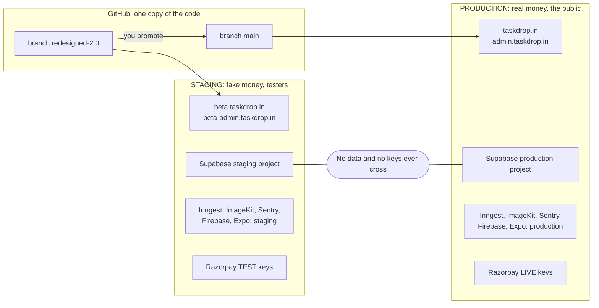
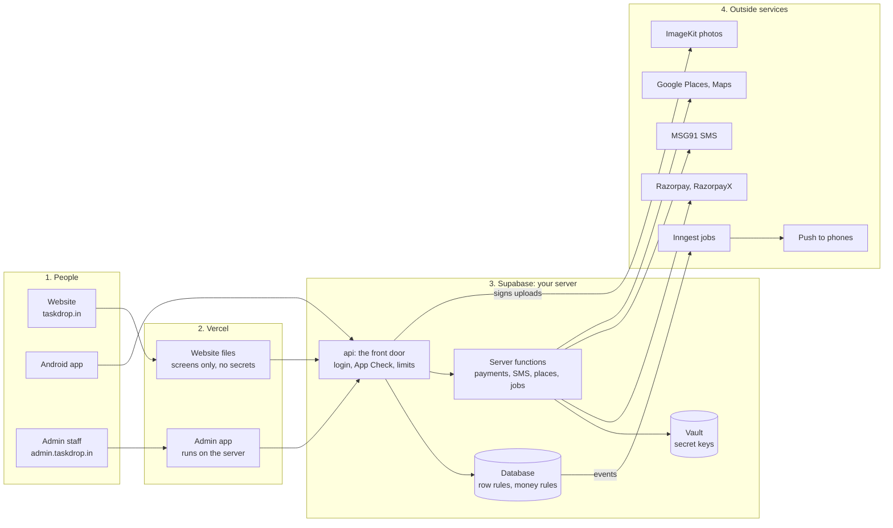
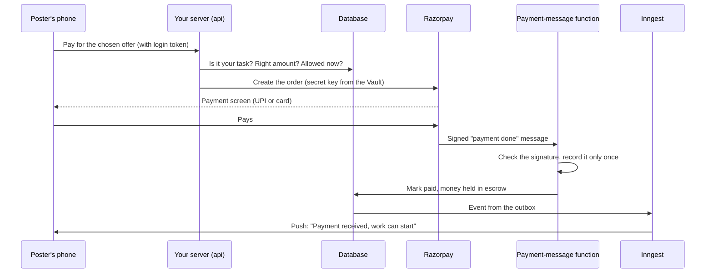

# TaskDrop: your complete plan

**This is the only file you need.** Work from top to bottom. Click a task to open its steps. Tick it when it is done.

The clickable version of this same file is `docs/ULTIMATE_PLAN.html`. Open it in Chrome; your ticks are saved there.

Updated 2026-10-30. Everything from `UPGRADE_PLAN.md`, `testing_checks.md`, `KEY_SECURITY_PLAN.md` and `API_CALLS.md` is inside this file: the jobs are tasks, and the details are in the "Reference" section near the end. Those four files stay for Claude. The old long plans are kept unchanged in `docs/archive/2026-10-30-before-simplify/`. You never need to open any of them.

---

## How to use this plan

Every step is one of three kinds:

- **CLICK**: you do it yourself, in a browser or on your phone.
- **SAY**: copy the text in the grey box into the Claude chat. Claude does the work and tells you when it is finished.
- **TELL**: write in the chat what you saw. A screenshot is fine.

Four rules:

1. **Go in order.** Start the **Paperwork** tasks in week 1 too. They are slow, so they run beside the other steps.
2. **Never paste a password, key or secret into the chat.** Claude will never ask you for one.
3. **If a screen looks different** from the steps (a button has another name, or is missing), stop and send Claude a screenshot. Websites change their buttons.
4. **When you finish a task, tell Claude its number** (for example "done 1.2"), so Claude can mark it here too.

---

## Where you are today (30 October 2026)

**Already done**

- The app works on the website and on Android with fake money. Claude checked it and called it "finished" on 2026-10-28.
- Staging safety is live: the "Staging: fake money and fake data" ribbon, the block that refuses a real payment key, the site hidden from Google, and the staging notice in Terms and Privacy.
- The app tour, the admin app with staff roles, Google sign-in, error alerts (Sentry) and uptime monitors all work.
- GitHub secret scanning is on for both code repositories (2026-10-29).

**Not done yet**

- Security hardening, and the big test checklist (0 of 184 checks run).
- Google Play testing: the Play account still needs Google's ID check, and the app is not created there yet.
- 12 testers for 14 days (Google requires this before a public release).
- All the paperwork for real money: company, bank account, lawyer, payment approval, SMS registration.
- Production, the real-money copy of TaskDrop, does not exist yet.

---

## The map

```map
 WEEK 1-2          WEEK 3-6           WEEK 5-8            AFTER PAPERWORK      THEN               AFTER LAUNCH
 STEP 1            STEP 2             STEP 3              STEP 4               STEP 5             STEP 6
 Lock the doors -> Prove it works  -> Get ready to sell -> Build production -> Launch one city -> Grow
 logins, keys,     Play testing,      workers, public     a separate copy      real money,        weekly numbers,
 security tests    12 testers, fixes  pages, Google map   of every tool        Rs 10 test, Play   next city
       |                 |                  |                   |                  |
    GATE 1            GATE 2             GATE 3              GATE 4             GATE 5

 PAPERWORK (start in week 1, runs beside everything, mostly waiting for others)
 P.1 company + bank --> P.2 lawyer --> P.3 payment quotes --> P.4 name + trademark
 --> P.5 SMS registration --> P.6 legal contacts --> P.7 payment approval (KYC)
 All of P.1 to P.7 must be finished before STEP 4.
```

**A gate** is a checkpoint. Do not start the next step until every line of the gate is true.

**The two copies of TaskDrop**

| | Staging (now) | Production (later) |
|---|---|---|
| Money | Fake. Razorpay test mode. Workers are "paid" by an admin clicking a button | Real. Live Razorpay keys, real UPI and bank |
| Data | Fake. Test accounts Asha, Ravi, Meera, and what testers create | Real customers. Starts empty |
| Who uses it | You and invited testers | The public |
| Sign-in code | Shown on screen. Any phone number works | Real SMS |
| Cost | Nothing monthly. Google Play account $25 once | About $45 a month plus fees (see "What it costs") |
| Web address | `taskdrop.in` today; `beta.taskdrop.in` from task 4.10 | `taskdrop.in` and `admin.taskdrop.in` |
| Tools | Today's account or project in every tool | Its own separate account or project in every tool (Step 4). Nothing is copied from staging |

---

## Your tools: which account owns each one

Checked on 2026-10-30. "Checked" means Claude saw that account signed in on the tool's own page or through its connection. Only login names are listed here, never passwords.

**You use two Google accounts:**

- **`hitendureacts@gmail.com`** (Chrome profile `/u/2`) owns almost everything, and is the only login the admin website accepts.
- **`narasimharaju7c@gmail.com`** (Chrome profile `/u/0`) owns only Google Play.

When Google shows an account chooser, check that it is the right one for that tool.

| Tool | What it does for TaskDrop | Open it at | Signed in as (staging) | Project name (staging) | What is inside (staging) | Gmail to use (production) | Project name (production) | What is inside (production) |
| --- | --- | --- | --- | --- | --- | --- | --- | --- |
| **GitHub** | The code | [Open](https://github.com/hitendureacts77) | Username **hitendureacts77** (checked) | `taskdrop`, `taskdrop-admin` | Repositories `taskdrop` and `taskdrop-admin`. Branch `redesigned-2.0` | No new account. Same username **hitendureacts77** | `taskdrop`, `taskdrop-admin` (the same two repositories) | Branch `main`, protected. Only code moves from staging to production (4.9) |
| **Vercel** | Hosts the website and the admin | [Open](https://vercel.com/hitenduteam) | **hitendureacts@gmail.com**, username `hitendureacts-2625` (checked) | `taskdrop-staging`, `taskdrop-admin-staging` (today `taskdrop`, `taskdrop-admin`) | Team `hitenduteam` on the free Hobby plan. Built from `redesigned-2.0`. Addresses `beta.taskdrop.in` and `beta-admin.taskdrop.in` from task 4.10 | **hitendureacts@gmail.com** (same team `hitenduteam`, upgraded to Pro) | `taskdrop-production`, `taskdrop-admin-production` | Same team `hitenduteam`, upgraded to Pro ($20 a month). Built from `main`. Addresses `taskdrop.in`, `www.taskdrop.in` and `admin.taskdrop.in` (4.8, 4.10) |
| **Supabase** | Database, sign-in, files, server code, Vault | [Open](https://supabase.com/dashboard) | **hitendureacts@gmail.com** (checked) | `taskdrop-staging` (today `taskdrop`; the ref `wjxvingpfbfvkfqhrguj` never changes) | Organization "hitendureacts@gmail.com's Org", free plan. Mumbai. Fake data only | **hitendureacts@gmail.com** (a new organization, not a new login) | `taskdrop-production` | New organization "TaskDrop Production", Pro plan ($25 a month), spend cap on. Mumbai. Starts empty (4.2) |
| **Firebase console** | Push messages to Android, App Check (proves a request comes from the real app) | [Open](https://console.firebase.google.com) | **hitendureacts@gmail.com** (`/u/2`) | `taskdrop-staging` (today **Taskdrop**; the ID `project-a19d1da9-6903-4168-905` and number `629108039430` never change) | Pay-as-you-go plan. An Android app and a web app are registered | **hitendureacts@gmail.com** (`/u/2`) | `taskdrop-production` | New project, Analytics off. Android app `com.taskdrop.app`, web app `taskdrop-web-production`, its own push key and App Check (4.3) |
| **Google Cloud console** | The keys behind maps, place search and Google sign-in, plus billing and the budget | [Open](https://console.cloud.google.com/?authuser=2) | **hitendureacts@gmail.com** (`/u/2`) | `taskdrop-staging` (today **Taskdrop**, the same project as Firebase), under organization `hitendureacts-org` | Keys `taskdrop-android-maps`, `taskdrop-server-places` and the Firebase "Browser key". Sign-in client `TaskDrop Supabase`. Billing account "My only billing account". Budget `taskdrop-monthly-100` (₹100 a month, alerts only) | **hitendureacts@gmail.com** (`/u/2`) | `taskdrop-production` (the same project as Firebase) | Keys `taskdrop-production-android-maps`, `taskdrop-production-server-places` and its own "Browser key". Sign-in client `TaskDrop Supabase production`. Same billing account. Budget `taskdrop-production-monthly` (₹1,000 a month, alerts at 50%, 90%, 100%). Places search capped at 2,000 a day (4.3) |
| **Google Play Console** | The Android app store | [Open](https://play.google.com/console/u/0/developers) | **narasimharaju7c@gmail.com** (`/u/0`) | No app yet (task 2.2). After launch: "TaskDrop Staging" | Personal developer account **NLNarasimhaRaju**. Testing tracks only. After launch, staging moves to the app `com.taskdrop.app.staging` (decision 9) | **narasimharaju7c@gmail.com** (`/u/0`), where your developer account is | **TaskDrop** (`com.taskdrop.app`) | The same developer account. The app's **Production** track, linked to the `taskdrop-production` Google Cloud project (4.7, 5.6) |
| **Expo (EAS)** | Android builds, app updates, the push key | [Open](https://expo.dev/accounts/hitendureacts) | Username **hitendureacts**, email hitendureacts@gmail.com (checked) | `@hitendureacts/taskdrop-staging` (today `@hitendureacts/taskdrop`; project ID `08aa002b-4eea-4952-a62a-ec9245e77953`) | Update channel `beta`. Has the staging-only App Check debug token | **hitendureacts@gmail.com**, username **hitendureacts** | `@hitendureacts/taskdrop-production` | New project under the same account. Update channel `production`. Its own push key and variables, and never a debug token (4.7) |
| **Sentry** | Error reports and alerts | [Open](https://sentry.io) | **hitendureacts@gmail.com** (checked) | `taskdrop-staging`, `taskdrop-admin-staging` (today `taskdrop` for the app and server functions, and `taskdrop-admin`) | Organization `hitendu` | **hitendureacts@gmail.com** (same organization `hitendu`) | `taskdrop-production`, `taskdrop-admin-production` | Same organization `hitendu`. Same alert rules. Source-map token `taskdrop-production-sourcemaps` (4.6) |
| **Inngest** | Background jobs | [Open](https://app.inngest.com) | **hitendureacts@gmail.com** (checked) | Organization `taskdrop-staging` (today `taskdrop`) | Free Hobby plan | **hitendureacts@gmail.com** (a new organization). Only if Inngest refuses a second organization: **hitendureacts+prod@gmail.com** | Organization **TaskDrop Production** | Separate organization on a paid plan, with its own Event key and Signing key. If Inngest does not allow a second organization, a second account with `hitendureacts+prod@gmail.com` (4.4) |
| **ImageKit** | Photo storage and delivery | [Open](https://imagekit.io/dashboard) | **hitendureacts@gmail.com**, name "Hitendu" (checked) | Today's photo account (name not recorded here) | Staging photos | **hitendureacts+prod@gmail.com** (a different address for the same inbox, so ImageKit makes a separate account) | ImageKit ID `taskdropproduction` | Separate account, signed up with `hitendureacts+prod@gmail.com`. Its own URL endpoint and keys (4.5) |
| **Razorpay** | Payments in (test mode now) | [Open](https://dashboard.razorpay.com) | **hitendureacts@gmail.com** (you confirmed, 2026-10-30) | The business account, **Test mode** | Test mode only | **hitendureacts@gmail.com** (same business account, Live mode) | The same business account, **Live mode** | Live keys. Razorpay already keeps test and live data apart (5.1) |
| **Uptime Robot** | "Site is down" emails | [Open](https://dashboard.uptimerobot.com) | **hitendureacts@gmail.com** (you confirmed, 2026-10-30) | "staging website", "staging admin" (renamed in 4.11) | Two monitors (website and admin), moved to `beta.taskdrop.in` and `beta-admin.taskdrop.in` | **hitendureacts@gmail.com** | "production website", "production admin", "production server" | Three new monitors: `taskdrop.in`, `admin.taskdrop.in` and the production `app-config` address (4.11) |
| **Spaceship** | Owns the domain `taskdrop.in` and its DNS | [Open](https://www.spaceship.com) | **hitendureacts@gmail.com** (you confirmed, 2026-10-30), account holder name Narasimha Raju | Domain `taskdrop.in` (one domain for both copies) | Today the domain points at staging. DNS names `beta` and `beta-admin` are added in 4.10 | **hitendureacts@gmail.com** | Domain `taskdrop.in` (one domain for both copies) | `taskdrop.in`, `www` and `admin` point at the production Vercel projects (4.10) |
| **MSG91** | Sign-in text messages | [Open](https://msg91.com) | Not created yet (task P.5) | Not used | The sign-in code shows on screen instead | **hitendureacts@gmail.com** | Your MSG91 account from P.5 | Real SMS. Use **hitendureacts@gmail.com**, like your other tools. Its key goes into production only (5.1) |
| **Cashfree** | Possible second payment company | [Open](https://www.cashfree.com) | No account (you asked for a quote only, task P.3) | None |  | **hitendureacts@gmail.com**, only if you open an account | None | Only if you choose it after the quote |
| **Bitwarden** | Your password manager | [Open](https://vault.bitwarden.com) | Not created yet (task 1.1) | None |  | **hitendureacts@gmail.com** (one vault for staging and production) | None | Holds every production key and the "TaskDrop production database password". Production keys are never kept in a file (5.1) |
| **Admin website** | Running TaskDrop | [Open](https://taskdrop-admin-git-redesigned-20-hitenduteam.vercel.app) | Only **hitendureacts@gmail.com** can sign in (your rule, 2026-10-25) | `taskdrop-admin-staging` (today `taskdrop-admin`; `beta-admin.taskdrop.in`) | Staff roles. Dummy staff Priya, Kiran and Neha | Only **hitendureacts@gmail.com** can sign in | `taskdrop-admin-production` (`admin.taskdrop.in`) | Starts with no staff. Only you can sign in. `ADMIN_PHONE` stays empty |

**Names (your rule, 2026-10-30):** staging names end in `-staging`, production names end in `-production`. The staging names marked "today" are the names the tools still use. They are not renamed yet: the Expo slug, the Vercel and Sentry projects and the build settings all point at the old names, so renaming is its own task. Never renamed: the GitHub repositories (both copies use the same code), the Supabase ref and the Firebase project ID and number.

**Rules for accounts**

1. Make every new account, including the production ones in Step 4, with **hitendureacts@gmail.com**, so everything is in one place. When a tool needs a different email for a second, production account (ImageKit, maybe Inngest), use **`hitendureacts+prod@gmail.com`**: Gmail delivers it to the same inbox. Google Play stays on narasimharaju7c@gmail.com, because that is where your developer account is.
2. **Future scope (your decision, 2026-10-30):** turning on a passkey or authenticator app for every account above, including **both** Google accounts (task 1.2). It is not needed now and does not block any gate.

---

## STEP 1: Lock the doors (weeks 1 to 2)

**Goal:** nobody can steal your logins, your keys or your money.

<details id="t1-1" data-short="Password manager">
<summary>[YOU] <b>1.1</b> Get a password manager and store your secrets safely <small>· 1 hour · free</small></summary>

**Why:** you need one safe place for passwords, recovery codes and secrets before you do task 1.2.

1. CLICK: open https://bitwarden.com, choose **Get started**, and make a free account.
2. Choose a **master password** made of 4 or 5 random words (for example "lamp river chosen mango sixty"). Write it on paper and keep it at home. Bitwarden cannot recover it if you forget it.
3. CLICK: install the **Bitwarden** app on your phone (Play Store) and the **Bitwarden** extension in Chrome. Sign in to both.
4. CLICK: add every login you use for TaskDrop: both Google accounts, GitHub, Vercel, Supabase, Expo, Sentry, Razorpay, Cashfree, Inngest, ImageKit, MSG91, Spaceship, Google Play Console.
5. CLICK: open `C:\complete taskdrop\.env.all-secrets` in Notepad. Press **Ctrl + A**, then **Ctrl + C**. In Bitwarden choose **New**, then **Secure note**. Name it "TaskDrop secrets copy", paste with **Ctrl + V**, and press **Save**. Leave the original file where it is.
6. CLICK: find the Android keystore backup. In File Explorer, search your OneDrive folder for "keystore". **Move** (not delete) the zip to a folder outside OneDrive, for example `C:\TaskDrop-safe`. Copy it to a USB stick as well, and keep the stick at home.
7. If a text file with the keystore passwords sits next to the zip: copy the passwords into a Bitwarden secure note, then delete that text file. **Never delete the keystore itself.** Without it you cannot update the app.
8. CLICK: Windows **Settings** → **Privacy & security** → **Device encryption** → **On**. First check that your recovery key is saved at https://account.microsoft.com/devices/recoverykey. If you do not see "Device encryption", tell Claude.
9. TELL Claude: "done 1.1".

**Done when:** all logins and the secrets copy are in Bitwarden, the keystore zip is out of OneDrive and on a USB stick, and device encryption is on.
</details>

<details id="t1-2" data-short="Passkeys on all logins">
<summary>[YOU] <b>1.2</b> Future scope: protect every login with a passkey or authenticator app <small>· 1 to 2 hours · free</small></summary>

> **Future scope (your decision, 2026-10-30).** Skip this task for now. It does not block Gate 1. Come back to it when you want it.

**Why:** most real hacks steal a login, not a key. This is the strongest protection you can add, and it is free. On 2026-10-28 you set this for "before real customers". Doing it now is recommended, because nothing else protects as much.

**You need:** your phone, with the **Google Authenticator** or **Microsoft Authenticator** app from the Play Store (for sites that do not offer passkeys). Do Google and GitHub first, because other sites let you "Sign in with Google" or GitHub.

1. **Google, for both accounts** (`hitendureacts@gmail.com` and the Play account `narasimharaju7c@gmail.com`). CLICK: https://myaccount.google.com → **Security** → **2-Step Verification** → turn it on. Then **Passkeys and security keys** → **Create a passkey**.
2. **GitHub.** CLICK: https://github.com → your photo (top right) → **Settings** → **Password and authentication** → **Two-factor authentication** → **Enable**, using the authenticator app. Then, on the same page, **Passkeys** → **Add a passkey**.
3. **Vercel.** CLICK: https://vercel.com → your photo → **Account Settings** → **Authentication** → turn on two-factor or add a passkey.
4. **Supabase.** CLICK: https://supabase.com/dashboard → your photo → **Account preferences** → **Security** → add an authenticator app.
5. **Expo.** CLICK: https://expo.dev → your photo → **Account settings** → **Two-factor authentication**.
6. **Sentry.** CLICK: https://sentry.io → your photo → **User settings** → **Security** → **Two-factor authentication**.
7. **Razorpay, Cashfree, Inngest, ImageKit, MSG91, Spaceship.** In each one, open the account **Settings** and look for **Security**, **Two-factor** or **2FA**. If a site only offers SMS codes, use SMS. It is better than nothing.
8. Each site shows **recovery codes** when you turn this on. Save each set in a Bitwarden secure note. Without them, a lost phone locks you out.
9. TELL Claude: "done 1.2", and name any site where you could not find the setting.

**Done when:** every account above asks for your phone or a passkey when you sign in.
</details>

<details id="t1-3" data-short="Limits and alert emails">
<summary>[YOU] <b>1.3</b> Set spending limits and alert emails <small>· 45 minutes · free</small></summary>

**Why:** if a key ever leaks, a limit means you lose a little money, not a lot, and an alert email means you hear about it in minutes.

**Which Google services can cost money today, and their limits** (checked from the code, 2026-10-30):

| Google service | Used for | Limit |
|---|---|---|
| Places API (New), "Text Search" | Address search, only through your server | **Already capped at 1,000 a day** (set 2026-10-22). Keep it |
| Maps SDK for Android | Showing the map in the app | Showing maps in an Android app is free, so no cap is needed |
| Firebase Cloud Messaging, Firebase Installations | Push messages | Free |
| Firebase App Check with reCAPTCHA Enterprise and Play Integrity | Proving requests come from your app | Free at the testers' scale. Claude rechecks this at launch (4.3) |

1. CLICK: https://console.cloud.google.com/?authuser=2 → choose project **Taskdrop** (top bar) → **Billing** → **Budgets & alerts**. The budget `taskdrop-monthly-100` (₹100 a month, alerts at ₹50, ₹90 and ₹100) already exists. Open it and check that the alert emails go to **hitendureacts@gmail.com**.
2. CLICK: **APIs & Services** → **Enabled APIs & services** → **Places API (New)** → **Quotas & System Limits**. Check that "SearchText requests per day" shows **1,000**.
3. CLICK: https://imagekit.io/dashboard → **Usage** or **Billing** → turn on usage alert emails if they are offered.
4. **GitHub leaked-key emails.** CLICK: https://github.com → your photo → **Settings** → **Notifications** → make sure **Email** is on for security alerts. Then open https://github.com/hitendureacts77/taskdrop and https://github.com/hitendureacts77/taskdrop-admin → **Watch** (top right) → **Custom** → tick **Security alerts** → **Apply**.
5. **Supabase.** CLICK: https://supabase.com/dashboard → organization "hitendureacts@gmail.com's Org" → **Settings** or **Billing** → check that the billing email is **hitendureacts@gmail.com**.
6. **Vercel.** CLICK: https://vercel.com → team **hitenduteam** → **Settings** → **Notifications** → turn on email for usage warnings and failed deployments.
7. **Razorpay.** CLICK: https://dashboard.razorpay.com → **Account & Settings** → look for **Notifications** or **Email preferences** → turn on emails for failed payments, refunds and webhook failures. This matters most after launch; setting it now means it is ready.
8. TELL Claude: "done 1.3". (MSG91 limits come later, in P.5.)

**Done when:** the Google budget alert reaches you, Places shows its 1,000-a-day cap, and GitHub, Supabase, Vercel and Razorpay send their warnings to an address you read.
</details>

<details id="t1-4" data-short="Verify Play account">
<summary>[YOU] <b>1.4</b> Verify your Google Play account (start now: Google takes days) <small>· 15 minutes, then wait · free</small></summary>

**Why:** nothing can be published on Google Play until Google has checked your ID. It takes several days, so start now.

Your Play account is the **Personal** account **NLNarasimhaRaju**, owned by `narasimharaju7c@gmail.com`. In Chrome it is the profile at `/u/0`.

1. CLICK: open https://play.google.com/console/u/0/developers. If Chrome asks which Google account to use, pick **narasimharaju7c@gmail.com**. Click the developer account **NLNarasimhaRaju**.
2. CLICK: on **Home**, under "Finish setting up your developer account", click **Get started** next to **Verify your identity**.
3. CLICK: choose an ID type from Google's list and upload a clear photo or scan. The name must match the name on the Play account. Do not edit or crop the image.
4. CLICK: back on **Home**, click **View details** next to **Verify your contact phone number**, and enter the code Google sends to your phone. If Google asks you to check an Android device, install the **Google Play Console** app on your phone, sign in as narasimharaju7c@gmail.com and approve.
5. Wait. The two banners disappear when Google is done (several days).
6. TELL Claude: "done 1.4, the Play account is verified". A screenshot of Home without the two banners is fine.

**Done when:** the Play Console home page no longer shows the two "Verify" banners.
</details>

<details id="t1-5" data-short="Read the runbook">
<summary>[YOU] <b>1.5</b> Read the emergency guide (runbook) once <small>· 20 minutes</small></summary>

**Why:** if something breaks at night, you need to know the first steps already.

1. CLICK: open `docs/RUNBOOK.md` in the `Taskdrop user` folder (VS Code or GitHub) and read it once.
2. TELL Claude anything that is wrong, or different from how you would really handle it.
3. TELL Claude: "done 1.5".

**Done when:** you have read it and Claude has fixed anything you flagged.
</details>

<details id="t1-6" data-short="Key protection">
<summary>[CLAUDE] <b>1.6</b> Key protection <small>· your time: 10 minutes</small></summary>

**What Claude builds (one pull request):**

- A secret scanner (gitleaks) that checks every code change, plus a full scan of the history once a week.
- A check on your PC that stops a commit that contains a key.
- Safer settings for the automatic checks on GitHub.
- The admin app stops falling back to the master database key when its own secret is missing.
- A deploy fails if a required secret is missing or too short.
- Keys, phone numbers and emails are hidden from error reports.
- A test that fails if any secret name or value ever ends up in the website or Android code.
- A check that the two fake Razorpay strings in one test file are made up, not real keys.

**What you do:**

1. SAY:

```say
start key protection
```

2. Wait. Claude sends a short summary in plain words and a link to the pull request.
3. Read the summary and ask about anything that is unclear.
4. SAY "merge it".

**Done when:** Claude says it is merged and all the checks are green.
</details>

<details id="t1-7" data-short="Stop-ship tests">
<summary>[CLAUDE] <b>1.7</b> Stop-ship tests (security round 1) <small>· your time: 20 minutes</small></summary>

**What Claude does:** tries to break your own app on the fake-money staging copy, in the seven ways money or private data could leak:

| Test | What it tries |
|---|---|
| T0, T1 | Test setup and the automatic checks |
| T2 Keys | Find a secret key in the website, the Android file or the code history |
| T3 Database rules | As a stranger, read or change someone else's tasks, chats or wallet |
| T5 Storage | Open someone else's private photos or files |
| T7 Server permissions | Call each server action logged out, or as the wrong person. Includes all 113 special database functions |
| T8 Money | Double payments, fake payment messages, wrong amounts, refunds |

Each problem gets a level. **Critical** or **High** means money or private data is at risk, and Claude fixes it. **Medium** or **Low** means you decide: fix or accept.

1. SAY:

```say
run stop-ship tests
```

2. Wait (this can take a few sessions). Claude sends a list of findings in plain words.
3. For each Medium or Low finding, reply "fix" or "accept".
4. SAY "merge the fixes" when Claude asks.

**Done when:** no Critical or High problem is open.
</details>

<details id="t1-8" data-short="Lock down secret storage">
<summary>[YOU] <b>1.8</b> Lock down the places where keys are kept <small>· 20 minutes · free</small></summary>

**Why:** your keys live in Vercel, Expo and on your PC. Each place should hide them, even from someone who gets in.

**Already done (Claude checked on 2026-10-30, names only):**

- **Vercel, project `taskdrop`:** `API_GATEWAY_SECRET`, `SENTRY_AUTH_TOKEN_TASKDROP_USERAPP`, `SUPABASE_ACCESS_TOKEN`, `DATABASE_URL` and `EXPO_GOOGLE_MAPS_API_KEY` are all **Sensitive**. Everything left as plain text is public by design (legal details, Firebase web settings, the reCAPTCHA site key, `INNGEST_MONEY_JOBS`).
- **Vercel, project `taskdrop-admin`:** `SUPABASE_SERVICE_ROLE_KEY`, `ADMIN_SESSION_SECRET`, `API_GATEWAY_SECRET`, `SENTRY_AUTH_TOKEN`, `SENTRY_AUTH_TOKEN_ADMIN`, `IMAGEKIT_PRIVATE_KEY` and `IMAGEKIT_URL_ENDPOINT` are all **Sensitive**. The plain ones (the Supabase address, the public key, the dashboard links) are public.
- **Expo, project `taskdrop`:** `EXPO_GOOGLE_MAPS_API_KEY`, `GOOGLE_SERVICES_JSON` and `SENTRY_AUTH_TOKEN` are **Secret**. `EXPO_PUBLIC_APP_CHECK_DEBUG_TOKEN` is Sensitive and exists only for the staging build; it must never be set for production (task 4.9 checks this).

So there is nothing to change in Vercel or Expo. What is left is on your PC and in your habits:

1. **New tokens from now on.** When you next create an access token (GitHub, Vercel, Supabase, Expo), give it an end date of **90 days** and only the permissions it needs, one token per job. Do not replace the tokens you have now (your no-rotation rule).
2. CLICK: Windows **Settings** → **Windows Update** → install all updates. Open **Windows Security** → **Virus & threat protection** and check it is on.
3. CLICK: look in your **Downloads** and **Desktop** folders for any file with keys or passwords in it (for example a Razorpay "key details" file or a `google-services.json`). Copy what is needed into Bitwarden, then delete the file. Do not touch the keystore (task 1.1 handles it).
4. CLICK: in the Chrome profile you use for Vercel, Supabase and Google Cloud (`/u/2`), open `chrome://extensions` and remove every extension you do not know or do not use.
5. TELL Claude: "done 1.8".

**Done when:** no key files sit in Downloads or on the Desktop, and Chrome has only extensions you trust.
</details>

<details id="t1-9" data-short="Alarms + key emergency guide">
<summary>[BOTH] <b>1.9</b> Alarms and the key emergency guide <small>· your time: 30 minutes</small></summary>

**Why:** if someone does get a key, you want to know within the hour, and you want written steps ready.

1. **A decoy key.** CLICK: https://canarytokens.org → choose the token type **AWS API key** → enter your email and the note "TaskDrop decoy file" → **Create**. Copy the lines it shows.
2. CLICK: open Notepad, paste the lines, and save the file as `C:\complete taskdrop\.env.production-old` (set "Save as type" to **All files**). Nothing uses this file and it is fake. If anyone ever steals your files and tries that key, Canarytokens emails you. Never put it inside the `Taskdrop user` or `Taskdrop administrator` folders.
3. **Security alerts.** SAY the text below. Claude makes the server report refused logins, App Check failures, wrong payment signatures and sign-in codes per hour to Sentry, then gives you the Sentry clicks (or does them in your Chrome with your OK) so a sudden spike emails you.

```say
Set up the security alerts in Sentry.
```

4. **The key emergency guide.** SAY the text below. Claude writes `docs/KEY_RUNBOOK.md`: for every secret, where it is set, where it is cancelled, what stops working while it changes, and who does each step. The target is any key replaced in under 15 minutes. Read it once. The "If something goes wrong" card in this file points to it.

```say
Write the key emergency guide.
```

5. **Proof.** SAY the text below. Claude checks the six things listed under "Done when" and reports each one.

```say
Prove the key protection works.
```

6. TELL Claude: "done 1.9".

**Done when** all six are true:

- a fake key in a test branch is **blocked** when pushed, and fails the automatic checks
- the website and the Android file contain no secret name or value
- a request with only the public key reads nothing private
- the admin deploy **fails** when its own secret is removed
- the decoy file is in place and Canarytokens shows your email for it
- the emergency guide exists and you have read it (a reading-only practice, no key is replaced)
</details>

> **GATE 1: do not start Step 2 until all of these are true**

- [ ] Tasks 1.1 to 1.9 are ticked, except task 1.2 (future scope)
- [ ] The six proofs in task 1.9 are all true
- [ ] No Critical or High security problem is open

---

## PAPERWORK: start in week 1 and let it run beside everything

**Why start now:** each of these waits on other people (banks, lawyers, Google, Razorpay, phone companies) for days or weeks. Starting is free. Waiting only delays launch.

<details id="tP-1" data-short="Company, PAN, bank">
<summary>[YOU] <b>P.1</b> Business basics: who owns TaskDrop, PAN, GST, bank account <small>· 1 to 3 weeks · bank and CA fees</small></summary>

**Why:** Razorpay, the SMS registration and the lawyer all ask for these first.

1. Book one meeting with a **Chartered Accountant (CA)**. Ask which business type fits TaskDrop: sole proprietor (simplest, uses your own PAN), LLP, or private limited company (the usual choice if you want investors later). This plan is not tax or legal advice. The CA decides with you.
2. Get the documents the CA says you need: PAN (a business PAN for an LLP or company), a GST registration if required, and address proof.
3. Open a **current account** in the business name at any bank. Ask for net banking and UPI.
4. TELL Claude: "done P.1. Business type: ___, name: ___". Do not send account numbers.

**Done when:** you have the business name, its PAN and a current account.
</details>

<details id="tP-2" data-short="Lawyer">
<summary>[YOU] <b>P.2</b> Find a lawyer and ask the money question <small>· weeks · lawyer's fee</small></summary>

**Why:** the lawyer's answer decides how payouts and refunds are built. Until then, the real-money jobs stay switched off.

1. Shortlist 2 or 3 lawyers in India who work with startups and payments (fintech). Ask your CA, friends or LinkedIn.
2. Email each one. Attach `docs/LAWYER_BRIEF.md` (it explains how TaskDrop moves money). Add the links https://taskdrop.in/?page=terms and https://taskdrop.in/?page=privacy. Ask for a **fixed-fee quote**.
3. The questions to ask:
   - May TaskDrop hold a poster's money until they approve, then pay the worker? Or must a payment company (for example Razorpay Route) hold it?
   - Does the wallet need RBI permission?
   - Please review our Terms and Privacy pages.
   - What do we need for India's data law (DPDP)?
4. Choose one lawyer and pay.
5. When the answer arrives, SAY the text below and paste the lawyer's answer after it.

```say
Here is the lawyer's answer:
```

**Done when:** you have the answer in writing and Claude has recorded it.
</details>

<details id="tP-3" data-short="Payment quotes">
<summary>[YOU] <b>P.3</b> Ask Razorpay and Cashfree for written price quotes <small>· 30 minutes, then wait · free</small></summary>

**Why:** your rule is "take the cheaper one". It counts only if that company also approves TaskDrop's way of handling money, in writing.

1. Copy this email, fill in the blanks, and send it to the sales teams of **Razorpay** and **Cashfree** (use the "Contact sales" form on each website):

```say
Subject: Pricing quote for TaskDrop (online task marketplace, India)

Hello,
I run TaskDrop (taskdrop.in), a marketplace where a person posts a task, a worker does it, and the payment is held until the poster approves the work. It is then paid out to the worker.

Please send me, in writing:
1. Your rate for UPI, cards and netbanking, separately.
2. Whether your fee is returned when we refund a cancelled task.
3. Your split-payment or payout product, its fee, and what each worker must do to be set up.
4. Whether our use case (money held until approval, then paid to a third party) is approved under the RBI payment aggregator rules.
5. Your settlement time (T+1, T+2).
6. Whether your KYC accepts a ___ (your business type).

Expected volume at the start: about ___ payments a month, ₹150 to ₹1,000 each.

Thank you,
___
```

2. Write the date down. If there is no reply in a week, send a reminder. Suggested deadline: **15 November 2026**.
3. When both have replied, SAY the text below and paste only the numbers (never any keys).

```say
Here are the payment quotes:
```

4. Claude fills a comparison table (it includes the cost of switching: Razorpay is already built, Cashfree would take about one phase of work) and recommends one.
5. Make decision 3 in the "Decisions" section.

**Done when:** both quotes are in and you have chosen.
</details>

<details id="tP-4" data-short="Name and trademark">
<summary>[YOU] <b>P.4</b> Check the name, file the trademark, claim the handles <small>· 1 hour, then filing · trademark fee</small></summary>

1. **Company names.** CLICK: https://www.mca.gov.in → **MCA services** → **Check Company/LLP name**. Search "taskdrop". Note what you find.
2. **Trademarks.** CLICK: https://tmrsearch.ipindia.gov.in/eregister → **Trade Mark Search** (or start from https://ipindia.gov.in). Search the word "taskdrop" and "task drop" in classes **9** (app), **35** (online marketplace) and **42** (software).
3. **Social handles.** CLICK: https://namechk.com → type "taskdrop" and see which handles are free.
4. TELL Claude what you found.
5. If the name is free: file the trademark for the word "taskdrop" and the drop-and-check logo in classes 9, 35 and 42. File yourself on IP India or through your lawyer. The fee is lower for individuals, startups and small businesses. Check the current fee on IP India.
6. Claim the free handles on Instagram, X, YouTube, LinkedIn (a company page) and Reddit.
7. TELL Claude: "done P.4".

**Done when:** the trademark is filed and the handles are yours.
</details>

<details id="tP-5" data-short="SMS registration">
<summary>[YOU] <b>P.5</b> SMS registration (DLT) and MSG91 <small>· days · about ₹5,000 once + ₹1,250 + GST</small></summary>

**Why:** in India, an SMS from an unregistered sender is silently blocked. Real phone sign-in needs this. Do it after P.1, because it asks for PAN and GST.

1. CLICK: pick one DLT portal (Jio, Airtel or Vi; one is enough). Register your business (the "entity") with PAN, GST and a letter of authorisation on your letterhead. The fee is about ₹5,000, one time. Approval takes a few working days. Note your **Entity ID**.
2. CLICK: register a **header** (the sender name), 6 letters such as `TSKDRP`. Choose **transactional**, not promotional. Promotional SMS does not reach people on Do-Not-Disturb.
3. CLICK: register this **template**, exactly as written, character for character:

```say
{#var#} is your TaskDrop verification code. It is valid for 10 minutes. Do not share it with anyone.
```

4. CLICK: make an account at https://msg91.com. Go to **SMS** → **DLT** and link your Entity ID and header. Go to **SMS** → **Templates** and create the same template with `##OTP##` where the code goes. Note its **template ID**.
5. CLICK: buy the **5,000 SMS pack** (₹1,250 + 18% GST). No bigger pack yet. Set a **daily send limit** and a **low-balance alert** in MSG91.
6. CLICK: in MSG91 → **Settings** → **API** → copy the **Auth Key** straight into Bitwarden. It goes into production in task 5.1. Never put it into staging or the chat.
7. TELL Claude the template ID and the header (these are not secrets).

**Done when:** the template is approved, the credits are bought, and the key is saved in Bitwarden.
</details>

<details id="tP-6" data-short="Legal contacts">
<summary>[YOU] <b>P.6</b> Legal contacts: DMCA agent and grievance officer <small>· 15 minutes · $6</small></summary>

**Why:** the law expects a marketplace to name a grievance officer, and a DMCA agent protects you when users upload photos.

1. CLICK: https://dmca.copyright.gov → **Register** → make an account → designate an agent (name, address, email, phone) → pay **$6** (valid 3 years).
2. Decide who the **grievance officer** is (it can be you) and which email they use. Find the PIN code of your business address.
3. SAY the text below and fill it in. These details are public, because they appear on the Privacy page.

```say
DMCA agent registered: name ___, email ___, address ___, phone ___. Grievance officer: name ___, email ___. Address PIN code: ___.
```

**Done when:** Claude confirms the legal pages show these details.
</details>

<details id="tP-7" data-short="Payment approval">
<summary>[YOU] <b>P.7</b> Payment approval (Razorpay and RazorpayX KYC) <small>· days to weeks · fee per payment</small></summary>

**Why:** live payment keys exist only after the payment company has checked your business. Do this after P.1, and best after the lawyer (P.2) and your gateway choice (P.3).

1. SAY the text below first. Payment companies check your website for these pages.

```say
Add the cancellations-and-refunds page and the contact-us page with the business address.
```

2. CLICK: https://dashboard.razorpay.com → **Activate account** → enter the business type, PAN, GST (if any), your current account and the website `https://taskdrop.in` → upload the documents it asks for → **Submit**. If you chose Cashfree in decision 3, do the same on Cashfree instead.
3. CLICK: https://x.razorpay.com → activate RazorpayX (for paying workers) with the same business.
4. Wait for the approval emails.
5. TELL Claude: "done P.7, Razorpay and RazorpayX are approved". **Do not create or copy live keys yet.** That is task 5.1.

**Done when:** both approval emails have arrived.
</details>

---

## STEP 2: Prove it works (weeks 3 to 6)

**Goal:** the whole app works with fake money, for 12 real testers, for 14 days.

<details id="t2-1" data-short="Your decisions">
<summary>[YOU] <b>2.1</b> Make your decisions <small>· 20 minutes</small></summary>

1. Read the **Decisions** section near the end of this file. Each decision has a recommended answer.
2. For each one, SAY its sentence (or your own answer).
3. TELL Claude: "done 2.1".

**Done when:** every decision has an answer.
</details>

<details id="t2-2" data-short="Create the Play app">
<summary>[YOU] <b>2.2</b> Create the app in Play Console and enter the answers <small>· 1 hour · needs 1.4 done</small></summary>

Sign in to Play Console as **narasimharaju7c@gmail.com** (Chrome profile `/u/0`). The icon and the feature graphic are in `docs/store/` (`icon-512.png`, `feature-graphic.png`). All the answers are below. They come from the code, and Google holds you responsible for them, so read each one before you tick it.

1. CLICK: Play Console → **Create app**, and fill it in with these answers:

| Field | Answer |
|---|---|
| App name | `taskdrop` |
| Default language | English (India) |
| App or game | App |
| Free or paid | Free |
| Declarations | Tick them, then **Create app** |

2. CLICK: on the app's **Dashboard**, open each item under **Set up your app** and enter these answers:

| Item | Answer |
|---|---|
| Privacy policy | `https://taskdrop.in/?page=privacy` |
| App category | Business (or Lifestyle) |
| Contact email | `hitendureacts@gmail.com` |
| Website | `https://taskdrop.in` |
| Account deletion URL | `https://taskdrop.in/?page=support` (in the app it is Account → Delete account) |
| Ads | **No**, the app does not contain ads. Paid promotions of your own tasks are not third-party ads |
| Target audience | **18 and over only**. Answer "No" to "appeals to children" |
| Content rating | Category **Utility, productivity, communication or other**. Violence, sexual content, bad language, drugs, gambling: **No**. Users can talk to each other or share content: **Yes** (chat, photos, reviews). Users can share location: **Yes** (an area only, until work starts). Digital purchases: **No**. Unrestricted web access: **No** |

3. **App access:** choose "All or some functionality is restricted" and paste this:

```say
Sign in with phone number 9990000001 on the "Sign in" screen. The 6-digit code is shown on screen in a "Test mode" box on this test build; type it in. No other credentials are needed. Switch between Hire and Earn with the mode switch on the Home screen.
```

4. **Data safety:** encrypted in transit: **Yes**. Users can ask for deletion: **Yes**. "Processed ephemerally": tick for **none**. Then for each data type:

| Google's data type | Collected | Shared | Why |
|---|---|---|---|
| Approximate location | Yes | Yes (shown as an area to other users) | App functionality |
| Precise location | Yes | Only after work starts, to the chosen person | App functionality |
| Name | Yes | Yes (shown to other users) | App functionality, account management |
| Email address | Yes (Google sign-in only) | No | Account management |
| Phone number | Yes | Only with the other person once work starts | Account management, app functionality |
| User IDs (username) | Yes | Yes | Account management |
| Other info: date of birth | Yes | No | Account management (the 18+ check) |
| Financial info: payment info | Yes | Yes, with Razorpay and RazorpayX | App functionality |
| Financial info: other (legal name and PAN before the first withdrawal) | Yes | Yes, with RazorpayX | Compliance |
| Messages: other in-app messages | Yes | Yes (to the other person in the chat) | App functionality |
| Photos and videos | Yes | Yes (to people who can see the task) | App functionality |
| Files and docs (proof of work) | Yes | Yes, to the other person | App functionality |
| App activity: in-app actions | Yes (promotion views and taps) | No | App functionality |
| Crash logs and diagnostics | Yes (Sentry) | Yes, with Sentry | Analytics, app functionality |
| Device or other IDs | Yes (install id, push token) | Yes, with Expo for push | App functionality |

Not collected: contacts, calendar, SMS, call logs, health, web history, audio recordings.

5. Plug in your phone and unlock it, then SAY the text below. Claude takes the store screenshots from the finished app.

```say
Take the final Play screenshots.
```

6. CLICK: **Grow users** → **Store presence** → **Main store listing**. Upload the icon, the feature graphic and the screenshots, and paste these texts → **Save**:

Short description (80 characters at most):

```say
Ask for anything. Someone gets it done for you.
```

Full description:

```say
taskdrop. is where you post a task in plain words and people near you, or online from anywhere, send offers to do it. You pick the person you like, and TaskDrop holds your money until you approve the work.

HIRE
• Describe what you need in a few lines, add photos, set a budget and a deadline.
• Local tasks (carry a sofa, fix a tap) and remote tasks (design a logo, write a report) both work.
• Compare offers, check profiles and reviews, then choose.
• Your payment is held safely until you approve the finished work.

EARN
• Switch to Earn with one tap. Find work near you or online, and send an offer with your own price.
• Chat with the poster, send proof of your work, and get paid after approval.
• Withdraw your earnings to UPI or your bank account.

BUILT FOR TRUST
• Only the area of a task shows until a worker is chosen; the exact address unlocks when work starts.
• Money is held until approval. If something goes wrong, open a dispute and the TaskDrop team looks at it.
• Report or block anyone, and delete your account any time from Account → Delete account.
• You must be 18 or older to use TaskDrop.

One account does both hiring and earning. India first: prices in ₹, pay with UPI.

taskdrop. is in testing: some features are still being finished.
```

7. TELL Claude: "done 2.2".

If you would rather not type all this, SAY "Fill the Play Console for me" and watch your Chrome. You click every declaration and every **Save** yourself.

**Done when:** every item under "Set up your app" shows a green tick.
</details>

<details id="t2-3" data-short="Upload the AAB">
<summary>[BOTH] <b>2.3</b> Build the store file (AAB) and upload it for testers <small>· 1 hour</small></summary>

**Why now:** the store file is a snapshot of the app. It is built from the finished code and goes only to the testing tracks, never to Production.

1. SAY:

```say
The app is finished. Build the store version (AAB).
```

2. Wait about 20 minutes. Claude tells you where the `.aab` file is on your PC.
3. CLICK: Play Console → your app → **Test and release** → **Testing** → **Internal testing** → **Create new release**. Upload the `.aab`. If Google asks about **Play App Signing**, accept. **Next** → **Save** → **Start rollout**.
4. CLICK: in Internal testing, open the **Testers** tab → **Create email list** → add the Gmail addresses of your first few testers → **Save**. Copy the **opt-in link** and send it to them.
5. CLICK: **Testing** → **Closed testing** → **Create track** (name it `staging testers`) → **Create new release** → upload the **same** `.aab` → **Save** → **Send for review**. Google may take a day or more.
6. CLICK: **Setup** → **App signing** → copy the **SHA-256 certificate fingerprint** and paste it to Claude. It is not a secret. Claude adds it so the app's security check works for Play copies.
7. TELL Claude: "done 2.3, the AAB is in Internal and Closed testing".

**Never** upload this file to the **Production** track. Small fixes later reach testers automatically, without a new upload.

**Done when:** the release shows in both Internal testing and Closed testing.
</details>

<details id="t2-4" data-short="12 testers, 14 days">
<summary>[YOU] <b>2.4</b> Get 12 testers for 14 days <small>· 1 afternoon, then 14 days</small></summary>

**Why:** Google requires at least 12 testers who stay opted in for 14 days in a row before it allows a public release. It cannot be sped up.

1. Send this message on WhatsApp to at least **15 people** (some will drop out). Mix people who will post tasks, people who want to earn, and a few who like breaking things. At least 12 must use Android.

```say
Hi! I'm building taskdrop., an app where you ask for anything and someone gets it done for you. Tasks can be nearby (fix a tap) or online (write a logo brief). It's in testing and I'd love your help for two weeks. It takes about 10 minutes a day, and all money in it is fake.

What I need: install it, make an account, post one task, send an offer on someone else's, and tell me what's confusing or broken. Use a phone number no other tester uses. The sign-in code is shown on screen in a "Test mode" box.

Reply with the Gmail address you use on your Android phone, and your phone model, and I'll send the install link.
```

2. Keep their names and Gmail addresses in a **private** Google Sheet. Never put it in the code folder.
3. CLICK: Play Console → **Testing** → **Closed testing** → your track → **Testers** → create an email list with their addresses → **Save**.
4. Copy the **opt-in link** and send it with this note:

```say
This is a test version. All money and all data are fake. Do not type a real address, ID number or bank account. Tap the link, accept, then install TaskDrop from Google Play. Report problems in this group with a screenshot, your phone model and what you tapped.
```

5. Make one WhatsApp group with all testers for feedback.
6. Write down the date the **12th** person opted in. Count 14 days from it. Do not remove anyone during those days.
7. TELL Claude: "done 2.4, the 14 days started on ___".

**Done when:** 12 or more testers have been opted in for 14 days in a row.
</details>

<details id="t2-5" data-short="Fix phone problems">
<summary>[CLAUDE] <b>2.5</b> Fix the problems found on the phone <small>· your time: 10 minutes</small></summary>

The phone test runs on 2026-10-28 found four small problems:

- After choosing an offer, **Back** shows the offers screen still saying "Open" with a live "Choose offer" button.
- In chat, the message box hides **behind the keyboard** while typing.
- A post with the word "phone" in the title gets phone-repair wording and the Repairs category.
- After writing a review, the app lands on the wrong screen (no tab bar).

1. SAY:

```say
Fix the four phone problems from the 2026-10-28 phone run.
```

2. Read Claude's summary and SAY "merge it".
3. Optional extras. Say any of these if you want them:

```say
Restrict the Firebase browser key to taskdrop.in.
```

```say
Make the Vercel build retry the function deploy.
```

```say
Fix the Sentry slow items in the admin.
```

**Done when:** the fixes are merged and Claude has published the app update to your testers.
</details>

<details id="t2-5b" data-short="Walkthrough fixes (30 Oct)">
<summary>[BOTH] <b>2.5b</b> Fix what your 20-minute phone walkthrough found <small>· your time: 15 minutes</small></summary>

On 2026-10-30 you recorded yourself using the staging app on your phone for 20 minutes and talked through everything that felt wrong. Claude watched it and listened to it. Times in brackets are where it happens in the video.

**Fixed already** (on branch `fix/walkthrough-2026-10-30`, not yet merged; checked in the browser on 30 Oct):

| # | What you saw | What it does now |
|---|---|---|
| 1 | The under-18 warning flashed and jumped back to the first screen (2:40–3:10) | The warning stays until you tap OK |
| 2 | The warning did not say why (1:30) | "TaskDrop is for adults only. You need to be 18 or older…" |
| 3 | Rubbish like "Jdjshrjensjjsks" became a post (8:00) | Blocked: "That doesn't read like a task yet. Say what you need in a few real words." Hindi, Telugu and short words like "AC" still pass |
| 4 | "Looks good" under the text box (5:40) | Removed |
| 5 | Questions not connected: "Online or computer work" still asked "At my home?" (8:30–9:00) | Online work hides "Where should it happen?"; hands-on work hides "Online"; the Place step starts on Remote or At a place to match |
| 6 | Separate "Add photo" and "Add video", with the choice showing low down (10:00–10:30) | One "Add photo or video" button; it opens Take photo, Record video, Choose from gallery |
| 7 | Tapping ₹500 did not fill in ₹500 (13:30) | It does, even with the keypad open |
| 8 | The slider stopped at ₹10,000 (13:00) | It reaches 5 times the usual price, and typing a bigger amount stretches it further |
| 9 | Scrolling the page changed the price by accident (14:00) | The slider only moves on a deliberate sideways drag |
| 10 | "1 Post 2 Offers 3 Pay 4 Approve" broke onto two lines (5:00) | One line |
| 11 | "Reel editing" and "Govt form help" did not look like examples (7:30) | They now start with "Try:" |

**Found while checking:**

| # | What | Needs |
|---|---|---|
| 12 | Your test number **+91 12345 67890 was banned on staging**: the under-18 birth date you typed in the video made the server close it. Signing in with it just cleared the code with no message | **Unbanned 30 Oct** (your OK). It asks for a birth date once more at next sign-in. Still to do: a clear "this account is closed" message. +91 12345 67899 ("nenu worker"), banned the same way, was unbanned too |
| 13 | After one under-18 answer, **every new number on that phone was refused for 30 days** (why 98765 43210 and 99999 99999 failed at 3:40–4:30) | **Removed 30 Oct** (your decision): each new number is asked afresh. Same branch |

**Need your design OK first** (Claude draws them, you approve, then they are built):

| # | What you asked for |
|---|---|
| 14 | Birth date picked from a calendar or wheel, like Instagram (2:30) |
| 15 | A sharper splash logo (2:00) |
| 16 | Tapping the "Drop a task" card should go straight in, like a quick post (6:00) |
| 17 | The category list is too long: show the top few plus a search box (9:30–10:00) |
| 18 | "When should it be done?" laid out in order, with clearer pictures (11:30) |
| 19 | The usual price should come from the description, not look the same for every task (12:30). Today it comes from a word list; a smarter estimate is server work |
| 20 | "Send an offer" versus "Send a detailed offer with a proposal" made clearer (18:30) |
| 21 | Poster things in green, worker things in blue, also on a poster's profile seen in Earn mode (19:00) |
| 22 | Explore and the map easier to understand (17:00) |
| 23 | An overall more premium, easier look (19:30) |

**Next to build** (no design needed):

| # | What |
|---|---|
| 24 | Ask for the location right after sign-in when the profile has none (7:00). New sign-ups are asked, returning members are not |
| 25 | Leaving a half-written post saves it as a **draft**, shown under Drafts in My Tasks (15:00) |
| 26 | A task opened as empty grey boxes (14:50): check what loads slowly |
| 27 | Check every Google sign-in path again (4:00) |
| 28 | Your ideas: a place for advice and suggestions, and the jobs no big app covers (15:30–16:00). Added to 6.4 |

1. SAY:

```say
merge the walkthrough fixes
```

2. SAY which design items to draw first, for example:

```say
draw 14, 16 and 17
```

**Done when:** items 1 to 13 are merged, and each of 14 to 28 is either built or moved to a later step.
</details>

<details id="t2-6" data-short="Test rounds 2 and 3">
<summary>[CLAUDE] <b>2.6</b> Security and quality tests (rounds 2 and 3) <small>· your time: 20 minutes</small></summary>

**What Claude tests:**

| Round | Test | In plain words |
|---|---|---|
| 2 | T4 | Typing attacks into every form |
| 2 | T6 | Sign-in tricks: guessing codes, stolen sessions, banned users, under-18 |
| 2 | T11 | The Android app itself: no keys inside, nothing secret in logs |
| 2 | T13 | Privacy: address hidden until work starts, account deletion works |
| 3 | T9 | Speed and a small load test |
| 3 | T10 | Every screen, every phone size, keyboard and screen-reader use |
| 3 | T12 | What the app shows when SMS, payments or photos are down; restoring a backup |

1. SAY:

```say
run test rounds 2 and 3
```

2. For each finding, reply "fix" or "accept" (only Medium and Low can be accepted).
3. SAY "merge the fixes".

**Done when:** no Critical or High problem is open and every Medium has your answer.
</details>

<details id="t2-7" data-short="Fewer requests">
<summary>[CLAUDE] <b>2.7</b> Fewer server requests (same design) <small>· your time: 10 minutes · needs decision 5</small></summary>

**What it is:** a trial already exists. The same walk through the app went from **56 requests to 37** (34% fewer) and from **171 operations to 73** (57% fewer). No screen looks different. The one trade-off: when you come back to a screen, something another person changed can take up to 30 seconds longer to appear. Your own actions still show at once, and pull to refresh still works.

1. Answer decision 5 first.
2. SAY:

```say
start API calls
```

3. Claude first explains why the Explore screen once waited 13 seconds in the trial, checks Android and the desktop website, then opens the pull request.
4. SAY "merge it" when Claude reports it is safe.

**Done when:** merged, and the new numbers are recorded.
</details>

<details id="t2-8" data-short="SMS safety">
<summary>[CLAUDE] <b>2.8</b> SMS safety (stop bots wasting SMS money) <small>· your time: 10 minutes</small></summary>

**Why:** bots can request sign-in codes to thousands of numbers, and you pay for every SMS. This is called "SMS pumping".

**What Claude adds:** limits per number, per device and per network address; a daily cap that you can raise from the admin; Indian numbers only; an alert when far fewer codes are used than sent; and Google sign-in shown first, because it costs no SMS (Claude shows you the screen first).

1. SAY:

```say
start SMS safety
```

2. Approve the sign-in screen layout when Claude shows it, then SAY "merge it".

**Done when:** merged, and Claude has shown you the limits working on staging.
</details>

<details id="t2-9" data-short="Release guide">
<summary>[CLAUDE] <b>2.9</b> Release guide and an undo rehearsal <small>· your time: 15 minutes</small></summary>

**Why:** before real money, you must know how to undo a bad release in minutes.

1. SAY:

```say
Write the release guide and rehearse a rollback on staging.
```

2. Claude writes `docs/RELEASE.md` (how a change goes from branch to staging to production, the 5-minute check after each release, and how to undo each part), then practises an undo on staging.
3. Read the "How every change reaches users" card near the end of this file. It is the short version.

**Done when:** the guide exists and one undo has been practised.
</details>

<details id="t2-10" data-short="Tester rounds">
<summary>[BOTH] <b>2.10</b> Two tester rounds (during the 14 days) <small>· 2 weeks, a few minutes a day</small></summary>

1. Ask the testers, in the WhatsApp group, to do this at least twice: sign up, post one local and one online task, send an offer on someone else's task, choose an offer on their own, chat, start the work, mark it done, approve, review, and try a (fake) withdrawal.
2. Every 2 or 3 days, copy the problems from the group and SAY the text below, followed by the problems:

```say
Tester problems:
```

3. Claude records them, fixes them and publishes an app update. Ask testers to **open the app twice**: the first open downloads the update, the second runs it.
4. After the second round with no serious problem, TELL Claude: "done 2.10".

**Done when:** two rounds have passed with no serious open problem.
</details>

<details id="t2-11" data-short="Staging exit gate">
<summary>[BOTH] <b>2.11</b> Check the staging exit gate <small>· 10 minutes</small></summary>

1. When the 14 days are over, SAY:

```say
Check the staging exit gate.
```

2. Claude checks everything in Gate 2 below and replies with what is still open.
3. Fix what is open, then ask again.

**Done when:** Claude replies that every line of Gate 2 is true.
</details>

<details id="t2-12" data-short="Switch-over">
<summary>[BOTH] <b>2.12</b> Switch everyone to the new app (Phase 9) <small>· 1 hour · cannot be undone</small></summary>

**What it is:** your testers move from the old app to the new one, the old doors to the database are closed, and the old code is removed. It does **not** start real money.

1. SAY:

```say
Phases 0 to 8 are done. I approve the switch-over.
```

2. Send your testers the install link Claude gives you, with: "Please install the new TaskDrop app from this link:".
3. SAY:

```say
Do the switch-over, one step at a time.
```

4. Claude asks before each step (redirects, closing direct database access, removing old code, updating `main`). Read each one and reply **yes**, or ask a question.
5. CLICK: open https://taskdrop-five.vercel.app (it should take you to https://taskdrop.in) and https://taskdrop-admin.vercel.app (it should open the new admin). TELL Claude what you saw.

**Done when:** every tester is on the new app, and the old addresses lead to the new ones.
</details>

> **GATE 2 (staging exit gate): do not start Step 4 until all of these are true**

- [ ] The automatic tests are green
- [ ] Sentry has been quiet for 7 days, and the uptime monitors are green
- [ ] The whole job works with fake money on the website, Android and the admin: post, offer, pay, work, approve, review, withdraw
- [ ] Account deletion, report and block work, and push notifications arrive on Android
- [ ] 12 testers have used the closed test for 14 days
- [ ] The lawyer has answered (P.2), or you have decided to launch with the money jobs off and pay workers by hand
- [ ] No Critical or High security problem is open
- [ ] The switch-over (2.12) is done

---

## STEP 3: Get ready to sell (weeks 5 to 8, overlaps Step 2)

**Goal:** the launch city has workers waiting, and the public pages are ready for launch day.

<details id="t3-1" data-short="City and task types">
<summary>[YOU] <b>3.1</b> Choose the launch city and the first 5 task types <small>· 30 minutes</small></summary>

**Why:** a marketplace dies when a posted task gets no offer. One city that is full of workers beats ten empty ones.

1. Choose the city. The plan assumes **Hyderabad** (the city in your Terms).
2. Choose 5 kinds of task you can find workers for in that city, for example small home repairs, cleaning, moving help, tutoring, and online tasks such as design or writing. Online (remote) tasks can be offered all over India from day one.
3. SAY the text below, filled in:

```say
Launch city: ___. First five task types: ___, ___, ___, ___, ___.
```

**Done when:** Claude has recorded both.
</details>

<details id="t3-2" data-short="Public pages">
<summary>[CLAUDE] <b>3.2</b> Build the public pages that Google can read <small>· your time: 30 minutes</small></summary>

**Why:** Google cannot properly read the app's screens. Plain, fast pages can be found on Google. They go live at `taskdrop.in`, next to the production app, on launch day.

**Pages:** Home, How it works, Earn with TaskDrop, Fees (3% service fee, 10% commission, the 5% cancel fine, shown plainly), Safety, Categories, Help, Contact, the legal pages, and a "Request TaskDrop in your area" form.

1. SAY:

```say
build the public pages
```

2. Claude shows you the design first. Reply "approved" or say what to change.
3. Claude builds them with a sitemap, so Google can list every page. You see them on staging first.

**Done when:** the pages are approved and ready for launch.
</details>

<details id="t3-3" data-short="Business Profile">
<summary>[YOU] <b>3.3</b> Google Business Profile for the launch city <small>· 30 minutes, then Google's check</small></summary>

**Why:** for a local service, this free listing shows TaskDrop on Google Maps and in local search. It is also where the first reviews go.

1. CLICK: https://business.google.com → **Add your business** → name **TaskDrop**.
2. Pick the closest category Google suggests.
3. Choose **I deliver goods and services to my customers** and set the service area to the launch city. This keeps your home address hidden.
4. Add your support email. Leave the website empty for now. You add `https://taskdrop.in` in task 5.4, when it shows the real app.
5. Complete Google's verification (a video, a phone call or a postcard; Google chooses).
6. Add the logo (`docs/store/icon-512.png`) and a short description. Ask Claude for one if you want.
7. TELL Claude: "done 3.3".

**Never** post fake reviews or ask friends to review a service they did not use.

**Done when:** the profile shows "Verified".
</details>

<details id="t3-4" data-short="Smart alerts">
<summary>[CLAUDE] <b>3.4</b> Smart alerts: tell the right workers about a new task (your idea) <small>· your time: 20 minutes</small></summary>

**What it is:** when a task is posted, the app notifies workers who have done that kind of task before, are near the task's area (remote tasks: by category only), and were active recently. There is a daily limit so nobody is spammed, and every worker can switch the alerts off. It starts simple, without AI, and is measured by how fast tasks get their first offer.

1. SAY:

```say
design smart alerts
```

2. Claude shows you the alert wording and any screen change as a picture first. Reply "approved" or say what to change.
3. SAY:

```say
build smart alerts
```

4. Test it on staging with your testers, then SAY "merge it".

**Done when:** merged, tested on staging, with a switch in the admin to turn it off.
</details>

<details id="t3-5" data-short="20+ workers">
<summary>[YOU] <b>3.5</b> Line up 20+ workers in the launch city <small>· 2 to 3 weeks, an hour a day</small></summary>

**Why:** posters leave if nobody offers. Workers first, then posters.

1. Copy this message (change the city and the task types if yours are different):

```say
Hi! I'm launching taskdrop. in Hyderabad: an app where people post small jobs (fix a tap, help with moving, cleaning, tutoring, design or writing work) and people nearby, or online, send offers to do them.

You set your own price for each job. The person who posts pays up front, and the app holds the money until they approve your work, so you always get paid for finished work. You can withdraw to UPI or your bank.

It's free to join. I'm looking for the first 20 reliable people before launch, and I'll personally help you get your first job.

Interested? Reply with your name, area and the kind of work you do.
```

2. Share it where people already look for work or help: local WhatsApp and Telegram groups, resident associations, colleges, coworking spaces, and the city's subreddit. Read each group's rules first, and never paste the same post into many groups.
3. Keep a **private** Google Sheet of interested workers: name, phone, skills, area. Never put it in the code folder.
4. Tell them the launch date. They sign up on the real app on launch day; nothing from staging carries over. On launch day you personally help the first **10 workers** and the first **10 posters** to finish one task. Write down what confused each of them.
5. TELL Claude: "done 3.5, ___ workers lined up".

**Done when:** at least 20 real workers have said yes.
</details>

<details id="t3-6" data-short="Launch posts">
<summary>[BOTH] <b>3.6</b> Prepare the launch posts <small>· 1 hour</small></summary>

These are first drafts. Change anything that does not sound like you. The rules: real people only, no fake reviews, no AI "customers", one post per community, follow each community's self-promotion rules, and post on Reddit by hand.

**LinkedIn (founder story):**

```say
I built taskdrop. because asking for help is still harder than it should be. Finding someone to fix a tap, carry a sofa or design a logo usually means ten phone calls and a guess about the price.

On taskdrop. you describe the job in plain words, people nearby (or online) send offers with their own price, and you choose. Your money is held until you approve the work, so both sides are protected.

We are live in Hyderabad today, starting with home repairs, cleaning, moving help, tutoring and online work. If you need something done, or want to earn on your own time, try it: https://taskdrop.in

I'd love your honest feedback.
```

**City subreddit (check the subreddit's rules first; some only allow this in a weekly thread):**

```say
Title: I built a local app for getting small jobs done in Hyderabad; looking for honest feedback

Hi all, I'm a Hyderabad-based founder. I made taskdrop.: you post a job (fix a tap, help moving, cleaning, tutoring, online work), people nearby send offers with their price, and you pick one. The payment is held until you approve the work.

It launched today and I personally answer every message. What would make you trust an app like this for jobs at home? Link in the comments if the rules allow it.
```

**WhatsApp (friends and groups):**

```say
taskdrop. is live in Hyderabad 🎉 Post any small job in plain words, get offers from people nearby or online, and pay only when the work is done. Need something done, or want to earn on your own time? https://taskdrop.in
```

**Product Hunt tagline (60 characters at most) and first comment:**

```say
Tagline: Ask for anything. Someone gets it done for you.

First comment: Hi Product Hunt! taskdrop. is a task marketplace for India: post a job in plain words, people nearby or online send offers, and the money is held until you approve the work. Local and remote tasks, UPI payments, one account to hire and earn. We started in Hyderabad and I'd love your feedback on the posting flow.
```

**Show HN:**

```say
Title: Show HN: taskdrop. – a local and remote task marketplace for India with held payments

Text: I built a two-sided marketplace where a person posts a task, others send priced offers, and the payment is held until the poster approves. Stack: Expo (React Native) for web and Android from one codebase, Supabase (Postgres with row-level security, Edge Functions), Inngest for background jobs, Razorpay for payments. Happy to talk about how the money rules are enforced in the database.
```

1. Read them and change anything you want.
2. TELL Claude: "done 3.6" (or what to change).
3. Keep them ready for task 5.7.

**Done when:** the posts are written and approved by you.
</details>

> **GATE 3: do not start Step 4 until all of these are true**

- [ ] Gate 2 has passed
- [ ] At least 20 workers are lined up in the launch city
- [ ] The public pages are approved
- [ ] Paperwork P.1 to P.7 is finished

---

## STEP 4: Build production, a separate copy of every tool (1 to 2 weeks, after Gate 3)

**Goal:** production gets its own account or project in **every** tool. Staging keeps the one set it has today. Nothing is copied from staging, and no key is shared.

**Your addresses (decided 2026-10-30):** `taskdrop.in` is **production**. Staging moves to its own address, **`beta.taskdrop.in`** (and the staging admin to `beta-admin.taskdrop.in`). Until task 4.10, `taskdrop.in` still shows staging.



**Every tool, side by side**

| Tool | What it does for TaskDrop | Staging: project name and what is inside (stays as it is today) | Production: project name and what is inside (new, separate) | Gmail to use (production) | Task |
| --- | --- | --- | --- | --- | --- |
| **Supabase** | Database, sign-in, files, server code, the Vault | `taskdrop-staging` (today `taskdrop`, ref `wjxvingpfbfvkfqhrguj`), free plan, today's organization | `taskdrop-production`, in a new organization "TaskDrop Production" on the Pro plan, Mumbai | **hitendureacts@gmail.com** | 4.2 |
| **Google Cloud and Firebase** | Push messages, App Check, map key, place-search key, Google sign-in, reCAPTCHA | `taskdrop-staging` (today "Taskdrop") | `taskdrop-production`, with its own budget and daily limits | **hitendureacts@gmail.com** (`/u/2`) | 4.3 |
| **Inngest** | Background jobs (reminders, pushes, money sweeps) | Organization `taskdrop-staging` (today `taskdrop`), free plan | Organization "TaskDrop Production" on a paid plan | **hitendureacts@gmail.com**. Only if Inngest refuses a second organization: **hitendureacts+prod@gmail.com** | 4.4 |
| **ImageKit** | Photo storage and fast delivery | Today's account | A separate account, ImageKit ID `taskdropproduction` | **hitendureacts+prod@gmail.com** | 4.5 |
| **Sentry** | Error reports and alerts | `taskdrop-staging`, `taskdrop-admin-staging` (today `taskdrop`, `taskdrop-admin`) | `taskdrop-production`, `taskdrop-admin-production`, in the same Sentry organization | **hitendureacts@gmail.com** | 4.6 |
| **Expo (EAS)** | Android builds, app updates, the push key | `@hitendureacts/taskdrop-staging` (today `@hitendureacts/taskdrop`), channel `beta` | `@hitendureacts/taskdrop-production`, channel `production` | **hitendureacts@gmail.com**, username `hitendureacts` | 4.7 |
| **Vercel** | Hosting the website and the admin | `taskdrop-staging` and `taskdrop-admin-staging` (today `taskdrop` and `taskdrop-admin`), built from `redesigned-2.0` | `taskdrop-production` and `taskdrop-admin-production` on the Pro plan, built from `main` | **hitendureacts@gmail.com** | 4.8 |
| **GitHub** | The code | Branch `redesigned-2.0` | Branch `main`, protected. Same repositories | Username `hitendureacts77` (no new account) | 4.9 |
| **Web addresses** | Where people open the app | `beta.taskdrop.in`, `beta-admin.taskdrop.in` | `taskdrop.in`, `admin.taskdrop.in` | **hitendureacts@gmail.com** (Spaceship) | 4.10 |
| **Uptime Robot** | "Site is down" emails | "staging website" and "staging admin" monitors | "production website", "production admin" and "production server" monitors | **hitendureacts@gmail.com** | 4.11 |
| **Razorpay and RazorpayX** | Payments in, payouts out | **Test mode** keys | **Live mode** keys. Same business account: Razorpay already keeps test and live data apart | **hitendureacts@gmail.com** | 5.1 |
| **MSG91** | Sign-in text messages | Not used (the code shows on screen) | Your MSG91 account from P.5 | **hitendureacts@gmail.com** | 5.1 |
| **Google Play** | The Android app store | Before launch: the testing tracks. After launch: a separate "TaskDrop Staging" app (decision 9) | The TaskDrop app's **Production** track | **narasimharaju7c@gmail.com** (`/u/0`) | 4.7, 5.6 |
| **Your copy of the secrets** | Your own backup | `.env.all-secrets` on your PC | Never in a file. Only in Bitwarden and the production Vault | **hitendureacts@gmail.com** (Bitwarden) | 5.1 |

**Rules for the two copies**

1. **Nothing is copied from staging to production:** no users, tasks, wallets, chats, photos, staff or test accounts. Production starts empty.
2. **Only code moves**, through GitHub (`redesigned-2.0` → `main`). Both copies run the same code with their own settings.
3. **No key is shared.** A staging key used in production (or the reverse) is refused.
4. **Staging stays one set** (one project per tool, as today), and Claude keeps deploying to it as now.
5. **Production settings are set fresh:** fees, the 7-day earnings clearing, the app controls. The full list, with each value, is in task 4.9.

<details id="t4-1" data-short="Say: I want to launch">
<summary>[YOU] <b>4.1</b> Say "I want to launch" <small>· 1 minute</small></summary>

1. Check that Gate 3 is true.
2. SAY:

```say
I want to launch.
```

3. Claude checks the paperwork and the gates and replies with anything still missing. From here on, the production accounts below start to cost money.

**Done when:** Claude confirms that everything is in place.
</details>

<details id="t4-2" data-short="Production Supabase">
<summary>[BOTH] <b>4.2</b> Production Supabase: a new organization and project <small>· 30 minutes · $25 a month</small></summary>

**Why a new organization:** Supabase charges the Pro plan per organization. With production in its own organization, only production pays, and staging stays free in today's organization.

Sign in to https://supabase.com/dashboard as **hitendureacts@gmail.com**.

1. CLICK: the organization menu (top left) → **New organization** → name **TaskDrop Production** → plan **Pro** → add your card → **Create**.
2. CLICK: in that organization → **New project** → name `taskdrop-production`, region **South Asia (Mumbai)**. Let Supabase generate the database password and save it straight into Bitwarden as "TaskDrop production database password". Never paste it into the chat.
3. CLICK: organization **Billing** → check that the **spend cap** is on.
4. CLICK: in the new project → **Authentication** → **Sign In / Providers**. Match staging, which Claude checked on 2026-10-30:
   - **Email: on.** Phone and username sign-in use it behind the scenes.
   - **Phone: off.** TaskDrop sends its own codes through MSG91.
   - **Google: on.** Paste the Client ID and Client Secret from task 4.3, step 7.
   - Everything else: off.
5. CLICK: **Authentication** → **URL Configuration**:
   - **Site URL:** `https://taskdrop.in`
   - **Redirect URLs:** add exactly these four: `https://taskdrop.in/**`, `https://www.taskdrop.in/**`, `https://admin.taskdrop.in/auth/callback`, `taskdrop://**`
   - Do **not** add the staging addresses (`beta…`, `localhost`, `vercel.app`, `exp://`). They stay only on staging.
6. CLICK: **Authentication** → **Sessions**: access token expiry **3600** seconds, **Detect and revoke potentially compromised refresh tokens: on**, reuse interval **10** seconds. These are the same values as staging.
7. CLICK: **Authentication** → **Attack Protection** → turn on **leaked password protection** (it is a Pro feature, so it can be on here).
8. TELL Claude: "done 4.2, the production project is `taskdrop-production`". Claude reads only its address, never its keys.

**Done when:** the empty production project exists, in its own Pro organization, with the spend cap and the sign-in settings above.
</details>

<details id="t4-3" data-short="Production Google + Firebase">
<summary>[BOTH] <b>4.3</b> Production Firebase and Google Cloud project <small>· 1 to 2 hours · pay as you use</small></summary>

**What lives here:** push messages, App Check, the Android map key, the server's place-search key, the Google sign-in client and the reCAPTCHA key. Each one gets a production copy, so a staging key can never touch real users. Sign in everywhere as **hitendureacts@gmail.com** (`/u/2`). Button names change sometimes; if a screen looks different, send Claude a screenshot.

**Part A: the project and the money**

1. CLICK: https://console.firebase.google.com/?authuser=2 → **Create a project** → name `taskdrop-production` → Google Analytics **off** → **Create project**.
2. CLICK: https://console.cloud.google.com/?authuser=2 → pick `taskdrop-production` → **Billing** → link "My only billing account".
3. CLICK: **Billing** → **Budgets & alerts** → **Create budget** → name `taskdrop-production-monthly`, amount **₹1,000** a month, alerts at 50%, 90% and 100% → **Finish**.

**Part B: turn on the Google services TaskDrop uses**

4. CLICK: **APIs & Services** → **Library** → search for and **Enable** each one:
   - Places API (New)
   - Maps SDK for Android
   - Firebase Installations API
   - Firebase Cloud Messaging API
   - Firebase App Check API
   - reCAPTCHA Enterprise API
   - Play Integrity API

**Part C: the keys** (save each one straight into Bitwarden)

5. CLICK: **APIs & Services** → **Credentials** → **Create credentials** → **API key**. Name it `taskdrop-production-server-places`, set **API restrictions** to **Places API (New)** only → **Save**. This is the server's key for address search (`GOOGLE_MAPS_API_KEY` in production).
6. CLICK: **Create credentials** → **API key** again. Name it `taskdrop-production-android-maps`:
   - **Application restrictions:** Android apps → package `com.taskdrop.app` → the **SHA-1** of the Play app-signing key (Play Console → **Setup** → **App signing**).
   - **API restrictions:** Maps SDK for Android, Firebase Installations API, FCM Registration API.
   - **Save.** This is the app's map key (`EXPO_GOOGLE_MAPS_API_KEY` in production).
7. **Google sign-in.**
   - CLICK: **Google Auth Platform** → **Branding**: app name **TaskDrop**, support email hitendureacts@gmail.com, logo `docs/store/icon-512.png`.
   - **Audience:** External → **Publish app**.
   - **Clients** → **Create client** → type **Web application**, name `TaskDrop Supabase production`.
   - Under **Authorized redirect URIs**, add `https://<your production project>.supabase.co/auth/v1/callback`. The project address is shown in Supabase → `taskdrop-production` → **Project Settings** → **API**.
   - **Create.** Copy the Client ID and the Client Secret into Bitwarden, then paste them into production Supabase → **Sign In / Providers** → **Google** (task 4.2, step 4).
8. CLICK: **Security** → **reCAPTCHA** → **Create key** → type **Website**, domains `taskdrop.in` and `www.taskdrop.in`, no checkbox challenge → **Create**. The site key is public: give it to Claude.

**Part D: Firebase apps, push and App Check**

9. CLICK: Firebase console → `taskdrop-production` → **Project settings** → **Add app** → **Android**:
   - Package name `com.taskdrop.app`.
   - Add the **SHA-1** and **SHA-256** of the Play app-signing key.
   - **Register app**, then download `google-services.json` and save it in `C:\TaskDrop-safe\prod\`.
   - It goes to the production Expo project as the Secret file variable `GOOGLE_SERVICES_JSON` in task 4.7.
10. CLICK: **Add app** → **Web** → nickname `taskdrop-web-production` → **Register**. Copy the web settings (apiKey, appId, projectId, messagingSenderId); these are public, so give them to Claude.
11. CLICK: **Project settings** → **Service accounts** → **Generate new private key** and save the file in `C:\TaskDrop-safe\prod\`. This is the push key for the production Expo project (4.7).
    - If Google says **"Key creation is not allowed"**, it is the same organization rule you relaxed for staging on 2026-10-22.
    - To relax it: Google Cloud → **IAM & Admin** → **Organization policies** → "Disable service account key creation" → for project `taskdrop-production`, set it to **Not enforced** → wait a few minutes → try again.
12. CLICK: Firebase → **App Check** → **Apps**:
    - Web app: register with **reCAPTCHA Enterprise** and the site key from step 8.
    - Android app: register with **Play Integrity**.
    - Leave enforcement **off**. Claude switches it on after testing.
13. CLICK: Play Console (narasimharaju7c@gmail.com) → your app → **Test and release** → **App integrity** → **Link a Cloud project** → choose `taskdrop-production`. An app can link to only one project, which is why staging moves to its own app after launch (decision 9).
14. CLICK: Google Cloud → **Credentials** → open the key Firebase made automatically, named "Browser key (auto created by Firebase)":
    - **Application restrictions:** Websites → `https://taskdrop.in/*` and `https://www.taskdrop.in/*` → **Save**.
15. CLICK: **APIs & Services** → **Places API (New)** → **Quotas & System Limits** → set "SearchText requests per day" to **2,000** to start.
16. TELL Claude: "done 4.3", and give the public values: the reCAPTCHA site key, the web settings and the project number.

**Done when:** all seven Google services are on, both keys are restricted, sign-in, App Check and push are set up, and the budget alert and daily cap are in place.
</details>

<details id="t4-4" data-short="Production Inngest">
<summary>[YOU] <b>4.4</b> Production Inngest: a separate organization <small>· 15 minutes · paid plan</small></summary>

**Why separate:** the free plan's run limit (50,000 a month) was already more than half used by testers alone. In a separate organization, staging tests can never use up production's runs, and the keys are different.

1. CLICK: https://app.inngest.com → your name or organization menu → **Create organization** → name it **TaskDrop Production**. If Inngest does not offer this, sign up for a second Inngest account with **`hitendureacts+prod@gmail.com`** (Gmail delivers it to your normal inbox), and tell Claude.
2. CLICK: in the new organization → **Settings** → **Billing** → choose a paid plan. Check the price on that page first.
3. CLICK: copy the **Event key** and the **Signing key** straight into Bitwarden. You put them into production in task 5.1, never into the chat.
4. TELL Claude: "done 4.4".

**Done when:** the production organization exists on a paid plan, and its two keys are in Bitwarden.
</details>

<details id="t4-5" data-short="Production ImageKit">
<summary>[YOU] <b>4.5</b> Production ImageKit: a separate account <small>· 15 minutes · free to start</small></summary>

**Why separate:** with its own account, the staging server's key cannot read or delete real users' photos, and staging uploads never use production's bandwidth.

1. CLICK: https://imagekit.io → **Sign up** with **`hitendureacts+prod@gmail.com`** (Gmail delivers it to your normal inbox, and ImageKit treats it as a new account) → ImageKit ID `taskdropproduction`.
2. CLICK: **Developer options** → copy the **URL endpoint**, the **Public key** and the **Private key** straight into Bitwarden.
3. CLICK: under **Usage** or **Billing**, turn on usage alert emails.
4. TELL Claude: "done 4.5" and give the **URL endpoint** only. It is not a secret; it is the web address of the photos.

**Done when:** the account exists and its keys are in Bitwarden.
</details>

<details id="t4-6" data-short="Production Sentry">
<summary>[BOTH] <b>4.6</b> Production Sentry projects <small>· 20 minutes · free to start</small></summary>

**Why separate:** real errors are never buried under test errors, and alerts for real users go only to you. Sign in at https://sentry.io as **hitendureacts@gmail.com** (organization `hitendu`).

1. CLICK: **Projects** → **Create project** → platform **React Native** → name `taskdrop-production` → **Create**. Like staging's `taskdrop`, it takes errors from the app and the server functions.
2. CLICK: **Create project** → platform **Next.js** → name `taskdrop-admin-production` → **Create**.
3. CLICK: in each production project → **Alerts** → **Create alert**, and make these (the same as staging):
   - **Money errors:** any new issue whose level is `fatal`, or whose message mentions payment, payout or refund → email you at once.
   - **Error spikes:** more than 10 errors in 5 minutes → email you.
   - **Security alerts** from task 1.9: spikes of refused logins, App Check failures and wrong payment signatures.
4. CLICK: copy each project's **DSN** (Project Settings → **Client Keys**). DSNs are safe to share: give them to Claude.
5. CLICK: **Settings** → **Auth Tokens** → **Create new token** named `taskdrop-production-sourcemaps`, with a 90-day end date and only the "Release: Admin" and "Project: Write" permissions. Save it in Bitwarden. It goes into the production Vercel and Expo projects as `SENTRY_AUTH_TOKEN` (4.7, 4.8).
6. TELL Claude: "done 4.6" with the two DSNs.

**Done when:** both production projects exist with their alerts, and their DSNs are with Claude.
</details>

<details id="t4-7" data-short="Production Expo + Play">
<summary>[BOTH] <b>4.7</b> Production Expo project and the Android app identity <small>· 30 minutes · free to start</small></summary>

**Why separate:** the Expo project holds the app's build secrets, the push key and the update channels. With a separate production project, a staging update can never reach real users' phones. Sign in at https://expo.dev as **hitendureacts**.

**The plan** (Claude checks it against the current Expo documentation before anything is made):

- A new Expo project `taskdrop-production` under your account, with the update channel `production`. Staging keeps `@hitendureacts/taskdrop` with the channel `beta`.
- The real app keeps the name `com.taskdrop.app` and its Google Play signing key.
- After launch, staging builds go to a separate "TaskDrop Staging" app, `com.taskdrop.app.staging` (decision 9).

1. CLICK: https://expo.dev → **Create a project** → name `taskdrop-production`. Tell Claude the project ID it shows.
2. CLICK: in `taskdrop-production` → **Environment variables** → add these for the **production** environment:
   - `GOOGLE_SERVICES_JSON`: a file (from 4.3, step 9), visibility **Secret**
   - `EXPO_GOOGLE_MAPS_API_KEY`: the `taskdrop-production-android-maps` key (4.3, step 6), **Secret**
   - `SENTRY_AUTH_TOKEN`: from 4.6, step 5, **Secret**
   - `EXPO_PUBLIC_SUPABASE_URL` and `EXPO_PUBLIC_SUPABASE_ANON_KEY`: the production project's address and public key, **Plain text**
   - **Never** add `EXPO_PUBLIC_APP_CHECK_DEBUG_TOKEN` here
3. CLICK: **Credentials** → **Android** → `com.taskdrop.app` → **FCM V1 service account key** → upload the push key from 4.3, step 11. Then **Android upload keystore**: upload the same keystore staging uses, from your safe copy (task 1.1). Google Play needs the same signing key for the same app.
4. TELL Claude: "done 4.7" with the project ID.

**Done when:** `taskdrop-production` exists with its own push key, keystore and production variables, and no debug token.
</details>

<details id="t4-8" data-short="Production Vercel">
<summary>[BOTH] <b>4.8</b> Production Vercel projects for the website and the admin <small>· 40 minutes · $20 a month</small></summary>

**Why separate projects:** the production projects hold only production settings, so a staging value can never end up in production. Vercel's free plan is for non-commercial use, so production needs Pro. Sign in at https://vercel.com as **hitendureacts@gmail.com**.

1. CLICK: team **hitenduteam** → **Settings** → **Billing** → upgrade to **Pro** ($20 a month).
2. SAY the text below. Claude creates both projects from the GitHub repositories (or gives you the clicks), with **Production Branch** set to `main` and no preview builds from other branches.

```say
Create the production Vercel projects taskdrop-production and taskdrop-admin-production, built from main.
```

3. CLICK: add these to each project → **Settings** → **Environment Variables**, environment **Production**. Copy the values from Bitwarden. Every secret gets **Sensitive** on; "public" means plain text is fine.

**`taskdrop-production` (the app and website):**

| Name | Value comes from | Type |
|---|---|---|
| `EXPO_PUBLIC_SUPABASE_URL`, `EXPO_PUBLIC_SUPABASE_ANON_KEY` | Production Supabase → Project Settings → API | public |
| `EXPO_PUBLIC_APP_URL` | `https://taskdrop.in` | public |
| `EXPO_PUBLIC_SENTRY_DSN` | `taskdrop-production` DSN (4.6) | public |
| `EXPO_PUBLIC_SENTRY_ENVIRONMENT` | `production` | public |
| `EXPO_PUBLIC_FIREBASE_API_KEY`, `_APP_ID`, `_PROJECT_ID`, `_SENDER_ID` | Firebase web settings (4.3, step 10) | public |
| `EXPO_PUBLIC_RECAPTCHA_SITE_KEY` | 4.3, step 8 | public |
| `FIREBASE_PROJECT_NUMBER` | Firebase project number | public |
| `EXPO_PUBLIC_LEGAL_ENTITY`, `_ADDRESS`, `_EMAIL`, `_JURISDICTION`, `EXPO_PUBLIC_GRIEVANCE_OFFICER_NAME`, `_EMAIL`, `EXPO_PUBLIC_COPYRIGHT_AGENT_NAME`, `_EMAIL`, `_ADDRESS`, `_PHONE` | Your business details (P.1, P.6) | public |
| `EXPO_PUBLIC_LEGAL_REVIEWED` | `yes`, only after the lawyer has reviewed (P.2) | public |
| `INNGEST_MONEY_JOBS` | `off` until task 5.2 | public |
| `API_GATEWAY_SECRET` | A new random value: Bitwarden password generator, 64 characters | **Sensitive** |
| `SUPABASE_ACCESS_TOKEN` | A new production access token (Supabase → Account → Access Tokens), 90-day end date | **Sensitive** |
| `DATABASE_URL` | Production Supabase → **Connect** → connection string, with the password from 4.2 | **Sensitive** |
| `SENTRY_AUTH_TOKEN_TASKDROP_USERAPP` | 4.6, step 5 | **Sensitive** |
| `EXPO_GOOGLE_MAPS_API_KEY` | `taskdrop-production-android-maps` (4.3, step 6) | **Sensitive** |

Never add `EXPO_PUBLIC_APP_CHECK_DEBUG_TOKEN` to production.

**`taskdrop-admin-production` (the admin):**

| Name | Value comes from | Type |
|---|---|---|
| `NEXT_PUBLIC_SUPABASE_URL`, `NEXT_PUBLIC_SUPABASE_ANON_KEY` | Production Supabase → Project Settings → API | public |
| `ADMIN_EMAIL` | `hitendureacts@gmail.com` | public |
| `ADMIN_PHONE` | Leave empty (your rule: no phone sign-in for the admin) | public |
| `INNGEST_DASHBOARD_URL`, `IMAGEKIT_DASHBOARD_URL` | `https://app.inngest.com`, `https://imagekit.io/dashboard` | public |
| `SENTRY_PROJECT_URL` | The `taskdrop-admin-production` page address in Sentry | public |
| `SUPABASE_SERVICE_ROLE_KEY` | Production Supabase → Project Settings → API → secret key | **Sensitive** |
| `ADMIN_SESSION_SECRET` | A new random value, **at least 32 characters** (Bitwarden generator) | **Sensitive** |
| `API_GATEWAY_SECRET` | The **same** value as in `taskdrop-production` | **Sensitive** |
| `SENTRY_AUTH_TOKEN`, `SENTRY_AUTH_TOKEN_ADMIN` | 4.6, step 5 | **Sensitive** |
| `IMAGEKIT_PRIVATE_KEY`, `IMAGEKIT_URL_ENDPOINT` | Production ImageKit (4.5) | **Sensitive** |

4. TELL Claude: "done 4.8". Claude compares the names (never the values) against the code and lists anything missing.

**Done when:** both production projects exist on Pro, built from `main`, with every variable above, and every secret marked Sensitive.
</details>

<details id="t4-9" data-short="Connect production">
<summary>[CLAUDE] <b>4.9</b> Connect everything and switch off the test shortcuts <small>· your time: 30 minutes</small></summary>

**What Claude does in production:**

- Builds the empty database from the code on `main`. No staging rows at all.
- Deploys the server functions.
- Protects the `main` branch on GitHub: a pull request and green checks are required, and no force-push.
- Creates your production admin account (hitendureacts@gmail.com). Staff are added again by name; none are copied.

**The settings production starts with** (read from staging on 2026-10-30; change any you want before saying yes):

| Setting | Production value | Staging today |
|---|---|---|
| Poster's service fee | **3%** | 3% |
| Worker's commission | **10%** | 10% |
| Fine for cancelling after work starts | **5%** | 5% |
| Days the poster has to approve or report | **3** | 3 |
| Days before earnings can be withdrawn | **7** | 7 |
| Smallest wallet top-up | **₹50** | ₹50 |
| Smallest withdrawal | **₹100** | ₹100 |
| Largest withdrawal | **₹1,00,000** | ₹1,00,000 |
| Longest video | **60 seconds** | 60 seconds |
| Promotion budgets per day | **₹50, ₹80, ₹150, ₹300** | the same |
| Promotion lengths | **1, 3 or 7 days** | the same |
| How workers are paid | **By hand** until task 5.2, then **RazorpayX** | by hand |
| Push messages through Inngest | **On** | on |
| Any number signs in with an on-screen code (`dev_otp_for_all`) | **Off** | on |
| Admin extra sign-in check (`admin_require_mfa`) | **On** | off |
| App environment setting | **`production`**, so any test payment key is refused | `staging` |
| Staging ribbon | **Gone** | shown |
| `ALLOW_ANY_OTP`, `TEST_PHONES`, `EXPO_PUBLIC_APP_CHECK_DEBUG_TOKEN` | **Not set anywhere** | set |
| Sign-ups, posting, offers, top-ups, withdrawals, promotions, chat photos | **On** | on |

1. SAY:

```say
Set up production.
```

2. When Claude asks for a login it cannot do alone, do that click yourself.
3. Read each list Claude shows you and reply **yes**, or say what to change.
4. TELL Claude: "done 4.9".

**Done when:** Claude reports production is built with the settings above, and a Google sign-in works there.
</details>

<details id="t4-10" data-short="Move the addresses">
<summary>[YOU] <b>4.10</b> Give staging its new address and taskdrop.in to production <small>· 30 minutes, then up to an hour of waiting</small></summary>

**What changes:** `taskdrop.in`, `www.taskdrop.in` and `admin.taskdrop.in` move to the production projects. Staging gets `beta.taskdrop.in` and `beta-admin.taskdrop.in`. All the projects are in the same Vercel team, so `taskdrop.in`'s own DNS record stays the same; only the new names need records.

1. SAY the text below. Claude first gets staging ready for its new address: Supabase redirect URLs and site URL, the App Check and reCAPTCHA website list, the site's security policy, and the Firebase browser key's allowed websites.

```say
Get staging ready to move to beta.taskdrop.in.
```

2. CLICK: https://www.spaceship.com → **Domains** → `taskdrop.in` → **DNS** (or **Advanced DNS**) → **Add record**, and add each of these → **Save**:

| Type | Host / name | Value |
|---|---|---|
| CNAME | `beta` | `cname.vercel-dns.com` |
| CNAME | `beta-admin` | `cname.vercel-dns.com` |
| CNAME | `admin` (only if it is not there already) | `cname.vercel-dns.com` |

If Vercel's **Domains** page shows a different value for a name, use Vercel's value.

3. CLICK: https://vercel.com → team **hitenduteam**, project by project. In each one, go to **Settings** → **Domains**:
   - **`taskdrop`**: **Add** `beta.taskdrop.in` (branch `redesigned-2.0`), then **Remove** `taskdrop.in` and `www.taskdrop.in`.
   - **`taskdrop-production`**: **Add** `taskdrop.in` and `www.taskdrop.in`.
   - **`taskdrop-admin`**: **Add** `beta-admin.taskdrop.in` (branch `redesigned-2.0`).
   - **`taskdrop-admin-production`**: **Add** `admin.taskdrop.in`.
4. Wait up to an hour. Then TELL Claude: "done 4.10". Claude checks every address:
   - `taskdrop.in` shows production, with the public pages from 3.2, and Google may list it
   - `beta.taskdrop.in` shows staging, with the ribbon, and stays hidden from Google
   - `admin.taskdrop.in` opens the production admin, and `beta-admin.taskdrop.in` the staging admin
5. Message your testers the new staging web address, `https://beta.taskdrop.in`. The Android test app keeps working; it talks to the staging server, not to a web address.

**Done when:** all four addresses open the right copy.
</details>

<details id="t4-11" data-short="Prove they are separate">
<summary>[BOTH] <b>4.11</b> Monitors, and prove the two copies are separate <small>· your time: 20 minutes</small></summary>

1. CLICK: https://dashboard.uptimerobot.com → **Add new monitor** → **HTTP(s)**, and add three:
   - `https://taskdrop.in`, named "production website"
   - `https://admin.taskdrop.in`, named "production admin"
   - `https://<your production project>.supabase.co/functions/v1/app-config`, named "production server"
   - Rename the old monitors "staging website" and "staging admin", and change their addresses to `beta.taskdrop.in` and `beta-admin.taskdrop.in`.
2. SAY:

```say
Prove that staging and production are separate.
```

3. Claude checks and reports each line under "Done when".

**Done when** all of these are true:

- a staging test account (Asha, `9990000001`) does **not** exist in production
- the production database has **no** staging tasks, wallets, chats or photos
- a staging key used against production is **refused**, and the reverse
- an error made on purpose in staging appears only in staging's Sentry, and the same for production
- a test photo uploaded in staging lands only in staging's ImageKit
- the production app shows no ribbon and asks for a real SMS code; the staging app shows the ribbon
</details>

> **GATE 4: do not start Step 5 until all of these are true**

- [ ] Tasks 4.1 to 4.11 are ticked
- [ ] Every tool in the table above has its own production account or project
- [ ] The six separation proofs in 4.11 are true
- [ ] `taskdrop.in` shows production and `beta.taskdrop.in` shows staging

---

## STEP 5: Launch one city (real money)

**Goal:** real customers pay real money, safely, in one city.

<details id="t5-1" data-short="Live keys in vault">
<summary>[YOU] <b>5.1</b> Put the live keys into production yourself <small>· 45 minutes · never in the chat</small></summary>

**Why you, not Claude:** live keys move real money and reach real people. Only you handle them. They are brand new keys, so this is not a key rotation. Never put production keys into `.env.all-secrets`; that is staging's file.

**Where each key goes** (Claude re-checks this list against the code before you start):

| Key | Comes from | Goes into |
|---|---|---|
| `RAZORPAY_KEY_ID`, `RAZORPAY_KEY_SECRET` | Razorpay Live Mode → API Keys | Production Supabase → **Integrations** → **Vault** |
| `RAZORPAY_WEBHOOK_SECRET` | A new random value you make (step 3) | Vault |
| `RAZORPAYX_KEY_ID`, `RAZORPAYX_KEY_SECRET`, `RAZORPAYX_ACCOUNT_NUMBER` | RazorpayX Live → API Keys and account details | Vault |
| `RAZORPAYX_WEBHOOK_SECRET` | A new random value you make (step 4) | Vault |
| `MSG91_AUTHKEY`, `MSG91_TEMPLATE_ID` | MSG91 (P.5) | Vercel `taskdrop-production`, **Sensitive** (the build copies it to the server) |
| `INNGEST_EVENT_KEY`, `INNGEST_SIGNING_KEY` | Production Inngest (4.4) | Vercel `taskdrop-production`, **Sensitive** |
| `IMAGEKIT_PRIVATE_KEY`, `IMAGEKIT_PUBLIC_KEY`, `IMAGEKIT_URL_ENDPOINT` | Production ImageKit (4.5) | Vercel `taskdrop-production`, **Sensitive** |
| `GOOGLE_MAPS_API_KEY` | `taskdrop-production-server-places` (4.3, step 5) | Vercel `taskdrop-production`, **Sensitive** |
| `SENTRY_DSN` | `taskdrop-production` DSN (4.6) | Vercel `taskdrop-production` |

1. CLICK: https://dashboard.razorpay.com → switch to **Live Mode** (top) → **Account & Settings** → **API Keys** → **Generate Live Key** → **Download Key Details**. The secret is shown only once.
2. CLICK: open production Supabase → **Integrations** → **Vault** → **Add new secret** → name `RAZORPAY_KEY_ID`, then `RAZORPAY_KEY_SECRET`, each with its value → **Save**.
3. **Payment messages (webhook).** In Bitwarden, generate a 64-character random password and save it as "Razorpay live webhook secret".
   - CLICK: Razorpay (Live) → **Account & Settings** → **Webhooks** → **Add New Webhook**:
     - URL: `https://<your production project>.supabase.co/functions/v1/razorpay-webhook`
     - Secret: the value you just made
     - Active event: **`payment_link.paid`**
     - **Create**
   - Put the same value into Vault as `RAZORPAY_WEBHOOK_SECRET`.
4. **Payouts.** CLICK: https://x.razorpay.com (Live) → **Settings** → **API Keys** → generate them, and copy the account number. Add `RAZORPAYX_KEY_ID`, `RAZORPAYX_KEY_SECRET` and `RAZORPAYX_ACCOUNT_NUMBER` to Vault.
   - Make a second 64-character secret in Bitwarden.
   - **Webhooks** → **Add**:
     - URL: `https://<your production project>.supabase.co/functions/v1/razorpayx-webhook`
     - Events: `payout.processed`, `payout.failed`, `payout.reversed`, `payout.rejected`, `payout.updated`, `payout.queued`, `payout.pending`, `payout.initiated`
   - Put the same secret into Vault as `RAZORPAYX_WEBHOOK_SECRET`.
5. CLICK: Vercel → `taskdrop-production` → **Settings** → **Environment Variables** → add the MSG91, Inngest, ImageKit, Google and Sentry names from the table, each **Sensitive** → **Save** → **Deployments** → **Redeploy** the latest.
6. Save a copy of every key in Bitwarden. Then delete any downloaded key file from your Downloads folder.
7. TELL Claude: "done 5.1, the live keys are in". Do not send the keys themselves.

**Done when:** Claude confirms each production function sees its key (without ever seeing the key), and a test webhook from Razorpay is accepted.
</details>

<details id="t5-2" data-short="Real money on">
<summary>[CLAUDE] <b>5.2</b> Switch on real money, one part at a time <small>· your time: 15 minutes</small></summary>

**Order:** live payments in, then RazorpayX payouts (after you add money to its balance), then the money jobs (automatic refunds and payouts), each tested before the next.

1. CLICK: add the starting balance to RazorpayX that the lawyer's answer and Claude say is needed. This is working money you hold, to pay workers.
2. SAY:

```say
Switch on real money, one part at a time.
```

3. Claude asks before each part. Reply **yes** after reading each one.

**Done when:** all money parts are on, and the safety check refuses any test key in production.
</details>

<details id="t5-3" data-short="₹10 test">
<summary>[YOU] <b>5.3</b> The ₹10 real-money test <small>· 20 minutes · ₹10 plus fees</small></summary>

1. CLICK: on the production app (`https://taskdrop.in`), sign in as yourself with a real SMS code. Post a ₹10 job and pay with your own UPI.
2. CLICK: on a second account (another phone, or Chrome Incognito with **Ctrl + Shift + N**), send an offer, then do the job: start, upload proof, mark it done.
3. CLICK: on your first account, approve and review.
4. CLICK: on the second account, withdraw to your own bank account.
5. Check your bank app. The money must arrive.
6. TELL Claude: "done 5.3, the money arrived", or what went wrong.

**Done when:** the money arrived and every amount matched.
</details>

<details id="t5-4" data-short="Search Console">
<summary>[YOU] <b>5.4</b> Google Search Console, Bing and your Business Profile link <small>· 30 minutes, then 10 minutes a week</small></summary>

1. CLICK: https://search.google.com/search-console → **Add property** → choose **Domain** → type `taskdrop.in` → **Continue**. Copy the **TXT record** Google shows.
2. CLICK: in Spaceship DNS (as in 4.10) → **Add record** → type **TXT** → paste the value → **Save**. Back in Search Console, click **Verify** (it can take up to an hour).
3. CLICK: in Search Console → **Sitemaps** → type `sitemap.xml` → **Submit**.
4. CLICK: https://www.bing.com/webmasters → sign in → **Import** from Google Search Console.
5. CLICK: in your Google Business Profile (3.3), add the website `https://taskdrop.in`.
6. Every week (10 minutes): look at the **Pages** and **Performance** reports, and tell Claude if a page has an error. Only `taskdrop.in` is listed; `beta.taskdrop.in` must never appear.
7. TELL Claude: "done 5.4".

**Done when:** the sitemap shows "Success" and pages start to appear as indexed.
</details>

<details id="t5-5" data-short="Go / no-go">
<summary>[BOTH] <b>5.5</b> Final launch check and your go / no-go <small>· 15 minutes</small></summary>

1. SAY:

```say
Check the launch gate.
```

2. Claude checks Gate 5 below and replies with the result.
3. If everything is true, SAY the text below, filled in:

```say
GO. Date: ___. Version: the one you just checked.
```

**Done when:** you have said GO and Claude has recorded the date and the version.
</details>

<details id="t5-6" data-short="Play release">
<summary>[YOU] <b>5.6</b> Release on Google Play (production) <small>· 45 minutes, then Google's review</small></summary>

1. SAY the text below. Claude builds the production AAB from the `taskdrop-production` Expo project and gives you its file path.

```say
Build the production AAB.
```

2. **A reviewer account.** In production the test shortcut is off, so Google's reviewer needs a real login. Sign up once on `https://taskdrop.in` with **username and password**: username `playreviewer`, and a strong password saved in Bitwarden. Claude marks this account as a reviewer so it is never shown to customers.
3. CLICK: Play Console (narasimharaju7c@gmail.com) → **Production** → **Apply for production access** (Google asks about your closed test; answer honestly).
4. CLICK: **App content** → **App access** → replace the old text with this (fill in the password from Bitwarden):

```say
Sign in with the "Username" option on the sign-in screen. Username: playreviewer. Password: ___. No other credentials are needed. Switch between Hire and Earn with the mode switch on the Home screen.
```

5. CLICK: **Data safety** → check every answer again against task 2.2 (nothing should have changed) → **Save**.
6. CLICK: **Main store listing** → in the full description, delete the last line: "taskdrop. is in testing: some features are still being finished." → **Save**.
7. CLICK: **Test and release** → **Production** → **Create new release** → upload the **production** AAB from step 1 (never the staging one) → release notes "First public release" → **Next** → **Save** → **Send for review**.
8. Wait for Google's approval email.
9. CLICK: **Testing** → **Closed testing** → your track → **Pause track**, so testers receive the real app from the Production track. Then SAY "start the TaskDrop Staging app" to set up the separate staging app (decision 9).
10. TELL Claude: "done 5.6, live on Google Play".

**Done when:** TaskDrop is public on Google Play.
</details>

<details id="t5-7" data-short="Launch day">
<summary>[YOU] <b>5.7</b> Launch day <small>· 1 day</small></summary>

1. Check: the store listing is live, `taskdrop.in` is live, 20+ workers are ready, and the posts from 3.6 are ready.
2. Post the launch posts (city subreddit and WhatsApp groups by hand, LinkedIn, then Product Hunt and Show HN on a Tuesday to Thursday).
3. Personally help the first 10 posters and 10 workers. Write down what confused them.
4. Reply to every comment the same day.
5. Keep watching your email (support and error alerts) and the production admin **Alerts** page all day.
6. If something breaks: see the "If something goes wrong" card near the end of this file.

**Done when:** launch day is over and the first real tasks are done.
</details>

> **GATE 5 (launch gate): all must be true before 5.6**

- [ ] Gate 4 has passed (production is built and separate)
- [ ] The ₹10 test passed (5.3)
- [ ] The automatic tests are green, Sentry has been quiet for 7 days, and the monitors are green
- [ ] Production is checked: backups on, test shortcuts off, live keys work, direct database access closed
- [ ] Undo is ready: website rollback, app update rollback, database backups, a written undo for each database change
- [ ] No Critical or High problem is open, and every Medium has your written OK
- [ ] You have said GO (5.5)

---

## STEP 6: Grow (after launch)

**The one number that matters most:** out of all tasks posted in your city, how many got an offer **within 30 minutes**. If it is low, find more workers before anything else.

<details id="t6-1" data-short="Weekly numbers">
<summary>[YOU] <b>6.1</b> Weekly numbers check <small>· 15 minutes every week</small></summary>

1. Every Monday, SAY:

```say
Show me this week's numbers.
```

2. Claude shows: active workers in the city, tasks posted, the share with an offer within 30 minutes, the share completed, posters who came back, sign-ups by channel, and any money problem (this must stay zero).
3. Decide one thing to improve this week. Usually: more workers in the areas where tasks got no offer.

**Done when:** it is a weekly habit.
</details>

<details id="t6-2" data-short="After-release checks">
<summary>[CLAUDE] <b>6.2</b> Safety checks after every release (first month) <small>· your time: 2 minutes per release</small></summary>

1. After every production release in the first month, SAY:

```say
Run the after-release checks.
```

2. Claude re-runs the most important security tests (keys, database rules, server permissions) and checks Sentry and the money totals.
3. Every quarter, and after any big change, SAY "run the full test plan again". All attack-style tests run on **staging**, never on production.

**Done when:** the first month is over with no money problem.
</details>

<details id="t6-3" data-short="Bigger servers">
<summary>[BOTH] <b>6.3</b> When to pay for bigger servers <small>· only when a number says so</small></summary>

Do not pay for bigger servers in advance. Claude watches these signals in **production** and tells you when one fires. The "How it grows" table in the Architecture section has the full picture.

| Signal | What to do |
|---|---|
| The database is more than 70% busy for an hour a day | A bigger database size in Supabase (a few clicks, more per month) |
| The app gets slower than the speed targets | Claude finds the slow part first; extra servers only if needed |
| Inngest or another plan's limit warns | Upgrade that one plan |
| A second busy city | Read copies of the database and caching (Claude plans it) |

**Done when:** this is ongoing; act only when a signal fires.
</details>

<details id="t6-4" data-short="Later ideas">
<summary>[BOTH] <b>6.4</b> Ideas for later, and when each one starts <small>· not now</small></summary>

| Idea | Start when |
|---|---|
| Smart alerts version 2 (rank workers by rating and speed) and version 3 (AI reads the task) | After a few months of real task data |
| A second city | When the "Request your area" form shows strong demand somewhere, and city 1 gets offers fast |
| WhatsApp sign-in codes | When you send more than about 30,000 codes a month, or SMS delivery is poor |
| Referral rewards ("give ₹50, get ₹50") | After the lawyer confirms credits are allowed, and the numbers show a profit per task |
| Product analytics (PostHog) | After launch, with a consent banner on the website |
| Paid ads | Only after a free post or video has clearly worked; then spend a little behind that exact message |
| Fewer requests, server side (S1 to S7) | When the server bill or speed makes it worth it |
| iOS app, Sign in with Apple | When you say "start iOS" ($99 a year Apple account) |
| Advice and suggestions as their own kind of task, and the everyday jobs no big app covers (from your 30 Oct walkthrough) | After launch, when the first tasks show what people ask for most |

</details>

---

## Architecture and system design

How TaskDrop is built, why it is built this way, and how it grows. This is the same for staging and production; each copy has its own set of these boxes (Step 4).

**The big picture**



Not drawn, to keep the picture readable: sign-in (phone code, Google, username) and private file storage are part of Supabase, Razorpay sends signed "payment done" messages back to a server function (see the next diagram), and every part sends its errors to Sentry.

**One payment, step by step**



The app never decides the amount and never sees the secret key. If the payment message arrives twice, it is recorded once.

**What each part does**

| Part | Its job | Not its job |
|---|---|---|
| **The app** (Expo: website and Android from one codebase) | Screens and buttons | Rules, prices or secrets: anyone can read app code |
| **Vercel** | Hosts the website and the admin; blocks network floods | Business rules |
| **api** (Supabase server function) | The front door for every read and write: checks login, App Check, limits and input | Holding data |
| **Database** (Postgres) | Owns all data and all money rules; row rules decide who sees each row | Slow outside calls |
| **Vault** | Keeps the secret keys, readable only by the server | Anything else |
| **Inngest** | Reminders, pushes, retries and money sweeps, with a log of every run | Holding data (the database is the source of truth) |
| **ImageKit** | Stores photos, resizes them, serves them fast | Videos and documents (kept in Supabase files) |
| **Razorpay / RazorpayX** | Takes payments; pays workers | Deciding amounts (the server does) |
| **MSG91** | Sends sign-in codes | Deciding who gets a code |
| **Google Places and Maps** | Address search (only through the server) and maps | Being called from the app with a secret key |
| **Firebase** (in Google Cloud) | Delivers push messages to Android phones (through Expo push), and App Check, which proves a request comes from the real app | Deciding what to send, or who may do what |
| **Sentry** | Errors, crashes and slow requests, with alerts | Analytics |
| **GitHub** | The code, pull requests and automatic checks | Holding secrets |

**Where attackers are stopped**

| Where | The attack | The defence | Status |
|---|---|---|---|
| Website | Network floods | Vercel blocks them automatically, on every plan | On |
| Website | Floods of requests, bad bots, scrapers | Vercel firewall rules and Attack Challenge Mode | At production (Pro) |
| `api` | Abuse, guessing, scraping | Login token required, limits per user and per network address, App Check | Partly on |
| Database, directly | Calls with the public key that skip `api` | Row rules now; the switch-over (2.12) closes this door | Biggest open door until 2.12 |
| Sign-in | SMS pumping, guessing codes | 60-second wait and 5 tries per code now; task 2.8 adds more | Partly on |
| Payments | Fake payment messages, card testing | Signature checks, record-once rule, limits on new orders | Mostly on |
| Photos and files | Huge uploads, stealing links | Private storage, 50 MB limit, allowed types only, expiring links | On |
| Admin | A stolen staff login | Staff roles, sign-out when idle, extra sign-in check at production | Partly on |
| Your bills | Someone runs up your SMS, map or photo costs | Daily limits and budget alerts (1.3, 4.3) | Being set up |
| Marketplace | Fake accounts, fake reviews, paying outside the app | Phone check, one review per finished task, report and block, moderation | On |

**The design rules TaskDrop follows** (the good system-design habits from the backend-concepts list you saved)

1. **The app asks, the server decides.** The app is a remote control. Every price, permission and limit is checked on the server.
2. **One front door.** Every request goes through `api`, where login, limits and input checks happen once.
3. **Money changes happen in one database step** (a transaction), so money can never be half-moved. No complex multi-service money dance is needed.
4. **Slow work goes to a queue** (the outbox, then Inngest), with automatic retries. A slow outside service never makes a user wait.
5. **Every payment message is recorded once** (idempotency), so a repeat cannot pay twice.
6. **Server functions keep no memory between requests** (stateless), so more copies can run when traffic grows.
7. **Photos come from a fast delivery network** (ImageKit's CDN), not from the database.
8. **Every list is paged**, and app settings are cached for 60 seconds.
9. **Busy counters are written as new rows**, not by changing one row over and over, so a popular task does not slow everything down.
10. **Outside calls have time limits.** A slow provider fails fast with a plain message; jobs that keep failing raise an alert.

Already handled for you by Vercel and Supabase, so there is nothing to build: load balancing, reverse proxies, an API gateway, servers and containers (Docker, Kubernetes), certificates and backups (Pro).

Deliberately not used: Cloudflare in front of Vercel (Vercel advises against it), splitting the app into many small services (microservices), and separate servers that you would have to run yourself.

**How it grows**

| Stage | Users (rough) | What runs | Move on when |
|---|---|---|---|
| Now | You and about 12 testers | Free plans (staging only) | You say "I want to launch" |
| Launch | Up to a few thousand a month | Production: Supabase Pro, Vercel Pro, Inngest paid | The database is busy more than 70% for an hour a day, the app is slower than its targets, or connections pass 80% of the limit |
| One busy city | Tens of thousands a month | A bigger database, connection pooling, a read copy of the database for lists and search, cached lists | The same signals again |
| Many cities | Hundreds of thousands and up | Read copies per region, busy tables split by city, a search service, a separate queue for chat | Only with real traffic data |

**Where this comes from:** the code itself (checked 2026-10-30); the old plan's architecture section and attack-defence workstream (now in the archive); the backend-concepts list you saved (the first 24 of 111 points were readable); Vercel's own guidance on Cloudflare; and Supabase's production checklist. The architecture-tool reel you saved keeps its content behind a "comment to get the link" message, so it could not be read.

---

## Decisions (only you can make these)

For each one, SAY the sentence to record your answer, or write your own.

| # | Question | Recommended | Say |
|---|---|---|---|
| 1 | **Addresses.** `taskdrop.in` is production (the app plus the public pages), and `admin.taskdrop.in` is the production admin. Staging gets its own address: `beta.taskdrop.in`, with `beta-admin.taskdrop.in` for its admin | **Decided by you, 2026-10-30.** Done | Nothing to say |
| 2 | **Launch city and first 5 task types** | Hyderabad. You pick the 5 (task 3.1) | "Decision 2: city ___, tasks ___." |
| 3 | **Payment company** | Your rule: take the cheaper quote, but only if it approves TaskDrop's use case in writing. Wait for the quotes (P.3) | "Decision 3: ___." |
| 4 | **Key replacement.** Your rule is "never replace keys". Allow one exception: replace a key only if it is confirmed leaked? | Yes, as the only exception | "Decision 4: keep no rotation, except when a key is confirmed leaked." |
| 5 | **Fewer requests.** Accept that some screens can take up to 30 seconds longer to show other people's changes when you return to them? | Yes. It cuts requests by a third and server work by more than half | "Decision 5: yes, accept the 30-second rule." |
| 6 | **Smart alerts for workers** | Yes. Design first (task 3.4) | "Decision 6: yes, design smart alerts." |
| 7 | **Block screenshots on the money screens** (wallet, payment) on Android? | Yes, block them | "Decision 7: block screenshots on money screens." |
| 8 | **Promotions.** When a user cancels a promotion, refund the unused part only (what "Stop" does today), or the full amount? | Unused part only. It is simpler and already built | "Decision 8: refund the unused part only." |
| 9 | **The staging Android app after launch.** Before launch, testers use the TaskDrop app (`com.taskdrop.app`) on Google Play's testing tracks, because Google's 12-tester, 14-day rule must run on the app that goes public. After launch, should staging move to its own "TaskDrop Staging" app (`com.taskdrop.app.staging`, internal testing only)? | Yes. Then both apps can sit on one phone, a staging build can never reach real users, and Google services that allow only one link per app stay apart. Claude checks the details against Google's and Expo's current docs in task 4.7 | "Decision 9: yes, a separate staging app after launch." |

---

## Cards: use these again and again

<details id="c-release">
<summary>[CARD] How every change reaches users</summary>

```
 You ask Claude --> Claude works on a short branch --> automatic checks run
   --> pull request into redesigned-2.0 --> you say "merge it"
   --> STAGING updates (website at once; Android after you open the app twice)
   --> you and the testers try it (fake money)
   --> you say "promote to production" --> you press Merge on GitHub (into main)
   --> PRODUCTION updates: database first, then server functions, then website, then app update
   --> Claude runs a 5-minute check --> if broken: "roll back"
```

Rules:

- Nothing reaches production without passing staging first.
- Claude never changes `main`. You merge into `main` yourself.
- An Android change to screens or text reaches phones as an update. A change to the app's built-in parts needs a new store file.
- Before production exists, everything stops at STAGING.

</details>

<details id="c-emergency">
<summary>[CARD] If something goes wrong</summary>

**The website or app is down** (an Uptime Robot email, or users tell you)

1. SAY "The site is down. Check and roll back if needed."
2. If Claude is not available: CLICK https://vercel.com → project **taskdrop** → **Deployments** → open the last one that worked → **⋯** → **Promote to Production** (or **Instant Rollback**).

**Money looks wrong** (a wrong balance, a double charge)

1. Switch on **maintenance mode** in the admin (**App controls**). The app then pauses for users.
2. SAY "Money problem: ___ (what you saw). Check the money totals."
3. Do not refund anyone by hand until Claude has checked.

**A key may have leaked** (a GitHub alert email, or you pasted one somewhere)

1. SAY "A key may have leaked: ___ (the key's NAME, never its value), seen at ___ (where)."
2. Under decision 4, Claude guides you with `docs/KEY_RUNBOOK.md` (task 1.9): first cancel the old key at the provider, then make a new one and put it in the vault yourself, then check the provider's log for any use in between. Always cancel the old key; never just add a new one.
3. Do not try to delete the key from the code history. Copies may already exist, so it does not help.

**Bots or an attack** (a flood of sign-ups, SMS costs jumping)

1. SAY "Possible attack: ___ (what you see)."
2. Claude tightens the limits from the admin, and on Vercel Pro switches on **Attack Challenge Mode**. If money paths are at risk, switch on maintenance mode.

**A tester or user reports a bug**

1. Ask for a screenshot, their phone model and what they tapped.
2. SAY "Bug report:" and paste it.

</details>

<details id="c-addresses">
<summary>[CARD] Addresses and test accounts</summary>

Which login owns each tool is in the "Your tools" section near the top.

| What | Address |
|---|---|
| Staging app | https://taskdrop.in today; https://beta.taskdrop.in from task 4.10 |
| Staging admin | https://taskdrop-admin-git-redesigned-20-hitenduteam.vercel.app today (sign in to vercel.com first); https://beta-admin.taskdrop.in from task 4.10 |
| Production app and admin (from task 4.10) | https://taskdrop.in and https://admin.taskdrop.in |
| Old app / old admin (until 2.12) | https://taskdrop-five.vercel.app / https://taskdrop-admin.vercel.app |
| Staging database | https://supabase.com/dashboard/project/wjxvingpfbfvkfqhrguj |
| Firebase (staging) | https://console.firebase.google.com/?authuser=2, project **Taskdrop** |
| Google Cloud (staging) | https://console.cloud.google.com/?authuser=2, project **Taskdrop** |

The admin website signs in only with `hitendureacts@gmail.com` (Chrome profile `/u/2`).

**Fake test accounts (staging only).** Any phone number signs in. The code shows in a yellow "Test mode" box.

| Name | Phone | Use for |
|---|---|---|
| Asha | 9990000001 | the person hiring |
| Ravi | 9990000002 | the person working |
| Meera | 9990000003 | a third person |

</details>

<details id="c-monthly">
<summary>[CARD] Monthly 10-minute security check (first Monday of each month)</summary>

Put a monthly reminder in your phone's calendar. Then:

1. CLICK: look at the sign-in history of each account, and check for any sign-in you do not recognise:
   - Google: https://myaccount.google.com → **Security** → **Recent security activity** (do both Google accounts)
   - GitHub: your photo → **Settings** → **Security log**
   - Vercel: team **hitenduteam** → **Settings** → **Activity** (or **Audit log**)
   - Supabase, Razorpay, Expo, Sentry: open account or organization settings and look for **Audit log**, **Activity** or **Security**
2. CLICK: on each billing page (Google Cloud, Supabase, Vercel, ImageKit, MSG91, Razorpay), check for usage you did not expect.
3. CLICK: on each code page on GitHub (`taskdrop` and `taskdrop-admin`) → **Security** → **Secret scanning**. There should be **0 open alerts**.
4. SAY the text below. Claude compares a fingerprint of each server secret with last month's (never the values themselves) and tells you if anything changed that you did not change.

```say
Run the monthly secrets check.
```

5. If anything looks wrong, use the "If something goes wrong" card.

</details>

---

## Reference: the details from the four old plan files

You do not need these to follow the tasks above. They are here so that nothing lives in another file.

<details id="c-phases">
<summary>[CARD] Build phases 0 to 10: status and the rules (from UPGRADE_PLAN.md)</summary>

| # | Phase | Status | What is left, and where it is in this plan |
|---|---|---|---|
| 0 | Foundations (automatic checks, deploys, test data) | **Done** | Nothing |
| 1 | See problems (error alerts, uptime monitors, app updates, push) | **Done** | Nothing |
| 2 | Make it work (bug fixes, tests) | Nearly done. App checked "finished" on 2026-10-28 | The four phone problems (2.5). Top-up and promote on the phone wait for Razorpay test links |
| 3 | The server decides everything | In progress | Closing direct database access and enforcing App Check (both in 2.12) |
| 4 | Accounts and sign-in | In progress | Remaining sign-in checks on each platform |
| 5 | Background jobs (Inngest) | In progress. The money sweeps already run in Inngest | Payouts, refund retries and payment-message handling wait for the lawyer (P.2) |
| 6 | Photos and speed (ImageKit) | Mostly done. Uploads checked on web and phone, admin photos and mobile-data speed checked | A few check boxes, listed in the archived plan |
| 7 | Moderation and admin tools | In progress | Promotion refund rule (decision 8), the reports queue, report and block on Android |
| 8 | Store readiness | In progress. Staging safety live (2026-10-26), app tour built (2026-10-28) | Play account check, Play app, AAB upload, 12 testers (1.4, 2.2 to 2.4) |
| 9 | Switch-over to the new app | Not started | Task 2.12 |
| 10 | Customer launch | Not started | Steps 4 and 5 |

**Rules that always hold:**

1. **All new code goes to `redesigned-2.0`**, through a short branch and a pull request. Only `main` and `redesigned-2.0` exist. You move it to `main` by hand. Claude never changes `main`.
2. **One shared database until the switch-over (2.12).** Database changes only add things. Nothing old is removed or renamed, so the old app keeps working.
3. **The app asks, the server decides.** Money, permissions, prices and limits are always checked on the server.
4. **The staging database is the test place.** Fake data only. Wiping or reloading it needs your OK.
5. **Staging = fake money.** Only Razorpay test keys. Live keys exist only in production.
6. **Website, Android and admin only.** iOS, Safari testing and Sign in with Apple are future scope.
7. **Nothing is built until you say "start ..."**, and nothing is pushed, merged or deployed unless you ask.
8. **The code stays public** on GitHub (your decision, 2026-10-24). That keeps secret scanning free.

</details>

<details id="c-testing">
<summary>[CARD] Testing: the 15 test groups, who to test as, and the rules (from testing_checks.md)</summary>

**The 15 test groups** (184 checks in all; Claude has the exact steps of each check in the archived file)

| Group | In plain words | Round | In this plan |
|---|---|---|---|
| T0 Setup | Test accounts and tools ready | 1 | 1.7 |
| T1 Safety net | Checks that run on every code change; secret scanner; risky packages | 1 | 1.6, 1.7 |
| T2 Keys | Can anyone find a secret key in the app, the website, the Android file or the code history? | 1 | 1.7, 1.9 |
| T3 Database rules | Can a stranger read or change someone else's data? Every table, every kind of user | 1 | 1.7 |
| T4 Hostile input | Typing attacks into every form | 2 | 2.6 |
| T5 Storage | Are photo and file stores private? Do share links expire? | 1 | 1.7 |
| T6 Sign-in | Guessing codes, stolen sessions, banned users, the 18+ gate, messages that reveal too much | 2 | 2.6 |
| T7 Server permissions | Every server action, logged out or as the wrong person | 1 | 1.7 |
| T8 Money | Escrow, wallet, refunds, double payments, fake payment messages, rounding | 1 | 1.7 |
| T9 Speed | Request counts, screen speed, a small load test | 3 | 2.6, 2.7 |
| T10 Everything works | Every screen and phone size, accessibility, keyboard | 3 | 2.6 |
| T11 Android security | No keys inside, nothing secret in logs, safe storage | 2 | 2.6 |
| T12 Recovery | Restore a backup; outages of SMS, payments, photos; undo for each database change | 3 | 2.6, 2.9 |
| T13 Privacy | Address hidden until work starts; deletion works; only needed data | 2 | 2.6 |
| T14 Final sign-off | The launch gate | gate | Gate 5 |

**Results so far**

- **T11 Android app (2026-10-28, on your phone): passed.** It is not debuggable, backups are off, there is no unencrypted traffic, there are no secret keys in the app file, and nothing secret appears in the phone log. Secure storage was checked in the code only.
- **T2 Google map key (2026-10-28):** calls from outside the app were refused.
- Everything else: not run yet.

**Problem levels**

- **Critical:** someone can take or create money, take over an account, or read private data.
- **High:** the same, with more effort.
- **Medium:** real harm, but only in special conditions.
- **Low:** tidying.
- **Critical and High block launch and cannot be accepted.** Each Medium or Low needs your "fix" or "accept".

**Who Claude tests as**

| Who | Must be able to | Must NOT be able to |
|---|---|---|
| Nobody (logged out) | See public pages | Read anything private, use money or admin actions |
| A: the poster | Post, pay, approve, cancel (with the fine), review | Change protected fields, see a worker's contacts early |
| B: the worker | Offer, chat, upload proof, withdraw | Read A's other tasks, act on someone else's offer |
| C: a stranger | Use the app normally | Read, change or delete anything of A or B |
| Banned, or under 18 | Nothing | Sign up, post, withdraw |
| Admin roles (finance, support, sales, viewer) | Only their own area | Anything outside it, above all money |

**Known open problems the tests must close (or you accept)**

| Problem | Test |
|---|---|
| Rate limits trust a forwarded network address; no overall daily SMS limit | T6, T12, task 2.8 |
| The test sign-in shortcut is on (on purpose in staging) | T6; switched off in 4.9 |
| An old `razorpay-setup` server function is still deployed | T7 |
| Server functions answer any website (CORS `*`). Not open today, because they need a login token, but wider than needed | T7 |
| Leaked-password protection is off in Supabase | T6 |
| Earnings cleared after 0 days in staging (finding F-19) | **Fixed:** staging shows 7 days (checked 2026-10-30); production starts with 7 (4.9) |
| 15 package warnings (4 high) in the user app | T1 |
| The admin can fall back to the master database key | T2; fixed in 1.6 |

**Testing rules**

1. Fake data on the staging database only. Never attack production, and never attack Razorpay, MSG91, Google or Expo. Use their test modes.
2. Every problem is written down in `docs/audit/FINDINGS_TESTING.md`: a number (TF-001), the test that found it, its level, how to repeat it (no secrets), the fix, the new test that guards it, and its status.
3. Prove it both ways: "B must not see this" and "A still can".
4. Re-run the database-rules tests (T3) after every database change.
5. Write down what was not tested. An honest gap beats a green board.

</details>

<details id="c-keys">
<summary>[CARD] Key safety: the five layers and what the check found (from KEY_SECURITY_PLAN.md)</summary>

**The honest goal.** No one can promise a key that can never be stolen. The aim is: a leak is **unlikely**, it is **noticed within minutes**, a stolen key **does little damage**, and recovery is **written down and fast**.

| Layer | What it means | Tasks |
|---|---|---|
| L1 Stop leaks | Scanners stop a key before it reaches GitHub; secrets hidden from logs; a test fails if a secret reaches the app | 1.6 (scanning was switched on 2026-10-29) |
| L2 Guard the places | Passkeys on every account; password manager; keystore out of OneDrive; encryption; Sensitive settings; token end dates | 1.1, 1.2, 1.8 |
| L3 Limit the damage | Spending caps; the admin stops using the master key; separate test and live keys; rate limits; test shortcuts off at launch; a separate production copy of every tool | 1.3, 1.6, 2.8, Step 4 |
| L4 Notice fast | Alert emails, Sentry spike alerts, the decoy key, the monthly check | 1.3, 1.9, monthly card |
| L5 Recover fast | The key emergency guide; cancel first, then replace, then check the logs | 1.9, "If something goes wrong" card |

**Where the keys are today (checked 2026-10-30).** Secret keys (Razorpay, RazorpayX, MSG91, Google Places, ImageKit, Inngest, the master database key) are only on the server, in the server settings or the locked Vault. Only the server can open the Vault: the live database refuses strangers and signed-in users. The live website code and the Android file contain only keys that are public by design: the Supabase public key, the Firebase web key, the reCAPTCHA site key, the Sentry address, and the Android map key, which only works inside your app.

**What the check found (2026-10-29)**

| Finding | Status |
|---|---|
| Secret scanning was off on GitHub | **Fixed** 2026-10-29 |
| An old Razorpay **test** key is in the code history (test account only, no real money) | Accepted under your no-rotation rule |
| The ImageKit private key was pasted into a chat once | Protected by the bandwidth limit (1.3); replace only under decision 4 |
| No scanner in the automatic checks, no check before a commit | Task 1.6 |
| The secrets file and the keystore passwords were together in OneDrive | Task 1.1 |
| The admin can fall back to the master database key | Task 1.6 |
| Good already: no secret file in the code, no master key in the app, map keys restricted, App Check live | Keep |

</details>

<details id="c-requests">
<summary>[CARD] Fewer server requests: the details (from API_CALLS.md)</summary>

**The trial** (local branch `perf/fewer-api-calls`, not merged): the same walk through the app went from **56 requests to 37** (34% fewer) and from **171 operations to 73** (57% fewer), with no change to how anything looks. It becomes a pull request in task 2.7, after decision 5.

| # | Waste found | Fix | Visible change |
|---|---|---|---|
| 1 | Up to 5 identical "unread count" questions at once, one per screen header | Ask once and share the answer | None |
| 2 | 16 questions sent on their own beside a group | Put them in the group | None |
| 3 | Opening a job took 3 requests in a row | Ask the permission check together with the job | None |
| 4 | Worker Home started some lists late and looked up posters three times | Start earlier; one poster lookup | None |
| 5 | Every return to a screen re-read everything | Reuse what was read less than 30 seconds ago, unless something changed | Other people's changes can take up to 30 s longer to show (decision 5) |

**Before merging:** explain why Explore once waited 13 seconds in the trial, and check Android and the desktop website.

**Later, server-side savings** (new server actions added beside the old ones; see 6.4)

| # | Change | Saves |
|---|---|---|
| S1 | Lists come with their posters attached | 1 request per list screen |
| S2 | Notifications come with their side | 1 per visit |
| S3 | My Tasks comes with offer counts | 1 per load |
| S4 | One wallet summary | 2 per Wallet visit |
| S5 | Job details include the poster's count | 1 per job opened |
| S6 | Device record and first "online" ping together | 1 per app start |
| S7 | Any request counts as being online | up to 1 a minute |

**How Claude measures again:** `npx expo export -p web --output-dir <folder>`, then `node scripts/count-api-calls.mjs <folder> --idle 130`.

</details>

---

## What it costs

| When | What | Amount |
|---|---|---|
| Now (staging) | Everything is on free plans. Only the Google Play account | **$25 once** |
| Paperwork | CA and bank | their fees |
| | Lawyer | a fee (ask for a fixed quote) |
| | Trademark | the IP India fee (lower for individuals, startups and small businesses) |
| | DLT registration (SMS) | about ₹5,000 once |
| | First 5,000 SMS (MSG91) | ₹1,250 + 18% GST |
| | DMCA agent | $6 per 3 years |
| Production (Step 4) | Supabase Pro, in its own organization (staging stays free) | $25 a month |
| | Vercel Pro | $20 a month |
| | Inngest paid plan, in its own organization (staging stays free) | check its billing page |
| | Google Cloud and Firebase for production | pay as you use, with a budget alert |
| | ImageKit, Sentry, Expo for production | free plans to start; pay only when a limit warns |
| | RazorpayX balance to pay workers | working money you hold |
| Each payment | Razorpay, about 2% + GST | about ₹3.65 on a ₹150 task |
| Every year | Domain `taskdrop.in` | about $6 |

**A ₹150 task, worked out:** the poster pays ₹154.50 (₹150 plus the 3% fee). The worker gets ₹135 (₹150 minus the 10% commission). Razorpay takes about ₹3.65. **TaskDrop keeps about ₹15.85.** Not counted: the cost of paying the worker out, and whether the fee comes back on a refund (that is what the P.3 quotes answer).

Prices were checked between 26 and 29 October 2026. Check again when you pay. This is not tax advice.

---

## Risks: the 5 biggest, and what protects you

| Risk | What protects you |
|---|---|
| The way money is held is not allowed | The lawyer first (P.2). Money jobs stay off until the answer |
| Posted tasks get no offers | One city, workers first (3.5), smart alerts (3.4), helping the first 20 users yourself |
| A security hole moves money or leaks data | Tests 1.7 and 2.6; the switch-over (2.12) closes direct database access |
| Bots run up bills (SMS, maps, photos) | Limits and alerts (1.3), SMS safety (2.8) |
| Growth tricks backfire | Real people only. No fake reviews, no AI "customers", no copy-paste spam |

---

## Skipped on purpose (so you never have to think about them)

| Idea | Why not |
|---|---|
| iOS and Sign in with Apple | Future scope since 2026-10-20 |
| Cloudflare in front of Vercel | Vercel advises against it, and it already stops large floods |
| Dodo Payments | Built for selling digital products, not for paying a local worker |
| A Chrome extension | Nothing shows it would bring users |
| Automated attack robots (PentAGI) | Fix what the test checklist finds first |
| Posting tools, AI video tools, plugin packs, design galleries, courses | They add work, not users. Post by hand; real people on camera beat AI |
| Buying more tools | What you have is enough |

---

## Words you will see

| Word | Meaning |
|---|---|
| **Staging** | The test copy. Fake money, fake data |
| **Production** | The real thing. Real money, real people |
| **Gate** | A checkpoint. Every line must be true before you go on |
| **Critical / High / Medium / Low** | How serious a problem is. Critical or High blocks launch |
| **Key / secret** | A password a program uses to reach a service. Never in the app, the code or the chat |
| **Vault** | The locked place in Supabase where secret keys are kept |
| **Decoy key** | A fake key left where a thief would look. If anyone uses it, you get an email |
| **Sensitive / Secret** (Vercel, Expo) | A setting that stops anyone, even you, from reading a saved key again |
| **Passkey / 2FA** | A second proof that it is really you when you sign in (your phone or fingerprint) |
| **Pull request (PR)** | A proposed code change that is checked before it is merged |
| **Merge** | Accepting a pull request into the code |
| **AAB** | The file you upload to Google Play |
| **KYC** | The check a payment company does on your business |
| **DLT** | India's registration for SMS senders. Without it, SMS is blocked |
| **Escrow** | TaskDrop holds the poster's money until they approve the work |
| **Rollback** | Undoing a release and going back to the last good version |

---

## Changelog

- **2026-10-30 (walkthrough, later):** Your decisions: the 30-day under-18 lock on a phone is removed, and your test numbers +91 12345 67890 and +91 12345 67899 are unbanned.
- **2026-10-30 (walkthrough):** New task **2.5b** lists everything from your 20-minute phone walkthrough: 11 fixes already made on a branch, a banned test account, the under-18 lockout decision, 10 design items and 5 builds.
- **2026-10-30 (last):** You confirmed that Razorpay, Uptime Robot and Spaceship also use hitendureacts@gmail.com. Every tool except Google Play now uses that one login.
- **2026-10-30 (late night):** A new section, "Your tools and which account owns each one", lists every tool, Firebase and Google Cloud console included, with its link and the login that owns it (checked on each tool where possible). Every "Claude will tell you" step now has the actual details written in: the Google service limits (1.3), what is already locked in Vercel and Expo (1.8), all the Play Console answers and texts (2.2), the worker message and launch posts (3.5, 3.6), the production sign-in settings (4.2), the full Firebase and Google Cloud set-up (4.3), the Sentry projects (4.6), the Expo set-up (4.7), every Vercel variable (4.8), the production settings table (4.9), the DNS and Vercel domain steps (4.10), where each live key goes, with the webhook events (5.1), and the reviewer login for Google Play (5.6).
- **2026-10-30 (night):** Decision 1 answered: staging lives at `beta.taskdrop.in` and `beta-admin.taskdrop.in`.
- **2026-10-30 (evening):** Your decisions: `taskdrop.in` is production, staging gets its own address (`beta.taskdrop.in`), and production gets a separate account or project in every tool, with no data copied. A new **Step 4, Build production** (tasks 4.1 to 4.11, with a tool-by-tool table and a separation diagram) was added. The old Step 4 (launch) is now Step 5, and Grow is Step 6. Smart alerts, workers and launch posts are 3.4 to 3.6, and Search Console moved to 5.4. The **Architecture and system design** section is back, with three diagrams (big picture, one payment step by step, staging versus production), what each part does, where attackers are stopped, the design rules, and how it grows. Decision 9 (the staging Android app after launch) was added.
- **2026-10-30 (latest):** Everything from the four other plan files is now here. New tasks 1.8 (lock down where keys are kept) and 1.9 (decoy key, security alerts, key emergency guide, six proofs). Alert emails added to 1.3, an app-code secret test added to 1.6, a monthly security check card, and a Reference section (phases and rules, testing, key safety, fewer requests).
- **2026-10-30 (later):** One complete step-by-step plan. Every task opens to its own clicks. The paperwork track, the decisions, the costs and the emergency cards are now in this one file. Corrected the status: the staging safety, the app tour and the "app finished" check were already done on 26 to 28 October.
- **2026-10-30:** First short version. The originals are in `docs/archive/2026-10-30-before-simplify/`.
