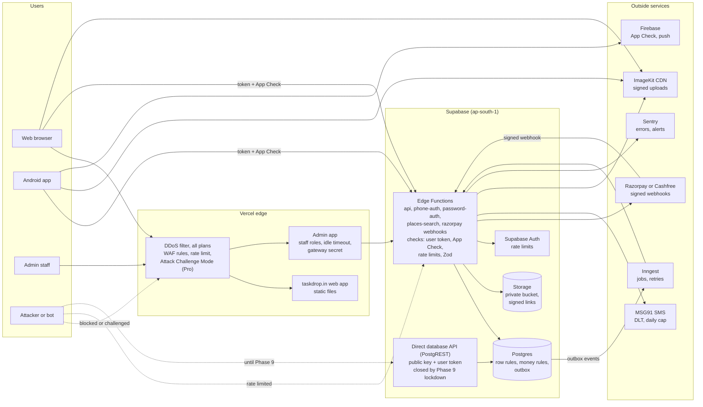

# TaskDrop ultimate plan

Written 2026-10-29 from the owner's request: every tip, tool and worry collected from the internet, sorted into workstreams that can be started one at a time. Read as the CEO's plan for getting from staging to a safe, growing launch.

## How to use this file

- **What this file is.** The umbrella over the other plans. Every request the owner made on 2026-10-29 (and the owner's saved WhatsApp groups) is sorted into one of fourteen workstreams, **U1 to U14**. Where another document already owns the detail, the box here links to it instead of copying it:
  - `docs/UPGRADE_PLAN.md`: build phases 0 to 10, and staging versus production (Part B, section 14). Still the single source of truth for phases.
  - `docs/testing_checks.md`: the test checklist T0 to T14 (security, money, speed, devices).
  - `docs/KEY_SECURITY_PLAN.md`: the five layers that protect keys (L1 to L5).
  - `docs/API_CALLS.md`: before/after counts of API calls (planned in U6; the side session that started it was stopped).
  - `docs/ULTIMATE_PLAN_PROMPTS.md`: your full prompt word for word, the same prompt cleaned up (with every place I interpreted you), and a ready-to-run prompt for each workstream.
- **Markers**, as in the upgrade plan: `- [ ]` open, `- [x]` done, `- [-]` deferred to future scope.
- **Who:** **(You)** = the owner only (sign-ins, payments, legal, anything with a password). **(Claude)** = code, documents, checks. **(Both)**.
- **How to start one:** say "start U3" (or a single box, "start U3.4"). Nothing here is built before that, the same rule as `AGENTS.md`. Owner, 2026-10-29: "Don't build anything. Just design the plan first of all." Boxes are numbered so they can be named.
- **Each workstream has:** why, the CEO call, the boxes, "done when", and what it depends on.
- **Not legal, tax or investment advice.** Legal items are what a lawyer should confirm (lawyer brief: `docs/LAWYER_BRIEF.md`).

## The CEO call (read this first)

**TaskDrop is a staging marketplace with about ten testers and fake money. What would kill it is not traffic. It is (1) a money or trust failure at launch and (2) empty neighbourhoods where a posted task gets no offer.** So the order is: make it safe and prove it with tests, get the legal basics a payment gateway and Play Store will ask for, set up production, then win one city deeply. Buy capacity when the numbers say so, not before.

On "something as big as Instagram": the architecture (Postgres with row rules, stateless Edge Functions, a CDN for the website and images, background jobs on Inngest) can grow a long way by paying for bigger plans. U4 lists the exact steps and the signal that triggers each one. Building for millions of users today would spend money and time that liquidity needs.

**Next 14 days, in this order**

| # | What | Who | Workstream |
|---|---|---|---|
| 1 | Passkey or authenticator sign-in on every provider account (GitHub, Vercel, Supabase, Google Cloud, Razorpay, Cashfree, Expo, Sentry, Inngest, ImageKit, MSG91, Spaceship) | You | U3.1 |
| 2 | Key protection pull request: gitleaks in CI and pre-commit, CI hardening, the admin service-role fallback removed | Claude | U3.2, U3.3 |
| 3 | Run the stop-ship tests on staging: T2 keys, T3 row rules, T5 buckets, T7 server checks, T8 money | Claude | U5.1 |
| 4 | Chase the Razorpay and Cashfree quotes in writing against the must-have list | You | U2.1 |
| 5 | Name and trademark checks, then file the trademark; add the refund and contact pages a gateway's KYC asks for | You, then Claude | U8.1, U8.4 |
| 6 | Decide the domain layout so a marketing site can be indexed while the staging app stays hidden | You | U9 decision D1 |

**Deliberately not now (and why)**

- **Dodo Payments**: built for digital products sold worldwide, not for holding a poster's money and paying a local worker (U2).
- **PostHog before launch**: there is nothing to measure yet with ten testers, and it adds a consent banner and privacy work (U8).
- **Chrome Web Store**: TaskDrop is not a browser extension, and no extension idea has shown it would bring users (U10).
- **iOS**: future scope since 2026-10-20 (U11).
- **PentAGI or any automated attack tool before the T-checks pass**: fix what a checklist finds first (U5).
- **Cloudflare in front of Vercel**: Vercel advises against it; it weakens Vercel's own attack detection (U4).
- **Bigger servers**: only when a U4 trigger fires.

### The roadmap: five stages, each with a gate

Weeks are estimates. The slow outside steps (lawyer, gateway KYC, DLT registration, Play's 14-day closed test) set the real pace, so they start in Stage 1 even though they finish later.

| Stage | Goal | Workstreams | Gate to move on |
|---|---|---|---|
| **1. Lock the doors** (weeks 1 to 2) | Nothing can be stolen or misused | U3.1 to U3.6, U5 Round 1 (T0 to T3, T5, T7, T8). **Start the slow outside steps now:** quotes (U2.1), lawyer brief (P1), name and trademark checks (U8.1, U8.2), DLT registration (U7.3), recruit closed-test testers | No stop-ship finding open; passkeys on every account |
| **2. Prove it on staging** (weeks 3 to 6) | The whole product works with fake money, under load, for real testers | U5 Rounds 2 and 3, U4.2 to U4.5 and U4.7, U6, U7.1 and U7.2, U3.11, U8.4 to U8.10, U14 version 1 design and sign-off, Play closed test running (12 testers, 14 days) | Staging exit gate (UPGRADE_PLAN 14.3) passes |
| **3. Get ready to sell** (weeks 5 to 8, overlaps) | People can find TaskDrop and the first area has workers | U9 D1 and the marketing site, Search Console, Google Business Profile, U10.1, U10.4, U10.8 to U10.10, U14 version 1 built and tested on staging | 20+ active workers lined up in the launch area; marketing site indexed |
| **4. Launch one area** (after the lawyer's answer, KYC and DLT) | Real money, real customers, one city | U1 and UPGRADE_PLAN P0 to P13, U4.6, T14 sign-off, launch posts (r/SideProject, Show HN, Product Hunt), U10 launch-day checklist | The ₹10 real-money test (P11) and launch gate (P12) pass |
| **5. Grow on evidence** (after launch) | More tasks get offers faster, then more areas | U14 versions 2 and 3, paid ads only behind proven hooks, WhatsApp codes (U7.5), PostHog with consent (U8), next area from the "request your area" data, U4 scale steps when triggers fire | Each step only when its number says so |

**The one number that matters most:** the share of posted tasks that get an offer within 30 minutes, in the launch area. It measures liquidity, the thing that decides whether a marketplace lives. Next to it: tasks completed, posters who come back, and zero money incidents.

**Top five risks, and the plan's answer**

| Risk | Answer in this plan |
|---|---|
| Money flow not allowed as built (RBI rules on holding money) | Lawyer first (P1); quotes must confirm the use case in writing (U2); money jobs stay off until then |
| A posted task gets no offer | One area deeply; workers first; concierge start; smart matching (U10, U14) |
| A security hole moves money or leaks data | U3, U5 Round 1 before anything else; RPC sweep (U3.4); Phase 9 lockdown |
| Bills run up by abuse (SMS, maps, images) | Caps, quotas and alerts (U7, KEY_SECURITY_PLAN L3, U4) |
| Growth tricks that backfire (fake reviews, AI "users", spam bots, Reddit bans) | Real people and honest posts only (U8, U10) |

## Progress board

| Workstream | Name | Status |
|---|---|---|
| U1 | Environments: staging and production | Designed in UPGRADE_PLAN section 14; release flow not written |
| U2 | Payment gateway quotes and decision | Waiting for quotes |
| U3 | Security: keys, the vibe-coding checklist, the common holes | Started: secret scanning and push protection on (2026-10-29) |
| U4 | Attack defence, DDoS and scale | Not started |
| U5 | Testing: the ultimate test plan | Checklist written (T0 to T14), 0 checks run |
| U6 | Fewer API calls, same design | Planned; the side session that began measuring was stopped, nothing merged |
| U7 | SMS OTP | Plan in `docs/SMS_OTP.md`; anti-fraud gaps open |
| U8 | Legal, privacy, consent, brand protection | Part done (age gate, account deletion, drafts) |
| U9 | SEO and Google Search Console | Not started (whole site is `noindex` on purpose) |
| U10 | Marketing and launch | Not started |
| U11 | Your dev setup: Android emulator, iOS on Windows | Not started |
| U12 | AI and dev tools: what to adopt | Verdicts below |
| U13 | Learning: cybersecurity and marketing | List below |
| U14 | Smart matching: the right worker sees the task first (your idea) | Proposed, not started |

---

## U1. Environments: staging and production

**Why.** You want to test every change in staging and only release it to production when it works.

**Already decided.** `UPGRADE_PLAN.md` section 14 sets up the two plans: what is fake and what is real (14.1), the rules that keep staging fake (14.2), the staging steps S1 to S10 (14.3) and the production steps P0 to P13 (14.4). They never share a database, a payment key or a secret. This workstream adds the day-to-day release flow on top.

| | Staging | Production |
|---|---|---|
| Code branch | `redesigned-2.0` | `main` (you promote by hand) |
| Web app | `taskdrop.in` today, `beta.taskdrop.in` once production exists (or sooner, see U9 D1) | `app.taskdrop.in` or `taskdrop.in` (U9 D1) |
| Database | Supabase `wjxvingpfbfvkfqhrguj`, free plan | A new Supabase project on Pro, ap-south-1, empty |
| Android | EAS channel `beta`; Play Internal and Closed testing | EAS channel `production`; Play Production |
| Admin | Preview deploy of `taskdrop-admin` | `admin.taskdrop.in` |
| Money and SMS | Razorpay test keys; sign-in code shown on screen | Live keys; real SMS through MSG91 |
| Sentry, Inngest, ImageKit | `beta` | `production` |

**The release flow (nothing reaches production that has not passed staging)**

1. Claude works on a short branch, opens a pull request into `redesigned-2.0`; CI must be green.
2. Vercel deploys staging. You and the testers run the core-flow checklist (UPGRADE_PLAN Part B, 5.2). Sentry stays quiet for 24 hours.
3. You say "promote". A pull request from `redesigned-2.0` into `main`; you merge it.
4. Production deploys from `main` in a fixed order: database migrations (forward-only, `scripts/deploy-migrations.mjs`), then Edge Functions, then the web app; Android gets an EAS Update on channel `production` (screen and code changes) or a new build (native changes).
5. A five-minute smoke test on production. If anything breaks: Vercel instant rollback, republish the previous EAS Update, and the written undo for the migration.

**Boxes**

- [ ] **U1.1** (Claude) Write `docs/RELEASE.md`: the five steps above, the production smoke-test list, and the rollback for each part (link `docs/RUNBOOK.md`).
- [ ] **U1.2** (Claude) Check and record which branch deploys where on Vercel, and that Production and Preview env values are separate (names only, no values).
- [ ] **U1.3** (You, Claude gives the clicks) GitHub branch protection on `main` in both repos: pull request required, CI must pass, no force-push. Claude may apply it with your yes.
- [ ] **U1.4** (Claude) Ship risky features "dark": the Phase 3 switches in app controls let a feature reach production switched off and be turned on after staging proved it.
- [ ] **U1.5** (You) The production steps P0 to P13 when you say "I want to launch".
- [-] **U1.6** A third environment (local or dev). Not needed: the cloud staging project is the test environment (ground rule 4).

**Done when:** one real change has gone branch, staging, tested, `main`, production, smoke test, and a rollback has been rehearsed once.

---

## U2. Payment gateway quotes and decision

**Status.** Razorpay is built in and runs in test mode. You have asked Razorpay and Cashfree for quotes; neither has answered yet (2026-10-29).

**Your rule:** take whichever quote is cheaper.

**CEO call: agreed, with one condition.** "Cheaper" counts only among quotes that pass every must-have below. A gateway that cannot legally hold a poster's money and then pay a worker is not cheaper; it cannot be used. And compare the cost over a year *including* the one-time cost of switching, because Razorpay is already built.

**Must-haves (pass or fail, in writing)**

1. Written approval of TaskDrop's use case: a marketplace where the poster's money is held until they approve, then paid to a third party (the worker). Razorpay's own Route docs say access now depends on criteria under the September 2025 RBI payment aggregator rules. This is the same question as the lawyer's R3 (UPGRADE_PLAN 14.4, P1).
2. UPI, cards and netbanking.
3. A split-payment or payouts product for paying workers, and its fee.
4. Refunds by API, and whether the gateway fee comes back on a refund.
5. Settlement time (T+1, T+2...).
6. Signed webhooks.
7. KYC accepts our business type and entity.

**Compare on:** the cost of one ₹150 task using the worked example in UPGRADE_PLAN 14.8, plus the payout cost per worker, plus any monthly fee, plus the switching cost spread over 12 months.

**Switching cost if Cashfree wins.** A new provider means new order, webhook, refund and payout code, re-running T8 on staging, and new KYC. About one phase of Claude's work. No customer is affected (staging only), but it is not free.

**Public figures (not quotes, checked 2026-10-29):** Razorpay's standard rate is 2% + GST. Cashfree's own charges page lists 1.95% to 2.0% for UPI, cards and netbanking; its 1.6% new-merchant offer was for sign-ups ending in spring 2026 (its pages give both 31 March and 30 April), so that window has closed. Third-party pages give Cashfree Easy Split at 0.1% to 0.2%; not confirmed.

**Dodo Payments: not for TaskDrop's core flow.** Dodo is a "merchant of record" for digital products and SaaS sold worldwide; it collects for one seller and pays that seller out. Third-party reviews say it is not meant for service businesses, and nothing shows a marketplace split. Revisit only if TaskDrop ever sells a digital subscription to buyers abroad.

**Comparison table (Claude fills it when the quotes arrive)**

| | Razorpay | Cashfree |
|---|---|---|
| Use case approved in writing | | |
| UPI / cards / netbanking rate | | |
| Fee returned on refund | | |
| Split or payout fee | | |
| Monthly fee | | |
| Settlement time | | |
| Cost per ₹150 task (14.8 method) | | |
| One-time switching cost | ₹0 (built) | about one phase |
| **Year-one total at expected volume** | | |

**Boxes**

- [ ] **U2.1** (You) Chase both quotes. Ask the 14.8 questions plus the must-haves above, in writing. Suggested deadline: 2026-11-15.
- [ ] **U2.2** (You) Paste the quoted numbers to Claude (numbers only, never keys).
- [ ] **U2.3** (Claude) Fill the table, recommend, and update UPGRADE_PLAN 14.8 and its changelog.
- [ ] **U2.4** (You) Decide and record the date.
- [ ] **U2.5** (Claude) Only if switching: write a "gateway switch" phase first (both gateways behind one provider interface, migrations add-only, T8 on staging) before any code.
- [ ] **U2.6** (Claude) The pages gateway KYC checks on the website: Terms, Privacy, Cancellation and refunds, Contact us with the business address (shared with U8.4).

**Done when:** a written decision with both quotes attached, and the chosen gateway's KYC started.

---

## U3. Security: keys, the vibe-coding checklist, the common holes

**CEO call.** No app is unhackable. The aim is: a leak is unlikely, caught in minutes, does little damage, and is fixed fast. Keys are covered layer by layer in `docs/KEY_SECURITY_PLAN.md`. This workstream maps the 18-point "vibe-coded website" checklist you sent to what TaskDrop has today, with evidence.

**Checked on 2026-10-29** (names and settings only; no secret values read):

| # | Checklist item | TaskDrop today | Action | Test |
|---|---|---|---|---|
| 1 | Hide API keys | Only public keys in the app bundle (UPGRADE_PLAN section 7); server keys in Supabase secrets, Vault and Vercel. GitHub secret scanning and push protection **on** for both repos | KEY_SECURITY_PLAN L1 to L5 | T2 |
| 2 | Check environment variables | 73 names inventoried and tested 2026-10-28; `OMNIROUTE_API_KEY` is unused | Startup check that fails a deploy when a required secret is missing (U3.3) | T2 |
| 3 | Protect admin routes | Separate admin app, server-side session, staff roles, gateway header. **Gap:** `middleware.ts` falls back to the service-role key when `ADMIN_SESSION_SECRET` is missing | U3.3. Authenticator on at production (P9) | T6, T7 |
| 4 | Proper authentication | Supabase Auth: phone code, Google, username and password; refresh-token reuse detection on; tokens expire in 1 hour. **Gap:** leaked-password protection is off (Supabase advisor) | U3.7 | T6 |
| 5 | Users see only their own data | Row rules on every table (advisor: none missing). Seven private tables have rules but no policy, which means closed to the app (intended; confirm). **113 privileged (SECURITY DEFINER) functions can be called by any signed-in user**; each must check the caller itself | U3.4: the most important test in this file | T3, T7 |
| 6 | Sanitize forms | Shared Zod schemas, validated on the server | T4 hostile-input cases | T4 |
| 7 | Protect against XSS | React escapes text; no `dangerouslySetInnerHTML` in the app. Full CSP is report-only | Enforce the full CSP after a clean week (U3.9) | T4 |
| 8 | Rate limiting | `api` limits per user and IP (`private.api_rate`); sign-in code: 60 s resend cooldown, 5 attempts; `password_attempts` table | Fill gaps found in U7 and U4 | T7, T9 |
| 9 | Check CORS | Every Edge Function answers `Access-Control-Allow-Origin: *`. Calls use a bearer token, not cookies, so this is not an open door, but it is wider than needed | U3.5: allow-list of our web origins (old app and admin must keep working) | T7 |
| 10 | Security headers | HSTS, `nosniff`, `X-Frame-Options: DENY`, referrer and permissions policies, CSP basics enforced (`vercel.json`) | Same check on the admin app | T4 |
| 11 | Turn off debug mode | Test shortcuts on by design in staging: `dev_otp_for_all`, `ALLOW_ANY_OTP`, `TEST_PHONES`, App Check debug token | Production test that each is off (P9) | T14 |
| 12 | Update dependencies | User repo: `npm audit --omit=dev` shows 15 (4 high, 6 moderate, 5 low). Admin repo: 0. Dependabot weekly | U3.6: fix or document the 4 high | T1 |
| 13 | Remove what you don't need | Unused env var above; 30 unused database indexes (mostly new admin tables, keep until there is traffic); old functions stay until Phase 9 (ground rule 2) | Remove after Phase 9 | — |
| 14 | Check for exposed files | No `.env` in git; task photos in a **private** bucket with signed links | U3.8: probe `/.env`, `/.git/config`, source maps on every domain | T5 |
| 15 | Secure the database | Row rules; migrations forward-only; no direct `db push` | U3.7: network restrictions and SSL enforcement; Phase 9 lockdown of direct table access; backups on Pro | T3 |
| 16 | Hash passwords properly | Username sign-in uses Supabase Auth (`signInWithPassword`), which stores bcrypt hashes; TaskDrop never stores passwords itself | None | T6 |
| 17 | Check git history for leaked secrets | One old Razorpay **test** key is in history (KEY_SECURITY_PLAN A2); scanning now on | gitleaks full-history scan (U3.2) | T2 |
| 18 | Full security audit | = U5 (T0 to T14) + `/security-review` on every pull request | U5 | T14 |

**The three most common holes in vibe-coded apps**

- **Exposed API keys:** items 1, 2, 17 above; T2.
- **SQL injection:** the app talks to Postgres through PostgREST and RPCs, which send values as parameters, not as SQL text. Dynamic SQL exists in 12 migration files, all in one-time admin loops that build `grant`/`policy` statements with `format('%I')`. Low risk, still tested in T4 with hostile input against every RPC.
- **Insecure buckets:** `task-media` is private, 50 MB limit, image and video types only, read through signed links; images go through ImageKit signing. T5 checks every bucket and every signed-link expiry.

**Boxes**

- [ ] **U3.1** (You) Passkey or authenticator on every provider account and the domain registrar (KEY_SECURITY_PLAN L2). The biggest single protection: most breaches are stolen logins, not cracked keys.
- [ ] **U3.2** (Claude) One pull request: gitleaks in CI (every pull request, plus a weekly full-history scan), a pre-commit hook, read-only `permissions:` in workflows, third-party Actions pinned to a commit.
- [ ] **U3.3** (Claude) Admin: refuse instead of falling back to the service-role key; a startup check that fails the deploy when a required secret is missing or too short.
- [ ] **U3.4** (Claude) RPC permission sweep in `npm run test:db`: call each of the 113 functions as a plain signed-in user; every admin, payout and other user's-data function must refuse. Any that do not are a stop-ship finding.
- [ ] **U3.5** (Claude) CORS allow-list for browser callers (`taskdrop.in`, `beta.`, `admin.`, Vercel previews), keeping native and old-app calls working.
- [ ] **U3.6** (Claude) Fix or document the 4 high `npm audit` findings.
- [ ] **U3.7** (You, Claude gives the clicks) Supabase: leaked-password protection on (if the free plan allows; otherwise at Pro), database network restrictions, SSL enforcement.
- [ ] **U3.8** (Claude) Exposed-file probe on `taskdrop.in`, the admin and Vercel previews: `/.env`, `/.git/config`, `*.map`, backup files. All must be 404.
- [ ] **U3.9** (Claude) Read the CSP reports in Sentry; switch the full CSP from report-only to enforced.
- [ ] **U3.10** (Claude) The rest of KEY_SECURITY_PLAN (log scrubbing, bundle-secret test, canary key, runbook).
- [ ] **U3.11** (Claude) The "30-minute security review" from the Secure Vibe Coding PDF you saved, run on staging: (1) dependency checks; (2) read the sign-in and permission code; (3) call every `api` operation with no token and with a wrong user's token ("what happens if I remove the sign-in?"); (4) ownership test: change a task, chat or payout id to another user's and confirm the server refuses (the "User A reads User B" test, part of U3.4); (5) production settings (debug off, HTTPS, CORS, headers, no secrets); (6) automated scan (U5.5) and, before real money, a human security review. Also from the PDF: sign-in errors must not reveal whether an account exists. First look 2026-10-29: no "user not found" or "wrong password" style messages in `phone-auth` or `password-auth`; T6 confirms it by testing.

**Done when:** all boxes ticked and T2, T3, T5, T7 pass.

---

## U4. Attack defence, DDoS and scale

**CEO call.** No plan stops every attack. The goal: an attack costs the attacker more than it costs us, one layer failing never moves money, and a flood of traffic slows the site rather than draining the bank account. Two firm calls:

- **No Cloudflare in front of Vercel.** Vercel's own guidance says not to put a reverse proxy in front of it: it adds delay, causes cache problems, and hides the signals Vercel's firewall and bot protection use. Vercel blocks network floods automatically on every plan, and does not bill for traffic it blocks.
- **Pay for scale on a trigger, not on a hope.**

### The system, and where attackers are stopped

### Threats and defences

| Where | Threat | Defence | Status |
|---|---|---|---|
| Website | Network floods (L3/L4) | Vercel automatic DDoS mitigation, every plan | On |
| Website | Request floods, scrapers, bad bots (L7) | Vercel WAF custom rules, rate limits, Bot Protection, Attack Challenge Mode | At production (check what Hobby allows) |
| `api` | Abuse, scraping, brute force | User token required; per-user and per-IP limits; App Check (monitor now, enforced in Phase 9) | Partly on |
| Direct database API | Calls with the public key that skip `api` | Row rules now; **Phase 9 lockdown** refuses direct calls | Biggest open door until Phase 9 |
| Sign-in | SMS pumping (fake sign-ups that burn SMS money), guessing codes | U7 controls; 60 s cooldown and 5 attempts already | Part on |
| Payments | Fake webhooks, card testing | Signature checks (on), idempotency (on), rate limit on order creation, the gateway's own fraud tools | Mostly on |
| Media | Huge uploads, hotlinking | Private bucket, 50 MB limit, allowed types, signed links | On |
| Admin | Stolen staff login | Staff roles, idle timeout, gateway secret; authenticator at production | Part on |
| Bills ("denial of wallet") | An attacker runs up Google, SMS or image costs | Quotas, daily caps and billing alerts (KEY_SECURITY_PLAN L3, L4) | Open |
| Marketplace fraud | Fake accounts, fake reviews, off-platform payment scams | Phone verification, one review per completed task, moderation tools (Phase 7), report and block | On; watch |

**When under attack (add to `docs/RUNBOOK.md`):** turn on Vercel Attack Challenge Mode; block the source IP ranges or countries in the WAF; tighten `api` limits through app controls; put the app in maintenance mode if money paths are at risk (app controls already have it); contact Supabase support; tell testers or users what is happening.

### Scale: what to buy and when

| Stage | Users (rough) | What runs | Move to the next stage when |
|---|---|---|---|
| 0, now | Owner and ~10 testers | Free plans everywhere | You decide to launch (P6) |
| 1, launch | Up to a few thousand a month | Supabase Pro (smallest compute, backups), Vercel Pro, Inngest paid | Database CPU above 70% for an hour a day, or p95 `api` time above the targets in UPGRADE_PLAN section 6, or connections above 80% of the limit |
| 2, one busy city | Tens of thousands a month | Bigger database compute, connection pooling for all server code, a read replica for feeds and search, cached feed answers, all slow work through Inngest | The same signals again, or one table dominating database time |
| 3, many cities | Hundreds of thousands and up | Read replicas per region, split hot tables by city or time, a search service for tasks, a dedicated queue for chat | Only with real traffic data |

**Rules that keep it scalable (mostly true today):** counters that many people hit at once (views, ad impressions, likes) are recorded as new rows or batched, never as one `UPDATE ... + 1` on the same row per event, because a single hot row makes every request wait in line; Edge Functions keep no state; Postgres owns money and rules; slow or outside work goes through the outbox and Inngest; images come from ImageKit's CDN; every list is paginated; app config is cached for 60 seconds; fewer API calls (U6).

**Boxes**

- [ ] **U4.1** (Claude) Check the diagram above against the code (Archify can draw one from the repository, U12) and merge it with UPGRADE_PLAN Part B, section 3.
- [ ] **U4.2** (Claude) k6 load-test scripts for staging only: open feed, post task, send offer, chat. Ramp slowly; record p95 time, errors and the first thing that breaks. Small runs only (free plan), each with your OK.
- [ ] **U4.3** (Claude) Draft the Vercel firewall rules (rate limit, known bad bots, maintenance bypass for staff), applied at production.
- [ ] **U4.4** (Claude) "Under attack" section in `docs/RUNBOOK.md`.
- [ ] **U4.5** (Both) Game day on staging: flood `api` from one machine and watch the limit work; switch on maintenance and watch the app show it; switch it off.
- [ ] **U4.6** (You, at launch) Supabase Pro with the spend cap on, Vercel Pro (already P6).
- [ ] **U4.7** (Claude) Timeouts and failure alerts on every outside call (MSG91, Razorpay, ImageKit, Google, Expo push, Firebase): a slow provider must fail fast with a plain message, never hang a user's request; Inngest runs that fail for good raise a Sentry alert (the "dead letter" idea).

**The backend-concepts list you saved (nataindata's "111 things", first 24 readable) against TaskDrop:** rate limiting, caching, CI/CD, idempotency, retries with exponential backoff, message queues, publish/subscribe, event-driven design, cron jobs and WebSockets are **already in TaskDrop** (`api` limits, CDN and app-config cache, GitHub checks, webhook idempotency, Inngest retries, the outbox, pg_cron/Inngest schedules, Supabase realtime). Load balancing, reverse proxies, API gateways, Docker, Kubernetes and service discovery are **handled by Vercel and Supabase** and need no work from us. Circuit breakers and timeouts: U4.7. Dead-letter queues: U4.7. Distributed transactions and sagas: money changes happen inside single Postgres transactions, which is the simpler and safer design; keep it that way.

**Done when:** the load test has found the first bottleneck on staging and the game day passed.

---

## U5. Testing: the ultimate test plan

**CEO call.** The test plan already exists: `docs/testing_checks.md`, T0 to T14, about 184 checks built from the videos you sent earlier, OWASP and the Supabase docs. **None has been run yet.** Writing a second plan would waste the first. This workstream runs it, in this order, and adds what is missing.

**Run order**

| Round | Checks | Why first |
|---|---|---|
| 1, stop-ship | T0 setup, T1 CI, T2 keys, T3 row rules, T5 buckets, T7 server checks, T8 money | These are the ways money or private data leak |
| 2 | T4 hostile input, T6 sign-in and sessions, T11 the Android app, T13 privacy | Attacks that need more effort |
| 3 | T9 speed and scale (with U4.2), T10 functions and devices, T12 recovery | Quality and resilience |
| Gate | T14 pre-production sign-off | Nothing goes to production without it |

**Additions (to be written into `testing_checks.md` when U5 starts)**

- [ ] **U5.1** (Claude) Round 1 on staging; findings into the findings log; stop-ship rule as written in `testing_checks.md`.
- [ ] **U5.2** (Claude) Rounds 2 and 3.
- [ ] **U5.3** (Claude) Lighthouse CI on every pull request for the web app and the marketing site (performance, accessibility, best practices, SEO). Targets: 90+ on the marketing site; the app's current scores recorded and not allowed to drop.
- [ ] **U5.4** (Claude) Accessibility: axe checks, a keyboard-only pass on web, TalkBack on Android, colour contrast at least 4.5:1 (already the design rule).
- [ ] **U5.5** (Claude) OWASP ZAP baseline scan (free, passive) against staging web and admin.
- [ ] **U5.6** (Both, after Round 1 passes) PentAGI, optional: an AI agent that attacks your own system. It needs Docker and an AI provider key, so it runs on a separate small cloud machine (vendor minimum 2 CPUs, 4 GB RAM), never on your PC with the secrets file. Aimed at staging domains only, never production or third-party services. First read Supabase's and Vercel's rules on security testing of your own project. Its findings are leads to confirm, not proof.
- [ ] **U5.7** (Claude) Outage drills: what the app shows when MSG91, the gateway, ImageKit or Inngest is down; money must stay safe.
- [ ] **U5.8** (Claude) `/security-review` and `/code-review` on every pull request into `redesigned-2.0`.
- [ ] **U5.9** (You) Real users: the Play closed test (12 testers for 14 days, required; kit in `docs/TESTER_RECRUITMENT.md`). **testmybuild.app:** no information about it could be found online on 2026-10-29; send the link before using it. Whatever service is used, testers get the staging build only (fake money, fake data). The tester email addresses you have collected in your "Testing vibe coding" WhatsApp group go into the Play Console closed-testing list (You); they are not copied into any file here.
- [ ] **U5.10** (Claude) Production smoke test (from U1.1) run after every production release.

**Done when:** T14 is signed off.

---

## U6. Fewer API calls, same design

Planned. A side session ("Reduce API calls without changing the design", 2026-10-29) began measuring, paused when you said "just plan", and was then stopped; nothing from it was merged. When started (prompt R8 in `docs/ULTIMATE_PLAN_PROMPTS.md`): measure the calls per screen on web, remove duplicates and repeated fetches, batch where possible without changing any existing `api` operation, and write before/after numbers to `docs/API_CALLS.md`. Earlier latency work (PRs 65 to 67) already batched some reads. The side session saw about 12 third-party requests on every web cold load (reCAPTCHA and App Check), which also matters for U8.

- [ ] **U6.1** (Claude) Measure first, then show the before/after numbers and proposed changes before building anything.
- [ ] **U6.2** (You) Approve the pull request into `redesigned-2.0` after testing it on staging.
- [ ] **U6.3** (Claude) T9 updated with the new targets from `docs/API_CALLS.md`.

---

## U7. SMS OTP

**Already planned:** `docs/SMS_OTP.md`: MSG91, DLT registration first, smallest pack first, about ₹0.13 a code at 30,000+ a month. In staging the code is shown on screen.

**CEO call.** Keep MSG91 SMS for launch. Make **Google sign-in** the first button: it is free and costs no SMS. Consider **WhatsApp codes** later as a second channel. Indian sources put WhatsApp's authentication price at about ₹0.12 to ₹0.15 a message plus the provider's markup, close to bulk SMS, so the gain is better delivery, not much lower cost. The real money risk is **SMS pumping**: bots requesting codes to many numbers so someone profits from the SMS charges.

**Controls against SMS pumping (have / to add)**

| Control | Status |
|---|---|
| 60-second resend cooldown, 5 attempts per code | Have (`phone-auth`) |
| Indian numbers (+91) only | Check |
| Limits per number per hour and per day, per IP and per device | Check `auth_send_log`; add what is missing |
| App Check token required to send a code | Monitor now; enforce in Phase 9 |
| Alert when codes verified divided by codes sent drops below about 60% | To add (Sentry) |
| Daily send cap and low-balance alert in MSG91 | To add (You) |
| A daily cap in our own database that stops sending when hit | To add |

**Boxes**

- [ ] **U7.1** (Claude) List the limits `phone-auth` has today and add the missing ones in the table above.
- [ ] **U7.2** (Claude) The verified-to-sent ratio alert and a daily cap that can be raised from admin.
- [ ] **U7.3** (You) DLT registration and MSG91 credits (production step P3); daily cap and low-balance alert in MSG91.
- [ ] **U7.4** (Claude) Google sign-in shown first on the sign-in screen (layout only, no new design; confirm with you first).
- [-] **U7.5** WhatsApp codes: after launch, when monthly codes pass about 30,000 or SMS delivery is poor.

---

## U8. Legal, privacy, consent and brand protection

**CEO call.** Do the basics that the payment gateway's KYC, the Play Store and Indian law will check before launch, and let the lawyer confirm (`docs/LAWYER_BRIEF.md`). This section is a checklist, not legal advice.

**The compliance checklist you sent, against TaskDrop**

| Item | TaskDrop today | Action |
|---|---|---|
| Privacy policy | Drafted from code (`docs/LEGAL_AUDIT.md`), marked "under legal review" | Lawyer review (P1) |
| Terms of service | Drafted | Lawyer review |
| Refund policy | Inside the Terms only | Own "Cancellations and refunds" page; gateways ask for it at KYC (U8.4) |
| Cookie policy and consent banner | Web keeps sign-in in browser storage; reCAPTCHA (App Check) and Sentry are security/error tools; no ads or analytics cookies | No banner needed until analytics or ads are added; then a banner with "reject" as easy as "accept", and a cookie section (U8.6) |
| Check form consents | 18+ confirmation live (migration 082) | Terms acceptance recorded at sign-up; any marketing opt-in separate and unticked |
| Don't collect unnecessary data | Address shown only after a worker is chosen | Review every field against its use (T13) |
| Audit third-party SDKs | Sentry, Firebase (App Check, push), reCAPTCHA Enterprise, Google Maps, ImageKit, Razorpay checkout, Expo. About 12 third-party requests on every web cold load (U6 session's count) | List each in the privacy policy and Play data-safety form; remove any not needed |
| Remove dark patterns | — | Check against the Consumer Protection Authority's 2023 dark-patterns guidelines: no drip pricing, false urgency, pre-ticked extras or shaming "no thanks" buttons |
| Remove hidden fees | 3% service fee and the 5% late-cancel fine come from the server | Show every fee and fine before the poster pays; a public fees page (U9) |
| Remove fake reviews | Seed data is staging only | Production starts empty (14.4); one review per completed task |
| Remove unsupported claims | Ground rule: no compliance claims in copy | Check "verified", "safe", "guaranteed" wording against what is actually checked |
| Accessibility alt text, contrast, keyboard | Contrast rule 4.5:1 in the design system | U5.4 |
| Business details | Entity, address, email, jurisdiction set in staging (T1) | Grievance officer and PIN code still open; required for a marketplace under the e-commerce rules |
| Age consent for children's data | 18+ only; no children's data | None |
| Unsubscribe link in emails | TaskDrop sends push, not marketing email | Add an opt-out to any future marketing email, SMS or WhatsApp |
| License fonts and images | Plus Jakarta Sans is open-licensed | Check icons, illustrations, stock images and copied components (21st.dev) for their licences |
| Data deletion request | Live (migration 087, self and admin) | None |
| DMCA | Admin notice handling live (085) | DMCA agent ($6 per 3 years) and grievance officer at P5 |

**PostHog: the call.** Not before launch. At production, yes, if you want product analytics, with these settings: the EU-hosted cloud, consent asked on web before it loads, no automatic capture of what people type, users identified only by TaskDrop's internal id (never phone or email), no session replay at first (Sentry already has masked replays), deletion wired into account deletion, and a line in the privacy policy and Play data-safety form. India's data law (DPDP Act 2023) applies wherever PostHog is hosted, because it processes data of people in India. For the marketing site, Vercel Web Analytics is cookieless and needs no banner. PostHog has nothing to do with DMCA, which is about copyrighted content users upload.

**Brand protection: name and trademark** (the three sites you found)

- **MCA company name search** (mca.gov.in): whether a company or LLP already uses the name; then reserve it (RUN or SPICe+) when you form the company.
- **IP India trademark public search** (ipindia.gov.in): search "taskdrop" and close variants in classes **9** (app software), **35** (online marketplace) and **42** (software as a service). An MCA name being free does not mean the trademark is free.
- **Handles and domains:** **Namechk.com** (the site named in the reel you saved; you wrote "namecheck.com") for Instagram, X, YouTube, LinkedIn, Reddit; `taskdrop.in` is already yours.

**Boxes**

- [ ] **U8.1** (You) The three name checks above; send Claude the results.
- [ ] **U8.2** (You) File the trademark for the word "taskdrop" and the drop-and-check logo in classes 9, 35 and 42 (check IP India's current fee; it is lower for individuals, startups and small businesses).
- [ ] **U8.3** (You) Claim the social handles before launch.
- [ ] **U8.4** (Claude) "Cancellations and refunds" and "Contact us" pages in the app and on the website, from the existing Terms and product rules; you approve the wording.
- [ ] **U8.5** (Claude) Third-party SDK list with purpose, data sent and where; matched to the privacy policy and the Play data-safety answers (`docs/PLAY_STORE.md`).
- [ ] **U8.6** (Claude, when analytics or ads are added) Consent banner on web and a cookie section in the privacy policy.
- [ ] **U8.7** (Claude) Dark-pattern and claims review of every screen with money or a sign-up on it.
- [ ] **U8.8** (Claude) Licence check of fonts, icons, images and copied components.
- [ ] **U8.9** (You) Grievance officer name and address PIN (P5, already open).
- [ ] **U8.10** (Claude) Run the "six legal traps" audit prompt you saved (WhatsApp, 4 Oct) against both repos and record PASS or FAIL with file and line. First look, 2026-10-29:

| Trap | First look | Still to do |
|---|---|---|
| 1. Age gate | Pass: 18+ confirmation at sign-up (migration 082) | None |
| 2. Fonts from Google's servers | Pass: Plus Jakarta Sans ships inside the app (`@expo-google-fonts/plus-jakarta-sans`); no `fonts.googleapis.com` in the code | Check the admin app and the future marketing site the same way |
| 3. Session replay recording input | Phones only, 5% of sessions plus sessions with an error, everything masked (text, images, icons); the web has no replay | Decide whether replay needs an explicit opt-in, or say it plainly in the privacy policy (lawyer) |
| 4. Email unsubscribe and postal address | No marketing email today | Add both to any future marketing email |
| 5. Renewal terms next to the buy button | No subscription or auto-renewal found | Apply if ad campaigns or a paid plan ever renew automatically |
| 6. User uploads (DMCA) | Takedown handling live in admin (085) | DMCA agent registration by you (P5) |

---

## U9. SEO and Google Search Console

**Today:** `taskdrop.in`, `www`, `beta` and every Vercel preview send `X-Robots-Tag: noindex, nofollow` on purpose (staging rule 14.2.5). There is no `sitemap.xml` or `robots.txt`. The web app is drawn in the browser by JavaScript (react-native-web), which ranks poorly: Google indexes such pages late, and most AI search crawlers do not run JavaScript at all.

**CEO call.** Do not try to make the app rank. Build a **small, fast, static marketing site** (landing pages, a blog, a waitlist, "earn with TaskDrop") that search engines can read, and keep the app hidden until launch. Start now, because search traffic takes months to build.

**Decision D1 (yours): the domain layout.** Recommended:

| Address | What | Indexed |
|---|---|---|
| `taskdrop.in` | Marketing site | Yes |
| `app.taskdrop.in` | Production web app (at launch) | Only its public pages |
| `beta.taskdrop.in` | Staging app (move it there now) | No |
| `admin.taskdrop.in` | Admin | No |

This changes UPGRADE_PLAN 14.4 P10 (which put the production app on `taskdrop.in`). Moving staging means updating the Google sign-in redirect addresses, the App Check and reCAPTCHA domains, the Supabase auth site URL, the CSP and the Vercel domains. Claude lists and does the code side; you do the console clicks.

**Boxes**

- [ ] **U9.1** (You) Decide D1.
- [ ] **U9.2** (Claude) Build the marketing site as static pages with Next.js (the admin already uses Next.js, so one framework to maintain), on its own Vercel project. Pages: Home; How it works (posting); Earn (working); Fees (3% service fee, 10% commission, the cancel fine, shown plainly); Safety and trust; Categories (local and remote tasks); Help and FAQ; Blog; Contact with business details; legal pages. Brand tokens and copy rules from `AGENTS.md`.
- [ ] **U9.3** (Claude) `sitemap.xml` generated at build; `robots.txt` that allows the marketing site and blocks app paths; canonical URLs; Open Graph images; structured data (Organization, WebSite, BreadcrumbList, Article for blog posts).
- [ ] **U9.4** (You) Google Search Console: add a **Domain property** for `taskdrop.in` by DNS TXT record at Spaceship; submit the sitemap; also add Bing Webmaster Tools (it can import from Search Console).
- [ ] **U9.5** (Claude) Lighthouse 90+ on every marketing page (U5.3).
- [ ] **U9.6** (Claude) City and category pages only where TaskDrop really has workers, each showing real, current data (as Ghosla did with real listings, U10). Thousands of near-identical, empty "service in area" pages break Google's spam policy on scaled content.
- [ ] **U9.7** (Both) Play Store listing keywords and screenshots (Phase 8, `docs/PLAY_STORE.md`).
- [ ] **U9.8** (You, weekly, 10 minutes) Search Console "Pages" and "Performance" reports.
- [ ] **U9.9** (Claude) The launch checks from the techpanchayithi reel you saved: link previews (Open Graph and X cards, tested by pasting the link into WhatsApp and LinkedIn), Bing Webmaster Tools, and an `llms.txt` "AI guide" file (cheap to add; how much AI search engines use it is not proven).
- [ ] **U9.10** (You) A **Google Business Profile** for TaskDrop in the launch city (from your marketing group). For a local service it is the free listing that shows on Google Maps and local search, and where the first reviews should go.

**Done when:** Search Console shows the sitemap read and the marketing pages indexed, while the staging app is still `noindex`.

---

## U10. Marketing and launch

**CEO call.** A marketplace grows by being full in one place, not visible everywhere. Pick **one city** (assumption: Hyderabad, the jurisdiction in the Terms; confirm) and a handful of task types. **Recruit workers first**, so that the first posters get offers fast, then posters. Remote tasks (online work) can be offered nationwide from day one because they do not need local density.

**Organic channels, ranked for TaskDrop**

| # | Channel | Why it fits | What to do | Measure |
|---|---|---|---|---|
| 1 | Local communities: WhatsApp and Telegram groups, resident associations, colleges, coworking spaces | Where neighbours already ask for help | Founder posts, a QR poster, student worker ambassadors | Sign-ups per community |
| 2 | Reddit (city subreddits, r/IndianStartups for building in public) | High-trust discussion; ranks in Google | Read each subreddit's self-promotion rule; help first (about 9 helpful posts to 1 about TaskDrop); never paste the same post into many subreddits | Visits, sign-ups per post |
| 3 | Marketing site and blog (U9) | Compounds over months | Price guides ("what a plumber costs in Hyderabad") once real data exists; "how to earn on weekends" guides | Search clicks |
| 4 | YouTube Shorts and Instagram Reels (same clips) | Shows a real task done start to finish | One short a week: a real task, a worker's story, how escrow protects you | Views to sign-up |
| 5 | Long YouTube videos | Search engine of its own | "How to earn money on weekends in Hyderabad", founder build log | Subscribers, sign-ups |
| 6 | LinkedIn | Founder story; small offices posting tasks | Weekly founder post | Business sign-ups |
| 7 | X | Building in public, investors, developers | Low priority for local users | — |
| 8 | Product Hunt and launch sites | One-day spike, credibility | After the production launch | — |
| 9 | Referral (give and get) | Best for marketplaces | **After the lawyer** (credits are money owed) and unit economics | Referred share |
| — | Chrome Web Store | No extension fits TaskDrop | Skip unless a "post a task from any page" extension is tested and shows demand | — |

**Posting to X, LinkedIn and Reddit with one click.** **Postiz** is an open-source scheduler that posts one message to X, LinkedIn, Reddit and 20+ more from one screen. It needs its own server (Docker, or a one-click host such as Railway) or its paid cloud, and each network needs its own developer app. X's API is now pay-per-use: third-party pages put it at about $0.015 a post and about $0.20 a post with a link (check X's developer console). **CEO rule:** one click for X, LinkedIn, Instagram, YouTube and Threads; **Reddit by hand**, written for each subreddit, because identical cross-posts get accounts banned and posts removed. Claude writes the per-platform versions from one brief using the marketing skills in U12.

**From your "Marketing app ideas vibe" WhatsApp group: verdicts**

| Saved idea | Verdict for TaskDrop |
|---|---|
| Launch posts: r/SideProject, Show HN (Hacker News), Product Hunt (Tuesday to Thursday), Indie Hackers, Uneed | **Use on launch week** for credibility and early adopters; they bring founders and developers, not Hyderabad posters, so they are not the main channel |
| Find customers on Quora and Reddit | **Use**: answer real questions ("how to find a plumber quickly", "earn on weekends"), link only where the community allows |
| Google Business Profile | **Use** (U9.10) |
| UGC (user-generated content) videos, "autopilot UGC" | **Use, real ones**: workers and posters filming real tasks with permission; pay small creators in the launch city for honest clips |
| Trustpilot for reviews | **Later**: Google reviews matter more for a local service; add Trustpilot after launch |
| Microsoft Clarity (free heatmaps and session recordings) | **Marketing site only, after the consent banner** (U8.6), with inputs masked. Not in the app: Sentry already covers it |
| AppSumo, RocketHub (lifetime-deal marketplaces) | **Skip**: they sell software licences to businesses; TaskDrop is a two-sided marketplace with no licence to sell |
| Supergrow (AI LinkedIn posts) | **Optional**: drafting help only; the founder's own voice matters on LinkedIn |
| Grok bot "AI employees" for marketing | **Not now** (video 3 below): it needs your account passwords and automated DMs risk bans |
| Money Printer Turbo (open-source AI short-video generator) | **Optional, careful**: real task videos build more trust than AI-generated ones; label any AI content |
| talktoads (run Meta ads with Claude), ProspecX (lead generation) | **Later**: paid ads only after organic channels show which message works; lead generation fits the small-business side after launch |
| AI voice agents (Telugu) | **Later**: could take task requests by phone in Telugu for people who don't type; a post-launch experiment |
| "100k downloads/installs" reels (Ryan Bartkiewicz, Gautam) | Same lesson as the table above: go where the target users already are and engage there, consistently |

**What the videos you saved actually teach (YouTube transcripts read in full, 2026-10-29)**

*1. "He got 10,000 users from one Reddit post" (Ghosla, an Indian tenant-to-tenant rental marketplace built with React Native and Supabase, the same stack as TaskDrop).* The most relevant video in your groups, because Ghosla had TaskDrop's exact problem: a marketplace needs supply before demand comes, and demand before supply joins. What the founder did, and what TaskDrop takes from it:

| What Ghosla did | TaskDrop version |
|---|---|
| Planned the marketing before building ("building is the easy part now") | This plan: U10 runs before launch, not after |
| Solved chicken-and-egg by collecting supply that was already being posted on social media | People already post "need a plumber / need help moving / need someone for a small online job" in city subreddits and WhatsApp groups, and workers post "available for work". Start where they already are |
| Built karma first, then answered day-old posts nobody had replied to, with exactly what that person needed | Answer real "need help" posts in the launch city's subreddits with a real offer, not a generic link |
| Was upfront ("I'm building this, it might help"), wrote in plain words, not AI copy; put the link in comments where a subreddit bans links in posts; if a mod removed a post, messaged them honestly | Same rules. **Not copied:** his tip of using a second account to post the link. That is vote manipulation under Reddit's rules and gets accounts banned |
| Kept replying in the comments so the post stayed alive | Founder replies to every comment on launch day |
| Viral Reddit posts raised the domain's standing with Google; then 2,000 to 3,000 pages ("1BHK flat in [area]") got indexed, each backed by real listings | City and category pages only where real tasks or workers exist (U9.6); each page shows real, current data |
| A "request your city" button: 40+ cities asked | A "request TaskDrop in your area" form on the marketing site (U10.8): free demand data for choosing the next area |
| A distinctive app icon got more clicks in search | The drop-and-check icon stays distinctive; check it next to competitors in Play search (U9.7) |
| Retention before ads: show it to 100 people; if 30 to 40 keep using it, then grow | Staging rounds and the first city: measure who comes back before spending on ads |

*2. "How these $100K/mo apps get users" (silent UGC).* A no-talking video: a person reacts while a text hook sits on screen ("I can't believe this exists..."), then the app is shown. Test many hooks for free on Instagram and YouTube Shorts, then put ad money only behind the ones that worked. Find formats by searching phrases like "I can't believe" and "no one told me", and look up competitors in the Meta Ad Library. Warm up a new account slowly instead of posting 30 videos on day one. **CEO call:** the format fits TaskDrop (a real task done, shown in 10 seconds). But the video makes the clips with AI actors posing as users and clones other creators' viral videos. For TaskDrop, use real workers and posters who agree to be filmed. If AI is used for an illustration, label it as AI and never present it as a customer, because AI "users" are fake testimonials (U8: fake reviews, unsupported claims) and copying someone's video is a copyright problem.

*3. "I built 7 AI agents" (Grok bot, in Hindi).* A CEO bot "hires" scout, brand-hunter, outreach and deal bots that research, write emails and DM influencers from a cloud computer logged into the founder's Instagram. The presenter's own verdict: good for business operations, not for building software. **CEO call:** not now. Never give an AI tool your Instagram or email password, and automated DMs break Instagram's rules (risking a ban). Later, an assistant that *drafts* worker-recruitment messages for a human to send is fine.

*4. "5 MCP servers" (YouTube Short).* Perplexity, Playwright, Firecrawl, Higgsfield, Chrome DevTools. This setup already has the equivalents of four (web search, the built-in browser and Claude in Chrome, Firecrawl). Higgsfield is an image and video generator: U12.

**From the websites and reels (captions read)**
- **Starter Story:** a one-feature product, sold by hand to 10 real users, with DMs as the support and feedback channel. TaskDrop version: the first 10 posters and 10 workers in one neighbourhood are found and helped personally by the founder (U10.9).
- **Consumer Club** (a paid agency): organic short videos first to find the hooks that work, then paid ads; expect views in month one and conversions in months two and three. The method is useful; the agency is not needed now.
- **TalkToAds** (₹999 course): Claude sets up Meta ad campaigns through a Chrome extension, kept paused until you approve. For later; the rule stays that no ad money is spent without your approval of each campaign.
- **Krishanu's "kill purple gradients, AI-slop copy and fake reviews before launch"**: added to the copy and claims review (U8.7) for the marketing site.

**Launch-day checklist (for P13):** store listing live, marketing site and blog live, 20+ active workers in the launch area, first-week posts lined up, the founder story ready for each channel, the support inbox watched, Sentry and the admin Alerts page watched, and the rollback in `docs/RELEASE.md` ready.

**Weekly numbers (no invented targets; set them after the first month):** active workers in the launch area, tasks posted, share of tasks with an offer within 30 minutes, share of tasks completed, repeat posters, sign-ups by channel.

**Boxes**

- [ ] **U10.1** (You) Confirm the launch city and the first five task types.
- [ ] **U10.2** (Claude) A 30-day content plan for the channels above (using the `content-strategy` and `social` skills, U12).
- [ ] **U10.3** (Both) Set up Postiz (or a paid scheduler) for X, LinkedIn, Instagram, YouTube; you create each network's developer app.
- [ ] **U10.4** (You) Worker recruitment in the launch city (staging testers first, `docs/TESTER_RECRUITMENT.md`).
- [ ] **U10.5** (Claude) Weekly numbers on the admin dashboard (the admin already has business reports).
- [-] **U10.6** Referral programme: after the lawyer's answer (R3).
- [-] **U10.7** Chrome extension: not planned.
- [ ] **U10.8** (Claude, with U9.2) A "Request TaskDrop in your area" form on the marketing site; results feed the choice of the next area.
- [ ] **U10.9** (You) Concierge start: find and personally help the first 10 posters and 10 workers in one neighbourhood; write down what each struggled with.
- [ ] **U10.10** (Both) Silent-video tests with real people (testers, workers who agree): 10 hooks, posted organically; keep the 2 that work for later ads.

---

## U11. Your dev setup: Android emulator and iOS on Windows

**Android emulator.** Your real phone over USB already works and stays the best test device (it is how the app was tested so far). For an emulator on Windows 11 Home:

1. Task Manager, Performance, CPU: "Virtualization" must say **Enabled**. If not, switch it on in the BIOS (Intel VT-x or AMD-V/SVM).
2. Windows Features: turn on **Windows Hypervisor Platform**, restart.
3. Android Studio: SDK Manager, update **Android Emulator** and **platform-tools**. Google retires its older emulator driver (AEHD) on 31 December 2026; Android Studio offers to switch to the Windows Hypervisor Platform. Accept.
4. Device Manager: create a new device with an **x86_64 Google Play** system image (not ARM), 2 GB+ RAM. If it shows a black screen, set Graphics to "Software" or cold-boot it, or wipe its data.
5. Keep 10 GB+ free disk space. The Android SDK folder must not contain spaces (the default under your user folder is fine).

- [ ] **U11.1** (Claude) With your OK, run read-only checks (`emulator -accel-check`, `emulator -list-avds`, `adb devices`) and tell you the exact failing step.
- [ ] **U11.2** (You) The BIOS or Windows Features step if U11.1 shows it.

**iOS on Windows.** Apple's iOS Simulator runs only on macOS; no tool runs it natively on Windows. The options:

| Option | What it is | Fit |
|---|---|---|
| Expo EAS Simulator | Expo builds and runs the iOS Simulator on its own Macs and streams it to you; limited-access preview (September 2026) | Best for TaskDrop (Expo app), when iOS starts |
| Appetize.io | Upload a simulator build, use it in the browser | Good for demos and quick checks |
| A rented cloud Mac | A full Mac in the cloud | Most complete, monthly cost |
| A real iPhone | Development build installed on a borrowed iPhone | Needs the Apple Developer account ($99/year) |

- [-] **U11.3** iOS: future scope since 2026-10-20. Nothing is bought or set up until you say "start iOS".

---

## U12. AI and dev tools: what to adopt

**Rule for every tool:** a third-party skill, plugin or MCP server runs with your permissions and can read the repository. Read what it installs first, and never let it read `.env.all-secrets`.

| Tool | What it is | Verdict |
|---|---|---|
| **21st.dev** | UI components and generation | **In use** (status badges, table head). Keep it for polish, inside the brand tokens; the free tier allows 2 code pulls a day |
| **Lighthouse** | Google's page-quality audit | **Adopt** in CI (U5.3, U9.5) |
| **Context7** | Up-to-date library docs for the AI | **In use** (connected); keeps Expo SDK 57 and Supabase answers current |
| **Graphify** | A local map of the codebase (functions, calls, imports) that the AI can query instead of re-reading files | **Optional, later.** Big token-saving claims come from blogs, unverified. We already have `AGENTS.md` and session memory. If tried: on the admin repo first, reading its git hook before installing |
| **Archify** | An agent skill that draws an interactive architecture diagram from the code, each box linked to a file and line | **Use once** for U4.1, then check the drawing against the code (AI diagrams can invent links) |
| **"Never Get Hacked"** | No tool with that name could be found on 2026-10-29 | Closest: the **VibeSec** skill (BehiSecc) and Claude Code's built-in **`/security-review`**. Adopt `/security-review` on every pull request now; read VibeSec before installing it |
| **GStack** (garrytan/gstack) | Garry Tan's pack of Claude Code skills: office-hours, review, ship, QA, browse | **Optional.** Overlaps what we have (`/code-review`, the TaskDrop CEO skill). If tried, install only its QA and review skills, read its setup script first, and never let a "ship" skill push to `main` (ground rule 3) |
| **PentAGI** | Open-source AI that runs attacks against your own system | **Later, optional** (U5.6), on a separate machine, staging only |
| **marketingskills** (coreyhaines31) | 50+ free marketing skills for Claude (from your Google Doc) | **Adopt** the eight in the doc: content-strategy, copywriting, ad-creative, emails, cold-email, seo-audit, social, marketing-plan. Give Claude the product, customer, competitors and quarterly goal first |
| **Postiz** | Open-source social scheduler | **Adopt** for U10.3 |
| **testmybuild.app** | Not found online on 2026-10-29 | **Unverified**; send the link |
| **Google Stitch** (stitch.withgoogle.com) | AI screen designer | **Marketing site mockups only**; the app's design is set, and design changes need your sign-off first |
| **LottieFiles, Higgsfield**, the animations library you saved | Animation sources | **Use Lottie** for marketing-site and empty-state animations, always with reduced-motion respected (design rule) |
| **Design galleries** (scrolltide, navbar.gallery, footer.design, cta.gallery, Refero styles, Supahero, 3dicons) | Inspiration for page sections | **Use for the marketing site** (U9.2), as inspiration only; check each licence before copying anything (U8.8) |
| **"Copy any website" tools (REA)** | Clone another site's design | **Skip copying**: cloning someone else's site risks copyright. Use as inspiration |
| **Agent Reach skill** | Lets Claude read social media | **Optional**: read it first; it would act through your accounts |
| **OmniRoute** | An AI model router | **Remove its key**: `OMNIROUTE_API_KEY` is set but no code uses it (U3 item 13) |
| **Whisper Flow** | Voice dictation | **Your choice**: handy for long prompts; nothing to set up in the project |
| **TrustMRR, CopyMRR, FoundersDB, CodeFast, the AI Startup Build & Launch Playbook, Dan Martell's tool list** | Founder inspiration and courses | **Reading list**, no project change |
| **Google AI Studio to Android** | Builds an Android app from a prompt | **Skip**: TaskDrop already has a tested Expo Android app |

**"The 30 best Claude plugins" (reel by heysansser, sent 2026-10-29).** The reel's own advice is right: don't install all 30; pick one for the job of the week, and read the repository first, because some can run commands on your computer. The names below come from the reel's caption; the repositories were not opened or checked here. Verdicts against what TaskDrop already has:

| Row in the reel | Plugins | Verdict for TaskDrop |
|---|---|---|
| Code like a senior dev | Superpowers, Matt Pocock Skills, ECC, Karpathy Skills, Ponytail, Agent Skills | **At most one, optional.** `AGENTS.md`, `/code-review`, `/security-review` and the test checklist already enforce plan-first and test-first. If one is tried, Superpowers (plan and test before code) fits best |
| Research and understanding | Graphify, Agent Reach, Understand Anything, Last 30 Days, Career Ops, REA | Graphify, Agent Reach, REA: as in the table above. **Last 30 Days** could help U10 (what people in the launch city said about finding help this month). Understand Anything: not needed for a codebase Claude already knows. Career Ops: not relevant |
| Big projects, fewer tokens | gstack, Caveman, Claude-Mem, Headroom, GSD, BMAD Method | **Skip for now.** Session memory, `UPGRADE_PLAN.md` and this plan already do what Claude-Mem, GSD and BMAD do; adding a second process would conflict. gstack: as above |
| Design and visuals | UI UX Pro Max, Taste, Archify, Impeccable, PPT Master, Diagram Design | **Marketing site only** (U9.2): one of Taste, Impeccable or UI UX Pro Max. The app's design is signed off and changes need your approval. Archify: U4.1. PPT Master: only if you need a pitch deck |
| Writing and video | Skills by Anthropic, OpenMontage, HyperFrames, Humanizer, I Have ADHD, Marketing Skills | **Marketing Skills: adopt** (U12.1). **HyperFrames** (web code to video) could turn real app screens into short explainer clips for U10; try once. Humanizer: drafts only, and label AI content. Skills by Anthropic: already available here. The rest: skip |

- [ ] **U12.1** (Claude) Install the eight marketing skills after reading each `SKILL.md`.
- [ ] **U12.2** (Claude) Archify run for U4.1.
- [-] **U12.3** Graphify, GStack, VibeSec: try one at a time only if a real need shows up.
**More tools from your saved reels and links (captions and pages read 2026-10-29):**

| Tool | What it is | Verdict |
|---|---|---|
| Arcads (AI UGC actors) | AI people holding your product in ad videos | **Skip for now**; real people first (U10). If ever used, label it AI |
| Grok bot (xAI) | "AI employees" that run operations from a cloud computer | **Not now**; never give it account passwords (U10, video 3) |
| Higgsfield, OpenMontage, Remotion, Money Printer Turbo | AI image and video generation and editing | **Optional** for marketing clips; label AI content |
| wshobson agents (200+ agents), GraphBit, "agent memory", browser-use | Agent packs and frameworks | **Skip**: this setup already has agents, memory and browser control; another framework would add risk, not speed |
| Perplexity MCP, Playwright MCP, Chrome DevTools MCP | Search and browser control for Claude | **Already covered** by this setup |
| scrolltide.co | Scroll-animation prompt templates (some free, most premium at $29/month) | Marketing site only, free ones first |
| FoundersDB | Paid library of 1,500+ founder case studies | Optional reading |
| CodeFast | A coding course | Not needed |
| Spearanza "Digital Stack" PDF | A beginner stack: Clerk, Stripe, Pinecone, PostHog, Cloudflare, Resend... | Already ahead of it. Clerk, Stripe and Pinecone are rejected for TaskDrop (`AGENTS.md`); the rest is covered in U3, U4, U8 |
| Spearanza "Pre-launch checklist" (22 checks) | Legal, infrastructure, domain and security, monitoring, analytics | Every check is covered: legal U8, keys U3, monitoring (Sentry, Uptime Robot) done, payments tested in T8 and P11, analytics U8 |

- [-] **U12.4** From the 30-plugins reel: HyperFrames for U10 explainer clips, one design plugin for the marketing site, Last 30 Days for U10 research. One at a time, each after reading its repository.

---

## U13. Learning: cybersecurity and marketing

**Cybersecurity (free unless noted)**

- **OWASP Top 10** and **OWASP API Security Top 10**: the list of the most common web and API holes. `testing_checks.md` is built on them.
- **OWASP MASVS**: the same for mobile apps (T11).
- **PortSwigger Web Security Academy**: free hands-on labs for every web attack (SQL injection, XSS, access control). The best single course.
- **Supabase docs**: "Row Level Security", "Production checklist", "Database linter" (the advisor used in U3).
- **TryHackMe** (beginner paths, some free) and **Hack The Box Academy** (deeper).
- **Google's "Secure your site" pages** and **Vercel's firewall docs**, for the platforms TaskDrop runs on.

**Marketing and growth**

- **"The Cold Start Problem"** by Andrew Chen: how marketplaces and networks start. The most relevant book for TaskDrop.
- **"Traction"** by Gabriel Weinberg and Justin Mares: the 19 channels and how to test them.
- **"The Mom Test"** by Rob Fitzpatrick: how to talk to users without fooling yourself.
- **The Ghosla interview you saved** ("He got 10,000 users from one Reddit post", YouTube): an Indian two-sided marketplace on the same stack; the closest real example for TaskDrop's first months.
- **The "Secure Vibe Coding" PDF you saved**: a two-page summary of server-side checks, rate limiting, password hashing, safe error messages and the 30-minute review (U3.11).
- **Google Search Central** (documentation and YouTube): SEO from the source.
- **Ahrefs blog and YouTube**: practical SEO and content.
- **Lenny's Newsletter** (marketplace posts) and **a16z's marketplace guides**: marketplace metrics.
- **Y Combinator Startup School** (free): the whole startup basics course.

---

## U14. Smart matching: the right worker sees the task first (your idea)

**Your note (WhatsApp "Vibe coding", 27 Oct):** use AI to match a task with the worker who can do it; if a worker has done that kind of task before, suggest them; use the area on the map; and share the post with that worker so the work gets done fast.

**CEO call: yes. This is the most important product idea in the groups,** because it attacks the number-one risk: a posted task getting no offer. Start simple and measurable, and add AI only when the simple version stops improving.

**Version 1, rules only (no AI):** when a task is posted, send a push to workers who (a) completed a task in the same category, (b) within a few km of the task's area (remote tasks: by category only), (c) recently active, and (d) not already notified today too many times. Then widen the radius if no offer comes within the first minutes.

**Version 2, ranking:** order those workers by past completion rate, rating, response speed and distance.

**Version 3, AI:** read the task text to pick the category and skills when the poster does not, and suggest "workers who did this before" to the poster.

**Rules that must hold:** the server decides who is notified (ground rule 1); only the area name is used until a worker is chosen (privacy rule); a worker can turn these alerts off; a daily cap so nobody is spammed; no worker's history is shown publicly. It is a new feature, so the screens it needs (an alert, a poster-side suggestion) are shown to you as a static design first (design sign-off rule).

**Measure:** time to first offer, share of tasks with an offer within 30 minutes, completion rate, alert opt-outs.

- [ ] **U14.1** (Claude) Write the design: data it uses (existing tables only, additions only), the push rule, the caps, the switch in app controls to turn it off.
- [ ] **U14.2** (You) Approve the alert wording and any screen change.
- [ ] **U14.3** (Claude) Build version 1 behind a switch; test on staging with the testers.
- [-] **U14.4** Versions 2 and 3: after launch, when there is real task data.

**Tagline ideas you saved** ("Where you can decide the price", "community of work") are kept as ad-copy options. The brand tagline stays "Ask for anything. Someone gets it done for you."

---

# Part B: reference

## B1. Decisions needed from you

1. **D1 domain layout** (U9): marketing site on `taskdrop.in`, staging app moved to `beta.taskdrop.in` now?
2. **Launch city and first five task types** (U10.1).
3. **Gateway quotes** (U2): send them when they arrive.
4. **From the key plan:** rotation only when a key is confirmed leaked? Repos stay public? Which password manager? (`docs/KEY_SECURITY_PLAN.md` section 6.)
5. **testmybuild.app:** the link, if you still want it.
6. **Smart matching (U14):** go ahead with the version 1 design?

## B2. What could not be read

- The three Instagram reels need an Instagram login; their content was not seen. Paste the captions or the main points if they matter.
- The Google Drive PDF "Secure_Vibe_Coding.pdf" needs a sign-in. Paste its text, or share it as "anyone with the link", and it will be added.
- The Google Doc ("Your One-Person Marketing Team") was read; it is in U12.
- **Your five "vibe" WhatsApp groups were read on 2026-10-29** (in your Chrome, read only, nothing sent): "Marketing app ideas vibe", "Vibe coding", "Testing vibe coding", "Legalities vibe code security", "Vibe coding learning". What was useful is in U5.9, U8.10, U9.9, U9.10, U10 (verdict table), U12 (extra rows), U13 and U14. Most reels were judged from their WhatsApp preview title; the videos themselves were not watched. Not readable: the three Spearanza PDFs (the PDF could not be rendered here), "Secure_Vibe_Coding.pdf" (sign-in), and what "Never-get-hacked" is (the reel shows only the name). Tester email addresses in the testing group were not copied anywhere.

## B2a. Every request, and where it is in this plan

| Your request (2026-10-29) | Where |
|---|---|
| Keep API keys safe from hackers; improve the future-scope plan | U3, `docs/KEY_SECURITY_PLAN.md` |
| Sort the tasks so they are easy to execute later | The whole file: U1 to U14, numbered boxes, "start U3" |
| Razorpay and Cashfree quotes; take the cheaper one | U2 |
| Separate staging and production; test in staging, then release | U1 (builds on UPGRADE_PLAN section 14) |
| The 18-point "vibe-coded website" security list | U3 table |
| Google Search Console, `sitemap.xml` | U9 |
| SEO launch; post to X, Reddit and LinkedIn with one click | U9, U10 |
| Android emulator not working; Android and iOS simulators on Windows | U11 |
| Marketing: "Chrome SEO" (read as Google SEO), Chrome Web Store, Reddit SEO, blogs, landing pages, YouTube | U9, U10 |
| SMS OTP strategy | U7 |
| PostHog, legal and DMCA | U8 |
| Where to learn marketing and cybersecurity | U13 |
| Architecture diagram, system design for growing traffic, filtering attackers, DDoS | U4 |
| Think as the CEO | "The CEO call" at the top |
| testmybuild.app for real-user feedback | U5.9 (could not be found online) |
| Search the internet for the best strategies | B3 sources |
| Archify | U12, U4.1 |
| Dodo Payments | U2 |
| 21st.dev, Lighthouse, Context7, Graphify, "Never Get Hacked" | U12 |
| PentAGI | U5.6 |
| A full test plan ("ultimate plan") for production readiness | U5 (runs `docs/testing_checks.md` T0 to T14) |
| Vulnerable API keys, SQL injection, insecure buckets | U3 ("The three most common holes") |
| Refactor to reduce API calls without changing the design | U6 (separate session; paused, then stopped before finishing) |
| GStack | U12 |
| namecheck, IP India, MCA | U8 brand protection |
| The Google Doc and the Drive PDF | U12 (Doc read); B2 (PDF needs sign-in) |
| The 24-point compliance list (cookie banner, dark patterns, refund policy...) | U8 table |
| Your five "vibe" WhatsApp groups | U5.9, U8.10, U9.9, U9.10, U10, U12, U13, U14 |
| The "30 best Claude plugins" reel | U12, U12.4 |
| "Don't build anything. Just design the plan first" | "How to use this file" |

**What was and was not read (honest list, updated 2026-10-29 after "read them all").** Claude cannot watch video or hear audio. For an Instagram reel it can read the written caption (and comments); for YouTube, YouTube's own word-for-word transcript.
- **Read in full:** all four YouTube videos (transcripts: silent UGC marketing; Grok bot AI agents, in Hindi; the Ghosla Reddit interview; the 5 MCP servers Short); the full written caption of every Instagram reel and post in your five groups and the ones you pasted (about 50); "Secure_Vibe_Coding.pdf" (opened in your signed-in Chrome); the three Spearanza PDFs; the three Google Docs (marketing skills, "ChatGPT fix your life", "ChatGPT humanizer"); the websites joinconsumerclub, talktoads, CodeFast, FoundersDB and scrolltide; your five WhatsApp groups.
- **Not possible to read:** what is *spoken* in Instagram reels, because Instagram gives no transcript. For most reels the caption carries the content. For these, the caption is only "comment X and I'll DM you the link", the comments are just that keyword, and the real content sits in the creator's DM: Ryan Bartkiewicz (100k downloads), Gautam/garoono (100k installs platforms), nitishmovements ("Skill is here"), Dan Martell (AI tools poll), lavin_creator (animations; "secret website"), gracebuilds (pen-testing tool), theaimillennial, mikenwo ("all pre-build plan" doc), aiwithdivyam (architecture-diagram tool), nataindata ("users silently"), namanyay ("pump"), byryangambrell (YC playbook), dk.mindset (5 websites), Techie Bro Telugu (AI voice agent guide). If any matters, comment the keyword yourself and paste what they send, or allow a speech-to-text run (below).
- **Also not readable here:** the public "AI Startup Build & Launch Playbook" page (its content is inside an embedded frame), Google Stitch's page (it shows only a title), and items 25 to 111 of nataindata's list (they sit in replies).
- **Option for the spoken reels (needs your OK, not done):** download each reel's video and run a speech-to-text program on your PC. That means downloading the videos from Instagram (check Instagram's terms) and installing a transcription tool (this PC has no Python today).

## B3. Sources (read 2026-10-29)

- Vercel: [Should I use Cloudflare in front of Vercel?](https://vercel.com/kb/guide/cloudflare-with-vercel)
- Supabase: [Production checklist](https://supabase.com/docs/guides/deployment/going-into-prod) · [Database linter](https://supabase.com/docs/guides/database/database-linter)
- Cashfree: [Payment gateway charges](https://www.cashfree.com/payment-gateway-charges)
- Dodo Payments: [Merchant of record intro](https://docs.dodopayments.com/hi/features/mor-introduction) · [Karbon: Dodo payment review](https://www.karboncard.com/blog/dodo-payment)
- PentAGI: [Help Net Security](https://www.helpnetsecurity.com/2026/04/22/pentagi-autonomous-ai-penetration-testing/) · [Docker Compose guide](https://www.mintlify.com/vxcontrol/pentagi/deployment/docker-compose)
- GStack: [Augment Code: Garry Tan open-sources gstack](https://www.augmentcode.com/learn/garry-tan-open-sources-gstack-claude-code)
- Archify: [README](https://cdn.jsdelivr.net/gh/tt-a1i/archify@main/README.md)
- Graphify: [How to give Claude Code codebase memory](https://graphify.com/blog/how-to-give-claude-code-codebase-memory)
- VibeSec: [I hack web apps for a living](https://dev.to/behi_sec/i-hack-web-apps-for-a-living-heres-how-i-stop-llms-from-writing-vulnerable-code-1i5g)
- Postiz: [Docs](https://www.mintlify.com/gitroomhq/postiz-app) · X API: [pricing overview](https://www.postproxy.dev/blog/x-api-pricing-2026/) (confirm in X's console)
- Android emulator: [Emulator release notes (AEHD sunset)](https://developer.android.com/studio/releases/emulator)
- iOS on Windows: [Expo: build iOS apps on Windows with cloud simulators](https://expo.dev/blog/build-ios-apps-on-windows-with-cloud-simulators) · [Expo: work without a Mac](https://docs.expo.dev/preview/simulators/how-to/work-without-a-mac.md)
- WhatsApp OTP price: [Authgear: WhatsApp API pricing 2026](https://www.authgear.com/post/whatsapp-api-pricing)
- SMS pumping: [TechTarget: SMS pumping attacks](https://www.techtarget.com/searchsecurity/feature/SMS-pumping-attacks-and-how-to-mitigate-them)
- DPDP and cookies: [SecurePrivacy: DPDPA cookie consent](https://secureprivacy.ai/blog/india-digital-personal-data-protection-act-dpdpa-cookie-consent-requirements)
- Name checks: [LegalWiz: MCA name availability](https://www.legalwiz.in/blog/how-to-check-company-name-availability-on-mca-portal)
- SPA and SEO: [Why your SPA is invisible to Google](https://dev.to/marketingwithinzuoo/why-your-single-page-application-is-invisible-to-google-and-how-to-fix-it-in-2026-4pp2)

Third-party pages and vendor blogs are marked as such above; prices change, so every price here is checked again before money is spent.

## B4. Changelog

- **2026-10-29:** First version. Sorted the owner's 2026-10-29 requests into U1 to U13; linked the existing plans instead of copying them; repository and live checks recorded in U3 (Supabase security advisor, `npm audit`, CORS, buckets, headers) and U9 (`noindex`, no sitemap). The API-call work was started in its own session.
- **2026-10-29 (later):** Added what was useful from the owner's five "vibe" WhatsApp groups: U14 smart matching (the owner's own product idea), the six-legal-traps audit (U8.10, first look recorded), Google Business Profile and launch checks (U9.9, U9.10), a verdict table for the saved marketing ideas (U10), extra tool rows (U12), and the Krishanu source (U13).
- **2026-10-29 (later):** Added the five-stage roadmap with gates, the one number that matters most and the top five risks (top of file); your prompts word for word, cleaned up with every interpretation listed, and 16 ready-to-run prompts in `docs/ULTIMATE_PLAN_PROMPTS.md`; U6 status corrected (side session stopped). Checked: Instagram's web player has no caption track, so spoken reel content needs speech-to-text.
- **2026-10-29 (later):** "Read them all": read the four YouTube transcripts, every reel caption, the Secure Vibe Coding PDF, the Spearanza PDFs, the Google Docs and the linked sites. Added the video lessons and Ghosla playbook (U10, U10.8 to U10.10), the 30-minute security review (U3.11), outside-call timeouts and the backend-concepts check (U4.7), more tool verdicts (U12), two learning items (U13), and an updated honest read list (B2a).
- **2026-10-29 (later):** Added the "30 best Claude plugins" reel the owner sent, with a verdict per row (U12, U12.4), and a hot-row rule for counters (U4).
