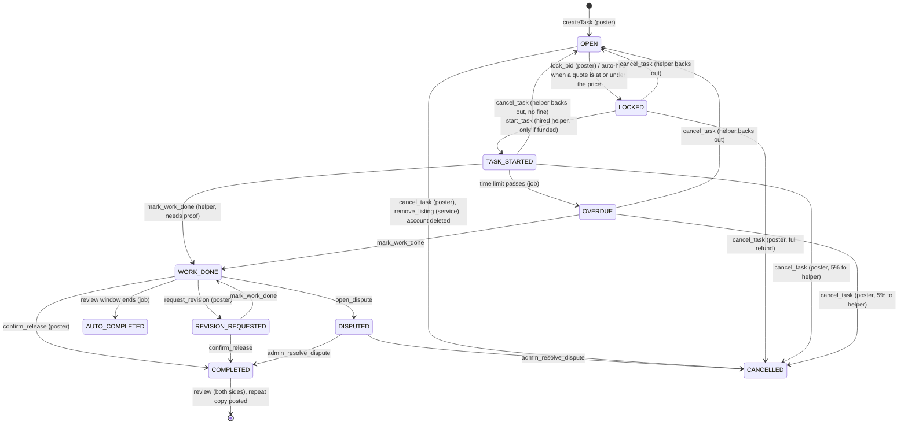

## Round 2, parts D and E (the task's life, and the new features)

Done on 4 Nov 2026 on STAGING only (`wjxvingpfbfvkfqhrguj`, code at `origin/redesigned-2.0` 491426f). Every attack ran inside a database transaction that was rolled back, as the seed people Asha (poster), Ravi (helper) and seed 3 ("Meera"). Nothing was left on staging. One read-only check used Ravi's real sign-in on staging (no rows created).

(Work in progress: this file is extended as the hunt goes.)

### The task's life (what the code allows today)



Offer (bid) states: open (`is_locked=false`) -> locked (`is_locked=true`, an `assignments` row "assigned") -> "started" -> "released"; or "refunded" when the task is cancelled, the helper backs out, or another helper started. There is no "expired" state for tasks or offers.

### Findings so far

| # | Finding | Level | Evidence | Failure scenario | Suggested fix |
|---|---|---|---|---|---|
| H51 | **A quote with a negative price creates money.** The database has no rule that a quote (or a task price) is above zero. The `api` checks it, but the database's data door is open to every signed-in person (H52), so a quote of minus ₹1,000 can be written straight into `bids`. When the poster accepts it, `lock_bid` -> `fund_task_from_wallet` "takes" minus ₹1,030 from the poster's wallet, i.e. **adds ₹1,030**. Cancelling afterwards gives nothing back (the refund skips amounts at or below zero), so the money stays | **Critical** | Rolled-back test as Asha and Ravi (SQL below): Asha's wallet went 4,900 -> 107,900 paise after accepting a -100,000 quote, and stayed 107,900 after cancelling. `bids` has no check on `price_minor` (only `UNIQUE(task_id,worker_id)`); `bids_insert_own`/`bids_update_own` allow price; `lock_bid` and `auto_accept_bid` use `v_bid.price_minor` as is. Direct data door proven open: Ravi's staging token read `/rest/v1/bids` and `/rest/v1/tasks` (200) | One person with two accounts posts a job, quotes minus ₹1 lakh from the second, accepts, cancels: ₹1.03 lakh appears in the wallet and can be withdrawn (manual review is the only stop today; with RazorpayX it goes out). On an Auto-hire task the bad quote is even accepted by itself | Add `check (price_minor > 0 and price_minor <= MONEY_MAX)` to `bids` and `benchmark_minor >= 0` to `tasks`; in `lock_bid`, `auto_accept_bid`, `fund_task_from_wallet` refuse `v_escrow <= 0`; and close the direct door (H52) |
| H52 | **The database's own data door is open, so every check that lives only in the `api` can be skipped**: amount limits, text checks, the suspended/deleted check, the per-person rate limits, the admin's maintenance and "posting/bidding off" switches, and the repeat keys. Signed-in people can insert into `bids`, `tasks`, `task_proofs` and call all 130+ functions directly | High | Column grants for `authenticated` on `bids` (insert/update price), `tasks` (30 columns), `task_proofs`; Ravi's token got 200 from `/rest/v1/bids`, `/rest/v1/tasks`, `/rest/v1/rpc/my_streaks` | A suspended person (token lives up to 1 hour) or a script keeps posting, quoting and accepting while the app is "switched off"; any limit the api enforces is not a limit | Either (a) turn off the Data API for the `public` schema / revoke table writes and function EXECUTE from `authenticated` so only the `api` (which could use a dedicated role) reaches them, or (b) copy every api check into the database (amount checks, standing check `private.assert_active()` at the top of every write function, switches). (a) is smaller and safer |

| H53 | **A job paid by card stays "paid" after the helper backs out, so the poster can hire a far dearer quote with the old money and the new helper is paid the new price.** When a helper backs out, `cancel_task` reopens the task but only wallet-paid tasks get their payment cleared (`refund_wallet_on_cancel`). A card-paid (`funded_via='payment'`) task stays `funded_at` set; `lock_bid` -> `fund_task_from_wallet` sees "already funded" and takes nothing; `confirm_release` pays `locked_minor x (1 - commission)` with no check against what was paid. Uses only normal app actions | **Critical** | Rolled-back test on staging task 501739c5 (card-paid ₹1,236 for a ₹1,200 quote, Ravi hired): Ravi backs out -> task OPEN, still funded ₹1,236; Meera quotes ₹12,000; Asha accepts (her wallet unchanged, 4,900 paise); Meera starts, sends proof, Asha approves -> **Meera's clearing earnings 0 -> ₹10,800** for ₹1,236 paid in. Approving twice was refused | Three friends (or one person with three accounts): pay ₹1,236 by card, first helper backs out, accept a ₹1 lakh quote from the third account, approve: ₹90,000 of earnings appear from nothing and are withdrawable after the clearing days | When a helper backs out, if `funded_minor` is less than the new escrow, the next `lock_bid` must charge the difference (or clear the funding and refund/hold it like the wallet path). Simplest: in `fund_task_from_wallet`/`lock_bid`, treat the task as funded only if `funded_minor >= new escrow`; in `confirm_release` refuse if `locked_minor x (1+fee) > funded_minor` |
| H54 | **A helper who backed out can come back and take the job from the new helper.** `start_task` checks only that an `assignments` row exists for the caller, not that it is the current one (status "assigned"). The old row stays (status "refunded") after backing out | High | Same rolled-back test: after Asha hired Meera, Ravi (who had backed out) called `start_task`: **allowed**; Meera's row became "refunded", Ravi's "started" | The first helper backs out, the poster picks someone else, the first helper presses Start and is now doing the job at the new (maybe higher) price; the chosen helper is silently dropped. Combined with H53 it is also a payout path | In `start_task` require `status = 'assigned'` and `bid_id = v_task.locked_bid_id`; same in `mark_work_done` / `confirm_release` (they already need "started") |

| B20 | **A poster can open a dispute on a task where no work was sent, even an OPEN task with no helper.** `open_dispute` only refuses closed or already-disputed tasks. On a started task this also dodges the 5% fine: once DISPUTED, `cancel_task` is refused and staff decide | Medium | Rolled-back: Asha disputed OPEN task ...015 (no helper) -> DISPUTED; disputed started task 2d85d642 before any proof -> allowed; cancel then refused | Posters fill the staff dispute queue with jobs nobody worked on; a poster who wants out of a started job disputes instead of cancelling, and if staff side with them the helper loses the 5% for their time | Allow `open_dispute` only in WORK_DONE / REVISION_REQUESTED (and maybe TASK_STARTED/OVERDUE by the helper); on a started job send the poster to Cancel |
| H55 | **Streaks, "jobs done" and five-star counts can be farmed with a second account.** Every completed job counts, including ones between two accounts of one person; the self-dealing check only raises a staff alert when the two accounts share a device or payout account | Low | `my_streaks`, `public_profile_stats` (public `jobsDone`), `private.flag_self_dealing`. Cost per fake job is only the 3% fee plus 10% commission on the smallest price | A helper buys a "50 jobs, 5 stars" profile for a few hundred rupees and wins more work | Count a job once per poster per week in public numbers; do not count jobs that raised a self-dealing alert; show "from N different customers" |
| B21 | **Nothing ever expires.** There is no "expired" state: OPEN tasks stay open after their due time, and a LOCKED task that is never paid stays locked | Low | Staging now: 21 OPEN tasks past their due time (9 more than a week), 2 LOCKED unpaid for over 2 days | The public feed fills with old jobs helpers cannot do in time; a helper waits forever on an unpaid lock | A daily job: close OPEN tasks some days past due (tell the poster); unlock a LOCKED unpaid task after 24 hours |

Note on H53: `admin_resolve_dispute` also pays `locked_minor`, so a staff "pay the helper" on such a task pays the inflated amount too. New accounts are held to ₹5,000 a job (`new_account_max_task_minor`), so per new account the gain is smaller but still money from nothing.

Tests for H53 and H54 are in the "Tests" section at the end.

### What was tried | Result

| What was tried (all rolled back) | Result |
|---|---|
| Poster puts a quote on their own task | Refused (row rule) |
| Helper accepts their own quote on someone else's task | Refused ("Only the poster can lock a quote") |
| Poster accepts two quotes | Refused ("no longer open"); the task row is locked while accepting, so two at the same moment also end with one |
| Two helpers auto-hired at the same moment | By reading: `auto_accept_bid` locks the task row and re-checks OPEN, so the second waits and then does nothing. Not raced live (rush tests are 2.13 J) |
| Someone not hired presses Start | Refused |
| Start before paid | Refused by `start_task` (needs funding) |
| **Helper who backed out presses Start after a new helper was chosen** | **Allowed: H54** |
| Finish with no proof | Refused (`mark_work_done` needs a proof row) |
| Poster marks the work done | Refused |
| Approve twice | Refused second time |
| Review before the job is approved | Refused. Reviewing again edits the same review (one per side, by design) |
| Poster cancels after start | 5% of the price to the helper, rest back (wallet path in the trigger, card path via `escrow_refund_due`, which subtracts the fine). Correct |
| Poster cancels while the work is submitted | Refused, sent to dispute |
| **Poster disputes an untouched or OPEN task** | **Allowed: B20** |
| **Helper backs out of a card-paid job, poster hires a dearer quote** | **No new payment taken, new helper paid the new price: H53** |
| Ask a question on a started task | Refused ("no longer taking offers"); finished tasks the same |
| **Act while suspended (database door)** | **Allowed** for quotes and questions: database functions do not check suspension; only the `api` does. A suspended person's token lasts up to an hour (H52). Deleted accounts: `deleted_at` is checked by questions and the Ideas board only |
| **Negative quote** | **Creates money: H51** |
| Zero quote, minus 5 minutes, ₹9 lakh crore quote, negative task price (database door) | **All stored** (H51 / H52). The `api` refuses them |
| Withdrawal of -₹1,000, 0, 1 paisa, the largest number | All refused |
| Promotion budget negative, 0, huge, minus 3 days | All refused |
| Fractions of a paisa | Impossible: every amount column is a whole number |
| Top-up on someone else's task, or on a closed task | No door: the top-up percent is set only when the poster creates the task (`tasks_insert_own`; `topup_pct` is not in the update grant) |
| Repeat key reused for a different action, or different details | Refused ("mismatch"); another person's same key is separate. The store is not callable by people. Keys only work through the `api` (H52) |
| Repeat jobs | Copy is posted once, only on the move into COMPLETED; crew jobs cannot repeat; `set_task_repeat` only on your own task |
| Poster options (preferred helper, flash, live answer, crew) | Cleaned by the `shape_poster_options` trigger: preferred helper must be someone you hired before, flash needs auto-hire, crew id cannot be someone else's |
| Ideas board: vote twice from one account | One vote (primary key post + person) |
| Ideas board: posting spam | 5 a day, same title refused for 7 days, contacts refused |
| Ideas board: script code in a title/body | Stored as typed, shown as plain text: no place in the app or admin puts text in as HTML (the only `dangerouslySetInnerHTML` is the admin's UPI QR picture). Safe today; keep it that way |
| Ideas board: reading hidden posts or comments | Refused: list, get and vote all skip hidden rows; tables readable by staff only |
| Ideas board: many new accounts voting | Possible: one vote per account and accounts are cheap while codes are auto-filled (`dev_otp_for_all`). Same as H47 (sign-up cost) |

### Level count (parts D and E)

Critical 2 (H51, H53), High 2 (H52, H54), Medium 1 (B20), Low 2 (H55, B21).

### Left on staging

Side note: seed 3 ("Meera") currently has a test string as her display name (`${7*7}{{7*7}}...`), left by an earlier fuzz run, not by this one. It shows as plain text; rename her when convenient.

Nothing. Every test was rolled back; the one live call only read (Ravi signed in once on staging, which writes a normal sign-in session and code row).

#### Test for H51 (fails today: the last line shows the wallet higher than before)

```sql
begin;
create temp table r(n serial, step text, val text) on commit drop;
grant all on r to authenticated; grant usage on sequence r_n_seq to authenticated;
select set_config('request.jwt.claims', json_build_object('sub','5eed0000-0000-4000-8000-000000000002','role','authenticated')::text, true);
set local role authenticated;   -- Ravi
with b as (insert into bids(task_id, worker_id, price_minor, time_limit_minutes, message)
           values ('d1d1e000-0000-4000-8000-000000000003','5eed0000-0000-4000-8000-000000000002',-100000,60,'HUNT2 test') returning id)
insert into r(step,val) select 'bid', id from b;
reset role;
select set_config('request.jwt.claims', json_build_object('sub','5eed0000-0000-4000-8000-000000000001','role','authenticated')::text, true);
set local role authenticated;   -- Asha
insert into r(step,val) select 'before', balance_minor from wallets where user_id='5eed0000-0000-4000-8000-000000000001';
select lock_bid((select val::uuid from r where step='bid'));
select cancel_task('d1d1e000-0000-4000-8000-000000000003','HUNT2');
insert into r(step,val) select 'after', balance_minor from wallets where user_id='5eed0000-0000-4000-8000-000000000001';
select step, val from r order by n;   -- today: before 4900, after 107900. Must be: the bid insert is refused.
rollback;
```

### Tests

#### H53 and H54 (fail today; run as one rolled-back block)

```sql
begin;
-- Ravi backs out of the card-paid, locked task
select set_config('request.jwt.claims', json_build_object('sub','5eed0000-0000-4000-8000-000000000002','role','authenticated')::text, true);
set local role authenticated;
select cancel_task('501739c5-07e0-4279-a73b-5aedc3a95fef','HUNT2');
reset role;
-- Meera quotes ten times the price, Asha accepts
select set_config('request.jwt.claims', json_build_object('sub','5eed0000-0000-4000-8000-000000000003','role','authenticated')::text, true);
set local role authenticated;
insert into bids(task_id,worker_id,price_minor,time_limit_minutes,message)
values('501739c5-07e0-4279-a73b-5aedc3a95fef','5eed0000-0000-4000-8000-000000000003',1200000,60,'HUNT2 test');
reset role;
select set_config('request.jwt.claims', json_build_object('sub','5eed0000-0000-4000-8000-000000000001','role','authenticated')::text, true);
set local role authenticated;
select lock_bid((select id from bids where task_id='501739c5-07e0-4279-a73b-5aedc3a95fef' and worker_id='5eed0000-0000-4000-8000-000000000003'));
-- H53: must be refused or must charge Asha 1,236,000 - 123,600. Today: LOCKED, nothing charged.
reset role;
-- H54: Ravi starts the job that is now Meera's. Must be refused. Today: allowed.
select set_config('request.jwt.claims', json_build_object('sub','5eed0000-0000-4000-8000-000000000002','role','authenticated')::text, true);
set local role authenticated;
select start_task('501739c5-07e0-4279-a73b-5aedc3a95fef');
reset role;
select worker_id, status from assignments where task_id='501739c5-07e0-4279-a73b-5aedc3a95fef';
rollback;
```
